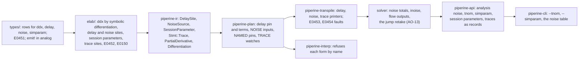

# Analog Operators Design

**Spec**: `.specs/features/analog-operators/spec.md`
**Status**: Approved with the spec (2026-11-18; AO-13 added 2026-11-19). Q1 to Q6 were answered with their recommended option (user: "Sobre as open questions, vou de aceito todas ok?"). The user is away; every point the spec left to design takes the default listed under "Decisions taken (user AFK)".

Designed against `main` at `4f505e09` (`msl-fixes`, `host-ii`, `solver-hygiene`, `root-e2e`, `unknown-semantics` and `analog-structure` merged). Two lanes are in flight and own most of the front end: `composite-values` (IR loops and aggregates, the checker and elaborator, the printer; batch B2 of 10 at planning) and `generics` (B1 done, B2 and later wait for `composite-values`). Line numbers are those of `4f505e09`; T1 re-reads every one, and the front-end batches re-read them again after those lanes merge.

---

## What the code does today

| Gap | Observed | Where it comes from |
| --- | -------- | ------------------- |
| L43, L44, L45, L47 | `ddx(..)`, `delay(..)`, `noise(..)`, `simparam(..)` are `P0001: core primitive `<name>` is not supported yet` | `types/catalogue.rs:237` `CORE_ROWS` has no row for them; `Checker::core_call` (`types/analog.rs:170`) refuses a primitive with no row |
| L45 | `white_noise(..)`, `flicker_noise(..)` are written in the stdlib over `noise` and refused through it | `std/analog.msl:12-13` |
| L45 | `noise_table` is a module with `const N` and an array param | `std/analog.msl:14`: needs `generics`, `composite-values`, `params-and-io` |
| L49 | `emit!` in `analog` is `P0001: an emit! in an analog block`; `E0603` already fires for `sim` and `checks` | `types/record.rs:119` `analog_trace`; `record.rs:111` |
| H2 | no host reaches the noise analysis | `piperine-api/src/request.rs:38` `Analysis::NAMES` has no `noise`; the solver's `NoiseSolver` exists (`piperine-solver/src/analyses/noise.rs:91`) |
| H2 | the solver ignores the input source, so it gives no `inoise` | `NoiseAnalysisOptions::input_source_name` (`noise.rs:51`) is read nowhere |
| H2 | the band total is a trapezoid over the grid, which ngspice does not use | `NoiseSolver::integrate_noise` (`noise.rs:373`); the comment of `tests/e2e/twins/noise_rc.cir` says the two totals agree only on a fine grid |
| H2 | two noise inputs of one instance with one name misalign the per-source series | `NoiseSolver::record` (`noise.rs:213`) pushes a second value at the same index |
| H2 | an output can only be a node pair | `NoiseAnalysisOptions` has `output_node` and `reference_node` only |
| L47 `tnom` | no `tnom` key; Appendix C gives 300.15 K | `request.rs` `Options` |
| L47 `simparam` | the solver binds a `GLOBAL NAMED` pin to a session parameter by name, and nothing gives it one | `core/bind.rs:563`, `CircuitBuilder::session_param` (`core/builder.rs:124`); `Netlist::circuit` (`piperine-plan/src/netlist.rs:60`) never calls it |
| L44 | the solver fails a `DELAY` term whose `td` exceeds its `max`; §14.6.4 reads `max` there | `piperine-analog-solver/src/device/delay.rs:76` |
| L49 | `TRACE` watches are recorded at every evaluation and drained by the operating point and the transient | `device/watch.rs:136`; `protocol/transient.rs:302`, `protocol/operating_point.rs:42` |
| L60 (AO-13) | a crossing that the step reading a jump makes fires after that step; its reaction's change waits for the next step | `protocol/transient.rs` step 5: accept, run the instant, deliver; nothing retakes |
| U7 | a node pin carries its nature's potential and flow `abstol`; the binder keeps the smallest per node | `piperine-plan/src/plan.rs:459`; `core/bind.rs:510` |

What already exists and is reused unchanged:

- **The ABI has every cell this feature needs** (`piperine-abi/src/raw.rs`, abi.md §4): the `DELAY` term op with its `TIME` part and `max` pin, the `NOISE` input with its `PSD` part, the `GLOBAL NAMED` pin, the `TRACE` watch. The analog solver stamps `DELAY` in every solve (`device/delay.rs`, `small_signal.rs:26`), injects `NOISE` columns through every term's response (`assembly.rs` `noise_sources`), and records `TRACE` watches with the Newton iteration (`watch.rs`).
- **Derivative sites** (`elab/derivatives.rs`, analog-structure mechanism 3): a core module's inputs lowered *standalone* (block-local `let`s inlined, `Scope::let_sources`), one site per call per frame (`Frame::derivatives`), a private continuous pin and two terms per site (abi.md A1). `delay` is the same shape.
- **Hoisting** (`elab/hoist.rs`): `white_noise` and `flicker_noise` are modules with a result; their value inputs are the caller's expressions.
- **`known_in_analog`** (`elab/known.rs:128`): the one `E0150` backstop for a value `analog` takes; the inputs of `delay` and `noise` pass through it (unknown-semantics F8).
- **`ac_stim` sites** (`Mode::Stim`, `print/site.rs`): the model for a site whose function writes an input's strength, read only by the sweep.
- **The `tf` request** (`request.rs:615`, `session.rs:291`): `input`, `output`, their flags and their `E0801` and `P0010` faults; `noise` takes the same keys (Q3).

---

## Architecture Overview

Every form lands on the Rust backend; the interpreter refuses each by name (R1). The solver and the host change little: the ABI already carries every cell. The front end and the IR carry most of the work.



Seven mechanisms carry the feature.

### 1. `ddx` is symbolic, at elaboration, in the IR

§14.2.3 says the derivative is symbolic. The elaborator lowers `e` standalone (as a derivative state is lowered: block-local `let`s inlined, so the tree is closed over params, probes, flows, sites, the environment and calls), then a new IR pass, `Differentiation`, builds `∂e/∂probe` as ordinary IR expressions. The backends see plain expressions: the plan, the printer and the solver change nothing for `ddx`, and the dual numbers of the `terms` function differentiate the result again for the Jacobian (AO-01 AC 9 needs no extra rule: the sweep linearizes the contribution at the operating point, so the value of `ddx` is taken there).

| Leaf or form | Derivative with respect to the probe `v(a, b)` (or the flow of branch `k`) |
| --- | --- |
| `Probe { a, b }` | 1 |
| `Probe { b, a }` | −1 |
| any other `Probe`; `Flow` of another branch | 0 (§14.2.3: another branch is held constant) |
| `Flow { branch: k }` against `i(..)` of branch `k` | 1 |
| `Limit { x, .. }` | `∂x` (§18 rule 3: transparent) |
| `Derivative(_)`, `Delay(_)`, `Noise(_)`, `Stim { .. }`, a hoisted result | 0 (the result of another instance is held constant) |
| `Real`, `Int`, `Param`, `Env`, `SessionParameter`, `Carrier`, a cast to an integer | 0 |
| `+`, `−`, `×`, `÷`, unary `−` | the sum, product and quotient rules |
| `If { c, t, e }` | `If { c, ∂t, ∂e }` (piecewise; `c` is not differentiated) |
| `Math` (`exp`, `ln`, `sqrt`, `abs`), `Method` (`powf`, `powi`, `sin` … `tanh`, `atan2`, `hypot`, `min`, `max`, `clamp`) | the chain rule; `min`, `max`, `clamp`, `abs` piecewise as `If` |
| `floor`, `ceil`, `round`, `trunc`, `signum` | 0 |
| `Block { lets, value }` | forward mode: each `let x = e` gains a `let ∂x = ∂e` |
| `Call { f, args }` | `Σ_i ∂f/∂arg_i(args) · ∂arg_i`, `∂f/∂arg_i` a derived function built once per `(f, i)` |
| anything else (a loop, an assignment, a call through a function value, a closure) | `NotDifferentiable` naming the form: `P0001` |

`ddx(ddx(e, p), p)` works with no rule of its own. `BodyData::partial_derivatives` records each `ddx` (name and origin) so the interpreter refuses it by name (AO-11) and a reader sees where it was.

**Approaches considered for `ddx`**

| Approach | Verdict |
| -------- | ------- |
| **Symbolic, in an IR pass at elaboration** | **Chosen.** §14.2.3 says symbolic; the backends see plain expressions; the IR shows the derivative; a second derivative composes |
| Nested dual numbers in the printed Rust (`Dual<1, Dual<N>>`) | Rejected. `Real` is implemented for `f64` and `Dual<N>` over `f64` only (`rt/real.rs:221`); nesting means a second numeric tower in the runtime, and the interpreter would need it too |
| Finite difference at run time | Rejected. Not symbolic, so `ddx(v(g) - v(s), v(g, s))` would not be exactly 0, and its step is a new tolerance |

### 2. `delay` is a site on a private pin

abi.md A1: an operator whose result is read non-linearly is hoisted onto a private pin `u` with the row `u − op(x) = 0`. A **delay site** `k` is a private continuous pin `delay<k>.value`, a `FLOW {u, GROUND}` term of value `u` and a `DELAY {u, GROUND}` term of value `−x` whose `TIME` is `td` and whose `max` pin is `delay<k>.max`. Every read of the result reads the pin (`Expr::Delay(k)`), so `0.5 * delay(v(src), 1u)` needs no rule (AO-02 AC 1). The solver already gives `DELAY` its §16.2 meaning in every column: `x` in an equilibrium solve (AC 3), `x(t − td)` from history in a step (the operating point's value before `td`, AC 2), `exp(−jω·td)` in a sweep (AC 7).

- **Standalone inputs.** `x`, `td` and `max` are lowered standalone, as a derivative state (§14 rule 9), and each passes `known_in_analog` (`E0150`).
- **`max`.** `delay<k>.max` is a `PRIVATE` discrete `F64` pin written by the function `delay:<k>.max` on the parameter cone (the pattern of `d<k>.abstol`). Without `max`, that function writes `td` itself, so the history is bounded by the delay (D4). A `max` that reads a probe, a flow, a site or the solve's environment is `P0001` naming it.
- **`E0452`.** Without `max`, `td` must read only params, constants and what is constant during an analysis (`temperature()`, `simparam`, `analysis(kind)`). The elaborator decides it on the lowered `td` of each frame, after value inputs are substituted, and names the placement (§14.6.2).
- **`td` above `max`, and `E0453`.** The `terms` function writes `TIME = min(td, max)` (§14.6.4, AC 4), so the solver's own refusal of `td > max` never fires (D5). A negative `td` makes `terms` return `Fault` 453; a `max` not positive makes `delay:<k>.max` return it. The run fails naming the instance (AC 6).
- **No time point** is added (§14.6.5); nothing in the plan asks for one.

### 3. `noise` is a `NOISE` input whose density only the sweep reads

A **noise source** `k` is a `NOISE` input `noise:<k>` of the shape. Every read of the result (`Expr::Noise(k)`) is a read of the input's `VALUE`, a differentiable read: the solver supplies 0 in every solve (AO-03 AC 1), and in a `Noise` sweep injects the partials against it with density `PSD` (abi.md A2). One instance read by two contributions is one input with two columns of partials: fully correlated (AC 2). Two instances are two inputs: their powers add (AC 3). Through a `DDT` term the response is `jω·c`, through a `DELAY` term `exp(−jω·td)` (AC 5); both are the solver's term responses.

- **The density.** The function `noise:<k>` writes `PSD` from the source's `density`, lowered standalone and through `known_in_analog`. The assembly evaluates it only for a noise sweep (`Need::NOISE`), so `k / freq().powf(e)` is never read at `freq() == 0` (AC 4). A negative or non-finite density makes the function return `Fault` 454 naming the source and the frequency it reads from `FREQ` (AC 6).
- **Reactions** cannot read an input (abi.md §4.1); the printer writes `0.0` for `Expr::Noise` in a reaction body or a guard (AC 7, §14.8.5). An event argument evaluated by an analog function reads the input's `VALUE`, which is 0 at every accepted solution.
- **The name.** `name` is kept on the source as `group: Option<String>`, a literal found after inlining through hoisted frames; anything else is `P0001` naming it. Two sources with one name stay two inputs (AC 8). The library result groups densities by name, or by instance path for an unnamed source (Q2).
- **The stdlib.** `white_noise` and `flicker_noise` (`std/analog.msl:12-13`) run with no change once `noise` lowers: they are hoisted modules with a result. `noise_table` stays refused by name until its three dependencies merge (AO-04 AC 3).

### 4. The noise run, from the solver to the command line

The solver's `NoiseSolver` already computes `Σ_k |H·b_k|²·PSD_k` per frequency by one adjoint solve. It gains four things:

- **The band total** by ngspice's rule: between two points the density is a power law, `N(f) = N₁·(f/f₁)^a` with `a = ln(N₂/N₁) / ln(f₂/f₁)`, so the interval adds `N₁·f₁/(a+1)·((f₂/f₁)^(a+1) − 1)`, and `N₁·f₁·ln(f₂/f₁)` when `a = −1`. It is `Integrator::power_law` (`piperine-analog-solver/src/math/integration.rs`), stored as `NoiseAnalysisResult::output_total`. The trapezoid `integrated_noise` stays, untouched, for its existing test (D8).
- **The input-referred density.** With an input instance, `H_in = Σ_s (z·g_s)·e^{jφ_s}`: the adjoint solution `z` against the columns of partials `g_s` of each `STIM` input of that instance, at unit magnitude and its own phase. `inoise² = onoise² / |H_in|²` per frequency; `input_total` integrates it by the same rule. The assembly gains `stimulus_columns(op, amb, instance)` beside `noise_sources`.
- **Flow and differential outputs.** The adjoint right side is `e_out − e_ref` for `v(a, b)`, the unit vector of the flow unknown for `i(<instance>)` of a potential branch, and the linearization of the term (its partials against the unknowns, and its direct partial against each noise input) for the one flow contribution of an instance with no potential branch (D10). The assembly gains `term_linearization(op, amb, instance, term)`.
- **The per-source series** keeps one value per frequency, summing the inputs that share a key (the `record` fix).

`piperine-api` adds `Analysis::Noise { output, input, from, to, grid }` (Q3), a `NoiseReport` that resolves the output and input and folds the solver's contributions into groups (Q2), and `Table::noise`: columns `freq`, `onoise`, and `inoise` with an input; the summary lines `onoise_total` and `inoise_total` after the rows (Q1). Densities print in V/√Hz or A/√Hz, the square root of the solver's power density; the totals in V or A.

### 5. Session parameters are `GLOBAL NAMED` pins

`simparam(name, default)` reads the session parameter `name` (§14.4, Q4). Each name a body reads is one `GLOBAL NAMED` pin named `name`, with a flagged `F64` layout (the value and its known byte), `OPTIONAL` when every read of it gives a default. An absent `OPTIONAL` pin reads as all zero bytes (abi.md §4), so the known byte is 0 and the read takes its default: `simparam("x", Some(d))` prints `pin.known_or(d)`. A read with no default prints `pin.known_or(0.0)` and is reached only when the host gave the parameter, because the host refuses before binding (`E0456`, AO-07 AC 3). A `NAMED` pin is a discrete read: a definition, a selector and `analog` all read it, and it is constant during an analysis (AC 4).

The host gives every run its session parameters: `reltol`, `abstol`, `vntol`, `trtol` (the run's, else the solver's defaults), `temp` and `tnom` in °C (`tnom` 27 when absent, Q6), then each entry of the run's `simparam` table (D13). They reach `CircuitBuilder::session_param` through `Netlist::with_session_parameters`, and a session builds through a `Netlist` whenever the design reads a session parameter.

### 6. Traces are `TRACE` watches written by `terms`

`emit!` in `analog` lowers to `Stmt::Trace { site, fields }`, where it stands in the analog block; `BodyData::traces` lists each site with its stream. The plan gives each site a `TRACE` watch with the stream's record layout (fields and the `maybe` byte), written by the `terms` function when the statement executes (AO-09 AC 4); the solver records every write with the Newton iteration, keeps it across a rejected step (AC 2) and reads none in a sweep (AC 3). A trace changes no row, so nothing else moves (AC 7).

The protocol already turns the solver's records into `Observation::Trace` in the operating point and the transient. `piperine-api` decodes them as `Record`s of the stream, adding the Newton iteration and the analysis, and delivers only those of a stream the run names in `streams` (Q5, AC 6). `E0603` stays as it is (AC 5). An `emit!` reached from `analog` through a `fn` is `P0001` naming the `fn` (D14).

### 7. A crossing made by a jump retakes the step that read it (AO-13)

§15.2 rule 4 today: a crossing that a jump makes fires at the time point of the step that reads the jump, after that step's solve, so the step that read the jump never reads what the crossing's reaction changed. With an ideal step into `slew`, the output follows the step in that one step.

The rule becomes (§15.2 rule 4, rewritten by T7): **when the reactions of such a crossing change a carrier or a param that `analog` reads, the step is retaken to the same time with the change, and the retaken solution replaces the first.** The reactions that ran are not run again; a crossing that the retaken solution makes and the first did not fires at the next microstep of the same instant, and may retake again. More retakes than the operating point's round bound fail as `E0504` naming the instant. A step that reads no jump never retakes.

The owner's transient loop (`protocol/transient.rs`) gets one owner type, `JumpRetake`: whether the step being taken reads a delivery (the previous instant delivered a boundary), and after the instant whether its boundary came from crossings of this step. A retake restores the analog side to the step's checkpoint, keeps the discrete side and the sink as the instant left them, delivers the new boundary with the integrator restart, and attempts the same time again, exempt from the truncation test.

**Approaches considered for AO-13**

| Approach | Verdict |
| -------- | ------- |
| **Retake the step that read the jump with the crossing's change** | **Chosen.** One solution per time point; the change and the jump are read by one step; the same retake a host `set` that moves the operating point already makes (§15.2, host `set`) |
| Locate the crossing inside the step that reads the jump | Rejected. §17.3 rule 8 forbids it: a jump has no interior to locate in |
| Make `slew` itself detect the jump (a `changed()` on its input) | Rejected. `x` is continuous; a stdlib fix would not cover the next model with the same pattern |

---

## Code Reuse Analysis

### Existing Components to Leverage

| Component | Location | How to Use |
| --------- | -------- | ---------- |
| Derivative sites, `Frame::derivatives`, `Scope::let_sources` | `crates/piperine-lang/src/elab/derivatives.rs`, `lower.rs` | Pattern for delay and noise sites: standalone inputs, one site per call per frame; the standalone lowering of `ddx`'s `e` |
| `Elaboration::known_in_analog` | `crates/piperine-lang/src/elab/known.rs:128` | `E0150` for `x`, `td`, `max` and `density` |
| `Checker::core_call`, `CORE_ROWS`, `Allowed` | `crates/piperine-lang/src/types/analog.rs:170`, `catalogue.rs:237` | One row per primitive; `Allowed::Instances` gives `delay` and `noise` the `E0350`/`E0352` placement rules of `ddt`; `Allowed::Analog` gives `ddx` the `E0450` of `ac_stim` |
| `Mode::DerivativeAbstol`, `Pins::derivative_abstols` | `crates/piperine-plan/src/plan.rs` | Pattern for `delay<k>.max` |
| `Mode::Stim`, `Target::StimRe` | `plan.rs`, `crates/piperine-transpile/src/print/site.rs` | Pattern for `noise:<k>` and its `PSD` |
| `RecordLayout`, `Digital::records` | `crates/piperine-plan/src/digital.rs:252` | The layout of a `TRACE` watch is the stream's record layout |
| `NoiseSolver`, `Assembly::noise_sources` | `crates/piperine-solver/src/analyses/noise.rs`, `piperine-analog-solver/src/device/assembly.rs` | The sweep and the adjoint; extended, not replaced |
| `CircuitBuilder::session_param`, `NAMED` binding | `crates/piperine-solver/src/core/builder.rs:124`, `bind.rs:563` | Session parameters, with no solver change |
| `Analysis::Tf`, `small_signal_of`, `Probe::resolve` | `crates/piperine-api/src/request.rs`, `session.rs:291`, `probe.rs` | The `input`/`output` keys, their flags and faults; the output grammar of a noise run |
| `Interpreter::amended_forms` / `structure_forms` | `crates/piperine-interp/src/lib.rs:124` | Pattern for `OperatorForms` |
| `Ngspice::run`, `Golden`, `ToleranceContract`, `Corpus` | `crates/piperine-parity/src/` | The noise, delay and `tnom` twins |

### Integration Points

| System | Integration Method |
| ------ | ------------------ |
| `piperine-solver` | `NoiseSolver` gains the band total, `inoise` and flow outputs; `protocol/transient.rs` gains the jump retake. No ABI change |
| `piperine-analog-solver` | `Integrator::power_law`; `Assembly::stimulus_columns` and `term_linearization`. `delay.rs` is unchanged (the device clamps `td`) |
| `piperine-plan` | new pins, terms, inputs and watches, each appended after every existing one; `Netlist::with_session_parameters` |
| `piperine-api`, `piperine-cli` | `noise` analysis, `tnom`, `simparam`, traces as records |
| `docs/spec` | Part V §15.2 rule 4 (T7); nothing else of the spec moves |
| `.specs/features/device-abi/abi.md` | no change: every cell exists |

---

## Components

### C1. IR forms (`piperine-ir`)

- **Purpose**: hold every form of this feature as data, checked, printed and serialized.
- **Location**: `crates/piperine-ir/src/model.rs`, `check.rs`, `deps.rs`, `print.rs`, `build.rs`, `handle.rs`, new `differentiate.rs`.
- **Interfaces**:
  - `DelaySite { name, input: ExprId, time: ExprId, maximum: Option<ExprId>, origin }`, `BodyData::delays`, `Expr::Delay(u32)`.
  - `NoiseSource { name, group: Option<String>, density: ExprId, origin }`, `BodyData::noise_sources`, `Expr::Noise(u32)`.
  - `SessionParameter { name, origin }`, `BodyData::session_parameters`, `Expr::SessionParameter { parameter: u32, default: Option<ExprId> }`.
  - `TraceSite { stream: u32, origin }`, `BodyData::traces`, `Stmt::Trace { site: u32, fields: Vec<EmitField> }` (in the analog block only).
  - `PartialDerivative { name, origin }`, `BodyData::partial_derivatives`.
  - `deps::Target::{DelayInput(k), DelayTime(k), DelayMaximum(k), NoiseDensity(k), Trace(k)}`; `Deps::{delays, noise_sources, session_parameters}`.
  - `Differentiation::new(builder, body, Variable) -> Differentiation`; `Differentiation::of(&mut self, expr) -> Result<ExprId, NotDifferentiable>`; `Variable::{Potential { plus, minus }, Flow { branch }, Argument(u32)}`; derived functions memoized by `IrBuilder::derived_function(function, argument)`.
- **Dependencies**: none (leaf crate).
- **Reuses**: the `Walk` of `Ir::check`; the arenas of `IrBuilder`.

### C2. Plan (`piperine-plan`)

- **Purpose**: give each new form its pins, terms, inputs, watches and functions.
- **Location**: `crates/piperine-plan/src/plan.rs`, `digital.rs`, `netlist.rs`.
- **Interfaces**:
  - `Term::DelayOutput(k)` (`FLOW {u, GROUND}`), `Term::DelayHistory(k)` (`DELAY {u, GROUND}`, value `−x`, `max` pin); `Target::DelayTime(k)`; `Mode::DelayMaximum(k)`, `Target::DelayMaximum(k)`.
  - `Source::Delay(k)` (continuous, differentiable), `Source::NoiseValue(k)` (differentiable, after `StimValue`), `Source::SessionParameter(k)` (discrete).
  - `Mode::Noise(k)`, `Target::NoiseDensity(k)`; `Target::Trace(k)` (a write of `terms`).
  - `Pins::{delays, delay_maxima, session_parameters}`; NOISE inputs after the `STIM` inputs; `TRACE` watches after the `CAP` watches. A body with none of these plans exactly as today.
  - `Netlist::with_session_parameters(self, &[(String, f64)]) -> Netlist`.
- **Dependencies**: C1.
- **Reuses**: `ReadSet::target`, `RecordLayout`, `Mode::DerivativeAbstol`.

### C3. Printer (`piperine-transpile`)

- **Purpose**: print the new forms as Rust.
- **Location**: new `print/delay.rs` (`DelayPrinter`), `print/noise.rs` (`NoisePrinter`), `print/trace.rs` (`TracePrinter`); arms in `print/value.rs`, `print/analog.rs`, `print/reaction.rs`, `print/shape.rs`.
- **Interfaces**: `DelayPrinter` prints the two terms, the `TIME` write `min(td, max)` and the `E0453` faults, and `delay:<k>.max`; `NoisePrinter` prints `noise:<k>` with the `E0454` fault and the `VALUE` read (0.0 in a reaction); `TracePrinter` prints a trace site's watch write in `terms_block`; `ValuePrinter` prints `SessionParameter` as `known_or`.
- **Dependencies**: C2.
- **Reuses**: `print/derivative.rs`, `print/site.rs`, the record printing of `print/reaction.rs`.

### C4. Front end (`piperine-lang`)

- **Purpose**: type, lower and check every form.
- **Location**: `types/catalogue.rs` (rows, `CoreParam::Probe`, `CoreParam::Text`, `CoreParam::OptionText`), `types/analog.rs` (`E0451`), `types/record.rs` (the trace is no longer refused); `elab/analog.rs` (dispatch), new `elab/partial.rs` (`ddx`), new `elab/delays.rs`, new `elab/noise.rs`, new `elab/session.rs`, new `elab/traces.rs`, `elab/hoist.rs` (`Frame::delays`, `Frame::noise_sources`).
- **Dependencies**: C1.
- **Reuses**: everything listed under Code Reuse.

### C5. Interpreter (`piperine-interp`)

- **Purpose**: refuse every new form by name (R1, AO-11).
- **Location**: new `crates/piperine-interp/src/operators.rs` (`OperatorForms`), one chained call in `Interpreter::new`.
- **Rows**: "ddx", "delay", "noise", "simparam", "emit! in analog".

### C6. Solver

- `piperine-analog-solver`: `Integrator::power_law`; `Assembly::stimulus_columns`, `Assembly::term_linearization`.
- `piperine-solver`: `NoiseAnalysisOptions::{input_source_name (read now), output_flow: Option<FlowOutput>}`, `NoiseAnalysisResult::{output_total, input_noise_sq, input_total}`; the `record` fix; `protocol/transient.rs` `JumpRetake`.

### C7. Host (`piperine-api`, `piperine-cli`)

- `request.rs`: `Analysis::Noise`, `Options::{tnom, session_parameters}`, `Overrides::{tnom, simparam}`.
- New `noise.rs`: `NoiseProbe` (the output and input, resolved), `NoiseReport` (rows, totals, groups).
- `session.rs`: the noise dispatch, `E0456`, session parameters to the netlist; `table.rs`: `Table::noise`, `Table::summary`; `record.rs`/`recorder.rs`: traces as records with `iteration` and `analysis`.
- `piperine-cli`: `--tnom`, `--simparam <name>=<value>` (repeatable), the summary lines after a table.

---

## Data Models

```rust
// piperine-ir/src/model.rs (additions; new BodyData fields are #[serde(default, skip_serializing_if = "Vec::is_empty")])
/// A `delay(x, td, max)` (§14.6): its output is the private pin `delay<k>.value`.
pub struct DelaySite { pub name: String, pub input: ExprId, pub time: ExprId, pub maximum: Option<ExprId>, pub origin: Origin }
/// A `noise(psd, name)` (§14.8): the `NOISE` input `noise:<k>`.
pub struct NoiseSource { pub name: String, pub group: Option<String>, pub density: ExprId, pub origin: Origin }
/// A session parameter a body reads (`simparam`, §14.4): the `GLOBAL NAMED` pin `name`.
pub struct SessionParameter { pub name: String, pub origin: Origin }
/// An `emit!` in `analog` (§19 rule 4): one `TRACE` watch.
pub struct TraceSite { pub stream: u32, pub origin: Origin }
/// A `ddx` the elaborator differentiated (§14.2), kept so a reader and the interpreter see it.
pub struct PartialDerivative { pub name: String, pub origin: Origin }

pub enum Expr { /* … appended last: */ Delay(u32), Noise(u32), SessionParameter { parameter: u32, default: Option<ExprId> } }
pub enum Stmt { /* … appended last: */ Trace { site: u32, fields: Vec<EmitField> } }

// piperine-ir/src/differentiate.rs
pub enum Variable { Potential { plus: Terminal, minus: Terminal }, Flow { branch: u32 }, Argument(u32) }
pub struct NotDifferentiable { pub form: &'static str, pub origin: Origin }
```

```rust
// piperine-solver/src/analyses/noise.rs (additions)
pub enum FlowOutput { Branch(BranchIdentifier), Term { instance: String, term: String } }
pub struct NoiseAnalysisResult { /* … */ pub output_total: f64, pub input_noise_sq: Option<Vec<f64>>, pub input_total: Option<f64> }

// piperine-api/src/noise.rs
pub struct NoiseReport { pub frequencies: Vec<f64>, pub output: Vec<f64>, pub input: Option<Vec<f64>>, pub output_total: f64, pub input_total: Option<f64>, pub groups: Vec<(String, Vec<f64>)>, pub unit: &'static str }
```

---

## Error Handling Strategy

| Error Scenario | Handling | User Impact |
| -------------- | -------- | ----------- |
| `ddx`'s second argument is not a potential or flow probe of a branch of the module (`p.inflow()` included) | `E0451` from the checker | names the argument |
| `ddx` outside `analog`, or in a body `let` or value input a definition or a reaction reads | `E0450` (the `Allowed::Analog` rule of `ac_stim`) | names `ddx` and the position |
| `ddx` through a form the differentiator does not handle | `P0001` naming the form | names it |
| `delay` without `max` whose `td` is not constant during an analysis | `E0452` at elaboration | names the placement |
| `td < 0`, or `max ≤ 0`, in a run | `Fault` 453 from the device; the run fails | `E0453` naming the instance |
| A `max` that reads a probe, a flow, a site or the solve's environment | `P0001` | names `max` |
| A noise density negative or not finite in a noise sweep | `Fault` 454 from the device | `E0454` naming the instance, the source and the frequency |
| A noise `name` that is no literal after inlining | `P0001` | names the argument |
| An unknown value reaching `delay` or `noise` | `E0150` (`known_in_analog`) | names the carrier |
| A noise run with no `output` or no sweep; a key of another analysis | `P0010` | names the key |
| `output` names no node or probe; `input` names no instance with an `ac_stim` | `E0801` before the analysis | names the path |
| `simparam(name)` with no default and no such session parameter | `E0456` before binding | names `name` |
| `--simparam` with a value that is no number; a `simparam` entry naming an option key | `P0010` | names the entry |
| `tnom` not a number above −273.15 | `P0010` | names `tnom` |
| A site reached from `analog` that writes `sim` or `checks` | `E0603`, as today | names the site |
| An `emit!` reached from `analog` through a `fn` | `P0001` | names the `fn` |
| A jump whose crossings keep changing what `analog` reads past the round bound | `E0504` naming the instant | as a jump that does not converge |
| A new form on the interpreter | refused by name | `--backend interp` names the form |

---

## Risks & Concerns

| Concern | Location (file:line) | Impact | Mitigation |
| ------- | -------------------- | ------ | ---------- |
| `composite-values` and `generics` edit the same files (`model.rs`, `check.rs`, `deps.rs`, `types/*`, `elab/*`, `print/value.rs`) | the whole front end | merge conflicts, a lowering written against a moving tree | Batches B3 to B6 start only after `composite-values` B10 and `generics` B8 are on `main` (ROADMAP item 9 precedes item 10); B1 and B2 touch none of those files |
| The twins' generated text and shapes could move | `plan.rs` pin, term, input and watch order; `print/analog.rs` | a byte change of a twin or a golden (AO-12) | New pins, terms, inputs and watches are appended after every existing one; a body with none of the new forms plans and prints as today; every plan and printer task runs `Run tgolden` and `Run twins` |
| The jump retake could move a run that reads a crossing after a delivered jump | `protocol/transient.rs` | the buck targets or a twin change | T1 lists every target whose run takes a retake (a probe that counts them); T8 runs every `buck_*` target and `Run twins`; a target that moves stops the task and is reported |
| Changing `NoiseAnalysisOptions` breaks the struct literal in `abi_noise.rs` | `crates/piperine-solver/tests/abi_noise.rs:28` | a compile error | The new field is added to each literal as `None` (a mechanical edit, no assertion changes); the trapezoid `integrated_noise` and its test stay |
| A `NAMED` pin named like a param pin of the same body | `core/bind.rs` binds `PARAM` by name | a session parameter `tnom` and a param `tnom` collide | T1 checks how the binder matches names; if a collision misbinds, T26 refuses it loud (`P0001` naming both) |
| The flagged `F64` layout of a `NAMED` pin must encode a host `ParamValue::Real` with its known byte | `core/bind.rs` `encode` | an always-unknown parameter | T1 confirms `encode` on a layout with `HAS_KNOWN`; a gap is a one-line encoder touch in T26 |
| `ddx` through a call needs a derived function per `(f, i)` | `differentiate.rs` | larger generated code | Memoized by `IrBuilder::derived_function`; only reached functions are derived |
| `Fault` from an analog function in a noise sweep, or from a parameter-cone function, may not reach the run error with its code | the owner's fault path | `E0453`/`E0454` unnamed | T1 confirms both paths (analog-structure confirmed it for `E0418` in a solve) |
| The history of a `DELAY` term before `td` must hold the operating point's value | `device/delay.rs` `Delayed::at` | AO-02 AC 2 reads 0 instead | T1 confirms the operating point is pushed at acceptance; a gap is one call in the assembly's `accept`, owned by T33 |
| The noise twins need ngspice's diode noise formulas | `tests/e2e/twins/noise_diode.cir` | a disagreement that is a model difference, not a solver one | The twin's `.msl` writes shot `2q|I|` and flicker `kf·|I|^af/f` explicitly; T42 derives the expected density at one point by hand beside the comparison |
| Delay interpolation in time vs ngspice's line model | `delay.rs` linear interpolation | `delay_tline` outside `TRAN_VOLTAGE` | A sine source (no corner), `--max-step` bounded; a failure stops T39 and is reported, the contract is not touched |
| `piperine-cli/tests/docs.rs:268` asks `L47` to keep `simparam` | `docs.rs:268` | red after the documents task | T44 rewrites that assertion (L47 closed) and says so in its commit |

---

## Decisions taken (user AFK)

The user is away ("Tu sempre assume o default mais razoável e depois me conta"). Each point below follows the spec and `docs/spec` where they speak, and takes the most reasonable default where they do not.

| # | Decision | Default taken | Why |
| - | -------- | ------------- | --- |
| D1 | How `ddx` is computed | symbolic differentiation in an IR pass at elaboration (`Differentiation`); backends unchanged | §14.2.3 says symbolic; see the approaches table |
| D2 | `ddx` through calls, blocks and newer forms | a derived function per `(function, argument)`; forward mode through block `let`s; a loop, an assignment, a closure or a call through a value is `P0001` naming it | covers every form M1 and `analog-structure` produce; fails loud on the rest |
| D3 | Whole-addend `delay` | none: every `delay` is a site (private pin, `FLOW` and `DELAY` terms) | one mechanism; abi.md A1; the cost is one unknown per site |
| D4 | `delay` without `max` | its `max` pin holds `td`, so the history is bounded | `td` is constant during the analysis (E0452), so this is exact and stops unbounded history |
| D5 | `td` above `max`, negative `td`, `max ≤ 0` | the device writes `TIME = min(td, max)`; faults 453 from the device | §14.6.4 reads `max`; abi.md says `td ≤ max`; no solver change |
| D6 | A `max` that is not on the parameter cone | `P0001` naming it | `max` is a discrete pin; the spec gives it no error code |
| D7 | Noise groups (Q2) | the source's name, else its instance path; the library carries each group's density | Q2 (a) |
| D8 | Band totals | ngspice's power-law integral between points, a new solver field; the trapezoid field and its test stay | parity on any grid, no tolerance for a quadrature difference, no existing test edited |
| D9 | Noise tolerance | one new constant `NOISE` (densities and totals), with its rationale; no existing constant moves | the spec's assumption: one constant, a second only if the first does not cover the total; with D8 it does |
| D10 | The spelling of a differential or flow output | one string in the probe grammar: `out`, `v(out, ref)`, `i(<instance>)`; no new flag | Q3 keeps `output` one key; the print probes already parse `i(..)` |
| D11 | `inoise` with several stimuli in the input instance | the transfer from all of them at unit magnitude and their own phase; an instance with none is `E0801` | ngspice's input-referred noise is per unit input |
| D12 | How a session parameter reaches a device | a `GLOBAL NAMED` pin with a flagged `F64` layout, `OPTIONAL` when every read has a default | the ABI's own cell; an absent optional pin reads unknown, so the default applies |
| D13 | The session's parameter set and conflicts | `reltol`, `abstol`, `vntol`, `trtol`, `temp`, `tnom`, then the `simparam` table; a `simparam` entry naming one of those six is `P0010` ("set it with its own key") | one source of truth per name |
| D14 | `emit!` reached from `analog` through a `fn` | `P0001` naming the `fn`, recorded in `GAPS.md` | a trace inside a function needs a watch buffer passed through calls; no criterion asks for it |
| D15 | Trace records | `Record` gains `iteration: Option<u32>` and `analysis`; delivered only for a stream named in `streams` | Q5 (a); §19 rule 1 |
| D16 | The AO-13 rule | retake the step that read the jump when its crossings change what `analog` reads; reactions are not run again; bounded by the round bound, else `E0504` | the spec's own wording of the fix (AO-13); mirrors the host `set` retake |
| D17 | `noise_table` | stays refused by name; `GAPS.md` keeps L45 for it alone | AO-04 AC 3 is a `WHERE` criterion |
| D18 | U7 | tests only, unless T1 finds a branch flow pin without its nature's flow `abstol`; then T10 fixes the plan. T1 found it, so T10 gave the private flow pin of a potential branch `abstol: [potential, flow]` of its ends' natures, and the one line of `crates/piperine-transpile/tests/golden/vsource.rs` that prints it moved (decided 2026-11-22 after verification Finding 2: kept). The effective flow tolerance of a potential branch is the minimum of the session `abstol` and the nature's flow `abstol` (decided 2026-11-22 after verification Finding 12): a nature can only tighten, and `--abstol` still tightens every MSL source. For `Electrical` the flow `abstol` is 1e-12, the session's default, so with default options no twin byte, no parity constant and no value moves (`twins` and `parity_*` pass); a run changes only where a user nature declares a tighter flow `abstol` (AO-10 AC 2) or the session `abstol` is tighter than the nature's. Nodes keep `vntol_for` (the nature's value overrides, the min rule is not applied there; see the Handoff) The pin's tolerance is part of the printed shape, so the golden cannot stay without dropping the fix | the behaviour exists (GAPS says "not exercised") |
| D19 | The noise and `tnom` twins | their models are written in their own `.msl` (`devices.msl` stays as it is); `noise_rc.cir` and `noise_switch.cir` are not edited; the new `noise_diode.cir` also writes `inoise`; every new twin is compiled-only | the twin corpus is frozen where it exists; the interpreter refuses the forms |
| D20 | Scheduling | B1 (solver) and B2 (host) run now; B3 to B7 after `composite-values` and `generics` phases A and B are on `main` | ROADMAP item 9 precedes item 10; the files of B1 and B2 are disjoint from both lanes |

> **Project-level decision, appended to `.specs/STATE.md` by T44 with the next free `MD-` number at merge** (`composite-values` takes MD-73): `ddx` is differentiated symbolically in the IR at elaboration; `delay` is always a site on a private pin; a noise source is a `NOISE` input whose density only a noise sweep reads, grouped by its name; a session parameter is a `GLOBAL NAMED` pin the host fills from its options and the run's `simparam` table; `emit!` in `analog` is a `TRACE` watch delivered as a record of a subscribed stream; the step that reads a jump is retaken when the jump's crossings change what `analog` reads.

---

## Tech Decisions (only non-obvious ones)

| Decision | Choice | Rationale |
| -------- | ------ | --------- |
| Where `ddx` lives | an IR pass the elaborator calls | the derivative is visible in the IR text; no backend learns a new form |
| Delay's `TIME` | written by `terms`, clamped to `max` | the value input is evaluated where it is read (§8.3.1); the clamp is §14.6.4 |
| Noise density function | one function per source (`noise:<k>`) | the assembly evaluates only the densities a sweep needs; a fault names the source |
| Session parameter layout | flagged `F64` | the absent-optional rule of abi.md gives "unknown", which `known_or` turns into the default |
| Trace writer | the `terms` function | it runs at every Newton evaluation, which is §19 rule 3's "every evaluation" |
| Band total | power law per interval, summed per source, then the root | ngspice's quadrature (`N_INTEG` per source), so `onoise_total` compares under the density's bound; same-name inputs merge before integration |
| Jump retake | in the owner's protocol | the owner alone sees both the instant's boundary and the step that read the jump |

---

## What changes, by crate

| Crate | Change |
| ----- | ------ |
| `piperine-ir` | `model.rs`, `check.rs`, `deps.rs`, `print.rs`, `build.rs`, `handle.rs`, new `differentiate.rs`; new target `tests/operators.rs` |
| `piperine-plan` | `plan.rs`, `digital.rs`, `netlist.rs`; new target `tests/operators_shape.rs` |
| `piperine-transpile` | new `print/delay.rs`, `print/noise.rs`, `print/trace.rs`; `print/value.rs`, `print/analog.rs`, `print/reaction.rs`, `print/shape.rs`; new target `tests/operators.rs` |
| `piperine-interp` | new `operators.rs`; `tests/frozen.rs` gains tests |
| `piperine-lang` | `types/catalogue.rs`, `types/analog.rs`, `types/record.rs`; `elab/analog.rs`, `elab/hoist.rs`, new `elab/partial.rs`, `elab/delays.rs`, `elab/noise.rs`, `elab/session.rs`, `elab/traces.rs`; new targets `tests/types_operators.rs`, `tests/elab_operators.rs`; the `ddx`, `delay`, `noise`, `simparam` and trace rows of `types_subset.rs` rewritten |
| `piperine-analog-solver` | `math/integration.rs`, `device/assembly.rs`; new target `tests/noise_numerics.rs` |
| `piperine-solver` | `analyses/noise.rs`, `protocol/transient.rs`; new targets `tests/noise_report.rs`, `tests/jump_retake.rs`; one literal of `tests/abi_noise.rs` |
| `piperine-api` | `request.rs`, `session.rs`, `table.rs`, `record.rs`, `recorder.rs`, new `noise.rs`; new targets `tests/noise.rs`, `tests/session_parameters.rs`, `tests/natures.rs`, `tests/traces.rs` |
| `piperine-cli` | `cli.rs`, `render/table.rs`; `tests/analyses.rs`, `tests/options.rs` gain tests; `tests/twins.rs` lists the new compiled-only twins; `tests/docs.rs` |
| `piperine-parity` | `contract.rs` gains `NOISE`; `ngspice.rs`/`golden.rs` read the noise `wrdata` pair; new twins `tests/e2e/twins/{delay_tline,noise_rc,noise_switch,noise_diode,tnom_res}` (`.msl`, `.command`, `.stdout`, and the new `.cir`s); new target `tests/parity_noise.rs`; `parity_tran.rs`, `parity_ac.rs`, `parity_op.rs` gain functions; new targets `tests/source_partial.rs`, `source_delay.rs`, `source_noise.rs`, `source_session.rs`, `source_traces.rs`, `source_slew.rs` with fixtures under `tests/operators/` |
| Documents | `docs/spec/part_v_execution.md` §15.2 rule 4; `GAPS.md`, `ROADMAP.md`, `.specs/STATE.md`, `docs/book/content.html`, `tests/book/` |

## Size

44 tasks in eight phases, seven batches; see `tasks.md`.
