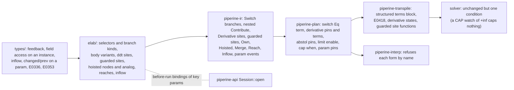

# Analog Structure Design

**Spec**: `.specs/features/analog-structure/spec.md`
**Status**: Approved with the spec (2026-11-18). Q1 to Q3 were answered (a), the recommended option (user: "Sobre as open questions, vou de aceito todas ok?").

Designed against `main` at `99d05af2` (msl-fixes merged) plus the two lanes that land first: `feature/host-ii` at `520e546e` and `feature/solver-hygiene` at `6c3df7cd`. Line numbers are those of `main` at `99d05af2`; T1 re-reads every one after the rebase.

---

## What the code does today

| Gap | Observed | Where it comes from |
| --- | -------- | ------------------- |
| L40 | `if c { i(a, gnd) +> x; }` is `P0001: a contribution under an if or in a closure` | `elab/contribute.rs:31` refuses at `scope.nesting > 0` and `block_depth > 0`; `Ir::check` (`check.rs:1123`) allows a `Contribute` only at the top of the analog block; `BranchKind` (`model.rs:136`) is `Flow` or `Potential`, fixed per body |
| L40 | `bound_step` under an `if` is `P0001` | `elab/analog.rs:223` (msl-fixes Q4) |
| L42 | `2.0 * ddt(q)`, `let d = ddt(q);`, `ddt(q, 1e-3)` are `P0001` | `elab/contribute.rs` splits the top-level `+`/`-` chain only; `elab/analog.rs:191` refuses any other `ddt`; `ddt_value` refuses a second argument |
| L50 | `limit`/`ac_stim` under an `if` is `P0001` | `elab/analog.rs:157` (`scope.nesting == 0`); `Ir::check` `site()` (`check.rs:1596`) refuses a site under a condition |
| L34 | `module G(o: Electrical, x: f64)` is `P0001: a value input` | `elab/unlowered.rs:64` `refuse_digital_forms`, called from `elaborator.rs:97` |
| L35 | a result module with a `signal` node or an `analog` block is `P0001` | `elab/hoist.rs:206` `hoistable` |
| L38 | `let y = idt(f(y));` is `P0001: the feedback of .. through an instance` | `types/result.rs:236` `self_read` |
| L36 | `v(c.mid)`, `c.state`, `c.r` are `P0001: field access` | `types/unsupported.rs:22` (the checker types no `Field`) |
| L37 | `Capacitor(b, gnd) { c }` with `let c = ..` is `E0321` | `elab/consts.rs:192`: `ConstEval` gives a body `let` no value |
| L26 | `p.inflow()`, `r.changed()`, `r.prev()` on a param are `P0001` | `types/call.rs:14` lists `inflow`, `changed`, `prev` as carrier methods; a param is no carrier |
| L27 | `signal s: Bit<f64> = k0;` is `P0001` | node and carrier initial values fold with no bindings (`elab/body.rs` `lower_node`, `elab/carriers.rs`) |
| S4 | the authored `Child` pads each own signal with `Terminal::Ground` | `elab/children.rs:112-119`; `Terminal` (`model.rs:123`) has no third form |

What already exists and is reused unchanged:

- **Hoisting** (`elab/hoist.rs`, MD-64): a placement of a module with a result is a `Frame`; its params fold to constants, its value inputs are the caller's expressions read in the caller's frame, its carriers, drives and reactions join the placing body under the placement's name. A placement is hoisted once (`Frame::placements`, keyed by the call), so two reads of one `let` are one instance.
- **The AC sweep re-evaluates analog functions under the sweep's own ambient** (`ac.rs:124` sets `is_static: false`; `Assembly::assemble_ac` re-runs a function whose read bytes changed). A switch branch therefore takes its sweep kind with no new solver code (§11.1.5).
- **Boundary delivery** (MD-62 item 2): a discrete change `analog` reads lands on the instant, solves on the left value, then restarts the integrator. This is §11 rule 18 for a switch branch's kind, with no new solver code.
- **`DDT` history across a jump** (`device/ddt.rs`): kept; the restart drops only the previous derivative (§15.2.1, §15.2.6).
- **A `DDT` term's own `abstol` pin** is read by the solver once `solver-hygiene` (V1) merges (`device/plan.rs`, `TermPlan::abstol` on that branch).
- **A timed `set` of a structural param is `E0803`** once `host-ii` (HII-13) merges (`piperine-api` `ParamPath::refuse_timed`), and a set recomputes the params derived from it (X9, `piperine-plan/src/derive.rs`).

---

## Architecture Overview

Every form lands on the Rust backend; the interpreter refuses each by name (R1). The pipeline keeps its layers; each layer gains what the forms need:



Five mechanisms carry the whole feature. Each is described below with the decision behind it.

### 1. A contribution under `if` or `match` stays where it was written

The IR keeps the analog block structured: a `Stmt::Contribute` may sit in the blocks of an `Expr::If` arm (a `match` lowers to such a chain, `elab/compound.rs:86`) and in a nested plain block, anywhere inside the analog block. It never sits in a function, a closure or a reaction. The **selector** of a contribution is the conjunction of the conditions of the arms that enclose it (§11); the IR does not store it, every consumer reads it off the structure.

The `terms` function prints the block as written. A body whose analog block has no nested contribution and no switch branch prints exactly as today (the twins' text does not move). A body that has one prints its sums as mutable accumulators declared at the top of `terms_block`, each contribution adding to its branch's sum where it stands:

```rust
fn terms_block<R: Real>(a: R, ctl: rt::Flagged<bool>, b0_flow_: R) -> Result<[R; 2], Fault> {
    let mut b0_potential_ = R::constant(0.0);
    let mut b0_potential_on_ = false;
    let mut b0_flow_sum_ = R::constant(0.0);
    let mut b0_flow_on_ = false;
    if ctl.high() {
        b0_potential_on_ = true;
        b0_potential_ = b0_potential_ + R::constant(0.0);
    } else {
        b0_flow_on_ = true;
        b0_flow_sum_ = b0_flow_sum_ + R::constant(0.0);
    }
    if b0_potential_on_ && b0_flow_on_ {
        return Err(Fault::new(418, "E0418: branch v(a, b) receives a potential and a flow contribution in one solve"));
    }
    let b0_eq_ = if b0_potential_on_ { a - b0_potential_ } else if b0_flow_on_ { b0_flow_ - b0_flow_sum_ } else { b0_flow_ };
    Ok([b0_flow_, b0_eq_])
}
```

A flow branch with a conditional contribution gets the zero-initialized sum and no flag: an arm not taken adds nothing, so the branch has zero flow (§11 rule 4).

### 2. A switch branch is one private flow pin and one selected equation

The branch kind is decided after the whole analog block (and every hoisted frame's block) is lowered, from the recorded contributions and their selectors:

| Contributions to the branch, after params-only selectors are folded (mechanism 4) | Kind |
| --- | --- |
| flow only | `Flow` |
| a potential contribution with no selector, and no flow contribution | `Potential` (more potential contributions under selectors add to its sum) |
| potential with no selector and flow with no selector | `E0415` at elaboration |
| any other mix (every potential contribution under a selector that reads a carrier, the environment or a value input) | `Switch` |

A `Switch` branch has the shape of a potential branch: the private continuous pin `b<k>.flow` (its flow unknown), the `FLOW {plus, minus}` term of value `f`, and the `FLOW {f, GROUND}` term `b<k>.eq` whose value the terms function selects per solve, as in the listing above:

| Enabled in this solve | `b<k>.eq` | Row meaning |
| --- | --- | --- |
| potential | `x(a) − x(b) − Σ potential` | the branch is a potential source |
| flow | `f − Σ flow` | the flow is the sum of the flow contributions |
| neither | `f` | zero flow (§11 rule 4) |
| both | the function fails with `E0418` naming the branch | §11 rule 2 |

The shape (pins, terms, partial pattern) is one per body; only values change between solves, so nothing is re-bound or re-compiled (MD-18). The declared partials are the union over the three cases (abi.md F5: an unseeded entry may be zero). `b<k>.eq` of a switch branch is never affine. A `ddt` on a switch branch is a derivative site (mechanism 3) unless it is a whole addend of an unconditional contribution, where it stays a `DDT` term on `f` as on a potential branch today.

**Approaches considered for the switch branch**

| Approach | Verdict |
| -------- | ------- |
| **One private flow pin, one `FLOW {f, GROUND}` term whose value is selected per solve** | **Chosen.** One shape for the life of the instance; the kind is a value, which the AC sweep already re-evaluates under its own `STATIC`; flow contributions reach the nodes through `f` in both kinds, so the Jacobian pattern is fixed |
| Flow contributions stamped on the node rows and gated, `f` forced to 0 in flow mode | Rejected. Same pin count, but a gated `DDT` term on the node rows would carry a stale history across the switch: re-enabling it reads a jump from 0 to the state and collapses it (the opposite of §15.2.1) |
| A new ABI term op `SWITCH` | Rejected. An ABI change (abi.md §3) for what two existing `FLOW` terms express |

### 3. A `ddt` that is not a whole addend is a derivative site

abi.md A1 already says how: "An operator whose result is used non-linearly is hoisted onto a private pin `u` with the row `u − op(x) = 0`". A **derivative site** `k` is a private continuous pin `d<k>.rate` (the derivative, an unknown), a `FLOW {d<k>.rate, GROUND}` term of value `u`, and a `DDT {d<k>.rate, GROUND}` term of value `−x` (its **state**). Every read of the `ddt` result reads the pin (`Expr::Derivative(k)`), in `analog`, in a body `let`, in an event argument or in a reaction. By §16.2 the pin is 0 in an equilibrium solve, the integrator's derivative in a transient step and `jω·x` in a sweep (§14.5.4: an event reads the derivative of the solution read).

A `ddt` is a **whole addend** (today's `Addend { operator: Ddt }`, unchanged) when its call is written as a leaf of the top-level `+`/`-` chain of an unconditional contribution, with no `abstol`; a body `let` whose value is a bare `ddt(x)` call is a whole addend when every read of that `let` in the module is such a leaf (§8.2.25: the `let` is its expression at each read; this keeps AS-07 AC 3's rows equal). Every other `ddt` is a site: off the top (`2.0 * ddt(q)`), under a selector, with `abstol`, read by an event or a reaction, or in a body `let` read anywhere else.

The state of a site is the argument of a core module, evaluated "at every accepted solution whatever control flow surrounds its placement" (§14 rule 9). So the elaborator lowers it **standalone**: in a scope with no locals, every block-local `let` of the analog block it reads inlined from its source expression, every `match` scrutinee re-read (the drive mode `Scope::no_locals` already does this for drives). The state therefore reads only params, nodes, carriers through `level`, the environment, other sites and the frame's value inputs, and the terms function computes every state first, outside any `if`. One `ddt` call per frame is one site (`Frame::derivatives`, keyed by the call, as `Frame::placements` keys placements), so a body `let` read in `analog` and in a reaction is one instance (§8.3.3).

`ddt(x, abstol)` gives the site's `DDT` term an `abstol` pin: a `PRIVATE` discrete `F64` pin `d<k>.abstol` written by a function of the parameter cone, as `cross` tolerances are (`plan.rs` `Mode::Ttol`). `solver-hygiene` V1 reads it (AS-07 AC 5).

`let y = ddt(f(y));` stays `E0353`: a core module's result has a direct dependence on its input (§8.3.6).

### 4. Params that fix structure are variant keys

§11 rule 3: when every selector of a branch depends on params only, its kind is fixed at elaboration and those params are structural (§8.1.2); a fixed zero-potential branch merges its nodes (AS-02 AC 4), per instance. An initial value is an `f64` expression over params (§6 rule 6, §5.1.5) that the shape carries as bytes (abi.md P-rules, `PinSpec::init`). Both make a body depend on param values. One mechanism serves both: **a body is lowered once per distinct value of its key params**.

- **Key params** of a module, a fixpoint over the reached modules (`elab/structural.rs`): a param read by a params-only selector of a contribution to a potential-capable branch (*structural*); a param read by the initial value of a node or a carrier (*initial*); a param read by the value a placement gives a key param of its child (transitive, same class as the child's).
- **Variant**: `(module, values of its key params)`. A module with no key param has one variant, its body id allocated in reached order exactly as today (`elaborator.rs:99`), so every existing body keeps its id and name. A keyed module's variants are allocated on request, after every unkeyed body, and named `Name~p=v` (the `~` of function variants, `elab/variants.rs`).
- **Lowering a variant** binds each key param to its constant: a params-only selector folds, and only the arm it selects is lowered; an initial value folds to the shape's init bytes. A structural key param is marked `Param::structural` (so `host-ii`'s `E0803` refuses a timed set, §8.1.24); an initial key param is not (a set during the run changes the pin and nothing else, and a session runs once, so initial values are never re-committed).
- **Before-run bindings of key params are elaboration inputs** (`Elaborator::run_with(top, &Overrides)`): `--param Top.k0=4.0` and a run table's `params` lower the variant of that value, so the held start and `s = 4.0` hold from `(0, 0)` (AS-15 AC 1). A binding of any other param stays the host's write before the run, as today, so `host-ii`'s `E0802` path does not move.
- **Merge**: a fixed `Potential` branch whose potential contributions are all unselected literal zeros, and whose flow no expression reads (`Expr::Flow`, an `inflow()` ammeter included), is dropped from the body and recorded as `Merge { plus, minus }`. Placement unions the two node refs of every instance of that body (`IrBuilder::merge_nodes`); `IrBuilder::finish` rewrites every instance's refs through the union and compacts the node arena, so the bound circuit has one node fewer.

**Approaches considered for params-only selectors**

| Approach | Verdict |
| -------- | ------- |
| **Body variants keyed by the values of key params** | **Chosen.** The kind is fixed at elaboration as §11 rule 3 says, the merge is per instance, the initial value is per instance, and `generics` (GN-15, GN-20: one IR body per instantiation, structural params) extends the same key with its generic arguments |
| One body; a params-only selector chosen per solve from the param pins | Rejected. The kind would be a run-time choice (not "fixed at elaboration"), a zero-potential branch could never merge (its rows would be singular, `0 = 0`), and an initial value would still need per-instance shapes |
| Per-instance shapes from `create(values)` (abi.md §9 lets a library return a shape per structure) | Rejected for this feature. It covers initial values only, puts a param-dependent shape in the transpiler's `create`, and still needs the before-run bindings at `create` |

### 5. Modules in expressions are hoisted, nodes and `analog` included

Appendix C.1.1: value inputs, results and named expressions are inlined at each read, their instances hoisted to the module. `hoist.rs` does this for digital modules today; it now does it for every module that takes a value input or has a result.

- **Which modules are hoisted**: a module with a result (as today) or with a value input (L34). Every other module keeps its own body and is placed as a child. `refuse_digital_forms` goes.
- **Frame nodes**: `Frame` gains `nodes: BTreeMap<DeclId, Terminal>`. Frame 0's map is the body's own nodes (today's `Scope::nodes`, moved). A hoisted frame maps each node port to the caller's terminal for the argument (lowered in the parent frame) and each node `signal` to a new body node named under the placement (`lag.y`, `Lag$1.y`), appended to the body's nodes. `lower_terminal` reads the frame's map.
- **Frame analog**: after the body module's own `analog` blocks, the `analog` blocks of each hoisted frame are lowered in frame order into the same statement list, with `scope.frame` set to the frame. Their contributions are branches of the body (§8.3.16: the callee's rows read what the value inputs probe in the caller; the caller's contribution reads the callee's unknowns).
- **The record**: `BodyData::hoisted` lists each hoisted frame that adds a node or an analog statement (`Hoisted { name, module, origin }`), so the interpreter can refuse it by name (AS-17) and a reader of the IR sees what was placed where.
- **Feedback** (L38): `types/result.rs` gives a body `let` whose value is a placement the declared result type of the placed module when the cycle back to it passes only through results with no direct dependence (§8.3.5); the elaborator already terminates, since such a result reads the callee's node, not its input. A cycle with a direct dependence at every result is `E0353` naming the cycle's names.
- **Out of reach, unchanged**: a hoisted module that places a module without a result (it would need a body inside a frame) and an `out` carrier port stay `P0001` by name.

### Reaching into a child, `inflow()`, and param history

- **`inst.name`** (L36, §8.2.8). The checker types `c.x` where `c` names a child placement: a `pub` node is a node, a `pub` carrier its carrier type, a `pub` param its type, a `pub let` its type; an item that is not `pub` is `E0343`; a commit or definition of a child's carrier is `E0222`. The elaborator gives the parent body one node (`NodeRole::Reached`) per child node it reaches and one carrier (`CarrierRole::Reached`, read-only like an `in` port) per child carrier it reaches, listed in `BodyData::reaches` (`Reach { child, item }`). Placement binds them to the child instance's node or net once the child is placed (`IrBuilder::bind_reached_node`, `bind_reached_net`). A `pub` param reads the value the placement gives (a constant, or the expression over the parent's params that `host-ii`'s derive plan recomputes); the child's param is marked structural, so a host `set` of it, which the parent could not see, is refused loud (`E0803`). A `pub let` lowers in a reach frame of the child, whose names resolve to those reached items (§8.2.25: evaluated in the reader's context).
- **`p.inflow()`** (L26, §6 rule 5, G.59). The flow entering the module at `p`, its children's branches included, is measured by an ammeter: the body gets a node `p.inflow` (role `Signal`), every branch end and child connection written on `p` in the module moves to it, and a potential branch `(p, p.inflow)` with the constant contribution 0 carries the flow. `p.inflow()` is `Expr::Flow` of that branch, so it differentiates like any probe; the branch is never merged because its flow is read. `BodyData::inflows` lists it (`Inflow { port, branch }`). `inflow()` on something that is not a port of a nature with `flow` is `E0243`; on the left of `+>` `E0410`.
- **`r.changed()` and `r.prev()` on a param** (L26, §5.3.1). `EventSource::ParamChanged(p)` fires when the param's pin changes (its `CHANGED` byte, abi.md §4.1, read by the event function); `Expr::ParamPrevious(p)` reads its `PREVIOUS`. A param is known, so `prev()` is `f64`, not flagged. A binding before the run is no change (spec assumption; T1 confirms the solver writes a before-run binding as the pin's starting value and fires nothing).

### Guarded core sites

- **`limit` under a selector** (AS-06 AC 1, §14.7.4). The site keeps its position (the `Expr::Limit` read in the arm) and carries `Site::enabled`: the conjunction of the enclosing conditions, lowered standalone like a derivative state; its `x`, `f` and `seed` are lowered standalone too. The `limit:<k>` function writes `PROPOSED = LIMITED = LAST` when `enabled` is false, so the solver's veto sees no gap and the held value stays (abi.md A3's "a limit not evaluated").
- **`ac_stim` under a selector** (AS-06 AC 4). Its magnitude and phase are lowered standalone; no enable is needed, because a term in an arm not taken does not read the stimulus, so its partial against it is 0 and the sweep injects nothing.
- **`bound_step` under a selector** (AS-01 AC 5, §14.10.2). `Stmt::BoundStep` moves to the top of the analog block with `when`: the conjunction of its enclosing conditions, standalone. The `cap:<site>` function writes `+∞` when `when` is false, and the solver reads `+∞` in a `CAP` watch as no cap (one condition in `device/watch.rs`; abi.md's `CAP` row gets the sentence).
- **A `limit` or `ac_stim` reading a carrier** (L50): `known_or` and `level` reads in a site's inputs are ordinary discrete reads of the site's function (abi.md F2: an analog function may read discrete pins). T1 finds the refusal that stops them today; the task that lifts it is T21.

---

## Code Reuse Analysis

### Existing Components to Leverage

| Component | Location | How to Use |
| --------- | -------- | ---------- |
| `Frame`, `frame_of`, `in_caller`, `hoisted_params` | `crates/piperine-lang/src/elab/hoist.rs`, `carriers.rs` | Extend: node map, analog lowering per frame, derivative memo; value inputs and params as today |
| `Scope::no_locals`, `Subject::Reread` | `crates/piperine-lang/src/elab/lower.rs`, `compound.rs` | The standalone lowering of a site's inputs reuses the drive mode and adds block-local `let` inlining |
| `Variants` (functions per flag pattern) | `crates/piperine-lang/src/elab/variants.rs` | Pattern for body variants: ids handed out at first request, `~` naming, lowered in id order |
| `ConstEval`, `Bindings` | `crates/piperine-lang/src/elab/consts.rs` | Fold params-only selectors and initial values per variant; follow a body `let` (L37) |
| `ChildValue::Expr` | `crates/piperine-ir/src/model.rs`, `elab/children.rs` | A body `let` as a param value lowers to it, so `host-ii`'s derive plan recomputes it (AS-12 AC 4) |
| `Mode::Ttol`/`Etol` and their pins | `crates/piperine-plan/src/plan.rs`, `digital.rs` | Pattern for the derivative `abstol` pins and functions |
| `Expr::Flow` and the potential branch's private pin | `elab/analog.rs:75`, `plan.rs` | Switch branches and the `inflow()` ammeter read the same pin |
| `ValuePrinter` block and `if` printing | `crates/piperine-transpile/src/print/value.rs:985` | Prints the structured analog block; gains the contribution sums |
| `Interpreter::amended_forms` | `crates/piperine-interp/src/lib.rs:96` | One row per new form (R1) |
| `Bench::load_file_on`, `Ngspice::run`, `Project` | `crates/piperine-parity/src/bench.rs`, `ngspice.rs`, `project.rs` | Run the rewritten capacitor against the `tran_rc` and `ac_rc` references; run every fixture from source on the Rust backend |

### Integration Points

| System | Integration Method |
| ------ | ------------------ |
| `piperine-api` (`host-ii`'s `Session::open`) | Elaborates with the run's before-run bindings as `Overrides`; the elaborator applies those of key params only (cross-lane touch, T22) |
| `piperine-analog-solver` (`device/watch.rs`) | A `CAP` watch of `+∞` caps nothing (cross-lane touch, T14) |
| `piperine-solver` | No change. Boundary delivery, the AC sweep's ambient and the fault report are reused; T1 confirms each |
| `.specs/features/device-abi/abi.md` | The `CAP` row gains the `+∞` sentence (T14); A1 already describes the derivative site |

---

## Components

### C1. IR forms (`piperine-ir`)

- **Purpose**: hold every form of this feature as data, checked, printed and serialized.
- **Location**: `crates/piperine-ir/src/model.rs`, `check.rs`, `deps.rs`, `print.rs`, `build.rs`, `handle.rs`.
- **Interfaces**:
  - `Terminal::Own(u32)`: in `Child::nodes` only, at the slot of an own signal of the child's body (Q1).
  - `BranchKind::Switch`; `Stmt::Contribute` allowed anywhere inside the analog block but in a function, a closure or a reaction.
  - `Expr::Derivative(u32)`; `BodyData::derivatives: Vec<Derivative>`, `Derivative { name, state: ExprId, abstol: Option<ExprId>, origin }`.
  - `Site::enabled: Option<ExprId>` (a `limit` under a condition has one, a top-level one none); `Stmt::BoundStep::when: Option<ExprId>`.
  - `BodyData::hoisted: Vec<Hoisted>`, `BodyData::merges: Vec<Merge>`, `BodyData::reaches: Vec<Reach>`, `BodyData::inflows: Vec<Inflow>`; `NodeRole::Reached`, `CarrierRole::Reached`.
  - `EventSource::ParamChanged(u32)`, `Expr::ParamPrevious(u32)`.
  - `IrBuilder::merge_nodes(kept: NodeRef, merged: NodeId)`, `IrBuilder::bind_reached_node(instance, slot, NodeRef)`, `IrBuilder::bind_reached_net(instance, carrier, NetId)`.
  - `deps::Target::Derivative(u32)`, `Target::DerivativeAbstol(u32)`; the walk attributes a nested contribution to its branch and adds its enclosing conditions' sources to the branch's targets.
  - `Body::contributions()`: every contribution of the analog block with its enclosing conditions, in source order (the one walk the plan, the printer and the interpreter share).
- **Dependencies**: none (leaf crate).
- **Reuses**: the walk of `Statements`, `Ir::check`'s `Walk`/`Ctx`.

### C2. Plan (`piperine-plan`)

- **Purpose**: give each new form its pins, terms, functions and reads.
- **Location**: `crates/piperine-plan/src/plan.rs`, `digital.rs`.
- **Interfaces**:
  - `Term::DerivativeRate(u32)` (`FLOW {u, GROUND}`), `Term::DerivativeState(u32)` (`DDT {u, GROUND}`, value `−x`, `abstol` pin or `DEFAULT`); a switch branch's `Term::Current` and `Term::Eq` as a potential branch's.
  - `Source::Derivative(u32)` (differentiable pin read), `Source::ParamChanged(u32)`, `Source::ParamPrevious(u32)`.
  - `Mode::DerivativeAbstol(u32)`, `Target::DerivativeAbstol(u32)`; `Mode::Limit(k)` reads the site's `enabled`; `Mode::Cap(k)` reads the site's `when`.
  - `Pins::derivatives`, `Pins::derivative_abstols`. Derivative pins follow the branch flow pins; derivative terms follow the branch terms; abstol pins follow the `etol` pins. A body with none has every index it has today.
  - Reached carriers get `PORT` discrete pins, as `in` ports.
- **Dependencies**: C1.
- **Reuses**: `Received`, `ReadSet::target`, `Digital::tolerance_pins`.

### C3. Printer (`piperine-transpile`)

- **Purpose**: print the new forms as Rust.
- **Location**: `crates/piperine-transpile/src/print/analog.rs`, `value.rs`, a new `print/contribution.rs` (the sums and flags of a structured block), a new `print/derivative.rs` (states and derivative terms), `print/limit.rs`, `print/site.rs`, `print/digital.rs`.
- **Interfaces**:
  - `ContributionSums`: per branch, the names of its sums and enable flags, and the text a nested `Stmt::Contribute` prints (`ValuePrinter::with_contribution_sums`).
  - `AnalogPrinter::terms` chooses the shadowed form (today's text) or the structured form (a nested contribution or a switch branch); the structured `terms_block` returns `Result<[R; n], Fault>`.
  - `DerivativePrinter`: the state `let`s at the top of `terms_block`, the two derivative terms, the `d<k>.abstol` function.
- **Dependencies**: C2.
- **Reuses**: `ValuePrinter` block and `if` printing, `slice`, `Self::terms_block::<Dual<N>>` naming (msl-fixes C7).

### C4. Front end (`piperine-lang`)

- **Purpose**: type, lower and check every form.
- **Location**: `types/`: `result.rs` (feedback, `E0353`), `module.rs` and `carrier.rs` (initial values over params), `call.rs` (`inflow`, `changed`, `prev` on a param), a new `types/reach.rs` (`inst.name`, `E0343`, `E0222`), `definition.rs` (`E0336` through a value input). `elab/`: a new `elab/selectors.rs` (contribution records, `E0414`, branch kinds, `E0415`, merges), a new `elab/structural.rs` (key params, variants, overrides), a new `elab/derivatives.rs` (sites, whole-addend uses, standalone lowering), `analog.rs` (guarded sites), `contribute.rs`, `hoist.rs` and `carriers.rs` (frame nodes and analog), a new `elab/reach.rs`, a new `elab/inflow.rs`, `children.rs` (`Own`), `place.rs` (variants, merges, reaches), `consts.rs` (body `let`), `events.rs` (param events), `unlowered.rs` (rows lifted).
- **Interfaces**:
  - `Elaborator::run_with(self, top: &str, overrides: &Overrides) -> Result<Ir, Vec<DesignDiagnostic>>`; `Elaborator::run` is `run_with(top, &Overrides::none())`.
  - `Overrides`: param paths (`Top.k0`, `Top.m.k0`) to constants.
- **Dependencies**: C1.
- **Reuses**: everything listed under Code Reuse.

### C5. Interpreter (`piperine-interp`)

- **Purpose**: refuse every new form by name (R1, AS-17).
- **Location**: `crates/piperine-interp/src/lib.rs` (`amended_forms`).
- **Rows**: "a contribution under a selector", "a switch branch", "a module placed in an expression with a node or an analog block" (`hoisted`), "a ddt off a whole addend or with abstol" (`derivatives`), "a reached node or carrier (inst.name)" (`reaches`), "inflow()" (`inflows`), "changed() or prev() on a param", "a guarded limit" and "a bound_step under a selector".

### C6. Host and solver touches (cross-lane)

- `piperine-api/src/session.rs` (`host-ii`'s file): `Session::open` passes the resolved before-run bindings to `Elaborator::run_with`.
- `piperine-analog-solver/src/device/watch.rs` (`solver-hygiene`'s crate): a `CAP` watch of `+∞` caps nothing; any other non-finite or non-positive value stays `E0509`.

---

## Data Models

```rust
// piperine-ir/src/model.rs (additions; each new field is #[serde(default)] and skipped when empty)
pub enum Terminal { Node(u32), Ground, /* new, a Child slot only: */ Own(u32) }
pub enum BranchKind { Flow, Potential, /* new: */ Switch }
pub enum NodeRole { Port, Signal, /* new: bound to a child's node */ Reached }
pub enum CarrierRole { In, Out, Signal, /* new: a child's carrier, read only */ Reached }

pub struct Site { pub name: String, pub origin: Origin, /* new: */ pub enabled: Option<ExprId> }

/// A `ddt` that is not a whole addend: its rate is the pin `d<k>.rate`, its state `state`.
pub struct Derivative { pub name: String, pub state: ExprId, pub abstol: Option<ExprId>, pub origin: Origin }
/// A module placed in an expression whose node or analog block joined this body.
pub struct Hoisted { pub name: String, pub module: String, pub origin: Origin }
/// A fixed zero-potential branch with no flow read: its two ends are one node in every instance.
pub struct Merge { pub plus: Terminal, pub minus: Terminal }
/// A `pub` item of child `child` that this body reads (`inst.name`).
pub struct Reach { pub child: u32, pub item: ReachedItem }
pub enum ReachedItem { Node { node: u32, child_node: u32 }, Carrier { carrier: u32, child_carrier: u32 } }
/// `p.inflow()`: the zero-potential branch `(p, p.inflow)` whose flow is read.
pub struct Inflow { pub port: u32, pub branch: u32 }

pub enum Expr { /* … */ Derivative(u32), ParamPrevious(u32) }
pub enum EventSource { /* … */ ParamChanged(u32) }
pub enum Stmt { /* … */ BoundStep { site: u32, value: ExprId, when: Option<ExprId> } }
```

`BodyData` gains `derivatives`, `hoisted`, `merges`, `reaches`, `inflows`. New enum variants are appended last, as msl-fixes did for `Env` (`Deps::env` order) and plan targets, so no existing order moves.

```rust
// piperine-lang/src/elab (internal)
/// One contribution as lowered: its branch, quantity, enclosing conditions and origin.
struct ContributionRecord { branch: u32, quantity: QuantityRole, conditions: Vec<ArmCondition>, unselected: bool, zero: bool, origin: Origin }
/// An enclosing condition, kept as source so a site's inputs can be lowered standalone.
enum ArmCondition { If { condition: pom::ExprId, holds: bool }, MatchArm { scrutinee: pom::ExprId, arm: usize }, ShortCircuit { left: pom::ExprId, holds: bool } }
/// A body to lower: a module and the values of its key params.
struct BodyKey { module: DeclId, keys: Vec<Constant> }
```

---

## Error Handling Strategy

| Error Scenario | Handling | User Impact |
| -------------- | -------- | ----------- |
| A selector of a potential-capable branch reads a probe or a result that reads a node | `E0414` at elaboration, per instance after substitution | names the branch and the probe |
| Potential and flow contributions both unselected (after params fold) | `E0415` at elaboration | names the branch |
| Both kinds enabled in one solve | the terms function returns `Fault` 418; the run fails | `E0418` naming the instance (solver) and the branch (device) |
| A contribution to `(a, a)` under an `if` | `E0241` as at the top | as today |
| A contribution in a closure | parse error (Appendix B.2 rule 3) | as today |
| A `limit` or `ddt` in a closure | `E0350` (§8.3.4) | names the core module |
| A continuous argument read by a callee's definition | `E0336` at the call | names the input |
| A feedback cycle with a direct dependence at every result | `E0353` | names the cycle's names |
| `inst.name` on an item that is not `pub` | `E0343` | names the item |
| A commit or definition of a child's carrier | `E0222` | names the carrier |
| `inflow()` on a non-port or a nature without `flow`; on the left of `+>` | `E0243`; `E0410` | names the receiver |
| A body `let` used as a param value that reads a carrier, a probe, the environment or a result | `E0321` | names the `let` |
| An initial value that reads a carrier or a probe | `E0210` | as today |
| A host `set` of a structural param during a run (a selector's or a reached param) | `E0803` (`host-ii`) | names the param as structural |
| A hoisted module placing a module without a result; an `out` carrier port of a hoisted module | `P0001` by name | as today |
| A new form on the interpreter | refused by name | `--backend interp` names the form |

---

## Risks & Concerns

| Concern | Location (file:line) | Impact | Mitigation |
| ------- | -------------------- | ------ | ---------- |
| The twins' generated text could move | `print/analog.rs:414` `terms_block`; `plan.rs:491` term order | a byte change of a twin or a golden (AS-18 AC 1) | The structured form is chosen only for a body with a nested contribution or a switch branch; new pins, terms and functions are appended after every existing one; a body with no new form plans and prints as today. Every printer and plan task runs `Run tgolden` and `Run twins` |
| Body ids and names must not move | `elab/elaborator.rs:99` | every golden and the IR text | Unkeyed modules keep the reached-order ids; keyed variants are allocated after them; the twins have no key param |
| Variant explosion | `elab/structural.rs` | one compiled body per distinct initial value (100 instances, 100 values, 100 bodies) | Bodies are keyed only by params a key reads; the same value shares one body. Recorded in `GAPS.md` as a performance note if a test shows it |
| A standalone site input duplicates a block's `let`s | `elab/derivatives.rs` | larger generated code for a `ddt` deep in an arm | Only site inputs are inlined; contributions keep the block's locals; the IR shows the state expression |
| A site input evaluated where the arm is not taken may compute `NaN` or panic (`unwrap` of `None`) | standalone states, limit inputs | a `NaN` state fails the solve (A4) although the arm is off | §14 rule 9 asks for it; a panic is already a fault of the run with a message. Logged in `GAPS.md` as a spec note if a test meets it |
| `f − Σ flow` is a branch row in amperes where a potential branch's is in volts | a switch branch's `eq` term | convergence tests on that row | The row is linear in `f`; T1 confirms the residual test on a private flow pin; a switch test runs with the default tolerances |
| Lane B owns `session.rs` | `piperine-api/src/session.rs` (`host-ii`) | merge conflict | T22 lands after `host-ii` merged and is one call in `Session::open`; T1 records the line |
| Lane C owns the analog solver | `piperine-analog-solver/src/device/watch.rs:100` | a numeric change slipping in | T14 is one condition for `CAP` only; `parity_baseline` and every parity target run unedited after it |
| A param pin's `CHANGED` and `PREVIOUS` might not be written by a host `set` or might fire for a before-run binding | the owner's set path (`circuit.rs` `set`) | `changed()` silent or firing at start | T1 confirms on the solver; a missing write is a one-function touch in T33 and is reported to the orchestrator before phase 5 |
| `--param` of a key param re-elaborates, so it recompiles when the library cache keys on the generated source | `piperine-transpile/src/cache.rs` | a slower `--param` | Correct, and before the run (MD-63: `rustc` only at build). T1 records whether instance params are in the cache key |
| A hoisted frame's node port may name a reached node or another frame's node | `elab/hoist.rs` | a terminal outside the body | `lower_terminal` reads the frame's own map; `Ir::check` names any terminal out of range |
| The Book's alarm listing shows `field access is not supported yet` for `line.v` (a resolved net, L21) | `docs/book/content.html:1091` | the listing changes if the refusal moves | `types/reach.rs` types a field of a child placement only; a field of anything else keeps the `field access` refusal; `Run clibook` after T29 |
| `piperine-cli/tests/docs.rs:167` asks `GAPS.md` to keep `### S4.` | `docs.rs:167` | red after the documents task | T36 rewrites that assertion (S4 closed) and says so in its commit |

---

## Tech Decisions (only non-obvious ones)

| Decision | Choice | Rationale |
| -------- | ------ | --------- |
| Where a conditional contribution lives in the IR | in place, inside the `if` arms; selectors read off the structure | the IR stays a readable view of the block; the printer needs the structure anyway |
| How a switch branch reaches the ABI | one private flow pin and one `FLOW {f, GROUND}` term selected per solve | one shape for the instance's life; the AC sweep's `STATIC` already selects the sweep kind |
| How `ddt` off a whole addend lowers | a derivative site: a private pin `u`, `FLOW u` and `DDT −x` on its row | abi.md A1's own rule; one mechanism for `2.0 * ddt(q)`, a `ddt` in a `let`, an event read, a selector and `abstol` |
| Which `ddt` stays a `DDT` addend | a whole addend of an unconditional contribution, with no `abstol` (directly or through a body `let` read only so) | the twins' terms do not move; AS-07 AC 3's rows are equal |
| Where a core site's inputs are evaluated | standalone, outside every `if` (block-local `let`s inlined) | §14 rule 9: a core module's inputs are evaluated whatever control flow surrounds it |
| How a `limit` under an `if` is inactive | its function writes `PROPOSED = LIMITED = LAST` when its `enabled` is false | abi.md A3's answer for a limit not evaluated; no solver change |
| How a conditional `bound_step` caps nothing | `+∞` in its `CAP` watch, read as no cap | a value the watch already carries; `E0509` keeps every other bad value |
| Params-only selectors and initial values over params | body variants keyed by the values of key params | fixed at elaboration (§11 rule 3), per-instance merge and init; `generics` extends the key |
| Before-run bindings | elaboration inputs for key params, host writes for the rest | AS-15 AC 1 holds from `(0, 0)`; `host-ii`'s `E0802` path does not move |
| Modules with a value input | hoisted like modules with a result | Appendix C.1.1; the caller's expression is read where the callee reads it |
| A `pub` param a parent reads | the value the placement binds, the child's param marked structural | the parent's read is fixed at elaboration; a `set` it could not see is refused loud rather than ignored |
| `inflow()` | an ammeter: a zero-potential branch on an inside node | includes the children's branches (G.59) with no child knowledge in the parent's body; differentiates like a flow probe |
| S4 | `Terminal::Own(k)` in the authored `Child` (Q1) | the authored tree shows the child's own node |
| `slew` | runs here (Q3); `generics` drops it from L58 | it is not generic |
| The three spec models of AS-05 | local copies prove the mechanism (`Integ`, `Switch`, `CapIc`, `Bounded`); `GAPS.md` keeps one L40 line for the stdlib `idt`, `Water` and the §18 `Diode` until their dependency merges (Q2) | they need `generics` or `params-and-io` |

> **Project-level decision, appended to `.specs/STATE.md` by T36 with the next free number after `host-ii` and `solver-hygiene` (both wrote MD-68; the second to merge renumbers):** a contribution under a selector stays in place in the IR; a branch whose kind depends on a carrier, the environment or a value input is a switch branch (one private flow pin, one selected equation, `E0418` from the device); a `ddt` that is not a whole addend of an unconditional contribution is a derivative site on its own private pin; a core module's inputs are evaluated standalone, outside every condition; a module is lowered once per value of its key params (params-only selectors, initial values), and before-run bindings of key params are elaboration inputs; a module with a value input is hoisted like one with a result, nodes and `analog` included.

---

## What changes, by crate

| Crate | Change |
| ----- | ------ |
| `piperine-ir` | `model.rs`, `check.rs`, `deps.rs`, `print.rs`, `build.rs`, `handle.rs`; new target `tests/structure.rs` |
| `piperine-plan` | `plan.rs`, `digital.rs`; new target `tests/structure_shape.rs` |
| `piperine-transpile` | `print/analog.rs`, `print/value.rs`, `print/limit.rs`, `print/site.rs`, `print/digital.rs`, new `print/contribution.rs`, `print/derivative.rs`; new target `tests/structure.rs` |
| `piperine-interp` | refusal rows; `tests/frozen.rs` gains tests |
| `piperine-lang` | `types/`: `result.rs`, `module.rs`, `carrier.rs`, `call.rs`, `definition.rs`, new `reach.rs`; `elab/`: new `selectors.rs`, `structural.rs`, `derivatives.rs`, `reach.rs`, `inflow.rs`, and `analog.rs`, `contribute.rs`, `lower.rs`, `compound.rs`, `hoist.rs`, `carriers.rs`, `body.rs`, `children.rs`, `place.rs`, `consts.rs`, `events.rs`, `elaborator.rs`, `unlowered.rs`; new targets `tests/types_structure.rs`, `tests/elab_structure.rs`; rewritten rows of `elab_unlowered.rs`, `types_subset.rs` |
| `piperine-parity` | new twins `tests/ngspice/uic_rc.msl`, `diode_rs.msl` and `diode_rs.cir`; new targets `tests/source_switch.rs`, `source_derivative.rs`, `source_modules.rs`, `source_reach.rs`, `source_params.rs` with fixtures under `tests/structure/`; `parity_tran.rs`, `parity_op.rs`, `parity_ac.rs` gain the new functions; `parity_corpus.rs` and `contract.rs` unedited |
| `piperine-api` (cross-lane) | `session.rs`: before-run bindings to the elaborator; new target `tests/bindings.rs` |
| `piperine-analog-solver` (cross-lane) | `device/watch.rs`: `+∞` in a `CAP` watch; `tests/assembly_watch.rs` gains a test |
| Documents | `GAPS.md`, `ROADMAP.md`, `.specs/STATE.md`, `.specs/features/device-abi/abi.md` (`CAP` row), `crates/piperine-cli/tests/docs.rs` |

## Size

36 tasks in six phases; see `tasks.md`.
