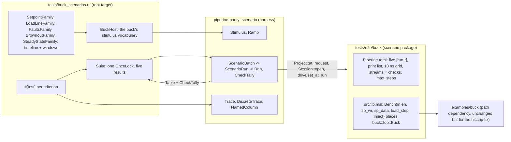

# Buck Scenarios Design

**Spec**: `.specs/features/buck-scenarios/spec.md`
**Status**: Draft (the user is away; every choice below is a default, listed in spec.md "Decisions taken (user AFK)")

---

## Architecture Overview

Five scenario runs over the unmodified converter, one per family of SPEC §10 scenarios, each driven by a Rust
host through `Session::drive` and `Session::set_at`, sampled by the session's `Recorder` on a 10 ns grid, and
judged by measurement types defined once in `piperine-parity`. One root target runs the five at once, in five
threads, and every test reads the run of its family.



Data path of one family: `Family::stimulus()` builds a `Stimulus` through `BuckHost` → `ScenarioRun::execute`
opens `tests/e2e/buck`'s run of that name, applies the stimulus to the `Session`, runs it with a `CheckTally`
sink, and returns `Ran { table, checks, started, ended, build }` → `Suite` keeps it as `Result<Ran, String>` →
a test reads a column through `Waveforms` into a `Trace` or `DiscreteTrace` and measures one window.

### Approaches considered

| Approach | What | Verdict |
| -------- | ---- | ------- |
| **A. Host stimulus, scenario package at `tests/e2e/buck`, one target, five families in parallel** | as above | **Chosen.** One stimulus mechanism for every scenario (S4, S7, S9 need timed sets no bench expresses, X8); `examples/buck` keeps its two runs; the wall time is the longest family's |
| B. MSL benches with the stimulus, runs added to `examples/buck/Piperine.toml`, host tests only measure | `piperine run s3` would reproduce a scenario | Rejected: S4, S7 and S9 still need host sets, so two mechanisms; CLI-08's run list and the Book's "2 runs, 2 passed" change; `piperine test` in `examples/buck` would cost about an hour |
| C. One run per scenario (nine runs) | maximal independence | Rejected: each 3.3 V run pays its own 1.25 ms start; about 26 ms simulated instead of 16.6 ms |

---

## Code Reuse Analysis

### Existing Components to Leverage

| Component | Location | How to Use |
| --------- | -------- | ---------- |
| `Session::drive`, `Session::set_at` | `crates/piperine-api/src/host.rs` | every stimulus; `at = 0` for the initial values, `at > 0` scheduled on the transient |
| `Session::open`, `Session::run`, `Project::at`, `Project::request` | `crates/piperine-api/src/{session,project}.rs` | open a run of the scenario package by name and run it with a sink |
| `Recorder`, print grid, `Keep::Last` | `crates/piperine-api/src/recorder.rs`, `session.rs:637` | rows on the 10 ns grid, memory by rows not steps (long-run) |
| `Record::is_passing_check`, `RecordSink` | `crates/piperine-api/src/record.rs` | `CheckTally` (the `Checks` sink of `buck_long.rs`, made a harness type) |
| `max_steps` run key | `crates/piperine-api/src/request.rs:401` | the 15 M budget of every run |
| The `OnceLock` fixture and column-by-suffix lookup | `crates/piperine-api/tests/buck_long.rs` | the pattern `Suite` and `NamedColumn` follow, with the result stored so a failure is not re-run |
| `HostRun`, `Ignore` sink | `crates/piperine-parity/src/host.rs` | the shape of a harness type that opens a `Session` (`ScenarioRun` mirrors it) |
| `benches/startup.msl` | `examples/buck/benches/startup.msl` | the `Bench` module copies its signal declarations (`pgood`, `fault: Bit<Fault>`, `mode: Bit<Mode>`) and `use` lines |

### Integration Points

| System | Integration Method |
| ------ | ------------------ |
| `piperine-project` | the scenario package's manifest with `buck = { path = "../../../examples/buck" }`; crate root `src/lib.msl` (E0175 requires it) |
| `piperine-parity::corpus` | walks `tests/e2e/*/`; `tests/e2e/buck/` holds no `.cir`, so it adds no twin (T7 gate runs `parity_corpus`) |
| `workspace_shape`, `suite_hygiene` | `tests/buck_scenarios.rs` is a top-level root target named after the feature that reaches `piperine::` and `piperine_parity` (MD-28 / CLA-13 `<feature>.rs` shape); `tests/e2e/buck/` holds no `.rs` |

---

## Components

### `NamedColumn` (harness)

- **Purpose**: Find a table column by its label or by a dotted suffix of it.
- **Location**: `crates/piperine-parity/src/scenario/column.rs`
- **Interfaces**:
  - `NamedColumn::find(table: &Table, name: &str) -> NamedColumn` - the column whose label is `name` or ends in `.name`; panics naming `name` and every label when none matches, and naming both when two match.
  - `NamedColumn::index(&self) -> usize`, `NamedColumn::label(&self) -> &str`.
- **Dependencies**: `piperine_api::Table`.
- **Reuses**: `buck_long.rs::column`.

### `Trace` (harness)

- **Purpose**: Measure one real column (a node, `isense` scaled to amperes) over a window.
- **Location**: `crates/piperine-parity/src/scenario/trace.rs`
- **Interfaces**:
  - `Trace::of(table: &Table, name: &str) -> Trace` - every row as `(time, value)`; panics naming the row when a cell is not `Real`.
  - `Trace::scaled(self, factor: f64) -> Trace`.
  - `Trace::between(&self, from: f64, to: f64) -> Trace` - the rows with `from <= time < to`; the window is kept for messages.
  - `Trace::maximum(&self) -> Sample`, `Trace::minimum(&self) -> Sample` - panic naming the label and window when empty.
  - `Trace::deviation_from(&self, nominal: f64) -> Sample` - the row of the largest `|value - nominal|`, `value` holding that absolute difference (BS-02 AC 2).
  - `Trace::mean(&self) -> f64`, `Trace::peak_to_peak(&self) -> f64`.
  - `Trace::settled_into(&self, low: f64, high: f64) -> Option<f64>` - BS-02 AC 1.
  - `Trace::first_crossing(&self, level: f64, crossing: Crossing, after: f64) -> Option<f64>` - BS-02 AC 5.
  - `Trace::first_rise_in_any_row(&self) -> Option<Sample>` - the first row not below its predecessor (`None` when strictly decreasing), for S8.
  - `Trace::decay_time_constant(&self) -> f64` - `(t_last - t_first) / ln(v_first / v_last)`, for S8.
- **Types**: `Sample { time: f64, value: f64 }`, `enum Crossing { Rising, Falling }`.
- **Dependencies**: `NamedColumn`.

### `DiscreteTrace` (harness)

- **Purpose**: Read one discrete column (a mode, a fault code, a `Bit`) over a window.
- **Location**: `crates/piperine-parity/src/scenario/discrete.rs`
- **Interfaces**:
  - `DiscreteTrace::of(table: &Table, name: &str) -> DiscreteTrace` - `Int(n)` as `Some(n)`, `Bool` as `Some(0 | 1)`, `Unknown` as `None`.
  - `DiscreteTrace::between(&self, from: f64, to: f64) -> DiscreteTrace`.
  - `DiscreteTrace::first_time(&self, value: i128, after: f64) -> Option<f64>` - BS-02 AC 6.
  - `DiscreteTrace::holds(&self, value: i128) -> Result<(), Departure>` - BS-02 AC 7.
  - `DiscreteTrace::value_at(&self, time: f64) -> Option<i128>` - the row at or before `time`.
  - `DiscreteTrace::peak_to_peak(&self) -> i128` - largest known value minus smallest; panics naming a row that is unknown.
- **Types**: `Departure { time: f64, value: Option<i128> }`.
- **Dependencies**: `NamedColumn`.

### `Stimulus`, `Ramp` (harness)

- **Purpose**: The host's schedule for one run, applied to a `Session` in the order it was given.
- **Location**: `crates/piperine-parity/src/scenario/stimulus.rs`
- **Interfaces**:
  - `Stimulus::new() -> Stimulus`.
  - `Stimulus::drive(self, port: &str, value: ParamValue, at: f64) -> Stimulus`.
  - `Stimulus::set(self, param: &str, value: f64, at: f64) -> Stimulus`.
  - `Stimulus::ramp(self, param: &str, ramp: Ramp) -> Stimulus` - one `set` per `Ramp::points`.
  - `Stimulus::apply(&self, session: &mut Session) -> Result<(), Failure>` - each action through `Session::drive` or `Session::set_at`; the first refusal is returned naming the action.
  - `Ramp { from, to, start, duration, step }`, `Ramp::points(&self) -> Vec<(f64, f64)>` - `n = round(|to - from| / step)` points; point `k` (1..=n) at `start + k * duration / n` with value `from + k * (to - from) / n` (BS-02 AC 8).
- **Types**: private `enum Action { Drive { port, value, at }, Set { param, value, at } }`.
- **Dependencies**: `piperine_api::{Session, Failure, ParamValue}`.

### `ScenarioRun`, `ScenarioBatch`, `Ran`, `CheckTally` (harness)

- **Purpose**: Run named runs of a scenario package under their stimuli, each once, several at a time.
- **Location**: `crates/piperine-parity/src/scenario/run.rs`
- **Interfaces**:
  - `ScenarioRun::new(package: &Path, run: &str, stimulus: Stimulus) -> ScenarioRun`.
  - `ScenarioRun::execute(&self) -> Result<Ran, String>` - `Project::at`, `request(Some(run))`, `Session::open` with `Settings { rustc: None, cache: <own TempDir> }`, `stimulus.apply`, `run(CheckTally)`; the session is dropped before its build directory; every failure becomes a message naming the run.
  - `ScenarioBatch::new(runs: Vec<ScenarioRun>) -> ScenarioBatch`, `ScenarioBatch::execute(self) -> Vec<Result<Ran, String>>` - one thread per run (`std::thread::scope`), in input order; a panicking thread becomes `Err` with its panic text.
  - `CheckTally { seen, failed }` implements `RecordSink` (the `checks` stream only).
  - `Ran { run: String, table: Table, checks: CheckTally, started: Instant, ended: Instant, build: PathBuf }`, `Ran::wall(&self) -> Duration`.
- **Dependencies**: `piperine_api`, `piperine_transpile::Settings`, `tempfile`.
- **Reuses**: `HostRun` (shape), `buck_long.rs::Checks`.

### The scenario package (`tests/e2e/buck/`)

- **Purpose**: The converter under a host, and the five runs that say what each family samples and emits.
- **Location**: `tests/e2e/buck/Piperine.toml`, `tests/e2e/buck/src/lib.msl`
- **Interfaces**: `Bench(in en: Bit, in sp_wr: Bit, in sp_data: Bit<u8>, in load_step: Bit, in inject: Bit)` with `signal pgood: Bit; signal fault: Bit<Fault>; signal mode: Bit<Mode>;` and `pub let buck = Buck(en, sp_wr, sp_data, load_step, inject, pgood, fault, mode);`. Runs `setpoint`, `load_line`, `faults`, `brownout`, `steady_state`, each: `top = "Bench"`, `analysis = "transient"`, `stop` from the timeline below, `max_step = 1e-8`, `print_step = 1e-8`, `streams = ["checks"]`, `max_steps = 15000000`, and the print list of BS-01 AC 2.
- **Dependencies**: `examples/buck` by path.

### Root target `tests/buck_scenarios.rs`

| Type | Purpose |
| ---- | ------- |
| `Supervisor` | the codes of `Mode` (`OFF` 0, `SOFT_START` 1, `REGULATE` 2, `HICCUP` 3) and `Fault` (`CLEAR` 0, `OVER_CURRENT` 1, `OVER_VOLTAGE` 2), SPEC §8's order, as associated consts |
| `Timing` | SPEC's shared numbers as associated consts: `FIRST_STIMULUS` 1.25 ms, `NEXT_SAMPLE` 2.02 µs, `TWO_SAMPLES` 4.52 µs, `GRID` 10 ns, `AMPERES_PER_VOLT` 10 (the 0.1 V/A sense), `REACTION` 0.1 A |
| `BuckHost` | the buck's stimulus vocabulary over a `Stimulus`: `at_rest()`, `enable(at)`, `disable(at)`, `write_setpoint(code, edge)`, `load_step(high, at)`, `inject(at)`, `load(ohms, at)`, `step_resistance(ohms, at)`, `line(from, to, start, duration)`, `into_stimulus()` |
| `Waveforms` | the buck's columns of one `Ran` as traces: `vout`, `vin`, `inductor_current`, `reference`, `code`, `mode`, `fault`, `pgood`, `high_side`, `low_side`, `over_current`, `sink_limit`, `cut` |
| `Suite` | the five results, run once by one `ScenarioBatch` behind a `OnceLock`; `Suite::get()`, `Suite::report()` (wall time per family and the overlap of their intervals) |
| `SetpointFamily`, `LoadLineFamily`, `FaultsFamily`, `BrownoutFamily`, `SteadyStateFamily` | each: its timeline as associated consts, `stimulus() -> Stimulus`, `ran() -> &'static Ran` (panics with the stored message on failure), and the events its tests share (e.g. `FaultsFamily::over_current_entry()`) |
| `Corner` | one S9 corner: Vin, setpoint volts, its §4.3 bound, its window |

The `#[test]` functions are the only free functions (libtest requires them); each holds one criterion and prints
the value it measured.

---

## Timelines

All 3.3 V families: the five ports at rest at time 0 (`en` low, `sp_wr` low, `sp_data` 100, `load_step` low,
`inject` low), `en` rises at 1 µs, the first stimulus at 1.25 ms. A setpoint write drives `sp_data` 1 µs before
its edge, `sp_wr` rises at the edge and falls 9 µs later.

| Run | Time | Action | Judged window |
| --- | ---- | ------ | ------------- |
| `setpoint` (stop 3.40 ms) | 1.25 ms | write 168 | S2: 1.25 to 2.00 ms |
| | 2.00 ms | write 8 | S2b: 2.00 to 3.40 ms |
| `load_line` (stop 2.92 ms) | 1.25 ms | `load_step` high | S3 up: 1.25 to 1.55 ms |
| | 1.55 ms | `load_step` low | S3 down: 1.55 to 1.85 ms |
| | 1.85 ms | `buck.r_load` 1.65 Ω | settling to 2 A |
| | 2.05 to 2.06 ms | `buck.vin_nom` 12 → 16 V, 40 steps | S4 up: 2.05 to 2.35 ms |
| | 2.35 to 2.36 ms | `buck.vin_nom` 16 → 12 V, 40 steps | S4 down: 2.35 to 2.65 ms |
| | 2.65 ms | `buck.r_load` 6.6 Ω | settling to 0.5 A |
| | 2.80 ms | `en` low | S8: 2.80 to 2.92 ms |
| `faults` (stop 4.70 ms) | 0 | `buck.r_step` 0.3 Ω | |
| | 1.25 ms | `load_step` high | S5: Hiccup expected ≈ 1.27 ms, retry ≈ 3.27 ms |
| | 3.32 ms | `load_step` low (during the retry's soft-start) | S5: Regulate expected ≈ 4.33 ms |
| | 4.50 ms | `inject` high | S6: 4.50 to 4.70 ms |
| `brownout` (stop 1.52 ms) | 1.250 to 1.340 ms | `buck.vin_nom` 12 → 7.5 V, 45 steps of 0.1 V, 2 µs each | S7: Off expected ≈ 1.33 ms |
| | 1.400 to 1.490 ms | `buck.vin_nom` 7.5 → 12 V, 45 steps | S7: SoftStart expected ≈ 1.42 ms |
| `steady_state` (stop 4.05 ms) | 0 | `buck.vin_nom` 9 V, `buck.r_load` 0.16 Ω, write 0 (edge 1 µs), `en` at 2 µs | |

`steady_state` corners (each window 64 µs, starting 200 µs after the last ramp or line step; a line step takes
10 µs in 0.1 V steps; a setpoint write moves `buck.r_load` to the full-load value at its edge):

| # | Setpoint | Vin | `r_load` | Window | Bound (§4.3) |
| - | -------- | --- | -------- | ------ | ------------ |
| 1 | 0.8 V | 9 V | 0.16 Ω | 0.464 to 0.528 ms | ± 6.5 mV |
| 2 | 0.8 V | 12 V | 0.16 Ω | 0.738 to 0.802 ms (line 0.528 to 0.538) | ± 6.5 mV |
| 3 | 0.8 V | 16 V | 0.16 Ω | 1.012 to 1.076 ms (line 0.802 to 0.812) | ± 6.5 mV |
| 4 | 3.3 V | 16 V | 0.66 Ω | 2.078 to 2.142 ms (write 100 at 1.076, ramp ends ≤ 1.878) | ± 14.7 mV |
| 5 | 3.3 V | 12 V | 0.66 Ω | 2.352 to 2.416 ms (line 2.142 to 2.152) | ± 14.7 mV |
| 6 | 3.3 V | 9 V | 0.66 Ω | 2.626 to 2.690 ms (line 2.416 to 2.426) | ± 14.7 mV |
| 7 | 5.0 V | 9 V | 1.0 Ω | 3.436 to 3.500 ms (write 168 at 2.690, ramp ends ≤ 3.236) | ± 20 mV |
| 8 | 5.0 V | 12 V | 1.0 Ω | 3.710 to 3.774 ms (line 3.500 to 3.510) | ± 20 mV |
| 9 | 5.0 V | 16 V | 1.0 Ω | 3.984 to 4.048 ms (line 3.774 to 3.784) | ± 20 mV |

`SteadyStateFamily` computes these windows from three constants (`SETTLE` 200 µs, `WINDOW` 64 µs, `LINE` 10 µs)
and the ramp lengths of SPEC §7.2; the table is the result, so a test and its stimulus can never disagree.

---

## Data Models

```rust
/// A measured row: its time and its value.
pub struct Sample { pub time: f64, pub value: f64 }

/// A row of a discrete trace that breaks what was asked.
pub struct Departure { pub time: f64, pub value: Option<i128> }

/// What a scenario run left.
pub struct Ran { pub run: String, pub table: Table, pub checks: CheckTally,
                 pub started: Instant, pub ended: Instant, pub build: PathBuf }

/// The `checks` records of a run.
pub struct CheckTally { pub seen: usize, pub failed: usize }
```

**Relationships**: `Suite` holds one `Result<Ran, String>` per family; `Waveforms` borrows a `Ran`'s table.

---

## Error Handling Strategy

| Error Scenario | Handling | User Impact |
| -------------- | -------- | ----------- |
| A run fails to open, refuses a stimulus action, or fails in the solver | `ScenarioRun::execute` returns `Err` naming the run and the `Failure`; `Suite` stores it | every test of that family fails with that message; the other families still judge (BS-08 AC 2) |
| A family's thread panics | `ScenarioBatch` turns the panic into `Err(<panic text>)` | as above |
| An event a test waits for never happens (no `Hiccup`, no crossing) | the measurement returns `None`; the test fails naming the event and its window | a precise failure, never a vacuous pass |
| A column is missing | `NamedColumn::find` panics naming the name and the labels | a precise failure |
| A step budget is exhausted | the solver's `exceeded the 15000000 step budget` failure, stored as above | the family fails loud instead of hanging the suite |

---

## Risks & Concerns

| Concern | Location (file:line) | Impact | Mitigation |
| ------- | -------------------- | ------ | ---------- |
| The hiccup lasts 1001 samples (2.002 ms), SPEC §8.5 says 1000 | `examples/buck/src/supervisor.msl:80,86` (`retry == 0` after `retry <- HICCUP_SAMPLES`) | S5's 2 ms retry fails | T8 fixes the model (`retry <- HICCUP_SAMPLES - 1` on entry), the mirrored reference model in `crates/piperine-parity/tests/buck_supervisor.rs:142`, and the pinned print `crates/piperine-lang/tests/fixtures/elab/buck.txt:428` (an intended change to a frozen pin, named in the commit) |
| S5's "within 16 to 20 µs" counts eight cut periods from the edge, but the overload ramps in 4 µs and the inductor slews ≈ 1.85 A/µs, so the first cut lands ≈ 4 µs after the edge and the entry may land ≈ 20.5 µs | SPEC §10 S5 | BS-05 AC 3 may fail on the model | judged as written (never retuned); if it fails, the Verifier reports the measured time and the user chooses between SPEC's window and the model |
| S6's estimates (≈ 7 mV/µs, ≈ 80 to 120 µs) assume −3 A held on average; §8.3's cut lets the current relax each period | SPEC §10 S6, §8.3 | the model may reach OVP in ≈ 40 µs | D8: reported, not judged; S6 is judged on the OVP mechanism (two samples over 3.81 V) |
| S7's restart meets a pre-biased output and trips `OverVoltage` two samples into `SoftStart` | SPEC §7.2, §8.4 | a reader may expect a clean restart | S7 judged to the entry into `SoftStart`; reported to the user |
| Run time: ≈ 60 to 80 CPU-minutes, 17 to 24 min wall | the solver lands near every 200 MHz instant (`long-run`, V12) | the workspace suite grows by about 20 minutes | five families in parallel threads; `multi-rate` (V12) is the lever; the budget table is in spec.md |
| Thread starvation: libtest runs tests in name order on N threads, so tests blocked on two families could keep the others from starting | `cargo test` default threads | serial families, ≈ 60 min wall | `Suite` starts all five families in one `ScenarioBatch` at the first access, whatever test triggers it |
| Memory: 470 000 rows × 14 cells per run, five runs at once | `Recorder` rows | ≈ 1 GiB of rows plus each solver (LR-12 holds one start under 1 GiB) | accepted on a 30 GiB machine; the report prints rows per family |
| A run that never ends | a collapsed step | the suite hangs | `max_steps = 15000000` per run (D14) |
| A top whose `in` ports feed a child: not exercised by an existing run | `Session::drive` (`host.rs:176`, `top_input`) needs a discrete `in` port of the top | the package would not drive | T7's tests open each run and drive all five ports before any long run |
| The corpus walker reads every `tests/e2e/*/` | `crates/piperine-parity/src/corpus.rs:26` | a stray `.msl` could be taken for a twin | the package's only `.msl` is under `src/`, no `.cir`; T7's gate runs `parity_corpus` |
| A path dependency could write a lock file into the tree | `crates/piperine-project/src/lockfile.rs` | a dirty tree after the suite | BS-01 AC 6 test lists the package directory after opening a run |
| `set_at` derives the whole schedule again on each call | `crates/piperine-api/src/host.rs:93-105` | `steady_state` schedules ≈ 230 sets: ≈ 26 000 derivations before the run | cheap (each derivation is a table clone); measured in the report |
| Test coverage gap: the supervisor's hiccup length is pinned only against a reference model with the same off-by-one | `crates/piperine-parity/tests/buck_supervisor.rs:128-143` | the divergence went unseen | T8 adds `each_hiccup_lasts_1000_samples`, which counts samples against SPEC, not the model |

---

## Tech Decisions (only non-obvious ones)

| Decision | Choice | Rationale |
| -------- | ------ | --------- |
| Harness home | `piperine-parity::scenario` | MD-72: `piperine-parity` stays the harness; `workspace_shape` keeps support `.rs` out of root `tests/` except declared targets; the harness gets its own unit tests (MD-28 rule 1) |
| One target, all families | `tests/buck_scenarios.rs` | cargo runs test binaries one after another; one binary lets the five runs overlap |
| Grid | 10 ns for every run | S5 and S6 judge the current to 0.1 A at slopes up to 3.4 A/µs; one grid for all keeps `Waveforms` uniform |
| Stimulus edge of a write | `sp_wr`'s rise | SPEC §7.1: the register takes `sp_data` on the rising `sp_wr` |
| The cleared fault's name | SPEC follows the model (`Clear`) | D12 |
| Project decision | MD-73 (below) | the scenario-package pattern is reusable by any host scenario |

**MD-73 (proposed, renumbered at merge if taken):** a host scenario of an example is a package under
`tests/e2e/<example>/` with a path dependency on the example and a top that exposes the example's `in` ports;
the stimulus is the Rust host's; the harness types live in `piperine-parity::scenario`; one root target per
example runs its families once each, in parallel. Recorded in `.specs/STATE.md`.
