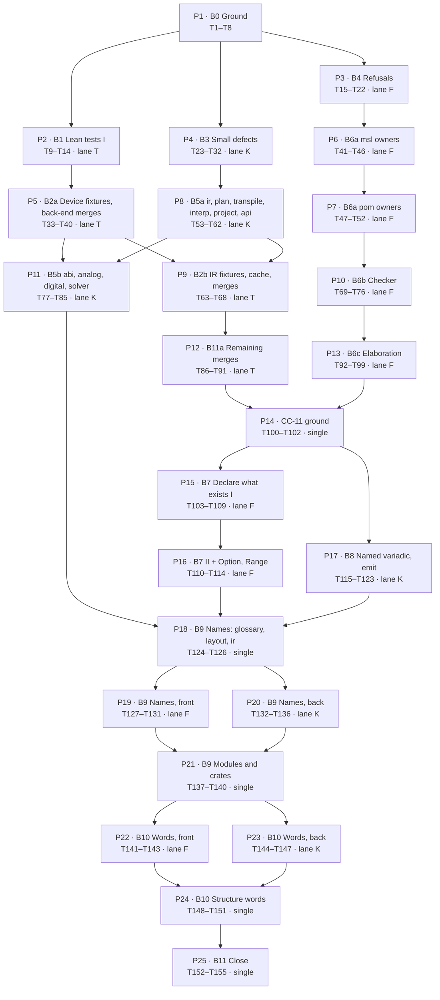

# Code Clarity Design

**Spec**: `.specs/features/code-clarity/spec.md` (CC-01 to CC-12; Assumptions rows 6 to 12 are the user's answers of 2026-11-25 and bind this design)
**Inventory**: `.specs/features/code-clarity/findings.md` (taken at `902f83ae1`)
**Base of this design**: `a8968de11` (`origin/main`, "chore: merge generics phase E")
**Status**: Approved (2026-11-25, with tasks.md)

---

## What changed since the inventory

Counts re-taken at `a8968de11` with `grep` and `wc` (the inventory's `syn` scan is not in the tree; T3 rebuilds it and T8 fixes the numbers the guards use, so no number below is hard-coded into a guard).

| | Inventory (`902f83ae1`) | Now (`a8968de11`) |
|---|---|---|
| `piperine-lang/src` lines | 57 589 | 58 019 |
| Files in `elab/` (+ `consts/`), `types/` | 72 (+10), 67 | 73 (+10), 67 |
| Files with `impl Checker` / `impl Elaboration` / `impl ConstEval` | 54 / 67 / 8 | 54 / 67 / 8 |
| Free functions at column 0 in `src/` (lang, solver, abi, analog, digital, project, api) | 417 | 418 (255, 47, 32, 31, 27, 20, 6) |
| `P0001` sites (`unsupported(` + `ConstFault::Unsupported`) | 501 in 82 files | 510 in 82 files (`types` 98, `elab` 411, of which 120 `ConstFault`) |
| "M1 subset" in non-test code | 29 | 10; the user-facing text is 2 sites (`types/check.rs:420`, `elab/elaborator.rs:309`); the only pin outside `src/` is `GAPS.md:171` |
| `emit!` | 152 `.msl`, 98 Book, 57 spec, 405 Rust test strings | 171 lines in 65 `.msl` files, 98 Book, 57 spec, 322 lines in Rust tests |
| `include_str!` | — | 6 `.msl`, 27 spec lines, 11 Book, 21 Rust test lines |
| Integration targets | 373 | lang 80, parity 61 (+7 buck), solver 58, transpile 29, api 27, root 26 (+2 buck), digital 16, ir 15, analog 13, abi 11, cli 10 (+2 buck), plan 9, numbers 8, interp 7, project 5 = 375 |
| `#[test]` functions | 4 496 | 4 541 |
| `static CACHE` | 33 in 31 files | 32 in 31 files |
| `#[path]` mods in tests / reaching another crate | 599 / 159 | 603 / 161 |
| `#[allow]` in tests | 486 | 506 |
| `impl Device` in tests | 173 | 170 |
| Proof rows | 3 349 in 44 features | 3 397 in 45 proofs files |
| `tests/book/inventory.tsv` | 817 rows | 828 lines |

Nothing moved a finding. Two facts the inventory did not have, both used below:

1. **A proof row names a `Run` group, not a target.** `Proof: run stdlibrary | test x ... ok` reads the line `**Run stdlibrary**: cargo test -p piperine-lang --test std_library`, and `check_proofs.py` matches the words `test`, `x`, `...`, `ok` in order on one output line. So `test std_library::x ... ok` still matches after a merge: **merging targets rewrites `Run` lines only** (about 600 of them), never the 3 397 proof rows, and a test keeps its name.
2. **`str` has no `Repr`** (`docs/spec/part_i_values.md:60,223`), while `emit!` fields carry strings today (`msg = "overrange"`, `kind = "require"`). So the bound on a record field cannot have `Repr` as a supertrait; the user settled it on 2026-11-25 (spec Assumption 14): `RecordValue`, with no supertrait.

---

## Architecture Overview

The feature is twelve batches (B0 to B11, `findings.md` §8) in 25 phases and 155 tasks. Three rules shape the order:

1. **Guards first, as ratchets.** B0 puts the inventory's scan in the tree as a test-only crate. Each guard starts with one allowance file per crate listing today's violations, fails on a violation that is not listed **and** on a listed row that no longer exists. A batch closes a finding by deleting rows. At the close every allowance file holds only the permanent exceptions the spec names (`main`, `extern "C"`, `#[test]`).
2. **Moves before renames, renames before words.** A function moves to its owner (B5, B6), then the owner gets its final name (B9), then it gets its doc comment (B10): each line is touched once per kind of change.
3. **Lanes are disjoint by path.** Up to three lanes run at once, each in its own worktree and target directory, each owning a set of directories for the wave. A lane never edits a path another lane owns in that wave.



### Batches, phases and sizes

Size: S (days, one crate), M (one to two weeks, several crates), L (a batch of its own), as in `findings.md` §7.

| Batch | Phases | Tasks | Size | Lane | Closes |
|---|---|---|---|---|---|
| **B0 Ground** | 1 | T1–T8 (8) | M | single | precondition of every guard; −6 400 lines (language server) |
| **B1 Lean tests I** | 2 | T9–T14 (6) | S | T | CC-12 AC 2, 5 (about 230 prose and dead-architecture tests out, uncited duplicates out) |
| **B2 Lean tests II** | 5, 9 | T33–T40, T63–T68 (14) | M | T | CC-12 AC 3, 4 for 12 crates; `Device::react` default; one compile cache |
| **B3 Small defects** | 4 (+ T51, T52 in 7) | T23–T32 (10) | S | K | parts of CC-03, CC-07; rule 9 panics |
| **B4 Refusals** | 3 | T15–T22 (8) | M | F | rule 2 made checkable; Q12; hands `spec-closure` its table |
| **B5 Owners, back end** | 8, 11 | T53–T62, T77–T85 (19) | L | K | CC-04, CC-06, CC-07 for 11 crates |
| **B6 Owners, front end** | 6, 7, 10, 13 | T41–T52, T69–T76, T92–T99 (28) | L (the largest) | F | CC-02, CC-04, CC-05 AC 2, CC-06 for `piperine-lang` |
| **B7 Declare what exists** | 14, 15, 16 | T100–T109, T112–T114 (13) | L | F | CC-11 AC 2 |
| **B8 Change the language** | 16, 17 | T110, T111, T115–T123 (11) | L | F (b, c), K (a) | CC-11 AC 1, 3 |
| **B9 Names** | 18–21 | T124–T140 (17) | L, mechanical | single, F ∥ K, single | CC-05 |
| **B10 Words** | 22–24 | T141–T151 (11) | M | F ∥ K, single | CC-01, CC-08, CC-10 |
| **B11 Close** | 12, 25 | T86–T91, T152–T155 (10) | M | T, single | CC-12 AC 3, 6; CC-09 |

`findings.md` §8 puts S5 (`Range`, `Iterator`) and S6 (`Option`) in B8. They are **scheduled** inside phase 16, before the method catalogue (T112, T113), because the catalogue's signatures name those types; they stay B8 changes for CC-09 (spec, Book, corpora and tests in the same commit).

### Lanes

A lane is a worktree with its own `CARGO_TARGET_DIR` and `TMPDIR` (`/var/tmp/piperine-target-<lane>`, `/var/tmp/piperine-tmp-<lane>`). A phase merges into the feature's integration branch when its last task is committed; the next phase of any lane starts from the integration branch. **Implementers can stop at any phase boundary.**

| Wave | Lane T (tests) | Lane F (front end) | Lane K (back end) | Paths each lane owns in the wave |
|---|---|---|---|---|
| 0 | — | P1 (single) | — | whole tree |
| 1 | P2 | P3 | P4 | T: `crates/*/tests/**` of the files T9–T14 name, `.specs/features/*/{tasks,checks,proofs}*.md`, `tests/book/inventory.tsv`. F: `crates/piperine-lang/src/**`, `crates/piperine-lang/tests/refusals.rs`. K: `src/**` of solver, analog-solver, digital-solver, plan, transpile, interp, ir, api, cli |
| 2 | P5 | P6, P7 | P8 | T: `tests/**` and `Cargo.toml` of abi, analog-solver, digital-solver, solver; `crates/piperine-device-fixtures/**`; `crates/piperine-abi/src/device.rs` (T33). F: `crates/piperine-lang/src/{msl,pom}/**`, `crates/piperine-numbers/src/**` (T51). K: `src/**` of ir, plan, transpile, interp, project, api |
| 3 | P9 | P10 | P11 | T: `tests/**` and `Cargo.toml` of ir, plan, interp, transpile, api, cli, numbers, project; `crates/piperine-ir-fixtures/**`; `crates/piperine-parity/src/**`. F: `crates/piperine-lang/src/types/**`. K: `src/**` of abi, analog-solver, digital-solver, solver |
| 4 | P12 | P13 | — | T: `tests/**` of lang, parity and the root. F: `crates/piperine-lang/src/elab/**` |
| 5 | — | P14 (single), then P15, P16 | P17 (after P14) | F: `std/{traits,core,numbers,carriers,option,sequences}.msl`, `pom/builtin.rs`, `types/{value,generics,traits,analog,carrier}/**`, `elab/{value,analog,digital}/**` minus the two record files, spec Parts I, II, IV and Appendix H. K: `msl/parser/**`, `types/module/record.rs`, `elab/digital/records.rs`, `std/{io,records}.msl`, every `.msl` corpus, spec Part VI and Appendices A, B |
| 6 | — | P18 (single), then P19 | P20 (after P18) | F: names declared in `piperine-lang`. K: names declared in every other crate |
| 7 | — | P21 (single), then P22 | P23 (after P21) | F: doc comments of `piperine-language`. K: doc comments of every other crate |
| 8 | — | P24, P25 (single) | — | whole tree |

Parallel **without conflict** (disjoint paths): P2 ∥ P3 ∥ P4; P5 ∥ P6–P7 ∥ P8; P9 ∥ P10 ∥ P11; P12 ∥ P13; P22 ∥ P23.

Parallel **with shared files, merged by region** (lane K merges first, lane F rebases): P15–P16 ∥ P17 share `docs/book/content.html`, `tests/book/inventory.tsv` and `docs/spec/appendix_b_grammar.md`, each lane in its own sections. P19 ∥ P20 share call sites in `piperine-api`, `piperine-parity` and `piperine-transpile`: a rename task merges into the integration branch as soon as its gate passes and the other lane rebases before its next task.

**Not parallel**: P1, P14, P18, P21, P24, P25 (each touches every crate or a file every lane reads).

Three rules keep the lanes apart:

- **A `src/` task of B3, B5 and B6 keeps every path a test names.** When an owner type replaces a `pub` free function that a test calls, the same commit edits the call in the test and nothing else in that file. Lane T's merges in the same wave are in other crates by construction (waves 2 and 3 swap the crate sets between T and K).
- **B6 never changes what `piperine-lang`'s tests import**: `Types::check`, `Elaborator::new(..).run(..)`, `Design`, the diagnostics. `Checker` and `Elaboration` are private to the crate.
- **Allowance files are per crate** (`crates/piperine-repository-guards/allowances/<crate>/<guard>.tsv`), so two lanes never edit the same one.

---

## Gates

Gate policy (user, 2026-11-23, `CLAUDE.md`): per task, the build and the touched crates and targets only; the full suite once per feature, at final verification.

| Gate | When | Commands |
|---|---|---|
| **Quick** | every task that changes Rust | the `**Build**` line of `tasks.md`; `cargo test -p <crate>` for each crate whose `src/` or `tests/` the task changed; the `Run` lines its `Done when` names |
| **Golden** | a task that touches a path from MSL source to generated bytes (`piperine-lang/src/elab`, `piperine-ir`, `piperine-plan`, `piperine-transpile`), or renames a name generated code spells | Quick, then `cargo test -p piperine-transpile --test golden`, `cargo test -p piperine-cli --test twins`, `cargo test -p piperine --test book_inventory` (`--test book inventory_guard::` after T89) |
| **Ledger** | a task that removes, moves or merges a test, or renames a crate | Quick, then `cargo test -p piperine-repository-guards --test proof_ledger` |
| **Build** | a task that changes no Rust (tracking files, the Book's prose, `ARCHITECTURE.md`) | the `**Build**` line |
| **Final** | T155 only | `cargo test --workspace`; `cargo test -p piperine-parity -- --nocapture` with ngspice installed; `env -u PIPERINE_NGSPICE cargo test -p piperine-parity`; the buck targets by name (`examples/buck/README.md`); `check_proofs.py code-clarity`; `check_proofs.py <feature>` for every feature with a `## Checks` |

Gate of each batch's tasks, and what its last task also shows before the phase merges:

| Batch | Task gate | Shown at the phase boundary |
|---|---|---|
| B0 | Quick; Ledger for T4, T5 | every guard target of the guards crate green with its allowances |
| B1 | Ledger | `every_retired_check_is_recorded`; no open row of `duplicate_tests.tsv` |
| B2 | Ledger for a merge, Quick for a fixtures crate | the crate's target plan lowered; merged targets pass with `--test-threads=1` and the default |
| B3 | Quick; Golden for T26, T28; Ledger for T27, T30 | no `SPEC_DEVIATION`, no open row of `single_implementor_traits.tsv` |
| B4 | Quick, with `cargo test -p piperine-lang` unedited | `**Run refusals**` |
| B5 | Golden for ir, plan, transpile, api session, abi; Quick plus the owner crate's dependants for the solvers | the crate's free-function allowance empty or the `extern "C"` list |
| B6 | Quick for `msl/` and `pom/`; Golden for `types/` and `elab/` | `an_inherent_impl_lives_with_its_type` with no row for the split type |
| B7 | Golden, plus the `source_*` target of the part touched | `**Run stddecl**` |
| B8 | Golden, plus `piperine-parity`, `piperine-api`, `piperine-cli` and `--test book` where the corpora or the Book move | `**Run variadics**`, `**Run srcio**` |
| B9 | Quick or Golden by the crate; Ledger for a crate rename | the crate's naming allowance empty |
| B10 | Quick (the crate builds under `#![deny(missing_docs)]`); Build for prose | the crate's documentation allowance empty |
| B11 | Ledger for merges; Final for T155 | the after report; every feature's proofs |

**CC-09 AC 1 reads "the full `cargo test` SHALL pass" at each commit.** The gate policy is later than the spec (2026-11-23 against 2026-11-18) and is the user's: each commit passes Quick (and Golden or Ledger where the table says), and byte-identity of every twin, golden, parity target and Book listing is proven once, by Final. A task that cannot keep a golden byte-identical stops and reports; only the changes listed under "What may move" may move bytes.

The `**Build**` line is green at the base (`validate_tasks.py --execute` runs it before T1) and is rewritten by the three tasks that change what it names: T2 (drops `--exclude piperine-lang-server`, because Cargo warns on an excluded package that does not exist and the line fails on any warning), T5 (the hygiene guard moves to the guards crate), T139 (`piperine-lang` becomes `piperine-language`).

### What may move (CC-09)

| Change | Approved by | Moves | Task |
|---|---|---|---|
| `P0001` loses "outside the M1 subset" | Q12 (row 8) | the label of every `P0001`; `GAPS.md:171` leaves | T16 |
| `emit!("s", a = b)` → `emit("s", a: b)`; `check(..)`, `finish(..)`; `include_str!(…)` → `include_str(…)`; no `!` form | Q14 (a) (row 10), OQ1 (row 13) | spec Parts I, VI, VII, Appendices A, B, C, G; 171 `.msl` lines; 98 Book lines; 322 Rust test lines; `E0602` changes phase | T115–T123 |
| `Dc`, `Transient`, `Ac`, `Noise` are written `Analysis::Dc`, …; `analysis(Static)` is `is_static()` | OQ4 (row 16) | 29 `.msl` lines (7 of them in `std`), 3 Book lines, 53 spec lines, 60 Rust test lines; no bare variant name resolves | T105, T106 |
| `Option` is a std enum; `Range<T>` and `Iterator<T>` are named | Q14 (b), (c) (row 11) | spec §1, Appendix H.4, H.6, H.7, H.9; reflection shows `Option` as a `std` item | T110, T111 |
| Builtins declared in `std` | CC-11 AC 2, Assumption 5 | wording of a diagnostic that named "the catalogue"; `E0457` narrows to `gnd` (S16) | T103–T114 |
| `GND`, `vss`, `VSS` stop naming ground | S21, rule 1 (the spec knows `gnd` only) | nothing in the corpora (T29 stops if one uses an alias) | T29 |
| A NaN pole and an empty shoot return the solver's `Error` instead of a panic | rule 9, `findings.md` §1.9 | nothing a passing run prints | T24 |
| Names of `piperine-abi` and of the embedded runtime that generated code spells | Q3 (row 7); spec Out of Scope: generated code "follows the renames only" | transpile goldens, by identifier only: the task shows `git diff --word-diff` holds renamed identifiers and nothing else | T132, T137 |

No tolerance moves, `crates/piperine-parity/src/contract.rs` is not edited, and no numeric result of any twin, parity target or Book listing changes. A task that would move one stops (CC-11 AC 4).

---

## Code Reuse Analysis

### Existing Components to Leverage

| Component | Location | How to Use |
|---|---|---|
| The model crates | `piperine-numbers`, `piperine-plan`, `piperine-cli` | already near-clean (`findings.md` §1.1): their shape is the target for the others |
| Fixture types with methods | root `tests/` (483 tests, 0 free helpers) | the pattern for every test-support type of B2 |
| `piperine-parity` | `crates/piperine-parity/src` | already the source-level test library; gains the one compile cache (T66) |
| `extern "intrinsic" fn` | spec §3 rule 10; `std/{io,values,analog}.msl` (5 uses) | the mechanism of CC-11: every builtin becomes one |
| `Unlowered` | `lang/src/elab/unlowered.rs` | the seed of `RefusedForm` (T15) |
| Hygiene guards | `lang/tests/suite_hygiene.rs`, `solver/tests/{crate_boundaries,workspace_shape}.rs` | move into the guards crate (T5); the ones that guard the present suite stay |
| `tests/book/inventory_guard.rs` | root | proves every Book row names an existing test after each merge |
| `lang/tests/support/code_owners.tsv` | lang | the model for the refusal table: a code has an owner, a guard reads the table |
| `check_proofs.py` | the skill | the final proof that no criterion of any feature lost its test (T155) |

### Integration Points

| System | Integration Method |
|---|---|
| 45 features' `tasks*.md` / `checks*.md` | `ProofLedger` rewrites their `Run` lines and lone `Proof:` commands; a static guard checks them at every merge |
| `tests/book/inventory.tsv` | `covered_by` cells rewritten by `ProofLedger`; `inventory_guard` checks them |
| The Book (`docs/book/content.html`) | follows T89 (CLAUDE.md sentence), T121 (`emit`), T123 (`include_str`), T136 (public api names), T138, T139 (crate names), T150 (organization chapter) |
| `GAPS.md`, `ROADMAP.md`, `CLAUDE.md`, `AGENTS.md` | each task that closes a row or renames a path they cite edits them in the same commit |
| `spec-closure` (item 13) | receives the refusal table with every row `Unswept` (T22) and S9, arithmetic operator traits (Q14 (d)) |

---

## Components

### `piperine-repository-guards` (new, test-only crate) — B0

- **Purpose**: the guards over the repository itself, and the scan they share. Resolves M7: `workspace_shape`, `crate_boundaries`, `suite_hygiene` and the structural part of `cli/tests/docs.rs` exercise the repository, not the crate they sit in.
- **Location**: `crates/piperine-repository-guards/`
- **Interfaces** (`src/`):
  - `SourceTree::of_workspace() -> SourceTree` — every `.rs` file of every crate, each marked product or test code (a file under `tests/`, an inline `#[cfg(test)] mod`, or a file a `#[cfg(test)] mod x;` or `#[path]` declaration reaches: the inventory did not follow the last, T3 does).
  - `ItemScan::of(&SourceTree) -> ItemScan` — one `ScannedItem` per file, module, type, field, variant, `impl`, method, free `fn`, nested `fn`, lint attribute and `unwrap`/`expect` call, with file, line, length and doc flag (`syn` 2 with `proc-macro2` `span-locations`, as Appendix G).
  - `Allowance::read(crate_name, guard) -> Allowance`, `Allowance::judge(found) -> Verdict` — the ratchet: `Verdict` lists unlisted violations and stale rows; both fail.
  - `Glossary`, `Dictionary` — the word check of CC-05 (`data/glossary.tsv`, `data/dictionary.txt`).
  - `ProofLedger` — below.
  - `Worklist::read(name)` — a table of inventory rows each with a verdict (`split`, `removed`, `kept: <reason>`); the guard fails on a row with none.
  - `SuiteCensus::take() -> SuiteCensus` — targets and tests per crate, for the before/after report and the target-count guard.
- **Targets** (`tests/`): `structure` (CC-01, CC-02, CC-08), `boundaries` (CC-03), `ownership` (CC-04, CC-05 AC 2, CC-07), `naming` (CC-05, CC-10 AC 4), `documentation` (CC-10), `suite` (CC-12 and the surviving hygiene tests), `proof_ledger` (CC-12 AC 5), `worklists` (CC-06, CC-07, CC-12 AC 2).
- **Dependencies**: `syn`, `proc-macro2` (already in the graph through `serde_derive`). No in-tree dependency.
- **Reuses**: the three moved guard targets.

### `ProofLedger` and the `repoint` binary — B0, used by B1, B2, B9, B11

- **Purpose**: keep every criterion of every feature proved while tests are removed, merged and crates renamed (CC-12 AC 5).
- **Location**: `crates/piperine-repository-guards/src/proof_ledger.rs`, `src/bin/repoint.rs`
- **Input**: a map file, one row per change, committed with the task under `.specs/features/code-clarity/repoints/T<n>.tsv`:

  | Row | Meaning |
  |---|---|
  | `move <crate>/<target> <crate>/<target>::<module>` | a target became a module of a merged target |
  | `rename-crate <old> <new>` | a crate was renamed |
  | `replace <crate>/<target>::<test> <crate>/<target>::<test>` | a duplicate was removed; the survivor proves the same rule |
  | `retire <crate>/<target>::<test> <reason>` | a prose pin was removed and no test replaces it (Q13) |

- **What it rewrites**: in `.specs/features/*/{tasks,checks}*.md`, each `**Run <name>**:` line and each lone `Proof: \`cargo test …\`` command (`-p old --test old_target` becomes `-p new --test merged old_target::`, the module filter keeping the run as small as it was); in `tests/book/inventory.tsv`, each `covered_by` cell; in `GAPS.md` and `examples/buck/README.md`, each `<crate>/<target>` it finds. For `replace`, the expected line of the proof takes the survivor's name. For `retire`, the proof becomes `Proof: run ledger | test every_retired_check_is_recorded ... ok`, the claim gains "(retired by code-clarity T<n>: <reason>)", and a row is appended to `.specs/features/code-clarity/retired.tsv` (feature, check, removed test, reason). `proofs*.md` files are the record of a past run and are not rewritten.
- **The guard** (`tests/proof_ledger.rs`), static, a few seconds, in the gate of every task that touches a test:
  - `every_proof_names_a_test_that_exists` — each `Run` line names a package and target that exist, and each `test <name> ... ok` line names a `#[test]` of that target's module tree;
  - `every_inventory_row_names_a_test_that_exists`;
  - `every_retired_check_is_recorded` — each retired proof has its `retired.tsv` row and the reverse;
  - `the_parity_oracles_are_not_reduced` — the tests of `parity_*`, `tests/scenarios.rs`, the twins and the buck targets are a superset of `data/parity_oracles.tsv`, written by T4 from the base.
- **Final proof**: T155 runs `check_proofs.py` for every feature.

### Test-support crates — B2 (Q7, Q17)

| Crate | Holds | Replaces | Used by (dev-dependency) |
|---|---|---|---|
| `piperine-device-fixtures` | the hand-written ABI devices as types (`Resistor`, `Capacitor`, `Diode`, `VoltageSource`, `Comparator`, `FlipFlop`, `Dac`, `Timer`, the mixed set), their shapes, `PartialsCheck` | `abi/tests/support/examples.rs`, `analog-solver/tests/support/devices.rs` (1 738 lines), `digital-solver/tests/support/devices.rs` (1 253), `solver/tests/helpers/{abi_devices,abi_mixed,partials}.rs`, `solver/src/analyses/test_devices.rs` (M6) | abi, analog-solver, digital-solver, solver |
| `piperine-ir-fixtures` | the hand-built IR bodies as types (`Buck`, `Mixed`, the device bodies) | `ir/tests/support/{digital,devices}.rs`, `transpile/tests/support/mixed.rs`, the `#[cfg(test)] #[path]` includes in `transpile/src/lib.rs` and `interp/src/lib.rs` | ir, plan, interp, transpile |
| `piperine-parity` (exists) | `CompileCache::shared()`: one cache directory per test run under the target directory, in place of 32 `static CACHE: OnceLock<TempDir>` | the per-target caches and the 2.5 GB they leak | parity, api, cli, root |

Departures recorded in P9 (fix round 1):

- The run half of the mixed fixtures (`BuiltDesign`, `Seen`) lives in `piperine_parity::mixed`, not in `piperine-ir-fixtures`. The fixtures crate depends on `piperine-ir` alone and a run needs the transpiler, so the body half (`Mixed`) stays in the fixtures crate and the run half goes where the compile cache already is. `piperine-transpile` therefore gains a dev-dependency on `piperine-parity`, which brings `piperine-lang` and `piperine-api` into transpile's test build. Only `piperine-ir` may dev-depend on `piperine-ir-fixtures` among the leaves (the dependency-graph guard says so); plan, interp and transpile are above the leaves.
- `CompileCache` is Linux-only: it keys a run by `std::os::unix::process::parent_id` and tells a live run by `/proc/<pid>`, so `piperine-parity` does not build off Linux. The project is Linux-only today.

`Device::react` gains a default body `Ok(Flow::Continue)` (A1, Q8): a trait default changes no `#[repr(C)]` layout; 102 no-op bodies leave.

Target counts after the merges (CC-12 AC 3), each merged target one `mod` per former target and a `//!` header:

| Crate | Today | After | Targets |
|---|---|---|---|
| `piperine-solver` | 58 | 6 | `protocol`, `abi_devices`, `analyses`, `transient`, `host`, `parity_baseline` |
| `piperine-analog-solver` | 13 | 3 | `assembly`, `numerics`, `boundary` |
| `piperine-digital-solver` | 16 | 3 | `engine`, `plan`, `boundary` |
| `piperine-abi` | 11 | 2 | `contract`, `thunks` |
| `piperine-ir` | 15 | 2 | `model`, `text` |
| `piperine-plan`, `piperine-interp`, `piperine-project` | 9, 7, 5 | 2, 1, 1 | `shape` + `circuit`; `interpreter`; `project` |
| `piperine-numbers` | 8 | 2 | `integers`, `floats` (the optimised exhaustive tests keep their profile) |
| `piperine-transpile` | 29 | 5 | `print`, `compile`, `digital`, `analog`, `golden` |
| `piperine-api` | 27 | 6 (departure from 5, T67) | `session`, `host`, `records`, `params`, `analyses`, `memory` (its counting `#[global_allocator]` measures the whole process, so the two tests that measure need a process of their own) |
| `piperine-cli` | 10 (+2 buck) | 3 (+2) | `commands`, `book`, `twins` |
| `piperine-lang` | 80 | 15 | `msl`, `pom`, `types_values`, `types_patterns`, `types_modules`, `types_analog`, `types_carriers`, `types_generics`, `elab_values`, `elab_analog`, `elab_digital`, `elab_structure`, `std`, `spec_structure`, `refusals` (+ `std_declarations`, `named_variadics` from B7, B8) |
| `piperine-parity` | 61 (+7 buck) | 11 (+7) | `source_values`, `source_carriers`, `source_structure`, `source_behavior`, `source_execution`, `source_io`, `source_stdlib`, `source_host`, `parity`, `harness`, `boundary` |
| root | 26 (+2 buck) | 4 (+2) | `book` (one module per chapter, Q11), `integrated`, `scenarios`, `host_ii` |
| guards | 3 moved | 8 | above |

375 link steps become 73, and 75 with the two targets phases 14 and 17 add (`std_declarations`, `named_variadics`). `parity` holds the twelve `parity_*` targets as modules; T88 checks ngspice's per-twin caching survives one process and stops if a comparison would be skipped.

Kept on the user's answers: `parity_*` and `tests/scenarios.rs` both stay (Q9). Layer deduplication (T2 of §3.3) removes only `transpile/tests/commits.rs`'s four tests whose twins in `parity/tests/source_commits.rs` run by default; the pairs whose source side is a buck target (`test = false`) keep the hand-built side.

### `Refusal` — B4 (rule 2, R1 to R7)

- **Purpose**: one owner for "this form is not supported yet". The 510 sites reach it through three channels today (`Checker::unsupported`, `Elaboration::unsupported`, `ConstFault::Unsupported`); the refused form is free text (311 literal messages, 71 `format!`).
- **Location**: `crates/piperine-lang/src/refusal.rs` (types), `crates/piperine-lang/src/refusal/forms.rs` (the table)
- **Interfaces**:

  ```rust
  /// One construct the front end refuses by name (`P0001`).
  pub struct Refusal { form: RefusedForm, detail: Option<String>, file: FileId, span: Span }

  /// The closed list of refused forms, one variant per form, grouped by family.
  pub enum RefusedForm { Value(ValueForm), Pattern(PatternForm), Analog(AnalogForm), Digital(DigitalForm),
                         Structure(StructureForm), Generics(GenericsForm), Constant(ConstantForm) }

  /// One row of the refusal table: the words a user reads and who owns closing it.
  pub struct RefusalRow { form: RefusedForm, text: &'static str, owner: RefusalOwner }

  /// Who closes a refused form.
  pub enum RefusalOwner { Gap(&'static str), Unswept }

  impl RefusedForm { pub fn row(self) -> &'static RefusalRow }
  impl Refusal {
      pub fn of(form: RefusedForm, file: FileId, span: Span) -> Refusal
      pub fn with_detail(self, detail: impl Into<String>) -> Refusal
      pub fn diagnostic(&self) -> Diagnostic        // the one place `P0001` is worded
  }
  ```

  `text` is the message's subject with at most one `{}` that `detail` fills (`"method `{}`"`). `Refusal::diagnostic` is the only place the literal `"P0001"` is written in `piperine-lang/src`.
- **The three channels**: `Checker::refuse(form, span)` and `Elaboration::refuse(form, span)` report `Refusal::of(..).diagnostic()`; `ConstFault::Unsupported { expr, what }` becomes `ConstFault::Refused(Refusal)`, and `elab/diagnose.rs` only places it.
- **Byte-identity**: T15 to T20 keep every message's bytes; the proof is that `cargo test -p piperine-lang` passes with no test edited (several hundred assertions pin `P0001` messages). T16 is the one approved change: the label `"{what} is outside the M1 subset"` becomes `"not supported yet"`.
- **R3** (25 messages raised from 68 sites): one `RefusedForm` variant each, raised by one method. **R4** (the same form refused in two phases): the elaborator's copy of the two exact pairs becomes an internal guard (`P0004`), unreachable by construction. **R7**: `types/unsupported.rs` and `elab/unlowered.rs` fold into the table.
- **The table `spec-closure` fills**: every row starts `RefusalOwner::Unswept`, except a form whose `GAPS.md` row a site already cites. The 510-site sweep (probe each site, give it a `GAPS.md` row or prove it unreachable) is `spec-closure`'s; this feature builds the table and the guard:
  - `p0001_is_worded_in_one_place`;
  - `every_refused_form_has_a_row`;
  - `every_gap_owner_names_a_gaps_row` — a `Gap("L58")` exists in `GAPS.md`;
  - `the_unswept_count_only_shrinks` — against `tests/support/unswept_count.txt`; `spec-closure` ends by replacing it with "no `Unswept`".
- **Reuses**: `Unlowered`, the `code_owners.tsv` pattern.

### Splitting `Checker` — B6b (G2, M1)

**Approach.** Three were weighed:

1. *One trait per concern on the same object* — the 552 methods stay methods of `Checker`; nothing is split. Rejected.
2. *Owned parts that call each other through the owner* — each part owns its fields; a part that needs another returns to `Checker`. Typing is mutually recursive (an expression holds a pattern holds an expression), so this needs either re-entrant borrows or a rewrite of the control flow: a behaviour risk in the most pinned code of the tree. Rejected.
3. **Views over partitioned state** (chosen) — the fields move into one table struct per concern, private to its module directory; each concern's methods move to a short-lived view type that borrows the whole state. A view calls another by reborrowing. The move is mechanical (`self.x` becomes `self.state.values.x`, `self.check_pattern(..)` becomes `self.patterns().check(..)`), keeps the order of every call, and module privacy gives "each owner holds only what it reads": a table's fields are reachable only from its own directory, another concern asks through a method.

```rust
/// Everything one check holds, one table per concern (the 68 fields of today's `Checker`).
pub(crate) struct CheckState<'d> { design: &'d Design, diagnostics: Diagnostics, worklist: Worklist,
    values: ValueTables, patterns: PatternTables, modules: ModuleTables, analog: AnalogTables,
    carriers: CarrierTables, generics: GenericsTables, traits: TraitTable, result: Types }

/// Types value expressions (§1.5, §3): the owner of `types/value/`.
pub(crate) struct ExpressionTyping<'c, 'd> { state: &'c mut CheckState<'d> }
impl<'d> CheckState<'d> { pub(crate) fn expressions(&mut self) -> ExpressionTyping<'_, 'd> }
```

Target module map of `crates/piperine-lang/src/types/` (67 files today; file names keep their words, B9 spells the abbreviated ones):

| Directory | Owner type | Files moved in |
|---|---|---|
| `types/` (root) | `Checker` (the declaration worklist and the pass order, nothing else), `CheckState`, `Types` | `check.rs`; `table.rs` split into `result_table.rs` (`Types`) and `callee.rs` (`Method`, `Builtin`, `Callee`); `model.rs` → `whole_model.rs` (`ModelCheck`); `ty.rs`; `attributes.rs` |
| `types/value/` | `ExpressionTyping` | `expr.rs`, `call.rs`, `associated.rs`, `methods.rs`, `operators.rs`, `literals.rs`, `aggregate.rs`, `compound.rs`, `enums.rs`, `closures.rs`, `iterators.rs`, `control.rs`, `loops.rs`, `exits.rs`, `assign.rs`, `flow.rs`, `lengths.rs`, `widths.rs`, `plain.rs`, `intrinsic.rs`, `class.rs`, `classes.rs` |
| `types/pattern/` | `PatternTyping` | `patterns.rs`, `aggregate_patterns.rs`, `cover.rs`, `logic_pattern.rs` |
| `types/module/` | `ModuleTyping` | `module.rs`, `result.rs`, `generation.rs`, `templates.rs`, `template_items.rs`, `param_requirement.rs`, `reach.rs`, `bundle.rs`, `bundle_handles.rs`, `handles.rs`, `record.rs` |
| `types/analog/` | `AnalogTyping` | `analog.rs`, `continuity.rs`, `nature.rs`, `nature_rules.rs` |
| `types/carrier/` | `CarrierTyping` | `carrier.rs`, `definition.rs`, `coverage.rs`, `element_target.rs`, `event.rs`, `reaction.rs` |
| `types/generics/` | `GenericsSolver` | `generics.rs`, `generic_values.rs`, `inference.rs`, `substitution.rs`, `obligations.rs`, `bounds.rs`, `module_bounds.rs`, `module_generics.rs` |
| `types/traits/` | `TraitTable` (exists as data; gains the methods that read it) | `traits.rs`, `coherence.rs`, `derives.rs`, `repr.rs` |
| gone | — | `catalogue.rs` (T114), `unsupported.rs` (T21) |

Order: T69 partitions the fields with no method moved; T70 to T75 move one concern each (a commit moves the files with `git mv`, changes the `impl` headers and the receivers, and nothing else); T76 leaves `Checker` with the worklist and closes its allowance row. The guard that holds it: `an_inherent_impl_lives_with_its_type` (every `impl T` block is in the file that declares `T` or below its directory), in `ownership`.

### Splitting `Elaboration` — B6c (G1, G3, M1)

The same approach. `Elaboration` (716 methods in 67 files, 37 fields) and its `Scope` (42 fields, `elab/lower.rs:26`) become:

```rust
/// Everything one elaboration run holds: the inputs, the IR being built, one table per concern.
pub(crate) struct ElaborationState<'d> { design: &'d Design, types: &'d Types, overrides: Overrides, locator: Locator,
    builder: IrBuilder, diagnostics: Diagnostics,
    values: ValueTables, functions: FunctionTables, analog: AnalogSites, digital: DigitalTables, structure: StructureTables }

/// The pass order of one run (documented in `elaborator.rs` today) and nothing else.
pub(crate) struct Elaboration<'d> { state: ElaborationState<'d> }
```

`Scope` splits the same way: `ValueScope` (locals, the temporaries, the loop and exit state), `AnalogScope` (the branch and site context), `DigitalScope` (the reaction and carrier context), each owned by its lowering's directory and carried in one `Scope` of three fields.

Target module map of `crates/piperine-lang/src/elab/` (73 files + `consts/`; the directory becomes `elaboration/` in T137):

| Directory | Owner type | Files moved in |
|---|---|---|
| `elab/` (root) | `Elaborator` (entry), `Elaboration` (pass order), `ElaborationState`, `Locator` | `elaborator.rs`, `origin.rs`, `diagnose.rs` |
| `elab/value/` | `ValueLowering` | `lower.rs` (→ `expressions.rs`; `lower_expr_unchecked`, 213 lines, becomes one method per expression family), `patterns.rs`, `aggregate.rs`, `compound.rs`, `control.rs`, `exits.rs`, `returns.rs`, `closures.rs`, `iterators.rs`, `methods.rs`, `derived.rs`, `levels.rs`, `repr.rs`, `types.rs`, `intrinsics.rs`, `tables.rs`, `table_model.rs`, `files.rs` |
| `elab/functions/` | `FunctionLowering` | `functions.rs`, `variants.rs`, `instances.rs`, `handles.rs`, `event_functions.rs` |
| `elab/analog/` | `AnalogLowering` | `analog.rs`, `contribute.rs`, `selectors.rs`, `derivatives.rs`, `delays.rs`, `noise.rs`, `partial.rs`, `expansion.rs`, `symbolic.rs`, `unroll.rs`, `session.rs`, `inflow.rs`, `signal_flow.rs`, `node_choice.rs`, `nature.rs`, `host_sources.rs` |
| `elab/digital/` | `DigitalLowering` | `carriers.rs`, `carrier_arrays.rs`, `elements.rs`, `element_commits.rs`, `element_coverage.rs`, `drives.rs`, `drive_loops.rs`, `drive_overlaps.rs`, `loops.rs`, `events.rs`, `event_reads.rs`, `reactions.rs`, `records.rs`, `resolvers.rs` |
| `elab/structure/` | `StructureLowering` (the type `Structure` of `carriers.rs` keeps its name) | `body.rs`, `children.rs`, `place.rs`, `bundles.rs`, `generation.rs`, `generic_bodies.rs`, `templates.rs`, `structural.rs`, `hoist.rs`, `reach.rs`, `reach_values.rs`, `reach_through_templates.rs`, `override_text.rs` |
| `elab/consts/` | `ConstEval` (one type, G3), split by value family as its files already are | `consts.rs` → `consts/evaluator.rs`; `composite.rs`, `control.rs`, `numbers.rs`, `floats.rs`, `dispatch.rs`, `generated.rs`, `imported.rs`, `parsed.rs`, `templates.rs`; `integers.rs` leaves for `piperine-numbers` (T51) |
| gone | — | `unlowered.rs` (T21) |

Order: T92 (state and `Scope` partitioned), T93 to T97 (one lowering each; in T97 the two `#[allow(clippy::too_many_arguments)]` of `generation.rs` become a parameter object), T98 (`ConstEval`), T99 (`Elaboration` keeps the pass order). Each of T93 to T99 runs the Golden gate: the elaborator is the path to every golden.

### The other owners — B5, B6a

One task per finding; the owner names are the inventory's.

| Finding | Owner | Task |
|---|---|---|
| F2 lexer (27) | `Lexer`, `NumberLiteral` | T41 |
| F5 printer (9), `print.rs` 1 028 lines | `Printer`; `print/{items,expressions,hardware}.rs` | T42 |
| F1 parser (124; Q4: owner types) | `TokenInput`, `Recovery`, `ParseDiagnostics` (T43); `ExpressionGrammar`, `expr::build` 430 lines as one method per precedence level (T44); `TypeGrammar`, `PatternGrammar`, `ItemGrammar` (T45); `ModuleGrammar`, `ParseCheck` (T46). A production is a method that returns its parser | T43–T46 |
| F3 classification (32) | `Classifier` | T47 |
| F4 POM passes (62), M4 | one type per pass with `run` as its method (`NameResolution`, `MemberResolution`, `ShapeCheck`, `LeafResolution`); `BodyWalk`; the three oversized `mod.rs` split and their hygiene exemptions deleted | T48–T50 |
| G4 `ir::Checker` (`expr` 518 lines) | `IdCheck`, `TypeCheck` (one method per `Expr` variant), `ClassCheck` | T53 |
| G6 `ir::Printer`, `ir/src/model.rs` (76 types), `deps.rs` | `print/{body,expression,arenas}.rs`; `model/{body,analog,digital,value,function,types}.rs` with the paths re-exported; results apart from `Walk` | T54–T56 |
| G10 `BodyPlan::new` (292 lines), `plan/src/digital.rs` | `BodyPlanBuilder`; `digital/{carriers,records,reactions}.rs` | T57 |
| G5 `ValuePrinter` (116 methods) | `ExpressionPrinter`, `StatementPrinter`, `RecordPrinter` | T58 |
| `interp/src/walk.rs`; Q10 | `walk/` by statement family; the crate doc says "reference for the analog core" and no refusal test is added | T59 |
| F12 project (20) | `Resolver`, `Lockfile`, `Version`, `GitCheckout`, `ProjectRoot` | T60 (`ProjectRoot` instead of `Project`: `piperine-api` declares `Project`, and `repeated_type_names` refuses a second one; coordinator decision, pending review) |
| G8 `Session`, G9 `Keys`, F13 | one runner per analysis family behind `Session::analysis`; `request/{run_table,overrides,options,grid}.rs` | T61, T62 |
| F11 abi (32), `raw.rs` | `Validator`, `Thunk<D>`; `raw/{views,shape,calls,constants}.rs` (`unsafe` stays in `raw`, `thunk`, `caller`) | T77, T78 |
| F8 analog (31) | `DdtStamp`, `FlowStamp`, `DelayStamp`, `LimitState`, `Watches`, `SmallSignal`; `AnalogPlan::bind_instance` split | T79, T80 |
| F6, F7 digital (27) | `ReactionRun` (the 10-parameter function and its `#[allow]` go), `DigitalPlan`, `Reachability` | T81, T82 |
| F9 `bind` (371 lines), F10, G7 | `Bind::run` by pin role (PORT, PARAM, GLOBAL, PRIVATE); the solver type of each file; `transient/{options,system,step_control,scheduled_sets,attempt}.rs` | T83–T85 |

**Method length (Q16, Assumption 9).** There is no limit and no length guard. About 40 lines and 5 parameters beyond `self` is what a reviewer looks for. What is checked is that the inventory was acted on: `worklists/long_functions.tsv` holds the 134 functions over 60 lines of Appendix B (re-taken by T8), and each task above gives the rows of its files a verdict, `split` or `kept: <reason>` (an exhaustive `match` with one-line arms is a reason). The guard `every_long_function_of_the_inventory_has_a_verdict` reads verdicts; it measures nothing. Rule 5 of `CLAUDE.md` is separate and is guarded: no `#[allow]` outside the list of generated-code strings (`no_allow_hides_a_design_problem`).

### CC-11: builtins declared in `std` — B7

**`LanguageItems`** (T101) is the one mechanism. The compiler needs to find some `std` items (`Option` for `?`, `Repr` for layouts, `ddt` to lower it). It finds each **once, at resolution, by its `std` path**, and from then on compares declaration ids:

```rust
/// A `std` item the compiler gives meaning to.
pub enum LanguageItem { Option, Repr, From, Analysis, Emit, Check, Finish, Ddt, /* … one per row of the table below */ }

/// The declarations of the language items of one design, found once from `std`'s own files.
pub struct LanguageItems { by_item: Vec<DeclId>, by_declaration: BTreeMap<DeclId, LanguageItem> }
impl LanguageItems {
    pub fn of(design: &Design) -> Result<LanguageItems, DesignDiagnostic>   // a missing std item is `P0004`
    pub fn declaration(&self, item: LanguageItem) -> DeclId
    pub fn item(&self, declaration: DeclId) -> Option<LanguageItem>
}
```

`crates/piperine-lang/src/pom/language_items.rs` holds the only table from a `std` path to a `LanguageItem`, and `IntrinsicBinding` (`elab/value/intrinsics.rs`) the only one from a `LanguageItem` to its lowering (`ir::Method`, an IR form). No new syntax: no `#[lang]` attribute. A model that shadows a prelude name declares another item with another `DeclId`, so the one shadowing rule of S16 falls out.

New `std` files and what each replaces:

| File | Declares | Replaces | Task |
|---|---|---|---|
| `std/traits.msl` | `Repr` (with `WIDTH`, `encode`, `decode`), `PartialEq`, `Eq`, `PartialOrd`, `Ord`, `Default`, `Debug`, `Hash`, `From`, `BitAnd`, `BitOr`, `BitXor`, `Not`, `Shl`, `Shr`, `Resolve`, written as the spec prints them (`part_i_values.md:826`, H.8, H.10) | 16 `BUILTINS` rows, 3 `Member` rows, the signatures in `types/operators.rs:195-210`, `bounds.rs:266-376`, `generics.rs:163-172` | T103 |
| `std/io.msl` | `pub trait TableRow`, `pub trait Integer`: the bounds of `parse_table` and `parse_hex`, today comments | `types/intrinsic.rs:75-90`; recognition by `(namespace, name)` strings | T104 |
| `std/core.msl` | the §14 functions (`now`, `temperature`, `simparam`, `analysis`, `is_static`, `freq`, `gmin`, `source_scale`, `potential`, `flow`, `ddx`, `ac_stim`), `pub enum Analysis { Dc, Transient, Ac, Noise }` (the variants are **not** re-exported: every use is written `Analysis::Dc`), the modules `ddt`, `delay`, `limit`, `noise`, `cross`, `at`, the event `settle`, `bound_step` | `CORE_ROWS` (16), 25 `BUILTINS` rows (the 5 bare variant rows among them), the `match name { "temperature" => … }` of `elab/analog.rs:174-200`, the two parser peeks for `bound_step` | T105, T106, T107 |
| `std/carriers.msl` | `impl<T: Repr> Bit<T> { changed, prev }`, `others`, `inflow`; `rise` and `fall` compile from the body `std/values.msl` already writes (S14) | 4 `Method` rows; `Builtin::Rise`/`Fall`; `rise_guard`/`fall_guard` | T108 |
| `std/sequences.msl` | `pub extern "intrinsic" struct Range<T>;`, `pub extern "intrinsic" struct Iterator<T>;` and their methods | `Ty::Range`, `Ty::Iterator` as unnameable types (H.9) | T110, T113 |
| `std/option.msl` | `pub enum Option<T> { None, Some(T) }` and its methods | 3 `BUILTINS` rows; 9 catalogue rows | T111, T113 |
| `std/numbers.msl` | `impl f64 { … }` (32), the integer methods (13, the signed-only rows under an `Int<N>` impl), `impl bool` (2), `impl<T, const N: usize> [T; N]` (7) | the method catalogue, `types/catalogue.rs:70-217` | T112, T113 |

What `std` must be able to write, checked against the tree by T100 before any of it is used (the inventory lists them, `findings.md` §2.2 last paragraph; `generics` phase E is on the base): an inherent `impl` on a primitive type, written in `std` only; `extern "intrinsic"` on a method and on a module; a trait with default type parameters (`BitAnd<Rhs = Self, Out = Self>`, which `std/logic.msl` already uses in `impl … BitAnd for Logic<N>`); generic methods with an `Fn` bound (phase D). T100 records each form as *parses and checks today* or *missing*; a missing form is implemented as a general form by the task that first needs it, with its spec rule, never as a `std`-only exception. If a form cannot be made general inside its task, the task stops and the item stays a row of the guard's allowance with the reason (CC-11 AC 1: "keep it with a written reason the user reviews").

**Not expressible today, decided here:**

| Case | Decision |
|---|---|
| A parameter that must be a probe (`ddx`'s second argument, `CoreParam::Probe`) | the parameter's type is a std trait `Probe`, implemented by the core for probe expressions; the rule "judged by name" becomes a bound |
| An overload by argument count (`potential(a)` / `potential(a, b)`) | the second node is a trailing `Option` parameter (§3.2.2), `None` meaning the reference; no overload exists |
| The position class (`Allowed::{Analog, Instances, Everywhere}`) | §3's function classes: an intrinsic declares its class by where its declaration sits (`std::core::analog`, `std::core::structure`); the checker reads the class from the declaration |
| `simparam`'s literal text, `emit`'s stream | not a special case: every `str` is a text known at elaboration (`part_i_values.md:223`); the existing refusal "a `str` that is not a text after inlining" covers both |
| `analysis(Static)` and the bare names `Dc`, `Transient`, `Ac`, `Noise` | `pub enum Analysis { Dc, Transient, Ac, Noise }` is an ordinary enum of `std`: its variants are written `Analysis::Dc`, as any enum's are, and the prelude re-exports the type only (a model that wants the bare names writes `use std::core::Analysis::*;` itself). `Static` is not an analysis: `analysis(Static)` becomes `pub extern "intrinsic" fn is_static() -> bool;`. T106 rewrites every source, the Book, the spec and the tests, and the five bare rows leave `BUILTINS` (S7; spec Assumption 16) |

**Kept, with the reason written in `std` as a doc comment and in the guard's closed list** (Q15): `Fn(P1, …, Pn)` and `Nature` (bounds on kinds of item), the primitive types and `gnd` (the type grammar's leaves), the nature quantity keys, the closed `#[derive]` set, `extern "intrinsic"` in `std` only.

**The guard** (`crates/piperine-language/tests/std_declarations.rs`, ratchet from T102, strict at T114):

- `every_builtin_is_declared_in_std` — every name the resolver can return as `Resolution::Builtin` is in the closed primitive list of S17;
- `no_std_item_is_found_by_its_spelling` — no comparison of an item's name against a string literal in `piperine-lang/src` outside `pom/language_items.rs` (the 220-site scan, as a test);
- `every_method_of_appendix_h_is_declared_in_std` — each row of H.1 to H.7 resolves to a `std` declaration.

`E0457` ("a core name redefined") narrows to `gnd`, `Nature` and `str`, which have no declaration; every other core name shadows like any prelude name (S16, spec `part_ii_carriers.md:438`, `part_iv_behavior.md:796`).

### CC-11: the language changes — B8

All of it is the user's decision (rows 10 and 11). The spec text below is what the tasks write; each amendment lands in the commit that implements it, with a revision note in `docs/spec/index.md` naming the special case removed (CC-11 AC 3).

#### Named variadic parameters (T115–T117)

**`docs/spec/part_i_values.md` §3.2**, first paragraph, replaces "There is no overloading, no variadic call and no default value in a signature." with:

> There is no overloading and no default value in a signature. A function may declare one **named variadic** parameter (§3.2.11 to §3.2.15).

**Syntax** (also Appendix B.3):

```
fn_param       ::= 'self' | IDENT ':' type | '..' IDENT ':' type
call           ::= path '(' ( argument ',' )* ')'
argument       ::= expr | IDENT ':' expr | '..' IDENT
```

**Static semantics**, appended:

> - **§3.2.11** A parameter written `..name: F` is a **named variadic**. It **MUST** be the last parameter, a function has at most one, and `F` **MUST** be a type parameter of the function bounded by `RecordFields`.
> - **§3.2.12** In a call of such a function, a named argument `name: value` that names no optional parameter (§3.2.9) is a **field**, and so is a bare identifier `name` written after the arguments that bind the other parameters: it means `name: name`, as in a struct expression (§1.3). Any other argument in that position is an error. A name that is an optional parameter binds the parameter. Field names are distinct within one call.
> - **§3.2.13** The fields of one call form an **anonymous record type**: its field names in the order written, each with the type of its value. `F` is that type at that call. It is fixed at compilation; there is no map and no dynamic value. Each field's type **MUST** implement `RecordValue`.
> - **§3.2.14** A function with a named variadic is instantiated once per record type, as any generic function is (§3.8).
> - **§3.2.15** In the body, the named variadic is a value of type `F`. A body that knows only `F: RecordFields` may pass it whole as the named variadic of another call, written `..name`, alone or after other fields; a field of the same name written twice is an error.

**`std/records.msl`** (new):

```
/// A value a record field can carry (§19 rule 11). It has no supertrait: the core implements it
/// for every type with `Repr` and for `str`.
pub trait RecordValue {}

/// The record the named arguments of one call form (§3.2.13). The compiler implements it for
/// each anonymous record type; no `impl` of it is written.
pub trait RecordFields {}

/// Write one record to `stream` (§19).
pub extern "intrinsic" fn emit<F: RecordFields>(stream: str, ..fields: F);
```

Errors: `E0604` ("a field name is repeated") moves from `emit!` to every such call; two new codes of the §3 family, taken by T116 as the next free numbers of `code_owners.tsv`, for "a named variadic that is not last, is repeated, or whose type is not a parameter bounded by `RecordFields`" and "an argument in the field position that is neither `name: value` nor an identifier".

The spelling is the one the language already has for a named argument (§3.2.4) and for a struct field, shorthand included, so a call has one named-argument form (the user, spec Assumption 13: "Mantem o padrão"). `call`'s production keeps its named arguments as they are and gains `'..' IDENT`.

`piperine-lang` implements this for every `fn`, not for `emit` alone: T116's acceptance tests declare user functions with a named variadic and call them; T117's run one end to end.

#### `emit`, the reserved streams, `include_str` (T118–T123)

**`docs/spec/part_vi_io.md` §19**: the production `emit ::= 'emit' '!' '(' …` is deleted; the section opens:

> There is one output function: `emit("name", field: value, …)` writes a typed record to the stream `name`. It is declared in `std` (§22.6) as a function with a named variadic (§3.2.11), and follows every rule of a call.

Rule 11 becomes "Each field's type implements `RecordValue` (§3.2.13)." `E0602` becomes "the stream of an `emit` is not a text known at elaboration" and moves from parse to elaboration.

**The reserved streams** (`sim`, `checks`; rule 4, rule 14) are no longer written with `emit`. `std/io.msl`:

```
/// End the run (§19 rule 4): the one writer of the stream `sim`. A parameter left out writes no field.
pub extern "intrinsic" fn finish(failed: Option<bool>, msg: Option<str>);

/// Record a check (§19 rule 4): the one writer of the stream `checks`. A parameter left out writes no field.
pub extern "intrinsic" fn check(kind: str, name: str, pass: Option<bool>, margin: Option<f64>);

pub fn fatal(msg: str) { finish(failed: true, msg: msg); }
pub fn require(name: str, pass: bool) { check("require", name, pass: pass); }
pub fn cover(name: str, hit: bool) { check("cover", name, pass: hit); }
pub fn target(name: str, margin: f64) { check("target", name, margin: margin); }
pub fn log(severity: Severity, msg: str) { emit("log", severity, msg); }
```

The field names and types of the two streams are the parameters of the two functions, so the compiler's reserved-field table (`types/record.rs:44-55`) goes, and the backends find the two streams by `LanguageItem::Finish` and `LanguageItem::Check` instead of the texts `"sim"` and `"checks"` (A5: `transpile/src/print/value.rs:1299`, `api/src/{record,verdict}.rs`, `cli/src/commands/run.rs:79`, `parity/src/scenario/run.rs:27` read one `ReservedStream` of `piperine-ir`). An `emit` whose stream is `sim` or `checks` is `E0603`, whose text becomes "a record is written to `sim` or `checks` by `emit`, or `finish` or `check` is reached from `analog`". `finish()` and `fatal(msg)` are called as today; a model that wrote `emit!("sim", finish = true)` writes `finish()`. Every record keeps its bytes (the IR records are the same), which the twins and the Book prove.

**`docs/spec/part_vi_io.md` §20**: `pub const extern "intrinsic" fn include_str(path: str) -> str;` beside `parse_table`; the production `include_str ::= …` is deleted.

**`docs/spec/appendix_a_lexical.md` A.1**, rules 4 and 5 become one:

> 4. **There are no macros and no `!` form.** A `path '!'` followed by `(`, `[` or `{` is a parse error, and so is `macro_rules`.

Appendix B loses the row "built-in `!` forms | `emit!`, `include_str!` | 2", constructs 44 and 45, and the `emit` rows of the position tables become rows of the function `emit`; `index.md:27` and `:175`, Appendix C (`:49`, `:60`) and Appendix G (`:37`) follow.

A source that still writes `emit!(` gets rule 4's parse error with the help "write `emit(…)`".

Rewrite of the corpora (T120, T121): 171 lines in 65 `.msl` files, 322 lines of Rust test strings, 98 Book lines, 57 spec lines. Each site changes twice: `emit!(` becomes `emit(`, and each field's `name = value` becomes `name: value` (the `=` at the top nesting level of the argument list; a field written `x = x` may stay `x: x`). T120 does it with the old production's own spans, so no `=` inside a value is touched, lists the reserved-stream sites it rewrote by hand, and proves the result by parsing every corpus and comparing every record.

#### `Option`, `Range`, `Iterator` (T110, T111)

**Appendix H.4**: `Option` is declared in `std`: `pub enum Option<T> { None, Some(T) }`, with `Some` and `None` re-exported by the prelude. `?` (§1.8.14), a left-out trailing parameter (§3.2.2) and the implicit `Some` (§3.2.3) name this declaration. Inside the compiler the declaration maps to the checker's and the IR's existing option representation at one place (`LanguageItems`); the IR does not change and no golden moves. Making `Option` an enum with no representation of its own is not in this feature (it would move the IR) and is logged for `spec-closure`.

**Appendix H.9** loses "a range and an iterator have a type no model can name": `Range<T>` is the type of `a..b` and `a..=b`, `Iterator<T>` the type `iter()` and every adaptor of H.7 return, both declared in `std/sequences.msl` as `extern "intrinsic"` structs. **§3 rule 10** gains `struct` among the items `extern "intrinsic"` may mark (function, module, struct): an item whose body or layout the core provides; it has no fields and no struct expression makes one. Naming the type gives it no new position: the rule that a range or an iterator lives inside one statement stays, with its code.

Deferred (Q14 (d)): `Add`, `Sub`, `Mul`, `Div`, `Rem`, `Neg` go to `spec-closure`; T154 writes the hand-off row.

### Names — B9 (Q2, Q3, Q6)

- **The glossary** is `findings.md` §1.3 (a), with `eval`/`Eval`, `spec`/`Spec` and `param` in it (Q2). It is data: `crates/piperine-repository-guards/data/glossary.tsv` (term, group, reason). The dictionary is `data/dictionary.txt`: the words the tree's names use after B9, each a full English word, reviewed in T124.
- **The rename list** is §1.3 (b), about 760 declared names. Each rename task covers one crate's declared names and every use in the workspace, and appends its rows to `.specs/features/code-clarity/renames.tsv` (old, new, kind, crate). The guard `no_renamed_name_survives_in_a_comment` reads that file (CC-10 AC 4).
- **Type names that say too little** (§1.3: `Step` ×8, `Source` ×6, `Walk` ×5, …; `AnalysisKind` twice in one crate): each takes its subject (`UnrollStep`, `ManifestWalk`). T131 and T134.
- **Modules** (T137): `elab` → `elaboration`, `rt` → `runtime`, `piperine-solver/src/core` → `circuit` (it holds bind, builder, circuit, net, result, introspect: the circuit and its binding), `deps` → `dependencies`, `diag` → `diagnostic`, `ty` → `checked_type`, `pat` → `pattern`, `iv` → `initial_value`, `num` → `number`, `sens.rs` → `finite_difference_sensitivity.rs` beside `sensitivity.rs`, parser `base.rs` → `tokens.rs` and `entry.rs` → `parse.rs`, `ir/src/handle.rs` and `written.rs` by content, `solver/tests/helpers` gone with T38.
- **One layout** (T125, Q6): `x.rs` + `x/`; no file is named `mod.rs`. The hygiene test `mod_rs_declares_only` is replaced by `no_file_is_named_mod_rs`.
- **Crates** (Q3): `piperine-interp` → `piperine-interpreter` (T138) and `piperine-lang` → `piperine-language` (T139; `lang` is an abbreviation and is not in the glossary; confirmed, spec Assumption 15). `abi`, `ir`, `cli` are glossary terms; `transpile`, `plan`, `parity`, `project`, `numbers` are words. Each crate rename is one commit: the directory, every `Cargo.toml`, every `use piperine_lang` (the lib name follows), `ProofLedger`'s `rename-crate` over every feature's `Run` lines (about 500 name `-p piperine-lang`), the Book's organization chapter, `CLAUDE.md`, `AGENTS.md`, `README.md`, `GAPS.md`, `ROADMAP.md`, and this feature's own `**Build**` and `Run` lines.

### Words — B10 (Q18)

- A `///` on every struct, enum, trait, alias, method and function, public or private, and on each field and variant whose meaning its name and type do not give (1 322 items, 2 531 fields and variants at the inventory). A comment says what the item is for and, for a method, what it returns or changes; a non-evident block says why and cites its rule.
- `#![deny(missing_docs)]` in every crate's `lib.rs`, added by the task that documents the crate; the private items are held by `every_private_item_is_documented` (`documentation`).
- **Tags** (T148): a feature requirement id (`DIG-09`, `CV-24`, at least 605) or a task id (`T47`, 61) in a doc comment is replaced by the spec rule (`§n`) where one exists; `MD-n` stays. An id with no spec rule stays and is listed in `allowances/<crate>/requirement_tags.tsv` with the reason; `no_feature_or_task_id_in_a_doc_comment` reads it.
- **Each `lib.rs`** (T149): purpose in the macro flow, module map, data path (input type → stages → output type), and nothing else but `mod` and `pub use` (A9). `every_crate_states_its_purpose_and_module_map` and `every_crate_states_its_data_path_with_existing_types` (the types the path names exist in the crate) hold them.
- **`ARCHITECTURE.md`** (T150), new at the root, and the Book's "How Piperine is organized" (`docs/book/content.html:9679`): the whole path `.msl → POM → types → elaboration → IR → plan → transpile/interpreter → ABI → solver → api → cli` with the owner type of each step. `the_architecture_document_names_every_step_and_owner` checks each named type exists.

---

## Error Handling Strategy

| Error Scenario | Handling | User Impact |
|---|---|---|
| A task cannot keep a golden, a twin or a Book value byte-identical | stop, report on the Handoff; nothing outside "What may move" moves | none: the change does not land |
| A lane's rebase conflicts in a file it does not own | the owning lane's version wins; the other lane redoes its edit on top | none |
| A `std` declaration form is missing (T100) and cannot be made general in its task | the item stays in the guard's allowance with the reason; reported for the user's review (CC-11 AC 1) | the builtin stays a table row, visibly |
| `ProofLedger` finds a proof whose test is gone and no map row | the guard fails; the task adds the `replace` or `retire` row | none |
| A removed test was the only proof of a criterion and the criterion is still a rule | it is not removed: `retire` is for prose pins only (P1, P2); the task keeps the test | none |
| The shared compile cache is written by two test processes at once | T66 checks the cache writes by rename and adds a test of two writers; if it does not, the cache gets its lock in T66 | none |
| ngspice's per-twin cache does not survive one merged `parity` process | T88 stops; `parity_*` stay separate targets | 11 more link steps |
| A source still writes `emit!(` or `include_str!(` | the parse error of A.1 rule 4, with the help naming the function | a clear error |
| `GND`, `vss` or `VSS` used as ground in a corpus (S21) | T29 stops and reports before removing the aliases | none |
| Disk passes 90 % (`df /`) | stop and report; never `cargo clean` another lane's directory | none |

---

## Risks & Concerns

| Concern | Location (file:line) | Impact | Mitigation |
|---|---|---|---|
| `Checker` and `Elaboration` are the most pinned code of the tree; a split that reorders one call changes a diagnostic's order | `lang/src/types/check.rs:54`, `lang/src/elab/elaborator.rs:52` | goldens, Book refusals | views over partitioned state: no call is reordered; T69 and T92 move fields only; one concern per commit; Golden gate on each |
| `str` has no `Repr`, so a record field's bound cannot have it as a supertrait | `docs/spec/part_i_values.md:60,223`; `std/io.msl` (`msg = msg`) | with the supertrait, no record could carry a text and every `log` breaks | settled (spec Assumption 14): `pub trait RecordValue {}` with no supertrait, implemented by the core for the `Repr` types and `str`; T100 records §19 rule 11's exact set and T116 stops if a type a record carries today is in neither group |
| A named variadic whose body can do nothing with it is a hollow general form | new | CC-11's point is lost | §3.2.15: forwarding with `..name`; T117's acceptance is a user wrapper over `emit`; accepted by the user (spec Assumption 13) |
| A field's name may equal an optional parameter's | `docs/spec/part_i_values.md` §3.2.9 | with one spelling for both, `f(a, x: 1)` could mean either | §3.2.12: the parameter wins; a test in `named_variadics` pins it |
| The `emit!` rewrite changes `=` to `:` at 700 sites, some with `=` or `==` inside a value | corpora, Book, Rust test strings | a value is corrupted by a textual replace | the rewrite uses the old production's spans, never a regular expression; every record and golden is compared after it |
| `Analysis::Dc` at 145 sites, `std` included | `std/analog.msl:184-301`, `std/monitor.msl:78`, corpora, spec, Book | a bare name left behind stops resolving | that is the intended error; T106 removes the bare rows in the same commit as the rewrite, so the build finds every site |
| The scan the inventory used is not in the tree | `findings.md` Appendix G | guards' numbers cannot be reproduced | T3 rebuilds it; T8 re-takes every count; no guard hard-codes a number from this document |
| 510 refusal sites converted by hand | `lang/src/{types,elab}/**` | a message changes by a character | T15–T20 edit no test; `cargo test -p piperine-lang` green with no test changed is the proof |
| `piperine-abi` public names appear in generated Rust | `transpile/src/print/**`, `transpile/tests/golden/` | goldens move on a rename | allowed by the spec's Out of Scope ("follows the renames only"); T132 and T137 show a word-diff with identifiers only; the cache hash changes, which is correct |
| Merging `solver` targets changes test order and shared statics | `solver/tests/**` (41 includes of `abi_devices.rs`) | a test that relied on process isolation fails | each former target is its own `mod`; a `static` moves into its `mod`; T38, T39 run the merged targets twice (`--test-threads=1` and default) |
| `serde` derives (370) have one non-test consumer | `lang/src/pom/design.rs:177` | none | settled (spec Assumption 17): the derives and the JSON export of the POM and the IR stay; no task removes them. A derive is an annotation on the type, not a macro this tree defines or a hand-written `impl`, so rule 7 allows it (the glossary of exceptions in `CLAUDE.md` rule 7 says so after T154) |
| `piperine-lang` → `piperine-language` touches every proof file | `.specs/features/*/tasks*.md` | a missed `-p piperine-lang` makes a proof select nothing | `ProofLedger` `rename-crate`, then `every_proof_names_a_test_that_exists`; `check_proofs.py` for every feature at T155 |
| Three hygiene exemptions and nine `SPEC_DEVIATION` comments record known defects | `lang/tests/suite_hygiene.rs:808-816`; `findings.md` M5 | rule 1: a recorded deviation is a defect | T48–T50 delete the exemptions; T31 moves the code or amends the feature's design text |
| Doc comments written by rote restate the code | CC-10 AC 3 | 3 800 comments nobody reads | B10 runs last, on final names and owners; each task's `Done when` asks what and why; the Verifier reads a sample per crate |
| The feature is long; `main` is frozen for other features meanwhile (Assumption 2) | — | queue blocked | phases are stop points; lanes cut the wall time; nothing is half-applied at a phase boundary because allowances make every guard green there |

---

## Tech Decisions (only non-obvious ones)

| Decision | Choice | Rationale |
|---|---|---|
| Home of the repository guards (M7) | a test-only crate `piperine-repository-guards` | the root package would gain `syn` and eight targets beside the integrated tests; MD-28 puts a target in the crate it exercises, and these exercise the repository |
| How guards land before the code is clean | per-crate allowance files that fail on unlisted **and** stale rows | a guard is green at every commit, a lane cannot regress another crate, and closing a finding is deleting rows |
| Proof re-pointing | Rust (`ProofLedger`) with a static guard, not a script outside the tree | the guard runs in seconds at every merge task; `check_proofs.py` for 45 features is the full suite and runs once |
| A removed prose pin's criterion (Q13) | the proof is re-pointed to `every_retired_check_is_recorded`, the claim says it was retired and why | `check_proofs.py` stays green and the record is honest |
| Method length (Q16) | no limit, no guard; a worklist of the inventory's long functions with a verdict each | the user's answer; the inventory is still acted on and the action is checked |
| Splitting the god objects | views over partitioned state | mechanical, order-preserving; module privacy enforces the split |
| How the compiler finds a `std` item | `LanguageItems`: by `std` path, once, at resolution | no new syntax, no name comparison at a use, shadowing needs no rule |
| `Option` | declared in `std`, mapped to the existing representation at one place | removes the user-visible special case without moving the IR |
| `Range`, `Iterator` | `extern "intrinsic" struct` | the existing marker for "the core provides it", extended to one more item kind instead of a fake field list |
| Reserved streams | two intrinsic functions with optional parameters | the field table becomes two signatures; the absent-field rule is §3.2.2's `None` |
| Named-argument spelling in a named variadic | `name: value`, shorthand `name` | the user: one spelling for every named argument, the one optional parameters and struct fields have |
| The bound of a record field | `RecordValue` (no supertrait), and `RecordFields` for the record | the user: `Field` is too generic a name; a text has no `Repr` |
| `Analysis` | an ordinary `std` enum, variants always qualified; `is_static()` | the user: a static import is explicit, as in any language |
| Crate renames | `piperine-interp` → `piperine-interpreter`, `piperine-lang` → `piperine-language` | Q3, confirmed for both (spec Assumption 15) |
| S5 and S6 scheduled inside B7's phase | T110, T111 before T112, T113 | the catalogue's signatures name `Option`, `Range` and `Iterator` |
| CC-09 AC 1 "full `cargo test` per commit" | read under the gate policy | the user's later rule; Final proves byte-identity once |

**Project-level decision**: T1 appends the next free `MD-n` to `.specs/STATE.md` recording, as standing rules after this feature: the guards crate and its ratchet allowances; test support as dev-only crates, never `#[path]` across crates; one module layout (`x.rs` + `x/`); `LanguageItems` as the only way the compiler finds a `std` item; every `P0001` through `Refusal`; MD-28 amended (repository guards have their own crate; the Book is one target with one module per chapter).

---

## Open Questions

None. The five questions this design raised were answered by the user on 2026-11-25 (spec Assumptions rows 13 to 17) and are folded in above.

| # | Question | Answer | Where it landed |
|---|---|---|---|
| OQ1 | The spelling of a field of a named variadic; forwarding | `name: value`, shorthand `name` meaning `name: name`; forwarding with `..fields` accepted | §3.2.11 to §3.2.15 above; T115 to T117; the corpus rewrite T120, T121 |
| OQ2 | `trait Field: Repr` excludes `str` | no supertrait, and a specific name: `RecordValue`; the record's bound is `RecordFields` | `std/records.msl` above; T116 |
| OQ3 | `piperine-lang` → `piperine-language`? | yes | T139 |
| OQ4 | `analysis(Static)` | `pub enum Analysis { Dc, Transient, Ac, Noise }`, every use written `Analysis::Dc`, no implicit import of the variants; `is_static()` | T105, T106 |
| OQ5 | The serde surface | keep the derives and the JSON export; a derive is an annotation, allowed under rule 7 | no task |
