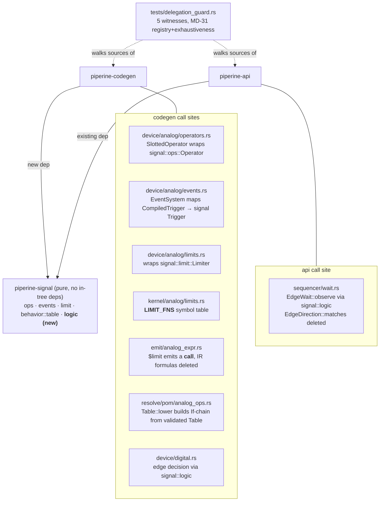

# codegen-simplification Design

**Spec**: `.specs/features/codegen-simplification/spec.md`
**Status**: Draft

---

## Architecture Overview

One direction of dependency, five families, no new concepts. `piperine-signal`
already exists and is already the owner of four of them; this feature makes the
ownership real by deleting the second copies, and extracts a fifth family that
was never extracted and had already drifted.



The JIT gains one thing it did not have: a call to a `piperine-signal`
function. That is not new machinery — it is the `MATH_FNS` mechanism
(`piperine-lang/src/math.rs:47`, imported at
`kernel/analog/compile.rs:148-164`) applied to a second table.

### Approach taken, and the one rejected

**Chosen — per-family incremental delegation, five independent commits.** Each
family is delegated on its own, gated by the full suite, and individually
revertible. The limiter is the only one that touches emission; it is sequenced
after the two trivially-pure families so that if it goes wrong, three
deletions are already banked.

**Rejected — one "delete all copies" change.** It reads cheaper (one diff, one
review) but makes bisection useless: with `ngspice_validation.rs` as the
oracle, a single numeric difference in a five-family diff tells you nothing
about which family moved it. The whole acceptance bar of this feature is
"nothing changed"; that bar is only useful if a violation localizes.

**Ordering consequence.** The digital-edge family (CGS-13/14) goes **last**.
The other four are "delete a copy, prove nothing changed". This one is
extraction plus a deliberate behavior change, so it is the only phase where a
green suite is not itself the proof — it needs a new test asserting a
transition that previously did not fire. Keeping it last means the four
zero-change deletions are already committed and green when the one behavioral
change lands.

---

## Code Reuse Analysis

### Existing Components to Leverage

| Component | Location | How to Use |
|---|---|---|
| `signal::ops::Operator` | `piperine-signal/src/ops.rs:15` | Import. Identical to codegen's enum minus `slot: usize`; variant fields are public, so the `idt` `ic` seeding pattern-match survives |
| `signal::events::{EventDetector, Trigger, CrossDir}` | `piperine-signal/src/events.rs:47` | Import. `fired(trigger, value, time, period)` is codegen's signature with `trigger` by value instead of by reference |
| `signal::limit::{Limiter, LimitKind, pnjlim, fetlim, limvds}` | `piperine-signal/src/limit.rs:59,143` | Two uses: `Limiter` replaces the device-side bookkeeping; the three free functions become JIT-linked symbols |
| `signal::behavior::table::Table` | `piperine-signal/src/behavior/table.rs:52` | Construct in the lowerer for validation + segment geometry; needs one new accessor (below) |
| `MathFn` + `MATH_FNS` pattern | `piperine-lang/src/math.rs:8,47` | Copy the shape for `LIMIT_FNS`: `{ name, arity, symbol }` + a `mod wrappers` of `extern "C"` fns |
| JIT symbol import loop | `kernel/analog/compile.rs:148-164` | Add a second loop over `LIMIT_FNS`; signature builder already generalizes over `arity` |
| `CseKey::Limit(slot)` | `emit/analog_expr.rs:311` | Unchanged — the call result is inserted under the same key, so a repeated `$limit` still collapses |
| `Quad::{from_logic, to_logic}` | `device/digital.rs:19-35` | Keep as codegen's encoding; add `Quad → signal::logic::Logic` beside it |
| `tests/suite_hygiene.rs` source-walk | root `tests/` | The pattern for `delegation_guard.rs`: walk the repo's own sources, look each item up in a table that must account for it |
| `piperine-signal/tests/purity.rs` | `piperine-signal/tests/` | Unchanged and must stay green — it inspects `[dependencies]` only |

### Integration Points

| System | Integration Method |
|---|---|
| Cranelift JIT (analog) | One additional `jit_builder.symbol()` + `declare_function(Linkage::Import)` loop over `LIMIT_FNS` |
| Cranelift JIT (digital) | **None.** `$limit` is analog-only; `kernel/digital/compile.rs`'s `MATH_FNS` loops are untouched |
| Symbolic differentiation | **None.** `resolve/diff.rs:264` already treats `$limit` as transparent (`d(vnew)/dV`); a call is a value site |
| `piperine-lang` headers (MD-24) | **None.** `$limit` is already a declared `extern task`; `pnjlim`/`fetlim`/`limvds` are kind-string *arguments*, not referenceable names |
| Solver ABI | **None.** No `Element` method changes, no new capability bit, no `EventKind` |

---

## Components

### `piperine_signal::logic` (new module)

- **Purpose**: the four-state value and the edge predicate, owned once, on IEEE 1364 semantics.
- **Location**: `crates/piperine-signal/src/logic.rs`
- **Interfaces**:
  - `enum Logic { Zero = 0, One = 1, X = 2, Z = 3 }` — discriminants deliberately match both `piperine_solver::abi::LogicValue` and codegen's `Quad`, so both conversions are a plain `match`, never a transmute
  - `enum EdgeDirection { Rising, Falling, Either }`
  - `EdgeDirection::fires(self, before: Logic, after: Logic) -> bool` — `Rising` ⟺ `before != One && after == One`; `Falling` ⟺ `before != Zero && after == Zero`; `Either` ⟺ `before != after`
- **Dependencies**: none (purity preserved — it defines its own `Logic` precisely so it need not see `LogicValue`)
- **Reuses**: the semantics currently at `device/digital.rs:286`, which is the correct one
- **MD-13 note**: `fires` is a method on `EdgeDirection`, not a loose function (rule 2).

### `piperine_signal::behavior::table::Table` (extended)

- **Purpose**: expose the validated segment geometry so a second renderer (codegen's `If`-chain) can be built from it without re-deriving the rules.
- **Location**: `crates/piperine-signal/src/behavior/table.rs`
- **Interfaces** (added):
  - `Table::points(&self) -> (&[f64], &[f64])` — the validated `xs`/`ys`
  - `Table::segment_slope(&self, i: usize) -> f64` — the existing private `slope`, made public
- **Dependencies**: none
- **Reuses**: existing `with_mode` validation and `slope`; **nothing is reimplemented** — `value`/`derivative` keep sharing `segment`, and the new accessors expose the same arrays those read.
- **Why not expose `segment(x)`**: codegen does not locate a segment at a *value*, it renders every segment at compile time. Exposing the runtime lookup would invite codegen to call it and would say nothing about the `If`-chain.

### `piperine-codegen` — `SlottedOperator`

- **Purpose**: carry the state-array slot that `signal::ops::Operator` deliberately does not.
- **Location**: `crates/piperine-codegen/src/device/analog/operators.rs`
- **Interfaces**:
  - `struct SlottedOperator { slot: usize, op: signal::ops::Operator }`
  - `SlottedOperator::slot(&self) -> usize`, `SlottedOperator::accept(&mut self, time, input) -> f64`
- **Dependencies**: `piperine-signal`
- **Reuses**: `signal::ops::Operator::{delay, slew, transition, integrate}` constructors and `accept`
- **Call-site impact**: `instance.rs:1284`'s `let slot = op.slot();` is unchanged; construction at `instance.rs:207-243` builds the inner `Operator` and wraps it. The `idt` `ic` seeding at `:243` matches on `SlottedOperator { op: Operator::Integrate { value, .. }, .. }`.

### `piperine-codegen` — `EventSystem` (delegating)

- **Purpose**: keep everything that is *not* a detector; delegate the fire decision.
- **Location**: `crates/piperine-codegen/src/device/analog/events.rs`
- **Interfaces**: unchanged externally (`EventSystem::new`, and whatever `instance.rs:detect_events` calls)
- **Dependencies**: `piperine-signal`
- **Reuses**: `signal::events::EventDetector::fired`
- **Mapping**: `CompiledTrigger::{Above, Cross(dir), Timer}` → `signal::events::Trigger::{Above, Cross(dir), Timer}`. `CompiledTrigger::Initial` **has no mapping and gains none** — it is `@initial` dispatch, and `EventSystem` short-circuits it before consulting a detector, exactly as `EventDetector::fired`'s `Initial => false` arm does today.

### `piperine-codegen` — `LIMIT_FNS`

- **Purpose**: the JIT-linkable symbol table for the three limiters.
- **Location**: `crates/piperine-codegen/src/kernel/analog/limits.rs` (the file already owns `$limit` kernel-side bookkeeping)
- **Interfaces**:
  - `struct LimitFn { name: &'static str, arity: usize, symbol: *const u8 }` + `unsafe impl Sync`
  - `const LIMIT_FNS: &[LimitFn]` — `pnjlim`/4, `fetlim`/3, `limvds`/2
  - `mod wrappers { pub extern "C" fn pnjlim(vnew, vold, vte, vcrit) -> f64 { signal::limit::pnjlim(..) } ... }`
- **Dependencies**: `piperine-signal`
- **Reuses**: `piperine-lang/src/math.rs:8-73` verbatim in shape (MD-13 rule 5: a data table plus plain wrappers, never a macro)
- **Why a codegen-local table**: putting these in `piperine-lang::math` would make the *frontend* depend on `piperine-signal` for symbols only codegen links.

### `piperine-codegen` — `$limit` emission

- **Purpose**: emit a call instead of inline IR.
- **Location**: `crates/piperine-codegen/src/emit/analog_expr.rs`
- **Change**: `emit_analog_limit` keeps its kind dispatch, argument evaluation, `vold` state load, slot lookup and `CseKey::Limit(slot)` CSE; the three `emit_*lim` bodies are replaced by one `self.builder.ins().call(limit_fn, args)`. Lines 331–465 (`emit_pnjlim`, `emit_min`, `emit_max`, `emit_fetlim`, `emit_limvds`) are deleted — `emit_min`/`emit_max` have **no other call sites** (verified).
- **Argument packing**: `pnjlim(vnew, vold, vte, vcrit)`; `fetlim(vnew, vold, vto)` where `vto` is the `vte` argument slot; `limvds(vnew, vold)`. This is the existing convention documented at `analog_expr.rs:318-320`, unchanged.
- **Unsupported kinds**: the `other => Err(CodegenError::unsupported(...))` arm stays, so AC 15's loud failure is the same error on the same path.

### `piperine-codegen` — device-side `Limiter`

- **Purpose**: hold seeds/active flags in the shared type.
- **Location**: `crates/piperine-codegen/src/device/analog/limits.rs`
- **Change**: the local `Limiter` struct and its `update` are replaced by `signal::limit::Limiter`. What **stays** in codegen: `seed()` (it calls the kernel to evaluate `vcrit`, which needs `AnalogKernel` + `SimCtx`), the checkpoint/restore packing, and the two-step construction order documented in the file header.

### `piperine-codegen` — `Table::lower`

- **Purpose**: build the `If`-chain from validated data.
- **Location**: `crates/piperine-codegen/src/resolve/pom/analog_ops.rs:128-232`
- **Change**: after `const_array` extraction (unchanged — including its loud failure when `xs`/`ys` are not compile-time constant), construct `signal::Table::with_mode(xs, ys, mode)`; map `TableError` onto the existing `Table::err` path so user-facing messages do not move; then walk `points()` + `segment_slope(i)` to emit the same nested-`If` expression, including the two end clamps.

### `piperine-codegen` — digital edge decision

- **Purpose**: one edge rule.
- **Location**: `crates/piperine-codegen/src/device/digital.rs` (`:286` seq path, `:329` comb path)
- **Change**: both inline `match edge { ... }` blocks become
  `direction.fires(Quad::to_signal(prev), Quad::to_signal(cur))`, with
  `EdgeKind → signal::logic::EdgeDirection` mapping alongside the existing
  `Quad` helpers.
- **Encoding note**: `s.watch` is `Vec<i64>` filled by `eval_watch` and can in principle hold values outside `0..=3`; `Quad::to_logic`'s `_ => X` arm already folds those to `X`, and under the new rule `X → One` still fires `Rising` — identical to today's `prev != 1 && cur == 1`.

### `piperine-api` — `EdgeWait`

- **Purpose**: same rule, host side.
- **Location**: `crates/piperine-api/src/sequencer/wait.rs`
- **Change**: `EdgeDirection::matches` is **deleted**; `EdgeWait::observe` converts `LogicValue → signal::logic::Logic` and calls `EdgeDirection::fires`. `piperine-api` re-exports `signal::logic::EdgeDirection` under its existing name so `pub use wait::EdgeDirection` (`sequencer/mod.rs:40`) and every Python binding keep compiling.
- **What stays host-side**: `baseline: Option<LogicValue>` and the "no prior settled sample ⇒ never fires" arming rule (AC 33) — that is sequencing, not edge semantics.

### `tests/delegation_guard.rs` (new)

- **Purpose**: make "one implementation" a gate (MD-31), not a claim.
- **Location**: root `tests/` (MD-28: it exercises two crates, so it is a cross-crate proof)
- **Shape**: a `const FAMILIES: &[(&str, &[&str], &[&str])]` registry — family name, forbidden identifiers, source roots to walk — asserted exhaustively, failing with the family and the offending `file:line`. Five entries: operators, events, limiter, table, digital edges (the fifth walks both `crates/piperine-codegen/src` and `crates/piperine-api/src`).
- **MD-31 obligation**: each witness must be **proven able to fail** — inject the violation, watch it fail, revert — and the task is not done until that has been done for all five.

---

## Data Models

```rust
// piperine-signal/src/logic.rs
#[derive(Debug, Clone, Copy, PartialEq, Eq)]
pub enum Logic { Zero = 0, One = 1, X = 2, Z = 3 }

#[derive(Debug, Clone, Copy, PartialEq, Eq)]
pub enum EdgeDirection { Rising, Falling, Either }

// piperine-codegen/src/kernel/analog/limits.rs
struct LimitFn { name: &'static str, arity: usize, symbol: *const u8 }

// piperine-codegen/src/device/analog/operators.rs
struct SlottedOperator { slot: usize, op: piperine_signal::ops::Operator }
```

**Relationships**: `Logic`'s discriminants are pinned to `LogicValue`'s
(`piperine-solver/src/digital/events.rs:11`) and to `Quad`'s
(`device/digital.rs:20`). The pinning is a *convention with a test*, not a
transmute: conversions are explicit `match` arms, and a unit test asserts all
four round-trip both ways.

---

## Error Handling Strategy

| Error Scenario | Handling | User Impact |
|---|---|---|
| `$limit` kind string is not `pnjlim`/`fetlim`/`limvds` | Unchanged `CodegenError::unsupported` arm in `emit_analog_limit` | Same loud message as today |
| `table` `xs` not strictly increasing / length mismatch / < 2 points | `TableError` mapped onto the existing `Table::err` path | Same message text as today (AC 17) |
| `table` mode not `"linear"` | `TableError::UnsupportedMode` → same path | Same message as today |
| `table` `xs`/`ys` not compile-time constants | `const_array` returns `None` before any `signal::Table` is built — path untouched | Same loud failure as today (AC 20) |
| Dev-dependency cycle rejected by Cargo | T1 discovers it before any delegation; fallback is relocating the `cross_check_*` fixtures out of `piperine-signal/tests/`, not abandoning delegation | None (build-time, resolved in T1) |

---

## Risks & Concerns

| Concern | Location | Impact | Mitigation |
|---|---|---|---|
| **CSE regression turns one clamp into N calls per Newton iteration** | `emit/analog_expr.rs:311-330` | A junction device's hottest path degrades silently; perf is a non-goal but a regression is not | The `CseKey::Limit(slot)` insert is kept verbatim and the call result stored under it. T7's `Done when` requires asserting the emitted function contains exactly one call per distinct `$limit` slot |
| **Dev-dependency cycle** (`codegen → signal` normal, `signal → codegen` dev) | `piperine-signal/Cargo.toml:9-13` | If Cargo rejects it, every delegation task is blocked | T1 is a standalone proof task, first in the plan, before any code moves |
| **Call overhead on the residual path** | new `$limit` call | Branchless inline math becomes a call per limited junction per iteration | Accepted explicitly by the user (spec Assumptions). Bounded by CSE (one call per slot, not per use). If `ngspice_validation.rs` runtime moves materially, report it — do not silently absorb it |
| **The edge fix changes existing digital test expectations** | `piperine-api` sequencer tests, `wait.rs:72-94` | Existing unit tests encode the *narrow* rule (`rising_matches_zero_to_one_only`) and will fail | Intended. T11 updates those tests to the IEEE rule and adds the `X→1` case. A test asserting the old behavior must be rewritten, never deleted |
| **`instance.rs` is 1 516 lines and construction order is load-bearing** | `device/analog/instance.rs:135-298` | `Limiter::seed` must still run after `@initial` events; the file's own header calls the two-step split deliberate | No task reorders construction. T8's `Done when` names the ordering explicitly |
| **`signal::Table` accessors could leak internals** | `behavior/table.rs:52` | Exposing `xs`/`ys` invites a future caller to re-implement interpolation from them | Accessors return `&[f64]` (read-only) and the module doc states they exist for renderers, not evaluators. `value`/`derivative` remain the only evaluation path |
| **Five witnesses could be written as decoration** | new `tests/delegation_guard.rs` | A guard that cannot fail is worse than none — it reads as coverage | MD-31's explicit obligation: each witness proven able to fail by injection before T12 is done |
| **`piperine-api` re-export churn breaks Python bindings** | `sequencer/mod.rs:40`, `piperine-python` | `EdgeDirection` moving crates could break `pip.` names | Re-export under the existing name and path; T11's gate is the full workspace suite, which includes the Python binding tests |

---

## Tech Decisions

| Decision | Choice | Rationale |
|---|---|---|
| Where `LIMIT_FNS` lives | `piperine-codegen/src/kernel/analog/limits.rs` | Codegen is the only linker of these symbols; `piperine-lang` has no reason to see `piperine-signal` |
| Registration scope | Analog JIT only | `$limit` is analog-only; unused imports in the digital module would be noise |
| Slot carrying | A named `SlottedOperator` wrapper | Preserves `op.slot()` call sites; MD-13 rules 1–2 (methods have an owner) reject a bare `Vec<(usize, Operator)>` |
| Four-state type | `piperine-signal` defines its own `Logic` | The purity guard forbids a `piperine-solver` dependency; discriminants pinned + round-trip tested |
| Edge arming rule | Stays in `piperine-api` | It is sequencing, not edge semantics — the shared detector sees only `(before, after)` |
| `Table` accessor shape | `points()` + `segment_slope(i)`, not `segment(x)` | Codegen renders all segments at compile time; it never locates one at a value |
| Guard placement | Root `tests/delegation_guard.rs` | MD-28: it spans `piperine-codegen` and `piperine-api`, so it is a cross-crate proof |
| Family ordering | Digital edges last | The only phase with an intended behavior change; the four zero-change deletions bank first |

> No project-level decision (`AD-NNN`/`MD-NN`) is created or superseded. This
> feature *executes* MD-36's delegation half; MD-31 supplies the guard shape;
> MD-13, MD-23, MD-24, MD-28 are conformed to without amendment.
