# Composite Values Design (phase C: arrays of carriers)

**Spec**: `.specs/features/composite-values/spec.md` (CV-23 to CV-28, with CV-34 to CV-37 carried)
**Status**: Draft (planned 2026-11-23 while the user is away; the open questions below take their
recommended default unless the user says otherwise)
**Base**: `main` with `composite-values` A–B (MD-79), `explicit-unknowns` phase A (MD-78) and
`generics` phases A–B merged. `generics` is on `origin/feature/generics` (verification fix round,
not merged at planning time); T64 does not start before it is on `main` (spec "Dependencies":
CV-A, CV-B, GN-A, GN-B, **CV-C**, GN-C, …). Phases A and B are `design.md`; phase D is not planned.

---

## What the code does today

| Area | Today | Where |
| ---- | ----- | ----- |
| Checker | `[T; N]` of a non-value element is `P0001` "an array of `Bit<bool>`"; an element or field target of a commit or a definition is `P0001` "an element or field commit/definition" | `crates/piperine-lang/src/types/aggregate.rs` (`array_type`), `types/definition.rs` (`drive_target`) |
| POM | `Recv::CarrierArray(nature, depth)` already walks `x[k]` to one carrier and raises `E0211` for a carrier method on the whole array (POL-19 AC 2) | `crates/piperine-lang/src/pom/resolve/members.rs` |
| IR | `Carrier { name, ty, role, init, origin }` is one carrier; `Expr::Carrier(u32)`, `Expr::Previous(u32)`, `EventSource::Changed(u32)`, `Stmt::Commit { carrier, value, after }`, `Drive { carrier, .. }`; nodes are `BodyNode`s; `Param.structural` exists | `crates/piperine-ir/src/model.rs` |
| ABI | a discrete pin is `layout.size` bytes; a `Statement { pin, offset, len }` already commits part of a pin, and C2/C3 order and transport per byte range, so a field commit needs no ABI change; `MAJOR` 1, `MINOR` 0, edited in place while unreleased (MD-78 item 4) | `crates/piperine-abi/src/raw.rs`, `.specs/features/device-abi/abi.md` §3, §6 |
| Engine | `Store` holds every net's bytes, `PREVIOUS` and change stamps densely; undo is the `Journal` behind `mark`/`rewind`; `write(net, offset, bytes)` | `crates/piperine-digital-solver/src/{store,journal,run,queue}.rs` |
| Binding | `CircuitBuilder::device(.., ports: &[Port])`, `Port` binds a pin to a node or a net by name | `crates/piperine-solver/src/core/{builder,bind}.rs` |
| Plan | `PinLayout` (scalar or `CompositeLayout`) per carrier, param and record field | `crates/piperine-plan/src/{pin,plan,netlist}.rs` |
| Runtime | `rt::Commits::commit(statement, value, after)`, `rt::pin::Field` | `crates/piperine-transpile/src/rt/{commits,pin}.rs` |
| Elaborator | one IR carrier per discrete port or signal (`elab/carriers.rs`), children bind whole carriers and nodes (`elab/children.rs`, `elab/place.rs`); analog loops that contribute are unrolled with the loop variable folded (`elab/unroll.rs`) | `crates/piperine-lang/src/elab/` |
| Host | `Probe::Shaped`/`Column::Shaped`, `Cell::Composite`, leaf paths `v[1]`; a printed path naming a leaf prints that leaf alone | `crates/piperine-api/src/` |
| `explicit-unknowns` C13 | `source_explicit.rs::an_element_never_committed_reads_its_initial_value` proves EU-04 AC 3 on a composite `Bit<[u8; 4]>` stand-in and is marked DEFERRED to `GAPS.md` L24 | `crates/piperine-parity/tests/source_explicit.rs:159` |

---

## Architecture Overview

**Approach (chosen, recommended): one sparse net per array of discrete carriers; one node per
element of an array of nodes.**

| Approach | What it costs | Verdict |
| -------- | ------------- | ------- |
| (1) **Sparse discrete arrays, dense node arrays.** An array of discrete carriers is one `DISCRETE` pin with an element count and one net whose store holds only the elements written; a child port bound to an element or a sub-array binds a *window* of that net. An array of nodes is `K` nodes (each is an MNA unknown anyway) | one engine mechanism (the window) for connections, element events and element commits; storage proportional to what is written (§5.1.3, §5.1.8, Q3 (a)) | **chosen** |
| (2) Every element its own net, expanded at elaboration | no ABI or engine change; violates §5.1.8 ("**MUST NOT** require storage proportional to the declared length") and Q3 (a); `[Bit<u8>; 1 << 32]` cannot elaborate | refused by the spec |
| (3) Dense up to a bound, sparse above it | two code paths for one construct, and the bound is a spec departure (Q3 (b), not chosen by the user) | rejected |

```mermaid
flowchart LR
    src[".msl: signal mem: [Bit&lt;u8&gt;; 1 &lt;&lt; 32]<br/>mem[a] &lt;- d; bl: [Electrical; 4]"] --> chk["types/: Ty::CarrierArray (generics' Length),<br/>element reads, element/field targets,<br/>E0211, E0221 per element, E0313"]
    chk --> elab["elab/: carrier arrays (count, init),<br/>node arrays as K nodes,<br/>element reads/events/commits/drives,<br/>windows to child ports"]
    elab --> ir["piperine-ir: Carrier.count, NodeArray,<br/>CarrierElement, ElementPrevious, ElementChanged,<br/>EventSource::ElementChanged, CommitTarget,<br/>Drive.element, CarrierWindow"]
    ir --> plan["piperine-plan: array pin (count, init Repeat/Each),<br/>element cells, element statements,<br/>Port::Window in the netlist"]
    plan --> print["piperine-transpile print/: element reads and commits;<br/>rt::CarrierArray over abi::ArrayView,<br/>Commits::commit_element"]
    print --> abi["piperine-abi: Pin.count, Cell.element,<br/>ArrayView, Host.commit_element"]
    abi --> eng["piperine-digital-solver: SparseArray store,<br/>element dirtying, windows, journaled undo"]
    plan --> bind["piperine-solver: Port::Window binding"]
    eng --> api["piperine-api: element probes, whole array as CompositeCell"]
    api --> cli["piperine-cli: literal syntax / one column per element"]
    ir --> interp["piperine-interp: refuses each new form by name (R1)"]
```



### The array pin (ABI, edited in place, `MINOR` stays 0 — QC1)

- **`Pin.count: u64`**, appended. `0` is a pin of one carrier (every existing pin). `count >= 1`
  makes a `DISCRETE` pin an **array pin**: `count` elements, each of `layout`. An array pin's net is
  an array net of the same `count` and layout (P4 gains "and equal `count`").
- **`init`** of an array pin is either one element's bytes (every element starts there: the
  `[x; K]` form) or `count × layout.size` bytes (the `[a, b, c]` form); `validate.rs` refuses any
  other length.
- **`Cell.element: u64`**, appended. `WHOLE` (`u64::MAX`) on an array pin means the cell reads the
  array: its `input[i]` is a pointer to an **`ArrayView`** (`#[repr(C)] { data, count, size,
  read: fn(data, element: u64, part: u32) -> *const u8 }`), which returns the `VALUE`,
  `PREVIOUS` or `CHANGED` bytes of one element of the reaction's snapshot (R2). Any other value
  names one element: its `input[i]` is that element's bytes, as for a scalar pin. Reads of a whole
  array and of a constant element are what `reads` declares; the dependency analysis dirties a
  constant-element cell only when that element changes and a `WHOLE` cell when any element does.
- **`Host.commit_element(statement, element: u64, offset, len, bytes, after)`**, appended (the
  `Host.size` gate of abi.md §3 lets a later version append). A statement on an array pin declares
  a range inside one element; `commit_element` names the element at run time. C2 (last write per
  overlapping byte) and C3 (transport per statement and byte range) apply per element.
- A scalar pin bound to one element, and an array pin bound to a contiguous run of elements (a
  sub-array of a nested array), bind a **window** of the array net (`Port::Window { net, first,
  length }` in `piperine-solver`). A window is not an ABI concept: the shape declares a scalar or
  array pin as before; only the owner's binding changes.

### The sparse array net (`piperine-digital-solver`)

`SparseArray` (new `array.rs`) is one array net: its `count`, its element size, its initial value
(`ArrayInit::{Repeat(bytes), Each(bytes)}`), and a `BTreeMap<u64, ElementState>` of the elements
written so far (`value`, `previous`, the microstep stamp of the last change). An element absent
from the map reads `ArrayInit` for that element, its `prev()` is the same value (§5.1.8), and its
`changed()` is true only in the microstep of the `(0, 0)` initial commit (§13 rule 6: the initial
commit is a change of every carrier) — no element is materialized by the initial commit. Every
write is journaled (`Journal<ElementUndo>`), so `mark`/`rewind` (R6) undo element writes without
copying the map. A window is the triple `(net, first, length)`; a scalar pin bound to a window of
length 1 reads and writes that element; its readers are dirtied when that element changes.

### Arrays of nodes

`[Electrical; K]` (any continuous nature) is `K` IR `BodyNode`s named `bl[0]` … `bl[K-1]`,
consecutive, plus one `NodeArray { name, first, count, origin }` entry of the body (serde default)
that keeps the array's name for the host (`Top.bl[2]`, `Top.bl`) and the printer (R3). An index of a
node array in `analog` must fold after `Unrolling` (composite-values T25), else it is refused naming
the index (CV-26 AC 2, QC4). The POM keeps the one declaration as written (UNBREAKABLE RULE).

### Element reads, events, commits and drives (IR)

| Source | IR |
| ------ | -- |
| `mem[i]` (any integer `i`) | `Expr::CarrierElement { carrier, index }` |
| `lines` read whole | `Expr::Carrier(c)` of type `[T; K]` (an array value) |
| `lines[k].prev()` | `Expr::ElementPrevious { carrier, index }` |
| `lines[i].changed()` read as a `bool` in a reaction (§13 rule 9) | `Expr::ElementChanged { carrier, index }` |
| `on lines[k].rise()`, `on lines[k].changed()` (`k` folds) | `EventSource::ElementChanged { carrier, element: u64 }`, guard `CarrierElement` read |
| `bits[i] <- x;`, `st.n <- 3;`, `word[2] <- true;`, `mem[a].f <- v;` | `Stmt::Commit { carrier, target: CommitTarget { element: Option<ExprId>, path: Vec<Projection> }, value, after }` (`target` serde default = whole) |
| `bits[0] = a;` (index folds) | `Drive { carrier, element: Option<u64>, path: Vec<Projection>, .. }` |
| `Child(x[k], ..)`, `Child(x, ..)` to an array port | the child's carrier slot holds `CarrierWindow { carrier, first, length }` |

A field or value-array projection inside one carrier is a byte range of its layout
(`CompositeLayout` gives the offset); an element of an array of carriers is an element index. Both
together (`mem[a].f`) are an element index plus a range. `Ir::check`: an element form only on an
array carrier; an integer index; a constant element below `count`; a projection's levels typed as
the committed value (§12.1.9).

### The generated code

`rt::CarrierArray<T>` (new `rt/array.rs`) wraps an `ArrayView`: `get(index) -> T`,
`previous(index)`, `changed(index)`, `whole() -> [T; K]`; an index `>= count` raises `rt::Panic`
naming the carrier and the index (the owner adds the instance and the instant, CV-25 AC 5).
`rt::Commits::commit_element(statement, index, value, after)` checks the index the same way and
calls `Host.commit_element`. A field commit prints as `commit_range(statement, offset, value,
after)` over the existing `Host.commit` (no ABI change). Each new form prints in
`print/carrier_array.rs` (`impl ValuePrinter`), never in `print/value.rs` beyond a dispatch arm.

### The host

`piperine-api` reads an array net through the engine's element accessor: `Top.lines[3]` is one
element (a scalar or a composite cell), `Top.lines` is every element as `Cell::Composite` of an
array, printed as phase B prints an array value (Q2 (c), D13): `[false, true, …]` in the text
table, record lines and JSON Lines, one column per element (`lines[0]` …) in CSV and the plot. A
node array prints `Top.bl[2]` and, whole, one column per node.

---

## Code Reuse Analysis

### Existing Components to Leverage

| Component | Location | How to Use |
| --------- | -------- | ---------- |
| `Recv::CarrierArray`, `E0211` | `crates/piperine-lang/src/pom/resolve/members.rs` | element walking and the whole-array method refusal stay as they are; the checker no longer masks them with `P0001` |
| `array_type`, `fold_length`, `Length` (generics A) | `crates/piperine-lang/src/types/aggregate.rs`, `types/lengths.rs`, generics `types/ty.rs` | `Ty::CarrierArray { element, length: Length }` reuses the folded length; `Length::Generic` stays refused until `generics` GN-13 |
| `drive_target`, the `committed`/`defined` books | `crates/piperine-lang/src/types/definition.rs`, `types/reaction.rs` | keyed by `(carrier, element)` for `E0221` per element |
| `E0313` (array shape of a connection) | `docs/spec/part_iii_structure.md` §8.1.10 | CV-23 AC 3 |
| `HandleBinding::Carrier(u32)` (generics B) | generics `crates/piperine-lang/src/elab/handles.rs` | gains `Element { carrier, index }` so `f(lines[k])` binds one carrier (QC3) |
| `Unrolling` | `crates/piperine-lang/src/elab/unroll.rs` | folds the loop variable that indexes a node array (CV-26) |
| `Place`/`Projection` | `crates/piperine-ir/src/model.rs` | `CommitTarget.path` and `Drive.path` reuse `Projection` |
| `CompositeLayout`, `PinLayout` | `crates/piperine-plan/src/{composite,pin}.rs` | element layout and the byte range of a field projection |
| `Statement { offset, len }`, C2/C3 overlap order | `piperine-abi`, `crates/piperine-digital-solver/src/queue.rs` | field commits with no ABI change; per-element ordering extends the same comparison |
| `Journal` | `crates/piperine-digital-solver/src/journal.rs` | undo of element writes |
| `CellShape`, `CompositeCell`, leaf paths | `crates/piperine-api/src/{composite,table}.rs` | whole-array and element cells |
| `CompositeForms` (interpreter refusals) | `crates/piperine-interp/src/composite.rs` | one arm per new form |
| `ElementsBench` (explicit-unknowns C13) | `crates/piperine-parity/tests/explicit/` | becomes the real `[Bit<Option<u8>>; 1 << 20]` |

### Integration Points

| System | Integration Method |
| ------ | ------------------ |
| `piperine-ir` serde | `Carrier.count`, `Body.node_arrays`, `Commit.target`, `Drive.element`/`path` carry `#[serde(default)]`; new `Expr`/`EventSource` variants are appended last |
| Device ABI | appended fields and one appended `Host` entry, in place at `MINOR` 0 (QC1); `abi.md` §3, §3.1 (P4), §6 amended in the same task |
| `generics` B handles | `HandleBinding::Element` (T79) |
| `generics` C (after this phase) | GN-17 (generated arrays of instances), GN-19 (`for k in 0..N { on lines[k].rise() }`) and generic `[Bit; ROWS]` ports build on `Port::Window`, `EventSource::ElementChanged` and `Length::Generic` |
| `explicit-unknowns` | EU-04 AC 3 (C13) is proven by this phase's real array (T86) |

---

## Components

Each new file has one purpose and an owner type; new methods of an existing owner live in a
sibling file under an `impl` block of that owner.

- **`piperine-abi`**: `raw.rs` (`Pin.count`, `Cell.element`, `WHOLE`, `ArrayView`,
  `Host.commit_element`), `validate.rs` (array pin rules), `shape.rs` (`PinSpec.count`).
- **`piperine-digital-solver`**: `array.rs` (`SparseArray`, `ArrayInit`, `ElementState`,
  `ElementUndo`), `window.rs` (`NetWindow`), `net.rs` (`NetSpec.count`, `NetSpec.array_init`),
  dirtying per element in `run.rs`, per-element order in `queue.rs`.
- **`piperine-solver`**: `core/bind.rs` (`Port::Window`), `CircuitBuilder::array_net`.
- **`piperine-transpile`**: `rt/array.rs` (`CarrierArray<T>`), `rt/commits.rs`
  (`commit_element`, `commit_range`), `print/carrier_array.rs` (`impl ValuePrinter`).
- **`piperine-ir`**: `model.rs` forms above; `check/carrier_array.rs` (the `Ir::check` rules);
  `typing.rs`, `print.rs`, `statements.rs` (an element commit inside a loop is one statement,
  §12.1.14), `deps.rs` (an element read is a read of the carrier).
- **`piperine-plan`**: `array.rs` (`ArrayPin`: count, element layout, init form, element cells,
  element statements), `netlist.rs` (windows).
- **`piperine-lang` checker**: `types/carrier_array.rs` (`impl Checker`: the array of carriers as
  a signal or port type, nested arrays, initial value `E0210`), `types/element.rs` (element reads,
  history, events, probes, `E0211` passes through), `types/definition.rs` (element and field
  targets, `E0221` per element), `types/connection.rs` (array and element connections, `E0313`,
  `E0223`).
- **`piperine-lang` elaborator**: `elab/carrier_arrays.rs` (`CarrierArrays`: declarations, init
  form, node arrays), `elab/elements.rs` (`impl Elaboration`: reads, history, events, handle
  binding of an element), `elab/element_commits.rs` (commit targets and element drives),
  `elab/children.rs` (windows), `elab/unroll.rs` (node-array indices after unrolling).
- **`piperine-api`**: `array_probe.rs` (`ArrayProbe`: element and whole-array cells of an array
  net or a node array).
- **`piperine-interp`**: `composite.rs` (one refusal arm per new IR form).

---

## Data Models

```rust
// piperine-abi raw.rs (appended, MINOR 0)
pub struct Pin<'a> { /* …, */ pub count: u64 }            // 0: one carrier; >= 1: an array pin
pub struct Cell { /* kind, index, part, */ pub element: u64 } // WHOLE = u64::MAX on an array pin
#[repr(C)] pub struct ArrayView { pub data: *const c_void, pub count: u64, pub size: u32,
    pub read: unsafe extern "C" fn(*const c_void, element: u64, part: u32) -> *const u8 }
pub struct Host { /* size, commit, */ pub commit_element: unsafe extern "C" fn(*mut c_void,
    statement: u32, element: u64, offset: u32, len: u32, bytes: *const u8, after: f64) -> u32 }

// piperine-digital-solver array.rs
pub enum ArrayInit { Repeat(Vec<u8>), Each(Vec<u8>) }
pub struct ElementState { value: Vec<u8>, previous: Vec<u8>, changed_at: Microstep }
pub struct SparseArray { count: u64, size: u32, init: ArrayInit, written: BTreeMap<u64, ElementState>, journal: Journal<ElementUndo> }
pub struct NetWindow { pub net: NetId, pub first: u64, pub length: u64 }

// piperine-ir model.rs (appended)
pub struct Carrier { /* …, */ #[serde(default)] pub count: Option<u64> }
pub struct NodeArray { pub name: String, pub first: u32, pub count: u32, pub origin: Origin }
pub struct CommitTarget { pub element: Option<ExprId>, pub path: Vec<Projection> }
pub struct CarrierWindow { pub carrier: u32, pub first: u64, pub length: Option<u64> } // None: one element as a scalar
pub enum Expr { /* …, */ CarrierElement { carrier: u32, index: ExprId },
    ElementPrevious { carrier: u32, index: ExprId }, ElementChanged { carrier: u32, index: ExprId } }
pub enum EventSource { /* …, */ ElementChanged { carrier: u32, element: u64 } }

// piperine-lang types/ty.rs
pub enum Ty { /* …, */ CarrierArray { element: Box<Ty>, length: Length } }   // element: Ty::Carrier, Ty::Node or a nested CarrierArray
```

Nested arrays (`[[Bit; 4]; 2]`, allowed by `sigtype`) are one array net, row-major: element
`x[r][c]` is `r * 4 + c`, and `x[r]` is the window `(4r, 4)`.

---

## Error Handling Strategy

| Error Scenario | Handling | User Impact |
| -------------- | -------- | ----------- |
| Array argument and array port of different lengths or shapes | `E0313` naming both lengths (§8.1.10, CV-23 AC 3) | elaboration fails |
| A carrier method on a whole array of carriers | `E0211` (§5.1.7, CV-24 AC 3), reaching the user unmasked | elaboration fails |
| A definition and commits of one element in one module | `E0221` naming the element (§5.2.4, CV-25 AC 3) | elaboration fails |
| An array initial value of the wrong type, or reading a carrier | `E0210` (§5.1.5) | elaboration fails |
| An array signal with an initial value whose element goes to a child's `out` port | `E0223` (initial value given twice, §5.2.6) | elaboration fails |
| A constant element index out of range (a connection, an event, a definition, an analog index) | `E0104` naming the index (§1 rule 11, as CV-13 at elaboration) | elaboration fails |
| A run-time element index out of range | `rt::Panic` naming the carrier and the index; the owner adds the instance and the instant (CV-25 AC 5) | the analysis fails |
| A node-array index in `analog`, an event head's element index or a definition's element index that does not fold | `E0188` naming the index (QC4, user 2026-11-23) | elaboration fails |
| An array of carriers as a function parameter or a `let` type | `P0001` naming the form (QC3: the spec is silent) | elaboration fails |
| A new IR form on the interpreter backend | refused by the form's name (R1, CV-34) | `Interp` refuses to build |
| An `init` of an array pin of another length than one element or `count` elements | `validate.rs` refuses the shape | a foreign library fails to load |

---

## Goldens, pins and tests that may move

| What | Why | Task |
| ---- | --- | ---- |
| `crates/piperine-lang/tests/types_aggregates.rs::phase_c_and_d_forms_stay_p0001_by_name` | its `[Bit<u8>; 4]` case runs now; the `f32`/`u128` cases (phase D) stay | T74 (the array case leaves, the test keeps the phase D cases and its name) |
| `tests/book/natures.rs::signals_of_every_family_are_refused_for_the_arrays_the_option_the_logic_and_the_net` | `[Bit; 8]` runs; `Bit<Logic<4>>` and `Sda` stay refused | T89 (renamed `signals_of_every_family_are_refused_for_the_logic_and_the_net`, `inventory.tsv` follows) |
| `tests/book/modules.rs::the_memory_bank_is_refused_for_its_struct_arrays_and_generics` | the arrays of carriers no longer refuse; the generic module and template stay | T89 (renamed `the_memory_bank_is_refused_for_its_generic_module`) |
| `crates/piperine-parity/tests/source_explicit.rs::an_element_never_committed_reads_its_initial_value` (model `ElementsBench`) | the stand-in becomes the real array of EU-04 AC 3 | T86 (same test name, stronger model) |
| A test asserting `P0001` "an element or field commit"/"definition" | the form runs | T76 (`types_buck.rs` 2 rows, `elab_unlowered.rs`, `types_subset.rs`, `elab_entry.rs`) |
| `crates/piperine-abi/tests/contract.rs::the_host_has_one_commit` (EU-16: "Host is 16 bytes, one commit") | QC1, approved by the user 2026-11-23: `Host` is 24 bytes with `commit_element`; supersedes EU-16 AC 2 | T65 |
| `crates/piperine-lang/tests/types_buck.rs` `an array type` row | `[Bit; 4]` runs | T74 |

Never moving: the twin goldens, `crates/piperine-parity/src/contract.rs`, the transpile goldens of
`crates/piperine-transpile/tests/golden/`, every parity target, every buck target's assertions.

---

## Risks & Concerns

| Concern | Location (file:line) | Impact | Mitigation |
| ------- | -------------------- | ------ | ---------- |
| The engine's dense `Store` assumes one byte buffer per net | `crates/piperine-digital-solver/src/store.rs:120` | an array net cannot live there without being dense | `SparseArray` is a separate store keyed by net, reached through the same `value`/`write` entry points by a net kind; T66 tests both kinds side by side |
| Checkpoint cost of an array net | `store.rs:153` (`mark`), `journal.rs` | copying a map per landing would cost what was written, every landing | element writes go through `Journal<ElementUndo>`, as byte writes do; a checkpoint copies nothing |
| Peak-heap measurement of CV-27 | `crates/piperine-api/tests/` | the generated device is a `cdylib` with its own allocator, invisible to a host `#[global_allocator]` | storage of an array lives in the engine (host side) by design; the device holds only an `ArrayView` pointer, so the host meter sees all storage that could scale with the length; the test asserts the meter counted the 1 000 written elements (a positive control) |
| `print/value.rs` and `elab/children.rs` are large | `print/value.rs`, `elab/children.rs` (351 lines) | god files | new forms in `print/carrier_array.rs`, `elab/elements.rs`, `elab/element_commits.rs`; `children.rs` gains the window builder only |
| A whole read or a whole print of a very long array | `rt/array.rs` (`whole`), host `ArrayProbe` | `[Bit<u8>; 1 << 32]` read whole is a 4 GiB value | the language allows it and the cost is what the author wrote (QC5); `whole()` builds the value on the heap (`Box<[T; K]>`), never the stack |
| `generics` not merged when phase C is due | `origin/feature/generics` (verification FAIL, fix round) | T64 cannot start | T64's first step checks `generics` A–B are on `main`; if not, the batch stops and reports (no work on an unmerged base) |
| Element events multiply event functions | `crates/piperine-plan/src/plan.rs` | one private event pin per `(carrier, element)` named in an event head | only elements named by a folded index get one; a whole-array reader is one cell |

---

## Tech Decisions

| Decision | Choice | Rationale |
| -------- | ------ | --------- |
| Discrete arrays | one sparse array net per array, windows for element bindings | §5.1.3, §5.1.8, Q3 (a); one mechanism for connections, events and commits |
| Node arrays | `K` nodes plus `NodeArray` metadata | an MNA unknown per node is inherent; §5.1.8 is a rule of discrete carriers |
| Reads of an array pin | `ArrayView` behind a `WHOLE` cell; a constant element is an ordinary cell | the snapshot (R2) stays the owner's; no copy of the array into a frame |
| Element commits | `Host.commit_element`; field commits use the existing `offset/len` | no change where none is needed |
| ABI version | appended in place at `MINOR` 0 | MD-78 item 4 (unreleased, edited in place); QC1 |
| Nested arrays | one array net, row-major, sub-arrays as windows | `sigtype` allows nesting; one net per declaration |
| Structural params | a param read by an array length is marked `structural` (§8.1.2) | the IR already has `Param.structural`; QC2 |

New project-level decision, recorded in `.specs/STATE.md` when phase C closes (T90), as an
extension of MD-79: "An array of discrete carriers is one sparse array net; a child binds a window
of it; an array of nodes is one node per element. The ABI's array pin (`Pin.count`, `Cell.element`,
`ArrayView`, `Host.commit_element`) was added in place at `MINOR` 0 (MD-78)."

---

## Decisions taken (user AFK)

| # | Open point | Default taken | Why |
| - | ---------- | ------------- | --- |
| DC1 | CV-24 AC 1 ("with their flags") and AC 4 ("never committed reads as unknown") were written before MD-78 | an array reads as an array value with no flag; an element never committed reads the array's initial value for that element, and its `prev()` that value (§5.1.8 today, EU-04 AC 3) | code follows docs/spec; MD-78 removed every flag |
| DC2 | Where the files go | `design-c.md`/`tasks-c.md`, tasks numbered T64 on and checks C111 on, so ids stay unique in the feature | design.md D1 |
| DC3 | The R-ladder "against its ngspice twin's values" (Independent Test) | the ladder against the written-out circuit (identical solution) and against its closed-form node voltages computed by Rust in the test; no new twin (QC6) | the ladder is linear, so Rust gives the exact value; the twin set is a frozen corpus |
| DC4 | An array signal with an initial value whose element is handed to a child's `out` port | `E0223` | §5.2.6 and §5.2.3: the initial value is given once, by the driver |
| DC5 | Nested arrays of carriers | accepted, row-major | `sigtype ::= '[' sigtype ';' expr ']'` |
| DC6 | Batch order | phase C starts after `generics` A–B merge (T64 checks it) | spec "Dependencies"; generics design: its phase C needs this phase |

---

## Open questions (each with the default the plan takes)

| # | Question | Default (taken unless the user objects) |
| - | -------- | --------------------------------------- |
| QC1 | Q3 (a) said the sparse array is an ABI change of minor version; MD-78 later made the unreleased ABI "edited in place, `MINOR` 0" | in place, `MINOR` stays 0; `abi.md` amended in the same task |
| QC2 | An array length that reads a param (`signal s: [Bit; n];`) | accepted; the param is marked structural (§8.1.2), so a host `set` of it during a run is refused (`E0803`); `generics` GN-20 extends the same flag to generation and templates |
| QC3 | An array of carriers as a function parameter (`fn f(a: [Bit; 8])`): §3 rule 7 makes a nature or bundle parameter a handle and says nothing of an array of them | refused by name (`P0001` "an array of carriers as a function parameter"); `GAPS.md` §5 gets a spec-hole row for the user; an element `f(lines[k])` binds a handle as one carrier (generics B) |
| QC4 | An index that must fold but does not (a node-array index in `analog`, an event head's element, a definition's element): CV-26 AC 2 says "naming the index" and no code | `E0188` "not a const expression" naming the index, the code the spec gives a non-constant where a constant is required. The first default (`P0002`) cannot be met, no source spells it (PI-06); the user chose `E0188` over `E0180` on 2026-11-23 |
| QC5 | A whole read or a whole print of a very long array (`Top.mem` of `1 << 32` elements) | allowed as the spec writes it, every element (CV-28 AC 1); the cost is what the author asked for |
| QC6 | The ladder's ngspice comparison | closed form plus the written-out circuit, no new twin (DC3) |
