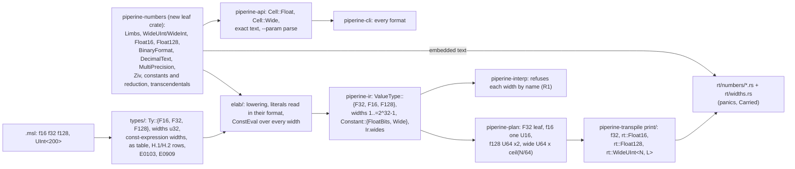

# Composite Values Design (phase D: number widths)

**Spec**: `.specs/features/composite-values/spec.md` (CV-29 to CV-33, with CV-34 to CV-37 carried)
**Status**: Draft (planned 2026-11-23; the open questions below take their default unless the user
says otherwise)
**Base**: batches D1 and D2 run on `main` as it is (they add one new crate and touch nothing phase C
touches); batches D3 and D4 start on `main` with phase C (`design-c.md`, T64 to T90) merged. T105
checks it and stops the batch if not.
**User decision Q4 (2026-11-23, answered by the user directly):** integers (a), `f16` (a), `f128`
(a) complete — see spec.md "Questions answered".

---

## What the code does today

| Area | Today | Where |
| ---- | ----- | ----- |
| Checker types | `Ty::F64` is the one float; `Ty::UInt(u8)`/`Ty::Int(u8)` hold 1..=64; `Float<16>`, `Float<32>`, `Float<128>` (`f16`, `f32`, `f128`) are `P0001` "type `f32`"; a width over 64 is `P0001` "integer type `u128`"; a width below 1 and a float width outside {16, 32, 64, 128} are `E0103`; a width that is not an integer literal (`UInt<{A + 1}>`) is `P0001` "with a width that is not an integer literal" | `crates/piperine-lang/src/types/check.rs:460-511` |
| Lexer | float suffixes `f32`, `f64`; integer suffixes `u1`..`u128`, `i1`..`i128`; a float literal keeps its `f64` value and its raw text (`Token::Float { value, raw }`); an integer literal's value is a `u128`; `E0909` for an infinite float or an integer past its suffix (unsuffixed: 128 bits) | `crates/piperine-lang/src/msl/lexer.rs:541-830` |
| Method catalogue | `F64_METHODS` (H.2) and `INTEGER_METHODS` (H.1) keyed by `Ty::F64` and `Ty::UInt(_) \| Ty::Int(_)` | `crates/piperine-lang/src/types/catalogue.rs:69-141` |
| Constant evaluation | integers as `i128`, wrapped by `1i128 << bits` (overflows at 127 bits); reals as `f64` | `crates/piperine-lang/src/elab/consts.rs:893-940` |
| IR | `ValueType::{F64, UInt(u32), Int(u32), ..}`; `Ir::check` refuses a width outside 1..=64 (RS-Q6); `Constant::{Real, Bool, Int(i128), Aggregate}`; `Method`, `MathFn` typed by operand | `crates/piperine-ir/src/model.rs:786-1043`, `check.rs:773-891` |
| ABI | leaves `BOOL U8 U16 U32 U64 I8 I16 I32 I64 F32 F64`; `Field.count` exists; no `F16`, no `F128`, nothing wider than 64 bits | `crates/piperine-abi/src/raw.rs:722`, `layout.rs` |
| Plan | `CarrierLayout::of` maps each scalar to a static layout (integers to the narrowest of 1, 2, 4, 8 bytes); `CompositeLayout` emits one `count: 1` field per leaf | `crates/piperine-plan/src/digital.rs:206`, `composite.rs` |
| Runtime | `rt::UInt<N>`/`rt::Int<N>` assert 1..=64; `Real`/`Dual` are `f64`-based; the runtime is embedded text (`rt.rs`, `Runtime::files`); generated code links `piperine-abi` only (MD-63 item 1) | `crates/piperine-transpile/src/rt.rs`, `rt/int.rs`, `rt/real.rs` |
| Printer | `rust_type` refuses a width outside 1..=64 (`Error::Unsupported`); a cast of an `f64` to an integer in `analog` drops the tangent (`.value()`) | `crates/piperine-transpile/src/print/value.rs:605-640, 810` |
| Host | `Cell::{Real(f64), Bool, Int(i128), Text, Composite, Absent}` | `crates/piperine-api/src/table.rs:19` |
| Interpreter | frozen at the M1 analog subset (R1); refuses composite forms by name (`CompositeForms`) | `crates/piperine-interp/src/composite.rs` |
| Book | language chapter's status box: "not run yet: … floats other than `f64`, and integers wider than 64 bits", proven by `a_form_not_run_yet_is_stopped_before_the_run_with_p0001_naming_it` | `docs/book/content.html:697`, `tests/book/language.rs:197` |
| Records | `GAPS.md` L13 (§4.1) and the §9 row "I §1–§2 values" ("floats other than `f64`, widths over 64") | `GAPS.md:101, 301` |

---

## Architecture Overview

**Approach (chosen): one numeric library, compiled as a leaf crate for the toolchain and embedded
verbatim as runtime source for generated code.**

| Approach | What it costs | Verdict |
| -------- | ------------- | ------- |
| (1) **A leaf crate `piperine-numbers`, embedded as `rt` source.** Its files are a normal crate (no dependency, no `unsafe`, no macro) that the elaborator, the plan and the host link, and the same files are written into a design's cache entry as `rt/numbers/*.rs`, as `abi_source.rs` already embeds `piperine-abi`'s files | one implementation of every operation, so elaboration (CV-36), the host's text and the generated code agree bit for bit; generated code still links `piperine-abi` only and compiles only embedded runtime source (MD-63 item 1 holds) | **chosen** |
| (2) The library only in `crates/piperine-transpile/src/rt/` | the elaborator (`piperine-lang`) cannot depend on `piperine-transpile` (it depends on the solver); const evaluation of `f128` and wide integers would need a second implementation | rejected: two implementations of a correctly rounded library disagree |
| (3) An external crate (`rustc_apfloat`, `num-bigint`, a libquadmath binding) | MD-63 item 1: generated code links `piperine-abi` and nothing else; a C library breaks "no `unsafe`" | refused by MD-63 |

**MD-63 item 1, checked:** "Generated code links `piperine-abi` and nothing else. Besides that crate
it uses only the embedded runtime source `rt.rs`; it holds no `unsafe` and no macro." The `f128`
library lives in `rt` in the sense that matters to that rule: generated code receives it as
embedded runtime source (`rt/numbers/*.rs`), compiled with the design, and links no external crate.
No other dependency rule binds (AGENTS.md: `piperine-abi` is the only in-tree crate a *solver* crate
may depend on; `piperine-numbers` is depended on by `piperine-ir`'s neighbours, never by a solver
crate). `num-bigint` (already in `Cargo.lock`) is a **dev-dependency** of the test oracles only and
never reaches a library or generated code.



### The numeric library (`crates/piperine-numbers`)

Every file has one purpose and one owner type; a file refers to a sibling only as `super::<file>::`,
so it compiles both as a module of the crate and as a module of `rt::numbers` in generated code
(T91's purity test enforces it, with no `use` of any crate but `core`/`std`).

| File | Owner | Purpose |
| ---- | ----- | ------- |
| `limbs.rs` | `Limbs` (trait on `[u64]`) | magnitude arithmetic on little-endian `u64` limbs: add, subtract, multiply, divide with remainder (Knuth D), shifts, compare, bit length, decimal digits |
| `wide.rs` | `WideUInt<const N: u32, const L: usize>`, `WideInt<N, L>` | integers of `N` bits in `L = ceil(N/64)` limbs (const generic arithmetic is not stable, so `L` is spelled and asserted), wrapping modulo `2^N` (§1 rule 6), two's complement; every operator but `/` and `%` (which panic, so they live in `rt/widths.rs`), comparisons, `as` among integer widths, H.1 methods in their total form (`checked_divide -> Option`, `clamp_checked -> Option`) |
| `format.rs` | `BinaryFormat` | the parameters of an IEEE 754 binary interchange format (precision, exponent range) for 16, 32, 64 and 128 bits, and rounding an exact value (a big magnitude and a binary exponent, with a sticky bit) to the nearest of the format, ties to even, with subnormals, overflow to infinity |
| `decimal.rs` | `DecimalText` | decimal text to the nearest value of any `BinaryFormat` (A.8 rule 8, for literals and `--param`), and the shortest decimal text that reads back to the same value (the host's text) |
| `half.rs` | `Float16` | `f16` stored as its bits: `+ - * /` and `sqrt` computed in `f32` and rounded to `f16` (exact: 24 ≥ 2·11 + 2); comparisons as IEEE 754 (NaN unordered, `-0.0 == 0.0`); conversions rounded directly from the source (never through `f32` twice); the H.2 transcendentals computed in `f64` and rounded once to `f16` (QD3) |
| `quad.rs` | `Float128` | `f128` stored as its `u128` bits: `+ - * /`, `sqrt`, comparisons, classification, `floor`/`ceil`/`round`/`trunc`/`fract`, `abs`, `signum`, `min`/`max`/`clamp`, `rem_euclid` and `hypot` exact then rounded once |
| `convert.rs` | `NumberConversion` | `as` (§1.4.5) between every pair of float and integer widths, each rounded once from the source, never through an intermediate format |
| `precision.rs` | `MultiPrecision` | binary floats of any precision with directed rounding (a lower and an upper bound), the arithmetic the transcendentals need |
| `constants.rs` | `ReferenceConstants` | π, ln 2 and ln 10 to any precision (cached per precision behind `std::sync::OnceLock`, safe std) |
| `reduction.rs` | `ArgumentReduction` | `x mod π/2` for every finite `f128` (Payne–Hanek with π to the bits the exponent needs), `x = k·ln 2 + r` |
| `ziv.rs` | `ZivRounding` | evaluates a function as an interval at increasing precision until both bounds round to one `f128`; each function supplies its exact cases (below) so the loop ends |
| `transcendental.rs` | `impl Float128` (sibling file) | `exp`, `ln`, `log2`, `log10`, `powf`, `powi`, `sin`, `cos`, `tan`, `asin`, `acos`, `atan`, `atan2`, `sinh`, `cosh`, `tanh`, each correctly rounded |

**Exact cases (the Ziv loop never meets an unresolvable midpoint).** A transcendental of a nonzero
algebraic argument is transcendental (Lindemann–Weierstrass), so it is never a representable value
or a midpoint, and the loop ends; the exceptions are found before the loop and returned exactly:
`exp(0)`, `ln(1)`, `sin/tan/asin/atan/sinh/tanh(±0)`, `cos(0)`, `cosh(0)`, `acos(1)`, `log2(2^k)`,
`log10(10^k)` (`k` an integer with `10^k` exact), `atan2` of signed zeros and infinities, `powf`
and `powi` whose result is rational (an integer exponent, or `x` a perfect power of `2^(1/2^j)`
form): computed exactly with `Limbs` when the exact result has at most 2·113 + 2 significant bits,
otherwise it is neither representable nor a midpoint and the loop is safe.

### Correct rounding, as decided

| Type | Operation | Result |
| ---- | --------- | ------ |
| `f32` | everything | Rust's `f32` (CV-29 AC 1): the generated code and the const evaluator both compute with Rust's `f32`, so the results are those Rust gives on the machine of the session (H.2 rule 6, G.69) |
| `f16` | `+ - * /`, `sqrt`, conversions, comparisons, the exact H.2 methods | IEEE 754 binary16, correctly rounded (user Q4 (a)) |
| `f16` | transcendental H.2 methods | correctly rounded: computed in `f64` and rounded once; proven over **every** `f16` input for each one-argument method (QD3) |
| `f128` | every operation and every H.2 method, the transcendentals included | IEEE 754 binary128, correctly rounded (user Q4 (a)) — stronger than H.2 rule 6's one-ulp bound, which it satisfies |
| `UInt<N>`, `Int<N>`, `N > 64` | every operation, every H.1 method | exact modulo `2^N` (§1 rule 6) |

### Where the widths meet the IR, the ABI and the host

- **IR.** `ValueType` gains `F32`, `F16`, `F128` (appended, serde). `UInt(u32)`/`Int(u32)` already
  hold any width; `Ir::check` accepts `1..=2^32 − 1` (QD1). `Constant::FloatBits(u128)` is a float of
  a non-`f64` width read by the type of its position, as `Constant::Int` is; `Constant::Wide(WideId)`
  names `Ir.wides: Vec<WideData>` (`limbs: Vec<u64>`, two's complement at the type's width), the one
  form of a constant of an integer type wider than 64 bits. `Method`/`MathFn` are typed by operand:
  every float width takes the H.2 rows, every integer width the H.1 rows. `Constant::Real` stays the
  `f64` form, so every existing IR text and serde byte is unchanged.
- **ABI (no change, Q4 integers (a)).** `f32` is the `F32` leaf. `f16` is one `U16` field. `f128` is
  one `U64` field of `count` 2 and an integer of `N > 64` bits one `U64` field of `count`
  `ceil(N/64)`, low limb first, the bit pattern of §2's table (`Float<N>`: the IEEE 754 bits; an
  integer: two's complement). The **metadata** that says these bytes are one number is the IR type of
  the pin (the host already reads the IR, `Metadata::of`), never the layout: abi.md §3.1 P3 gains
  that sentence. Two pins of one net still have equal layouts (P4), the layout being a function of
  the IR type.
- **Runtime.** `rt/numbers/*.rs` are the library's files, embedded; `rt/widths.rs` adds MSL's rules
  over them that need `rt::Panic` (an integer `/` or `%` by zero, `clamp` with `lo > hi` or a NaN
  bound, §1 rule 11), `rt::Carried` for each type (bytes and levels, §2), and conversions to and from
  `rt::UInt<N>`, `rt::Int<N>` and `f64`/`R`. A design that uses none of the new types gets exactly
  the runtime files it has today (`Runtime::files` gains a `numbers` switch), so every transpile
  golden and cache key of the existing corpus is byte-identical.
- **Generated Rust (R3).** `f32` prints as `f32` with Rust's methods; `f16` as `rt::Float16`,
  `f128` as `rt::Float128`, `UInt<200>` as `rt::WideUInt<200, 4>`, `Int<100>` as
  `rt::WideInt<100, 2>`; operators print as Rust operators (the library implements them), methods
  as methods of the same names, `as` as `rt::Convert` calls. `UInt<N>` for `N <= 64` is unchanged.
- **`analog`.** "Analog code computes in `f64`" (§1 table): a non-`f64` float or a wide integer in
  an `analog` body is a value with no tangent; `x as f32` of a differentiable `f64` drops the tangent,
  as `x as u8` does today (`print/value.rs:810`; QD4). A contribution and a probe comparison take
  `f64` only (CV-29 AC 3, §1 rule 7).
- **Host (Q2 (c)).** `Cell::Float(FloatCell { format, bits })` for `f16`, `f32`, `f128`;
  `Cell::Wide(WideCell { signed, width, limbs })` for an integer wider than 64 bits. Text, record
  lines and JSON Lines print the shortest decimal that reads back to the same value in that format
  (`DecimalText`), JSON as a number; CSV the same text; the plot the nearest `f64`. `--param x=…`
  reads decimal (and `0x`/`0o`/`0b` for integers) into the type, correctly rounded (A.8 rule 8).
  `Cell::Real(f64)` and `Cell::Int(i128)` keep every existing width, so no golden moves.
- **Interpreter (R1).** `crates/piperine-interp/src/widths.rs` (`NumberWidths`) refuses a body any
  of whose types is `f16`, `f32`, `f128` or an integer over 64 bits, naming the type
  (`a value of type f32`), checked before `CompositeForms`.

---

## Code Reuse Analysis

### Existing Components to Leverage

| Component | Location | How to Use |
| --------- | -------- | ---------- |
| `float_type`/`integer_type`, `E0103` | `crates/piperine-lang/src/types/check.rs:460-511` | the widths are accepted there; `E0103` keeps its two cases and gains the C.2 limit (QD1) |
| `fold_length` (array lengths) | `crates/piperine-lang/src/types/aggregate.rs`, `types/lengths.rs` | a const-expression width (`UInt<{A + 1}>`) folds as an array length folds; a width naming a const generic parameter stays `generics`' (`Length::Generic`) |
| `F64_METHODS`, `INTEGER_METHODS` | `crates/piperine-lang/src/types/catalogue.rs` | keyed by every float width and every integer width (H.2 and H.1 are one table per family) |
| `Token::Float { raw }`, `int_value` | `crates/piperine-lang/src/msl/lexer.rs` | the raw text is read again into the position's format by `DecimalText` |
| `ConstEval` integer and real arms | `crates/piperine-lang/src/elab/consts.rs` | gain a `NumberValue` arm per width; widths `<= 64` keep the `i128` path unchanged |
| `CarrierLayout::of`, `CompositeLayout` leaves | `crates/piperine-plan/src/digital.rs`, `composite.rs` | the new scalars and their `count` |
| `abi_source.rs` (`include_str!` of `piperine-abi`) | `crates/piperine-transpile/src/abi_source.rs` | the pattern `rt.rs` follows to embed `piperine-numbers` |
| `rt::Panic`, `rt::Carried`, `rt::LevelWords` | `crates/piperine-transpile/src/rt/{control,pin}.rs` | `rt/widths.rs` raises and carries through them; `LevelWords` already holds more than 64 levels |
| `rust_type`, `integer_path` | `crates/piperine-transpile/src/print/value.rs` | one dispatch arm each to `print/widths.rs` (`impl ValuePrinter`) |
| `Cell`, `CompositeCell`, `param_text.rs` | `crates/piperine-api/src/{table,composite,param_text}.rs` | the two new cells; the param text reader per type |
| `CompositeForms` | `crates/piperine-interp/src/composite.rs` | `NumberWidths` sits beside it, same refusal path |
| `ValueFile`, `Chapter`, `inventory.tsv` | `tests/book/` | the Book's status box sentence changes, its claims follow |

### Integration Points

| System | Integration Method |
| ------ | ------------------ |
| Workspace | `crates/piperine-numbers` joins `members` and `default-members` of the root `Cargo.toml`; `piperine-lang`, `piperine-plan` and `piperine-api` depend on it (`piperine-ir` does not: the IR holds bits and limbs, it computes nothing); `piperine-transpile` embeds its text |
| `piperine-ir` serde | `ValueType::{F32, F16, F128}` and `Constant::{FloatBits, Wide}` appended last; `Ir.wides` `#[serde(default)]` |
| Phase C (`design-c.md`) | D1–D2 touch only `crates/piperine-numbers/`, the root `Cargo.toml` and `Cargo.lock`; D3–D4 start after phase C merges (T105), so `model.rs`, `print/value.rs`, `plan/composite.rs`, `rt.rs`, `table.rs` and `interp` are edited on top of it |
| `generics` | a width over a const generic parameter (`UInt<N>` inside `fn f<const N: u32>`) is `generics`' `Length::Generic` path, refused there by name until its phase owns it |
| Book | the language chapter's status box and its two claims (`language~56bbb0e9`, `language~5628120b`) |

---

## Components

- **`piperine-numbers`**: the files of the table above; `tests/purity.rs` (no dependency, no
  `unsafe`, no `macro_rules!`, siblings only through `super::`); `tests/integers.rs`,
  `tests/formats.rs` (rounding and decimal text), `tests/half.rs`, `tests/quad.rs`, `tests/conversions.rs`, `tests/precision.rs`,
  `tests/transcendental.rs` (each opens with a `//!` header naming its oracle); `tests/vectors/`
  (the reference vectors and their generator).
- **`piperine-ir`**: `model.rs` (variants, `WideData`, `Ir.wides`), `check/widths.rs` (the width rule
  and the typing of the new types), `typing.rs`, `print.rs` (`1.5f32`, `f128(0x3fff…)`,
  `wide(0x…)`).
- **`piperine-plan`**: `widths.rs` (`NumberLayout`: the leaf and `count` of each new scalar, its
  constant bytes); `digital.rs`/`composite.rs` gain one dispatch arm each.
- **`piperine-transpile`**: `rt.rs` (embedding, `RuntimeForms { digital, numbers }`),
  `rt/widths.rs` (`Divide`, `Clamp`, `Convert`, `Carried` impls), `print/widths.rs`
  (`impl ValuePrinter`: types, literals, operators, `as`, methods).
- **`piperine-lang` checker**: `types/widths.rs` (`impl Checker`: float and integer widths,
  const-expression widths, literal fit, `as` pairs); `catalogue.rs` keys; `check.rs` delegates.
- **`piperine-lang` elaborator**: `elab/widths.rs` (`impl Elaboration`: lowering of types, literals
  read by `DecimalText`, `as`, methods); `elab/number_consts.rs` (`NumberValue`: the const
  evaluator's values of the new widths).
- **`piperine-api`**: `number_cell.rs` (`FloatCell`, `WideCell`: decode from bytes by IR type,
  text, JSON, plot value), `param_text.rs` gains the new types.
- **`piperine-interp`**: `widths.rs` (`NumberWidths`).

---

## Data Models

```rust
// piperine-numbers
pub trait Limbs { /* on [u64]: add_assign, sub_assign, multiply_into, divide_with_remainder, shift_left, … */ }
#[derive(Clone, Copy)] pub struct WideUInt<const N: u32, const L: usize>([u64; L]);   // value < 2^N
#[derive(Clone, Copy)] pub struct WideInt<const N: u32, const L: usize>([u64; L]);    // sign-extended to 64·L bits
#[derive(Clone, Copy)] pub struct Float16(u16);                                       // IEEE 754 binary16 bits
#[derive(Clone, Copy)] pub struct Float128(u128);                                     // IEEE 754 binary128 bits
pub struct BinaryFormat { pub bits: u32, pub precision: u32, pub maximum_exponent: i32 }
pub struct DecimalText;                      // nearest(text, format) -> Option<u128>; shortest(bits, format) -> String
pub struct MultiPrecision { negative: bool, magnitude: Vec<u64>, exponent: i64, precision: u32 }
pub struct ZivRounding;                      // round(function, x) -> Float128
// PartialEq/PartialOrd of Float16 and Float128 are written by hand: IEEE 754 equality and order.

// piperine-ir model.rs (appended)
pub enum ValueType { /* …, */ F32, F16, F128 }
pub enum Constant { /* …, */ FloatBits(u128), Wide(WideId) }
pub struct WideData { pub limbs: Vec<u64> }
pub struct Ir { /* …, */ #[serde(default)] pub wides: Vec<WideData> }

// piperine-lang types/ty.rs
pub enum Ty { /* …, */ UInt(u32), Int(u32), F32, F16, F128 }      // UInt/Int widen from u8

// piperine-api table.rs (appended)
pub enum Cell { /* …, */ Float(FloatCell), Wide(WideCell) }
pub struct FloatCell { pub format: FloatFormat, pub bits: u128 }
pub struct WideCell { pub signed: bool, pub width: u32, pub limbs: Vec<u64> }
```

---

## Error Handling Strategy

| Error Scenario | Handling | User Impact |
| -------------- | -------- | ----------- |
| An integer width that is not a const expression `>= 1`, a float width outside {16, 32, 64, 128} | `E0103` (CV-33 AC 1) | elaboration fails |
| An integer width above `2^32 − 1` | `E0103` naming the limit of Appendix C.2 (QD1) | elaboration fails |
| A width naming a const generic parameter | `generics`' existing refusal by name (`Length::Generic`) | elaboration fails, as today |
| A literal that does not fit its type (`300u8`, `0x1_0000_0000u32`; `70000.0` as `f16`) | `E0909` for an integer past its type (CV-32 AC 3); a float literal whose nearest value in its own format is infinite is `E0909` too (A.2 rule 8 read per format, QD5) | elaboration fails |
| An `f32` where an `f64` is required (a contribution, a probe comparison, an `f64` parameter) | the existing type mismatch (§1 rule 7, CV-29 AC 3) | elaboration fails |
| A wide integer `/` or `%` by zero; `clamp` with `lo > hi` or a NaN bound | `rt::Panic` naming the operation (§1 rule 11); in a const context an elaboration error naming the expression (CV-36 AC 2) | the analysis fails / elaboration fails |
| A new width on the interpreter backend | refused naming the type (R1, CV-34 AC 1) | `Interp` refuses to build |
| A `--param` text that is no value of the type | the existing param-text failure, naming the type | the command fails |

---

## Goldens, pins and tests that may move

| What | Why | Task |
| ---- | --- | ---- |
| `crates/piperine-lang/tests/types_aggregates.rs::phase_c_and_d_forms_stay_p0001_by_name` | its `Bit<f32>` and `Bit<u128>` cases run now (after phase C its array case is gone too) | T110: removed; its cases become rows of `types_number_widths.rs::every_float_and_integer_width_type_checks` (the commit body names both) |
| `tests/book/language.rs::a_form_not_run_yet_is_stopped_before_the_run_with_p0001_naming_it` | its `f32` and `u128` rows run; `%` on floats and the item in a block stay refused | T119: the two rows leave; the test keeps its name and its two remaining rows |
| `docs/book/content.html:697` and `tests/book/inventory.tsv` rows `language~56bbb0e9`, `language~5628120b` | the status box no longer lists floats and wide integers; the sentence's id changes with its text | T119 |
| `crates/piperine-ir` tests asserting a width outside 1..=64 is refused (RS-Q6) | the rule becomes 1..=2^32 − 1 | T106 (the refusal of width 0 stays) |
| `crates/piperine-transpile` tests asserting `Unsupported` for a width over 64 | the type prints | T109 |

Never moving: the twin goldens, `crates/piperine-parity/src/contract.rs`, the transpile goldens of
`crates/piperine-transpile/tests/golden/` (a design without the new types gets the same runtime files
and text), every parity target, every buck target's assertions.

---

## Risks & Concerns

| Concern | Location | Impact | Mitigation |
| ------- | -------- | ------ | ---------- |
| A correctly rounded `f128` transcendental library is large and slow | `piperine-numbers/src/{precision,ziv,transcendental}.rs` | build time of generated code that uses `f128`; run time of `f128` transcendentals (~10–100 µs each) | embedded only when a design uses a new width; a first Ziv attempt at 160 bits resolves almost every input; the cost is what the author asked for |
| Payne–Hanek for `sin(1e4000)` needs π to ~16 500 bits | `reduction.rs` | first call computes π once per precision | `OnceLock` cache; tested on the largest finite `f128` |
| `f16` transcendentals lean on the platform's `f64` libm | `half.rs` | a libm worse than ~1 ulp could round one input wrongly | the exhaustive test (T104) runs every `f16` input against the `f128` library rounded to `f16`, with an ambiguity guard; a failure names the input |
| Rust's `f32` transcendentals come from the platform libm | generated code, const evaluator | results may differ between machines | the spec allows it (H.2 rule 6, G.69: one result per session); the test compares against Rust's `f32` on the same machine |
| A very wide integer on the stack (`UInt<1000000>` is 125 KiB a value) | generated code | stack use grows with width | the width is what the author wrote; C.2's limit (QD1) bounds the representation, not the stack; noted for the user |
| `Ty::UInt(u8)` widens to `u32` | `crates/piperine-lang/src/types/` (every match on `Ty::UInt`) | a mechanical edit across the checker | T110 does it alone first, with no behaviour change, then adds the widths |
| Phase C in flight edits `model.rs`, `print/value.rs`, `plan`, `rt.rs`, `interp` | `design-c.md` | merge conflicts | D3–D4 start after phase C merges (T105); D1–D2 touch none of those files |

---

## Tech Decisions

| Decision | Choice | Rationale |
| -------- | ------ | --------- |
| Where the library lives | leaf crate `piperine-numbers`, embedded verbatim as `rt/numbers/*.rs` | one implementation for elaboration, host and generated code; MD-63 item 1 holds |
| Wide integers | `[u64; L]` with `N` and `L` both const parameters | Q4 (a); `generic_const_exprs` is not stable |
| `f16` | bits; arithmetic in `f32` rounded once (exact); transcendentals in `f64` rounded once, proven exhaustively | Q4 (a); QD3 |
| `f128` | bits; exact operations by limb arithmetic; transcendentals by Ziv over `MultiPrecision` with exact-case detection | Q4 (a), complete |
| ABI | no new leaf: `U16`, `U64 × 2`, `U64 × ceil(N/64)`; the IR type is the metadata | Q4 integers (a); abi.md unchanged but for P3's sentence |
| Oracles | `f32`: Rust's own `f32` in the test; `f16` and every exact `f128` operation: exact rational arithmetic in the test (`num-bigint`, dev-dependency); `f128` transcendentals: reference vectors computed by an independent arbitrary-precision library and rounded exactly (below); wide integers: `u128`/`i128` up to 128 bits, `num-bigint` above | the user's rule: no tolerance looser than correctly rounded |

**The oracle of the `f128` transcendentals.** `crates/piperine-numbers/tests/vectors/generate.py`
computes each function with `mpmath` (BSD licence, independent of this code) at 1 024 bits, rounds
to binary128 by exact rational comparison with the two neighbouring midpoints (`fractions.Fraction`),
and raises the precision until the rounding is decided (a Ziv loop on the oracle side); it writes
`<function>.tsv` (input bits, expected bits) with a header naming the generator and `mpmath`'s
version. The vectors (committed, ~2 000 per function) are: special values; every exact case;
uniformly random bit patterns; random values in each function's interesting ranges; arguments near
overflow, underflow and subnormal results; trigonometric arguments near multiples of π/2 and up to
the largest finite value. Tests compare bit for bit. No tolerance anywhere.

New project-level decision, recorded in `.specs/STATE.md` when phase D closes (T120), as an
extension of MD-79: "Number widths: `f32` is Rust's `f32`; `f16`, `f128` and integers wider than 64
bits are the leaf crate `piperine-numbers`, embedded verbatim as runtime source (MD-63 item 1 holds);
`f16` and `f128` are correctly rounded in every operation and H.2 method; no ABI leaf was added: the
IR type is the metadata."

---

## Decisions taken (defaults; the user may overrule)

| # | Open point | Default taken | Why |
| - | ---------- | ------------- | --- |
| QD1 | §1.1.2 says an integer width "has no upper limit"; the IR and the ABI's `count` hold it in a `u32` | widths up to `2^32 − 1`; a wider one is `E0103` naming the limit, written as a row of Appendix C.2 (reference implementation) and in `E0103`'s row | an implementation limit belongs in C.2, as the 2^24 loop bound does; no `GAPS.md` residue |
| QD2 | Where the `f128` library lives | `piperine-numbers`, embedded as `rt` source (Architecture) | the user's "lives in `rt`" read through MD-63 item 1: generated code gets it as runtime source |
| QD3 | `f16` transcendentals: Q4 (a) names `+ - * /` and `sqrt` "in `f32`" | computed in `f64`, rounded once to `f16`; correct rounding proven over all 65 536 inputs per one-argument method; two-argument methods (`atan2`, `powf`) over all special values and 2^20 deterministic pairs | `f32` libm error can land within an `f16` midpoint's reach; `f64` leaves 2^-42 relative margin |
| QD4 | `analog` and non-`f64` widths | a value with no tangent; a cast of a differentiable `f64` drops the tangent, as an integer cast does today | "analog code computes in `f64`" (§1 table); same rule as `x as u8` |
| QD5 | A.2 rule 8 names "a float literal whose nearest `f64` is infinite" | read per format: a literal whose nearest value in its own format is infinite (`70000.0` as `f16`) is `E0909` | §1 rule 7: "a literal out of its type's range is `E0909`" |
| QD6 | The host's text of `f16`, `f32`, `f128` | the shortest decimal that reads back to the same value in that format (as Rust prints `f32`/`f64`) | readable, exact on read-back |
| QD7 | Test oracles | as "Tech Decisions"; `num-bigint` as a dev-dependency (already in `Cargo.lock`); the vector generator in Python with `mpmath` | the user asked for oracles no looser than correctly rounded; no Rust crate offers a correctly rounded binary128 reference without C |
| QD8 | Batch order | D1–D2 now, beside phase C; D3–D4 after phase C merges | no file of D1–D2 is one phase C edits |

---

## Divergences found (current code vs docs/spec in this area), each a fix task

| # | Divergence | Spec | Fix task |
| - | ---------- | ---- | -------- |
| VD1 | A width that is a const expression but not a literal (`UInt<{A + 1}>`) is `P0001`, and no `GAPS.md` row lists it | §1 rule 5: "The width of `UInt<N>` and `Int<N>` is any const expression `N >= 1`" | T110 |
| VD2 | `ConstEval`'s wrap shifts `1i128 << bits`, wrong from 127 bits | §1 rule 6 | T112 (widths over 64 use `WideUInt`/`WideInt`) |
| VD3 | `Ir::check` and the printer state RS-Q6's 1..=64 as a rule | Q4 (a) supersedes RS-Q6 | T106, T109 |
