# Composite Values Design (phases A and B)

**Spec**: `.specs/features/composite-values/spec.md`
**Status**: Approved (2026-11-20, under the user's standing AFK rule; see "Decisions taken (user AFK)")
**Scope of this file**: phase A (control and functions, CV-01 to CV-08) and phase B (aggregates,
CV-09 to CV-22), with the cross-cutting CV-34 to CV-37 carried by each. Phase C (arrays of
carriers, CV-23 to CV-28, ROADMAP item 11) is sketched at the end as a later batch boundary and
gets its own `design-c.md`/`tasks-c.md` after `generics` A–B. Phase D (number widths) is not
planned here.

---

## What the code does today

| Area | Today | Where |
| ---- | ----- | ----- |
| Value types of the checker | `Ty::{F64, Bool, Unit, UInt, Int, Enum(unit variants only), Option, Tuple (only as a tuple-`let` initializer), Fn, Carrier, Event, Str, Node, Module}`. `has_repr` is `bool`, integers, `f64`, unit enums | `crates/piperine-lang/src/types/ty.rs` |
| Refusals | every form outside the subset is one `P0001` named by `Unsupported` (exhaustive, no wildcard): `assignment`, `while`/`loop`/`for`, `break`, `return`, `?`, `field access`, `index expression`, `struct expression`, `array expression`, `` `let mut` binding ``, `range pattern`, a guard, a binding in an or-pattern, `if let` other than `Some(p)`, a closure outside a `Fn`-typed argument, "a function that calls itself" | `types/unsupported.rs`, `types/control.rs`, `types/compound.rs`, `types/expr.rs:211`, `types/call.rs:333` |
| `match` | an `if` chain over the scrutinee (`elab/compound.rs` `arms_chain`); exhaustiveness counts integer literals only up to 16 bits; a non-exhaustive `match` is `P0002` | `types/control.rs` (`exhaustive`) |
| Enums | an enum of `V` unit variants is its tag `UInt<ceil(log2 V)>` in the IR (`EnumLayout`); no IR type names it; a host reads the tag (`GAPS.md` §4.7) | `elab/compound.rs` |
| `Option` | the pair `(is, val)` in the IR (MD-67 item 2); an `Option` parameter is two parameters | `elab/compound.rs`, `elab/functions.rs` |
| Tuples | `let (a, b) = (x, y);` only: one local per component | `types/compound.rs` (`tuple_let`), `elab/compound.rs` |
| Closures | only as the argument of a `Fn`-typed parameter (`limit`, the `Option` rows); an `Option` row's closure is inlined | `types/call.rs` (`closure`), `elab/compound.rs` (`closure_parts`) |
| Constant evaluation | `ConstEval` over POM expressions: scalars, `if`, blocks, calls, methods, `Unknown` (`Folded`); no loop, no mutation, no aggregate | `elab/consts.rs` |
| IR values | `ValueType::{F64, Bool, Unit, Fn, UInt, Int, Flagged}`; `Constant` is `Copy` (`Real`, `Bool`, `Int`); `Stmt::{Let, Expr, Contribute, Commit, Emit, BoundStep}`; no assignment, loop or exit | `crates/piperine-ir/src/model.rs` |
| Recursion | `Ir::check` refuses a function that calls itself; `deps.rs`'s abstract walk refuses a recursive call | `piperine-ir/src/check.rs:1052`, `deps.rs:852` |
| Unknown control | landed (`unknown-semantics`, MD-70): an `If` whose condition is `Flagged` is the §3.3.3 merge, printed `c.choose(..)` in pure code and `commits_.branch(..)` in a reaction; arm closures capture outer locals by shared reference only, because the IR has no assignment yet. The loop bound of §3.3.16 is 64, written in Appendix C.2; US-04 AC 11 (loops) and AC 12 (unknown index) "travel with" L5 and L3 | `print/value.rs` (`merged`), `rt/control.rs`, `rt/commits.rs`, `GAPS.md` L3, L5 |
| Generated values | `rt::Carried` (bytes and levels; `to_levels -> u64`, so at most 64 levels), `rt::Flagged<T>` (one flag per value), `rt::Merge` | `crates/piperine-transpile/src/rt/flag.rs` |
| Carrier layouts | static layouts per scalar (`CarrierLayout::of`); records laid out field after field (`RecordLayout`) | `crates/piperine-plan/src/digital.rs` |
| Host | reads the IR for metadata (`Metadata::of(ir, ..)`); `Cell` is a scalar; `--param` takes a param path and a scalar | `crates/piperine-api/src/metadata.rs`, `table.rs`, `host.rs` |
| Interpreter | frozen at the M1 analog subset (R1); `walk.rs` names a refused form (`form`, `form_name`) | `crates/piperine-interp/src/walk.rs` |

---

## Architecture Overview

One pipeline, unchanged in shape; each stage gains the composite and control forms:

```mermaid
flowchart LR
    src[".msl"] --> chk["types/: places and mutability, loops, exits,<br/>patterns, closures and fn values,<br/>struct/tuple/array/enum/slice types,<br/>derives, H.5–H.7 rows, Repr of composites"]
    chk --> elab["elab/: control lowering, pattern tests,<br/>type arena, aggregate lowering,<br/>iterator chains as loops, analog unrolling,<br/>ConstEval over loops and aggregates"]
    elab --> ir["piperine-ir: ValueType aggregates + TypeData arena,<br/>Constant::Aggregate, Stmt::Assign + Place,<br/>Loop/While/ForRange/Break/Continue/Return,<br/>FunctionRef/CallValue, aggregate Exprs"]
    ir --> plan["piperine-plan: composite layouts<br/>(dotted fields, arrays as count)"]
    plan --> print["piperine-transpile print/: Rust items for the arena,<br/>plain control under known decisions,<br/>rt::Unrolled + written-local tuples under unknown ones"]
    print --> rt["rt: Trips (2^24), Depth (1024),<br/>Unrolled (64, exit by exit),<br/>Merge for tuples, Carried for composites"]
    ir --> interp["piperine-interp: refuses each new form by name (R1)"]
    rt --> api["piperine-api: composite Cell, enum names from the IR arena"]
    api --> cli["piperine-cli: literal syntax in text and JSON Lines,<br/>dotted leaves in CSV and plot"]
```



### Control flow: known decisions print plain Rust; unknown decisions print the merge

The IR gains statement and expression forms for mutation, loops and exits. What decides each
one's code is whether its decision may be unknown, which the elaborator already computes
(`Known`, MD-64 item 2: a `Flagged` condition):

| IR form | Every decision known (all analog code, most digital code) | A decision `Flagged` (digital code only, §3.3.5) |
| ------- | -------------------------------------------------------- | ------------------------------------------------ |
| `Stmt::Assign` | `x = e;`, `x += e;`, `s.f = e;`, `a[i] = e;` | unchanged: an assignment is not a decision |
| `If` whose arms assign mutable locals | `if c { .. } else { .. }` | `let (v, x, y) = c.choose(\|\| { let mut x = x; ..; (v, x, y) }, \|\| ..);` — the arms return the value and every mutable local they write, as a tuple, and `Merge` merges the tuple field by field (§3.3.3 "effects are the value yielded, each local written"). In a reaction the same tuple travels through `commits_.branch` |
| `Loop`, `While`, `ForRange` | `loop { .. }`, `while c { .. }`, `for k in a..b { .. }`, each counted by `rt::Trips` (Q5: 2^24 iterations is a panic) | `rt::Unrolled`: the loop is its unrolling, merged exit by exit; the body is a closure from the written-local tuple to an `rt::Step` (continue with a state, exit with a state and a break value, return a value); an unknown decision splits into its exit path and its continuing path; at 64 iterations (Appendix C.2) a still-running path is cut and every local it writes becomes unknown (§3.3.3, §3.3.16). In a reaction, commits after the first unknown decision of the loop run on a `commits_` path that is not definite (`Commits::run(false, ..)`), so each is a `MAYBE \| MERGE` commit (MD-70) |
| `Break`, `Continue`, `Return` | Rust's `break`, `continue`, `return` | values of `rt::Step` inside `rt::Unrolled` |
| a recursive call | a plain call with a trailing `depth_` argument (`rt::Depth`, Q5: over 1 024 is a panic) | the same |

`analog` never has a `Flagged` decision (§3.3.5), so analog loops are plain Rust over `R` and the
existing dual-number arithmetic differentiates through them (§11 rule 5) with no new rule.

### Analog loops and recursion that place or contribute are unrolled at elaboration

A loop in `analog` that holds a contribution or a placement (§11 rule 12, §8.3.4), and a
recursion reached from `analog` (§3 rule 12), are expanded by the elaborator: the trip count, or
each recursive call's controlling condition, is folded by `ConstEval`; each iteration is the
loop body lowered again with the loop variable bound to its constant. A trip count that does not
fold is `E0416` (contribution) or `E0351` (placement); a recursion that does not fold is `E0126`
naming the function. A placement in iteration `k` is a distinct instance named by the existing
hoisting rule (`<module>$<k>` counting placements in unrolled order, `elab/hoist.rs`). A loop
without a contribution or placement stays a loop in the IR.

### Aggregates: typed in the IR, one Rust type per source type, flattened only at the ABI

- **IR types (Q1 (a)).** `ValueType` gains `Tuple(Vec<ValueType>)`, `Array(Box<ValueType>, u64)`,
  `Slice(Box<ValueType>)` (function parameters only, `&[T]`), `Struct(TypeId)`, `Enum(TypeId)`
  and `Option(Box<ValueType>)`. `Ir` gains a type arena of `TypeData` (name, MSL path, origin,
  struct fields or enum variants with discriminants and tag width, derives). `Ir::check` checks
  every aggregate expression's type against the arena.
- **Every enum is an IR enum.** Unit-variant enums leave the `UInt` tag lowering (`EnumLayout`):
  CV-20 AC 4 requires a source enum to print as one Rust type and CV-22 requires its variant
  names. The tag stays the enum's `Repr` layout (§2), so carried bytes do not change.
- **`Option` keeps MD-67's pair in value code.** It becomes the IR type `Option(T)` only where an
  `Option` must be one value: a struct field, an array element, a tuple item, a carrier, a param,
  a record field. `Expr::OptionPack { is, value }` builds one from the pair and
  `Expr::OptionPart { option, part }` reads it back into the pair.
- **Ranges and iterators are not IR types.** A range value is a compound of its bounds (as the
  `Option` pair); H.6 rows are comparisons; H.7 adaptor chains and a `for` over an array, a slice
  or a chain lower to one `ForRange` over indices with element reads, `filter` as an `if`,
  `fold`/`sum`/`count`/`any`/`all` as a mutable accumulator (with `break` for `any`/`all`). The
  unknown-control rules then apply to the chain unchanged ("`filter` is written with an `if`",
  §3.3).
- **Composite constants.** `Constant` stays `Copy`: `Constant::Aggregate(AggregateId)` names an
  entry of an IR arena of composite constants (its parts in declaration order), used by param
  defaults, carrier initial values and folded constants.
- **Generated Rust.** `print/types.rs` prints one Rust item per arena entry: a struct, a tuple
  struct or an enum with `#[derive(Clone, Copy, PartialEq, PartialOrd, Default)]` as the source
  derives allow (Rust's derived enum order is by discriminant, as H.8 rule 3); a type that
  holds an `f64` (transitively) is generic over `R: Real` so `analog` differentiates through its
  fields; tuples and arrays print as Rust tuples and arrays. Each item carries a doc comment with
  its MSL path and origin (R3). A carried type also gets `impl rt::Carried` encoding the §2
  layout into the ABI bytes.
- **The ABI is unchanged (Q1 (a)).** A composite carrier, param or record field is one pin whose
  `Layout` lists its scalar leaves: nested fields with dotted names (`p.x`, `t.0`), an array one
  field per element (`num[2]`), the value bytes **packed at alignment 1** (a leaf, an `f64`
  included, may sit unaligned; a foreign device reads it unaligned) and **one known byte for the
  whole composite** after them (`HAS_KNOWN`), the flag of the value (G6/S6, until
  `explicit-unknowns` phase A): one byte cannot stand for the `count` known bytes of a counted
  field, so an array has no `count > 1` field. Two pins of one net get equal layouts (abi.md P4)
  because the layout is a function of the IR type alone. Delivered by T56 (MD-79).
- **Levels.** `rt::Carried::to_levels`/`from_levels` move from `u64` to a level word vector
  (`rt::LevelWords`), so `level`, `cast`, `same` and `merge` work on composites wider than 64
  levels; a scalar's text does not change.
- **Host (Q2 (c)).** `piperine-api` decodes a composite pin into `Cell::Composite` (a tree of
  scalars, struct fields, tuple items, array elements, enum variant + fields) using the IR's
  arena, so a carried enum shows its variant name (`Regulate`, CV-22). Text table, record lines
  and JSON Lines print the MSL literal syntax (`Tx::Data { n: 5 }`, `[1, 2, 3]`, `(3, true)`);
  JSON Lines nests (struct → object, tuple and array → array, enum → `{"Data": {"n": 5}}`, a unit
  variant → `"Idle"`). CSV and the plot get one column per leaf, dotted (`st.n`, `bits[3]`,
  `t.0`); an enum gives a variant column (`st`) and its payload's leaves. A composite param is
  set by leaf path: `--param Top.f.num[2]=0.5`.

---

## Code Reuse Analysis

### Existing Components to Leverage

| Component | Location | How to Use |
| --------- | -------- | ---------- |
| `Unsupported` (named refusals) | `crates/piperine-lang/src/types/unsupported.rs` | each form this feature lifts leaves its `P0001` path; forms still refused (phase C, D, generics) keep their names |
| `Checker::pattern`, `Covers`, `exhaustive` | `crates/piperine-lang/src/types/control.rs` | extended to guards, ranges (intervals), `@`, or-bindings, tuple/struct/variant/slice patterns; exhaustiveness by interval cover |
| `tuple_let`, `enum_type`, `derives` | `crates/piperine-lang/src/types/compound.rs` | generalized: tuple types anywhere; payload enums; derive lookup for H.8 |
| `Checker::closure`, `closure_typed` | `crates/piperine-lang/src/types/call.rs` | closures outside a `Fn`-typed argument; first-call typing of a let-bound closure |
| `arms_chain`, `pattern_test`, `option_test` | `crates/piperine-lang/src/elab/compound.rs` | `match` stays an `if` chain; arm tests gain guards, ranges, variant tests, bindings |
| `Known`, `Flag` | `crates/piperine-lang/src/elab/known.rs` | a mutable local's flag is the join of its initializer and every assignment (a loop to its fixed point) |
| `Variants` (one IR function per flag pattern) | `crates/piperine-lang/src/elab/variants.rs` | recursion: a variant is registered before its body is lowered, so a recursive call finds it |
| `ConstEval`, `Folded`, `ConstFault` | `crates/piperine-lang/src/elab/consts.rs` | gains an environment of mutable locals, loops, exits and composite values (`ConstValue`) |
| Hoisting `Frame` (`hoist.rs`, and `structural.rs` from `analog-structure`) | `crates/piperine-lang/src/elab/` | a placement inside an unrolled analog loop is a frame per iteration |
| `records.rs` inlining of an emitting `fn` | `crates/piperine-lang/src/elab/records.rs` | the model for inlining a recursive call reached from `analog` |
| `Statements::of` (ABI statement numbering) | `crates/piperine-ir/src/statements.rs` | a commit inside a loop is one statement (§12.1.14): the walk visits a loop body once |
| `rt::Merge`, `Flagged::choose`, `Commits::branch`/`run`, `rt::Attempt`, `rt::Panic` | `crates/piperine-transpile/src/rt/{flag,control,commits}.rs` | the merge of written-local tuples, `Unrolled`, loop and depth panics |
| `ValuePrinter::merged`, `holds_effect`, `block_lines` | `crates/piperine-transpile/src/print/value.rs` | the arms of a merged `if` return their written locals; new forms print in sibling files |
| `RecordLayout`, `CarrierLayout` | `crates/piperine-plan/src/digital.rs` | composite layouts built field by field, packed (alignment 1), one known byte per composite |
| `ShapeBuf` (owned layouts) | `crates/piperine-abi/src/shape.rs` | owned composite layouts; no ABI change |
| `Metadata::of(ir, ..)`, `Cell`, `Streams` | `crates/piperine-api/src/{metadata,table,record}.rs` | composite cells decoded with the IR arena |
| Interpreter refusal by name | `crates/piperine-interp/src/walk.rs` (`form`, `form_name`) | one arm per new form; `tests/frozen.rs` pins each |

### Integration Points

| System | Integration Method |
| ------ | ------------------ |
| `piperine-ir` serde | new fields and variants carry `#[serde(default)]` where an old IR must still load; new `Expr`/`Stmt` variants are appended last (msl-digital convention) |
| ABI (`piperine-abi`) | none: composite layouts use the existing `Field` (`name`, `leaf`, `offset`, `count`, `known`) |
| `unknown-semantics` (MD-70) | the merged `if` and `Commits` paths are reused; `Merge` gains tuple and composite impls; the 64-iteration bound applies to `rt::Unrolled` |
| `msl-fixes` (MD-67) | Appendix H rows: H.5 to H.8 join the closed catalogue (`types/catalogue.rs`); the `Option` pair stays |
| Book and galleries | CV-37: a fence or listing that now checks is held to the checker in its existing test |

---

## Components

Each new file has one purpose and an owner type; methods of an existing owner (`Checker`,
`Elaboration`, `ValuePrinter`) that belong to a new concern live in a sibling file under an
`impl` block of that owner, so no existing file grows a second purpose.

### IR (`crates/piperine-ir`)

- **`model.rs`**: `Local::mutable`; `Stmt::Assign { place: Place, op: Option<BinaryOp>, value }`;
  `Place { local: u32, path: Vec<Projection> }`, `Projection::{Field(u32), Index(ExprId)}`;
  `Expr::{Loop { body }, While { cond, body }, ForRange { local, low, high, inclusive, reverse, body }, Break(Option<ExprId>), Continue, Return(Option<ExprId>), FunctionRef(FunctionId), CallValue { callee, args }}` (phase A);
  `ValueType::{Tuple, Array, Slice, Struct(TypeId), Enum(TypeId), Option}`, `TypeData`,
  `Constant::Aggregate(AggregateId)`, `Expr::{Tuple, Array, ArrayRepeat, StructOf, VariantOf, Field, Index, SliceOf, Length, IsVariant, VariantField, OptionPack, OptionPart, Default}` (phase B).
- **`check.rs`**: assignment only to a mutable local's place; `Break`/`Continue` inside a loop;
  `Return` inside a function; a loop's type from its breaks; recursion allowed except a
  recursive function reached from an `analog` body; aggregate types against the arena.
- **`deps.rs`**: loops and recursion reach a fixed point over the abstract sources (the lattice is
  finite and the join monotone); an assignment joins into the local's abstract value.
- **`typing.rs`, `print.rs`, `statements.rs`, `build.rs`**: one arm per form; `IrBuilder::type_data`
  and `aggregate`.

### Runtime (`crates/piperine-transpile/src/rt`)

- **`rt::Trips`** (`control.rs`): counts one loop's iterations in one evaluation; past 2^24 it
  raises `rt::Panic` naming the loop's origin.
- **`rt::Depth`** (`control.rs`): a call depth carried as a trailing argument of recursive
  functions; past 1 024 it raises `rt::Panic` naming the function.
- **`rt::Step<S, B, R>`, `rt::Unrolled`** (`control.rs`): a loop under unknown control, exit by
  exit, cut at 64 iterations.
- **`Merge` for tuples** (`flag.rs`): field-by-field merge of written-local tuples, arities 1 to 12
  (one hand-written impl each; no macro, AGENTS.md rule 5).
- **`rt::LevelWords`** (`flag.rs`): level bits of a value of any width; `Carried::to_levels` and
  `from_levels` take it.
- **`rt::Index`** (`control.rs`): an index or a slice range checked against a length, a panic
  naming the index and the origin (§1.5.25); an unknown index merges the elements it may name
  (§3.3.13).

### Printer (`crates/piperine-transpile/src/print`)

- **`print/control.rs`** (`impl ValuePrinter`): `let mut`, assignments, loops, exits, recursion
  depth, and the written-local tuples of a merged `if`/loop.
- **`print/aggregate.rs`** (`impl ValuePrinter`): aggregate construction, field, index, slice,
  length, variant tests and fields, `Option` pack and parts, default values.
- **`print/types.rs`** (`TypeItems`): the Rust items of the IR arena and their `Carried` impls.

### Checker (`crates/piperine-lang/src/types`)

- **`assign.rs`** (`impl Checker`): places, `let mut`, compound assignment, deferred
  initialization (§1.7.5), moves of non-`Copy` values (§1.4.7): `E0183`.
- **`loops.rs`** (`impl Checker`): `while`, `while let`, `loop`, `for`, `break`/`continue`,
  the loop's type: `E0185`.
- **`exits.rs`** (`impl Checker`): `return`, `?`: `E0185`.
- **`control.rs`** (existing): guards, range patterns, or-bindings, `@`, refutable patterns in
  `if let`/`while let`/`let else`, irrefutability, interval exhaustiveness: `E0184`.
- **`call.rs`** (existing): closures anywhere with first-call typing, function classes of
  closures (`E0122`), function values, recursion.
- **`aggregate.rs`** (`impl Checker`): struct, tuple, array, slice and reference types and
  expressions; field access; `E0186`, `E0102`.
- **`enums.rs`** (`impl Checker`): payload enums, `#[repr(uN)]`, discriminants: `E0111`.
- **`derives.rs`** (`Derives`): the H.8 derive table of a type, its requirements (H.8 rule 6),
  the traits of built-in types (H.8 rule 7), `Repr` (`E0110`).
- **`catalogue.rs`** (existing): the H.5, H.6 and H.7 rows.

### Elaborator (`crates/piperine-lang/src/elab`)

- **`control.rs`** (`impl Elaboration`): `let mut`, assignments, loops, exits, closures, function
  values, recursion registration.
- **`patterns.rs`** (`PatternTest`): one pattern as a boolean test over the scrutinee plus its
  bindings; `compound.rs`'s arm chain calls it.
- **`types.rs`** (`TypeArena`): POM struct/enum declarations to `TypeData`, by first reach.
- **`aggregate.rs`** (`impl Elaboration`): aggregate expressions, places with projections, the
  `Option` pack/parts, ranges.
- **`iterators.rs`** (`IteratorChain`): H.7 chains and `for` over arrays to `ForRange` loops.
- **`unroll.rs`** (`Unrolling`): analog loops and recursions expanded at elaboration.
- **`consts.rs`** (existing): `ConstValue` (scalar or composite), an environment of locals,
  loops and exits for const contexts (CV-36).

### Plan, host, CLI

- **`piperine-plan/src/composite.rs`** (`CompositeLayout`): the leaf layout of an IR type.
- **`piperine-api/src/composite.rs`** (`CompositeCell`): decode bytes to `Cell::Composite` with the
  IR arena; render as literal syntax and as dotted leaves.
- **`piperine-cli/src/render/`** (existing): literal syntax in the text table, record lines and
  JSON Lines; leaves in CSV and the plot.

---

## Data Models

```rust
// piperine-ir model.rs (phase A)
pub struct Local { pub name: String, pub ty: ValueType, #[serde(default)] pub mutable: bool }
pub struct Place { pub local: u32, pub path: Vec<Projection> }
pub enum Projection { Field(u32), Index(ExprId) }                 // Index: phase B
pub enum Stmt { /* …, appended: */ Assign { place: Place, op: Option<BinaryOp>, value: ExprId } }
pub enum Expr { /* …, appended: */
    Loop { body: Vec<StmtId> }, While { cond: ExprId, body: Vec<StmtId> },
    ForRange { local: u32, low: ExprId, high: ExprId, inclusive: bool, reverse: bool, body: Vec<StmtId> },
    Break(Option<ExprId>), Continue, Return(Option<ExprId>),
    FunctionRef(FunctionId), CallValue { callee: ExprId, args: Vec<ExprId> },
}

// piperine-ir model.rs (phase B)
pub enum ValueType { /* …, */ Tuple(Vec<ValueType>), Array(Box<ValueType>, u64), Slice(Box<ValueType>),
                     Struct(TypeId), Enum(TypeId), Option(Box<ValueType>) }
pub struct TypeData { name: String, path: String, origin: Origin, kind: TypeKind, derives: Derives }
pub enum TypeKind { Struct { form: FieldsForm, fields: Vec<(String, ValueType)> },
                    Enum { tag_levels: u32, variants: Vec<VariantData> } }
pub struct VariantData { pub name: String, pub discriminant: i128, pub form: FieldsForm, pub fields: Vec<(String, ValueType)> }
pub enum Constant { Real(Real), Bool(bool), Int(i128), Aggregate(AggregateId) }   // still Copy
pub enum Expr { /* …, appended: */
    Tuple(Vec<ExprId>), Array(Vec<ExprId>), ArrayRepeat { element: ExprId, count: u64 },
    StructOf { ty: TypeId, fields: Vec<ExprId> }, VariantOf { ty: TypeId, variant: u32, fields: Vec<ExprId> },
    Field { expr: ExprId, index: u32 }, Index { expr: ExprId, index: ExprId },
    SliceOf { expr: ExprId, low: Option<ExprId>, high: Option<ExprId>, inclusive: bool },
    Length(ExprId), IsVariant { expr: ExprId, variant: u32 }, VariantField { expr: ExprId, variant: u32, field: u32 },
    OptionPack { is: ExprId, value: ExprId }, OptionPart { option: ExprId, part: LevelPart }, Default(ValueType),
}

// piperine-lang types/ty.rs
pub enum Ty { /* …, */ Struct(DeclId), Array(Box<Ty>, u64), Slice(Box<Ty>), Ref(Box<Ty>),
              Range(Box<Ty>), Iterator(Box<Ty>), Closure(ClosureId) }   // Tuple and Enum widen

// piperine-api table.rs
pub enum Cell { /* …, */ Composite(Box<CompositeCell>) }
```

---

## Error Handling Strategy

| Error Scenario | Handling | User Impact |
| -------------- | -------- | ----------- |
| Assignment to a param, carrier, immutable local, body `let` or function parameter | checker `E0183` naming the target (§1.5.12) | elaboration fails |
| `let mut` in a module body | parser `E0331` (exists) | parse fails |
| Read of a moved non-`Copy` value; read before assignment | `E0183` (§1.4.7, §1.7.5) | elaboration fails |
| `break`/`continue` outside a loop, `break value` outside `loop`, `return` outside a function, `?` outside an `Option` function, a completing `let … else` block | `E0185` naming the position | elaboration fails |
| Non-exhaustive `match`, refutable pattern in `let`/`for`/a closure parameter, or-alternatives binding differently, name bound twice, empty range pattern | `E0184` naming one missing pattern (moves today's `P0002` for a non-exhaustive `match`) | elaboration fails |
| Struct expression missing/duplicate/unknown field; unknown field access; self-containing type | `E0186` naming the field or type | elaboration fails |
| Discriminant does not fit `#[repr(uN)]`, or two equal | `E0111` | elaboration fails |
| `#[derive(Repr)]` with a field without `Repr` | `E0110` naming the field | elaboration fails |
| A type without `Repr` carried (a closure, a fn value, a struct without the derive) | `E0112` | elaboration fails |
| `&` outside a call argument or a function parameter | `E0102` | elaboration fails |
| A closure called where its class is not allowed | `E0122` | elaboration fails |
| A method outside H on an array, slice, range or iterator | `E0161` naming method and type | elaboration fails |
| Analog loop holding a contribution / placement with a non-constant trip count | `E0416` / `E0351` | elaboration fails |
| Recursion reached from `analog` that does not fold | `E0126` naming the function | elaboration fails |
| A composite param's `where` false after a host set | `E0317` (existing path) | the set is refused |
| Two `emit!` sites giving one field two composite types | `E0605` | elaboration fails |
| Non-constant array length; `==`/`<` on a type without the trait; `Default` on an enum | `P0002` naming the length, the trait or `Default` (the spec names no code; `GAPS.md` X5 is `params-and-io`'s) | elaboration fails |
| Index or slice out of range | at elaboration `E0104`; during a run `rt::Panic` naming instance, instant, index (§1 rule 11) | elaboration fails / the analysis fails |
| A loop past 2^24 iterations; a call depth past 1 024 (Q5 (b)) | `rt::Panic` naming the loop or function, instance and instant; in a const context `E0104` | the analysis fails; the process does not abort |
| A form of phase C or D, or of `generics` (generic struct/enum, `impl`, methods with `self`, a capturing closure to a user `fn`) | stays `P0001` naming the form | elaboration fails |
| A new IR form on the interpreter backend | refused by the form's name (R1) | `Interp` refuses to build |

---

## Goldens, pins and tests that may move

| What | Why | Task |
| ---- | --- | ---- |
| `crates/piperine-lang/tests/types_compound.rs` / `types_subset.rs` assertions of `P0001` for a form this feature lifts (`assignment`, `for loop`, `while loop`, `struct expression`, `a match arm guard`, `range pattern in a match arm`, `a binding in an or-pattern`, `` `if let` with a pattern other than `Some(p)` ``, "closure outside an argument…", "a function that calls itself", `tuple expression`, `array type`, `field access`, `index expression`, "enum … with a variant with a payload", "… with a `#[repr]` attribute") | each becomes the acceptance test of the criterion that lifts it; the commit names both | the task that lifts the form |
| A test asserting `P0002` for a non-exhaustive `match` | becomes `E0184` (§1.6, docs/spec) | T15 |
| `crates/piperine-ir/tests/check.rs` "function calls itself" | recursion is allowed outside `analog` (§3 rule 12) | T5 |
| Generated text of designs with a unit enum (the buck's modes) | the enum prints as a Rust enum instead of `rt::UInt<k>` (CV-20 AC 4) | T48 |
| `crates/piperine-lang/tests/fixtures/elab/*.txt` printouts with an enum tag | the IR prints `enum Mode` instead of `u2` | T48 |

Never moving: the 7 ngspice twin goldens, `crates/piperine-parity/src/contract.rs`, the transpile
goldens of `crates/piperine-transpile/tests/golden/`, every parity target, every buck target's
assertions, the ABI's `MINOR`.

---

## Cross-lane touches

| File | Lane | What this feature does there |
| ---- | ---- | ---------------------------- |
| `crates/piperine-lang/src/elab/{analog.rs,contribute.rs,structural.rs,hoist.rs,lower.rs,known.rs}` | `analog-structure` (ROADMAP item 7, closing on `feature/analog-structure`, not on `main` at `04053a51`) | T1 rebases onto `main` after it merges and re-reads these; the analog unrolling phase (T25, T26) is the only one that enters `structural.rs`/`hoist.rs`, and it reads `Frame` as the unit of a placement per iteration |
| `crates/piperine-lang/src/types/{check.rs,expr.rs,call.rs}`, `elab/variants.rs` | `generics` (item 9, after this feature's phase B) | this feature adds no type parameter; `Ty::Array` holds a concrete `u64`; a generic `struct`/`enum` stays `P0001` (`GN-06` lifts it); a capturing closure passed to a user `fn` stays refused (`GN-01`). `generics` starts from this feature's merged tree |
| `crates/piperine-transpile/src/rt/{flag,control,commits}.rs` | `unknown-semantics-per-level` (item 11) | `Merge` for tuples and composites goes through `Merge::merge` of each field, so per-level changes `Flagged` bodies only |
| `crates/piperine-api/src/host.rs`, `metadata.rs` | `params-and-io` (item 10) | composite params by leaf path; `params-and-io` later adds integer, enum and `Option` params on the same path |
| `GAPS.md`, `crates/piperine-lang/tests/spec_text.rs`, `crates/piperine-cli/tests/docs.rs` | shared | rows removed in the closing commits; appended assertions only |

---

## Risks & Concerns

| Concern | Location (file:line) | Impact | Mitigation |
| ------- | -------------------- | ------ | ---------- |
| `print/value.rs` is 1 601 lines and the merged `if` already juggles closures | `crates/piperine-transpile/src/print/value.rs:1011` | adding control and aggregates there makes a god file | new concerns go to `print/control.rs`, `print/aggregate.rs`, `print/types.rs` (`impl ValuePrinter` blocks / `TypeItems`); `value.rs` only dispatches |
| `rt::Carried::to_levels` returns `u64` | `rt/flag.rs:38` | composites over 64 levels cannot `level`/`cast` | `rt::LevelWords` (T36); scalar text unchanged |
| `deps.rs` is an abstract walk that assumes no loops or recursion | `crates/piperine-ir/src/deps.rs:852` | a loop could walk forever or under-approximate | fixed point over a finite lattice (T3, T5); a test with a loop that reaches a probe on its third iteration |
| `Constant` is `Copy` in 27 files | `crates/piperine-ir/src/model.rs` | a non-`Copy` constant would ripple everywhere | `Constant::Aggregate(AggregateId)` keeps `Copy` |
| Unit enums leave the tag lowering | `elab/compound.rs` (`EnumLayout`), `elab/intrinsics.rs` (`cast` tags) | buck's generated text and the elab printouts move | T48 alone does it, with the buck targets and elab fixtures in its gate; the tag remains the layout, so carried bytes and observations do not move |
| Closures returning written locals under unknown control | `print/value.rs:1011` | a reaction arm that both commits and assigns needs `commits_` and the tuple | the arm closure takes `commits_` and returns the tuple; `Commits::branch` is generic over its `Merge` result already |
| A capture by value (§3 rule 3) vs Rust's default capture by reference | printer | a later `let mut` assignment would be seen by the closure | closures print `move \|..\|` (§1.5.14: `move` changes nothing in MSL, so it is always written) |
| Typing a let-bound closure without annotations | `types/call.rs:328` ("no type variable") | §1.4.4 lets uses fix the parameter types | the first call in the same body fixes them (decision D17); a closure never called with unannotated parameters is `E0181` |
| `analog-structure` not yet merged | `feature/analog-structure` (`33910195`) | textual conflicts in `elab/` and `print/` | T1 rebases first; analog-only tasks in their own phase |
| `zi_nd` itself needs generics and arrays of carriers | `crates/piperine-lang/std/analog.msl:152` | the spec's Independent Test cannot run the module | its reaction body's value computation runs as a free function over `[f64; N]` parameters (T53); the module waits for `generics` and phase C |
| Test coverage gap: no source-level target exercises a reaction loop that commits | `crates/piperine-parity/tests/` | §12.1.14 untested | `source_control.rs` covers it (T20) |

---

## Tech Decisions

| Decision | Choice | Rationale |
| -------- | ------ | --------- |
| Aggregates in the IR | typed `ValueType` aggregates + a type arena (Q1 (a)) | the user's answer; keeps `Ir::check` typed and the Rust readable |
| Unknown control over mutation | written mutable locals travel as a merged tuple out of `choose`/`branch`; loops through `rt::Unrolled` exit by exit | §3.3.3 lists "each local written" as an effect; exit by exit keeps more levels known than merge-and-continue |
| Iterators | lowered to IR loops by the elaborator | one control form for the merge, the interpreter refusal and `deps.rs`; no iterator type in the IR |
| Enums | every enum an IR enum type | CV-20 AC 4, CV-22 |
| `Option` | the pair in value code (MD-67), `ValueType::Option` where one value is needed | conforms to MD-67; adds no golden move |
| Recursion depth | a trailing `depth_` argument on recursive functions only | no thread-local; non-recursive functions keep their text |
| Loop bound | `rt::Trips` on every printed loop | Q5 (b): one rule for every loop |

New project-level decision, recorded as the next free `MD-` entry when phase B closes (T62):
"Composite values are typed IR aggregates with a type arena; every enum is an IR enum; known
control prints plain Rust and unknown control prints `rt::Unrolled` and merged written-local
tuples." It extends MD-64 and MD-67 and supersedes nothing.

---

## Decisions taken (user AFK)

The user said "Tu sempre assume o default mais razoável e depois me conta". Each default below
follows the approved spec, `docs/spec/` (the grammar and semantics authority, CLAUDE.md) and the
active MD decisions; each is reported back.

| # | Open point | Default taken | Why |
| - | ---------- | ------------- | --- |
| D1 | The spec says each phase gets `design-<phase>.md`/`tasks-<phase>.md` | this `design.md`/`tasks.md` hold phases A and B together (the caller's instruction: ROADMAP item 9 is "phases A–B"); phase C gets `design-c.md`/`tasks-c.md` | one approval for one ROADMAP item |
| D2 | CV-08 AC 1 ("fault while `unknown-semantics` has not landed") | void: `unknown-semantics` is on `main` (`04053a51`), so every form of this feature applies the §3.3.3 merge now (CV-08 AC 2), with the 64-iteration bound of Appendix C.2; US-04 AC 11 and 12 are proven here | `GAPS.md` L3/L5 say those criteria travel with these rows |
| D3 | CV-09 AC 2 lists `..base` | not implemented: `docs/spec` §1.3.3 says "There is no form that copies the remaining fields from another value" and B.3.7 has no production, so `..base` stays a parse error; a test pins it | docs/spec wins over a feature spec ("code follows spec") |
| D4 | CV-12 AC 1 lists `Default` for enums | refused naming `Default` (H.8 rule 4: "An enum does not derive `Default`") | docs/spec |
| D5 | Exhaustiveness code ("`P0002` meanwhile", a planner assumption) | `E0184`, as §1.6 and §1.8 name it, for today's non-exhaustive `match` too (a fix task) | docs/spec names the code; X5 is about type mismatches only |
| D6 | Codes where docs/spec names one | `E0183`, `E0184`, `E0185`, `E0186`, `E0102`, `E0110`, `E0111`, `E0112`, `E0122`, `E0126`, `E0161`, `E0351`, `E0416`, `E0605`, `E0317`, `E0104`; where it names none (non-constant array length, a comparison without the trait, enum `Default`): the checker's `P0002` | the spec's codes; X5 owns the rest |
| D7 | Q5 numbers in const evaluation | the same bounds (2^24 iterations, depth 1 024) give `E0104`; §1 rule 11 gains the Q5 sentence with a `spec_text` guard | one rule at elaboration and at run time |
| D8 | Representation details of Q1 (a) | as Data Models: `TypeData` arena, `Constant::Aggregate(AggregateId)` (keeps `Copy`), `ValueType::Option` only where one value is needed | least ripple; conforms to MD-67 |
| D9 | Unit enums | become IR enum types (fix of CV-20 AC 4); carried bytes unchanged | spec |
| D10 | Iterators and ranges | elaborator-lowered loops, not IR types | one control form |
| D11 | A struct holding an `f64` in `analog` | printed generic over `R: Real` | §11 rule 5 differentiates through fields |
| D12 | Recursion reached from digital code | allowed in the IR; `Ir::check` refuses only a recursive function reached from an `analog` body | §3 rule 12 |
| D13 | Host formats (Q2 (c)) | literal syntax in the text table, record lines, JSON Lines (struct → object, tuple/array → array, enum → `{"Variant": {..}}` or `"Unit"`); CSV and plot one column per dotted leaf, an enum a variant column plus its payload leaves; a composite param set by leaf path only | Q2 (c) as accepted |
| D14 | Move semantics (§1.4.7) | checked (`E0183`); the generated Rust types are all `Clone + Copy` and the checker enforces moves | docs/spec |
| D15 | `let x;` without a value (§1.7.5) | supported with a definite-assignment check (`E0183`) | part of L5 |
| D16 | Placements in unrolled analog loops | named by the existing hoisting rule, counting placements in unrolled order | no new naming rule |
| D17 | A let-bound closure without parameter annotations | its first call in the same body fixes the parameter types; never called is `E0181` | §1.4.4 local inference without a type variable |
| D18 | The spec's "zi_nd reaction body compiled as a free function" | the value computation of the body (`acc` over `num`, `xs`, `den`, `ys`) as a monomorphic `fn` over arrays, in phase B (arrays) | the module needs `generics` and phase C |
| D19 | Approval line of tasks.md | `**Approved**: 2026-11-20 - under the user's standing AFK rule - user: "Eu gostaria que engatilhasse até o 12"` (ROADMAP "Execution order", item 9 is inside it) | the caller's wording plus the user's recorded words, which the skill's gate reads |
| D21 | CV-04 AC 2 lists range patterns "over an enum without payload" | integer and float bounds only; an enum bound is `P0002` naming it | §1.6.4: "A bound is a literal or a path to a `const`, of an integer or a float type" |
| D20 | Batch order against in-flight lanes | B1 starts after `analog-structure` merges to `main` (T1 rebases); `generics` planning may proceed in parallel but its code starts on this feature's merged tree | conflict avoidance |

---

## Divergences found (current code vs docs/spec in this area), each a fix task

| # | Divergence | Spec | Fix |
| - | ---------- | ---- | --- |
| V1 | A non-exhaustive `match` is `P0002` | §1.6, §1.8 errors: `E0184` | T15 |
| V2 | Integer `match` exhaustiveness counts literals only up to 16 bits | §1.8.6: "every value of its range, by literals and ranges" | T14 (interval cover, any width) |
| V3 | Unit enums are `UInt` tags: no enum in the IR or the generated Rust; a host prints `2` for `Regulate` | CV-20 AC 4, CV-22, `GAPS.md` §4.7 | T48, T60 |
| V4 | `Ty::has_repr` leaves out tuples, arrays, `Option`, derived structs and payload enums | §2 table | T46 |
| V5 | `Ir::check` and `deps.rs` refuse every recursion | §3 rule 12 | T5 |
| V6 | The feature spec's `..base` (CV-09 AC 2), enum `Default` (CV-12 AC 1) and enum range patterns (CV-04 AC 2) | §1.3.3, B.3.7, H.8 rule 4, §1.6.4 | not implemented (D3, D4, D21); tests pin the refusals |

---

## Phase C (ROADMAP item 11): later batch boundary

Planned in `design-c.md` and `tasks-c.md` (T64 to T90, 2026-11-23). The sketch below is the
starting point it refined; where they differ, `design-c.md` holds.

Not tasked here. After `generics` A–B, `design-c.md`/`tasks-c.md` plan CV-23 to CV-28 on top of
this feature's types: `Ty::Array` of a carrier type (`[Bit<T>; K]`, `[Electrical; K]`), one IR
carrier or node per element with element ports (CV-23), element reads and `E0211` (CV-24),
element and field commits through `Place` projections on a carrier (`Stmt::Commit` gains a
`path`) with per-level last-write-wins (CV-25), analog element contributions through T25's
unrolling (CV-26), the sparse carrier array of Q3 (a) as a minor ABI addition (CV-27) and the
host's element paths (CV-28). It starts with a rebase onto `generics` B and re-reads
`Place`, `CompositeLayout` and `rt::Unrolled`.
