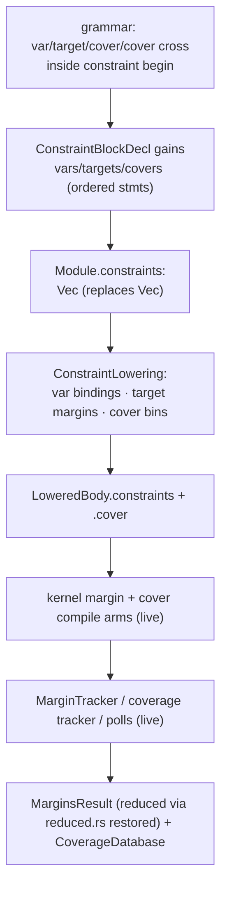

# Constraint Statements — Design

**Spec**: `.specs/features/constraint-statements/spec.md`
**Status**: Draft

---

## Architecture Overview

Producer extension of the shipped MD-49 pipeline; consumers unchanged
except `reduced.rs` (math restored). One structural change: the POM's
authored surface becomes an **ordered statement list** — `target#<n>`
naming is statement-index-based across kinds, and var substitution is
authored-order, so parallel per-kind lists cannot carry the semantics.



## Code Reuse Analysis

| Component | Location | How to Use |
|---|---|---|
| Var substitution + target margin lowering | `fa223679~1:resolve/pom/constraints.rs` | Restore `lower_stmts`' bindings map + `margin_of_target`, retargeted to the new POM nodes |
| Cover lowering | `be43d3bd` era `ConstraintLowering` | Same restoration path as margins |
| Reduced math (ugbw/pm/gm, bracket/interp, probe eval) | `34c0c632:api/src/reduced.rs` (383 lines) | Restore nearly verbatim; walk `Module::constraints()` |
| Kernel cover compile + `eval_cover` | `kernel/analog/{compile,coverage}.rs` | Unchanged |
| `MarginKind::Var/Target`, `QuantityClass`, `ResolvedCoverBins` | codegen/solver/abi types | Unchanged |
| `CoverTracker`, `CoverageReport`, `CoverageDatabase` | device/solver/api | Unchanged |
| E4008 duplicate-label check | `elab/lower/vams.rs` | Extend to the new kinds |

## Components

### 1. AST (`ast/item.rs`)
`ConstraintBlockDecl` gains ordered statement lists (keep `requires` for
compat? **No** — replace with `stmts: Vec<ConstraintStmt>` where
`ConstraintStmt = Require(RequireDecl) | Var{span,doc,name,expr} |
Target{span,doc,expr,cmp:TargetCmp,level,tol} | Cover{span,doc,name,expr,bins:CoverBins} |
CoverCross{span,doc,name,points:Vec<String>}`. `TargetCmp::{Le,Ge}`;
`CoverBins::{Range{lo,step,hi},Set(Vec<Expr>)}` — exprs, const-evaled at
lowering (the pre-MD-45 shapes).

### 2. Grammar (`grammar/item.rs`)
`parse_constraint_block` dispatches: contextual `var`/`target`/`cover`/
`cover`+`cross`. `var name = expr;` · `target expr (<=|>=) level [tol e];`
· `cover name : expr bins [e:e:e];` | `bins in {e, …};` ·
`cover cross name : p1[, p2…];`. Anything else keeps the typed error
naming what is legal (message updated).

### 3. POM (`pom/behavior.rs`, `pom/module.rs`)
`PomConstraintStmt` (Require(PomRequire) | Var{name, expr} |
Target{expr, cmp, level, tol} | Cover{label, expr, bins:Resolved later at
lowering — POM keeps authored exprs} | CoverCross{label, points}) —
`Module.constraints: Vec<PomConstraintStmt>`; `constraints()` accessor
retyped. `Module::constraints()` callers (codegen body.rs, api margins
catalog) adapted. Duplicate-label E4008 now covers all named kinds
(require/var/cover/cross names share one namespace; targets unnamed).

### 4. Codegen (`resolve/pom/constraints.rs`)
`ConstraintLowering::lower(stmts, ctx)` — full restore:
- **var**: subst into later statements; a var is never itself a margin.
- **target**: `margin_of_target` (restored) — diff by cmp, `/scale` iff
  tol; label `target#{index}` (enumerate over ALL statements);
  classification (reduced iff a reduced helper appears in
  expr/level/tol).
- **require**: unchanged from shipped core.
- **cover**: `LoweredCoverPoint` with `ResolvedCoverBins` const-evaled;
  `LoweredCoverCross{label, points, joint_bin_count}` (product of the
  named points' bin counts — resolved at lowering, fail loud if a named
  point doesn't exist).
- `lower_bodies`: `constraints = Some(...)` iff ≥1 margin stmt (require/
  target/var-reduced); `cover = Some(...)` iff ≥1 cover/cross.

### 5. Kernel (`kernel/analog/compile.rs`)
Unchanged — the existing arms read `LoweredBody.constraints` (filter
Pointwise) and `.cover`. Targets of Pointwise class reach the kernel;
reduced never do (D7). Var margins: a reduced var has NO kernel function;
its value comes from the host reduction. A pointwise var contributes no
declared margin itself (rides inside readers) — preserved semantics.

### 6. api (`reduced.rs`, `margins.rs`, `session/entry.rs`)
- `reduced.rs`: restore the 383-line engine — walk
  `design.flat_module(top).instances()` × module constraint stmts; for
  each reduced var/target evaluate the helper over the AC sweep's probed
  phasors; emit `MarginEntry{kind: Var|Target, value: Reduced{..}}`;
  non-AC quantities → catalog `not_defined`.
- `ConstraintCatalog::compute`: extend — reduced var/target present in
  the instance kernel? no → `not_defined` (not digital); cover/cross
  labels skip the margins catalog.
- `Session::ac` already calls `ReducedEvaluation` (plumbing live).

### 7. Docs (Part I §12, ROADMAP)
Statement surface paragraph rewritten (var/target/cover in); ROADMAP's
still-dark list drops var/target/cover, keeps scoping/windows +
distributions + gradients.

## Data Models

```rust
// ast
pub enum ConstraintStmt {
    Require(RequireDecl),
    Var { span, doc, name: String, expr: Expr },
    Target { span, doc, expr: Expr, cmp: TargetCmp, level: Expr, tol: Option<Expr> },
    Cover { span, doc, name: String, expr: Expr, bins: CoverBins },
    CoverCross { span, doc, name: String, points: Vec<String> },
}
// pom: PomConstraintStmt mirrors it (span: Option<miette>, authored exprs)
```

## Error Handling Strategy

| Scenario | Handling |
|---|---|
| var referencing a later/unknown name | loud LowerError naming it |
| target over unresolved name | loud LowerError |
| cover bins non-const / step ≤ 0 | loud LowerError naming the point |
| cross naming a nonexistent point | loud LowerError |
| duplicate name across kinds | E4008 (elab) |
| reduced read outside AC | catalog not_defined → loud get() |
| non-finite cover value at a point | no bin hit (tracker's existing rule) |

## Risks & Concerns

| Concern | Location | Mitigation |
|---|---|---|
| `Module.constraints()` retype breaks the just-shipped api walk | api/margins.rs, codegen/body.rs | Mechanical adapt; the walk gets simpler (one stmt list) |
| Reduced math restoration drift vs original tests | reduced.rs | The blocked tests ARE the original assertions — migrate, don't rewrite |
| `target#N` index semantics | lowering | Enumerate over all statements; `reduced_metrics` pins `target#3` after 3 vars |
| Cover kernel arm untested since MD-45 | kernel/analog | cover_bin_mapping ×7 are the acceptance tests |
| Contextual keyword collisions (`var` is Annex B reserved? check) | keywords.rs | `var` não está na Table B.1 do VAMS (é 1364 `reg`-era); verify — if reserved, `at_kw` still matches Ident text; the annex_b gate only pins KEYWORDS, contextual matching is fine either way |

## Tech Decisions

| Decision | Choice | Rationale |
|---|---|---|
| One ordered stmt list vs parallel lists | ordered list | target#N + authored-order substitution need cross-kind order |
| var without type annotation | `var name = expr;` | real-only quantities; simplest grammar |
| Reduced classification | syntactic helper-name scan at lowering | The original rule; no type system needed |
| Cover bins resolution | const-eval at codegen lowering (not elab) | Matches `ResolvedCoverBins` "folded at lowering" docs |
