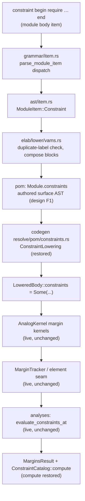

# Constraints on VAMS — Design

**Spec**: `.specs/features/constraints-on-vams/spec.md`
**Context**: `.specs/features/constraints-on-vams/context.md`
**Status**: Draft

---

## Architecture Overview

**Reconnect the preserved backend to a new VAMS producer.** The entire
evaluation half is alive and `Option`-gated today: kernel margin
compilation (`kernel/analog/compile.rs:684` reads
`LoweredBody::constraints`), the `Constraints` capability
(`eval_margin`, `margin_catalog`), per-instance `MarginTracker`
(worst/argmin/findings, posture/analysis/window filtering), the solver's
`evaluate_constraints_at` at exactly the accepted points design §C3
defines (DC: final converged solution only, never homotopy intermediates;
tran: accepted steps, UIC t=0 skipped; AC: each frequency point), the
`CheckPosture` plumbing (`SolverConfig.checks → Context.checks →
Element::update → set_check_posture`), and api's `MarginsResult`/
`MarginEntry` channel. **The feature is the missing producer**: a grammar
production, an AST/POM node, a codegen lowering, and one api catalog
walk. Nothing below the codegen `resolve` stage changes.



**Approach choice** (Large feature — one alternative considered and
rejected): reusing `$assert`-style system tasks
(`Stmt::TaskCall` carries expressions, zero grammar change) was declined
by the user in context.md on ergonomics — the block form is the
requirement. Restoring the PHDL `ConstraintDecl` AST node verbatim was
rejected because its surface carries `var`/`target`/`cover`/event blocks
(this feature's scope excludes them); the new node is `require`-only.

---

## Code Reuse Analysis

### Existing Components to Leverage

| Component | Location | How to Use |
|---|---|---|
| Comparison→margin rules (`a<=b → b−a`, `a>=b → a−b`, `l<=a&&a<=u → min(a−l,u−a)`, tol divides) | pre-MD-45 `resolve/pom/constraints.rs` @ `fa223679` | Restore/adapt into the new producer; drop the `var` substitution map and `Target` arm (deferred) |
| `resolve_expr` / `subst_expr` | `resolve/pom/expr.rs` | Name resolution against the module's symbols — the same path the analog body takes |
| Kernel margin compilation | `kernel/analog/compile.rs:676-712` | Unchanged — already consumes `LoweredBody::constraints`, filters pointwise, CSEs against the `__temp` tape |
| `min` in compiled rows | `compile.rs:801-805` (`bound_step` fold) | The `&& → min(parts)` margin stays compilable, no new intrinsic |
| `MarginTracker` + postures + §C3 points | `device/analog/constraints.rs`, `analyses/{dc,ac,transient}.rs` | Unchanged — strict abort / collect / off all live |
| `MarginsResult`/`MarginEntry` | `api/margins.rs` | Unchanged; `with_margin_catalogs` wiring already threaded through session/entry.rs |
| Pre-MD-45 `ConstraintCatalog::compute` | `9bf4a5a9~1:api/margins.rs` | Restore, minus `var`/`target`/`cover` arms (deferred) |
| `parse_behavior_construct`'s dispatch shape | `grammar/item.rs:222,699` | The `constraint` arm mirrors `analog`'s: keyword dispatch → dedicated parse fn |
| Restored 44 present-and-red tests | `codegen/tests/margin_*.rs`, `tests/tol_inert.rs` | Acceptance tests — migrate fixtures from `constraint Mod {…}` to `constraint begin…end`; the require-only subset must go green |

### Integration Points

| System | Integration Method |
|---|---|
| Annex B keyword gate (`tests/annex_b_keywords.rs`) | **Untouched.** `constraint`/`require`/`tol` are *contextual* (soft) keywords — matched by `Ident` text at their production sites, never added to Table B.1; `Keywords::is_reserved` unchanged, so LRM sources using these words as identifiers still parse (escaped `\constraint` also still works, §2.8.2) |
| Flatten pass (`Design::flat_module`) | Constraints are per-module authored data; leaves fall back to the authored module unchanged — no splicing needed (kernels are per-module `Arc`-shared) |
| `piperine-python` | `Session.checks` posture + margins channel already bound; parity test follows |
| LSP | Out of scope (spec), but spans ride the POM from day one so the follow-up needs no re-parse |

---

## Components

### 1. AST nodes (`crates/piperine-lang/src/ast/item.rs`)

- **Purpose**: carry the authored constraint block as module surface.
- **Interfaces**:
  - `ModuleItem::Constraint(ConstraintBlockDecl)` — new arm.
  - `ConstraintBlockDecl { span, attrs, doc: Option<String>, requires: Vec<RequireDecl> }`.
  - `RequireDecl { span, doc: Option<String>, name: String, pred: Expr, tol: Option<Expr> }`.
- **Dependencies**: none new.
- **Reuses**: `Expr` as-is; `doc` follows the `///` convention of neighboring decls.

### 2. Grammar (`crates/piperine-lang/src/grammar/item.rs`)

- **Purpose**: parse `constraint begin … end` as a module body item.
- **Interfaces**: `parse_module_item` dispatches on `kw_after_attrs() == Some("constraint")`; new `parse_constraint_block` consumes `constraint`, `begin`, `require` statements, `end`. `parse_require_stmt`: contextual `require`, `expect_identifier` (rejects LRM keywords as labels), `:`, `parse_expr`, optional `tol <expr>`, `;`.
- **Dependencies**: cursor's `eat_kw`/`at_kw` (string-matched `Ident`s — the lexer's own design, keywords.rs doc).
- **Reuses**: `parse_attr_instances`, `parse_expr`, the `doc comment run` capture used by other decls.
- **Decisions**: `(* … *)` attrs parse and are carried but no schema reads them yet (forward-compatible); anything inside the block that is not `require` is a typed parse error naming the offending token — never a silent skip.

### 3. POM (`crates/piperine-lang/src/pom/`)

- **Purpose**: authored constraints visible on the module (AC: "visible on the POM").
- **Location**: `Module.constraints: Vec<PomRequire>` in `pom/module.rs`; `PomRequire { span, name, pred: ast::Expr, tol: Option<ast::Expr> }` in `pom/behavior.rs` (behavioral node family) — **no** revival of `pom/constraint.rs`'s `ConstraintBlock`/`QuantityClass` machinery (deferred statements don't exist to classify).
- **Interfaces**: `Module::constraints() -> &[PomRequire]` accessor (MD-25 navigability).
- **Multiple blocks compose** (edge case): the elaborator concatenates in authored order — a flat `Vec<PomRequire>` is the whole truth, no block structure kept (no consumer needs it; spans preserve provenance).

### 4. Elaboration (`crates/piperine-lang/src/elab/lower/vams.rs`)

- **Purpose**: `ModuleItem::Constraint` arm in `elab_module`'s item loop.
- **Interfaces**: appends `PomRequire`s; **duplicate label across the module fails loud** — new typed `ElabErrorKind::ConstraintLabelDuplicate` (E4007, following the E4xxx LRM-clause-anchored family; help text cites the extension doc).
- **Name resolution**: deliberately *not* re-implemented here — the analog body itself resolves names at codegen `resolve`, and constraints follow the same path (consistency beats duplicating the resolver). CONVAMS-15's "elaboration fails loud" is honored as "the compile pipeline fails loud pre-simulation" through `LowerErrors`'s typed `UnresolvedName` — flagged to the Verifier as a spec-precision reading, not silently.

### 5. Codegen lowering (`crates/piperine-codegen/src/resolve/pom/constraints.rs` + `body.rs`)

- **Purpose**: the producer — `PomRequire` → `LoweredMargin`.
- **Interfaces**: `ConstraintLowering::lower(requires, ctx)` (restored shape from `fa223679`, minus `var`/`target`): predicate form must be `<=`, `>=`, or `&&` of two comparisons — anything else is a loud `LowerError` naming the require ("require predicate outside the margin forms"); `tol` → `/ scale` (division only when authored); `resolve_expr` against the module symbols (unknown name → typed error, never `0.0`); `class = Pointwise`, `analyses = []`, `window = None` (all deferred surfaces). `lower_bodies` sets `constraints = Some(vec)` iff ≥1 require lowered, else `None` (a module without the block pays exactly what it pays today).
- **Reuses**: `resolve_expr`/`subst_expr`; kernel consumer unchanged.

### 6. api catalog (`crates/piperine-api/src/margins.rs`)

- **Purpose**: restore `ConstraintCatalog::compute` (success criterion: no longer empty; "MD-45 regression" doc comment removed).
- **Interfaces**: walk `design.flat_module(top).instances()` × `module.constraints()`: an instance absent from `info.instances` → its requires catalogued `digital`; requires present in the instance kernel's `margin_catalog()` → skipped; in core scope nothing lands in `not_defined` (reduced statements are deferred — the list stays live for them).
- **Reuses**: pre-MD-45 walk at `9bf4a5a9~1`, minus the deferred arms.

### 7. Docs (CONVAMS-16/17)

- `docs/spec/part_i_language.md`: new subsection under the extensions — "`constraint begin … end` (sanctioned extension)" beside `(* device *)` schemas and `///`; states the syntax, the severity anchor (§9.7.3), the soft-keyword rule, and the MD pointer.
- `.specs/STATE.md`: new **MD-49** — `constraint begin` is a sanctioned Annex-A extension with contextual keywords, superseding MD-45's "rebuild on `(* attribute *)`" tentative path for the constraint surface (context.md already records the user's supersession).
- `ROADMAP.md`: dv-core/dv-tester/host-library marked correctly — constraint surface re-anchored (require core), `var`/`target`/`cover`/distributions still dark.

---

## Data Models

```rust
// ast/item.rs
pub struct ConstraintBlockDecl {
    pub span: PreprocessedSpan,
    pub attrs: Vec<Attr>,
    pub doc: Option<String>,
    pub requires: Vec<RequireDecl>,
}
pub struct RequireDecl {
    pub span: PreprocessedSpan,
    pub doc: Option<String>,
    pub name: String,
    pub pred: Expr,           // `abs(V(g,s)) <= vgs_max`
    pub tol: Option<Expr>,    // `tol <scale>` — normalization, default 1
}

// pom (authored surface, design F1)
pub struct PomRequire {
    pub span: Option<miette::SourceSpan>,
    pub name: String,
    pub pred: crate::ast::Stmt,   // resolved Expr, see tasks
    pub tol: Option<crate::ast::Expr>,
}
// Module: pub constraints: Vec<PomRequire> + constraints() accessor

// codegen — existing types, now produced
LoweredMargin { label, kind: Require, class: Pointwise, analyses: [], window: None, expr }
```

Margin numeric convention unchanged: `m ≥ 0 ⟺ satisfied`, `tol` divides,
absent `tol` emits no division.

---

## Error Handling Strategy

| Error Scenario | Handling | User Impact |
|---|---|---|
| Non-`require` statement inside `constraint begin` | typed parse error naming the token | edit-time, LSP-visible |
| duplicate `require` label in a module | E4007 `ConstraintLabelDuplicate`, names both sites | elaboration error |
| predicate form outside `<=`/`>=`/`&&`-of-comparisons | loud `LowerError` naming the require + the form | compile error, pre-simulation |
| unresolved name in a predicate | typed `UnresolvedName` via `resolve_expr` (analog body's own path) | compile error naming name + require |
| violation at an accepted point, `strict` | existing `ValidationSeverity::Error` → analysis aborts naming constraint/instance/time/margin (live machinery) | run fails loud |
| rejected-iteration violation | never evaluated (accepted-points-only, §C3) — LRM §9.7.3 rule inherited | no false positive |
| quantity unavailable in the running analysis | core `require` is pointwise-analog; a require on a digital-only instance catalogues `digital` and `MarginsResult::get` fails loud naming it (live machinery) | loud read error |
| non-finite margin | `Error` finding, never clamped (live machinery) | loud |

---

## Risks & Concerns

| Concern | Location | Impact | Mitigation |
|---|---|---|---|
| Sensitive hand-written parser (`CLAUDE.md` flags `grammar/`) | `grammar/item.rs` | ripple into existing parses | New dispatch arm + new fns only; no existing production touched; full `piperine-lang` suite + `annex_a_grammar`/`annex_b_keywords` gates as the task gate |
| Soft keywords break sources using `constraint`/`require`/`tol` as identifiers at module-item/statement positions | `grammar/item.rs` | pre-existing fixtures could stop parsing | grep fixtures+stdlib for those identifiers at module-item position before landing; escaped-identifier escape hatch documented; pre-1.0, acceptable per user |
| `flatten` drops authored per-module data on non-leaf modules | `Design::flat_module` | constraints lost on flattened mid-hierarchy modules | `lower_bodies` iterates `prog.modules()` (authored set) and `flat_module` falls back for leaves — verify mid-hierarchy constrained module still lowers via its own authored entry (its instances reference it by name); test with a 3-level fixture |
| Restored 44 tests mix require-only with deferred statements (`var`/`target`/`cover`, PHDL grammar) | `codegen/tests/margin_*.rs`, `tests/tol_inert.rs` | scope creep / wrongly-green claims | migrate require-only fixtures; tests exercising deferred statements stay red **with their `//!` note updated to name the deferred mechanism**; the spec explicitly forbids reading the 73 as this feature's metric |
| api tests use `target#N` labels, `tol` on `target`, MC distributions | `piperine-api/tests/*` | un-blocking overreach | per-target triage in tasks: require-subset migrates, the rest keeps its blocked note |
| `analog begin` bodies take a `Stmt`, constraint wants its own statement list | `ast/item.rs` | coupling to `Stmt` would drag digital statement machinery in | constraint block owns `Vec<RequireDecl>` — not a `Stmt` variant; no interaction with Annex C subset checks |
| Suite hygiene: new files must satisfy MD-34 (`mod.rs` ≤60 lines), no `unwrap`, no macros | all crates | gate failures | follow existing file shapes; `suite_hygiene` in the final gate |

---

## Tech Decisions (only non-obvious ones)

| Decision | Choice | Rationale |
|---|---|---|
| Keyword status | contextual (soft) keywords, not Table B.1 | Annex B gate pins `KEYWORDS` to the LRM; the extension must not silently mutate the reserved set; `eat_kw`/`at_kw` already string-match `Ident`s |
| POM shape | flat `Vec<PomRequire>` on `Module`, no `ConstraintBlock` node | only `require` exists; block structure has no consumer; spans keep provenance; composition edge case becomes concatenation |
| Where duplicate-label check lives | elab (E4007); name resolution stays in codegen `resolve` | duplicate detection needs the module-wide view the elaborator already has; name resolution belongs where the analog body resolves it — one resolver, not two |
| CONVAMS-15 "elaboration fails loud" reading | compile pipeline (`lang` elab + codegen `lower_bodies`), pre-simulation | consistency with the analog body's own resolution stage; flagged for Verifier as spec-precision note |
| `tol` grammar | trailing clause on `require` only | spec's logged assumption; `target` (its old PHDL host) is deferred |
| `abs(V(g,s))` in predicates | nothing special — `resolve_expr` + kernel already compile `abs`/`V`/`I` | margins ride the same compilation as residuals |

**Project-level decision to record:** MD-49 (supersede MD-45's tentative attribute-based rebuild for the constraint surface) — appended to `.specs/STATE.md` in the docs task.

---

## What the Design Deliberately Does Not Touch

`piperine-solver` (any file), `kernel/analog/constraints.rs`,
`device/analog/constraints.rs`, `device/element.rs`, the analyses'
evaluation points, `MarginsResult`/`MarginEntry`, the postures, the
Python binding layer. The MD-20 dependency arrows are unaffected
(lang ← codegen ← {solver unchanged}).
