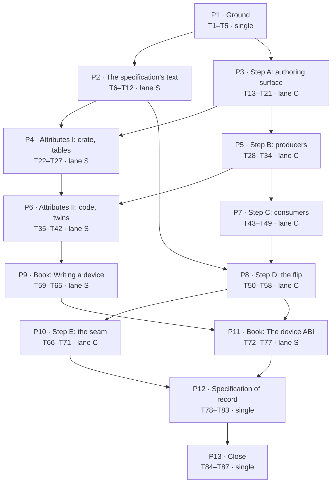

# Device ABI Simplification Design

**Spec**: `.specs/features/device-abi-simplification/spec.md`
**Status**: Approved
**Approved**: 2026-11-27 - user: "Aprovo a spec e design do novo abi"

Paths and crate names are those of the tree after `code-clarity` merges (`piperine-language`, `piperine-interpreter`, `piperine-device-fixtures`, `raw/`, `solver/src/circuit`, merged test targets). T1 re-takes them on the merged `main`. Proposal sections are cited as "proposal §n"; sections of the published specification as "ABI §n".

---

## Architecture Overview

The feature has four parts that meet at one point, the authoring surface of `piperine-abi`:

1. **The contract** moves from the present layout to proposal Part II in five steps (A to E). The authoring surface moves first, the reading side second, the raw layout last, so no commit has to change every crate.
2. **The specification** is written into `docs/abi/` from Part II before the layout flips, and the flip is tested against it: the layout test reads the sizes, offsets and constants from the specification's own listings.
3. **The attributes** are a proc-macro crate over the authoring surface of step A. That surface does not change when the raw layout flips in step D, so the attributes are built in parallel with steps B and C.
4. **The Book** prints only code that a test compiles: each listing is a marked region of a source file of the `book` target.



### Sizes

S: days, one crate. M: one to two weeks, several crates. L: a batch of its own.

| Phase | Tasks | Size | Lane | Delivers |
| --- | --- | --- | --- | --- |
| 1 Ground | T1–T5 (5) | S | single | baseline, decision record, capability ledger, macro guard, tracking rows |
| 2 The specification's text | T6–T12 (7) | M | S | `docs/abi/` chapters 1 to 13, annexes A to D and F, the builder |
| 3 Step A | T13–T21 (9) | L | C | the new authoring surface over the present layout |
| 4 Attributes I | T22–T27 (6) | M | S | the macro crate, its argument parser and errors, `#[shape_tables]` |
| 5 Step B | T28–T34 (7) | L | C | every producer on the new surface; goldens regenerated once |
| 6 Attributes II | T35–T42 (8) | L | S | `#[function]`, `#[reaction]`, `#[device_code]`, the six twins |
| 7 Step C | T43–T49 (7) | L | C | every consumer on the reading view; C4 |
| 8 Step D | T50–T58 (9) | L (the hardest) | C | the raw layout of Part II, the nine rules, the six refusals |
| 9 Book: Writing a device | T59–T65 (7) | M | S | the hands-on chapter, every listing run |
| 10 Step E | T66–T71 (6) | M, mechanical | C | the seam's names and typed identifiers |
| 11 Book: The device ABI | T72–T77 (6) | M | S | the concepts chapter |
| 12 Specification of record | T78–T83 (6) | M | single | annex E, `abi.md` retired, 601 citations re-pointed |
| 13 Close | T84–T87 (4) | S | single | documents, publication, final verification |

87 tasks. Honest reading: this is a feature of the size of a `code-clarity` batch pair (B5 plus B9), about five to seven weeks of agent work on two lanes. Phase 8 holds the one task that cannot be made small (T53, the flip).

### Lanes

A lane is a worktree with its own `CARGO_TARGET_DIR` and `TMPDIR` (`/var/tmp/piperine-target-<lane>`, `/var/tmp/piperine-tmp-<lane>`). Two lanes, because disk is tight. A phase merges into the feature's integration branch when its last task is committed; a phase starts from the integration branch.

| Wave | Lane C (the contract) | Lane S (specification, attributes, Book) |
| --- | --- | --- |
| 0 | P1 (single) | — |
| 1 | P3 Step A | P2 the specification's text |
| 2 | P5 Step B | P4 Attributes I |
| 3 | P7 Step C | P6 Attributes II |
| 4 | P8 Step D | P9 Book: Writing a device |
| 5 | P10 Step E | P11 Book: The device ABI |
| 6 | P12, P13 (single) | — |

Paths each lane owns, for every wave:

| Lane | Paths |
| --- | --- |
| C | `crates/piperine-abi/**`; `crates/piperine-plan/**`; `crates/piperine-transpile/**`; `crates/piperine-interpreter/**`; `crates/piperine-device-fixtures/**`; `crates/piperine-analog-solver/**`; `crates/piperine-digital-solver/**`; `crates/piperine-solver/**`; `crates/piperine-api/**`; `crates/piperine-parity/**`; in the guards crate `tests/suite/**`, `tests/boundaries/**`, `tests/worklists.rs`, `tests/naming.rs`, `tests/ownership.rs` and the allowances of the crates above; `.specs/features/device-abi-simplification/capabilities.tsv` |
| S | `docs/abi/**`; `docs/book/**`; `tests/book/**`; `crates/piperine-abi-macros/**`; `mkdocs-spec.yml`; the root `Cargo.toml` and `Cargo.lock`; in the guards crate `tests/documentation.rs`, the new target `tests/authoring.rs` and `allowances/piperine-abi-macros/**` |

Three points where the lanes meet, each at a phase boundary:

- P4 starts from P3 merged (the attributes call the builder of step A).
- P6's twin tests (T40, T41) read the hand-written twins of `piperine-device-fixtures`, which P5 rewrote; P6 starts from P5 merged.
- P8 reads `docs/abi/` (T50, T52); P2 merged long before. P11 prints listings of the flipped raw structs; it starts from P8 merged.

Not parallel: P1, P12, P13. Each touches files of both lanes.

---

## Approaches considered

### Where the specification lives (Q1)

| Approach | For | Against |
| --- | --- | --- |
| **A. Its own set, `docs/abi/`** (recommended) | The reader is a device implementer in any language, not a model author. The ABI has its own version (the symbol's major, `Library.minor`). `docs/spec/` stays "the only grammar and semantics source" of MSL. One page, one artifact, linked both ways | A third document to build and publish |
| B. Part IX of `docs/spec/` | One site, one build | The language specification gains a binary contract with another audience and another version; `spec_version` would move with a struct offset |
| C. Keep `.specs/features/device-abi/abi.md`, rewritten | No new place | `.specs/features/` is the feature log; a specification of record does not belong there, and nothing publishes it |

### The shape of the attributes (Q3, Q4)

| Approach | For | Against |
| --- | --- | --- |
| **A. Attribute macros that add methods to the author's type** (recommended) | Every generated item is an inherent method or constant with a name fixed by rule. The author still calls the builder and implements the trait. The expansion is the hand-written form | The author writes three wiring lines and a four-method `impl` |
| B. One top attribute or derive that generates the trait implementation, the shape and the statics | Shortest device | The trait, the shape and the thunks leave the file: what the user called magic |
| C. A function-like macro with its own notation (`device! { ... }`) | Free syntax | Not native declarations; no editor support; errors point into the macro |

---

## The specification: `docs/abi/`

| File | Holds | From the proposal |
| --- | --- | --- |
| `index.md` | status, the map, the nine kinds and four catalogues, how to cite (`ABI §n.m`), the link to the published page | §0.1 |
| `part_i_packaging.md` | 1 Conventions · 2 Library and device type · 3 The shape | §8, §9, §10 |
| `part_ii_tables.md` | 4 Pins · 5 Linkage · 6 The analog tables | §11, §12, §13 |
| `part_iii_code.md` | 7 Code, reads, writes and aspects · 8 Entry points · 9 Execution rules | §14, §15, §16 |
| `part_iv_conformance.md` | 10 Validation · 11 Versioning · 12 Threading · 13 Error reporting | §17, §18, §19, §20 (without §20.1) |
| `annex_a_concepts.md` | the twelve contracts, the three merges by judgement, "where does X go?" (informative) | §0.3, §3, §3.1 |
| `annex_b_glossary.md` | every noun against the language specification and the tree (informative) | §3.2 |
| `annex_c_runtime_areas.md` | where memory is (informative) | §4 |
| `annex_d_solver_phases.md` | how each phase of the solver uses the ABI (informative) | §5 |
| `annex_e_rust_authoring.md` | the Rust authoring surface and the attributes: normative for `piperine-abi`'s helpers and `piperine-abi-macros`, informative for the binary contract | §20.1, and this design |
| `annex_f_previous_contract.md` | the mapping from the contract before this one; kept until the first release | §21 |

Rules of the text:

- Chapters 1 to 13 are normative and use MUST, MUST NOT, MAY, SHOULD as RFC 2119 does. Rule names V1 to V9 are kept.
- **Every struct is one fenced listing with the offset of each field and the size**, in the form the proposal uses (`// @48`, `size 88`). Every constant group is one table with a `Value` column. These are the forms the conformance tests parse (T50, T52), so the specification is the place the pinned numbers are written, once.
- The text describes the contract, not its history: no "today", no "present", no line citations of the solver. What the proposal says about the code as it was goes to annex F or is dropped.
- A citation in source is `ABI §n.m`. The guard of ABI-15 resolves each one against the headings.

**Build and publication.** `docs/abi/build.py <output>` writes one self-contained HTML page (the convention of `docs/book/build.py`; it uses the `markdown` package already in `docs/requirements.txt`). A test runs it (as `piperine-language`'s `book` test runs the Book's builder). `mkdocs-spec.yml` gains a "Device ABI" section. T86 publishes the page as an artifact after the user's go-ahead and writes its link into `docs/abi/index.md`, `docs/spec/index.md` and the Book's chapter.

**How it replaces `abi.md`.** T83 reduces `.specs/features/device-abi/abi.md` to a pointer of a few lines (what it was, the decision that retired it, where the specification is). T80 to T82 re-point the 601 citations in Rust sources from `abi.md §n` to `ABI §n.m`; a task that rewrites a file earlier re-points that file's citations in its own commit. Two guards close it: no file outside `.specs/features/` cites `abi.md`, and every `ABI §` citation names a heading that exists.

---

## Code Reuse Analysis

### Existing Components to Leverage

| Component | Location | How to Use |
| --- | --- | --- |
| The primitive views `Str`, `Bytes`, `List<T>`, `Layout`, `Field`, the leaves, the shipped layouts | `piperine-abi/src/raw/views.rs`, `layout.rs` | unchanged (ABI §1.6) |
| The owned builder and the reference-counted shape | `piperine-abi/src/shape.rs` (`ShapeBuf`, `ShapeRef`) | the storage of `ShapeBuilder` and `SharedShape`; only the vocabulary and the typed indices are new |
| The generic thunks, panic catching, the packed call that allocates nothing | `piperine-abi/src/{thunk,caller}.rs` | kept; renamed; the two commit entries merge |
| `Validator` and its `Rule` list | `piperine-abi/src/validate.rs` (after `code-clarity` T77) | the owner of V1 to V9 |
| The partials verifier | `piperine-abi/src/verify.rs` | unchanged, over `evaluate` |
| The transpiler's shape comparison | `piperine-transpile/src/shape_check.rs` | the comparison of the six twins (ABI-23) and of step A's lowering (T21) reuse its entry-by-entry rule |
| `AbiSource::FILES` and its test | `piperine-transpile/src/abi_source.rs`, `tests/abi_source.rs` | every task that adds or removes a file of `piperine-abi/src` edits the table in the same commit |
| The cache key over the ABI's sources | `piperine-transpile/src/compile.rs` | makes the flip safe; T57 adds the test |
| `piperine-device-fixtures` | from `code-clarity` T34 | each hand-written device lives once; step B rewrites it once; the hand-written twins of ABI-23 are six of them |
| The guards crate: `SourceTree`, `ItemScan`, `Allowance`, `Worklist` | `piperine-repository-guards/src` | every new guard of this feature |
| The Book's inventory, `Chapter`, the claims guard | `tests/book/support/**`, `tests/book/inventory.tsv` | the two chapters; a new support type holds Rust listings to compiled regions |
| The worked examples of `abi.md` §11.1 to §11.6 | fixtures crate (formerly `abi/tests/support/examples.rs`) | the six twins: resistor, diode with limiting and noise, capacitor, D flip-flop, comparator, DAC |
| `compile_fail` doc tests | `piperine-abi/src/{shape,raw}.rs` already use them | the proofs of ABI-02 AC 3 and ABI-27 |

### Integration Points

| System | Integration Method |
| --- | --- |
| `piperine-plan`, `piperine-transpile` (printer), `piperine-interpreter` | move to the new builder together (T28): the loader compares the printed shape with the plan's |
| The analog solver, the digital solver, the owner | read shapes through `ShapeView` (T44 to T46), then take one binding vector per pin table (T47) |
| The Book (`docs/book/content.html`, `tests/book/`) | chapter 18 rewritten, a new chapter after it; the organization chapter and the cheat sheet follow |
| `docs/spec/` | `index.md` links to the ABI specification; `appendix_c_implementation.md` cites `ABI §` where it names the ABI |
| `CLAUDE.md`, `AGENTS.md`, `ARCHITECTURE.md`, `GAPS.md`, `ROADMAP.md`, `.specs/STATE.md` | T2, T5, T84 |

---

## Components

### `piperine-abi` after the feature

- **Purpose**: the device ABI: the raw contract, the authoring surface, the reading view, the call path. A leaf with no dependency. The symbol stays `piperine_abi_1`, `MAJOR = 1`, `MINOR = 0`: the contract changes in place (user, 2026-11-27: "nao avanca a versão do ABI, ainda nao fizemos release"), with no second symbol and no compatibility layer.
- **Location**: `crates/piperine-abi/src/`
- **Module map** (one layout: `x.rs` + `x/`):

| Module | Holds |
| --- | --- |
| `raw/views.rs` | `Str`, `Bytes`, `List<T>`, `Layout`, `Field` |
| `raw/library.rs` | `Library`, `DeviceType`, `ParameterValue`, `Created`, `Instance`, `FailureMessage` |
| `raw/shape.rs` | `Shape` |
| `raw/pins.rs` | `ContinuousPin`, `DiscretePin`, `EventPin`, `Linkage` |
| `raw/analog_tables.rs` | `Term`, `Limit`, `SmallSignalSource`, `Crossing`, `OperatingPointVariable`, `Trace` |
| `raw/code.rs` | `Read`, `Write`, `Partial`, `Function`, `Reaction`, `CommitSite` |
| `raw/calls.rs` | `FunctionFrame`, `ReactionFrame`, `CommitQueue`, `ArrayView`, the six function types |
| `raw/constants.rs` | the eleven groups, `GROUND`, `SESSION_DEFAULT`, `WHOLE_ARRAY`, the statuses |
| `layout.rs` | the shipped layouts, `PlainData` |
| `shape/index.rs` | the typed indices |
| `shape/specification.rs` | the specifications an author hands to the builder |
| `shape/builder.rs` | `ShapeBuilder`, `SharedShape` |
| `shape/view.rs` | `ShapeView`, the read-only accessor the consumers use |
| `function_kind.rs` | `FunctionKind` |
| `validate.rs` | `Validator`, `Rule` |
| `device.rs` | `DeviceImplementation`, `DeviceFactory`, `Fault`, `ReactionOutcome`, `ParameterValues` |
| `lens.rs` | `FunctionFrameLens`, `ReactionFrameLens`, `CommitSiteHandle` |
| `thunk.rs` | `Thunk<D>`: the generated C entries |
| `caller.rs` | `InstanceHandle`, `RequestedCommit` |
| `verify.rs` | the partials verifier |

`unsafe` stays in `raw`, `thunk` and `caller`.

- **Interfaces** (the authoring surface; the full list is annex E of the specification):
  - `ShapeBuilder::new() -> ShapeBuilder`
  - `ShapeBuilder::continuous_pin(ContinuousPinSpecification) -> ContinuousPinIndex`, and one method per table: `discrete_pin`, `event_pin`, `term`, `limit`, `small_signal_source`, `crossing`, `operating_point_variable`, `trace`, `function`, `reaction`, each returning its typed index
  - `ShapeBuilder::freeze(self) -> Result<SharedShape, ShapeRefused>`: validates (ABI §10) and checks that every typed read and write has the byte length its aspect gives
  - `Linkage::private()`, `Linkage::port(position)`, `Linkage::parameter()`, and one per session net; `Linkage::optional(self)`
  - `Read::continuous_pin_value(ContinuousPinIndex)`, and one constructor per readable aspect; `Read::element(self, u64)`, `Read::whole_array(self)`. `Write::term_value(TermIndex)`, and one per writable aspect. The constructor's parameter type is the table's index, which is how a wrong table fails to compile
  - `FunctionSpecification::new(name)`, `.read::<T>(Read) -> ReadPosition`, `.write::<T>(Write) -> WritePosition`, `.partial(WritePosition, ReadPosition)`, `.partial_at(WritePosition, write_offset, ReadPosition, read_offset)`, `.owns_limit_correction()`
  - `ReactionSpecification::new(name)`, `.triggered_by(EventPinIndex)`, `.read::<T>(Read) -> ReadPosition`, `.commit_site(CommitSiteSpecification) -> CommitSiteIndex`, `.irreversible()`
  - `FunctionFrameLens::read::<T: PlainData>(position) -> Result<T, Fault>`, `.write::<T: PlainData>(position, &T) -> Result<(), Fault>`, `.partials(&[f64]) -> Result<(), Fault>`, `.wanted(partial) -> bool`, `.array(position) -> Result<ArrayView, Fault>`
  - `ReactionFrameLens::read::<T>(position)`, `.commit_site(CommitSiteIndex) -> CommitSiteHandle`; `CommitSiteHandle::commit(&self, &T, after)`, `.commit_element(&self, element, &T, after)`, `.fire(&self, after)`
  - `trait DeviceImplementation { fn default_shape() -> &'static Shape; fn create(&ParameterValues) -> Result<(Self, SharedShape), Fault>; fn evaluate(&self, FunctionIndex, &mut FunctionFrameLens) -> Result<(), Fault>; fn react(&self, ReactionIndex, &mut ReactionFrameLens) -> Result<ReactionOutcome, Fault>; }` (the last with a default body, as `code-clarity` T33 gives `react`)
  - `DeviceType::implemented_by::<D>(name) -> DeviceType`, `DeviceType::made_by(name, &'static F) -> DeviceType`, `Library::of(name, build, device_types) -> Library`
  - `FunctionKind::of(&Function) -> FunctionKind` with the variants `FunctionKind::Analog`, `FunctionKind::Digital`, `FunctionKind::Neither`
  - `ShapeView::of(&Shape) -> ShapeView`: the eleven tables as iterators, `function_kind(FunctionIndex)`, the byte length of any read and write
  - `InstanceHandle::create(...)` (which makes the caller's checks of ABI §8.2), `.evaluate(...)`, `.react(...)`
- **Dependencies**: none.
- **Reuses**: the present builder's storage, thunks, caller, validator, verifier.

Enumerations of the binary contract are `u32` constants (ABI §1.2). The authoring surface gives each a Rust enum with qualified variants (`TermOperator::Direct`, `SmallSignalSourceKind::Noise`) that converts to its constant, so authored code names no bare number.

### The migration's scaffold (steps A and C, deleted in D)

- **Purpose**: let producers and consumers move one crate at a time.
- **Location**: `crates/piperine-abi/src/shape/lowering.rs` (step A) and `crates/piperine-abi/src/shape/present_numbering.rs` (step C)
- **Interfaces**:
  - `Lowering::of(&ShapeBuilder) -> PresentShape`: the table of proposal §7.2, item by item: the three pin tables as one list (parameters in the order of their names, then ports in the order of their positions, then the rest); the linkage as `role` and `global`; the presence bits as `HAS_INIT`; `WHERE_CONDITION` as `HAS_CHECK` with `check` pointing at the pin itself; `limits` and `small_signal_sources` as `inputs`; `crossings`, `operating_point_variables`, `traces` as `watches`, then one `CAP` watch per `STEP_BOUND` write; a stimulus strength as the two cells `RE` and `IM`, with every later write index of that function and every `Partial.write` moved by one
  - `PresentNumbering::of(&Shape)`: both numberings of pins, the index of a pin in its table and the present pin index it lowers to, with the translation each way
- **Dependencies**: the present raw layout.
- **Reuses**: nothing; written to be deleted. T58's guard proves it is gone.

### `Validator` (step D)

- **Purpose**: the nine rules of ABI §10, in order.
- **Location**: `crates/piperine-abi/src/validate.rs`
- **Interfaces**: `Validator::check(&Shape) -> Result<(), Refusal>`; `Refusal { rule: Rule, table, name, origin, detail }`; `Rule::UnreadableList` … `Rule::LimitCorrection`; `AccessTable`, the table of ABI §7.3 as data (rows of aspect × {analog function, digital function, reaction} × {read, write, commit target} and the three conditions)
- **Dependencies**: `raw`, `FunctionKind`.
- **Reuses**: the present `Validator`'s walk. The test of V8 takes the allowed cells from the specification's table and tries every cell, so `AccessTable` and ABI §7.3 cannot differ.

### The consumers (step C)

| Crate | What reads the view | Task |
| --- | --- | --- |
| `piperine-analog-solver` | `AnalogPlan` (terms to two equations, the sparsity pattern, the classification of analog functions by the aspects they write), `Assembly` (the call environment), the accept step | T44 |
| `piperine-digital-solver` | `DigitalPlan` (one writer per net, the order, the parameter cone, the kept minimum delays), `ReactionRun`, the shadow | T45 |
| `piperine-solver` | `Bind::run`, by linkage kind in place of pin role; the sensitivity analyses; the circuit | T46 |
| the three together | the binding vectors become three, one per pin table; the translation is no longer used | T47 (C4) |
| `piperine-transpile` | the shape comparison and the loader | T48 |

### The seam (step E)

`DiscreteSide` → `DigitalSide`; its adapter → `DigitalSolverAdapter`; the bare `u32` of the seam → `NetId`, `AnalogCopySlot`, `EventNetId`, `SampleIndex`; `Boundary` → `DeliveredChange`; the two `Ambient` → `SolveEnvironment` and `InstantEnvironment`; the owner's `Site` → `BoundNet`; `piperine_solver::abi` → `piperine_solver::device_authoring` (Q6). `Binding` and `AnalogBinding` keep their names. T1 strikes from this list what `code-clarity` T31 and T134 already did.

### `piperine-abi-macros`

- **Purpose**: write the bookkeeping of a device (the declaration of each entry, the three lists of a function, the unpacking of a frame) from attributes beside native declarations.
- **Location**: `crates/piperine-abi-macros/` (`proc-macro = true`; dependencies `syn` 2, `quote`, `proc-macro2`, all already in `Cargo.lock`; dev-dependency `prettyplease` for the golden files, and `piperine-abi`, `piperine-device-fixtures` for the twins)
- **Module map**: `lib.rs` (the four `#[proc_macro_attribute]` entries, one line each); `arguments.rs` (`AttributeArguments`: a closed set of keys per attribute); `authoring_error.rs` (`AuthoringError`: the ten errors, each with its message and span); `shape_tables.rs` (`ShapeTablesExpansion`); `function.rs` (`FunctionExpansion`); `reaction.rs` (`ReactionExpansion`); `device_code.rs` (`DeviceCodeExpansion`); `origin.rs` (`OriginStamp`)
- **Interfaces**: each expander is a type with `parse(attribute, item) -> Result<Self, AuthoringError>` and `expand(&self) -> TokenStream` over `proc_macro2`, so unit tests call it without a compiler.
- **Dependencies**: none in the tree. `piperine-abi` does not depend on it.

#### Three rules that keep it from being magic

1. **An attribute adds inherent constants and methods to the author's own type, and nothing else.** No trait implementation, no new type, no `static`, no `unsafe`, no registration behind the author. The author's item is emitted unchanged, minus the helper attributes.
2. **The macro knows no catalogue of the ABI.** `#[read(continuous_pin_value(tables.p))]` expands to `Read::continuous_pin_value(tables.p)`. An aspect that does not exist, or an index of the wrong table, is `rustc`'s own error on the author's token. The macro checks only what `rustc` cannot: the shape of the declaration (the ten errors).
3. **Position is order.** The n-th `#[read]` parameter is `reads[n]`; the n-th `#[write]` is `writes[n]`; gradients fill `partials` in order, write by write. The n-th field of a table kind is entry n of that table. The n-th `#[function]` method is `functions[n]`.

#### The catalogue: seventeen names, each an ABI concept

| Attribute | On | ABI concept | Generates |
| --- | --- | --- | --- |
| `#[shape_tables]` | a struct whose fields are typed indices | the pins and analog tables of a shape | `fn declare(shape: &mut ShapeBuilder) -> Self` |
| `#[continuous_pin(linkage = …, unit = …, hold_potential = …, potential_tolerance = …, flow_tolerance = …)]` | a field `ContinuousPinIndex` | continuous pin, linkage | one `shape.continuous_pin(...)` in `declare` |
| `#[discrete_pin(linkage = …, layout = …, unit = …, initial_value = …, element_count = …, untracked, record_stream, relaxed_loop_allowed, structural, where_condition)]` | a field `DiscretePinIndex` | discrete pin, linkage, its five flags | one `shape.discrete_pin(...)` |
| `#[event_pin(linkage = …)]` | a field `EventPinIndex` | event pin, linkage | one `shape.event_pin(...)` |
| `#[term(operator = direct \| time_derivative \| delay, positive = …, negative = …, state_tolerance = …, maximum_delay = …)]` | a field `TermIndex` | term | one `shape.term(...)` |
| `#[limit]` | a field `LimitIndex` | limit | one `shape.limit(...)` |
| `#[small_signal_source(kind = noise \| stimulus)]` | a field `SmallSignalSourceIndex` | small-signal source | one `shape.small_signal_source(...)` |
| `#[crossing(event_pin = …, time_tolerance = …, value_tolerance = …)]` | a field `CrossingIndex` | crossing | one `shape.crossing(...)` |
| `#[operating_point_variable(layout = …)]` | a field `OperatingPointVariableIndex` | operating-point variable | one `shape.operating_point_variable(...)` |
| `#[trace(layout = …)]` | a field `TraceIndex` | trace | one `shape.trace(...)` |
| `#[device_code(tables = T)]` | an inherent `impl` block | the two code tables of a shape | index constants, `declare_code`, `evaluate_function`, `run_reaction` |
| `#[function(name = …, owns_limit_correction)]` | a method | function | `<method>_specification`, `<method>_from_frame` |
| `#[reaction(triggering_events(…), irreversible)]` | a method | reaction | `<method>_specification`, `<method>_from_frame` |
| `#[read(<aspect>(<index>), element = n \| whole_array)]` | a parameter, by value | one entry of `reads`: aspect, index, element | one `specification.read::<T>(...)`, one `frame.read::<T>(n)?` |
| `#[write(<aspect>(<index>))]` | a parameter `&mut T` | one entry of `writes` | one `specification.write::<T>(...)`, one `frame.write(n, &value)?` |
| `#[partials(of = w, against(r1, r2, …))]` | a parameter `&mut [f64; N]` | N entries of `partials`: the gradient of one write | N `specification.partial(w, r)`, one slice of the frame's partials |
| `#[commit_site(<aspect>(<index>), offset = …, length = …, minimum_delay = …, replaces_pending)]` | a parameter `CommitSiteHandle` | commit site | one `specification.commit_site(...)`, one `frame.commit_site(n)` |

In a field attribute, `positive = p` names another field of the same struct, declared above it; `GROUND` and `SESSION_DEFAULT` are written as the constants they are. The field's name is the entry's `name` (`name = "…"` overrides it), and its `origin` is the field's `file:line:column`. In `against(…)`, an entry is a read parameter's name, or `name[byte_offset]` for a real inside a layout; `of = w[byte_offset]` likewise.

A helper key that is a flag of the contract is written bare (`structural`); a key that is a field of the contract is `key = value`. An index expression is any Rust expression of the typed index; inside `#[device_code(tables = T)]`, the identifier `tables` is a `&T`. A device with a fixed shape may use associated constants instead and leave `tables` out.

#### Side by side: a resistor

By hand, with the builder and the lens:

```rust
/// Where each entry of a resistor's shape is.
pub struct ResistorTables {
    p: ContinuousPinIndex,
    n: ContinuousPinIndex,
    r: DiscretePinIndex,
    i: TermIndex,
}

impl ResistorTables {
    /// Adds the pins and the term of a resistor to `shape`.
    fn declare(shape: &mut ShapeBuilder) -> ResistorTables {
        let p = shape.continuous_pin(ContinuousPinSpecification::new("p").linkage(Linkage::port(0)));
        let n = shape.continuous_pin(ContinuousPinSpecification::new("n").linkage(Linkage::port(1)));
        let r = shape.discrete_pin(
            DiscretePinSpecification::new("r", &F64).linkage(Linkage::parameter()).initial_value(&1.0e3_f64),
        );
        let i = shape.term(TermSpecification::new("i", TermOperator::Direct).positive(p).negative(n));
        ResistorTables { p, n, r, i }
    }
}

impl Resistor {
    /// The position of `current` in `functions`.
    const CURRENT: FunctionIndex = FunctionIndex::at(0);

    /// What `current` reads, writes and differentiates.
    fn current_specification(tables: &ResistorTables) -> FunctionSpecification {
        let mut specification = FunctionSpecification::new("current");
        let p = specification.read::<f64>(Read::continuous_pin_value(tables.p));
        let n = specification.read::<f64>(Read::continuous_pin_value(tables.n));
        let r = specification.read::<f64>(Read::discrete_pin_value(tables.r));
        let i = specification.write::<f64>(Write::term_value(tables.i));
        specification.partial(i, p);
        specification.partial(i, n);
        specification.partial(i, r);
        specification
    }

    /// The current through the resistor and its gradient against `p`, `n` and `r`.
    fn current(&self, p: f64, n: f64, r: f64, i: &mut f64, gradient: &mut [f64; 3]) -> Result<(), Fault> {
        let v = p - n;
        *i = v / r;
        *gradient = [1.0 / r, -1.0 / r, -v / (r * r)];
        Ok(())
    }

    /// Unpacks the frame of `current`, calls it and stores its results.
    fn current_from_frame(&self, frame: &mut FunctionFrameLens<'_>) -> Result<(), Fault> {
        let p = frame.read::<f64>(0)?;
        let n = frame.read::<f64>(1)?;
        let r = frame.read::<f64>(2)?;
        let mut i = f64::default();
        let mut gradient = [0.0_f64; 3];
        self.current(p, n, r, &mut i, &mut gradient)?;
        frame.write(0, &i)?;
        frame.partials(&gradient)
    }

    /// Adds the code of a resistor to `shape`.
    fn declare_code(shape: &mut ShapeBuilder, tables: &ResistorTables) {
        shape.function(Resistor::current_specification(tables));
    }

    /// Runs the function at `function`.
    fn evaluate_function(&self, function: FunctionIndex, frame: &mut FunctionFrameLens<'_>) -> Result<(), Fault> {
        match function {
            Resistor::CURRENT => self.current_from_frame(frame),
            other => Err(Fault::no_such_function(other)),
        }
    }
}
```

With the attributes; the author writes only this:

```rust
/// Where each entry of a resistor's shape is.
#[shape_tables]
pub struct ResistorTables {
    #[continuous_pin(linkage = port(0))]
    p: ContinuousPinIndex,
    #[continuous_pin(linkage = port(1))]
    n: ContinuousPinIndex,
    #[discrete_pin(linkage = parameter, layout = F64, initial_value = 1.0e3_f64)]
    r: DiscretePinIndex,
    #[term(operator = direct, positive = p, negative = n)]
    i: TermIndex,
}

#[device_code(tables = ResistorTables)]
impl Resistor {
    /// The current through the resistor and its gradient against `p`, `n` and `r`.
    #[function]
    fn current(
        &self,
        #[read(continuous_pin_value(tables.p))] p: f64,
        #[read(continuous_pin_value(tables.n))] n: f64,
        #[read(discrete_pin_value(tables.r))] r: f64,
        #[write(term_value(tables.i))] i: &mut f64,
        #[partials(of = i, against(p, n, r))] gradient: &mut [f64; 3],
    ) -> Result<(), Fault> {
        let v = p - n;
        *i = v / r;
        *gradient = [1.0 / r, -1.0 / r, -v / (r * r)];
        Ok(())
    }
}
```

In both forms the rest of the device is the same hand-written code, which the attributes never touch:

```rust
impl Resistor {
    /// The shape every resistor shares.
    fn shape() -> Result<SharedShape, ShapeRefused> {
        let mut shape = ShapeBuilder::new();
        let tables = ResistorTables::declare(&mut shape);
        Resistor::declare_code(&mut shape, &tables);
        shape.freeze()
    }
}

impl DeviceImplementation for Resistor {
    fn default_shape() -> &'static Shape { /* the shape above, built once */ }
    fn create(values: &ParameterValues<'_>) -> Result<(Resistor, SharedShape), Fault> { /* … */ }
    fn evaluate(&self, function: FunctionIndex, frame: &mut FunctionFrameLens<'_>) -> Result<(), Fault> {
        self.evaluate_function(function, frame)
    }
}
```

The golden expansion of the second block is the first block. That equality is what T40 and T41 test, by shape and by bytes, and what T42 pins as text.

#### Side by side: the reaction of a D flip-flop

```rust
// by hand
fn capture_specification(tables: &FlipFlopTables) -> ReactionSpecification {
    let mut specification = ReactionSpecification::new("capture");
    specification.triggered_by(tables.rise);
    specification.read::<bool>(Read::discrete_pin_value(tables.d));
    specification.commit_site(CommitSiteSpecification::new(Write::discrete_pin_value(tables.q)));
    specification
}
fn capture_from_frame(&self, frame: &mut ReactionFrameLens<'_>) -> Result<ReactionOutcome, Fault> {
    let d = frame.read::<bool>(0)?;
    let q = frame.commit_site(CommitSiteIndex::at(0));
    self.capture(d, q)
}

// with the attributes
#[reaction(triggering_events(tables.rise))]
fn capture(
    &self,
    #[read(discrete_pin_value(tables.d))] d: bool,
    #[commit_site(discrete_pin_value(tables.q))] q: CommitSiteHandle<'_>,
) -> Result<ReactionOutcome, Fault> {
    q.commit(&d, 0.0)?;
    Ok(ReactionOutcome::ContinueAnalysis)
}
```

#### What is declared where

| ABI thing | Declared by |
| --- | --- |
| a read | `#[read(aspect(index))]` on a by-value parameter; its Rust type gives the byte length, checked at `freeze` against the aspect's |
| an element of an array | `element = n`, or `whole_array` with the parameter type `ArrayView` |
| a write | `#[write(aspect(index))]` on a `&mut T` parameter |
| a partial derivative | `#[partials(of = w, against(r1, …))]` on a `&mut [f64; N]`: the gradient of one write against N reads, N entries of `partials` in that order. Entries the caller did not want may be written; the caller ignores them (ABI §8.4) |
| a commit site | `#[commit_site(aspect(index), …)]` on a `CommitSiteHandle` parameter; the reaction commits by calling `commit`, `commit_element` or `fire` on it |
| the events that trigger a reaction | `triggering_events(…)` of `#[reaction]` |
| flags | bare keys: `owns_limit_correction`, `irreversible`, `replaces_pending`, the five of a discrete pin, `optional` inside a linkage (`linkage = optional(port(2))`) |

#### The compile errors

The ten of spec ABI-25. Each is an `AuthoringError` variant with its message and the span of the offending token; `lib.rs` turns it into the compiler's error at that span. Everything else (an unknown aspect, a wrong table, a type that is not `PlainData`) is `rustc`'s own error on the author's token, because the expansion spans those tokens with the author's spans.

### The six twins

| Twin | Shows |
| --- | --- |
| resistor | a `DIRECT` term, a parameter, a gradient |
| capacitor | a `TIME_DERIVATIVE` term and its tolerance |
| diode | a limit (four aspects), a noise source, a partial against the limit |
| D flip-flop | a digital function that fires an event pin, a reaction, a commit site |
| comparator | a crossing, its event pin, a reaction that reads a continuous pin |
| DAC | an analog function that reads discrete pins |

The hand-written form of each is the fixture of `piperine-device-fixtures`; the attribute form lives in `crates/piperine-abi-macros/tests/twins/`.

### The Book's two chapters

- **Purpose**: teach the ABI to a reader who has never written a device.
- **Location**: `docs/book/content.html` (`<section id="abi">`, rewritten; `<section id="device-authoring">`, new, after it; both in Part 2), `tests/book/abi.rs`, `tests/book/device_authoring.rs`, `tests/book/listings/**`
- **"The device ABI"** (`abi`), in manual order:
  1. *Concepts and motivation*: what a device is; why it has no memory and what that buys (undo, redo, run ahead, parallel evaluation); the nine kinds, one paragraph and one small example each; "where does X go?"
  2. *Examples*: one resistor and one flip-flop followed through the solver: load, create and bind, a DC solve, a transient step, a small-signal analysis, a host write. Each section says which table the solver read and which entry it called
  3. *Structures*: the pins, the linkage, the six analog tables, a function and a reaction, a frame; each with its listing and a sentence per field
  4. *Reference*: the 24 aspects, the 13 linkages, the statuses, the nine rules, "what your MSL becomes"; each table links to its section of the specification
- **"Writing a device"** (`device-authoring`):
  1. *Concepts*: a device is a type; a shape is built once; a function is a method that turns reads into writes
  2. *Examples*: the resistor by hand, line by line; the same resistor with the attributes, side by side, and what the attributes expand to; the flip-flop; the diode; the programmable counter (Q8)
  3. *Structures*: the builder, the specifications, the lenses, the trait
  4. *Reference*: the seventeen attributes; the ten compile errors, each with the code that causes it and the message
- **Listings run.** A new support type `RustListing` reads a region of a source file between `// listing <id>` and `// end listing`. Each `rust` block of the two chapters is compared with its region; the files are modules of the `book` target, so they are compiled, and each device in them is run by a test. An expansion listing is `held` against the golden file of T42; a compile-error listing is `held` against the message of `AuthoringError`.
- **Tone.** Second person, present tense, one idea per paragraph, a concrete example before each definition. The forbidden phrases of ABI-20 are a guard. Every Rust construct the chapters lean on beyond functions and structs (`#[repr(C)]`, an attribute, a trait) is explained where it first appears; the Book never says "as in Rust".
- **Dependencies**: `piperine-abi`, `piperine-abi-macros` (dev-dependencies of the root package).
- **Reuses**: `Chapter`, the inventory, the claims guard.

### New guards

| Guard | Target | Requirement |
| --- | --- | --- |
| `every_capability_of_the_ledger_names_a_test_that_exists`, `the_unimplemented_capability_names_its_gap` | `worklists` | ABI-09 |
| `only_the_abi_authoring_crate_defines_a_macro`, `the_attributes_are_used_only_where_allowed` | `suite` | ABI-21 |
| `the_abi_crate_has_no_dependency`, `the_authoring_macros_depend_on_no_crate_of_the_tree` | `authoring` (new target, lane S) | ABI-21 |
| `no_migration_scaffold_survives`, `no_identifier_of_the_previous_contract_survives` | `suite` | ABI-11 |
| `state_records_the_device_abi_decision` | `boundaries` | ABI-29 |
| `the_seam_uses_its_final_names`, `the_seam_passes_no_bare_integer` | `suite` | ABI-13 |
| `the_function_kind_is_decided_in_the_abi_crate` | `boundaries` | ABI-04 |
| `every_file_of_the_abi_specification_is_in_its_index`, `every_link_of_the_abi_specification_resolves`, `every_table_of_a_shape_has_its_contract` | `documentation` | ABI-14 |
| `no_file_cites_the_retired_abi_document`, `every_cited_abi_section_exists` | `documentation` | ABI-15 |
| `the_abi_specification_builds_to_one_page`, `the_specification_site_lists_the_abi` | `documentation` | ABI-16 |
| `the_chapters_use_no_condescending_phrase`, `every_kind_and_catalogue_entry_is_defined`, `the_chapters_follow_the_manual_order`, `no_listing_of_the_abi_chapters_is_only_shown` | the `book` target | ABI-17, ABI-18, ABI-20 |

Each guard has a unit test of a violating and a clean input, as the guards crate requires.

### The capability ledger

`.specs/features/device-abi-simplification/capabilities.tsv`: one row per C1 to C98 and S1 with the capability, the mechanism of proposal §22.7, and the tests that prove it (`<crate>/<target>::<test>`). T3 fills it from the tests as they stand; each migration task that renames or moves a test keeps its rows. It is the acceptance contract made checkable: `check_proofs.py` runs the suite, the guard proves that each capability still has a test in it.

---

## Data Models

The raw structs are those of proposal Part II, unchanged; the specification's listings are the source. The types this design adds:

```rust
/// The position of an entry in one table of a shape; one type per table.
pub struct ContinuousPinIndex(u32);   // and DiscretePinIndex, EventPinIndex, TermIndex, LimitIndex,
                                      // SmallSignalSourceIndex, CrossingIndex, OperatingPointVariableIndex,
                                      // TraceIndex, FunctionIndex, ReactionIndex, CommitSiteIndex

/// The position of a read in the reads of one function or reaction.
pub struct ReadPosition(u32);
/// The position of a write in the writes of one function.
pub struct WritePosition(u32);

/// Which solver calls a function (ABI §7.2).
pub enum FunctionKind { Analog, Digital, Neither }

/// Why a shape was refused (ABI §10, §13).
pub struct Refusal { pub rule: Rule, pub table: &'static str, pub name: String, pub origin: String, pub detail: String }
```

**Relationships**: a typed index is produced by `ShapeBuilder` and consumed by a `Read`, a `Write`, a specification of another entry, or `ShapeView`. `ReadPosition` and `WritePosition` are produced by a specification and consumed by `partial` and by the lens.

---

## Gates

Gate policy (user, 2026-11-23): per task, the build and the touched crates; the full suite once, at final verification.

| Gate | When | Commands |
| --- | --- | --- |
| **Quick** | every task that changes Rust | the `**Build**` line; `cargo test -p <crate>` for each crate whose `src/` or `tests/` the task changed |
| **Golden** | a task on the path from MSL source to generated bytes (`piperine-plan`, `piperine-transpile`, `piperine-interpreter`), and T53 | Quick; `cargo test -p piperine-transpile --test golden`; `cargo test -p piperine-cli --test twins`; `cargo test -p piperine --test integrated` |
| **Solvers** | a task of step C, D or E | Quick over the three solver crates and `piperine-device-fixtures`; `cargo test -p piperine --test integrated` |
| **Book** | a task that edits `docs/book/` or `tests/book/` | Quick; `cargo test -p piperine --test book` |
| **Build** | a task that changes no Rust | the `**Build**` line |
| **Final** | T87 only | `cargo test --workspace`; `cargo test -p piperine-parity -- --nocapture` with ngspice; the buck targets by name; `check_proofs.py device-abi-simplification`; `check_proofs.py <feature>` for every feature with a `## Checks` |

### What may move

| Change | Approved by | Moves | Task |
| --- | --- | --- | --- |
| The transpiler's printed code builds its shape with the new builder | proposal §7.2, B1 | the transpile goldens, regenerated once | T28 |
| A `where` condition is called a "where condition" in a refused host write | decision 2 | one error text | T46 |
| `E0509` names the function, not the watch | proposal §6 | one error text | T55 |
| The six refusals | decision 5 | six shapes or circuits accepted before are refused; no producer in the tree makes one | T51, T52, T55, T56 |
| The Book's chapter 18, a new chapter, the organization chapter | the user's request | their inventory rows | T59 to T65, T72 to T77, T84 |
| Identifiers of the seam and of `piperine-abi` in printed code and in messages | decisions 1, 2, 8 | text only | T53, T66 to T70 |

No tolerance moves, `crates/piperine-parity/src/contract.rs` is not edited, and no numeric result of any twin, parity target, buck target or Book listing changes. A task that would move one stops and reports.

---

## Error Handling Strategy

| Error Scenario | Handling | User Impact |
| --- | --- | --- |
| A numeric oracle moves after a migration commit | stop; report on the Handoff; bisect within the step (every commit builds and is tested) | none: the change does not land |
| The lowering of step A and the present builder disagree on a shape | T21's comparison fails entry by entry and names the entry | none |
| A transpile golden changes in a task other than T28 | stop and report | none |
| The specification and the code differ at the flip (a size, an offset, a constant) | T50's test fails naming the struct and the field; the code is corrected, unless the proposal itself is wrong, in which case the task stops for the user (the specification is the user's approved text) | none |
| A sum of offsets in the proposal's listing is wrong | found by T6 to T9 when the listings are written and by T50 when they are compiled; reported, not silently fixed | the user sees the erratum |
| A library compiled before the flip is in a cache | its key differs, so it is not found (T57 proves it) | a recompile |
| An attribute is misused | one of the ten errors, at the token | a clear compile error |
| A read's Rust type and its aspect differ in byte length | `ShapeBuilder::freeze` refuses, naming the function and the read | a clear refusal at shape build, in the author's own test |
| A producer outside the tree relies on a refused thing | validation or bind refuses with the rule | the six refusals, by design |
| A lane's rebase conflicts in a file it does not own | the owning lane's version wins | none |
| Disk passes 90 % (`df /`) | stop and report; never `cargo clean` another lane's directory | none |
| The artifact service is not reachable at T86 | the specification is complete in the repository; the task reports and the links are added later | the page is published later |

---

## Risks & Concerns

| Concern | Location (file:line) | Impact | Mitigation |
| --- | --- | --- | --- |
| The proposal cites `origin/main` at its snapshot; `code-clarity` moves most of what it cites | proposal passim; `code-clarity` T34, T77, T78, T83, T132, T137 | a task names a file that no longer exists | T1 re-takes every path and count on the merged `main` and corrects `tasks.md` before any code; the three documents name the post-`code-clarity` tree |
| The device count differs already: 187 implementations at `97d327d58`, two of them in `piperine-plan`'s tests, against the proposal's 180 in six crates | `crates/piperine-plan/tests` | a producer is missed by step B | T1's inventory; T58's guard fails on any use of the previous authoring surface |
| `AbiSource::FILES` lists the ABI's files by hand and writes them flat | `crates/piperine-transpile/src/abi_source.rs:17`, `:31` | a new file compiles in the workspace and is missing from generated builds | every task that adds a file edits the table; `tests/abi_source.rs` fails otherwise. The flat write must already hold directories after `code-clarity` T78; T1 checks |
| The flip (T53) is one commit over the whole of `piperine-abi` | `crates/piperine-abi/src/**` | a large diff that is hard to review | T50 lands the new structs and T51, T52 the new validator before it, each tested alone; T53 is then rewiring and deletion. Opus implements it; the consumers do not change, because they read the view |
| C4 (T47) crosses three crates in one commit | `solver/src/circuit/bind.rs`, `analog-solver/src/device/plan.rs`, `digital-solver/src/plan.rs` | no intermediate state compiles | the proposal accepts it; Opus implements; the Solvers gate runs on it |
| A stimulus strength is one write of 16 bytes over a layout that has two cells | proposal §7.2 | a wrong write index after the split | the lowering translates write indices and `Partial.write`; T17 tests a function with a write after a stimulus strength, which no producer of the tree has |
| Attribute functions take one parameter per read; clippy's `too_many_arguments` fires above seven and `#[allow]` is not available | new | a diode-sized function cannot be written flat in this tree | a gradient is one array parameter per write; a multi-field pin is one `PlainData` read; a function may be written against the lens by hand beside attribute functions. The Book says so. Clarification (2026-11-28, rule 5 as amended; user: "#[allow] é permitido em casos específicos onde não tem jeito MESMO"): where none of the three applies, the authored function may carry an item-scoped `#[expect(clippy::too_many_arguments, reason = "…")]` that the guard lists, as the last resort and in T30, T40 and T63 only; an expansion never emits one |
| A proc-macro's errors can point at the macro call instead of the author's token | new | the attributes feel like magic exactly when something is wrong | every emitted token that comes from the author keeps the author's span; T39 asserts the line and column of each of the ten errors |
| The golden expansions need a formatter | new dev-dependency `prettyplease` | a new crate in `Cargo.lock` | dev-only, small, over the `syn` already in the graph; if it cannot be fetched, the goldens compare normalized token text |
| The `tables` argument of `#[device_code]` becomes the default of each `#[function]` and `#[reaction]` inside it | this design | one thing an attribute does that is not local to it | stated in the Book and annex E; visible in the golden expansion as the `tables: &T` parameter |
| `prettyplease` and the macro crate must not reach generated code | `piperine-transpile/src/print/**` | generated code is built with `rustc` alone | the guard `the_attributes_are_used_only_where_allowed`; `piperine-abi` has no dependency |
| 601 citations of `abi.md` by section number | 11 crates | a wrong section number is worse than none | the mapping table is data (`abi_section_map.tsv`, T79); the guard resolves every `ABI §` against the headings |
| The Book's AVR listing does not compile and never did | `docs/book/content.html`, chapter 18 | the rule "every listing runs" cannot hold with it | Q8 |
| The language specification's builder lives outside the repository, in `/var/tmp` | `/var/tmp/piperine-artifacts/specsite/build.py` | a reboot can lose it | out of scope; reported. The ABI's builder is in the tree from the start |
| The user asked for "for dummies"; the project forbids condescension | spec Assumptions | a chapter that is either too terse or patronizing | manual order, an example before each definition, a phrase guard, and the Verifier reads both chapters as a newcomer |
| `code-clarity` may still change its plan before it merges | — | these documents name a tree that does not exist yet | T1; nothing here is executed before the merge |

---

## Tech Decisions (only non-obvious ones)

| Decision | Choice | Rationale |
| --- | --- | --- |
| Where the pinned numbers are written | in the specification's listings; the layout test reads them | code follows the specification mechanically; the numbers exist once |
| The reading view after the flip | `ShapeView` stays as the consumers' API | the consumers do not change at the flip, and a typed read-only view is what they want anyway |
| The new raw structs before the flip | they land first under `raw/` beside the present ones (T50), tested for layout | the flip becomes rewiring and deletion |
| The validator before the flip | written and tested on raw literals (T51, T52) | it reads nothing but raw structs |
| Typed reads in a specification | `read::<T>` records `size_of::<T>()`; `freeze` checks it against the aspect | the check the attributes need exists for hand-written devices too |
| Enumerations in authored code | Rust enums with qualified variants over the `u32` constants | the project's rule on enum variants; no bare number in a device |
| The macro crate's name | `piperine-abi-macros` | says what it is for; `piperine_plugin_macros` is a dead-architecture identifier |
| What an attribute may generate | inherent constants and methods only | the user's "não pareça mágica" |
| How the macro knows the aspects | it does not: it emits `Read::<aspect>(…)` | no second catalogue to keep in step; errors are `rustc`'s |
| Testing the expanders | unit tests over `proc_macro2` in the macro crate; errors asserted by message and span | no compile-fail harness and no new test dependency for it |
| Book listings | marked regions of compiled files | the Book prints only code that ran |
| The version | unchanged: `piperine_abi_1`, major 1, minor 0 | the user's constraint; the cache key over the ABI's sources already keeps a library of the previous layout from being opened |
| Step E's place | last, on lane C | it edits the same solver files as steps C and D |
| Citation form | `ABI §n.m` | short, greppable, resolvable by a guard |

**Project-level decision**: T2 appends the next free `MD-n` to `.specs/STATE.md`: the eight decisions of the proposal with the user's words; `docs/abi/` as the specification of record of the device ABI, cited as `ABI §n.m`, with the layout test reading it; rule 7 amended (one crate, `piperine-abi-macros`, may define macros, for device authoring, used only where Q5 allows, generating inherent items only); a Book listing in Rust is a region of a compiled file.

---

## Open Questions

Q1 to Q8 of spec.md. This design is written on the recommended side of each. What changes on the other side:

| # | If the user takes the other side |
| --- | --- |
| Q1 | the files of `docs/abi/` become `docs/spec/part_ix_*.md` and annexes; T12 edits the language specification's builder instead of adding one; citations stay `ABI §` |
| Q2 | P9 and P11 write one chapter; the task count does not change |
| Q3 | `FunctionExpansion` also parses a `#[writes]` struct (one more expander, one more error); T36 grows |
| Q4 | a fifth attribute `#[device_type]` and T38 grows by one task; rule 1 of the macro design is relaxed and the golden expansions gain a trait implementation |
| Q5 | P5 rewrites the fixtures with attributes, which makes P5 depend on P6 and removes the lanes' independence in waves 2 and 3 |
| Q6 | T70 uses the chosen name |
| Q7 | `code-clarity` is amended before it runs; nothing changes here |
| Q8 | T64 writes prose instead of the counter device |
