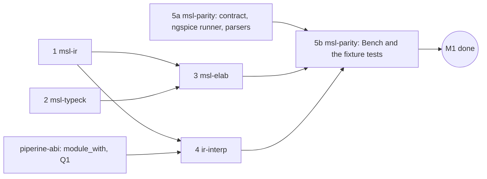

# M1: the first path from MSL to the solver

**Status**: specs and tasks approved 2026-11-15. The slice was decided by the user ("Concordo e pode disparar", `.specs/features/codegen/context.md` S1 to S10) and the eight questions of `questions.md` were answered, each with the recommended option.

## The slice

A vertical cut through every stage instead of one finished stage at a time. M1 is analog parity:

- **Devices**: resistor, capacitor, voltage source, current source, diode with `limit` and `pnjlim`.
- **Analyses**: operating point, DC sweep, AC, transient.
- **Fixtures**: `divider`, `diode_series`, and `isrc_r` added by Q7 (operating point), `diode_iv` (DC sweep), `ac_rc` (AC), `tran_rc` (transient). Each is an `.msl` file and the `.cir` twin already in `tests/ngspice/`.
- **Path**: `.msl` → parse and POM → type check → elaboration → IR → interpreter (one generic `Device` through the ABI) → solver, compared with ngspice.

M2 is digital and mixed-signal (galleries E and F, the conformance set of Appendix C.2.3). M3 is `ir-rust`, with the interpreter as its oracle.

## What M1 needs of the language

Found by writing the models first (now `tests/ngspice/*.msl`; they build on today's POM with zero diagnostics). `std` supplies `Electrical`, `vt`, `pnjlim`, `K_B`, `Q`. It has no resistor, capacitor, source or diode, so those five are written in `devices.msl`.

| Area | In M1 | Left for M2 |
| --- | --- | --- |
| Types | `f64`, `bool`, `()`, function types of closures passed as arguments | integers, `Option`, structs, enums, arrays, generics, `Repr`, unknown values |
| Value code | literals (SI suffixes included), arithmetic, comparisons, `&&` `\|\|` `!`, `let`, `if`/`else`, blocks, function calls, `exp` `ln` `sqrt` `abs`, `const` items | `match`, loops, `let mut`, assignment, the rest of Appendix H |
| Structure | modules, `f64`/`bool` params with default and `where`, `Electrical` ports and signals, a held node (`= value`), placements with a param block, `gnd` | generics, generation, templates, value inputs, results, bundles, `m`/`dtemp`, `extern` |
| Analog | `analog for M`, potential probes, flow and potential contributions, `ddt` as an addend of a flow contribution, `limit(x, f, seed)`, `ac_stim`, `temperature()`, `gmin()`, `source_scale()` | selectors and switch branches, flow probes, `ddx`, `delay`, `noise`, `bound_step`, `now()`, `analysis()`, `ddt` elsewhere |
| Digital | nothing | all of it |

Everything in the right column is refused by name (`P0001`), never skipped.

## The five features

| # | Feature | Crate | What it delivers | Requirements | Tasks | Who |
| - | ------- | ----- | ---------------- | ------------ | ----- | --- |
| 1 | `msl-ir` | `piperine-ir` (new; leaf, `serde` only) | the object model: bodies, functions, the flat instance and node tables, printer, `check()`, static dependencies | IR-01 to IR-09 (8) | 8 | Sonnet implements, Opus verifies; the dependency analysis is Opus's |
| 2 | `msl-typeck` | `piperine-lang` (`types/`) | a type for every expression a top reaches; `Deferred` members resolved; the subset enforced | TYP-01 to TYP-06 | 9 | Sonnet implements, Opus verifies |
| 3 | `msl-elab` | `piperine-lang` (`elab/`) | `Design` + top → `Ir`: constants, params, instances, nodes, the analog lowering | ELAB-01 to ELAB-06 | 10 | Sonnet implements, Opus verifies; the contribution split is Opus's |
| 4 | `ir-interp` | `piperine-interp` (new) plus one addition to `piperine-abi` | the generic device: shape from a body, dual-number evaluation, `limit`, `ac_stim`, the affine rule, IR → `CircuitInstance` | INT-01 to INT-14 (10) | 12 | Opus implements the six delicate tasks, Sonnet the rest, Opus verifies |
| 5 | `msl-parity` | `piperine-parity` (new, `publish = false`) | twins, ngspice runner, `ToleranceContract`, one test per fixture, corpus guard | PAR-01 to PAR-08 | 10 | Sonnet implements, Opus verifies |

49 tasks. Each feature has its `tasks.md` (approved 2026-11-15, `validate_tasks.py --execute` clean) and a `WORKER.md` brief for batch workers.

**Delicate** means a mistake gives a wrong number with no error: the Jacobian pattern (`msl-ir` `Deps`), the sign and placement of `ddt` in a contribution (`msl-elab`), and in `ir-interp` the shape plan, the `Terms` walk, the affine rule, `limit`, and the one task with `unsafe` (`module_with`). Those go to Opus directly. The rest is tables, plumbing and tests with a clear oracle.

## Order

- **Wave 1, in parallel**: `msl-ir`; `msl-typeck`; the first half of `msl-parity` (it needs only ngspice and the fixtures).
- **Wave 2, in parallel**: `msl-elab` (needs 1 and 2); `ir-interp` (needs 1 only: its tests run on IR bodies built by hand through `IrBuilder`, the same bodies `msl-ir` keeps as fixtures).
- **Wave 3**: the second half of `msl-parity`.

`ir-interp` and `msl-elab` meet for the first time in wave 3. The contract between them is the printed IR of the five device bodies: `msl-ir` pins the hand-built ones as golden texts, `msl-elab` must produce texts equal to them, and `ir-interp` is tested on exactly those.

Dependency arrows after M1 (new edges only): `piperine-lang → piperine-ir`; `piperine-interp → piperine-ir, piperine-abi, piperine-solver`; `piperine-parity → piperine-lang, piperine-interp, piperine-solver`. The solver crates gain no edge, so MD-60 and MD-61 hold as they are.

## How M1 is proven done

All of these green at one `HEAD`, with ngspice installed:

| Proof | Command | What it shows |
| --- | --- | --- |
| The five parity tests | `cargo test -p piperine-parity` → `divider`, `diode_series`, `diode_iv`, `ac_rc`, `tran_rc` | MSL source and ngspice agree under the contract, in all four analyses |
| The corpus guard | same run → `parity_corpus` | every twin has a test; no tolerance outside the contract |
| Exact partials | `cargo test -p piperine-interp` → the `verify_partials` sweep | every function of every M1 body passes the ABI's finite-difference verifier |
| Exact linear terms | `cargo test -p piperine-interp` → the resistor residue test | the T5 lesson is closed for generated devices |
| Golden IR | `cargo test -p piperine-lang` → the elaboration golden files | the lowering of the five twins is pinned and readable |
| Subset is enforced | `cargo test -p piperine-lang` → the `P0001` fixtures | nothing outside M1 is accepted silently |
| Nothing regressed | `cargo build` with zero warnings; `cargo test` | the five existing crates, their guards and `suite_hygiene` stay green with three new default members |

And one red: with ngspice off `PATH` and no `PIPERINE_NGSPICE`, the five parity tests fail and say why (Q2).

## Found while planning

| Finding | Evidence | Where it went |
| --- | --- | --- |
| The `Device` trait cannot express one type serving many modules | `piperine-abi/src/thunk.rs:28`, `device.rs:17` | Q1; `ir-interp` INT-08. **Blocks M1 until answered** |
| The solver wants `&'static Module` | `piperine-solver/src/core/builder.rs:99` | accepted for M1: one small leak per body; a risk row in `ir-interp/design.md` |
| A crate named `piperine-ir` trips the retired-crate guard | `piperine-solver/tests/workspace_shape.rs:22` | Q6 |
| The specification has no code for a type mismatch | no row in any error table; §0.4 | Q5 |
| §18 rule 2 (a `limit` keeps its seed) is missing from abi.md's diode example | `abi.md` §11.2 fn 0 | `ir-interp` INT-10 AC 3 follows the specification |
| `out` is a keyword, so the node `out` of two fixtures is `r#out` | found by building `ac_rc.msl` | the twins use `r#out`; the path is still `out` |
| MSL has no `uic` | §16 H6 | the transient twin holds `out` at 0 V (H1), which is the same start |
| ngspice shunts every junction with `gmin` | its `i(v1)` at −1 V is 1.01e-12 A | the fixture diode adds `gmin() * vd` |
| A shape with pins and no function is not exercised by any solver test | `piperine-solver/src/core/bind.rs:417` | a spike test opens `ir-interp`'s netlist task; the fallback already exists in the solver |
| Appendix C still describes "AIR v2" with full inlining | `docs/spec/appendix_c_implementation.md:12` | Q8 |
| The five green crates still compile | `cargo check` of each on 2026-11-15 | the baseline M1 starts from |
