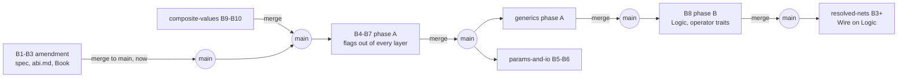

# Explicit Unknowns Design

**Spec**: `.specs/features/explicit-unknowns/spec.md` (EU-01 to EU-21, R1 to R10, D1 to D16, Q1 to Q3)
**Status**: Draft. It takes the recommended option of Q1, Q2 and Q3; "If the user answers otherwise" at the end says what moves.

---

## Approach

Three parts, each green at every commit.

1. **The amendment** (batches B1 to B3): the specification, `abi.md`, the records and the Book state the explicit model. It merges to `main` first and alone, as `value-semantics`' amendment did (`cc3599bf`). Until phase A lands, `GAPS.md` holds one silent row, S8: "the implementation still carries the known flag", and the Book's status boxes say which listings do not run yet.
2. **Phase A, the flag leaves every layer** (batches B4 to B7), on `main` right after `composite-values` merges and before `generics`. In three moves, the order `value-semantics` used:
   - **accept**: the checker takes a plain read of a binary carrier in `analog`, and the elaborator starts a carrier with no initial value at its type's `Default`;
   - **rewrite the tree**: `std`, `examples/buck`, the e2e packages, the fixtures and the tests move to the explicit form while the earlier form still compiles;
   - **refuse and remove**: the names stop resolving, a missing initial value is `E0187`, and the flag is deleted from the elaborator, the IR, the generated code, the records, the ABI, the engines and the host, in that order, so each layer loses a form only after nothing above it produces it.
3. **Phase B, `Logic` from library source** (batch B8), after `generics` phase A is on `main`: operator traits in the checker and the elaborator, `std/logic.msl`, the host's four-state cells.

Refusing first would break `std` and half the corpus in one commit. Removing the ABI's known byte first would break every layer above it at once.



## Why `Logic` waits for `generics`

`Logic<const N: usize = 1>` is a generic struct with `impl<const N: usize> BitAnd for Logic<N>` and methods on `self`. Generic structs (T31, T38), `impl` and `self` (T24 to T26, T35), trait `impl`s and static dispatch (T27 to T29, T36) are all `generics` phase A. Nothing regresses in between: on `main` today `Logic`, `Strength` and `Wire` are refused with `P0001` (`GAPS.md` L21, L58), so no model loses a type it could run. An interim `Logic` lowered by `elab/intrinsics.rs` was rejected: it is the special case R2 forbids, written only to be deleted.

## What exists, and what changes

| Concern | Today (`main` at `8b5596ed`) | After |
| ------- | ---------------------------- | ----- |
| Literal | `Token::Unknown`, `LitKind::Unknown` (`msl/lexer.rs`, `msl/ast.rs`); `E0906`, `E0908` | the token and the literal are gone; `Unknown` is an identifier that resolves to nothing (`E0161`), with a help from the same table that helps `Clone` and `Copy` |
| Flag methods | `level`, `merge`, `same`, `cast`, `logic`, `matches_bits`, `known`, `known_or`, `is_known`, `high` typed in `types/intrinsic.rs`, lowered in `elab/intrinsics.rs` | `level`, `merge`, `known`, `known_or`, `is_known`, `high` deleted from both tables. `same` and `cast` stay intrinsics with the D10 and D11 meaning until `generics` compiles `std/values.msl` (its T41, as MD-70 Q1 (b) already planned). `logic` and `matches_bits` are retyped to `Logic<N>` in phase B and are refused by name (`P0001`, `GAPS.md` L58) between phase A and phase B |
| Analog reads | `types/flag_total.rs` and `types/analog.rs` refuse a read outside `level` or a flag-total function (`E0150`) | `flag_total.rs` deleted; a discrete carrier read in `analog` is typed like any expression. A `Logic` there fails where an `f64` or a `bool` is required, by `E0180`, with no rule of its own |
| Structure | `E0151`: a structural decision that is unknown | deleted: a structural decision is a `bool` or an integer |
| Unknown-ness | `elab/known.rs` decides which expressions may be unknown; the elaborator builds `ValueType::Flagged(_)` | `known.rs` deleted; no expression has a flagged type |
| IR | `ValueType::Flagged` in `model.rs`, rules in `check.rs`, `typing.rs`, `deps.rs`, `print.rs` | removed whole |
| Control | `rt/control.rs` runs both arms and merges; a loop under unknown control is cut at 64 iterations (Appendix C.2.1) | one path. The merge, the bound and its C.2 rows are gone |
| Carried layouts | `piperine-plan/src/digital.rs`: every carrier is a value leaf and a known byte (`{ v: U16 @0, known @2 }`) | the value leaf alone. `Option<T>` is `{ some: BOOL, v }`, the layout `composite-values` T56 gives it, unchanged |
| Initial values | a carrier with no `= value` starts at zero bytes, which read as unknown (P3) | the elaborator emits init bytes for every carrier: the written value or `Default::default()`. Zero bytes are storage before `(0, 0)`, which no model reads |
| Records | every stream's layout ends with `maybe` (`RecordLayout` in `piperine-plan`); `Record::surely`, an unknown verdict (`piperine-api/src/verdict.rs`, `record.rs`); the CLI prints it (`render/record.rs`, `render/json.rs`) | no field, no `surely`, two verdicts |
| Commits | `Host.commit_with(.., flags)`, `commit_flag::{MAYBE, MERGE}`; `layout::Merge`; the digital solver's queue converts pending commits under `MAYBE` (`queue.rs`) | `commit` only |
| ABI | major 1, minor 1; `Field { .., flags, known }`; `HAS_KNOWN`; `BIT` size 2, `REAL` size 16, `BYTE` size 2 | major 2, minor 0; `Field { name, leaf, offset, count }`; `BIT` size 1, `BYTE` size 1, `F64` size 8. `REAL` is deleted: it was `F64` with a known byte |
| Relaxation | drive pin = value + `driving: BOOL` with a known byte; zero bytes are "absent"; a field with a known byte that still moves is zeroed, one without is a fault (abi.md D1) | drive pin = value + plain `driving: BOOL`; 0 is absent. A loop that still moves is `E0511` (Q3 = A): the solver no longer acts on a layout's fields, which closes abi.md §14 point 6 |
| Host cells | a cell may be unknown (`table.rs`, `probe.rs`, `plot.rs`, `recorder.rs`, `request.rs`) | a cell is a value. `None` prints `None`; `Logic<N>` prints its pattern (phase B) |
| `rise`, `fall` | `changed() && prev().level(0) != Some(true) && level(0) != Some(false)`; a `Bit` that starts high rises at `(0, 0)` | `changed() && !prev() && value`; `prev()` at `(0, 0)` is the initial value, so no edge there (D9) |
| `Default` | `composite-values` T44 and T52 give `false`, zero, `None` | the table of D4; `E0187` for the rest |

## The explicit model, as the specification will state it

This section is the normative text the amendment tasks write out. Where it gives source, that source is the target text of the Part VII fences and of `std/*.msl`.

### Part I §3.3, new title "Uncertainty and absence"

1. **§3.3.1** A value of every type is a value of that type. No level and no value carries a record of being established or not.
2. **§3.3.2** A type that may hold "not determined" says so: `Logic<N>` (§22.1) has the states 0, 1, X and Z on each of its `N` levels.
3. **§3.3.3** A type that may hold "nothing" says so: `Option<T>` is `None` or `Some(x)`.
4. **§3.3.4** A carrier, a drive and a param have a value from `(0, 0)` on: the initial value written, or `Default::default()` of the type (H.8). A type without `Default` requires the initial value (`E0187`). `bool`, `UInt<N>`, `Int<N>`, `Float<N>` and `str` do not implement `Default`; in this they differ from Rust, on purpose: a register with no reset value has no meaning a number can express.
5. **§3.3.5** Control (`if`, `while`, a guard, `&&`, `||`) takes a `bool`. A `Logic` decides nothing by itself; a model writes how: `x.is_high()`, `same(a, b)`, `match x.at(0) { .. }`, `x.to_bit()`.
6. **§3.3.6** `analog` reads a discrete carrier like any expression. A solve computes with reals and `bool`s, so a `Logic` reaches it through a function that returns one (`to_volts`, `is_high`).

Errors of §3.3: none of its own. `E0150` and `E0151` are retired.

### Appendix H

H.8, `Default` row and rule 4: the text of D4. Rule 7's built-in table loses `Default` for `bool`, the integers and the floats.

H.8, `PartialEq<Rhs = Self, Out = bool>`: `fn eq(self, other: Rhs) -> Out; fn ne(self, other: Rhs) -> Out;`. A bound or a derive that writes `PartialEq` alone means `PartialEq<Self, bool>`, as before. `contains`, `match` on a literal and derived comparison require that form.

H.8, `From<T>`: `fn from(x: T) -> Self`.

New H.10, operator traits:

| Operator | Trait | Function |
| --- | --- | --- |
| `a & b` | `BitAnd<Rhs = Self, Out = Self>` | `fn bitand(self, rhs: Rhs) -> Out` |
| `a \| b` | `BitOr<Rhs = Self, Out = Self>` | `fn bitor(self, rhs: Rhs) -> Out` |
| `a ^ b` | `BitXor<Rhs = Self, Out = Self>` | `fn bitxor(self, rhs: Rhs) -> Out` |
| `!a` | `Not<Out = Self>` | `fn not(self) -> Out` |
| `a << k`, `a >> k` | `Shl<Rhs = usize, Out = Self>`, `Shr<Rhs = usize, Out = Self>` | `fn shl(self, rhs: Rhs) -> Out`, `fn shr` |
| `a == b`, `a != b` | `PartialEq<Rhs = Self, Out = bool>` | `eq`, `ne` |

Rules: (1) an operator on a struct or an enum is the function of the one `impl` whose type is the left operand's and whose `Rhs` is the right operand's; none is `E0180`. (2) For one operator trait, one type and one `Rhs`, at most one `impl` exists (`E0187`), so `Out` follows from the operands. (3) The built-in types implement these traits with the meaning §1.5 gives; §1.5 is unchanged. (4) A compound assignment `a &= b` is `a = a & b`. (5) The arithmetic and ordering operators have no trait: they apply to the types §1.5 lists and to derived `PartialOrd`.

### Part VII §22.1

```rust
/// Four-state logic on N levels: 0, 1, X (not determined) and Z (not driven).
#[derive(Repr)]
pub struct Logic<const N: usize = 1> {
    pub binary: UInt<N>, // 1 where the level is 0 or 1
    pub value: UInt<N>,  // the level where binary; where not, 0 is X and 1 is Z
}

#[derive(Repr, PartialEq)]
pub enum LogicState { X, L, H, Z }

impl<const N: usize> Default for Logic<N> {
    fn default() -> Logic<N> { Logic::X }
}

impl<const N: usize> Logic<N> {
    pub const X: Logic<N> = Logic { binary: 0, value: 0 };
    pub const Z: Logic<N> = Logic { binary: 0, value: !0 };
    fn ones(self) -> UInt<N> { self.binary & self.value }
    fn zeros(self) -> UInt<N> { self.binary & !self.value }
    pub fn is_high(self) -> bool { self.ones() == !0 }
    pub fn is_low(self) -> bool { self.zeros() == !0 }
    pub fn is_x(self) -> bool { self.binary == 0 && self.value == 0 }
    pub fn is_z(self) -> bool { self.binary == 0 && self.value == !0 }
    pub fn to_bits(self) -> Option<UInt<N>> { if self.binary == !0 { Some(self.value) } else { None } }
    pub fn at(self, k: usize) -> LogicState { .. }
}

impl<const N: usize> BitAnd for Logic<N> {
    fn bitand(self, r: Logic<N>) -> Logic<N> {
        let one = self.ones() & r.ones();
        Logic { binary: one | self.zeros() | r.zeros(), value: one }
    }
}
impl<const N: usize> BitOr for Logic<N> {
    fn bitor(self, r: Logic<N>) -> Logic<N> {
        let one = self.ones() | r.ones();
        Logic { binary: one | (self.zeros() & r.zeros()), value: one }
    }
}
impl<const N: usize> BitXor for Logic<N> {
    fn bitxor(self, r: Logic<N>) -> Logic<N> {
        let both = self.binary & r.binary;
        Logic { binary: both, value: (self.value ^ r.value) & both }
    }
}
impl<const N: usize> Not for Logic<N> {
    fn not(self) -> Logic<N> { Logic { binary: self.binary, value: !self.value & self.binary } }
}
impl<const N: usize> PartialEq<Logic<N>, Logic> for Logic<N> {
    fn eq(self, r: Logic<N>) -> Logic {
        if self.binary != !0 || r.binary != !0 { Logic::X } else { Logic::from(self.value == r.value) }
    }
    fn ne(self, r: Logic<N>) -> Logic { !self.eq(r) }
}
impl<const N: usize> From<UInt<N>> for Logic<N> {
    fn from(b: UInt<N>) -> Logic<N> { Logic { binary: !0, value: b } }
}
impl From<bool> for Logic { fn from(b: bool) -> Logic { Logic { binary: 1, value: b as u1 } } }
impl Logic {
    pub const L: Logic = Logic { binary: 1, value: 0 };
    pub const H: Logic = Logic { binary: 1, value: 1 };
    pub fn to_bit(self) -> Option<bool> { self.to_bits().map(|b| b == 1) }
    pub fn to_volts(self, vdd: f64) -> f64 { match self.to_bit() { Some(true) => vdd, Some(false) => 0.0, None => vdd / 2.0 } }
}
```

The mixed forms (EU-08 AC 6) are four more `impl`s per operator, each one line through `From`: `impl<const N: usize> BitAnd<UInt<N>, Logic<N>> for Logic<N>`, `impl<const N: usize> BitAnd<Logic<N>, Logic<N>> for UInt<N>`, and the `bool` pair for `Logic<1>`. `Shl` and `Shr` shift both planes and set the shifted-in levels of `binary` to 1.

The tables the section prints (X stands for X or Z as an operand; a result is never Z):

| `&` | 0 | 1 | X |   | `\|` | 0 | 1 | X |   | `^` | 0 | 1 | X |   | `!` |   |
| - | - | - | - | - | - | - | - | - | - | - | - | - | - | - | - | - |
| **0** | 0 | 0 | 0 |   | **0** | 0 | 1 | X |   | **0** | 0 | 1 | X |   | 0 | 1 |
| **1** | 0 | 1 | X |   | **1** | 1 | 1 | 1 |   | **1** | 1 | 0 | X |   | 1 | 0 |
| **X** | 0 | X | X |   | **X** | X | 1 | X |   | **X** | X | X | X |   | X, Z | X |

`same` and `cast` (§22.1.3, §22.1.4):

```rust
pub fn same<T: Repr>(a: T, b: T) -> bool { a.encode() == b.encode() }
pub fn cast<A: Repr, B: Repr>(a: A) -> Option<B> where A::WIDTH == B::WIDTH { B::decode(a.encode()) }
```

`impl Bit` (§22.1.5) and, beside it, the same two functions on `Bit<Logic>`:

```rust
impl Bit {
    pub fn rise(self) -> Event { self.changed() && !self.prev() && self }
    pub fn fall(self) -> Event { self.changed() && self.prev() && !self }
}
impl Bit<Logic> {
    pub fn rise(self) -> Event { self.changed() && self.is_high() && !self.prev().is_high() }
    pub fn fall(self) -> Event { self.changed() && self.is_low() && !self.prev().is_low() }
}
```

`init` (§22.1.6) is unchanged: `signal up: Bit = true; up.changed()` fires at `(0, 0)` because the first commit is a change (D8).

### Part VII §22.3 (Q2 = A)

```rust
#[derive(Repr, PartialEq, PartialOrd)]
pub enum Strength { Weak, Pull, Strong, Supply }

#[derive(Repr)]
pub struct Driven { pub v: Logic, pub s: Strength }

impl Driven {
    pub const Z: Driven = Driven { v: Logic::Z, s: Strength::Weak }; // not driving
    pub fn strong(v: bool) -> Driven { Driven { v: Logic::from(v), s: Strength::Strong } }
    // pull, weak, supply alike
    /// The strongest drive wins; equal strongest drives that disagree give X. A Z drive is left out.
    pub fn wired<const N: usize>(d: [Driven; N]) -> Driven {
        d.iter().filter(|x| !x.v.is_z()).fold(Driven::Z, |a, x|
            if a.v.is_z() || x.s > a.s { x }
            else if x.s < a.s { a }
            else if same(a.v, x.v) { a }
            else { Driven { v: Logic::X, s: a.s } })
    }
}
pub nature Wire { value: Driven, resolve: Driven::wired }

#[derive(Repr, PartialEq)]
pub enum Tristate<T> { Free, Driven(T), Contended }
pub fn tri<T: Repr, const N: usize>(d: [Tristate<T>; N]) -> Tristate<T> {
    d.iter().fold(Tristate::Free, |a, x| match (a, x) {
        (Tristate::Free, y) | (y, Tristate::Free) => y,
        _ => Tristate::Contended,
    })
}
pub nature Tri<T: Repr> { value: Tristate<T>, resolve: tri }
```

`Tribuf`, `Pullup`, `Pulldown`, `Keeper`, `Tran`, `Tgate`, `Bidir` and `TribufDelayed` keep their bodies with `Driven` for the earlier `Logic`, `w.v.is_high()` or `w.v.to_bit()` where they read `w.v` as a `bool`, and an explicit initial drive `= Driven::Z`. Appendix F.4's three cases read: undriven is `v.is_z()`, contended is `v.is_x()`, kept is a level at `Strength::Weak`.

### Carriers (Part II §5)

- §5.1.1: reading a carrier yields its value. The initial value is committed at `(0, 0)`: `= value`, or `Default::default()` (§3.3.4).
- §5.1.5: the initial expression is over params and constants. The sentence "It may be or contain `Unknown`" goes.
- §5.1.8: an element never committed reads as its initial value.
- §5.2.8: a one-driver carrier with no drive holds its initial value in every analysis; its type implements `Default` or it is `E0187`.
- §5.2.12: a drive with no initial value starts at `Default::default()`; a type without it is `E0187`.
- §5.3 table and §5.3.4 to §5.3.8, §5.3.11: the text of D8 and EU-13. §5.3.12 (the value bytes of an unknown level) goes.
- Examples: `signal en: Bit = false;`, `signal bus: Bit<Logic<4>> = logic("10xx");`, `signal sda: Wire = Driven::Z;`.

### Other parts

| Rule today | Becomes |
| ---------- | ------- |
| §2 rule 9 (a `None` from `decode` reads as unknown), rule 11 (all-zero bytes are all-unknown) | rule 9: the caller receives the `None`. Rule 11: the bytes of `Logic::X`, of `None` and of every derived `Default` are all zero |
| §8.1 "a level no definition names stays unknown" | holds the carrier's initial value |
| §8.2.3 step 4 | the run stops with `E0511` naming the loop's drives (Q3 = A); the error-table row "is not an error" is replaced by the `E0511` row |
| §8.2.28, §8.3.18 (a value read through a `let`, an input or a result keeps its flags) | removed |
| §8.2.30 (an unknown delay commits `Unknown`), §12.1.19 | removed: a delay is an `f64` |
| §8.5 (an input with an unknown level: the foreign simulator is not run) | removed: an `extern` module receives the bytes of the types it declares |
| §11 rule 13 | the text of §3.3.6 |
| §13 rule 1 (an unknown guard runs the reaction), rule 5 (an unknown `at` or `cross` does not fire) | removed |
| §13 rule 6 | the initial value's commit at `(0, 0)` is a change of every carrier |
| §17.3 rule 5 | removed |
| §19 rule 1 (`maybe`), rule 11 (the name is reserved), §23.2 rules 3 and 4, §23.3 rule 4g | removed |
| §23.1 rule 9 | a top-level `in` port follows §3.3.4: its `= value`, the host's value before the analysis, or its type's default; none of the three is `E0187` when the analysis starts |

### `abi.md`, major 2

- §2: seven entry points become six; `commit_with` is removed. The symbol is `piperine_abi_2`.
- §3: `Field { name: Str, leaf: u32, offset: u32, count: u32 }`. The constants `HAS_KNOWN` and `commit_flag` go. `MAJOR` 2, `MINOR` 0.
- P3: discrete storage starts all zero and no model reads it: the elaborator gives every carrier pin init bytes, which the owner commits at `(0, 0)`. The shipped layouts are `BIT`, `BYTE`, `F64` and `NONE`.
- P5: a parameter that may be not given is a pin of `Option<T>`: `{ some: BOOL @0, v: T }`.
- The empty value of a `TRACE` site not reached, and a record made in a function (C5): each `known` use is re-derived by one rule, "what may be absent has a `BOOL` presence field first".
- C7: removed.
- D1: the text of D14 and of Q3 = A. Relaxation starts each pass with `driving` 0 on every drive of the cycle; a net that still moves after the bounded passes is a `FAULT` the owner reports as `E0511`.
- §12 Versioning: one paragraph on why this is a major (a field and an entry were removed).
- §14 point 6: removed. §15 rows 6 and 7: marked superseded by MD-78.

## Sequencing with the features in flight

### `composite-values` (B9 and B10 in flight on `feature/composite-values`, merges first)

It merges as planned; this feature does not ask it to stop. What it built on the flag becomes plain in phase A:

| Its work | What phase A does |
| -------- | ----------------- |
| Arrays whose elements carry a flag; an index that may be unknown merges the elements it may name (L3, L24, `unknown-semantics` US-04 AC 12) | T31 removes the merge of an unknown index; an index is an integer |
| The refusal of an unknown part of a struct | T31 deletes the refusal; its tests are replaced by EU-01 AC 1 on a struct carrier |
| T44, T52: `Default` gives `false` and zero | T21 changes the table to D4. **If B9 has not committed T52 when this plan is approved, T52 is amended in place** (drop the numeric and `bool` rows), which saves the rework |
| T56, T57: composite layouts with a known byte per leaf | T36 drops the known bytes |
| T60 to T62: composite cells and records, an unknown cell | T38, T39 |

### `generics` (`origin/feature/generics`, phase A pending; runs after phase A of this feature)

| Task | Verdict | Change |
| ---- | ------- | ------ |
| T12 Printer: `Carried` through `encode` and `decode` | **change** | no flag moves with the levels; a `decode` that gives `None` is returned to the caller (§2 rule 9 as amended) |
| T16 `GenericSignature`, T19 what a bound gives | **change** | `Default` is given by the table of D4; `T: Default` no longer holds for the numeric types |
| T27 to T29 trait `impl`s, T36 static dispatch | **keep, one addition** | a trait may have type parameters with defaults (`PartialEq<Rhs = Self, Out = bool>`); the overlap rule compares the trait's arguments too. Operator dispatch itself is this feature's T42 and T43 |
| T30, T39 a hand-written `impl Repr` | **change** | drop "a `None` from `decode` makes the value unknown" |
| T41 Gallery fences and Book listings; the deletion of `elab/intrinsics.rs` | **change** | `std/values.msl` holds `same` and `cast` only; `level` and `merge` are already gone. The listings are those the amendment wrote |
| T44 to T52 handles | **keep** | |

### `unknown-semantics-events` (B5 waiting: T24 to T31)

`settle`, `fired(k)` and `limexp` (B1 to B4, MD-74) stand: none reads a flag. Phase A removes one thing they touch, `guard_may_be_unknown` in `piperine-plan/src/digital.rs` (§13 rule 1).

| Task | Change |
| ---- | ------ |
| T24 rebase | re-reads the anchors on the tree without flags |
| T25, T26 `Pfd3` | its `state` gets an initial value (`signal state: Bit<i2> = 0;`); the listing and its comment "all levels unknown" are the amended Book's; no merge |
| T27 to T30 `Event` functions | keep |
| T31 closing | the feature's name stays; its `GAPS.md` rows no longer cite §3.3.3 |

### `resolved-nets` (B1, B2 on `main`; B3 onward waiting: T11 to T36)

It runs after `generics` phase A **and** this feature's phase B, since `Wire` needs `Logic`.

| Task | Change |
| ---- | ------ |
| T7 (done) the drive presence field | reworked by this feature's T37: `driving` is a plain `BOOL` |
| T8, T9 (done) `Unsettled` | under Q3 = A the observation becomes the `E0511` fault; T37 |
| T12 to T15 IR, plan, printer, netlist | no flagged drive; the drive pin is D14's layout |
| T16, T19 resolved natures, `ResolverBodies` | unchanged under Q1 = A: `resolve` names a const-generic function, instantiated per drive count `0..=N` |
| T20 initial values of resolved carriers | §5.2.12 as amended: `Default` or `E0187` |
| T24, T25 relaxation and its `log` record | the record is replaced by `E0511` (Q3 = A) |
| T27 `Logic`, `Strength`, `Wire` | becomes `Strength`, `Driven`, `Wire`; `Logic` already runs (this feature's T44) |
| T28 `Tri<T>` | over `Tristate<T>` |
| T29 to T32 `Tribuf` to `Bidir` | the bodies of §22.3 as amended |
| T33 edge cases | drop "an unknown strength merges the arms"; add a Z drive of any strength is left out |
| T34, T35 the Book's alarm | the listing the amendment wrote |

### `resolved-nets-bundles` (B2 onward waiting: T5 to T21)

No task changes meaning. Two notes for its rebase (T5): every fixture that declares a `Bit` field or signal with no initial value gains one (`E0187` otherwise), and T15 (a bundle field of a resolved nature) uses `Driven`.

### `params-and-io` (B5, B6 waiting: T29 to T44)

It runs after this feature's phase A, so it builds the param pins once.

| Task | Change |
| ---- | ------ |
| T30, T31 integer, enum and `Option` params | "not given" is `Option<T>` with `None`; no param is unknown |
| T32 plan and printer: param pins | layouts without a known byte; an `Option` param is `{ some: BOOL, v }` |
| T33 host: the text of the new types | `None` is written and printed as `None` |
| T35 the Book's debouncer | the listing without `known_or(clean)`; `GAPS.md` L59 is moot and closes with phase A |
| T37 to T44 | keep |

## Components

Every new type and method carries a `///` comment; no free function; names are whole words.

| Component | File | Purpose |
| --------- | ---- | ------- |
| `InitialValue` | `crates/piperine-lang/src/elab/carriers.rs` | what a carrier holds at `(0, 0)`: the written expression or the type's default; names the carrier and `Default` when neither exists |
| `Defaults` | `crates/piperine-lang/src/types/` (the unit `composite-values` T44 creates for derives) | the table of D4 and the `E0187` of a type outside it |
| `RemovedName` rows | `crates/piperine-lang/src/pom/resolve/` (the unit that helps `Clone` and `Copy`) | the help line for `Unknown`, `level`, `known`, `known_or`, `is_known`, `high`, `merge` |
| `OperatorTraits` | `crates/piperine-lang/src/types/` (phase B) | maps an operator and its operand types to the one `impl`, and gives the result type |
| `LogicCell` | `crates/piperine-api/src/table.rs` (phase B) | prints the two planes as a pattern |

## Tests: where each criterion is proven

| Layer | Target | New or existing |
| ----- | ------ | --------------- |
| Specification text | `crates/piperine-lang/tests/spec_text.rs`, `spec_codes.rs` | existing; one assertion per rule the amendment writes, and one that the removed words are absent |
| `abi.md` and records | `crates/piperine-cli/tests/docs.rs` | existing |
| Book | `tests/book/values.rs`, `language.rs`, `types.rs`, `generics.rs`, `natures.rs`, `digital.rs`, `analog.rs`, `mixed.rs`, `core_std.rs`, `errors.rs`, `cheatsheet.rs`, `abi.rs`, `inventory.tsv`, `inventory_guard.rs`, `claims_guard.rs` | existing |
| Checker | `crates/piperine-lang/tests/types_explicit.rs` | replaces `types_unknowns.rs` |
| Elaborator | `crates/piperine-lang/tests/elab_explicit.rs` | replaces `elab_unknowns.rs` |
| Runs from source | `crates/piperine-parity/tests/source_explicit.rs`, models in `tests/explicit/*.msl` | replaces `source_unknowns.rs` and `tests/unknowns/` |
| IR | `crates/piperine-ir/tests/digital.rs` | existing |
| Plan | `crates/piperine-plan/tests/digital_shape.rs` | existing |
| Generated code | `crates/piperine-transpile/tests/reaction.rs`, `golden.rs` | existing |
| ABI | `crates/piperine-abi/tests/layouts.rs`, `contract.rs`, `validate.rs` | existing |
| Digital solver | `crates/piperine-digital-solver/tests/relax.rs`, `queue.rs` | existing |
| Host and CLI | `crates/piperine-api/tests/records.rs`, `session.rs`; `crates/piperine-cli/tests/run.rs` | existing |
| Tree hygiene | `crates/piperine-lang/tests/suite_hygiene.rs` | existing, one walk added for the removed names |
| Standard library | `crates/piperine-lang/tests/std_excerpts.rs`, `std_library.rs` | existing |
| `Logic` (phase B) | `crates/piperine-lang/tests/types_operators.rs`, `crates/piperine-parity/tests/source_logic.rs`, models in `tests/logic/*.msl` | new |

## Goldens, pins and tests that may move

| What | Task | Rule |
| ---- | ---- | ---- |
| `types_unknowns.rs`, `elab_unknowns.rs`, `source_unknowns.rs` and `tests/unknowns/*.msl` | T20, T27, T29, T31 | each test is replaced by the test of the criterion that supersedes it; the commit body lists old name and new name. A test whose behavior no longer exists (a merge of two arms) is replaced by the one-path test of EU-01 AC 2 on the same source |
| `spec_text.rs`: `zero_bytes_are_the_unknown_value`, `appendix_c_states_the_loop_bound_under_unknown_control`, `appendix_c_lists_the_loop_bound_among_the_defaults`, and every assertion that quotes §3.3 | T1 to T9 | replaced by the assertions of the amended rule |
| `tests/book/values.rs`: `the_flag_is_read_with_known_known_or_and_is_known`, `analog_reads_a_digital_carrier_through_known_or`; the rows of `inventory.tsv` whose text changes | T12 to T18 | replaced; fingerprints regenerated by the inventory's own tool |
| `crates/piperine-ir/tests/golden/buck/**`, `crates/piperine-lang/tests/fixtures/elab/buck.txt` | T32 | regenerated once: the only diff allowed is a flagged type becoming its plain type |
| `crates/piperine-transpile/tests/golden/**` | T33 | regenerated once: the only diff allowed is the removal of flag and merge code |
| `crates/piperine-lang/tests/fixtures/preformat/**` | T23, T24 | regenerated from the rewritten sources |
| Record goldens in `crates/piperine-cli/tests` and `crates/piperine-api/tests` | T34 | the `maybe` column and field leave; nothing else |
| The buck's asserts on a known byte or on `maybe` | T24, T34, T36 | rewritten to the value; every waveform assert stays |
| Twin goldens, `contract.rs`, every `ToleranceContract` | none | never |

## Risks & Concerns

| Risk | Where | Signal | Answer |
| ---- | ----- | ------ | ------ |
| D9 changes when an edge fires at `(0, 0)` | every model with `on x.rise()` or `on x.fall()` and no `prev().is_known()` filter: `examples/buck`, the parity models, the Book | a buck assert or a source test moves in T23 to T26 | T23 changes `rise`/`fall` and lists on the Handoff every model whose output moved; each is rewritten so its output is unchanged (`on x.fall() \|\| init() && !x`), never by editing an expected value. If the list is long, stop and report: the user may prefer the earlier `changed() && value` |
| A model relied on a carrier being unknown at the start | `tests/e2e/integrated/src/*.msl`, `examples/buck/src/supervisor.msl` ("unknown control is read on the safe side") | `known_or(d)` with a `d` that differs from the first value committed | T24, T25: the carrier gets `= d` as its initial value, which is what the model read until its first commit |
| The ABI major breaks an out-of-tree device | `piperine_abi_1` libraries, the cache of compiled models (`piperine-transpile/src/cache.rs`) | a cached `.so` built before T36 | the cache key holds the ABI major; T36 asserts a major-1 library is refused by name, never loaded |
| The removal is one coupled change across five crates | T36 (`Field`, the plan's layouts, the printer's shapes, the solver's bind, the hand-written test devices) | the workspace does not build between two commits | the order of B6 and B7: nothing above the ABI produces a flag by the time T36 runs, so T36 is a mechanical drop of one byte per leaf; it is the one task whose `Where` is a crate, not a file |
| Operator traits meet the built-in operators | `types/expr.rs` (phase B) | `a & b` on integers becomes slower to check or changes a diagnostic | T42 dispatches to a trait only when the left operand is a struct or an enum; §1.5 keeps the built-in path |
| `Logic<N>` for `N` > 64 | the plan's layout of `UInt<N>` | a wide `Logic` bus | it is `UInt<N>`'s layout twice; no rule of its own. T44's source test covers `N` = 1, 4, 64 and 100 |
| The Book and `GAPS.md` conflict at each rebase | T19, T41 | `content.html`, `inventory.tsv` | the amended wording wins for the language; the other feature's facts win for what runs |
| `main` holds a specification the code does not meet between the amendment and phase A | `spec_text.rs` green, behavior not | a reader takes the Book for the binary | S8 in `GAPS.md`, the status boxes, and Appendix G.72's sentence "the reference implementation does not meet this yet", removed by T40 |

## If the user answers otherwise

| Answer | What moves |
| ------ | ---------- |
| Q1 = B (a trait the nature implements) | T3 rewrites §4 (grammar line, table, rules 2, 6, 8, `E0203`) and §3.7 gains the exception to `E0134`; T7 writes `impl Resolve for Wire`; T8 changes Appendix B's `resolve` row; T14 the Book's listings; `resolved-nets` T16 and T19 read the `impl` instead of the field. No task of phase A or B changes |
| Q2 = B (a plain `Wire`) | T7 writes `Wire { value: Logic, resolve: Logic::wired }` and redesigns §22.3.5 to §22.3.8 around an `OpenDrain` nature; T9 Appendix F.4; T14 the Book's alarm; `resolved-nets` T27, T29 to T32 |
| Q3 = B (`Default` where it exists) | T4 (§8.2.3 step 4), T10 (D1), T37, and `Driven`, `Strength` and `Tristate` each need a `Default`; `resolved-nets` T24, T25 keep their `log` record |
