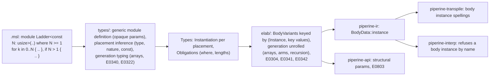

# Generics Design (phase C: generic modules and generation)

**Spec**: `.specs/features/generics/spec.md` (GN-13 to GN-20, GN-32, the residual of GN-01 AC 1; GN-29 to GN-31 carried)
**Status**: Draft (planned 2026-11-23; the open questions below take their recommended default unless the user says otherwise)
**Base**: `main` with `generics` phases A and B merged (MD-81). Phase 13 (the `Repr` residuals, T53 to T58) needs nothing
else and may start at once. Every later phase of this file starts at T59, after `composite-values` phase C (arrays of
carriers, `origin/feature/composite-values-c`, design `composite-values/design-c.md`) is on `main`: T59 merges it and
re-reads its anchors. Phases A and B are `design.md`; phase D is `design-d.md`, phase E `design-e.md`.

---

## What the code does today (`main` at `2fda3089`)

| Area | Today | Where |
| ---- | ----- | ----- |
| `encode`/`decode` under `T: Repr` | written out per instance for `bool`, integers up to 64 bits (`decode` unsigned only) and hand-written `Repr` types; `f64`, derived struct, enum, tuple, array layouts and a signed `decode` are `P0001` naming the call (GAPS L70) | `crates/piperine-lang/src/elab/levels.rs:67,134` |
| `cast` | `Expr::LevelCast { expr, to, tags }` reinterprets the levels of any laid-out type under another of the same level count (`Typing::level_cast`), printed as `<T as rt::Carried>::try_from_levels(&levels)`; the interpreter refuses it by name | `crates/piperine-ir/src/typing.rs:135`, `crates/piperine-transpile/src/print/value.rs:816`, `crates/piperine-interp/src/walk.rs:284` |
| Hand-written `Repr` on a generic type; a carrier of a hand-written type with a `Default` and no initial value | `P0001` naming each (GAPS L69, GN-32) | `crates/piperine-lang/src/elab/carriers.rs:148`, `types/repr.rs` |
| Generic module | `P0001` "generic module" at its definition (`Checker::module`) and at a placement (`Checker::placement`); the whole-model check skips it (GAPS S3) | `crates/piperine-lang/src/types/check.rs:690`, `types/module.rs:200`, `types/model.rs:54` |
| Behavior block generic names | the POM resolver checks the block's names against the module's (`E0403`); nothing binds them | `crates/piperine-lang/src/pom/resolve/behaviors.rs:65` |
| Module `where` | checked as a `bool` const expression at the definition (`E0304`), evaluated at elaboration by `place.rs` | `types/check.rs:695`, `elab/place.rs:264` |
| Body variants | `KeyParams` classifies structural params; `BodyVariants` lowers a body once per value of its key params, named `Name~p=v`; a host `set` of a key param is `E0803` (MD-71 item 3) | `crates/piperine-lang/src/elab/structural.rs` |
| Node merge | a zero-potential branch no flow reads merges its two nodes at elaboration | `elab/structural.rs:639` |
| Generation | parsed into `DeclKind::Generation(GenerationData::{For, If})`; `P0001` "generation `for`/`if` in a module body" and "... in a `digital` block" | `pom/decl.rs:359`, `types/check.rs:718`, `types/event.rs:214` |
| Templates | a param of module type holds a folded `TemplateValue` (MD-75 item 3); `cell(c)` through it places the template; every other template form is `P0001` (phase D) | `elab/templates.rs`, `elab/children.rs:173`, `types/module.rs:191`, `types/expr.rs:247` |
| IR instance names | `GenericInstance { item, arguments }` on functions and types (`name()`, `type_name()`); `Text::spelled` maps `::<`, `<`, `, `, `>`, `-` | `crates/piperine-ir/src/model.rs`, `crates/piperine-transpile/src/print/text.rs` |

What `composite-values` phase C adds (its design-c.md, read again at T59): `Ty::CarrierArray { element, length:
Length }`; `Carrier.count`, `NodeArray`, `CarrierWindow`, `Expr::CarrierElement`, `EventSource::ElementChanged`,
`CommitTarget` in the IR; `Port::Window` in the solver; `HandleBinding::Element`; a param read by an array length is
marked structural (its QC2). It leaves `Length::Generic` refused until this phase (GN-13).

---

## Architecture Overview

Phase C applies phase A's monomorphization to modules, and adds one elaboration-time unrolling (generation). Nothing new
reaches the IR but a body's `GenericInstance`; generation leaves only arrays composite-values phase C already lowers.



### The `Repr` residuals (phase 13)

- **L70 through `LevelCast`.** `x.encode()` at a derived layout is the levels of `x` read as `[bool; WIDTH]`:
  `LevelCast { expr: x, to: [bool; WIDTH] }` unwrapped (every level pattern decodes to a `[bool; WIDTH]`, so the
  `Option` is always `Some`). `T::decode(levels)` is `LevelCast { expr: levels, to: T }`, whose `Option<T>` is the
  result as §2 rule 9 wants. `f64`, a signed integer, a derived struct, enum, tuple and array all go this way;
  `bool`, unsigned integers and hand-written types keep their phase A lowering. No IR form is added (DC1).
- **`cast` and `same` from source (user, 2026-11-23).** With L70 closed, `same` (`a.encode() == b.encode()`) and
  `cast` (`B::decode(a.encode())`) compile from `std/values.msl` as ordinary generic functions, so `Intrinsic::Cast`
  and `Intrinsic::Same` leave the checker and the elaborator (T55, moved here from `explicit-unknowns` T48). A
  differential test holds the source-compiled pair to the values the removed lowering gave.
- **GN-32 AC 1.** `impl<T: Repr> Repr for Pair<T>` is an `ImplEntry` whose `WIDTH` is a const expression over the
  arguments' `WIDTH`s; each instance of `Pair` gets its own `Pair<f64>.encode`/`.decode` IR functions and a
  `ReprForm::HandWritten` entry, lowered when the type instance is registered with the `TypeArena`.
- **GN-32 AC 2.** A carrier of a hand-written type with no initial value starts at the levels `encode` gives for the
  type's `Default` value, folded in the constant evaluator as D18 folds an initializer.

### Generic modules (phases 14 and 15)

- **Definition (Q1 (c)).** `Checker::module` types a generic module once with its type and nature parameters opaque
  (`Ty::Param`) and its const parameters as `ConstTerm::Param`; ports and signals of `Bit<T>`, `S` (a nature
  parameter), `[Bit; ROWS]` (`Ty::CarrierArray` with `Length::Generic`) are typed. The whole-model check seeds generic
  modules (S3 closes).
- **Placement.** `Checker::generic_placement` (`types/module_generics.rs`) reads turbofish arguments, then infers: a
  nature parameter from the natures of the carriers connected to ports of that type (`Short(a, b)`), a type parameter
  from a `Bit<T>` connection or a value input, a const from an array argument's length, then the defaults
  (`S: Nature = State`); `E0181` for one nothing gives, `E0187` for a bound or a count. It records an `Instantiation`
  for the placement's `ExprId`, as a call records one.
- **Behavior blocks** (`analog<S> for idt<S>`): the POM already holds the names equal (`E0403`); the checker types each
  block under the module's parameters and the elaborator lowers it under the instance's substitution.
- **Elaboration.** `BodyVariants` is keyed by `(module, Instance, key values)`; a generic module is lowered once per
  key, its body under `ConstEval`'s substitution, its `where` and array-length obligations discharged per instance
  (`E0304` naming the instance, `E0180` for two lengths that differ). Names: `Ladder::<3>`, `idt::<State>`, then the
  key params' suffix (`Ladder::<3>~r=1k`); the IR records `BodyData::instance`. A chain of growing arguments is `E0341`
  at depth 1 024 (D7).
- **`Short`** is a generic module with one zero-potential contribution; the existing merge joins its nodes (GN-16 AC 1).
  Two natures that differ are a failed inference: `E0180` naming both natures (DC4).
- **Structural params** (GN-20): a param read by a const generic argument, an array length, a generation range or
  condition, or a template is a key param of `KeyParams` (§8.1.2), so `--param` selects the variant before the run and
  a `set` or a sweep of it during the run is `E0803` naming it as structural (MD-71 item 3).

### Generation (phases 16 and 17)

- **Checker** (`types/generation.rs`, `impl Checker`): a range or condition is checked in `Context::Const` (`E0340`
  otherwise); a param inside generation is `E0322`; an item declared in a generation `for` has the array type of its
  element (a signal `[Bit; K]` is `Ty::CarrierArray`, a node `[Electrical; K]` likewise, an instance an
  `Ty::InstanceArray`, a `let` an array of its value), nested loops nest the array (§8.2.23); an item in a generation
  `if` is typed whatever the arm and its uses are checked again per instance.
- **Elaborator** (`elab/generation.rs`, `Generation`): folds the range or the condition, elaborates each iteration's
  items with the loop variable bound as a constant, stores each named item as an array indexed by ordinal from 0
  (carriers and nodes as composite-values' arrays, instances as `name[k]` children), drops an untaken arm, and raises
  `E0342` for a reference into an arm that was not elaborated or an index outside a generated array. An empty range is
  an empty array.
- **Recursion** (GN-18): a module that places itself under a generation `if` unrolls through the ordinary placement of
  a new instance; the depth bound of D7 gives `E0341` naming the module.
- **`digital` blocks** (GN-19): a generation `for` around reactions makes one reaction per iteration, its event over the
  element (`EventSource::ElementChanged` of composite-values phase C), kept in iteration order inside source order
  (§12.1.14).

### Interim: the unfinished-forms gate (amendment 2026-11-23, after T59)

**Why.** Every run, every `piperine check`, the host and the Book call the whole-model check before the run check. The draft
of T60 to T62 (`origin/wip/generics-c-b10`) seeded generic modules there, so the Book's own generic modules reported their
definition gaps instead of the `generic module is not supported yet` that 14 Book tests pin. The same shape repeats for
generation (T72 types it, T73 unrolls it, T77 flips the Book) and for generation in `digital` (T78 to T80): a form that the
checker accepts before the elaborator lowers it would reach the run half-built.

**Decision (option b).** One test-visible switch in `piperine-lang/src/types/unfinished.rs`:
`UnfinishedForm { GenericModules, Generation, DigitalGeneration }` and `UnfinishedForms::IN_FORCE`, the forms every
production entry still refuses with the exact `P0001` it gives on `main` (a generic module is neither seeded nor placed;
generation is `P0001` in the checker). `Types::check`/`Types::check_model` read `IN_FORCE`; `Types::check_admitting(design,
top, forms)`/`Types::check_model_admitting(design, forms)` and parity's `Project::admitting(forms)` are the opt-ins a task's
tests use before the form's flip, naming the form. The pin `types_model.rs::unfinished_forms_in_force_are_the_ones_phase_c_
has_not_closed` asserts the list and the production behaviour of each listed form. Flips, each a named task that also
removes the form's opt-ins: `GenericModules` in **T71**, `Generation` in **T77**, `DigitalGeneration` in **T80**, which
deletes the type, the opt-ins and the pin (replaced by `generation_in_a_digital_block_runs_from_every_entry`). No Book test
changes before its flip; S3 stays in `GAPS.md` until T71.

**Why T71 moves before T69 and T70.** The Book rule says a refused row flips in the task that makes it run; with the gate
that task is the flip, so T71 is the gate flip for generic modules and runs right after T68 (instances lower). T69
(`Short` on the parity entry) and T70 (structural override through the host `Session`) then need no opt-in, and no
temporary switch reaches the public host API.

**Re-pin rule.** When a flip changes what a still-refused Book row prints, the row's test is re-pinned in that commit to the
exact refusals it now gives, each with its gap id and owner in `GAPS.md` §11; a pin is never widened.

### Gap verdicts (the draft's list, each checked against `docs/spec`)

| # | Gap the draft hit | Spec | Verdict | Owner |
| - | ----------------- | ---- | ------- | ----- |
| G1 | a value param of type `T` (`Dff`'s `reset: T`) | §8.1.15 "a param's type is a value type" | (i) real form | T60 (typed under bounds), T68 (folded per instance), runs in T71 |
| G2 | a value param of type `C` (`cell: C`, `C: Fn(Cell)`) | §8.4.1, §8.4.5 | (i) real form of templates | phase D T88 (amended); until then `P0001` naming the template form, pinned at T71 |
| G3 | a `struct` with a carrier field (`Stream`, `Cell`) | §7 | (ii) bundles | `resolved-nets-bundles` T21 (natures#8 already; amended to cover modules#10, modules#11, cheatsheet#8 after phase D T93 narrows them) |
| G4 | generation in a module body (ladder, `MemoryBank`, cheatsheet#3) | §8.2.7 | (i) real form | T72 to T77; behind the gate until T77 |
| G5 | `E0332` "a `let` reads its own name" (`lowpass`, `PiAw` over `idt`) | §8.3.5: an instance may read its own result when the result reads only the module's carriers | (i) real form; the code's fault: a generic placement was not pushed on `placing`, so the feedback rule never ran | T61 |
| G6 | `E0312` `Setup(clk, d)` with 2 of 3 ports (core-std#8) | §8.1.8 "a carrier port is never optional"; `viol` is an `out` carrier port | (iii) Book bug | T116 (BA1): `Setup(clk, d, late)` |
| G7 | `_` inferred generic argument (`MemoryBank::<_, 64, 32>`) | §1.2.12; spec index row 22 (`_` in the generic arguments of an expression) | (i) real form | T61 (`_` as if left out); inferring `C` from the template bound to `cell` is phase D T88 (amended) |
| G8 | a named connection (`reset: seat` in `std/analog.msl` `idtmod`) | §8.1.9, §8.3.7: trailing `Option` value inputs may be passed by name | (i) real form, generic-agnostic; a loud `P0001` with no `GAPS.md` row | new T117 |
| G9 | `E0187` "`bool`/`u8` does not implement `Default`" | §3.3.4 and MD-78: `bool`, `UInt<N>` have no `Default`; a carrier with no driver that gives a value needs an initial value | spec-correct. (iii) the test harnesses (`signal clk: Bit;` read only by `in` ports) and the plan's `Dff::<u8>` were wrong; the code's share is that a generic placement did not record its `out` ports in the `DriveBook` (T61) | harnesses and `Dff` at `Option<u8>` in T71 (`Dff::<u8>` proven `E0187`); BA2, BA3 below |

### Book amendments (T116)

| # | Row | Book text | Spec | Correction |
| - | --- | --------- | ---- | ---------- |
| BA1 | core-std#8 and the chapter "digital" sentence that quotes it | `let chk = Setup(clk, d) { ts: 100p };` | §8.1.8 | `signal late: Bit; let chk = Setup(clk, d, late) { ts: 100p };` |
| BA2 | cheatsheet#2 | `signal s: [Bit; N];` | §3.3.4 (`bool` has no `Default`) | `signal s: [Bit; N] = [false; N];` |
| BA3 | natures#8 | `module Slice<T: Repr>` with `signal buf: Bit<T>;` | §3.3.4; gallery E.6 writes `Slice<T: Repr + Default>` | `module Slice<T: Repr + Default>` |

---

## Code Reuse Analysis

### Existing Components to Leverage

| Component | Location | How to Use |
| --------- | -------- | ---------- |
| `Expr::LevelCast`, `Typing::level_cast`, `ValuePrinter::level_cast` | `piperine-ir/src/typing.rs`, `piperine-transpile/src/print/value.rs` | L70: `encode` and `decode` of every derived layout |
| `Elaboration::with_hand_written_widths`, `ImplTable::hand_written_repr`, D18 initial levels | `elab/levels.rs`, `types/traits.rs`, `elab/carriers.rs` | GN-32 |
| `GenericSignature`, `Inference`, `BoundCheck`, `Obligations`, `Instantiation` | `types/generics.rs`, `inference.rs`, `bounds.rs`, `obligations.rs`, `table.rs` | module definitions and placements, as for functions |
| `Instantiations`, `ConstEval::typed`, the depth bound | `elab/instances.rs`, `elab/consts.rs` | module instances |
| `KeyParams`, `BodyVariants`, the merge of zero-potential branches | `elab/structural.rs` | instance keys, `Short`, structural params |
| `GenericInstance`, `Text::spelled` | `piperine-ir/src/model.rs`, `piperine-transpile/src/print/text.rs` | body instance names |
| `Unrolling` | `elab/unroll.rs` | the loop variable of a generation `for` bound as a constant |
| `CarrierArrays`, `NodeArray`, `CarrierWindow`, `EventSource::ElementChanged` (composite-values C) | `elab/carrier_arrays.rs`, `elab/elements.rs`, `piperine-ir` | generated signal and node arrays, `[Bit; ROWS]` ports, generated reactions |
| `E0403` | `pom/resolve/behaviors.rs` | GN-13 AC 3 needs no new code: its test proves it on a generic module |
| `E0803` | `piperine-api/src/session.rs` | GN-20 AC 3 |

### Integration Points

| System | Integration Method |
| ------ | ------------------ |
| `piperine-ir` serde | `BodyData::instance: Option<GenericInstance>`, `#[serde(default)]`; no `Expr`/`Stmt` variant |
| `composite-values` C | arrays of carriers and nodes, windows, element events (T59 re-reads them) |
| `piperine-api` | variant selection by `--param`, `E0803` for a structural set |
| Book | 13 rows of `GAPS.md` §11 flip in T71, T77, T80 |

---

## Components

- **`types/module.rs`** (existing): a generic module definition is typed with opaque parameters (T60).
- **`types/unfinished.rs`** (`UnfinishedForm`, `UnfinishedForms`): the interim gate; the forms production still refuses
  (T60); emptied by T71, T77, and deleted by T80.
- **`types/module_generics.rs`** (`impl Checker`): placement of a generic module, inference, the recorded
  `Instantiation`, `_` arguments, `placing` and the `DriveBook` for a generic placement (T61).
- **`types/module.rs`** placement connections: a trailing `Option` value input passed by name (T117).
- **`piperine-parity/src/project.rs`**: `Project::admitting`, the parity opt-in to the gate (T68 to T80, deleted with it).
- **`types/lengths.rs`** (existing): const expressions in written types anywhere (`UInt<{A + 1}>`, `Int< -1 >`) (T63).
- **`elab/consts/composite.rs`** (existing): an array repeat reading a const generic, a `const fn` result as a param
  value (T64).
- **`types/generation.rs`** (`impl Checker`): generation in a body and in a `digital` block (T72, T78).
- **`elab/structural.rs`** (existing): `BodyVariants` keyed by the instance; structural params (T65, T70).
- **`elab/generic_bodies.rs`** (`impl Elaboration`): the carriers, nodes and ports of a generic module's instance
  (T68).
- **`elab/generation.rs`** (`Generation`): generation unrolled, arrays, arms, recursion (T73, T74).
- **`elab/reactions.rs`** (existing): generated reactions (T79).
- **`piperine-ir/src/model.rs`**: `BodyData::instance`; `Ir::check` holds the body's name to it (T66).
- **`piperine-transpile/src/print/text.rs`**: body instance spellings (T67).
- **`piperine-interp/src/walk.rs`**: refuses a body with an `instance` by name (T66).

---

## Data Models

```rust
// piperine-ir model.rs
pub struct BodyData { /* …, */ #[serde(default)] pub(crate) instance: Option<GenericInstance> }

// piperine-lang types/ty.rs
pub enum Ty { /* …, */ InstanceArray { module: DeclId, length: Length } }   // a generated array of instances

// piperine-lang elab/structural.rs
struct VariantKey { module: DeclId, instance: Option<Instance>, keys: Vec<(DeclId, Constant)> }

// piperine-lang elab/generation.rs
pub(super) struct Generation { /* the folded ranges and arms of one body */ }
pub(super) enum GeneratedItem { Carriers(u32), Nodes(NodeArrayId), Instances(Vec<u32>), Values(Vec<LoweredExpr>) }
```

---

## Error Handling Strategy

| Error Scenario | Handling | User Impact |
| -------------- | -------- | ----------- |
| A generic argument of a placement that nothing gives | `E0181` naming the parameter | elaboration fails |
| An argument that misses its bound; a wrong count | `E0187` | elaboration fails |
| Behavior block names that differ from the module's | `E0403` naming both lists (exists) | parse/resolve fails |
| A module's `where` false for an instance, or not a `bool` const expression | `E0304` naming the instance | elaboration fails |
| Two natures given to one nature parameter (`Short(a_el, b_th)`) | `E0180` naming both natures (DC4) | elaboration fails |
| A generation range or condition that is not a const expression | `E0340` | elaboration fails |
| A param declared inside generation | `E0322` | elaboration fails |
| A reference into an arm not elaborated; an index outside a generated array | `E0342` | elaboration fails |
| A generation recursion or a chain of growing arguments that does not end | `E0341` naming the module, at depth 1 024 | elaboration fails |
| A host `set` or sweep of a structural param during a run | `E0803` naming the param as structural | the request fails |
| A form of phase D or E (template outside a param, `m`/`dtemp`, a stdlib item still blocked) | stays `P0001` naming the form (GN-29 AC 2) | elaboration fails |
| A generic body instance on the interpreter | refused by name (R1, GN-29 AC 1) | `Interp` refuses to build |

---

## Goldens, pins and tests that may move

| What | Why | Task |
| ---- | --- | ---- |
| `elab_generics.rs::encode_and_decode_of_a_derived_layout_are_refused_naming_the_call` (proof of check C1 in `tasks.md`) | L70 closes: replaced by `encode_and_decode_of_every_layout_lower_through_the_level_cast`, and `tasks.md` C1's proof line follows | T53 |
| Tests that pin `Callee::Intrinsic(Cast)`/`(Same)` or the `cast`-to-a-tuple-holding-an-enum refusal | the intrinsics leave; each pin becomes the source-compiled acceptance | T55 |
| The `P0001` pins of L69 (a hand-written `Repr` on a generic type; a carrier with no initial value) | GN-32 | T57, T58 |
| `types_generics.rs::phase_c_d_and_e_forms_stay_p0001_by_name` (check C39) | its phase C cases run; it keeps the phase D and E cases and its name | T60, T81 |
| `types_model.rs` and `crates/piperine-cli/tests/commands.rs` expectations that an unreached generic module passes `check` | S3 closes when the gate opens | T71 |
| `elab_structure.rs::the_water_model_waits_for_generics` and the `idt` refusal next to it | `idt` is a generic module that runs; each becomes the acceptance of the spec model, or its refusal narrows to the form still missing | T71 |
| `types_model.rs::unfinished_forms_in_force_are_the_ones_phase_c_has_not_closed` (new in T60) | the interim pin: its list shrinks at each flip | T71, T77; replaced at T80 by `generation_in_a_digital_block_runs_from_every_entry` |
| Book listings core-std#8, cheatsheet#2, natures#8 and their fingerprints in `inventory.tsv` | Book amendments BA1 to BA3 | T116 |
| Book tests whose harness reads a `Bit` only through `in` ports with no initial value (`book_digital`, `book_core_std`, `book_cheatsheet`, `book_natures`, `book_generics`) | §3.3.4: the harness gains `= false`/`= None`; `Dff` is placed at `Option<u8>` | T71 |
| Book tests still refused after a flip (modules#1, #2, #10, ~b53307eb, ~4bcb9f1d, cheatsheet#8, natures#8, the `piperine-cli --test book` ladder listing) | re-pinned to their exact remaining refusals | T71, T77 |
| Book tests `the_ladder_is_refused_for_its_generic_module`, `the_half_reactions_are_refused_with_the_ladder`, `the_lowpass_module_is_refused_for_the_generic_integrator`, `the_pi_controller_is_refused_only_for_its_generic_idt`, `the_flip_flop_is_refused_for_its_generic_module`, `the_register_with_a_setup_check_is_refused_for_the_generic_monitor`, `the_module_card_is_refused_for_its_const_generic`, `the_body_items_card_is_refused_for_its_generation`, `e0340_is_not_raised_generation_is_refused_before_its_range_is_checked`, `e0304_is_not_raised_a_generic_ladder_is_refused_before_its_where_is_checked` | each row runs (or is raised) and its test becomes the acceptance; `inventory.tsv` and `GAPS.md` §11 follow | T71, T77, T80 |

Never moving: the 7 ngspice twin goldens, `crates/piperine-parity/src/contract.rs`, the transpile goldens of
`crates/piperine-transpile/tests/golden/`, every parity target, every buck target's assertions, the ABI.

---

## Risks & Concerns

| Concern | Location (file:line) | Impact | Mitigation |
| ------- | -------------------- | ------ | ---------- |
| `LevelCast`'s printer builds the levels through `rt::Carried`, which a `[bool; W]` must implement for `W` up to the widest derived layout | `piperine-transpile/src/print/value.rs:816` | an `encode` of a wide struct does not compile | T54 runs widths 1, 64 and a struct of 3 fields on the Rust backend; a `Carried` gap found there is fixed in `rt/` in that task |
| `BodyVariants` ids: an unkeyed module keeps its first-reach id (MD-71) | `elab/structural.rs` | a generic module that takes a new id could move a body of a golden | instances take ids after every unkeyed body, as keyed variants do; the twins and transpile goldens hold no generic module |
| Generation multiplies instances; the elaborator recurses per placement | `elab/children.rs`, `elab/generation.rs` | a deep generated recursion overflows the stack in debug | the depth bound of D7 and `stack::wide`, as phase A's instances do |
| `KeyParams` is a fixpoint over reached modules | `elab/structural.rs` | a const generic argument read through a child's placement must propagate | T70 adds the generic argument and array length reads to the same fixpoint, tested through two levels |
| A Book row may need a form another feature still owes (a `VSignal` in modules#8, the `Option` value inputs of `idt`) | `tests/book/modules.rs` | the row cannot flip at T71 | the row's refusal narrows to that form, its `GAPS.md` §11 row takes the form's id and owner, recorded on the Handoff (GN-27 AC 2 rule) |
| `composite-values` C not merged when phase 14 is due | `origin/feature/composite-values-c` | T59 cannot start | T59's first step checks it; if absent, the batch stops and reports (no work on an unmerged base) |

---

## Tech Decisions

| Decision | Choice | Rationale |
| -------- | ------ | --------- |
| L70 lowering | `Expr::LevelCast` to and from `[bool; WIDTH]` (DC1) | the IR already reinterprets the levels of every laid-out type; the "new bit-pack form" of D21 would duplicate it |
| Module instance identity | `(module, Instance, key values)` in `BodyVariants` | one body per instance (S6), one variant mechanism (MD-71) |
| Module instance name | `Name::<args>` then the key suffix, `BodyData::instance` | D8, `GenericInstance` of phase A |
| Generated item storage | composite-values' carrier and node arrays; instances as `name[k]` children | §8.2.23 by ordinal; no second array mechanism |
| `Short` | the existing zero-potential merge | MD-71 already merges such a branch |

The `MD-81` entry gains item 6 at T82: "Generic modules are lowered once per (instance, key values), named
`Name::<args>`; generation is unrolled at elaboration into composite-values' arrays; a param read by a generic
argument, an array length, generation or a template is structural." Supersedes nothing.

---

## Decisions taken (planner, 2026-11-23)

| # | Open point | Default taken | Why |
| - | ---------- | ------------- | --- |
| DC1 | D21 says L70 "needs an IR bit-pack form" | `Expr::LevelCast` serves (above); no IR form is added | `Typing::level_cast` accepts every laid-out type of one level count |
| DC2 | Files and numbering | `design-c.md`/`tasks-c.md`; tasks T53 to T82, checks C51 to C86, so ids stay unique in the feature; phases numbered 13 on | design.md D1, composite-values DC2 |
| DC3 | Phase 13 order | first, on `main` as it is (it needs no composite-values C); `cast`/`same` from source right after L70 (T55, user 2026-11-23) | the coordinator's note: L70 is phase C's first task; `same` needs `encode` of every layout |
| DC4 | GN-16 AC 2 names no code | `E0180` naming both natures (a type mismatch of the inference) | §1.4.4: one parameter, two types |
| DC5 | GN-13 AC 3 | `E0403`, raised by the POM today; T62 proves it on a generic module | Part IV §10 errors |
| DC6 | A stdlib generic module that starts to run with T68 (`Setup`, `since`, `idt`, `Short`) | its Book rows flip in phase C (T71) the day they run; their §22 value tests stay phase E's (GN-28) | the Book rule: a refusal test fails "now runs" the day it runs |
| DC7 | GN-20 AC 1's generation half | classified in T73, with generation; T70 does generic arguments, array lengths and templates | generation does not exist before T73 |
| DC8 | The whole-model check exposed the Book's generic definitions before they could check clean (T60 draft) | option (b): the unfinished-forms gate, flipped in T71, T77, T80 (section "Interim") | the coordinator's recommendation (2026-11-23); no Book test is loosened, every task lands green |
| DC9 | New tasks need ids | T116, T117, after phase E's T115, so no id of phases D and E moves; checks C120 to C127 | ids stay unique in the feature (DC2) |
| DC10 | A Book listing that contradicts the spec | corrected in the Book (BA1 to BA3, T116), each old form proven refused on a non-generic model | code follows the spec; the Book follows the spec |
| DC11 | Round 2 finding 10: an array of carriers with no `Default` and one driven element was exempt from `E0187` as a whole | Per element: an element no undelayed definition and no `out` port names is `E0187` naming it; an initial value on an array with some undelayed element definitions is the value of the others, `E0338` only once every element is defined; `E0223` (an initial value under a hand-over) follows the same rule: the instance holds the drive of the handed elements only, so it is `E0223` once every element is handed (finding 13, §5.2.6 amended) | §3.3.4, §8.2.20 "a level no definition names holds the initial value", §8.2.21 "on the levels defined"; AFK default 2026-11-24, pending user review. An element index decided at run time stands for all. Finding 12: a length not known yet (generic argument, param) and an index the checker cannot fold but that reads nothing over time (`Element::Unfolded`: a generic or param expression, a generation `for` variable) is judged per instance at elaboration (`elab/element_coverage.rs`), where lengths and indices fold: `E0187` names the elements and the instance (`b[1..4]` in `M::<4>`), `E0223` once every element is handed, `E0338` once the definitions name every element; the checker only defers (`Types::defers_*`). A body with an item refused inside generation is not judged (the refusal is the one diagnostic) |
| DC12 | Round 2 finding 11: a refused whole-array definition raised `E0187` beside `P0001` | The refused drive counts as the driver for `E0187` (no cascade), as finding 3 | the refusal is the one diagnostic |

## Open questions (user)

None for phase C: every point above follows the approved spec, `docs/spec/` and MD-71/MD-81.

---

## Divergences found (current code vs docs/spec in this area), each a fix task

| # | Divergence | Spec | Fix |
| - | ---------- | ---- | --- |
| VC1 | An unreached generic module is not type-checked | §0.3 | T60 |
| VC2 | `E0304`, `E0340`, `E0342`, `E0322` are named by §8 and never raised for a generic module or generation | §8, §8.2.7, §8.2.24 | T65, T72, T73 |
| VC3 | A trailing `Option` value input passed by name is `P0001` "named connection" | §8.1.9, §8.3.7 | T117 |
| VC4 | A generic placement skipped `placing` (so §8.3.5 feedback was `E0332`) and the `DriveBook` | §8.3.5, §3.3.4 | T61 |
