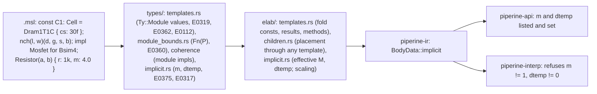

# Generics Design (phase D: templates and implicit params)

**Spec**: `.specs/features/generics/spec.md` (GN-21 to GN-26; the user's decision of 2026-11-22, "a module type takes trait
impls"; GN-29 to GN-31 carried)
**Status**: Draft (planned 2026-11-23; the open questions at the end take their recommended default unless the user says
otherwise)
**Base**: `main` with `generics` phase C (`tasks-c.md`, T53 to T81) merged. `params-and-io` (module-typed params, MD-75
item 3) and `host-ii` (derived params re-derived on a `set`, MD-69; `E0803`) are on `main`. GN-24 AC 4 (noise and `m`)
is tasked in phase E, which waits on `analog-operators` (design-e.md DE1).

---

## What the code does today (after phase C)

| Area | Today | Where |
| ---- | ----- | ----- |
| Template as a param value | a param of module type holds a folded `TemplateValue` (the module and its param constants, interned); `cell(c)` through it places the module with the template's values; a param block on it is `E0361` | `crates/piperine-lang/src/elab/templates.rs`, `elab/children.rs`, `types/module.rs:178` |
| Template anywhere else | `P0001` "module template `Name { .. }` outside a placement" (a `const`, a function result, a `let`); a call through a function's result, `nch(l, w)(d, g, s, b)`, is `P0001` "placement through a template value or a function" | `types/expr.rs:247`, `types/call.rs:55`, `types/module.rs:191`, `elab/children.rs:173` |
| `Fn(P)` on a module parameter | the bound is read (`Bound::Callable`), a value of such a type parameter is called as a function (§3.8.6); no check that a module's ports match `P` | `types/generics.rs`, `types/call.rs` |
| `impl` on a module | `E0130` (POM classifier) | `pom/resolve/classify.rs`, `types_traits.rs::an_impl_on_a_module_is_e0130` |
| `m`, `dtemp` | `BuiltinKind::ImplicitParam` rows in the POM; binding one at a placement is `E0320` "no param `m` in `R`"; reading one is `P0001` "built-in m" | `pom/builtin.rs:80`, `elab/place.rs` |
| `temperature()` | `Expr::Env(Env::Temperature)`, the analysis temperature | `elab/analog.rs:153` |
| Derived params | a child param bound to an expression over the parent's params is `ChildValue::Expr`, re-derived on a host `set` through generated functions (MD-69) | `piperine-ir`, `piperine-api/src/params.rs` |

---

## Architecture Overview

Templates stay elaboration values (§8.4.9): no IR form. Phase D widens where a template value may come from (a `const`,
a function result, a method of a module's `impl`) and where it may be placed from; `Fn(P)` checks the port shape;
`m` and `dtemp` become two implicit params of every body, scaled into the IR where §8.5.4 says.



### Templates (GN-21, GN-22)

- **Type.** `Name { params }` is a value of `Ty::Module(Name)`, and `Name::<G> { params }` of the module instance's
  type (`Nominal`); a template-valued expression is checked in `Context::Const` (`E0362` otherwise, §8.4.6), every
  required param is bound (`E0319`, §8.4.2), and a template as a carried type is `E0112` (§8.4.1).
- **Folding.** `TemplateFolder` (extending `elab/templates.rs`) folds a template from a `const`, a param, a function
  result (a binning function runs in `ConstEval`, which now returns a `TemplateValue` for a module-typed result) and
  a method of a module's `impl` (below); equal templates intern to one number, as today.
- **Placement.** Any call whose callee is a template-valued const expression (`cell(conns)`, `nch(l, w)(d, g, s, b)`,
  `C1(a, b)`) places the folded module with the folded params, identical to `Name(conns) { params }` (§8.4.9); a param
  block on it is `E0361`. Every param such an expression reads is structural (§8.4.6, GN-20).
- **Two levels.** A template passed through two template-typed params places what the innermost binding names
  (edge case): the fold follows params to their constant.

### `Fn(P)` bounds and module trait impls (GN-23, the 2026-11-22 decision)

- **Shape.** `C: Fn(P1, .., Pn)` holds for a module whose ports have the types and directions `P`, in order, names not
  counting, a module with a result included (§8.4.5); otherwise `E0360` naming the first port that differs.
- **Nominal.** A trait may be implemented for a module type (`impl Mosfet for Bsim4 { .. }`), and an inherent
  `impl Bsim4 { .. }` is allowed. Its functions are pure functions of the template: `self` is the template, they may
  read its params (`self.card.vth0`), compute, return values or another template (binning); a function that reads a
  node, a quantity or time is `E0122` (solve-reading in an elaboration context, DD3). They run at elaboration
  (`nmos.vth() + 0.2` in a param default or a `let` of a body). A bound may combine a trait and `Fn(P)`
  (`N: Mosfet + Fn(Electrical, Electrical, Electrical, Electrical)`): only a module that declares `impl Mosfet` fits.
- **`inst.name`** on an instance placed through a template-typed param resolves against the concrete module at
  elaboration (§8.4.8), `E0343` for a missing or private item.

### `m` and `dtemp` (GN-24 to GN-26)

- **Binding and reading.** `m` and `dtemp` may be bound in a placement's or a template's param block (no `E0320`); the
  names `m` and `dtemp` read inside a module are `f64` and stand for the instance's effective values; a module item
  named `m` or `dtemp` is `E0375`; `m <= 0.0` is `E0317` (§8.1 rule applied to `m`).
- **Effective values.** Every body carries two implicit params, `BodyData::implicit: ImplicitParams { multiplicity,
  offset }` (indices into the body's param pins, defaults `1.0` and `0.0`, DD1). A child's effective multiplicity is
  `parent.M × child.m` and its offset `parent.dtemp + child.dtemp` (§8.5.3, §8.5.5), bound as `ChildValue::Expr`, so a
  host `set` re-derives the descendants through MD-69's derived-param path (GN-26 AC 1).
- **Scaling (§8.5.4), at elaboration in the IR.** `ImplicitScaling` (`elab/implicit.rs`) multiplies each flow
  contribution by `M`, divides each flow probe by `M`, leaves potential contributions, potential probes, discrete
  carriers, events and reactions unchanged, and lowers `temperature()` inside the body as the analysis temperature plus
  the offset. With `M = 1` and `dtemp = 0` the values are exact (`x · 1.0`, `x / 1.0`, `t + 0.0`), so the twins print
  the same bytes.
- **Host.** `Session` lists `m` and `dtemp` among each instance's params (GN-26 AC 2) and a `set` of either is a param
  change (AC 1).

---

## Code Reuse Analysis

### Existing Components to Leverage

| Component | Location | How to Use |
| --------- | -------- | ---------- |
| `TemplateValue`, template interning, `template_values` | `elab/templates.rs`, `elab/children.rs` | every template source and placement |
| `E0361`, `E0319` | `types/module.rs`, `elab/place.rs` | template placements and templates |
| `ConstEval` (functions, methods of the project) | `elab/consts.rs` | binning functions and module `impl` functions |
| `ImplTable`, `Coherence`, `FunctionClasses` (`E0122`) | `types/traits.rs`, `types/coherence.rs`, `types/classes.rs` | trait impls on module types; a solve-reading module `impl` function |
| `Bound::Callable` | `types/generics.rs` | `Fn(P)` on a module parameter |
| `inst.name` resolution (`analog-structure`, `E0343`) | `types/reach.rs`, `elab/structural.rs` | through a template-typed param |
| Derived params (`ChildValue::Expr`, MD-69) | `piperine-ir`, `piperine-api/src/params.rs` | effective `m` and `dtemp` down the path |
| `KeyParams` (phase C) | `elab/structural.rs` | params read by a template are structural |
| `Env::Temperature` | `elab/analog.rs` | `temperature()` plus the offset |

### Integration Points

| System | Integration Method |
| ------ | ------------------ |
| `piperine-ir` serde | `BodyData::implicit`, `#[serde(default)]`; no `Expr`/`Stmt` variant |
| `piperine-plan`/ABI | the two implicit params are ordinary param pins of the body, after its own params |
| `piperine-api` | param listing and `set` of `m`, `dtemp` |
| `docs/spec` | §3.1 (the `E0130` row), §3.7 (`impl Tr for` a module type), §8.4 (a bound combining a trait and `Fn(P)`), with `spec_text` guards (T82) |
| Book | modules#12 flips; a new "swappable MOSFET" listing runs; modules#10 and cheatsheet#8 narrowed (DD2); modules~1faf8c12 flips (GN-26 AC 3) |

---

## Components

- **`types/templates.rs`** (`impl Checker`): template values, `E0319`, `E0362`, `E0112` (T83).
- **`elab/templates.rs`** (existing, `TemplateFolder`): templates from consts, function results and module methods
  (T84, T89).
- **`types/module.rs`** (existing): placement through a template-valued expression (T85).
- **`elab/children.rs`** (existing): placement through any folded template (T86).
- **`types/module_bounds.rs`** (`impl Checker`): `Fn(P)` on a module (`E0360`), a trait plus `Fn(P)` (T87).
- **`types/coherence.rs`** (existing): trait and inherent impls on a module type (T88).
- **`elab/reach_through_templates.rs`** (`impl Elaboration`): `inst.name` through a template-typed param (T90).
- **`piperine-ir/src/model.rs`**: `ImplicitParams`, `BodyData::implicit`, `Ir::check` (T93).
- **`types/implicit.rs`** (`impl Checker`): `m`/`dtemp` bound and read, `E0375`, `E0317` (T94).
- **`elab/implicit.rs`** (`ImplicitScaling`, `impl Elaboration`): effective values, flow scaling, `temperature()` (T95,
  T96).
- **`piperine-api/src/params.rs`**: listing and setting `m`, `dtemp` (T97).

---

## Data Models

```rust
// piperine-ir model.rs
pub struct ImplicitParams { pub multiplicity: u32, pub offset: u32 }   // indices of the body's param pins
pub struct BodyData { /* …, */ #[serde(default)] pub(crate) implicit: Option<ImplicitParams> }

// piperine-lang types/ty.rs: a template is Ty::Module(DeclId) or Ty::ModuleInstance(Nominal) for a generic module

// piperine-lang elab/templates.rs (existing TemplateValue gains the instance)
pub(super) struct TemplateValue { pub module: DeclId, pub instance: Option<Instance>, pub fields: Vec<(DeclId, Constant, ExprId)> }
```

---

## Error Handling Strategy

| Error Scenario | Handling | User Impact |
| -------------- | -------- | ----------- |
| A template leaving a required param unbound | `E0319` (§8.4.2) | elaboration fails |
| A template-valued expression that is not const | `E0362` (§8.4.6) | elaboration fails |
| A template as a carried type | `E0112` (§8.4.1) | elaboration fails |
| A param block on a placement through a template value | `E0361` (§8.4.4) | elaboration fails |
| A module bound to `C: Fn(P)` whose ports differ | `E0360` naming the first differing port (§8.4.5) | elaboration fails |
| A module bound to `N: Tr + Fn(P)` without `impl Tr` | `E0187` naming the module and the trait | elaboration fails |
| A module `impl` function that reads a node, a quantity or time | `E0122` naming the function (DD3) | elaboration fails |
| `inst.name` through a template param naming a missing or private item | `E0343` | elaboration fails |
| A module item named `m` or `dtemp` | `E0375` | elaboration fails |
| `m <= 0.0` | `E0317` | elaboration fails |
| `m` other than 1 or `dtemp` other than 0 on the interpreter | refused by name (R1, GN-29 AC 1) | `Interp` refuses to build |

---

## Goldens, pins and tests that may move

| What | Why | Task |
| ---- | --- | ---- |
| `types_traits.rs::an_impl_on_a_module_is_e0130` (check C8 of `tasks.md`) | the user's decision of 2026-11-22: a module type takes impls; replaced by `an_impl_on_a_module_type_is_accepted` and `C8`'s claim and proof amended with the spec (DD3) | T82, T88 |
| `types/expr.rs`, `types/call.rs`, `elab/children.rs` template `P0001` pins | GN-21, GN-22 | T83 to T86 |
| `tests/book/modules.rs::binding_m_and_dtemp_is_refused_as_an_unknown_param` | GN-26 AC 3 | T99 |
| `tests/book/modules.rs::a_function_that_returns_a_template_is_refused_where_it_is_placed` | GN-22 | T92 |
| `tests/book/modules.rs::the_memory_bank_is_refused_for_its_generic_module`, `tests/book/cheatsheet.rs::the_template_card_is_refused_for_its_generic_module_and_its_placements` | narrowed to the bundle `Cell` (L25), owner `resolved-nets-bundles` (DD2) | T92 |
| **The transpile goldens of `crates/piperine-transpile/tests/golden/`** and any plan or ABI pin that counts a body's param pins | every body gains the two implicit params and its flow contributions the factor `M` (DD1) | T93, T96 (one move each, the commit body lists every golden that moved and why) |

Never moving: the 7 ngspice twin goldens, `crates/piperine-parity/src/contract.rs`, every parity target, every buck
target's assertions.

---

## Risks & Concerns

| Concern | Location (file:line) | Impact | Mitigation |
| ------- | -------------------- | ------ | ---------- |
| Two implicit params on every body ripple through tests that count params or pins | `crates/piperine-*/tests/**` | many red tests unrelated to the task | `BodyData::implicit` is a separate field, so `params()` keeps its meaning; the pins are appended after the body's own; T93 and T96 list each moved pin in the commit body |
| `x · M` changes the generated Rust of every device | `crates/piperine-transpile/tests/golden/` | golden churn; a twin moving by rounding | `· 1.0` and `/ 1.0` are exact in IEEE 754; T96's gate runs the twins and the parity suites, and a twin that moves stops the task |
| A binning function evaluated at elaboration could read the solve | `elab/consts.rs` | a template that depends on the run | `FunctionClasses` refuses a solve-reading call in a const context (`E0122`) |
| Templates of generic modules carry an `Instance` | `elab/templates.rs` | two equal templates of two instances must not intern together | the interning key includes the instance |
| Noise and `m` (GN-24 AC 4) needs `noise` | `analog-operators` | cannot be tested before it lands | tasked in phase E (design-e.md), after `analog-operators` merges |

---

## Tech Decisions

| Decision | Choice | Rationale |
| -------- | ------ | --------- |
| Template at run time | none: folded at elaboration, no IR form | §8.4.9 |
| Where `m` and `dtemp` act | in the IR, at elaboration (`ImplicitScaling`), not in the printer or the solver | the IR is the one place every backend reads; the symbolic derivatives follow the scaled expression |
| Effective values | derived params down the path (MD-69) | a host `set` of `m` re-derives the descendants with no new mechanism |

The `MD-81` entry gains item 7 at T100: "A template is an elaboration value from a param, a `const`, a function or a
module `impl`; a module type takes trait and inherent impls of pure functions over its params; every body carries the
implicit params `m` and `dtemp`, applied in the IR (flow contributions times `M`, flow probes over `M`, `temperature()`
plus the offset) and derived down the path."

---

## Decisions taken (planner, 2026-11-23)

| # | Open point | Default taken | Why |
| - | ---------- | ------------- | --- |
| DD4 | Files and numbering | `design-d.md`/`tasks-d.md`; tasks T82 to T100, checks C86 on, phases 18 to 20 | design-c.md DC2 |
| DD5 | GN-24 AC 4 (noise) | tasked in phase E (T110), after `analog-operators` merges | its WHERE holds only then |
| DD6 | The "swappable MOSFET" Book example the decision of 2026-11-22 asks for | a listing in the modules chapter after the binning paragraph: `trait Mosfet`, two models (`Bsim3`, `Mos1` as small analog stand-ins), a `DiffPair<N: Mosfet + Fn(..)>`, run by a Book test | the decision's "a Book example (the swappable MOSFET)" |

## Open questions (user; each changes approved scope or a spec text, so the default needs the user's yes)

| # | Question | Options | Recommended default |
| - | -------- | ------- | ------------------- |
| DD1 | Where do `m` and `dtemp` live in the compiled code? GN-26 AC 1 lets a host `set` them on any instance during a run, and MD-18 forbids re-JIT, so the compiled body must carry them | (a) **every body carries both as two implicit param pins**; the IR scales flow contributions and probes and shifts `temperature()`; the transpile goldens move once (values exact, twins unchanged). (b) only bodies whose instance binds or reads them carry them; a host `set` of `m` on another instance is `E0803`, which narrows GN-26 AC 1 | **(a)**: GN-26 AC 1 as approved; the only cost is a one-time golden move |
| DD2 | modules#10 (`MemoryBank`) and cheatsheet#8 (the template card) place a bundle, `struct Cell { in wl: Bit, bl: Electrical }` (L25, `resolved-nets-bundles`) | (a) **phase D makes every other form of them run** (proved on the same shape over `Electrical` ports, the spec's own Independent Test), narrows each row's refusal to the bundle and hands the two rows to `resolved-nets-bundles` (§11 gap L25), which flips them before spec-closure. (b) phase D waits for `resolved-nets-bundles` | **(a)**: ROADMAP puts `resolved-nets-bundles` after `generics`; the rows still flip before item 13 |
| DD3 | After a module type takes impls (decision of 2026-11-22), what is left of `E0130` ("an `impl` on a module", GN-03 AC 2, §3.1 errors)? | (a) **`E0130` leaves the spec**: an `impl` on a module type is accepted; a function of it that reads a node, a quantity or time is `E0122` (as a solve-reading call in a const context, D13). GN-03 AC 2 and check C8 are amended in T82. (b) `E0130` stays for an `impl` on a module whose item is not a function | **(a)**: the decision allows "an inherent `impl Bsim4 { fn .. }` with no trait", so nothing of an `impl` block itself remains wrong; what the decision forbids (reading the solve) is `E0122`'s condition |

---

## Divergences found (current code vs docs/spec in this area), each a fix task

| # | Divergence | Spec | Fix |
| - | ---------- | ---- | --- |
| VD1 | §3.1 lists `E0130` "an `impl` on a module" and §3.7 limits `impl Tr for` targets to value types and natures, against the user's decision of 2026-11-22 | the decision | T82 amends the spec text with `spec_text` guards |
| VD2 | `E0360`, `E0362`, `E0375` are named by §8.4/§8.5 and raised nowhere | §8.4, §8.5.2 | T83, T87, T94 |
