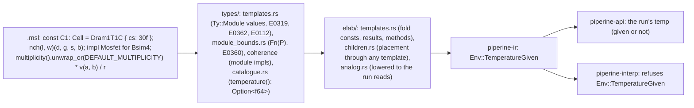

# Generics Design (phase D: templates, `temperature()` and `multiplicity()`)

**Spec**: `.specs/features/generics/spec.md` (GN-21 to GN-26; the user's decision of 2026-11-22, "a module type takes trait
impls"; GN-24 to GN-26 as amended by the user's decisions of 2026-11-23; GN-29 to GN-31 carried)
**Status**: Draft (planned 2026-11-23; revised the same day with the user's answers to DD1 to DD3 and DQ1 to DQ3, and again for DQ4: `multiplicity()` is a stdlib function over `simparam`)
**Base**: `main` with `generics` phase C (`tasks-c.md`, T53 to T82) merged. `params-and-io` (module-typed params, MD-75
item 3) and `host-ii` (derived params re-derived on a `set`, MD-69; `E0803`) are on `main`. There is no implicit param
and no automatic scaling (user decision 2026-11-23). `multiplicity()` is a stdlib function over `simparam` (DQ4), so T99
to T101 wait on `analog-operators`' session-parameter task (`simparam(name) -> Option<f64>`, the `simparam` table and
`--simparam` flag) being on `main`; T99 checks it and stops the batch if it is missing.

---

## What the code does today (after phase C)

| Area | Today | Where |
| ---- | ----- | ----- |
| Template as a param value | a param of module type holds a folded `TemplateValue` (the module and its param constants, interned); `cell(c)` through it places the module with the template's values; a param block on it is `E0361` | `crates/piperine-lang/src/elab/templates.rs`, `elab/children.rs`, `types/module.rs:178` |
| Template anywhere else | `P0001` "module template `Name { .. }` outside a placement" (a `const`, a function result, a `let`); a call through a function's result, `nch(l, w)(d, g, s, b)`, is `P0001` "placement through a template value or a function" | `types/expr.rs:247`, `types/call.rs:55`, `types/module.rs:191`, `elab/children.rs:173` |
| `Fn(P)` on a module parameter | the bound is read (`Bound::Callable`), a value of such a type parameter is called as a function (§3.8.6); no check that a module's ports match `P` | `types/generics.rs`, `types/call.rs` |
| `impl` on a module | `E0130` (POM classifier) | `pom/resolve/classify.rs`, `types_traits.rs::an_impl_on_a_module_is_e0130` |
| `m`, `dtemp` | `BuiltinKind::ImplicitParam` rows in the POM; binding one at a placement is `E0320` "no param `m` in `R`"; reading one is `P0001` "built-in m" | `pom/builtin.rs:80`, `elab/place.rs` |
| `temperature()` | an `f64` (`CORE_ROWS`, `Allowed::Everywhere`), `Expr::Env(Env::Temperature)`: the run's temperature, the solver's 300.15 K when the request gives no `temp` | `types/catalogue.rs:291`, `elab/analog.rs:153`, `piperine-analog-solver/src/tolerances.rs:75` |
| The run's temperature | `Request::temp: Option<f64>` in degrees Celsius (`--temp`), `tnom` beside it | `piperine-api/src/request.rs:97` |
| Callers of `temperature()` | `std/analog.msl` (`vt()` and the models on it), `tests/e2e/twins/temp_res.msl`, Book listings, `docs/spec` examples, about 20 test sources | `grep -rln "temperature()"` |
| Derived params | a child param bound to an expression over the parent's params is `ChildValue::Expr`, re-derived on a host `set` through generated functions (MD-69) | `piperine-ir`, `piperine-api/src/params.rs` |

---

## Architecture Overview

Templates stay elaboration values (§8.4.9): no IR form. Phase D widens where a template value may come from (a `const`,
a function result, a method of a module's `impl`) and where it may be placed from; `Fn(P)` checks the port shape.
`m` and `dtemp` are gone (user decision 2026-11-23): the run sets a temperature and a multiplicity, and a model reads
them through `temperature()` and `multiplicity()`, both `Option<f64>`, and decides what to do with them
(`multiplicity()` is an ordinary stdlib function over `analog-operators`' `simparam`, DQ4: nothing in the core).



### Templates (GN-21, GN-22)

- **Type.** `Name { params }` is a value of `Ty::Module(Name)`, and `Name::<G> { params }` of the module instance's
  type (`Nominal`); a template-valued expression is checked in `Context::Const` (`E0362` otherwise, §8.4.6), every
  required param is bound (`E0319`, §8.4.2), and a template as a carried type is `E0112` (§8.4.1).
- **Folding.** `TemplateFolder` (extending `elab/templates.rs`) folds a template from a `const`, a param, a function
  result (a binning function runs in `ConstEval`, which now returns a `TemplateValue` for a module-typed result) and
  a method of a module's `impl` (below); equal templates intern to one number, as today.
- **Placement.** Any call whose callee is a template-valued const expression (`cell(conns)`, `nch(l, w)(d, g, s, b)`,
  `C1(a, b)`) places the folded module with the folded params, identical to `Name(conns) { params }` (§8.4.9); a param
  block on it is `E0361`. Every param such an expression reads is structural (§8.4.6, GN-20).
- **Two levels.** A template passed through two template-typed params places what the innermost binding names
  (edge case): the fold follows params to their constant.

### `Fn(P)` bounds and module trait impls (GN-23, the 2026-11-22 decision)

- **Shape.** `C: Fn(P1, .., Pn)` holds for a module whose ports have the types and directions `P`, in order, names not
  counting, a module with a result included (§8.4.5); otherwise `E0360` naming the first port that differs.
- **Nominal.** A trait may be implemented for a module type (`impl Mosfet for Bsim4 { .. }`), and an inherent
  `impl Bsim4 { .. }` is allowed. Its functions are pure functions of the template: `self` is the template, they may
  read its params (`self.card.vth0`), compute, return values or another template (binning); a function that reads a
  node, a quantity or time is `E0122` (solve-reading in an elaboration context, DD3). They run at elaboration
  (`nmos.vth() + 0.2` in a param default or a `let` of a body). A bound may combine a trait and `Fn(P)`
  (`N: Mosfet + Fn(Electrical, Electrical, Electrical, Electrical)`): only a module that declares `impl Mosfet` fits.
- **`inst.name`** on an instance placed through a template-typed param resolves against the concrete module at
  elaboration (§8.4.8), `E0343` for a missing or private item.

### `temperature()` and `multiplicity()` (GN-24 to GN-26 as amended, user decisions 2026-11-23)

The user, 2026-11-23: "Não temos a semântica de fazer set e de criar nada implícito em lugar algum... O que podemos fazer
é um method chamado temperature() que retorna Option e multiplicity(). Eles retornam o que foi setado na simulação e o
modelo que escolhe se vai usar como temperatura o tempo todo, se vai usar como temp inicial ou se vai ignorar", and "é
meio que um param do run (session)".

- **No implicit params.** No instance has `m` or `dtemp`; the names are ordinary (binding `m` at a placement is `E0320`
  like any unknown param); `E0375`, §8.5's `E0317` row for `m`, §8.4.2's sentence and Appendix G.54 leave the spec.
  Nothing scales a contribution, a probe or a noise, and nothing offsets a temperature.
- **Run settings.** The run (the session's request) sets them: its existing `temp` key (degrees Celsius, `--temp`), and
  the session parameter `multiplicity` through the existing `simparam` table and flag (`[run.<name>] simparam =
  { multiplicity = 4.0 }`, `--simparam multiplicity=4.0`, `crates/piperine-api/src/request.rs:175`,
  `crates/piperine-cli/src/cli.rs:172`). There is no dedicated `multiplicity` key or flag: the generic flag already
  exists, so a dedicated one would be a second spelling of the same entry (DQ4, the simpler of the two). Neither is
  given at a placement and neither changes during a run (no `set`). The system does not check the value: it is a
  session parameter like any other, and the model decides what a zero or negative multiplicity means (`E0802` for a
  multiplicity is withdrawn with the key).
- **Reads.** `temperature() -> Option<f64>` replaces the `f64` one: `Some(temp + 273.15)` when the run set `temp`, `None`
  otherwise; an environment read, constant during an analysis, allowed where `temperature()` is today (`analog`,
  reactions, body `let`s, value inputs; a const context stays `E0188`). `multiplicity()` is an ordinary stdlib function
  written in MSL, `pub fn multiplicity() -> Option<f64> { simparam("multiplicity") }` in `std/analog.msl` beside `vt()`:
  `Some(v)` when the run sets that session parameter, `None` otherwise (DQ4, user decision 2026-11-23: nothing in the
  core; `analog-operators` delivers `simparam(name) -> Option<f64>`, with no default argument and `E0456` retired).
  It is allowed wherever `simparam` is, so a const context is `E0188` through it.
- **One per run; the instance decides with its own param** (DQ1). The run sets one multiplicity; there is no
  per-instance setting. A module that wants its own multiplicity declares an ordinary param, `m: Option<f64>` (the name
  is free now), and combines it in its body: `let count = m.or(multiplicity()).unwrap_or(DEFAULT_MULTIPLICITY);`. The
  combination lives in a body `let`, not in the param's default, because a default is a const context and
  `multiplicity()` (through `simparam`) there is `E0188`. An `Option` param no placement binds is `None` (MD-75 item 6), and `Option::or` is an Appendix H method
  (`types/catalogue.rs:212`), so the combination needs no new form.
- **Why `f64` for the multiplicity.** ngspice's `m` and VAMS `$mfactor` are real; a fractional multiplicity scales a
  device below one unit (`m = 0.5`); a model that counts devices rounds it itself.
- **The fallbacks.** `std/constants.msl` gains `AMBIENT_TEMPERATURE: f64 = 300.15` (27 °C, ngspice's default) and
  `DEFAULT_MULTIPLICITY: f64 = 1.0` (ngspice's default `m`, user decision 2026-11-23); the spec, the Book and the
  constants' doc comments recommend `temperature().unwrap_or(AMBIENT_TEMPERATURE)` and
  `multiplicity().unwrap_or(DEFAULT_MULTIPLICITY)`. Every in-tree caller
  migrates to it, so the twins, which run ngspice at its default when they set no temperature, keep their numbers.
- **IR.** `Env::Temperature` keeps its meaning (the run's temperature, 300.15 K when unset); an appended
  `Env::TemperatureGiven` makes the `Option` pair. The device ABI's environment carries it (in place, `MINOR` 0); only
  bodies that read it change. No environment read is planned for the multiplicity: `simparam`'s session parameters
  (`analog-operators`) already carry it to the device (DQ4).

---

## Code Reuse Analysis

### Existing Components to Leverage

| Component | Location | How to Use |
| --------- | -------- | ---------- |
| `TemplateValue`, template interning, `template_values` | `elab/templates.rs`, `elab/children.rs` | every template source and placement |
| `E0361`, `E0319` | `types/module.rs`, `elab/place.rs` | template placements and templates |
| `ConstEval` (functions, methods of the project) | `elab/consts.rs` | binning functions and module `impl` functions |
| `ImplTable`, `Coherence`, `FunctionClasses` (`E0122`) | `types/traits.rs`, `types/coherence.rs`, `types/classes.rs` | trait impls on module types; a solve-reading module `impl` function |
| `Bound::Callable` | `types/generics.rs` | `Fn(P)` on a module parameter |
| `inst.name` resolution (`analog-structure`, `E0343`) | `types/reach.rs`, `elab/structural.rs` | through a template-typed param |
| `KeyParams` (phase C) | `elab/structural.rs` | params read by a template are structural |
| `Env::Temperature`, `Request::temp` | `elab/analog.rs`, `piperine-api/src/request.rs` | the run's temperature, unchanged; `temperature()` adds whether it was given |
| `CoreSig`, `CORE_ROWS` | `types/catalogue.rs` | `temperature()` as an `Option<f64>` read |
| `simparam` (`analog-operators`), the `simparam` table and `--simparam` flag | `elab/session.rs`, `piperine-api/src/request.rs:175`, `piperine-cli/src/cli.rs:172` | the body of the stdlib `multiplicity()`, and how the run sets it (DQ4) |

### Integration Points

| System | Integration Method |
| ------ | ------------------ |
| `piperine-ir` | one `Env` variant appended (`TemperatureGiven`); no `Expr`/`Stmt` variant |
| Device ABI | the environment record gains whether the run set its temperature, in place at `MINOR` 0 (MD-78 item 4), `abi.md` amended |
| `piperine-api`, `piperine-cli` | unchanged: `temp` exists, and the multiplicity is a `simparam` entry (DQ4) |
| Stdlib | `multiplicity()` in `std/analog.msl` and `DEFAULT_MULTIPLICITY` in `std/constants.msl`, MSL over `simparam` (T99) |
| Stdlib, Book, spec, tests | every `temperature()` caller reads `.unwrap_or(AMBIENT_TEMPERATURE)` (T97, T98) |
| `docs/spec` | §3.1 (the `E0130` row), §3.7 (`impl Tr for` a module type), §8.4 (a bound combining a trait and `Fn(P)`), with `spec_text` guards (T83) |
| Book | modules#12 flips; a new "swappable MOSFET" listing runs; modules#10 and cheatsheet#8 handed to `resolved-nets-bundles` (DD2); modules~1faf8c12 rewritten to the run settings and run (GN-26 AC 3) |

---

## Components

- **`types/templates.rs`** (`impl Checker`): template values, `E0319`, `E0362`, `E0112` (T84).
- **`elab/templates.rs`** (existing, `TemplateFolder`): templates from consts, function results and module methods
  (T85, T90).
- **`types/module.rs`** (existing): placement through a template-valued expression (T86).
- **`elab/children.rs`** (existing): placement through any folded template (T87).
- **`types/module_bounds.rs`** (`impl Checker`): `Fn(P)` on a module (`E0360`), a trait plus `Fn(P)` (T88).
- **`types/coherence.rs`** (existing): trait and inherent impls on a module type (T89).
- **`elab/reach_through_templates.rs`** (`impl Elaboration`): `inst.name` through a template-typed param (T91).
- **`piperine-ir/src/model.rs`**: `Env::TemperatureGiven` (T95).
- **`piperine-abi/src/raw.rs`**: the environment record's temperature-given flag; the solver fills it, the transpiler reads it (T96).
- **`types/catalogue.rs`**, **`elab/analog.rs`** (existing): `temperature()` as an `Option<f64>` read and its lowering; `std/constants.msl`'s
  `AMBIENT_TEMPERATURE` (T97).
- **`std/analog.msl`**, **`std/constants.msl`**: `pub fn multiplicity() -> Option<f64> { simparam("multiplicity") }` and
  `DEFAULT_MULTIPLICITY` (T99); no `piperine-api` change: the multiplicity is a `simparam` entry (DQ4).

---

## Data Models

```rust
// piperine-ir model.rs
pub enum Env { /* Temperature, …, */ TemperatureGiven }   // appended last

// the run's multiplicity: no new field; `Request::simparam` (analog-operators) carries ("multiplicity", v)

// std/constants.msl
/// The ambient temperature, 27 °C in kelvin: ngspice's default, and the recommended fallback of `temperature()`.
pub const AMBIENT_TEMPERATURE: f64 = 300.15;
/// ngspice's default multiplicity `m`, and the recommended fallback of `multiplicity()`.
pub const DEFAULT_MULTIPLICITY: f64 = 1.0;

// std/analog.msl (user decision 2026-11-23: a stdlib function, nothing in the core)
/// The run's multiplicity: the session parameter `multiplicity`, `None` when the run sets none.
pub fn multiplicity() -> Option<f64> { simparam("multiplicity") }

// piperine-lang types/ty.rs: a template is Ty::Module(DeclId) or Ty::ModuleInstance(Nominal) for a generic module

// piperine-lang elab/templates.rs (existing TemplateValue gains the instance)
pub(super) struct TemplateValue { pub module: DeclId, pub instance: Option<Instance>, pub fields: Vec<(DeclId, Constant, ExprId)> }
```

---

## Error Handling Strategy

| Error Scenario | Handling | User Impact |
| -------------- | -------- | ----------- |
| A template leaving a required param unbound | `E0319` (§8.4.2) | elaboration fails |
| A template-valued expression that is not const | `E0362` (§8.4.6) | elaboration fails |
| A template as a carried type | `E0112` (§8.4.1) | elaboration fails |
| A param block on a placement through a template value | `E0361` (§8.4.4) | elaboration fails |
| A module bound to `C: Fn(P)` whose ports differ | `E0360` naming the first differing port (§8.4.5) | elaboration fails |
| A module bound to `N: Tr + Fn(P)` without `impl Tr` | `E0187` naming the module and the trait | elaboration fails |
| A module `impl` function that reads a node, a quantity or time | `E0122` naming the function (DD3) | elaboration fails |
| `inst.name` through a template param naming a missing or private item | `E0343` | elaboration fails |
| A read of whether the run set `temperature()` on the interpreter | refused by name (R1, GN-29 AC 1) | `Interp` refuses to build |

---

## Goldens, pins and tests that may move

| What | Why | Task |
| ---- | --- | ---- |
| `types_traits.rs::an_impl_on_a_module_is_e0130` (check C8 of `tasks.md`) | the user's decision of 2026-11-22: a module type takes impls; replaced by `an_impl_on_a_module_type_is_accepted` and `C8`'s claim and proof amended with the spec (DD3) | T83, T89 |
| `types/expr.rs`, `types/call.rs`, `elab/children.rs` template `P0001` pins | GN-21, GN-22 | T84 to T87 |
| `tests/book/modules.rs::binding_m_and_dtemp_is_refused_as_an_unknown_param` | GN-26 AC 3: the claim is rewritten to the run settings and runs (`the_multiplicity_listing_runs_as_four_in_parallel`) | T101 |
| `tests/book/modules.rs::a_function_that_returns_a_template_is_refused_where_it_is_placed` | GN-22 | T93 |
| `tests/book/modules.rs::the_memory_bank_is_refused_for_its_generic_module`, `tests/book/cheatsheet.rs::the_template_card_is_refused_for_its_generic_module_and_its_placements` | narrowed to the bundle `Cell` (L25), owner `resolved-nets-bundles` (DD2) | T93 |
| Every source, listing and test that reads `temperature()` as an `f64` | it is an `Option<f64>`: each reads `.unwrap_or(AMBIENT_TEMPERATURE)`, the same number when the run sets no temperature | T97, T98 (each moved file named in the commit body) |
| The transpile goldens of a twin model that reads `temperature()` | its source reads the fallback; its printed numbers do not move | T97 |

Never moving: the 7 ngspice twin goldens, `crates/piperine-parity/src/contract.rs`, every parity target, every buck
target's assertions.

---

## Risks & Concerns

| Concern | Location (file:line) | Impact | Mitigation |
| ------- | -------------------- | ------ | ---------- |
| Migrating every `temperature()` caller touches the stdlib, the twins' sources, the Book and about 20 test files | many files in one task | T97 does the code and test sources, T98 the Book and spec text; the twins and parity suites gate T97 |
| A twin that sets no temperature must still run at ngspice's 27 °C | `tests/e2e/twins/` | a twin's numbers move | `AMBIENT_TEMPERATURE` is ngspice's default; T97's gate runs the twins |
| A binning function evaluated at elaboration could read the solve | `elab/consts.rs` | a template that depends on the run | `FunctionClasses` refuses a solve-reading call in a const context (`E0122`) |
| Templates of generic modules carry an `Instance` | `elab/templates.rs` | two equal templates of two instances must not intern together | the interning key includes the instance |

---

## Tech Decisions

| Decision | Choice | Rationale |
| -------- | ------ | --------- |
| Template at run time | none: folded at elaboration, no IR form | §8.4.9 |
| Temperature and multiplicity | run settings read by `temperature()` (core) and `multiplicity()` (stdlib, over `simparam`), `Option<f64>`; nothing implicit, nothing scaled | user decisions 2026-11-23 (DD1, DQ4) |

The `MD-81` entry gains item 7 at T102: "A template is an elaboration value from a param, a `const`, a function or a
module `impl`; a module type takes trait and inherent impls of pure functions over its params. No instance has implicit
params: the run sets a temperature and a `multiplicity` session parameter, `temperature()` and the stdlib `multiplicity()`
(over `simparam`) return them as `Option<f64>`,
and the model decides how to use them (user decision 2026-11-23)."

---

## Decisions taken (planner, 2026-11-23)

| # | Open point | Default taken | Why |
| - | ---------- | ------------- | --- |
| DD4 | Files and numbering | `design-d.md`/`tasks-d.md`; tasks T83 to T102, checks C87 to C109, phases 18 to 20 | design-c.md DC2 |
| DD5 | GN-24 AC 4 (noise under `m`) | gone with the user's decision of 2026-11-23: nothing scales noise | the model decides |
| DD6 | The "swappable MOSFET" Book example the decision of 2026-11-22 asks for | a listing in the modules chapter after the binning paragraph: `trait Mosfet`, two models (`Bsim3`, `Mos1` as small analog stand-ins), a `DiffPair<N: Mosfet + Fn(..)>`, run by a Book test | the decision's "a Book example (the swappable MOSFET)" |

## Questions answered (user, 2026-11-23)

| # | Question | Answer |
| - | -------- | ------ |
| DD1 | Where do `m` and `dtemp` live? | (`multiplicity()` refined by DQ4: a stdlib function over `simparam`) **Both options rejected.** No implicit params, no `set`, no automatic scaling: `temperature() -> Option<f64>` (one function, replacing the `f64` one) and `multiplicity() -> Option<f64>` return what the run set; "é meio que um param do run (session)"; the docs recommend `unwrap_or` the ambient temperature, ngspice's 27 °C |
| DD2 | modules#10 and cheatsheet#8 need the `Cell` bundle | (a): `resolved-nets-bundles` owns them |
| DD3 | What is left of `E0130`? | (a): `E0130` leaves the spec; a module-impl function that reads the solve is `E0122`; GN-03 AC 2 and C8 amended |

## Questions answered (user, 2026-11-23, second round)

| # | Question | Answer |
| - | -------- | ------ |
| DQ1 | One multiplicity per run, or per instance path? | "Um por run e a instância decide no seu próprio parâmetro": one per run; an instance that wants its own declares an ordinary param (`m: Option<f64>`) and combines it in its body (`m.or(multiplicity()).unwrap_or(1.0)`; spelled `m.or(multiplicity()).unwrap_or(DEFAULT_MULTIPLICITY)` since DQ4) |
| DQ2 | Temperature per instance? | the same for every instance (the default) |
| DQ3 | `tnom`? | untouched (the default) |

## Questions answered (user, 2026-11-23, third round)

| # | Question | Answer |
| - | -------- | ------ |
| DQ4 | `simparam` with a default, or an `Option`? | "É, melhor voltar Option": `simparam(name) -> Option<f64>`, no default argument, `E0456` retired (delivered by `analog-operators`). Refined the same day (user decision 2026-11-23, accepted from the coordinator): `multiplicity()` stays as an ordinary stdlib function written in MSL, `pub fn multiplicity() -> Option<f64> { simparam("multiplicity") }`, nothing in the core, with `DEFAULT_MULTIPLICITY = 1.0` (ngspice's default `m`) beside `AMBIENT_TEMPERATURE` and the docs recommending `multiplicity().unwrap_or(DEFAULT_MULTIPLICITY)`. The run sets it as any `simparam` entry (no dedicated key or flag: the generic `simparam` table and `--simparam` flag exist, the simpler choice), no `E0802` for it, no `Env::Multiplicity`/`MultiplicityGiven` and no ABI field for it; `temperature() -> Option<f64>` stays as planned |

---

## Divergences found (current code vs docs/spec in this area), each a fix task

| # | Divergence | Spec | Fix |
| - | ---------- | ---- | --- |
| VD1 | §3.1 lists `E0130` "an `impl` on a module" and §3.7 limits `impl Tr for` targets to value types and natures, against the user's decision of 2026-11-22 | the decision | T83 amends the spec text with `spec_text` guards |
| VD2 | `E0360`, `E0362` are named by §8.4 and raised nowhere; `E0375` names a reservation the user's decision removes | §8.4, §8.5.2 | T84, T88; T94 retires `E0375` |
| VD3 | `temperature()` is an `f64` that hides whether the run set a temperature | the user's decision of 2026-11-23 | T94 to T98 |
