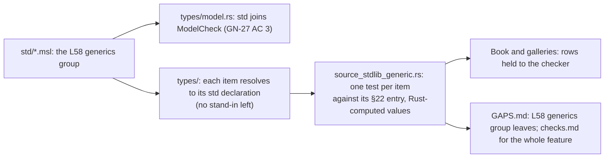

# Generics Design (phase E: the stdlib built on generics)

**Spec**: `.specs/features/generics/spec.md` (GN-27, GN-28; GN-29 to GN-31 carried)
**Status**: Draft (planned 2026-11-23; the open questions at the end take their recommended default unless the user says
otherwise)
**Base**: `main` with `generics` phases C and D merged and, by DE1, `analog-operators` B4–B7 (`delay`, L44; `noise` and
the noise analysis, L45) merged. T103 checks both and stops the batch if one is missing.

---

## What the code does today (after phase D, read at planning on `main` `2fda3089`)

| Item (§22) | Source | Forms it needs beyond generics | State expected at phase E |
| ---------- | ------ | ------------------------------ | ------------------------- |
| `Short` (§11, prelude) | `std/carriers.msl:22` | none | runs since phase C (T69) |
| `since` (§22.1.8) | `std/values.msl:46` | none | runs since phase C (generic module over `Bit<T>`) |
| `MinPulse` (§22.5.7) | `std/monitor.msl:58` | `since` | runs since phase C |
| `Setup` (§22.5.5) | `std/monitor.msl:35` | `since`, `require` | runs since phase C (core-std#8 flips in T71) |
| `inertial` (§22.5.8) | `std/monitor.msl:69` | `Default` (explicit-unknowns A, landed) | runs since phase C |
| `Stable`, `Hold` (§22.5.4, §22.5.6) | `std/monitor.msl:27,47` | an event read as a `bool` (L51, closed by `unknown-semantics-events`) | runs since phase C |
| `idt`, `idtmod` (§22.2.8, §22.2.9) | `std/analog.msl:172,186` | a node in a result (L35), a contribution under `if` (L40), `Option` methods and `rem_euclid` (`msl-fixes`): all landed | runs since phase C; `Water` (Part IV §13, L40) with it |
| `laplace_nd`, `_np`, `_zd`, `_zp` (§22.2.14) | `std/analog.msl:420..466` | param arrays, node arrays `[State; D - 1]` (composite-values C), `const fn` (`poly_s`), contributions under `if` | runs after phases C and composite-values C |
| `zi_nd`, `_np`, `_zd`, `_zp` (§22.2.12, §22.2.13) | `std/analog.msl:283..388` | `delay` (L44), `settle` (L52, closed), `[Bit<f64>; N]` signals (composite-values C), `every` | runs once `analog-operators` lands `delay` (DE1) |
| `noise_table` (§22.2.3) | `std/analog.msl:22` | `noise` (L45), `table_model` (L57, closed), `freq()` | runs once `analog-operators` lands `noise` (DE1) |
| `cast`, `same` (§22.1.3, §22.1.4) | `std/values.msl:5,10` | `encode` of every layout (L70) | compile from source since phase C T55 (user, 2026-11-23: the intrinsics' removal moved here from `explicit-unknowns` T48); the `cast` to a tuple or array holding an enum runs |
| `merge` | none | removed by `explicit-unknowns` (MD-78; `types/call.rs:18` lists it among the removed flag methods) | not an item any more (DE2) |
| `std` in the whole-model check | `types/model.rs` | left out by design.md D2 | joins it here (GN-27 AC 3) |

---

## Architecture Overview

Phase E adds no mechanism: it proves phases A to D on the standard library, puts `std` under the whole-model check,
retires the checker's last stand-ins for library items, and does the feature's bookkeeping.

### What each test compares

| Item | Expected value (computed in Rust in the test, §22 text cited) |
| ---- | ------------------------------------------------------------- |
| `since(d)` | `now - t_change` after each change of `d`, `inf` before the first (`-inf` start, §22.1.8) |
| `MinPulse { w }` | a `require` failure exactly for a pulse narrower than `w` |
| `Setup { ts }`, `Hold { th }` | a violation exactly when `d` changed less than `ts` before a rising `clk` / `clk` high less than `th` before `d` changed |
| `Stable` | a failure exactly when `d` changes while `en` holds and did not just change |
| `inertial(x, tpd)` | `x` delayed by `tpd`, a pulse shorter than `tpd` swallowed (§22.5.8) |
| `Short(a, b)` | the two nodes one: equal voltages, the current through it the divider's |
| `idt(x, ic, reset)` | the integral of a constant `x` from `ic`, reset holding `ic` (closed form) |
| `idtmod` | the integral wrapped into `[offset, offset + modulus)` (`rem_euclid` in Rust) |
| `laplace_*` | the step response of a first- and a second-order transfer function at sample instants, against the closed form |
| `zi_*` | the difference equation run in Rust over the same samples |
| `noise_table` | the output noise PSD at listed frequencies against the table interpolated by `table_model`'s rule |

### The feature's checks file

`check_proofs.py` reads one checks file per feature (`checks.md`, else `tasks.md`). The closing task (T115) writes
`.specs/features/generics/checks.md`: the `**Build**` line, the union of the `Run` lines, and every check of `tasks.md`,
`tasks-c.md`, `tasks-d.md` and `tasks-e.md` with its proofs (the GN-30 checks of each file once), so the closure runs
every proof of the feature at `HEAD`.

---

## Code Reuse Analysis

### Existing Components to Leverage

| Component | Location | How to Use |
| --------- | -------- | ---------- |
| `ModelCheck` | `crates/piperine-lang/src/types/model.rs` | `std` joins the seed list (D2 retired) |
| `Callee::Intrinsic`, `Builtin` stand-ins | `types/table.rs`, `types/intrinsic.rs` | every one standing for an L58 item leaves (`cast` and `same` already left in T55) |
| Phase A to D machinery | `types/`, `elab/` | unchanged |
| `std_library.rs`, `std_excerpts.rs`, `std_galleries.rs` | `crates/piperine-lang/tests/` | the stdlib's own check and the gallery fences |
| `source_explicit.rs`-style source harness | `crates/piperine-parity/tests/` | one source test per item |

### Integration Points

| System | Integration Method |
| ------ | ------------------ |
| `analog-operators` | `delay`, `noise`, the noise analysis (DE1) |
| `explicit-unknowns` phase B | its T48 no longer removes the `cast`/`same` intrinsics: generics T55 does (DE3) |
| `GAPS.md` | L58's generics group leaves; L40's `idt`/`Water` part closes |
| `.specs/STATE.md` | MD-81 gains item 8 |

---

## Components

- **`types/model.rs`** (existing): `std` joins the whole-model check (T104).
- **`types/table.rs`** (existing): the remaining stand-ins for library items leave (T105).
- **`crates/piperine-parity/tests/source_stdlib_generic.rs`** (new target): one test per item, models in
  `tests/stdlib_generic/*.msl` (T106 to T112).
- **`crates/piperine-lang/tests/std_library.rs`** (existing): no generics group item refused because generic (T113).
- **`.specs/features/generics/checks.md`** (new): the feature's checks for `check_proofs.py` (T115).

---

## Error Handling Strategy

| Error Scenario | Handling | User Impact |
| -------------- | -------- | ----------- |
| An L58 item whose other form has not landed (only possible if DE1 is declined) | refused naming that form; `GAPS.md` lists the item under the form's id (GN-27 AC 2) | elaboration fails, naming what to wait for |
| A `std` item with a type error | `ModelCheck` reports it like any crate's | `check` fails on the library itself |
| A `require` of a monitor that fails | the monitor's own fault, as §22.5.1 says | the run reports the violation |

---

## Goldens, pins and tests that may move

| What | Why | Task |
| ---- | --- | ---- |
| `std_library.rs` pins that a generics group item is refused | GN-27 | T113 |
| `elab_structure.rs` L40 pins of `idt`/`Water` not already moved by T71 | GN-28 | T109 |
| A stdlib error found once `std` joins the model check | GN-27 AC 3 | T104 (fixed in `std/` in that task, each fix named in the commit body) |

Never moving: the 7 ngspice twin goldens, `crates/piperine-parity/src/contract.rs`, every parity target, every buck
target's assertions; the transpile goldens move only as phase D's DD1 already moved them.

---

## Risks & Concerns

| Concern | Location (file:line) | Impact | Mitigation |
| ------- | -------------------- | ------ | ---------- |
| `std` joining the model check surfaces errors in library items no test reached | `crates/piperine-lang/std/*.msl` | T104 grows | T104 fixes each in `std/` with the spec as the authority; a fix that changes a §22 behaviour stops the task and is reported |
| `analog-operators` not merged when phase E is due | ROADMAP item 4 | `zi_*` and `noise_table` cannot run | T103 checks it and stops (DE1); the user may choose the refusal path instead |
| `laplace_*` and `zi_*` use node arrays and param arrays | composite-values C | a gap there blocks them | T110 and T111 report a composite-values gap as its own `GAPS.md` row with that feature as owner |

---

## Tech Decisions

| Decision | Choice | Rationale |
| -------- | ------ | --------- |
| Proof per item | a source test against the §22 text, values computed in Rust | GN-28 AC 1 |
| `std` in the model check | yes, from T104 | GN-27 AC 3; design.md D2 said "until phase E" |
| Checks for the closure | one `checks.md` aggregating the four tasks files | `check_proofs.py` reads one file |

MD-81 gains item 8 at T115: "The standard library is under the whole-model check; every item of L58's generics group
compiles from its source in `std/`."

---

## Decisions taken (planner, 2026-11-23)

| # | Open point | Default taken | Why |
| - | ---------- | ------------- | --- |
| DE3 | `cast` and `same` (design.md D15 said phase E replaces their intrinsics) | **answered (user, 2026-11-23):** their intrinsics leave in phase C, T55, right after L70; phase E only checks they resolve to their source like the rest of the group | the user ruled the work lives in `generics` |
| DE4 | Files and numbering | `design-e.md`/`tasks-e.md`; tasks T103 to T115, checks C142 to C151, C135 and C152 to C155 (renumbered at fix round 1: C110 to C119 and C136 to C139 collided with phases C and D), phases 21 and 22 | design-c.md DC2 |

## Questions answered (user, 2026-11-23)

| # | Question | Options | Recommended default |
| - | -------- | ------- | ------------------- |
| DE1 | Phase E's `zi_*` and `noise_table` need `delay` and `noise` from `analog-operators` (lane B, building now) | **answered (user, 2026-11-23): (a), the default.** (a) **phase E starts after `analog-operators` B4–B7 merges**, and both run with tests against §22. (b) phase E runs as soon as phase D closes; the two are refused naming `delay`/`noise`, listed in `GAPS.md` under L44/L45, and their tests move to `analog-operators` (GN-28 AC 2) | **(a)**: ROADMAP item 4 already precedes the later `generics` rows, and the proofs stay in one feature |
| DE2 | GN-27 AC 1 lists `merge`, which `explicit-unknowns` removed (MD-78: no hidden known flag; `merge` is among the removed flag methods) | **answered (user, 2026-11-23): (a), the default; spec.md amended in the planning commit.** (a) **strike `merge` from GN-27's list** in spec.md, citing MD-78; (b) restore `merge` | **(a)**: the item no longer exists in the spec or the library |

---

## Divergences found (current code vs docs/spec in this area), each a fix task

| # | Divergence | Spec | Fix |
| - | ---------- | ---- | --- |
| VE1 | `std` is not under the whole-model check | §0.3, GN-27 AC 3 | T104 |
| VE2 | GN-27 names `merge`, which neither the spec nor the library has | MD-78 | spec.md amended at planning (DE2); T113 asserts the list |
