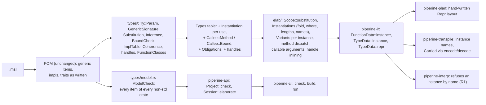

# Generics Design (phases A and B)

**Spec**: `.specs/features/generics/spec.md`
**Status**: Approved (2026-11-20, under the user's standing AFK rule; see "Decisions taken (user AFK)")
**Scope of this file**: phase A (generic items and the whole-model check, GN-01 to GN-09) and
phase B (handles, GN-10 to GN-12), with the cross-cutting GN-29 to GN-31 carried by each.
Phases C (generic modules and generation, GN-13 to GN-20), D (templates and implicit params,
GN-21 to GN-26) and E (the stdlib, GN-27 to GN-28) are ROADMAP item 11; they are sketched at the
end as later batch boundaries and get `design-c.md`, `design-d.md`, `design-e.md` with their own
tasks files.

**Base.** This design is written on top of `composite-values` phases A–B as planned in
`.specs/features/composite-values/{design.md,tasks.md}` (63 tasks, branch
`feature/composite-values`). Every type it names from that feature (`Ty::Struct`, `Ty::Enum`,
`Ty::Array`, `Ty::Closure`, `Derives`, `TypeArena`, `TypeData`, `CompositeLayout`,
`print/types.rs`'s `TypeItems`, `Expr::FunctionRef`/`CallValue`, `ConstEval`'s environment,
`Variants` registering a recursion before its body) is read at T7 after the rebase; a shape that
moved is mapped there and on the Handoff before any later task uses it.

---

## What the code does today (`main` at `04053a51`)

| Area | Today | Where |
| ---- | ----- | ----- |
| Reach | `Types::check(design, top)` walks a worklist from the top: placements, calls and const reads; an unreached item is never typed (S3). `Project::check` on a package with no run parses only and prints `type checking needs a run` | `crates/piperine-lang/src/types/check.rs` (`Checker::run`, `reach`), `crates/piperine-api/src/project.rs:135`, `crates/piperine-cli/tests/commands.rs:146` |
| Generic functions | `signature_parts` refuses a generic function (`P0001` "generic function") and a `self` parameter; a call is typed from the declared signature | `types/check.rs` (`signature_parts`) |
| Generic modules | refused (`P0001` "generic module") | `types/check.rs` (`module`) |
| Types | `Ty` has no type variable ("There is no type variable"); a struct used as a type is `P0001` | `types/ty.rs`, `types/check.rs` (`lower_type_node`) |
| Methods | a method call resolves to an Appendix H row, a stdlib flag read (`Builtin`) or `P0001` "method `x` defined by the project"; the checker lists the project's method names to avoid a wrong `E0161` | `types/call.rs` (`method_call`), `types/check.rs` (`project_methods`) |
| `impl` and traits in the POM | `ImplData { trait_, self_ty }`, `TraitData { supertraits }`, `GenericParamData::{Type { bounds, default }, Const { ty, default }}`, `GenericArgsNode::{Angle, Paren}` (the `Fn(A) -> R` sugar). The member resolver already looks a method up in §3.1.7 order (carrier built-ins, the nature's `impl`s, the value's `impl`s, then a blanket `impl<T: Repr>`); it solves no other bound. `E0130` (an `impl` on a module) is raised by the classifier | `crates/piperine-lang/src/pom/decl.rs:224`, `pom/body.rs:40`, `pom/resolve/members.rs:117`, `pom/resolve/classify.rs:140,165` |
| Stdlib generics | `merge`, `same`, `cast`, `logic`, `matches_bits` are `Callee::Intrinsic`, typed by contract "until `generics` lets it compile from its stdlib source"; `known`, `known_or`, `is_known`, `level`, `rise`, `fall`, `high`, `changed`, `prev` are `Builtin`s standing for the stdlib's own items | `types/table.rs` (`Callee`, `Builtin`), `std/values.msl` |
| Functions in the IR | one IR function per `fn` and flag pattern (`Variants`, `name~01`), lowered at first reach; IR functions are pure values (no probe, no carrier) and a function that reaches `emit!` is inlined at its call instead (`records.rs`, `Scope::texts`) | `elab/variants.rs`, `elab/functions.rs`, `elab/records.rs` |
| Probes in functions | `E0450` "a probe is allowed in an `analog` block and a module body only" in a `fn` or a const context | `types/analog.rs:56` |
| Function classes | not inferred; `E0122` is raised nowhere (composite-values T16 adds it for closures) | — |
| Rust names | `Text::spelled` maps the front end's marks `~`, `.`, `$` to `_v`, `_d`, `_s`; two names of one owner spelling alike are refused where printed | `crates/piperine-transpile/src/print/text.rs:142` |
| Interpreter | frozen at the M1 analog subset (R1); refuses a form by name | `crates/piperine-interp/src/walk.rs` |

---

## Architecture Overview

Monomorphization, as Appendix C states ("generics, const generics: monomorphization") and
codegen S7 requires. The POM keeps every generic item as written; the checker types a generic
body once with its parameters opaque (Q1 (c)) and records, per use, the generic arguments it
inferred; the elaborator folds those arguments under the current substitution, checks the
instantiation's `where` and array lengths, and lowers one IR function (or IR type) per distinct
instantiation. The IR and the generated Rust see only concrete code.



### The two checks of a generic item (Q1 (c))

| Belongs to the definition (checked once, `piperine check`, even uninstantiated) | Belongs to an instantiation (checked at elaboration, per argument list) |
| --- | --- |
| every name, type and class of the body with each type parameter opaque (`Ty::Param`) | the value of every const generic argument |
| a method or operator on a `Ty::Param` given by none of its bounds (`E0161` for a method, naming the bound that would give it; `P0002` naming the trait for an operator, as composite-values D6) | the `where` of the item (`E0127` naming the instantiation) |
| the bounds of every generic call in the body (`E0187`) | array-length equality and array lengths built from const parameters (`[f64; N + 1]` against `[f64; D]`), compared by value (`P0002` naming the item and its arguments) |
| `impl` and trait rules (`E0130` to `E0134`, `E0187`) | a const expression that panics (`E0104`) |

§3 rule 9 gains this split in one sentence, with the `spec_text` guard (GN-07 AC 4, T19).

### Whole-model check (S3)

`ModelCheck` (`types/model.rs`) runs one `Checker` seeded with every module, function, `const`
and `impl` function of every crate of the design but `std`, in declaration order, and keeps only
its diagnostics. `Types::check(design, top)` stays the reach of one top: it builds the table the
elaborator reads, and its `reached()[0]` stays the top (`elab/elaborator.rs:35,96` depend on it).
The hosts run both: `Project::check` and `Session::elaborate` call `Types::check_model` before the
top's reach, so `piperine check`, `build` and `run` report the same diagnostic (GN-09).

### Instantiation

- **Checker.** A call of a generic function, a method of a generic `impl`, a use of a generic
  struct or enum, records an `Instantiation { item, arguments: Vec<GenericValue> }` in the table,
  keyed by the use's `ExprId` (or `TypeId` for a written type). Arguments may themselves name the
  enclosing item's parameters (`Ty::Param`, `ConstTerm::Param`).
- **Elaborator.** Lowering runs under a `Substitution` held by the `Scope` (`Scope::substitution`);
  every read of the type table goes through `Elaboration::typed(scope, expr)`, which applies it.
  `Instantiations::concrete` folds an `Instantiation` under the substitution into an `Instance`
  (concrete types, folded const values), checks it, and names it.
- **Naming (GN-02 AC 1, GN-15 AC 2).** An instance is named with MSL's turbofish spelling,
  `swap::<f64>`, `widen::<3>`, `apply::<closure$0>`, `Pair<f64>` for a type; the flag-pattern
  suffix follows (`swap::<f64>~01`). `Text::spelled` maps `::<` and `<` to `_g`, `, ` to `_c`,
  `>` to `_e` and `-` to `_m` (`swap_gf64_e`, `Pair_gf64_e`); the existing collision refusal
  covers the rest.
- **Equal arguments, one instance** (§3.8.10, edge case): `Variants` is keyed by
  `(function, Instance, flag pattern)` and the `TypeArena` by the concrete `Ty`.
- **Callable arguments (GN-01 AC 2).** A closure or a `fn` name passed for a parameter of type
  `F: Fn(A) -> R` is part of the instance: a `fn` name is `GenericValue::Function(DeclId)`, a
  closure `GenericValue::Closure(ExprId)` (every closure is its own type, as in Rust). In the
  instance's body `f(x)` lowers as a direct call of the named function, or as the closure's body
  inlined with its parameters bound to the arguments; a closure's captures (by value, §3 rule 3)
  become trailing parameters of the instance, `f.<name>`, passed by the caller.

### Traits and `impl`s

`ImplTable` (`types/traits.rs`) is built once per check over the whole design: every trait with
its items, every inherent `impl`, every trait `impl`, every blanket `impl<T: B> Tr for T`. It
answers four questions, each by one method: the inherent item `name` of a type; the trait item
`name` visible on a type from a namespace (§3.7.8, G.67); the implementation of a trait item for
a concrete type (an `impl`'s own function, else the trait's default body under `Self = T`); and
whether a type implements a trait. A method call on a value records `Callee::Method(DeclId)`; one
on a `Ty::Param` through a bound records `Callee::Bound { item }`, which the elaborator resolves
per instance with `ImplTable::implementation`. `Coherence` (`types/coherence.rs`) holds the
declaration rules: `E0131`, `E0132`, `E0134`, and the `E0187` family (missing or extra items,
signatures, supertraits, overlap, the crate rule of §3.7.7, `pub` in a trait `impl`, `self` not
first or outside an `impl`).

### Handles (phase B)

A parameter of a nature or bundle type, and `self` of an `impl` on a nature, is a handle
(§3 rule 7, §3.1). IR functions stay pure values (MD-64), so a function with a handle parameter
is never an IR function: it is inlined at each call, as `records.rs` inlines an emitting
function. `Scope::handles` binds each handle parameter to what the caller passed
(`HandleBinding::Node(Terminal)` for a continuous carrier, `HandleBinding::Carrier(u32)` for a
discrete one, resolved in the caller's frame, `elab/structural.rs`'s `Frame` included); a probe
`v(a)` lowers to the binding's terminal, a read of a discrete handle to `Expr::Carrier` with its
flags (§3.1.6). A generic nature parameter (`fn f<N: Nature>(a: N)`) is fixed by the call's
carrier. A recursion through a handle function reached from `analog` unrolls through
composite-values' `Unrolling` or is `E0126`.

`FunctionClasses` (`types/classes.rs`) infers the solve-reading class (§3: a probe, `now()`,
`freq()`, `gmin()`, `source_scale()`, `analysis(Static)`, or a call of a solve-reading function,
to a fixed point over recursion) and reports `E0122` at a call in a position the class does not
allow (a const context, a definition). Composite-values T16 adds `E0122` for closures; T47 extends
that inference rather than adding a second.

---

## Code Reuse Analysis

### Existing Components to Leverage

| Component | Location | How to Use |
| --------- | -------- | ---------- |
| `Checker` worklist, `reach`, `report`, `unsupported` | `crates/piperine-lang/src/types/check.rs` | `ModelCheck` seeds the same worklist; every new checker concern is an `impl Checker` block in its own file |
| `Unsupported` | `crates/piperine-lang/src/types/unsupported.rs` | the refusals this feature lifts leave their `P0001` path (`generic function`, `` `self` parameter ``, `generic parameter`, `trait item`, `impl item`, method "defined by the project"); phase C and D forms keep theirs (GN-29 AC 2) |
| `bind_arguments`, `apply`, `closure_typed` | `crates/piperine-lang/src/types/call.rs` | a generic call binds its arguments after `Inference` has substituted the signature |
| The member resolver's §3.1.7 order and `impls_of` | `crates/piperine-lang/src/pom/resolve/members.rs`, `classify.rs` | the checker follows the POM's resolution where it resolved, and `ImplTable` answers where the POM deferred (`ReceiverTypeUnknown`, a `Ty::Param` receiver) |
| `Derives` (H.8 table, traits of built-in types) | composite-values `types/derives.rs` | `BoundCheck` asks it whether a type implements an H.8 trait; H.8 rule 6 for a generic type's arguments |
| `Ty::Closure`, the function class of a closure, `E0122` | composite-values T16 (`types/call.rs`) | `Fn` bounds accept a closure by its signature; `FunctionClasses` extends the class inference |
| `Variants` (recursion registered first) | `crates/piperine-lang/src/elab/variants.rs` | the key gains the `Instance`; `Variants::name` takes the instance's name |
| `records.rs` inlining (`inline_emitting`, `Scope::texts`) | `crates/piperine-lang/src/elab/records.rs` | the model for inlining a handle function, `Scope::handles` beside `Scope::texts` |
| `ConstEval` with its environment of locals | composite-values `elab/consts.rs` | folds const generic arguments, `where` and array lengths with the const parameters bound |
| `TypeArena`, `TypeData`, `CompositeLayout`, `TypeItems` | composite-values `elab/types.rs`, `piperine-ir`, `piperine-plan/src/composite.rs`, `piperine-transpile/src/print/types.rs` | one arena entry per generic type instance; a hand-written `Repr` adds a layout form and a `Carried` impl |
| `Unrolling` | composite-values `elab/unroll.rs` | a recursion through a handle function reached from `analog` |
| `Text::spelled` and its collision refusal | `crates/piperine-transpile/src/print/text.rs` | instance spellings |
| Interpreter refusal by name | `crates/piperine-interp/src/walk.rs`, `tests/frozen.rs` | one arm per new IR marker |

### Integration Points

| System | Integration Method |
| ------ | ------------------ |
| `piperine-ir` serde | `FunctionData::instance`, `TypeData::instance` and `TypeData::repr` carry `#[serde(default)]`; no `Expr`/`Stmt` variant is added |
| ABI (`piperine-abi`) | none: a hand-written `Repr` type is carried as its `WIDTH` levels with the existing `Field` |
| `piperine-api` | `Project::check` (a library package is typed), `Session::elaborate` (the model check before the top) |
| `analog-structure` (merged before this feature's code) | handle bindings resolve against the caller's `Frame`; `types/reach.rs` (its `inst.name`) is a sibling of `types/model.rs`, not this feature's |
| Book and galleries | GN-31 AC 2: a fence or listing that now checks is held to the checker in its existing test |

---

## Components

Each new file has one purpose and an owner type; methods of an existing owner (`Checker`,
`Elaboration`, `ValuePrinter`) that belong to a new concern live in a sibling file under an
`impl` block of that owner.

### Checker (`crates/piperine-lang/src/types`)

- **`model.rs`** (`ModelCheck`): the whole-model check. `ModelCheck::run(design) -> Result<(), Vec<DesignDiagnostic>>`; `Types::check_model(design)` is its public face. Items of `std` are left to the stdlib's own check (D2).
- **`ty.rs`** (existing): `Ty::Param(DeclId)` (a type or nature parameter of the item being checked, opaque); `GenericValue::{Type(Ty), Const(ConstTerm), Function(DeclId), Closure(ExprId)}`; `ConstTerm::{Value(i128), Bool(bool), Param(DeclId), Expr(ExprId)}`; `Nominal { decl: DeclId, arguments: Vec<GenericValue> }` carried by composite-values' `Ty::Struct` and `Ty::Enum`; `Length::{Fixed(u64), Generic(ConstTerm)}` carried by `Ty::Array`.
- **`generics.rs`** (`GenericSignature`): an item's generic parameter list as data: each parameter's kind (type, nature, const and its type), bounds (`Bound::{Trait(DeclId), Library(H8Trait), Repr, Nature, Callable(Vec<Ty>, Ty)}`) and default; the §3.8.4 order rule; `E0187` for a wrong number of arguments; `E0161` for a bound name that is no trait (H.8 intro).
- **`substitution.rs`** (`Substitution`): parameter to `GenericValue`; `apply(&Ty) -> Ty`; composing (an argument naming an outer parameter).
- **`inference.rs`** (`Inference`): explicit turbofish arguments, then unification of parameter types against argument types and the expected type (§1.4.4); a const from an array argument's length; a default; else `E0181` naming the parameter.
- **`bounds.rs`** (`BoundCheck`, and `impl Checker` for bound-given members): whether a type satisfies a bound (`E0187` naming argument and bound); what a `Ty::Param`'s bounds give: methods (`E0161` naming the bound that would give a missing one), operators (`P0002` naming the trait), `T::WIDTH`, `T::NAME`.
- **`obligations.rs`** (`Obligations`): the per-instantiation checks the definition defers: a `where`, an array-length equality, a const expression; recorded in the table, discharged by the elaborator.
- **`traits.rs`** (`ImplTable`): the traits and `impl`s of the design; `inherent`, `visible`, `implementation`, `implements`.
- **`coherence.rs`** (`Coherence`): the declaration rules of §3.1 and §3.7 (`E0131`, `E0132`, `E0134`, `E0187`).
- **`methods.rs`** (`impl Checker`): `self` parameters, method calls on value types and through bounds, `Self`, `Type::f` and `Type::NAME` paths.
- **`repr.rs`** (`impl Checker`): a hand-written `impl Repr` (`WIDTH`, `encode`, `decode`) and `Ty::has_repr` through the `ImplTable`.
- **`handles.rs`** (`impl Checker`): nature-typed parameters and `self` as handles; probes and carrier methods through a handle; `E0133`.
- **`classes.rs`** (`FunctionClasses`): the solve-reading class and `E0122`.
- **`table.rs`** (existing): `Types::check_model`, `Types::instantiation(expr)`, `Types::written_instantiation(ty)`, `Types::obligations(item)`, `Types::impls()`, `Types::handle(param)`; `Callee::Method(DeclId)`, `Callee::Bound { item: DeclId }`.

### Elaborator (`crates/piperine-lang/src/elab`)

- **`lower.rs`** (existing): `Scope::substitution`, `Scope::handles`; `Elaboration::typed(scope, expr)` is the one read of the type table.
- **`instances.rs`** (`Instantiations`, `Instance`): fold, check (`E0127`, lengths, `E0104`) and name an instantiation; the depth bound of D7.
- **`variants.rs`** (existing): keyed by `(DeclId, Instance, Vec<Flag>)`.
- **`methods.rs`** (`impl Elaboration`): `self` as the first parameter; inherent methods, associated functions and constants; trait dispatch through `ImplTable::implementation`.
- **`callable.rs`** (`CallableArgument`): a `fn` name or a closure passed for an `Fn` bound, its captures as trailing parameters, its call inside the instance.
- **`types.rs`** (composite-values `TypeArena`): one entry per generic type instance; a hand-written `Repr`'s `encode`/`decode` lowered as IR functions and named on the entry.
- **`handles.rs`** (`impl Elaboration`, `HandleBinding`): the inlining of a handle function.

### IR, plan, printer, interpreter

- **`piperine-ir/src/model.rs`**: `FunctionData::instance: Option<GenericInstance>` (`GenericInstance { item: String, arguments: Vec<String> }`, the generic item's MSL path and its arguments as written); `TypeData::instance: Option<GenericInstance>`; `TypeData::repr: ReprForm::{Derived, HandWritten { width: u32, encode: FunctionId, decode: FunctionId }}`. `Ir::check`: an instance's name agrees with its `GenericInstance`; a hand-written entry's functions have the signatures of §2.
- **`piperine-plan/src/composite.rs`** (composite-values `CompositeLayout`): a hand-written `Repr` type is one leaf of `width` levels.
- **`piperine-transpile/src/print/text.rs`**: the instance spellings of `Text::spelled`.
- **`piperine-transpile/src/print/types.rs`** (composite-values `TypeItems`): the `Carried` impl of a hand-written `Repr` type calls its `encode` and `decode`; a `None` reads as unknown (§2 rule 9).
- **`piperine-interp/src/walk.rs`**: refuses a function with an `instance` and a type with a hand-written `repr`, by name.

### Hosts

- **`piperine-api/src/project.rs`**: `Project::check` types a package with no run through `Types::check_model` (`Checked::typed` true).
- **`piperine-api/src/session.rs`**: `Session::elaborate` runs `Types::check_model` before the top.
- **`piperine-parity/src/project.rs`**: the source runner does the same, so a source test sees what a host sees.

---

## Data Models

```rust
// piperine-lang types/ty.rs
pub enum Ty { /* …, */ Param(DeclId) }
pub enum GenericValue { Type(Ty), Const(ConstTerm), Function(DeclId), Closure(ExprId) }
pub enum ConstTerm { Value(i128), Bool(bool), Param(DeclId), Expr(ExprId) }
pub struct Nominal { pub decl: DeclId, pub arguments: Vec<GenericValue> }   // Ty::Struct(Nominal), Ty::Enum(Nominal)
pub enum Length { Fixed(u64), Generic(ConstTerm) }                       // Ty::Array(Box<Ty>, Length)

// piperine-lang types/table.rs
pub struct Instantiation { pub item: DeclId, pub arguments: Vec<GenericValue> }
pub enum Callee { /* …, */ Method(DeclId), Bound { item: DeclId } }
pub enum Obligation { Where { item: DeclId, condition: ExprId }, SameLength { at: ExprId, expected: Length, found: Length }, Constant { at: ExprId } }

// piperine-lang elab/instances.rs
pub(super) struct Instance { pub item: DeclId, pub arguments: Vec<ConcreteValue> }  // Ord: the Variants key
pub(super) enum ConcreteValue { Type(Ty), Const(i128), Bool(bool), Function(DeclId), Closure(ExprId) }

// piperine-lang elab/handles.rs
pub(super) enum HandleBinding { Node(Terminal), Carrier(u32) }

// piperine-ir model.rs
pub struct GenericInstance { pub item: String, pub arguments: Vec<String> }
pub struct FunctionData { /* …, */ #[serde(default)] pub(crate) instance: Option<GenericInstance> }
pub struct TypeData { /* …, */ #[serde(default)] instance: Option<GenericInstance>, #[serde(default)] repr: ReprForm }
pub enum ReprForm { #[default] Derived, HandWritten { width: u32, encode: FunctionId, decode: FunctionId } }
```

---

## Error Handling Strategy

| Error Scenario | Handling | User Impact |
| -------------- | -------- | ----------- |
| An error in an item nothing reaches | `ModelCheck`: the code it has when reached | `check`, `build` and `run` fail alike |
| A generic argument that cannot be inferred | `E0181` naming the parameter (§3.8 errors) | elaboration fails |
| A generic argument that does not satisfy its bound; a wrong number of generic arguments | `E0187` naming the argument and the bound | elaboration fails |
| A method on a `Ty::Param` that no bound gives | `E0161` naming the method, the parameter and the bound that would give it | `check` fails at the definition |
| An operator on a `Ty::Param` whose bounds lack its trait | `P0002` naming the trait (composite-values D6) | `check` fails at the definition |
| A false `where` on a function | `E0127` naming the instantiation (`clamp::<u8>`) | elaboration fails |
| Two array lengths that differ in an instantiation; a const expression that panics | `P0002` / `E0104` naming the item and its arguments | elaboration fails |
| An instantiation chain deeper than 1 024 | `E0341` naming the function (D7) | elaboration fails |
| `impl` on a module | `E0130` (exists, POM) | parse/resolve fails |
| A method named `changed`, `prev`, `others`, `inflow`, `level` | `E0131` | elaboration fails |
| A non-function item in an `impl` on a nature | `E0132` | elaboration fails |
| `impl Trait for` a nature or bundle | `E0134` | elaboration fails |
| Missing, extra or mis-signed trait items; a missing supertrait; overlapping `impl`s; an `impl` in a crate §3.7.7 refuses; `pub` in a trait `impl`; `self` not first or outside an `impl` | `E0187` naming the trait and the type | elaboration fails |
| `#[derive(Repr)]` generic type instantiated with an argument without `Repr` | `E0110` naming the argument | elaboration fails |
| A handle returned, stored in a value (`let`, field, element, capture) or written through | `E0133` | elaboration fails |
| A solve-reading function called in a const context or a definition | `E0122` naming the function and the position | elaboration fails |
| A form of phase C, D or E (generic module, generation, template, `m`/`dtemp`) | stays `P0001` naming the form (GN-29 AC 2) | elaboration fails |
| An instance on the interpreter backend | refused by name (R1, GN-29 AC 1) | `Interp` refuses to build |

---

## Goldens, pins and tests that may move

| What | Why | Task |
| ---- | --- | ---- |
| `crates/piperine-cli/tests/commands.rs` `ok: no_run (2 crates, 0 runs; type checking needs a run)` | a library package is now type-checked (GN-08 AC 2) | T5 |
| `crates/piperine-lang/tests/types_subset.rs` rows `generic function`, `trait`, `struct with an impl (its methods are never reached)` | each becomes the acceptance test of the criterion that lifts it; the commit names both | T18, T25, T28 |
| Book and gallery expectations of a green `check` over a package holding an unreached refused item | that is S3; each becomes the item's diagnostic, and `GAPS.md` names the item | T5, T41 |
| A composite-values source fixture with an unreached refused item, met by the parity runner's model check | the same rule; found at T4/T7 and listed on the Handoff | T4, T7 |

`types_subset.rs::unreached_items_are_not_reported` does not move: `Types::check` stays the
reach of one top. Never moving: the 7 ngspice twin goldens, `crates/piperine-parity/src/contract.rs`,
the transpile goldens of `crates/piperine-transpile/tests/golden/`, every parity target, every buck
target's assertions, the ABI's `MINOR`.

---

## Scheduling against the other lanes

| Work | Can run before `composite-values` A–B merges? | Why |
| ---- | --------------------------------------------- | --- |
| Phase 1, T1 to T6 (whole-model check, S3 for non-generic items, GN-08, GN-09) | **yes**, once `analog-structure` is on `main` | touches only `types/model.rs` (new), `types/table.rs`, `types/mod.rs`, `piperine-api` `project.rs`/`session.rs`, `piperine-parity/src/project.rs`, CLI tests and `GAPS.md`; no file composite-values plans except a one-line module list. `analog-structure` edits `types/check.rs`, `table.rs` and `session.rs`, so B1 starts from `main` after it merges |
| T7 onward (every generic, trait, handle task) | **no** | each edits a file composite-values rewrites (`types/ty.rs`, `call.rs`, `check.rs`'s signatures, `elab/variants.rs`, `functions.rs`, `lower.rs`, `consts.rs`, `TypeData`, `print/types.rs`) or builds on its types (`Ty::Struct`, `Ty::Array`, `Ty::Closure`, `Derives`, `TypeArena`); composite-values D20 already says generics code starts from its merged tree. T7 rebases B1's commits onto that tree and re-runs their gates |
| Phase B (T44 to T52, handles) | after phase A | its inlining reads `analog-structure`'s `Frame` and composite-values' `Unrolling` |

`unknown-semantics-events` (ROADMAP item 10) waits on phase B (L53, a function returning `Event`,
is "with L8").

---

## Risks & Concerns

| Concern | Location (file:line) | Impact | Mitigation |
| ------- | -------------------- | ------ | ---------- |
| Elaboration reads the type table at ~38 sites directly (`self.types.ty(..)`) | `crates/piperine-lang/src/elab/{lower,compound,consts,known,..}.rs` | a site that skips the substitution lowers `Ty::Param` and fails or, worse, lowers the wrong width | T32 routes every read through `Elaboration::typed`; a `suite_hygiene`-style grep test pins that no `self.types.ty(` remains outside `typed` |
| `Ty::Struct(DeclId)`/`Ty::Enum(DeclId)`/`Ty::Array(_, u64)` change shape | composite-values `types/ty.rs` | wide mechanical ripple | T14 and T15 are refactors alone, with no behaviour change, gated by composite-values' own targets |
| The whole-model check may surface refused items in fixtures that relied on S3 | `crates/piperine-*/tests/**`, `examples/`, `docs/book` | red tests unrelated to the task | design "Goldens, pins and tests that may move"; each moved expectation names S3 in its commit body and the item lands in `GAPS.md` |
| Stdlib items are checked only when reached until phase E | `crates/piperine-lang/std/*.msl` | a generic stdlib body with an error passes until phase E | D2; GN-27 AC 3 is phase E's |
| Monomorphization can blow up (one IR function per instance and flag pattern) | `elab/variants.rs` | generated Rust grows | deterministic names, one instance per equal arguments; the depth bound of D7 |
| Closures as generic arguments carry captures | `elab/callable.rs` | a capture read after a later assignment would differ | captures are copied at the closure's definition (§3 rule 3), as composite-values T23 does |
| `print/value.rs` is already 1 600 lines | `crates/piperine-transpile/src/print/value.rs` | a god file | this feature adds no printing to it: names go to `text.rs`, `Carried` to `types.rs` |
| Handle functions inlined at every call | `elab/handles.rs` | code size in a body with many calls | as `records.rs`; a handle function is small by nature (a probe and arithmetic) |
| Test coverage gap: no test runs a probing function from a reaction | `crates/piperine-parity/tests/` | §3 table row "solve-reading" untested | T51 |

---

## Tech Decisions

| Decision | Choice | Rationale |
| -------- | ------ | --------- |
| Generic body check | Q1 (c): definition-time with opaque parameters, instantiation-time for `where`, lengths and const values | the user's answer |
| Where instances exist | IR and generated Rust only; the POM keeps the generic item and its uses as written | MD-25, S6, S7 |
| Instance identity | `(item, concrete arguments)`; a closure argument is its own type; a `fn` name is a value of the instance | §3.8.10, Rust |
| Trait dispatch | static, resolved per instance by `ImplTable::implementation` | §3.7: there is no trait object |
| Whole-model check | a separate `ModelCheck` the hosts run before the top's reach | keeps `Types::check`'s table and the elaborator's reach untouched |
| Handles | inlined at elaboration, never IR functions | MD-64: IR functions are pure values |
| Instance names | MSL turbofish spelling in the IR, spelled to Rust by `Text::spelled` | readable in `piperine` output and generated Rust (R3) |

New project-level decision, recorded as the next free `MD-` entry when phase B closes (T52):
"Generics are monomorphized at elaboration: the checker types a generic body once with opaque
parameters and records each use's arguments; the elaborator makes one IR function or IR type per
distinct instance, named by its turbofish spelling; trait dispatch is static; a handle function is
inlined; `piperine check` types every item of every non-std crate." It extends MD-64 and
supersedes nothing.

---

## Decisions taken (user AFK)

The user said "Tu sempre assume o default mais razoável e depois me conta". Each default below
follows the approved spec, `docs/spec/` (the grammar and semantics authority, CLAUDE.md) and the
active MD decisions; each is reported back.

| # | Open point | Default taken | Why |
| - | ---------- | ------------- | --- |
| D1 | The spec says each phase gets `design-<phase>.md`/`tasks-<phase>.md` | this `design.md`/`tasks.md` hold phases A and B (ROADMAP item 9 is "phases A–B"); C, D and E get their own files at item 11 | one approval per ROADMAP item; composite-values D1 did the same |
| D2 | GN-08 AC 1 "every crate of the package and of its dependencies": does that include `std`? | no: the model check covers the root crate and its dependency crates; `std` is checked when reached, as today, until phase E proves GN-27 AC 3 | `std` holds items whose forms other features still owe (L58); checking it whole now would fail every package |
| D3 | Where the whole-model check runs | in the hosts (`Project::check`, `Session::elaborate`) and the parity source runner, through `Types::check_model`; `Types::check` and `Elaborator::run` keep the reach of one top | the elaborator builds bodies from `reached()`; GN-08/09 are about `piperine check`, `build`, `run` |
| D4 | Missing-bound diagnostics (GN-07 AC 2 names no code) | a method: `E0161` naming the method, the parameter and the bound; an operator: `P0002` naming the trait | `E0161` is "no such method"; composite-values D6 uses `P0002` for an operator without its trait; X5 owns the rest |
| D5 | GN-04 AC 4 "refuse naming the trait and the type" names no code | `E0187` | §3.7 errors name `E0187` for exactly these conditions |
| D6 | GN-01 AC 3 names no code | `E0181` naming the parameter | §3.8 errors |
| D7 | An instantiation chain that never ends (`f::<[T; N]>` calling `f::<[T; N + 1]>`) | refused at depth 1 024 (composite-values Q5's depth) with `E0341` naming the function | the spec's edge case uses `E0341` for the module form; one bound for every recursion at elaboration |
| D8 | Instance names | `swap::<f64>`, `widen::<3>`, `apply::<closure$0>` (closure ordinal in its enclosing item, source order), `Pair<f64>`; Rust spelling `_g`, `_c`, `_e`, `_m` | readable and deterministic; the existing collision refusal covers clashes |
| D9 | A closure passed for an `Fn` bound | the closure is part of the instance; its captures are trailing parameters `f.<name>` | Rust's model (a closure is its own type); keeps IR functions pure |
| D9 amended (T37, 2026-11-23) | A closure or a function name passed for an `Fn` bound | the instance is still keyed by the closure or function (`closure$<item>$k`, the item added because two items each have a `closure$0`), but its parameter has the callable's function type and the caller passes a function value (`Expr::Closure` or `FunctionRef`); `f(x)` is the existing call of a local of function type, and captures are copied with the closure as before | inlining plus trailing capture parameters needed a capture analysis and a second calling convention, while composite-values already runs function values end to end (Rust backend included); the result is the same values, the instance stays specialized per callable, and nothing about the IR gained a new form |
| D18 (T39, 2026-11-23) | The initial value of a carrier of a hand-written `Repr` type, and where `encode` and `decode` come from | the elaborator lowers the impl's `encode` as `Type.encode` and the author's `decode` as its two `Option` halves `Type.decode.is` and `Type.decode.val`, and packs them in a synthetic `Type.decode` that returns the whole `Option` (the IR's `HandWritten` names one function); a carrier's initial value is the levels word `encode` gives for the folded initializer, run in the constant evaluator, held as `Constant::Int` of the type (`Ir::check` holds it to `0..2^width`, the plan writes it as the narrowest unsigned integer); `Ir::carried` of a hand-written enum is `UInt(width)`; the type checker reaches the `impl Repr` items when a carrier of the type is checked, and the transpiler prints `encode` and `decode` for every hand-written type | a constant cannot run the author's function in the plan, and the IR's constants have no levels form; folding at elaboration keeps the plan and the runtime free of an evaluator | a plan that calls `encode` at load time, which needs an interpreter at load
| D19 (T43, 2026-11-23) | T43 says `GAPS.md` drops S3 | S3 stays, narrowed to a generic module's body (phase C, GN-13); L4, L7, L9 and X6 are dropped. The whole-model check now seeds a method of a generic `impl` as it seeds a generic function (`model.rs`), so only a generic module, struct or enum stays unchecked when unreached | a generic module's body is still `P0001` when reached and is not checked when it is not (T42 pins the refusal); dropping S3 would claim `check` is complete | dropping S3 as written, which leaves the generic module unlisted until phase C
| D13 amended (T47, 2026-11-23) | Positions where a solve-reading call is `E0122` | a const context only (a `const`, a param default, a `where`, a const argument); a definition that reads the solve stays `E0336` (§8.2.5, §8.3.9 name it and its tests exist), and `temperature()` is not solve-reading (§3 table: constant during an analysis), so a `const` that reads it stays `E0188` (§3.9.2); a function that probes, or reads `now()`, `freq()`, `gmin()`, `source_scale()` or `analysis(..)`, is solve-reading | the more specific rule of the spec wins where two name one construct, and the §3 table lists `temperature` with the pure environment | `E0122` in a definition too, which would change `E0336`'s tests and say one error twice
| D10 | `impl Thermal { .. }` in a user crate while `Thermal` is a `std` nature: §3.7.7 says "`impl T { … }` … is written in the crate that declares `T`" | §3.7.7 governs value types; an inherent `impl` on a nature may be written in any crate. §3.1 gains a Resolution sentence saying so, guarded by `spec_text` (T46) | §3.1's own example is `impl Thermal`, and GN-10 AC 1 names prelude natures; §3.7 is the traits section, whose types are value types (§3.1.9, §3.7.4) |
| D11 | GN-29 AC 1 asks the interpreter to refuse "a handle" | a handle leaves no IR form: its function is inlined into plain probes and carrier reads, the forms the interpreter already runs. The test pins that a handle call lowers to the IR of its written-out body; generic instances and hand-written `Repr` types are refused by name | R1 forbids extending the interpreter, and there is no new form to refuse |
| D12 | `E0133` "stored in a value" | a `let` binding, a struct field, a tuple or array element and a closure capture of a handle; passing it as an argument is allowed (§3.1.5) | §3.1.5 lists read, probe, pass on, carrier methods as the allowed uses |
| D12 amended (fix round, 2026-11-23, approved by the user 2026-11-23) | A handle reaching a `let`, a struct field or a tuple or array element through a block tail, an `if` arm or a `match` arm | `E0133` as for a bare name (`Checker::handle_held`), for a node handle only: a discrete handle used as a value is its read (§3.1.6 amended, round 2), so `let c = a;`, a tail `a` and `a && true` are clean | §3.1.5 allows read, probe, pass on and carrier methods only; the value position does not change what is stored |
| D13 ruling (fix round, 2026-11-23, approved by the user 2026-11-23) | A solve-reading call in a definition: `E0336` or `E0122` | the code stays `E0336`; §3 of `part_i_values.md` gains "rule 0" saying so, guarded by `spec_text.rs` | §8.2.5 names definitions; the §3 table lists behavior positions only |
| D20 (fix round, 2026-11-23, approved by the user 2026-11-23) | An unread elaborator temporary in the generated Rust | the printer reads "synthesized" from the IR local's name holding `$`, which no written identifier can, not from a printed prefix | a user local called `match_size` is never given the allowance |
| D21 (fix round 2, 2026-11-23, approved by the user 2026-11-23) | `T::WIDTH`, `x.encode()` and `T::decode(levels)` of a `T: Repr` parameter in an instance | all three run: `T::WIDTH` and the `[bool; T::WIDTH]` length fold to the level count of the argument (`ConstEval::parameter_width`, `Elaboration::with_hand_written_widths`); `encode` and `decode` are written out per instance (`elab/levels.rs`) for `bool`, integers up to 64 bits (`decode` for unsigned) and hand-written `Repr` types (a call of their own `encode`/`decode`); `f64`, derived aggregates and signed-integer `decode` stay `P0001` naming the call (GAPS L70, residual, the first task of phase C) | the approved scope (GN-01 AC 1, Q1) puts them in phase A; the derived `f64` and aggregate layouts need an IR form that packs and unpacks levels (new `Expr`, interpreter, transpiler and printer rows), estimated at one task batch |
| D13 | Positions where a solve-reading call is `E0122` | const contexts (a `const`, a param default, a `where`, a const argument) and definitions; everything else of the §3 table allows it | §3 table: "`analog`, event expressions, reaction bodies, body `let`s, value inputs" |
| D14 | `UInt<N>`/`[f64; N + 1]` with a const parameter inside a generic **function** | allowed in phase A (the length or width is a `ConstTerm`, compared per instance); a const expression in a written type outside a generic item stays `P0001` until phase C (GN-14) | GN-01 AC 1 needs const parameters; GN-14 is phase C |
| D15 | The stdlib's `Callee::Intrinsic` (`merge`, `same`, `cast`, `logic`, `matches_bits`) and the flag `Builtin`s | unchanged in phases A–B; phase E replaces them by their stdlib source | GN-27 is phase E |
| D16 | Approval line of tasks.md | `**Approved**: 2026-11-20 - under the user's standing AFK rule - user: "Eu gostaria que engatilhasse até o 12"` | the caller's wording plus the user's recorded words (ROADMAP "Execution order", item 9) |
| D17 | Batch order against in-flight lanes | B1 (phase 1) after `analog-structure` is on `main`, in parallel with composite-values; B2 onward after composite-values A–B is on `main` (T7 rebases) | the scheduling table above |

---

## Divergences found (current code vs docs/spec in this area), each a fix task

| # | Divergence | Spec | Fix |
| - | ---------- | ---- | --- |
| V1 | `piperine check` types only what a run's top reaches; a library with no run is not typed | §0.3 ("every static check in elaboration, of the whole model") | T1 to T5 |
| V2 | §3 rule 9 ("an error inside an instantiation is an elaboration error") and §3.8.9 ("checked at each instantiation … a value of a type parameter offers what the bounds offer") do not say which errors belong to the definition | Q1 (c), GN-07 AC 4 | T19 adds the sentence |
| V3 | A probe in a function body is `E0450` whatever it probes | §3 rule 7, §3.1.5: a function probes through a handle | T44 |
| V4 | The feature spec's GN-01 AC 3 and GN-04 AC 4 name no code | docs/spec §3.8 and §3.7 errors name `E0181` and `E0187` | D5, D6: the codes of docs/spec |
| V5 | §3.7.7 and §3.1's example `impl Thermal` read two ways for an inherent `impl` on a `std` nature | §3.1, §3.7.7 | D10, T46 |

---

## Phases C, D and E (ROADMAP item 11): later batch boundaries

**Designed (2026-11-23):** `design-c.md`, `design-d.md`, `design-e.md`, with `tasks-c.md`, `tasks-d.md`, `tasks-e.md`.

Not tasked here; each starts with a rebase onto `composite-values` phase C and re-reads
`Instantiations`, `Substitution`, `ImplTable` and `HandleBinding`.

- **C (GN-13 to GN-20):** generic modules on the same `Instantiation`/`Instance` (one IR body per
  instance, codegen S6, named as D8), nature parameters with defaults, behavior blocks repeating
  the module's generic names, `where` after a port list (`E0304`), const expressions in written
  types (GN-14, lifting D14's remaining `P0001`), `Short` as a node merge, generation `for`/`if` in a
  body and a `digital` block (`E0340`, `E0341`, `E0342`, `E0322`), structural params.
- **D (GN-21 to GN-26):** templates as values, placement through a template or a binning function,
  `Fn(P)` bounds on modules (`E0360`), `m` and `dtemp`.
- **E (GN-27, GN-28):** the stdlib items of L58's generics group compile from their source; the
  `Callee::Intrinsic` and flag `Builtin` paths of D15 retire where their stdlib source now checks;
  `std` joins the model check (D2).
