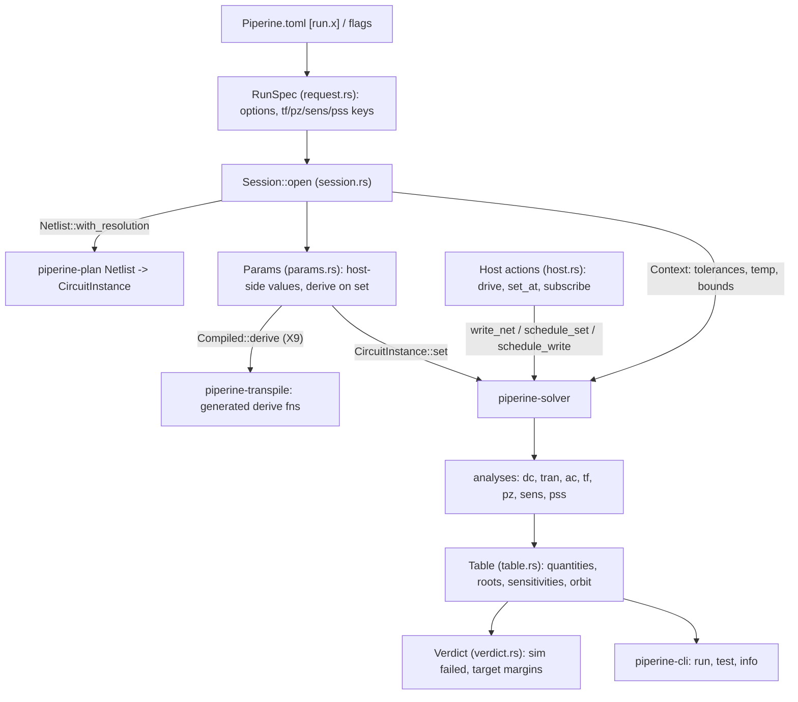

# Host II Design

**Spec**: `.specs/features/host-ii/spec.md`
**Status**: Approved

---

## Architecture Overview

Host II is mostly `piperine-api`: new run keys, new arms of `Session::analysis`, new table forms, a host-action list kept on the session, and a param table the host owns. The command line gains flags, the analysis names and (Q1) `piperine info`. Three places outside the host crates are touched, each named in "Cross-lane touches" below: two small host-facing additions to `piperine-solver`, five new parity twins with their harness parser and contract constants in `piperine-parity`, and (X9) a derived-param plan in `piperine-plan` printed and loaded by `piperine-transpile`.



### Session options

`RunSpec` gains an `Options` struct (`reltol`, `abstol`, `vntol`, `trtol`, `temp`, `resolution`, `maxrounds`, `maxmicro`, `nodeset`), all `Option`, read by every analysis. `Session::open` builds one `Context` from it (`Tolerances` fields replaced where given, `temperature = temp + 273.15`) and uses it for every solver it builds; `resolution` goes to `Netlist::new(ir).with_resolution(r).circuit(..)`, which `piperine-plan` already offers (`netlist.rs:31`), so the backends' own `circuit()` helpers are bypassed, not edited. `nodeset` paths resolve to node references at open (`E0801`), and every operating point the session takes calls `DcSolver::apply_initial_conditions` (`dc.rs:197`) with them. With no key given, `Context::default()` and the backends' own `circuit()` path are used exactly as today: that is how HII-02 AC 1 and HII-21 hold.

`maxrounds` and `maxmicro` are not reachable today: `ProtocolOptions::new` hard-codes 20 rounds (`protocol/transient.rs:46`), and the binder builds the digital engine with `DigitalLimits::default()`, 1000 microsteps (`core/bind.rs:641`, `piperine-digital-solver/src/limits.rs:16`). Rounds are an analysis option: `Context` (host-facing, `analyses/context.rs`) gains `max_rounds: u32`, default 20, read where `ProtocolOptions` is built. Microsteps are a binding option, like the resolution: `CircuitBuilder::microsteps(n)` beside `CircuitBuilder::resolution` (`core/builder.rs:127`) carries it to `bind`, and `piperine-plan`'s `Netlist` gains `with_microsteps(n)` beside `with_resolution`. These are the first solver touch and the first plan touch.

### Small-signal analyses and PSS

`Analysis` gains `Tf { input, output }`, `Pz { input, output }`, `Sens { wrt }` and `Pss { period, tstab, max_step, print_step }`. The session resolves `input` to the instance's first potential branch (the rule `Probe::Flow` already uses), refusing an instance with none (`P0010`, MD-14), and `output` to a node. The arms call the solver's own drivers: `CircuitInstance::transfer_function`, `pz` (then `poles()` and `zeros()`), `sens`, `pss`. The PSS arm turns `PssResult::trace` (one period, every step) into a table with `Table::transient`, and with `print_step` into the grid with `Table::on_grid(h, t0, t0 + T)`: both are the existing oracles of `long-run`, so no new interpolation is written. A period is held whole in memory: one period, by definition bounded.

New `Table` constructors: `Table::transfer(&TransferFunctionAnalysisResult)`, `Table::roots(&PoleZeroResult)`, `Table::sensitivities(&probes, &wrt, &SensResult)`. The plot refuses `tf`, `pz` and `sens` (`P0010`) and draws `pss` as a transient.

### Metadata

A `Probe::Param { instance, param }` reads the session's param table (below) and repeats the value in every row. A `Probe::Term { instance, term }` reads `Assembly::term_value` (`piperine-analog-solver/src/device/assembly.rs:296`) through the bound circuit, for an instance with exactly one flow term and no potential branch. `Session::metadata()` builds `Metadata { params, ports, streams }` from the IR (`Body::params`, `Param::where`, the plan's `structural` flag, `Streams::of`). `piperine info` (Q1 (a)) prints it as three text tables through the existing table renderer.

### Host actions

`piperine-api/src/host.rs` holds `HostAction { Drive { net, bytes, at }, Set { path, value, at } }` in the order given; `Session::drive`, `Session::set_at` and `Session::subscribe` validate at once (`E0804`, `E0806`, `E0803`, `E0802`, `E0805`) and push. At `run`, actions at `at = 0` are applied before the analysis (a `set` through the param table; a drive through `CircuitInstance::write_net`), and actions at `at > 0` go to the transient: `TransientSolver::schedule_set` exists (`analyses/transient.rs:598`) and a sibling `schedule_write(t, net, bytes)` is added, landing on the same `Protocol::set` path (`protocol/host.rs:89`). That is the second solver touch. Encoding a value to a net's bytes reuses the layouts `Cell::decode` reads (`table.rs:36`), inverted.

### Verdict

`Verdict` reads the `sim` stream as well as `checks`: a record with `failed = true` makes the verdict `Fatal { msg }`; `piperine run` exits 1 after printing what it printed, `piperine test` prints `FAIL <name> (fatal: <msg>)`. Targets: the verdict keeps the last `target` record per name in first-seen order; `piperine test` prints them after the run's line. Nothing in lane A's S1 work is needed: `fatal` already writes the record (`std/io.msl:9`); whether the analysis stops there is lane A's.

### Digital-only transient (L56)

The protocol already runs a design with no analog unknown to its stop (`protocol/transient.rs:252`, `None => stop_tick`) and observes the stop step (`observe_step(t_c)`); what refuses the run is the api's check of `result.iter().last()` (`session.rs`), because the solver's result records only analog accepts. The check moves to the recorder: the last time the step observer saw is the time the run reached. No solver change. If the observer does not see the stop, the task stops and reports: the fix would then be in the protocol, lane C's file.

### X9: derived params (cross-lane, isolated phase)

The IR already keeps every child param a placement derives from its parent's params, as `ChildValue::Expr` beside the child (`piperine-ir/src/model.rs:251`, written by `piperine-lang/src/elab/carriers.rs:152`); the instance table holds only the constant it folds to. Host II compiles those expressions and calls them on a `set`:

1. `piperine-plan` gains `DerivePlan`: for the design, the list of derived bindings `(child instance path, child param, parent instance path, expression)`, in instance order (a parent before its children, so a chain derives top-down), and for each param the bindings that read it.
2. `piperine-transpile` prints one function per binding, `derive_<k>(params: &[f64]) -> f64` over the parent's params in declaration order (a `bool` as 0 or 1), into the same generated source, and exports one `extern "C" fn piperine_derive_1(k: u32, params: *const f64, n: u32) -> f64` next to `piperine_abi_1`. `Compiled::derive(k, &[f64]) -> f64` loads and calls it. The device ABI (`piperine-abi`) is not touched: this export is the transpiler's contract with its host, and generated code still links `piperine-abi` alone (MD-63 item 1).
3. `piperine-api/src/params.rs` keeps the host's table of every instance's param values, seeded from the IR's constants. A `set` of `p` writes the table, then walks `DerivePlan` from `p` down, calling `Compiled::derive` for each binding that reads a changed value and writing each result to the table; then every changed param that has a pin is written with `CircuitInstance::set`, in instance order. If any write is refused, the params already written are written back to their old values and the `set` is `E0802` naming the refusing param: nothing changes (§23.1 rule 6). A timed `set` derives the values when it is scheduled (the value is known then) and schedules one `schedule_set` per changed pin at the same `at`.
4. On the interpreter there is no `Compiled`: a `set` of a param that `DerivePlan` lists as read is refused (`E0802`, naming `--backend rust`). The interpreter itself is not edited.

`let`s and definitions inside one body (HII-19) read the param's pin at each evaluation, so a `set` reaches them already; T38 proves it, and a failure there stops the task and is reported (the fix would be elaboration, lane A's).

---

## Cross-lane touches

| Where | Lane | What | Why it cannot stay in the host |
| ----- | ---- | ---- | ------------------------------ |
| `crates/piperine-solver/src/analyses/context.rs` and the sites that build `ProtocolOptions` (`protocol/transient.rs:46`); `core/builder.rs`, `core/bind.rs:641` | C (`solver-hygiene` edits solver errors and numerics) | `Context::max_rounds` (default 20); `CircuitBuilder::microsteps` carried to the `DigitalLimits` of `bind` (default 1000) | `maxrounds`, `maxmicro` (X7) are hard-coded constants today. Defaults equal today's values; no numeric path changes. Rebase risk: lane C renaming errors in `protocol/` |
| `crates/piperine-plan/src/netlist.rs` | A | `Netlist::with_microsteps`, beside `with_resolution` | the binding option reaches the builder through the netlist, as the resolution does |
| `crates/piperine-solver/src/core/circuit.rs`, `src/analyses/transient.rs` | C | `CircuitInstance::write_net` (a host write to a net between analyses) and `TransientSolver::schedule_write` (a timed host write) | The protocol's `set` (`protocol/host.rs:89`) is crate-private; the host needs a public door for a net, beside the existing one for a param (`schedule_set`) |
| `crates/piperine-plan/src/derive.rs` (new) | A (`msl-fixes`: ir, plan, transpile) | `DerivePlan` | X9: what to recompute is the plan both backends share (MD-63) |
| `crates/piperine-transpile/src/print/derive.rs` (new), `src/compiled.rs` | A | the generated `derive_<k>` functions, the `piperine_derive_1` export, `Compiled::derive` | X9: "recomputed by a function compiled into the device (generated Rust)" |
| `crates/piperine-parity/src/ngspice.rs`, `src/contract.rs`, `tests/parity_{temp,tf,pz,sens,pss}.rs`, `tests/ngspice/{temp_res,tf_divider,pz_lowpass,sens_divider,pss_rc}.{cir,msl}` | none (the harness) | a parser for ngspice's `print` lines; three new tolerance constants; five twins | MD-38: a new analysis is proven against ngspice; existing constants and twins are untouched |

The X9 tasks are Phase 6, after every other code phase, so that the phase rebases onto `msl-fixes` alone and nothing earlier depends on it. `piperine-lang`, `piperine-ir` and `piperine-interp` are not edited.

---

## Code Reuse Analysis

### Existing Components to Leverage

| Component | Location | How to Use |
| --------- | -------- | ---------- |
| `RunSpec`, `Keys`, `Overrides`, `RUN_KEYS`, `ANALYSIS_KEYS` | `crates/piperine-api/src/request.rs` | extend with the option and analysis keys; the `P0010` rules stay in one place |
| `every_run_key_has_its_flag` | `crates/piperine-cli/src/cli.rs:329` | extended with the new flags (the list grows; no assertion is weakened) |
| `Table::transient`, `Table::on_grid` | `crates/piperine-api/src/table.rs:154`, `:183` | the PSS table, unchanged |
| `TransferFunctionSolver`, `PoleZeroSolver`, `SensSolver`, `PssSolver` | `crates/piperine-solver/src/analyses/` | called as they are |
| `Netlist::with_resolution` | `crates/piperine-plan/src/netlist.rs:31` | `resolution` |
| `DcSolver::apply_initial_conditions` | `crates/piperine-solver/src/analyses/dc.rs:197` | `nodeset` |
| `TransientSolver::schedule_set` | `crates/piperine-solver/src/analyses/transient.rs:598` | timed `set` |
| `Assembly::term_value` | `crates/piperine-analog-solver/src/device/assembly.rs:296` | the flow of a flow contribution |
| `ChildValue::Expr` | `crates/piperine-ir/src/model.rs:251` | the expressions X9 compiles |
| `Reference::run`, `wrdata` parser, `ToleranceContract` | `crates/piperine-parity/src/{ngspice,contract}.rs` | the new parity targets |

### Integration Points

| System | Integration Method |
| ------ | ------------------ |
| `piperine-solver` | `Context` per session; the analysis drivers; `write_net`, `schedule_write`, `schedule_set` |
| `piperine-transpile` | `Compiled::derive` (X9) |
| `piperine-cli` | flags, the new analysis names, `piperine info`, the `fatal` and target lines of `piperine test` |
| ngspice | `.options temp`, `.tf`, `.pz ... vol pz`, `.sens`, `.tran` run by the harness at test time |

---

## Components

### Options (`piperine-api/src/request.rs`, `session.rs`)

- **Purpose**: the session options of a run, typed and applied.
- **Interfaces**: `pub struct Options { reltol, abstol, vntol, trtol, temp: Option<f64>, resolution: Option<f64>, maxrounds: Option<u32>, maxmicro: Option<u32>, nodeset: Vec<(String, f64)> }` on `RunSpec`; `Session::context(&self) -> &Context`.
- **Reuses**: `Given<T>`, `Source::fault`.

### Analyses (`request.rs`, `session.rs`, `table.rs`)

- **Interfaces**: `Analysis::{Tf, Pz, Sens, Pss}`; `Analysis::NAMES` of eight; `Table::transfer`, `Table::roots`, `Table::sensitivities`.

### Params (`piperine-api/src/params.rs`, new)

- **Purpose**: the host's values of every param, and the derived recomputation of X9.
- **Interfaces**: `Params::of(&Ir) -> Params`; `Params::get(path) -> Option<Value>`; `Params::set(&mut self, path, value, derive: &dyn Derive) -> Result<Vec<Changed>, Failure>`; `trait Derive { fn derive(&self, k: u32, params: &[f64]) -> f64; }` implemented for `Compiled`; `Changed { instance, param, value }`.

### Host actions (`piperine-api/src/host.rs`, new)

- **Interfaces**: `Session::drive(&mut self, port: &str, value: Value, at: f64) -> Result<(), Failure>`; `Session::set_at(&mut self, path: &str, value: f64, at: f64) -> Result<(), Failure>`; `Session::subscribe(&mut self, streams: &[&str]) -> Result<(), Failure>`.

### Metadata (`piperine-api/src/metadata.rs`, new)

- **Interfaces**: `Session::metadata(&self) -> Metadata`; `Metadata { params: Vec<ParamInfo>, ports: Vec<PortInfo>, streams: Vec<StreamInfo> }`.

### Verdict (`piperine-api/src/verdict.rs`)

- **Interfaces**: `Verdict::fatal(&self) -> Option<&str>`; `Verdict::targets(&self) -> &[(String, f64)]`.

### DerivePlan (`piperine-plan/src/derive.rs`, new) and its print (`piperine-transpile`)

- **Interfaces**: `DerivePlan::of(&Ir) -> DerivePlan`; `DerivePlan::bindings() -> &[Binding]`; `DerivePlan::readers(instance, param) -> &[u32]`; `Compiled::derive(k: u32, params: &[f64]) -> f64`.

---

## Data Models

```rust
pub struct Binding {
    pub k: u32,                  // index of the generated function
    pub parent: String,          // instance path
    pub child: String,           // instance path
    pub param: String,           // the child's param name
    pub reads: Vec<String>,      // the parent's params the expression reads
}
```

New tables, as `Table` columns of typed cells:

| Analysis | Columns | Rows |
| -------- | ------- | ---- |
| `tf` | `quantity`, `value` | `gain`, `input_impedance`, `output_impedance` |
| `pz` | `kind`, `real`, `imag` | poles, then zeros |
| `sens` | `param`, `d(<path>)` per printed signal | one per `wrt` entry |
| `pss` | `time`, one per printed signal | the orbit's steps, or the grid |

---

## Error Handling Strategy

| Error Scenario | Handling | User Impact |
| -------------- | -------- | ----------- |
| An option out of range | `P0010` at the key's span, or with no span for a flag | `piperine check` and `run` stop before compiling |
| A `tf`/`pz` input that is not a voltage source | `P0010` naming the instance (MD-14) | stop before compiling |
| A path that names nothing (`nodeset`, `output`, `wrt`, a drive, a timed set) | `E0801` | stop before compiling |
| A drive of a carrier the host holds no drive of | `E0804` | the action is refused, nothing changes |
| A timed set of a structural param | `E0803` | refused before the run |
| A subscription after the run | `E0805` | refused |
| A negative `at` | `E0806` | refused |
| A derived recomputation that fails a child's `where` | `E0802` naming the child param; params already written restored | nothing changes |
| A `set` on the interpreter of a param others derive from | `E0802` naming `--backend rust` | refused |
| A `sim` record with `failed = true` | `Verdict::Fatal`; exit 1 | the records stay printed; `FAIL <name> (fatal: <msg>)` |
| A bound reached (`maxrounds`, `maxmicro`) | the solver's error, unchanged in text | run fails, exit 1 |

---

## Risks & Concerns

| Concern | Location (file:line) | Impact | Mitigation |
| ------- | -------------------- | ------ | ---------- |
| A twin moves when options are wired | `crates/piperine-api/src/session.rs` (every arm) | parity breaks unseen | With no option key the session builds `Context::default()` and the backend's own `circuit()`, as today; `twins.rs` byte goldens and the parity targets run in every phase's gate (HII-21) |
| Lane C edits the same solver files | `protocol/transient.rs:46`, `analyses/transient.rs:598`, `core/circuit.rs` | merge conflicts | The touches are additions (a field, two methods), each in its own task with its own commit, listed above |
| Lane A edits plan and transpile | `piperine-plan`, `piperine-transpile/src/print` | merge conflicts in X9 | Phase 6 holds every X9 task and nothing before it depends on them; new files (`derive.rs`) keep the edits of existing files to a registration line each |
| Re-entry is approximate (V8) inside PSS shots | `analyses/pss.rs` | the orbit is off by up to 7.3e-4 relative | PSS converges on its own residual (`shoot_tol = 1e-6`); the parity bound is `TRAN_VOLTAGE`, not retuned. A miss is a finding reported to the user, never a moved bound |
| ngspice's `.pss` is not a reference for a driven circuit | probe 2026-11-17 | a wrong oracle | The oracle is a long `.tran` and the closed form (spec, Assumptions) |
| A square drive in MSL may hit B1 | `GAPS.md` B1 | the `pss_rc` twin does not build | The source's contribution reads a param (`v(p, n) +> amp * level.known_or(0.0)`), the form B1 says works; the fallback is the stdlib `D2A`. Either is the task's choice; a third failure stops the task |
| The derive export is a second symbol of the generated library | `piperine-transpile/src/compiled.rs` | a library compiled before this feature lacks it | The cache key is the source hash, so a new source compiles anew; a library with no `piperine_derive_1` and a non-empty `DerivePlan` is a load error naming the symbol |
| A `set` of a parent param that has no pin (H5) | `CircuitInstance::set` | today `E0802` "no PARAM pin" | `Params::set` writes only params with a pin; a param with neither a pin nor a reader stays `E0802` as today (H5 is not in scope) |
| Bool params in derive | `derive_<k>(&[f64]) -> f64` | a truncation | A `bool` crosses as exactly 0.0 or 1.0 and is read back with `!= 0.0`; integer params are refused today (L28) |

---

## Tech Decisions (only non-obvious ones)

| Decision | Choice | Rationale |
| -------- | ------ | --------- |
| Where derived values are computed | the host calls a generated function, then writes each child's pin with `set` | No change to the device ABI or to the solver's binder (a parent device writing a child's param net would need both); the shadow check of each child's `where` still runs |
| Atomic multi-instance `set` | write in instance order, restore on the first refusal | `CircuitInstance::set` checks one instance's shadow; restoring keeps §23.1 rule 6 ("changes nothing") |
| A timed `set` of a derived chain | derived when scheduled, one `schedule_set` per changed pin at the same time | The value is known before the run; nothing runs host code inside the protocol |
| `temp` | Celsius in, Kelvin to the solver | ngspice's key, ngspice's unit |
| PSS table | `Table::transient` / `Table::on_grid` over the one-period trace | the `long-run` oracles; one period is bounded |
| L56 | judged by the step observer's last time, not the solver's result | the protocol already reaches the stop; no solver change |

A project-level decision is recorded at the end of the feature (T42) as `MD-69`: a host `set` recomputes derived params through functions the compiled backend generates; elaboration and compilation still run once (MD-18 unchanged).
