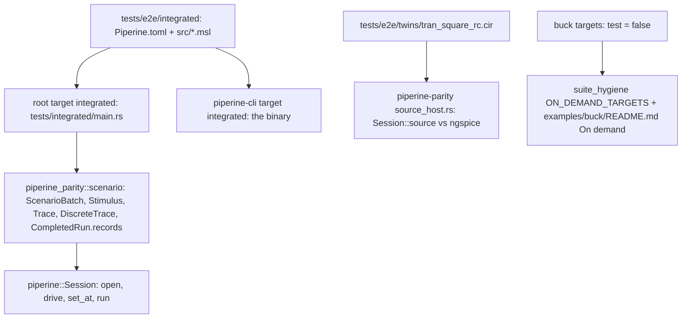

# Integrated Tests Design

**Spec**: `.specs/features/integrated-tests/spec.md`
**Status**: Approved (with the spec, under the user's standing AFK authorization)

---

## Architecture Overview

Two moves. The buck's simulation targets stay where they are and stop running by default: each gets an
explicit `[[test]]` table with `test = false`, and a registry in `suite_hygiene` keeps that flag from becoming
a quiet way to switch tests off. A new integrated suite proves the same capabilities on five small designs of
one scenario package, run at once by one root target through the host library, with a CLI target over the
same package and one analog-only ngspice twin.



---

## Code Reuse Analysis

### Existing Components to Leverage

| Component | Location | How to Use |
| --------- | -------- | ---------- |
| Scenario harness | `crates/piperine-parity/src/scenario/` | `ScenarioRun`, `ScenarioBatch`, `Stimulus` (`drive`, `set`, `ramp`), `Trace`, `DiscreteTrace`, `NamedColumn`, `CheckTally`; `CompletedRun` gains `records` |
| Planted package | `crates/piperine-parity/src/scenario/planted.rs` | the harness unit test of `records` |
| The contract | `crates/piperine-parity/src/contract.rs` | `ToleranceContract::TRAN_VOLTAGE.assert(&Point, golden, actual)`, unchanged |
| Crossing judged by voltage | `crates/piperine-parity/tests/buck_boundary.rs::the_comparator_trips_at_its_thresholds` | the rule: the analytic voltage at the located instant equals the threshold under `TRAN_VOLTAGE` |
| Compile with no warning, valid shapes | `crates/piperine-parity/tests/buck_whole.rs::the_buck_compiles_with_no_warning_and_valid_shapes`, `crates/piperine-transpile/tests/support/mixed.rs` (`Built::new`) | the same check per run, `#[path]`-included as `buck_whole` does |
| Host-driven analog twin | `crates/piperine-parity/tests/source_host.rs`, `tests/source_host/rc_top.msl`, `tests/e2e/twins/tran_pwl_rc.cir` | `tran_square_rc` is the same shape with a square |
| A scenario package | `tests/e2e/buck/`, `tests/buck_scenarios.rs` (`Package`, `Suite`, `Family`) | the layout and the one-batch-per-target pattern |
| Registry + exhaustiveness | `suite_hygiene.rs` (`ROOT_TARGET_EXEMPTIONS`, `RootManifest::test_paths`) | `ON_DEMAND_TARGETS` and a manifest reader of `test = false` |
| Root `tests/` shape | `crates/piperine-solver/tests/workspace_shape.rs::root_tests_hold_no_end_to_end_target` | extended for a declared `main.rs` target's own modules |
| Book support | `tests/book/support/` (`Chapter`, `Model`) | `tests/book/buck.rs` uses them |
| CLI binary fixtures | `crates/piperine-cli/tests/buck.rs` (`run`, `table`, `column`) | the shape of the CLI target, rewritten as types |

### Integration Points

| System | Integration Method |
| ------ | ------------------ |
| Cargo | `[[test]] name, path, test = false` per on-demand target; root `[[test]] name = "integrated" path = "tests/integrated/main.rs"`, `name = "book_buck" path = "tests/book/buck.rs" test = false`; root dev-dependencies `piperine-ir`, `piperine-plan`, `piperine-abi` for the shape check |
| `tests/book/inventory.tsv` | rows `cli#44`, the buck listing block and claims `cli~9c4b6fcf` name the on-demand tests |
| `.specs/STATE.md` | MD-76 |

---

## The suite: circuits, closed forms and references

Conventions used throughout. A clock of frequency `f` rises at `(k − ½)/f` and falls at `k/f`, `k ≥ 1`
(initial value false). `TRAN_VOLTAGE` is the only contract any analog criterion uses. A row at `k·h` holds
a net's value after the last instant at or before `k·h`. `std::convert::D2A` is a Thévenin source
`ramp · v(vdd)` behind `rout`; its 20 ps ramp is a step in every closed form (error < 1e-5 relative).

### Shared MSL (`tests/e2e/integrated/src/lib.msl`)

`Clock(out clk: Bit = false) { f }` (a toggle every half period from `every`), `Vdc(p) { dc }`,
`Resistor(p, n) { r }`, `Capacitor(p, n) { c }`, `Switch(p, n, in on: Bit) { ron, roff }` (conductance
`1/roff + (1/ron − 1/roff) · transition(level, tr: 1p)`, the `PowerSwitch` pattern), `Adc8(ain, in sample: Bit,
out code: Bit<u8> = 0, out done: Bit = false) { vref, tconv, tstrobe }` (mid-tread, `code <- q after tconv`,
`done` a pulse of two statements, the buck `Adc` at 8 bits), `PwmCounter(in clk, in duty: Bit<u8>, out hs,
out ls, out wrap) { dead }` (count `0..99`, duty latched at count 0, `hs = count < duty`, `ls` from
`duty + dead` to `100 − dead`, `std::monitor::Never` on `hs && ls`). Each scenario file places them under its
top. Every module and param carries a `///` line.

### `PiecewiseRc` (Rust, `tests/integrated/rc.rs`)

A first-order node under a piecewise-constant drive: segments `(start, target, tau)`, `tau = ∞` for a
held node. `at(t)` returns `target + (v0 − target)·exp(−(t − start)/tau)` with `v0` carried from the previous
segment. `crossing_voltage(t)` is `at(t)`. Used by `threshold`, `pwm_filter`, `sample_hold` (track and hold),
`state_machine` (charge, hold, dump). One purpose: the analytic voltage of one node.

### `threshold`

Circuit: `Clock { f: 100k }` → `D2A { rout: 100, tr: 20p }` from a 1 V rail → 900 Ω → 1 nF; `A2D { vth: 0.5,
hyst: 0.1 }` on the capacitor; `EdgeCounter` counts `cmp.rise()` in `rises: Bit<u8>` and `cmp.fall()` in
`falls`, each reaction `emit!("edges", rising, n)`. Run: transient to 42 µs, `max_step` 10 ns, `print_step`
100 ns, print the capacitor, `rises`, `falls`; `streams = ["edges"]`.

Closed form: τ = (100 + 900) Ω · 1 nF = 1 µs; segments at 5, 10, 15, ..., 40 µs, target 1 V while the square
is high, 0 V while low, from 0 V. Crossings: rising at `t_r + τ ln((1 − v0)/(1 − 0.55))` (first: 5.7985 µs),
falling at `t_f + τ ln(v0/0.45)` (first: 10.7918 µs). Criteria: IT-04 AC 1 to 5. The judge of a record is
`PiecewiseRc::at(record.time)` against 0.55 V or 0.45 V.

### `sample_hold`

Circuit: `Vdc` input (param `dc`, set by the host), `Switch { ron: 10, roff: 1G }` from the input to the hold
node, closed while a `Clock { f: 1M }` is high; 1 nF on the hold node; `Adc8 { vref: 1.0, tconv: 200n,
tstrobe: 50n }` sampling the hold node on `clk.fall()`. Run: to 51 µs, `max_step` 10 ns, `print_step` 10 ns,
print the hold node, `code`, `done`, `clk`.

Host (`Stimulus::set` on the input's `dc`): 0 at 0; 1/256 V at 10.25 µs; 0.5 V at 20.25 µs; 255/256 V at
30.25 µs; 1.2 V at 40.25 µs. Each step falls inside a hold (`[k, k + ½)` µs), so the hold node must not move.
Track lasts 0.5 µs = 50 τ_on (τ_on = 10 Ω · 1 nF); droop τ_off ≈ 1 s.

Expected codes, sample `k` at `k` µs: `floor(v·256 + 0.5)` clamped: 0 (k ≤ 10), 1 (11..20), 128 (21..30),
255 (31..40), 255 (41..50: 1.2 V clamps). Every input sits at a code centre, so a solver error under half an
LSB (1.95 mV) cannot move a code. `done` is high on exactly the rows `k + 0.20` to `k + 0.24` µs (five rows).

### `pwm_filter`

Circuit: `Clock { f: 100M }` → `PwmCounter { dead: 2 }`; `hs` → `D2A` from a 1 V rail → 900 Ω → 10 nF
(τ = 10 µs). The duty is a top `in` port the host drives: 25 at 0, 60 at 30.3 µs. Run: to 60 µs, `max_step`
10 ns, `print_step` 10 ns (rows at multiples of 10 ns; edges at 5 ns offsets, so one row per clock period),
print `hs`, `ls`, the filter node; `streams = ["checks"]`.

Count after edge `k` is `(k − 1) mod 100`; wraps (count 0) at `m µs + 5 ns`. Period `m` with latched duty `d`:
`hs` high for `d` rows, low for 2, `ls` high for `96 − d`, low for 2. The host's 60 is latched at the wrap of
31.005 µs. `Never` checks at each rising edge: 6 000 records, all passing. Closed form: `PiecewiseRc` with
τ = 10 µs, breakpoints at the `hs` edges the reference PWM computes.

### `state_machine`

Circuit: `Clock { f: 10M }`; source `Vdc` (param `dc`, host-set) → `Switch` (charge, `ron` 1 Ω) → 1 kΩ →
capacitor 1 nF; capacitor → `Switch` (dump, `ron` 1 Ω) → 1 kΩ → ground; `A2D { vth: 0.9, hyst: 20m }` on the
capacitor as `ov`; `enum Phase { Idle, Charge, Hold, Dump, Fault }`, `enum Fault { Clear, OverVoltage }`;
`Sequencer` reacts on `clk.rise()`; `on ov.rise() { emit!("trips", ...) }`; every change of `phase` emits
`("phase", to)`. Top `in en: Bit` driven by the host. Run: to 22 µs, `max_step` 10 ns, `print_step` 100 ns.

Reference (`PhaseMachine`, Rust, at each rising edge reading `en` and `ov` as the row before the edge
holds them; `ov_last` is the previous edge's `ov`):

1. If `phase` is not `Fault` or `Idle`, `ov && ov_last` → `Fault`, `fault = OverVoltage`, ticks 0.
2. Else, if `!en` and `phase != Fault` → `Idle`.
3. Else by phase: `Idle` → `Charge` (ticks 0); `Charge`: ticks + 1, at 20 → `Hold`, and if `fault ==
   OverVoltage` it becomes `Clear` (a clean retry); `Hold`: at 10 → `Dump`; `Dump`: at 20 → `Charge`;
   `Fault`: at 30 → `Charge` (the retry).

Switches: charge on in `Charge`; dump on in `Dump` and `Fault`.

Host: `en` false at 0, true at 1.0 µs (first edge seeing it: 1.05 µs); source 1 V, 2 V at 10.0 µs (inside the
second `Dump`), 1 V at 13.0 µs (inside `Fault`). Timeline (τ = 1.001 µs through 1 Ω + 1 kΩ): `Charge` 1.05,
`Hold` 3.05, `Dump` 4.05, `Charge` 6.05, `Hold` 8.05, `Dump` 9.05, `Charge` 11.05 (to 2 V: crosses 0.91 V at
≈ 11.596 µs), `Fault` at 11.75 (second edge with `ov`), dump discharges below 0.89 V, `Charge` (retry) at
14.75 with 1 V (peak ≈ 0.872 V, no trip, `fault` back to `Clear` at 16.75), `Hold` 16.75, `Dump` 17.75,
`Charge` 19.75. Twelve `phase` records. Every instant above is what the reference computes; the tests
compare to the reference, never to this table.

### `pi_loop`

Plant: `pwm_filter`'s (`Clock { f: 100M }`, `PwmCounter { dead: 2 }`, `hs` → `D2A` → 900 Ω → 10 nF, τ =
10 µs, 1 V rail). `Adc8 { vref: 1.0, tconv: 200n, tstrobe: 50n }` samples the filter node on `wrap` (every
1 µs, at `m µs + 5 ns`, 100 samples). `Pi` reacts on `done.rise()`:

```
e     = 128 − code                                  (i16)
u     = (48·e + 5·integ) >> 6                       (i32, arithmetic shift: Q6)
duty  = clamp(u, 0, 100)
integ = integ                      if (u > 100 && e > 0) || (u < 0 && e < 0)    (conditional integration)
        clamp(integ + e, 0, 1280)  otherwise
emit!("loop", code, err: e, duty)
```

The duty takes effect at the next wrap: one period of delay. Derivation of the gains: per period the plant is
`v[n+1] = a·v[n] + (1 − a)·Vdd·d[n]/100`, `a = e^{−0.1}` = 0.905; in codes per count it is
`(1 − a)·2.56` = 0.2437. `Kp/(Kp + Ki)` = 48/53 = 0.906 ≈ `a` cancels the plant pole; with the period of delay
the loop is `z² − z + g = 0`, `g = (53/64)·0.2437` = 0.2018: poles 0.72 and 0.28, a time constant of
3 periods, 1 % in 14 periods after the duty leaves saturation (about 8 periods at duty 100). The settled
window starts at 50 µs (50 periods).

Bounds (IT-08): one duty count moves the settled output by `Vdd/100` = 10 mV = 2.56 codes, so a limit cycle of
one count keeps the code within `128 ± 3`. The `regulated` check (`on settle && now() > 50u`,
`require("regulated", (v(out) − 0.5).abs() <= 50m)`): ripple peak to peak `Vdd·tanh(T/4τ)` = 25 mV, plus two
counts of limit cycle 20 mV, plus one LSB 3.9 mV = 48.9 mV ≤ 50 mV. Reference: `PiController` (Rust) runs the
equations above on the codes the table commits and must give every committed duty. Run: to 100 µs, `max_step`
10 ns, `print_step` 10 ns (10 001 rows), print `code`, `duty`, the filter node; `streams = ["loop", "checks"]`.

### `tran_square_rc` (ngspice, analog only)

`tests/e2e/twins/tran_square_rc.cir`: `V1 vin 0 PWL(...)` with the square of `threshold` (0 → 1 V at 5 µs,
back at 10 µs, ..., 40 µs; 20 ps edges), the `R1` and `C1` of `tran_pwl_rc.cir` (`rc_top.msl`'s values),
`.options interp`, `tran 0.1u 42u 0 10n uic`, `wrdata tran_square_rc_tran v(out)`. The piperine side is a
test of `source_host.rs` beside `tran_pwl_rc`'s: `Session::source` with the same corners on `RcTop`'s node
port, `--max-step 1e-8`, compared row by row under `TRAN_VOLTAGE`. A header comment names the fair
configuration (TMAX 10 n on both sides), as `tran_pwl_rc.cir` does.

---

## Components

### On-demand registry (`suite_hygiene.rs`)

- **Purpose**: keep every `test = false` target registered, documented and really on demand.
- **Location**: `crates/piperine-lang/tests/suite_hygiene.rs`
- **Interfaces**:
  - `OnDemandManifest::targets(manifest: &str) -> Vec<String>` - the `[[test]]` names with `test = false`.
  - `const ON_DEMAND_TARGETS: [(&str, &str, &str); N]` - crate directory, target, why.
  - tests `on_demand_targets_are_registered`, `the_on_demand_targets_are_the_buck_set`,
    `the_buck_readme_names_every_on_demand_target`, `the_on_demand_reader_finds_test_false` (planted).
- **Reuses**: `RootManifest::test_paths`'s line reading.

### `CompletedRun::records` (`piperine-parity/src/scenario/run.rs`)

- **Purpose**: a run's records for the tests that judge them.
- **Interfaces**: `RunRecords` (a `RecordSink`: keeps every record, tallies `checks` into its `CheckTally`);
  `CompletedRun { records: Vec<Record>, .. }`.
- **Reuses**: `CheckTally`, `PlantedPackage`.

### Root target `integrated` (`tests/integrated/`)

- `main.rs`: `//!` header, `mod` lines only.
- `suite.rs`: `IntegratedPackage` (dir, runs, files), `Suite` (`OnceLock`, one `ScenarioBatch`, `ran(run)`,
  `report()`), `Scenario` trait (`RUN`, `stimulus()`).
- `rc.rs`: `PiecewiseRc`. `clock.rs`: `ClockEdges` (`rising(k)`, `falling(k)`, `rows_per_period`).
- `package.rs`: IT-03 tests (runs, no diagnostic, warning-free compile and shapes, tree, build directories,
  report).
- One file per scenario: its host stimulus type, its reference model type (`PwmReference`, `PhaseMachine`,
  `PiController`, `SampleSchedule`) and one test per criterion. Tests are `#[test] fn`; every helper is a method.

### CLI target (`crates/piperine-cli/tests/integrated.rs`)

- **Purpose**: the binary on `pi_loop` and `threshold`.
- **Interfaces**: `IntegratedPackage::run(args) -> Output` (shared cache), `PrintedTable::of(stdout)`
  (`header`, `rows`, `column(name)`).

### Book on demand

- `tests/book/buck.rs` (`book_buck`, `test = false`): `the_buck_bench_starts_with_the_supervisor_off`, the run
  half of today's `cli#44` test; `book_cli` keeps `the_buck_bench_of_the_chapter_is_the_example`.
- `crates/piperine-cli/tests/book_buck.rs` (`test = false`): `the_buck_block_is_what_the_binary_prints`, over
  `crates/piperine-cli/tests/support/book_listing.rs` (`BookListing`: the `<pre>` blocks of
  `docs/book/content.html` with their `data-cli-*` attributes, entities decoded; `of_project(name)`).
- `crates/piperine-cli/tests/book.rs`: `checked()` skips listings of project `buck`; the files half of the old
  buck test becomes `the_buck_block_shows_the_example_files`; the listing count assertion lowers by one.

---

## Error Handling Strategy

| Error Scenario | Handling | User Impact |
| -------------- | -------- | ----------- |
| A run of the batch fails | `Suite::ran` panics with the run's message in every test of the run; nothing re-runs | one clear failure per criterion |
| A record stream is empty or an event never happens | the test asserts the count first and names the stream or event | no vacuous pass |
| ngspice missing | as `tran_pwl_rc` (the existing `PIPERINE_NGSPICE` rule) | none new |
| A `test = false` target appears unregistered | `suite_hygiene` names crate and target | the flag cannot hide a test |

---

## Risks & Concerns

| Concern | Location (file:line) | Impact | Mitigation |
| ------- | -------------------- | ------ | ---------- |
| `--all-targets` no longer compiles the on-demand targets | root `Cargo.toml`, each crate manifest | a refactor can break them unseen | this feature's `**Build**` line compiles them with `--no-run`; MD-76 asks the same of every feature's close (D11) |
| A derived bound may be wrong (the `pi_loop` limit cycle, the 50 µs settling) | `design.md` "pi_loop" | a red test on a sound model | the worker measures and, if the derivation is wrong, corrects the derivation and its number with the reason in the Handoff, never widens a contract; a red caused by the code is a finding |
| `book_inventory` may expect one root target per chapter | `tests/book/inventory_guard.rs` | `book_buck` refused | T4 reads the guard first; if it does, `book_buck` registers the way the guard says (no rule is relaxed silently) |
| `checked()` count of listings | `crates/piperine-cli/tests/book.rs:390` | the moved listing lowers `>= 29` | the bound lowers by exactly one, with a comment naming `book_buck` |
| Six `buck_scenarios` reds | `tests/buck_scenarios.rs` | the buck run is red | out of scope; reported at each buck run |
| Disk | `/` at 88 % during planning | builds fail | workers stop at 90 % (`df /`) and use their private target directory |

---

## Tech Decisions (only non-obvious ones)

| Decision | Choice | Rationale |
| -------- | ------ | --------- |
| Mechanism | `test = false` per target (D1) | paths, names and historical commands stay valid; no `cfg`, no feature |
| One root target with modules | `tests/integrated/main.rs` + modules; `workspace_shape` accepts the modules of a declared `main.rs` target under its own directory | one `ScenarioBatch`: wall time is the longest run |
| A small typed Book-listing reader in the CLI on-demand target | `support/book_listing.rs` instead of extracting `book.rs`'s forty free functions | the extraction would be a large refactor of a guarded target; the new reader is ~40 lines of types |
| Crossing instants | judged by the closed-form voltage at the record's instant | no time tolerance is written (the `buck_boundary` rule) |
