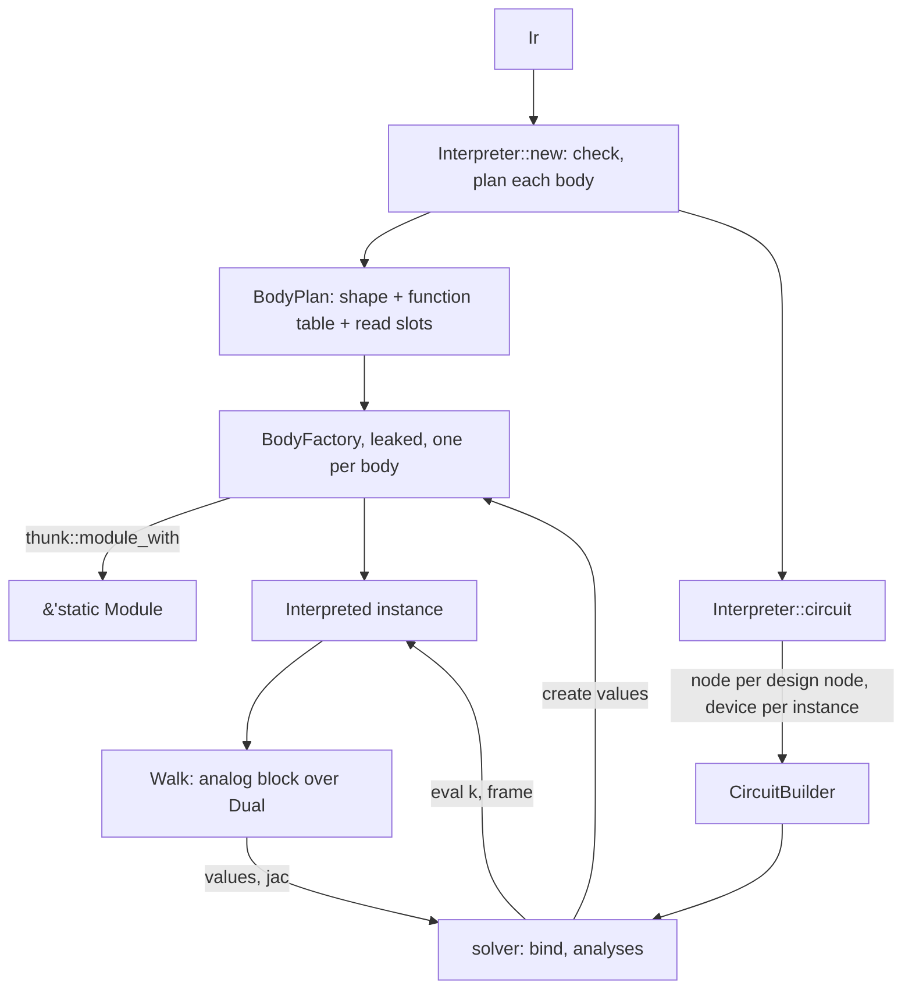

# IR Interpreter (reference backend, M1 subset) Design

**Spec**: `.specs/features/ir-interp/spec.md`
**Status**: Draft

---

## Architecture Overview

Three layers. A **plan** turns one IR body into a shape and a table that says what each function index computes and where each of its reads lands. A **device** (`Interpreted`) holds a plan and runs a function by walking the body's `analog` block over dual numbers. A **netlist** step turns the IR's instance table into `CircuitBuilder` calls. The solver sees shapes and `eval`; nothing else crosses.



### From a body to a shape

| IR item | ABI entry | Notes |
| --- | --- | --- |
| param `p: f64` / `bool` | pin `DISCRETE`, `PARAM`, layout `F64` / `BIT`, `HAS_INIT` when it has a default | first, in declaration order (abi.md P5); a param with no default has no `init`, and elaboration guarantees a bound value |
| param with `where` (INT-14) | adds `HAS_CHECK` and `check` = a `PRIVATE` discrete `BIT` pin `check:<p>`; a discrete function `check:<p>` writes it | the function reads `PARAM` pins only, so it is inside the parameter cone (P6) |
| body node (port or signal) | pin `CONTINUOUS`, `PORT`; `abstol = [potential.abstol, flow.abstol]`; `HAS_INIT` when the node has `= value` | bound by position to the instance's design nodes |
| potential branch `bK` | pin `CONTINUOUS`, `PRIVATE`, named `bK.flow` | the branch's flow unknown (§11 rule 16) |
| `temperature()` read | pin `DISCRETE`, `GLOBAL`, `TEMPERATURE`, layout `F64` | one per body, only when read |
| flow branch, direct addends | term `FLOW {plus, minus}` named `bK.flow` | |
| flow branch, `ddt` addends | term `DDT {plus, minus}` named `bK.charge`, value = the sum of the arguments | the solver owns d/dt, `jω` and the history |
| potential branch | term `FLOW {plus, minus}` = `f`; term `FLOW {f, GROUND}` named `bK.eq` = `x(plus) − x(minus) − Σ` | abi.md A1 |
| `limit` site `Lk` | input `LIMIT`, named after the site; function `limit:<name>` | reads the site's dependency set plus `LAST`, `AGE`, ambient `STATIC`; writes `PROPOSED`, `LIMITED` |
| `ac_stim` site `Sk` | input `STIM`; function `stim:k` | writes `RE`, `IM` |
| the `analog` block | function `terms` | writes every term; reads the union of the terms' dependency sets |
| `gmin()`, `source_scale()` | read cells `AMBIENT GMIN`, `AMBIENT SOURCE_SCALE` | no shape entry (abi.md §4.2) |

Function order in the shape: `limit:*` by site, `stim:*` by site, `terms`, `check:*` by param. Read order inside a function: continuous pins (nodes by index, then private flows), `LIMIT` values, `STIM` values, then params, the temperature pin and the ambients. The first three groups are the differentiable reads: each gets one tangent slot, in that order. Partials are declared term by term, each against the differentiable reads of its own dependency set, in read order. That order is the order the assembly folds `Σ g·x` in, which INT-12 relies on.

### How one function runs

Every function is the same walk of the `analog` block in a different mode. Sites and contributions sit at the top level of the block (the IR's `check()` guarantees it), so a walk reaches site `k` unconditionally.

| Mode | At a `limit` site `j` | At an `ac_stim` site `j` | At a contribution | Stops |
| --- | --- | --- | --- | --- |
| `Limit(k)` | `j < k`: the input's `VALUE`, tangent 1 on its slot. `j = k`: evaluate `x`; pick `old` (INT-10 AC 2); `LIMITED = f(x.value, old)` over plain reals, raised to the seed when it starts from it (AC 3); write and stop | the input's `VALUE` | skipped | at site `k` |
| `Stim(k)` | `VALUE` | `j < k`: `VALUE`. `j = k`: evaluate `mag`, `phase` as plain reals; write and stop | skipped | at site `k` |
| `Terms` | `VALUE`, tangent 1 | `VALUE`, tangent 1 | each addend is evaluated and added, with its sign, to its term's accumulator | at the end |

After a `Terms` walk the accumulators are written: value to `output[j]`, tangents to `jac` for the seeded partials. For a term the plan marks affine, the walk for that term is done with the node pins read as 0, and the value written is `c + fold(g, x)` (INT-12). Affine and non-affine terms of one body are separated by running the walk twice only when the body has both; the M1 devices have one or the other.

### Dual numbers

`Dual { v: f64, d: Tangent }`, where `Tangent` is a `Vec<f64>` of the function's slot count, or empty meaning all zero. A constant, a param and an ambient read have an empty tangent, so arithmetic among them allocates nothing. Rules: `+`, `-`, `*`, `/` by the usual formulas; `exp`, `ln`, `sqrt` analytic; `abs` gives `sign(v)·d`; comparisons read `v` only. `If` evaluates the taken arm (§11 rule 5: "an `if` on a probe chooses between expressions"). A function call binds argument duals to the callee's locals and walks its body: derivatives flow through calls with no extra rule. A closure is a value only as `limit`'s `f`, and is called with plain reals.

---

## Code Reuse Analysis

### Existing Components to Leverage

| Component | Location | How to Use |
| --------- | -------- | ---------- |
| Shape builder | `crates/piperine-abi/src/shape.rs` (`ShapeBuf`, `PinSpec`, `TermSpec`, `InputSpec`, `FunctionSpec`) | the plan writes every shape through it, as the hand-written devices do |
| Lenses | `piperine-abi/src/device.rs` (`Eval`: `f64`, `u8`, `bool`, `set`, `wanted`, `jac`) | the walk reads and writes through them; no byte arithmetic of its own |
| Shipped layouts | `piperine-abi/src/layout.rs` (`F64`, `BIT`) | param and check pins |
| Shape validation and the partials verifier | `piperine-abi/src/validate.rs`, `verify.rs` | INT-09 AC 8 and INT-03 AC 4 are calls to these |
| The existing thunks | `piperine-abi/src/thunk.rs` (`guarded`, `cut`, `cut_mut`, `write_note`) | `module_with` reuses all of them; only `create` differs (it reads `Module.data`) |
| Hand-written devices as the reference shapes | `crates/piperine-solver/tests/helpers/abi_devices.rs` (`R`, `C`, `Vsrc`, `Iac`), `tests/limiting_report.rs` | the generated shapes of `Resistor`, `Capacitor`, `Vsource` are compared entry by entry with these comments |
| Circuit assembly | `piperine-solver/src/core/builder.rs` (`CircuitBuilder::{node, ground, device}`), `core/bind.rs` (`Port`, `ParamValue`) | `Interpreter::circuit` is these calls in a loop |
| Dependency sets | `piperine-ir` `Body::dependencies`, `Body::is_affine` | reads, partials and the affine flag |

### Integration Points

| System | Integration Method |
| ------ | ------------------ |
| `piperine-abi` | one addition: `device::Factory` and `thunk::module_with` (INT-08, Q1) |
| `piperine-solver` | none changed; used through its prelude |
| `workspace_shape.rs` | `DEFAULT_MEMBERS` gains `crates/piperine-interp` in the creating task |
| `crate_boundaries.rs` | unchanged: the new crate sits above the solver, and the solver crates gain no edge |

---

## Components

### `Factory` and `module_with` (in `piperine-abi`)

- **Purpose**: a `Module` whose `create` reads a value instead of a type.
- **Location**: `crates/piperine-abi/src/device.rs`, `thunk.rs`
- **Interfaces**:
  ```rust
  pub trait Factory: Sized + Send + Sync + 'static {
      type Instance: Send + 'static;
      fn prototype(&self) -> &Shape<'_>;
      fn create(&self, values: &Values<'_>) -> Result<(Self::Instance, ShapeRef), Fault>;
      fn eval(instance: &Self::Instance, k: u32, cx: &mut Eval<'_>) -> Result<(), Fault>;
      fn react(instance: &Self::Instance, k: u32, cx: &mut React<'_>) -> Result<Flow, Fault>;
  }
  pub fn module_with<F: Factory>(name: &'static str, factory: &'static F) -> Module;
  ```
- **Dependencies**: the existing thunk helpers.
- **Reuses**: `create::<D>`'s value checks and shape validation, moved into one private function both constructors call. `unsafe` stays in `thunk.rs`.

### `BodyPlan`

- **Purpose**: everything computed once per body.
- **Location**: `crates/piperine-interp/src/plan.rs`
- **Interfaces**: `BodyPlan::new(body: piperine_ir::Body<'_>) -> BodyPlan`; fields: `shape: ShapeRef`, `functions: Vec<FunctionPlan>`.
- **Dependencies**: `ShapeBuf`, `Deps`.

### `BodyFactory` and `Interpreted`

- **Purpose**: the generic device.
- **Location**: `crates/piperine-interp/src/device.rs`
- **Interfaces**: `struct BodyFactory { ir: Arc<Ir>, body: BodyId, plan: Arc<BodyPlan> }` implements `Factory`; `struct Interpreted { ir: Arc<Ir>, body: BodyId, plan: Arc<BodyPlan> }` is its `Instance`. `create` returns the plan's shape for every instance: in M1 no param is structural, so one shape serves every instance of a body (abi.md concept 2).
- **Dependencies**: `Walk`.

### `Walk` and `Dual`

- **Purpose**: evaluation.
- **Location**: `crates/piperine-interp/src/walk.rs`, `dual.rs`
- **Interfaces**: `Walk::new(ir, body, plan, mode, cx: &mut Eval) -> Walk`; `run(self) -> Result<(), Fault>`; `Dual` with `impl Add/Sub/Mul/Div/Neg` and `exp/ln/sqrt/abs` as methods (operator traits are methods of a struct: no loose function).
- **Dependencies**: `piperine-ir` handles, `Eval`.

### `Interpreter`

- **Purpose**: the public face.
- **Location**: `crates/piperine-interp/src/lib.rs`, `netlist.rs`
- **Interfaces**:
  - `Interpreter::new(ir: Arc<Ir>) -> Result<Interpreter, Rejected>` (`Rejected` holds the `check()` entries)
  - `module(&self, BodyId) -> Option<&'static Module>`
  - `circuit(&self) -> piperine_solver::prelude::Result<CircuitInstance>`
- **`circuit` in full**: `CircuitBuilder::new(top path)`; for each IR node `b.node(path)`; for each instance with a module, `b.device(module, path, values, ports)` where `ports[i]` is `Port::Node` of the design node (or `b.ground()`) bound to body node `i`, and `values` is each bound param as `ParamValue::Real` or `ParamValue::Bool` by name; `b.build()`.

---

## Data Models

```rust
pub(crate) enum Mode { Limit(u32), Stim(u32), Terms, Check(u32) }

pub(crate) struct FunctionPlan {
    mode: Mode,
    reads: Vec<Source>,            // parallel to the shape's reads of this function
    slots: usize,                  // differentiable reads: the leading entries of `reads`
    writes: Vec<Target>,           // parallel to the shape's writes
    partials: Vec<(usize, usize)>, // (write, slot), parallel to the shape's partials
    affine: Vec<bool>,             // per write
}
pub(crate) enum Source { Node(u32), BranchFlow(u32), LimitValue(u32), StimValue(u32),
                         Param(u32), Temperature, Gmin, SourceScale, LimitLast(u32), LimitAge(u32), Static }
pub(crate) enum Target { Flow(u32), Charge(u32), BranchEq(u32), Proposed(u32), Limited(u32), StimRe(u32), StimIm(u32), Check(u32) }

pub(crate) enum Value { Real(Dual), Bool(bool), Unit, Unread, Closure(piperine_ir::ExprId) }
```

**Undeclared reads (verification F4).** A function's reads are its `Body::dependencies`, yet its walk
passes the whole `analog` block, including code over cells it does not read (a `let` only another
site uses, a dead `if` over a param). Every such cell, real or `bool`, reads `Value::Unread`, a poison
that never steers control flow: arithmetic, a method, a comparison or a call over it gives `Unread`; an
`if`, `&&` or `||` whose deciding operand is `Unread` runs no arm and gives `Unread`; and every place
that needs a number or a decision faults on it with `Walk::UNDECLARED` (a contribution's addend in the
`terms` walk, a site's arguments, a `where`, a term's probe or flow pin). Skipping an arm cannot drop a
write, because contributions sit at the top level and sites unconditionally (`Ir::check`). A correct
plan never reaches a fault; a wrong dependency set faults instead of choosing a branch on a stand-in
value (the earlier `NaN` stand-in took the `else` arm of `NaN > x`, and an unread `bool` was `Unit`,
which faulted dead code on an IR that passes `check()`).

---

## Error Handling Strategy

| Error Scenario | Handling | User Impact |
| -------------- | -------- | ----------- |
| An IR that fails `check()` | `Interpreter::new` returns `Rejected` with the entries | no circuit; the entries name items and origins |
| A value for a param that does not fit its layout | the thunk's existing check faults before the factory is called | a bind error naming the pin |
| An IR form the walk does not execute | `Fault` with the form and its origin; nothing written | the solve fails naming instance (solver), form and origin (interpreter) |
| A non-finite value | written as is | the solver fails the solve and names the cell (abi.md A4) |
| A panic in the walk | caught by `guarded` in the thunk | `FAULT` with the panic message; no unwinding across the boundary |
| `circuit()` cannot bind | the solver's `Error`, unchanged | as for a hand-built circuit |

---

## Risks & Concerns

| Concern | Location (file:line) | Impact | Mitigation |
| ------- | -------------------- | ------ | ---------- |
| `Device` cannot express a data-carrying module | `crates/piperine-abi/src/device.rs:17`, `thunk.rs:28` (`data: core::ptr::null()`) | blocks the generic device | INT-08; Q1 asks the user because it touches a finished crate and abi.md §7 |
| `&'static Module` is required by the solver | `piperine-solver/src/core/builder.rs:99`, `piperine-abi/src/caller.rs:130` | each `Interpreter` leaks one `Module`, one factory and one name per body | bounded and small; stated in the rustdoc of `Interpreter::new`; a test builds 100 interpreters to show the process survives. Relaxing the lifetime is a solver change for the host feature |
| A shape with pins and no function (a top with a held node) is not exercised by any solver test | `piperine-solver/src/core/bind.rs:417` | if bind rejects it, the RC transient has no hold | the first task of the netlist step is a spike test of exactly this shape; the fallback is `TransientSolver::apply_initial_conditions` from the IR's node inits, which the solver already supports (`transient.rs:574`) |
| §18 rule 2 (the seed is kept) is not in abi.md's diode example | `abi.md` §11.2 fn 0 | two readings of the first iteration | the specification is normative; INT-10 AC 3 follows it, and the convergence test of INT-10 pins the outcome |
| The affine rule depends on the assembly's fold order | `piperine-analog-solver/src/device/flow.rs:24` | a reorder there brings the residue back silently | INT-12's test re-implements the fold from the declared partials, and a comment at `Linear::dot` names the test |
| `Vec` tangents allocate per operation on the differentiable path | `dual.rs` | slow on large bodies | accepted: the interpreter is the reference (C6); the M1 bodies have at most four slots |
| `verify_partials` needs points where `LIMITED = PROPOSED` | `piperine-abi/src/verify.rs:42` | the diode's limit function must be probed at a non-limiting point | the test picks `LAST = x` so `pnjlim` returns `x` |

---

## Tech Decisions

| Decision | Choice | Rationale |
| -------- | ------ | --------- |
| Function granularity | one `terms` function per body, one function per site | abi.md F4 leaves it to the library; A3 forces limits apart from terms |
| Evaluation | a tree walk over the IR, one mode per function | readable and obviously the same code in every mode; no bytecode (C6) |
| Tangents | dynamic length, empty means zero | no dependency, no const generics over slot count |
| The netlist step lives here | `Interpreter::circuit` | no host crate builds; it is a loop over the instance table |
| Which instances are devices | those whose body has an `analog` block or a held node | a purely structural module contributes nothing to any row |

## Size

12 tasks: `Factory` and `module_with` in `piperine-abi` with its test; crate skeleton and guard edit; `Dual`; value walk (INT-02); `BodyPlan` pins and terms; `BodyPlan` functions, reads and partials; the `Terms` walk with probes and environment; the affine rule; `limit`; `ac_stim`; `Interpreter::circuit` with the held-node spike; `where` check pins (P2) and the `verify_partials` sweep over every M1 body. Opus implements the six that decide numbers or touch `unsafe` (`module_with`, both `BodyPlan` tasks, the `Terms` walk, the affine rule, `limit`); Sonnet implements the rest; Opus verifies the feature.
