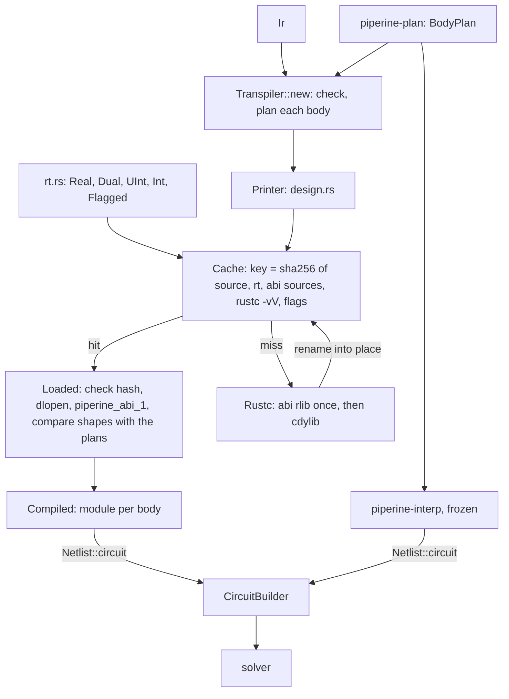

# IR to Rust Transpiler Design

**Spec**: `.specs/features/ir-rust/spec.md`
**Status**: Approved (2026-11-15, under R4 with the spec)

---

## Architecture Overview

Four stages, each a struct with one job. The **plan** (shared with the interpreter) turns a body into an ABI shape and a table of functions. The **printer** writes one Rust source text per design from the IR and the plans. The **builder** finds `rustc`, keys the cache and compiles. The **loader** opens the library, checks it and gives the solver `&'static Module`s. The solver sees what it sees from any device: shapes, `eval`, `react`.



### What the generated source looks like

The target, for the M1 resistor. It is the hand-written device of `abi_devices.rs` plus comments, and that is the point (R3).

```rust
// design Divider, generated by piperine-transpile. Do not edit: edit the model.
mod rt;
use piperine_abi::device::{Device, Eval, Fault, Flow, React, Values};
use piperine_abi::shape::{ShapeBuf, ShapeRef};
use rt::{Dual, Real};

// body Resistor @ tests/ngspice/devices.msl:5:1
pub mod resistor {
    use super::*;

    pub struct Resistor;

    impl Resistor {
        // Resistor.analog @ tests/ngspice/devices.msl:8:1
        fn terms_block<R: Real>(p: R, n: R, r: R) -> [R; 1] {
            // b0.flow: i(p, n) +> v(p, n) / r @ tests/ngspice/devices.msl:8:23
            let b0_flow_ = (p - n) / r;
            [b0_flow_]
        }

        // function 0 `terms`: reads p, n, r; writes b0.flow
        fn terms(cx_: &mut Eval<'_>) -> Result<(), Fault> {
            let p = cx_.f64(0);
            let n = cx_.f64(1);
            let r = cx_.f64(2);
            // every term is affine in the pins: evaluated with pins read as 0,
            // written as c + (0.0 + g0 * p + g1 * n)
            let [b0_flow_] = Self::terms_block(Dual::<2>::seeded(0.0, 0), Dual::<2>::seeded(0.0, 1), Dual::constant(r));
            cx_.set(0, b0_flow_.v + (0.0 + b0_flow_.d[0] * p + b0_flow_.d[1] * n));
            if cx_.wanted(0) { cx_.jac()[0] = b0_flow_.d[0]; }
            if cx_.wanted(1) { cx_.jac()[1] = b0_flow_.d[1]; }
            Ok(())
        }
    }

    impl Device for Resistor { /* prototype: ShapeBuf calls, one per entry, each under its comment; create; eval: match k; react */ }
}

#[unsafe(no_mangle)]
pub extern "C" fn piperine_abi_1() -> *const piperine_abi::raw::Library { /* OnceLock over thunk::library */ }
```

**Names** (verification F2, F3). Two name spaces never meet. A name the printer makes ends in exactly one `_` after a character that is not `_`: the evaluator `cx_`, the evaluations `at_iterate_` and `at_zero_`, the environment variables `temperature_`, `gmin_`, `source_scale_`, a site's reads with its MSL name first (`vd_limit_`, `vd_last_`, `vd_age_`, `ac_stim_`), branch sums (`b0_flow_`), a duplicate local (`arg_4_`), and the limit rules' `proposed_`, `f_`, `seed_`, `from_seed_`, `old_`, `limited_`. An MSL name prints as written, raw if a keyword, unless it ends in `_`, is one of `crate`, `self`, `Self`, `super`, or is a name the generated code refers to (an import, `rt`, `Ok`, `f64`, `R`, …): then it takes one more `_` (`self` is `self_`, `self_` is `self__`). The map is one to one and never reaches a generated name. Functions of a body's `impl` put the MSL name first too (`vd_limit`, `vd_limit_block`, `ac_stim`, `r_check`), so no site or param name makes two of them meet. A parameter the code never reads prints as `_`.

### From an IR function to a Rust function

One Rust `fn` per function of the shape, each a **backward slice** of the `analog` block: the statements its outputs reach through `let` bindings, in source order. Sites and contributions sit at the top level of the block (`Ir::check`), so a slice is a filter over top-level statements. The interpreter instead walks the whole block per mode with poison values for undeclared reads; in typed Rust a missing binding is a compile error, so a wrong slice fails at build, loudly, and RS-06 AC 1 compares the result with the interpreter's.

| Shape function | Slice | Body |
| --- | --- | --- |
| `limit:<site k>` | the `let`s the site's `x`, `f` and `seed` reach; earlier sites read as their `LIMIT` `VALUE` | `x` over `Dual<N>` gives `PROPOSED` and its partials; `old` is the seed when `AGE` is 0 or `STATIC` with `AGE` 1, else `LAST`; `LIMITED = f(x.value(), old)` over plain `f64`, with the seed kept as INT-10 AC 3 says. Ported rule by rule from `piperine-interp/src/walk.rs` |
| `stim:<site k>` | the `let`s `mag` and `phase` reach | plain `f64`; writes `RE`, `IM` |
| `terms` | every contribution and the `let`s it reaches; every site reads its input's `VALUE` with tangent 1 | one generic `terms_block<R: Real>` returning the term sums; the caller instantiates it at the iterate, at pins read as 0, or both, as the plan's `affine` flags say (the table below) |
| `check:<param>` | the `where` expression | plain `bool`, written as `HIGH`/`LOW` |
| `cross:<event>` (phase B) | the `let`s the crossed expression reaches | over `Dual<N>`; writes the `CROSS` watch and its partials |
| `drive:<carrier>`, `event:<event>` (phase B) | the drive's or guard's expression | plain values and `Flagged`; writes a discrete or an event pin |

The affine rule, as `Interpreted::terms` has it and for the same reason (the assembly forms the right side as `−(v − Σ g·x)`, folding from `0.0` in declared partial order):

| Term | Value written | Partials from |
| --- | --- | --- |
| not affine | the sum at the iterate | the walk at the iterate |
| affine | `c + (0.0 + g₀·x₀ + g₁·x₁ + …)` with `c` and `g` from the evaluation at pins read as 0, the products in declared partial order | pin partials from the evaluation at 0; a partial against a `LIMIT` or `STIM` value from the evaluation at the iterate |

`terms_block` is called once when a body has only one kind of term and twice when it has both, exactly as the interpreter walks. The right side of a term with `c ≠ 0` keeps the 1-ulp bound of `ir-interp` verification F3; no assembly change is made.

### Dual numbers in generated code

`rt::Real` is a trait with `constant(f64)`, `value(self) -> f64`, the four operators as supertraits, and `exp`, `ln`, `sqrt`, `abs`. `f64` implements it. `rt::Dual<const N: usize> { v: f64, d: [f64; N] }` implements it with the formulas of `piperine-interp/src/dual.rs`, component by component: `mul` is `a.d·b.v + b.d·a.v`, `div` is `a.d·(1/b.v) + b.d·(−q/b.v)`, `abs` is `sign(v)·d`. The interpreter skips an empty tangent where the array form multiplies by an explicit zero; at finite points the two give values that compare equal (`x + 0·y == x`), which is the comparison RS-06 AC 1 states for partials. Output cells are computed by the same `f64` operations in the same order, so they are bit-equal. `rustc` does not contract `a·b + c` into a fused multiply-add and no fast-math flag is passed.

### Phase B: the IR additions

| Source form | IR | Notes |
| --- | --- | --- |
| `u9`, `i32` | `ValueType::UInt(n)`, `ValueType::Int(n)` | `n` in 1..=64 by `check()` |
| a value that may be unknown | `ValueType::Flagged(inner)` | the type of a carrier read and of everything computed from one |
| `3`, `0x1F` | `Expr::Int { value: i128, ty }` | |
| `&` `\|` `^` `<<` `>>`, `!` on an integer | `BinaryOp::{BitAnd, BitOr, BitXor, Shl, Shr}`, `UnaryOp::Not` | `And`/`Or` stay the short-circuit forms |
| `x as T` | `Expr::Cast { expr, to }` | |
| `a.min(b)`, `max`, `clamp`, `x.floor()` | `Expr::Method { method, receiver, args }` | a closed `Method` enum |
| a carrier read | `Expr::Carrier(u32)` | index into the body's carriers; type `Flagged` |
| `Unknown` | `Expr::Unknown` | |
| `x.known_or(d)`, `x.is_known()`, `x.high()` | `Expr::KnownOr`, `Expr::IsKnown`, `Expr::High` | the three flag-total reads of §3.3.7 |
| `q <- x;`, `q <- x after d;` | `Stmt::Commit { carrier, value, after }` | |
| `in clk: Bit`, `signal count: Bit<u9> = 0` | `Carrier { name, ty, role, init, origin }` in `BodyData::carriers` | `role`: `In`, `Out` or `Signal` |
| `sample = count == 0;`, `g = x after tpd;` | `Drive { carrier, value, after, origin }` | |
| `clk.changed()`, `clk.rise()`, `cross(e)` | `Event { source, guard, origin }` with `source`: `Changed(carrier)` or `Cross(expr)` | `rise` is `Changed` with guard `clk.high()` |
| `on ev { … }` | `Reaction { on: Vec<u32>, stmts, locals, origin }` | `on` indexes the body's events |
| a discrete net of the design | `NetData` in `Ir::nets`; `InstanceData::nets` binds each carrier port | the discrete twin of `NodeData` |

The printer of the IR writes a new section only when it is not empty, so every M1 golden text is unchanged (RS-09 AC 5).

### Phase B: from a body to a shape

Appended to the interpreter's table; nothing of M1 moves, so M1 function and pin indices are unchanged.

| IR item | ABI entry |
| --- | --- |
| carrier | pin `DISCRETE`; `PORT` (`In`, `Out`) or `PRIVATE` (`Signal`); layout one field `v` with a known byte (RS-12 AC 1); after the M1 pins, in declaration order |
| drive | discrete function `drive:<carrier>`: reads the `VALUE` of each carrier and param it reaches, writes the carrier's pin |
| drive with `after` | pin `PRIVATE` `drive:<carrier>.now`, written by the function above; an event `Changed` on it; a reaction with one statement committing it after the delay |
| event `Changed` | pin `PRIVATE` `EVENT` `event:<k>`; discrete function `event:<k>` reads `VALUE` and `CHANGED` of the carrier and the guard's pins, writes the event pin (abi.md §11.4) |
| event `Cross` | watch `CROSS` → pin `PRIVATE` `EVENT`; analog function `cross:<k>` with partials against its continuous reads (abi.md §11.5); a guard, when present, is a second event function on that pin |
| reaction | ABI reaction: `on` the event pins; reads the `VALUE` of every carrier, param and node its body reads; one statement per `Stmt::Commit` in source order |
| carrier read in `analog` | a read of `terms` (not differentiable) |
| probe in a reaction | a continuous pin among the reaction's reads |

Function order in a shape: `limit:*`, `stim:*`, `terms`, `check:*` (M1), then `cross:*`, `drive:*`, `event:*`.

### Phase B: generated digital code

A reaction is one Rust `fn` over `React`. Carrier reads are `rt::Flagged<T>` values decoded from the pin's bytes; `T` is `bool`, `f64`, `rt::UInt<N>` or `rt::Int<N>`. Operators on `Flagged` are all-or-nothing except the `bool` `&`, `|`, `!`. An `if` on a `Flagged<bool>` is `if cond.decide("<origin>")? { … }`, which returns a `Fault` when the flag is clear. Commits are collected in an `rt::Commits` value and flushed after the body ran, so a fault makes no commit (RS-11 AC 5). `UInt<N>` and `Int<N>` hold a `u64`/`i64` and mask after each operation; their operators are trait impls, so `count + 1` in MSL is `count + UInt::<9>::new(1)` in Rust.

---

## Code Reuse Analysis

### Existing Components to Leverage

| Component | Location | How to Use |
| --------- | -------- | ---------- |
| The shape plan | `crates/piperine-interp/src/plan.rs` (`BodyPlan`, `FunctionPlan`, `Mode`, `Source`, `Target`, `Term`, `Pins`) | moved unchanged to `piperine-plan` and made `pub`; both backends read it |
| The netlist loop | `crates/piperine-interp/src/netlist.rs` | moved to `piperine-plan` as `Netlist::circuit`, parameterised by who supplies the module of a body |
| `Device`, `module::<D>`, `library`, `Eval`, `React`, `ShapeBuf` | `crates/piperine-abi/src/{device,thunk,shape}.rs` | generated code is written against them; nothing in the ABI crate changes |
| `validate`, `verify_partials`, `caller::Handle` | `crates/piperine-abi/src/{validate,verify,caller}.rs` | the loader validates through the solver's bind as today; the differential tests call both backends through `Handle` |
| The interpreter's `Dual` and `Walk` rules | `crates/piperine-interp/src/{dual,walk}.rs` | the reference `rt::Dual` and the `limit` printer are ported from, and the oracle of RS-06 |
| Hand-built M1 bodies | `crates/piperine-ir/tests/support/devices.rs` | the fixtures of every phase A test |
| Hand-written reference devices | `crates/piperine-solver/tests/helpers/abi_devices.rs` | what the generated source is meant to read like |
| The parity harness | `crates/piperine-parity/src/{bench,contract,ngspice}.rs` | `Bench` gains a backend; contracts and ngspice runner unchanged |
| The interpreter's test of the affine residue | `crates/piperine-interp/tests/terms.rs` (C28, C29, C48) | the same assertions, run on compiled functions |
| `libloading`, `sha2` | workspace `Cargo.toml`, `Cargo.lock` | the loader and the cache key; both already resolved |

### Integration Points

| System | Integration Method |
| ------ | ------------------ |
| `piperine-interp` | depends on `piperine-plan`; re-exports `BodyPlan`; `Interpreter` implements `Modules`. Phase B adds one refusal in `Interpreter::new` |
| `piperine-ir` | phase B adds nodes, builder methods, `check()` rules and printer sections |
| `piperine-parity` | depends on `piperine-transpile`; `Backend` selects how a twin's circuit is built |
| `piperine-abi`, the three solver crates | unchanged |
| `workspace_shape.rs`, `crate_boundaries.rs` | `DEFAULT_MEMBERS` and the manifest gain the two crates in the tasks that create them |
| `.specs/STATE.md` | MD-63 records the two crates and the rule that generated code links only `piperine-abi` |

---

## Components

### `piperine-plan` (new crate)

- **Purpose**: what the two backends share: the shape and function table of a body, and the circuit of a design.
- **Location**: `crates/piperine-plan/src/{lib,plan,netlist}.rs`
- **Interfaces**:
  - `BodyPlan::new(body: piperine_ir::Body<'_>) -> BodyPlan`; `shape()`, `functions()`, `reactions()` (phase B)
  - `trait Modules { fn module(&self, body: BodyId) -> Option<&'static Module>; }`
  - `Netlist::new(ir: &Ir).circuit(modules: &impl Modules) -> piperine_solver::prelude::Result<CircuitInstance>`
- **Dependencies**: `piperine-ir`, `piperine-abi`, `piperine-solver`.
- **Reuses**: the two files it is made of.

### `Printer`

- **Purpose**: the IR and its plans as one Rust source text.
- **Location**: `crates/piperine-transpile/src/print/{text,value,shape,analog,digital,library}.rs`
- **Interfaces**:
  - `Text`: the writer (`line`, `comment(path, origin)`, `indented(|t| …)`, `real(f64) -> String`, `ident(&str) -> String`)
  - `ValuePrinter::function(Function<'_>)`, `expr(ExprId) -> Result<String, Unsupported>`
  - `ShapePrinter::prototype(&Shape<'_>)`: any shape as `ShapeBuf` calls
  - `AnalogPrinter::{terms, limit, stim, check}(…)`, `DigitalPrinter::{drive, event, cross, reaction}(…)` (phase B)
  - `LibraryPrinter::design(&Ir, &[Option<BodyPlan>]) -> Result<String, Unsupported>`
- **Dependencies**: `piperine-ir` handles, `piperine-plan`.
- **Reuses**: the read and write order of `FunctionPlan`.

### `rt` (the runtime source)

- **Purpose**: the few types generated code needs and Rust lacks.
- **Location**: `crates/piperine-transpile/src/rt/{real,int,flag}.rs`. Each file is compiled into the transpiler as an ordinary module, so its unit tests run under `cargo test` with no `rustc` call, and embedded with `include_str!` to be written into every cache entry as `rt.rs`.
- **Interfaces**: `Real`, `Dual<N>`; `UInt<N>`, `Int<N>` (phase B); `Flagged<T>`, `Commits` (phase B).
- **Dependencies**: `core` and, for `Commits`, `piperine_abi::device::React`.

### `Rustc`

- **Purpose**: find the compiler and run it.
- **Location**: `crates/piperine-transpile/src/rustc.rs`
- **Interfaces**: `Rustc::locate(settings: &Settings) -> Result<Rustc, Error>`; `version_text()` (the output of `-vV`); `rlib(src, out)`, `cdylib(src, extern_abi, out)`; `invocations() -> u32`.
- **Dependencies**: `std::process`.

### `Settings`

- **Purpose**: every value read from the environment, in one place.
- **Location**: `crates/piperine-transpile/src/settings.rs`
- **Interfaces**: `Settings::resolve(lookup: &dyn Fn(&str) -> Option<String>) -> Result<Settings, Error>` (pure, so tests pass a table and never mutate the process environment); `Settings::from_environment()`; fields `rustc: Option<PathBuf>`, `cache: PathBuf`.

### `AbiSource`

- **Purpose**: the sources of `piperine-abi`, embedded, and the `rlib` built from them.
- **Location**: `crates/piperine-transpile/src/abi_source.rs`
- **Interfaces**: `AbiSource::FILES: &[(&str, &str)]` (`include_str!` of each file of `crates/piperine-abi/src`); `write_to(dir)`; a guard test compares the table with the directory.

### `Cache`

- **Purpose**: entries by key, built aside and renamed into place.
- **Location**: `crates/piperine-transpile/src/cache.rs`
- **Interfaces**: `Cache::at(dir) -> Result<Cache, Error>` (creates it, `0700` on Unix); `Key::of(parts: &[&[u8]]) -> Key`; `entry(&Key) -> Option<Entry>` (present and complete); `build(&Key, |staging: &Path| …) -> Result<Entry, Error>`; `Entry::{source, library, manifest}`; `clear()`.
- **Layout**: `<cache>/rust/abi-<key>/libpiperine_abi.rlib`; `<cache>/rust/<key>/{design.rs, rt.rs, <dll prefix>design<dll suffix>, manifest}`. The manifest holds the library's SHA-256, the `rustc -vV` text and the flags.

### `Loaded`

- **Purpose**: a library in the process, checked.
- **Location**: `crates/piperine-transpile/src/load.rs` (the only file of the feature with `unsafe`)
- **Interfaces**: `Loaded::open(entry: &Entry) -> Result<Loaded, Error>`: checks the recorded hash, opens with `libloading`, calls `piperine_abi_1`, checks `Library.size` and `minor`, and leaks the handle (abi.md §12: a library lives until the process ends); `module(name) -> Option<&'static Module>`.

### `Transpiler` and `Compiled`

- **Purpose**: the public face.
- **Location**: `crates/piperine-transpile/src/lib.rs`
- **Interfaces**:
  - `Transpiler::new(ir: Arc<Ir>) -> Result<Transpiler, Error>` (`Error::Rejected` holds `check()`'s entries)
  - `source(&self) -> Result<String, Error>`
  - `compile(&self, settings: &Settings) -> Result<Compiled, Error>`
  - `Compiled` implements `Modules`; `circuit()`, `report() -> &Report`, `source_path() -> &Path`
  - `Report { transpile, compile, load: Duration, rustc_invocations: u32, cache_hit: bool }`

### `Backend` (in `piperine-parity`)

- **Purpose**: how a twin's circuit is built.
- **Location**: `crates/piperine-parity/src/backend.rs`
- **Interfaces**: `enum Backend { Interp, Rust }`; `Backend::parse(Option<&str>) -> Result<Vec<Backend>, String>` (pure); `Backend::selected()`; `Bench::load_on(fixture, Backend)`; `Point::with_backend(&str)`.

---

## Data Models

```rust
pub enum Error {
    Rejected(Vec<piperine_ir::Broken>),
    Unsupported { form: String, path: String, origin: Origin },
    NoCompiler { looked_for: String },                 // names `rustc`; says the interpreter needs none
    CompilerTooOld { found: String, required: &'static str },
    CompileFailed { stderr: String, source: PathBuf },
    Cache { dir: PathBuf, cause: String },
    Load { file: PathBuf, cause: String },
    ShapeMismatch { body: String, entry: String },     // generated shape differs from the plan's
    Setting { name: &'static str, value: String, valid: &'static str },
}
```

Phase B additions to `piperine-plan`:

```rust
pub enum Mode { Limit(u32), Stim(u32), Terms, Check(u32), Cross(u32), Drive(u32), Event(u32) }
// Source gains: Carrier(u32), CarrierChanged(u32).  Target gains: Carrier(u32), EventPin(u32), Watch(u32).
pub struct ReactionPlan { pub on: Vec<u32>, pub reads: Vec<Source>, pub statements: Vec<StatementPlan> }
pub struct StatementPlan { pub carrier: u32, pub min_after: Option<f64> }   // Some: LATER
```

---

## Error Handling Strategy

| Error Scenario | Handling | User Impact |
| -------------- | -------- | ----------- |
| An `Ir` that fails `check()` | `Error::Rejected` | no source; the entries name items and origins |
| A form with no lowering | `Error::Unsupported`, found while printing; nothing is written | the form, its IR path and origin |
| No compiler, or one below 1.85 | `Error::NoCompiler`, `Error::CompilerTooOld`, before any file is written | what to install; that the interpreter needs none |
| `rustc` fails on generated source | `Error::CompileFailed`; the staging directory is kept and named | a transpiler defect, with the source to report |
| The cache cannot be written | `Error::Cache` | the directory to fix |
| A cached library fails its hash | the entry is removed and rebuilt once; a second mismatch is `Error::Load` | none, or the file |
| `dlopen`, the symbol or the version check fails | `Error::Load` | the file |
| A loaded shape differs from the plan's | `Error::ShapeMismatch` | a transpiler defect, named, instead of a wrong simulation |
| A panic in generated code | caught by the ABI thunk compiled into the library | `FAULT` with the message; the solve fails naming the instance |
| An unknown `if` condition (phase B) | `Flagged::decide` returns a `Fault` with the origin; `Commits` is dropped unflushed | the reaction's origin; no commit |
| A non-finite value | written as it is | the solver names the cell (abi.md A4) |

---

## Risks & Concerns

| Concern | Location (file:line) | Impact | Mitigation |
| ------- | -------------------- | ------ | ---------- |
| The plan is private to the interpreter | `crates/piperine-interp/src/plan.rs:32-182` (`pub(crate)`) | a second plan in the transpiler would let read order, partial order or affine flags drift, and the linear-term rule with them | T1 moves it to `piperine-plan`; every test of `piperine-interp` stays as it is and green |
| The solver needs `&'static Module` | `crates/piperine-solver/src/core/builder.rs:99` | every loaded library stays mapped until the process ends | abi.md §12 says a library lives that long; one mapping per distinct design; stated in `Loaded`'s rustdoc |
| The embedded copy of `piperine-abi` can miss a new file | `crates/piperine-abi/src/` | generated code fails to build after an ABI edit | a guard test compares `AbiSource::FILES` with the directory listing |
| The host's `piperine-abi` and the library's copy are compiled separately | `crates/piperine-abi/src/raw.rs:285` (`Library`) | a layout disagreement would be undefined behavior | both come from one source tree; only `#[repr(C)]` data crosses; `Loaded` checks `size` and `minor` before reading a module; the ABI sources are part of the cache key |
| Bit equality depends on the two backends using one `exp`/`ln` | `rt/real.rs` | a different libm in the library would break RS-06 AC 1 | both link the system libm through `std`; AC 1 is the detector; a failure there stops the task, it is not loosened |
| The affine rule depends on the assembly's fold order | `crates/piperine-analog-solver/src/device/flow.rs:24` | a reorder brings the residue back | the compiled functions run the interpreter's residue tests (C28, C29, C48) |
| `limit` has rules found only in code | `crates/piperine-interp/src/walk.rs` (`Held`, the seed kept) | a port by description would differ at the first iteration | the task ports the function and RS-06 AC 1 enumerates the six `AGE`/`STATIC` cases |
| Each test that compiles pays `rustc` | every `tests/*.rs` of the crate | slow suites | one cache directory per test binary under `CARGO_TARGET_TMPDIR`, so each design compiles once per run; tests of an empty cache use a `tempdir` |
| Tests that change the environment race | edition 2024 makes `set_var` `unsafe` | flaky or unsound tests | no test sets a variable: `Settings::resolve` and `Backend::parse` are pure over a lookup |
| The digital IR is designed before its elaborator | `crates/piperine-ir/src/model.rs` | M2 may need a node shaped differently | each node mirrors one source form of the table above; every fixture carries the `.msl` text it transcribes; M2 changes the IR under its own spec if it must |
| Phase B exercises solver paths no MSL-derived device used yet (reactions reading continuous pins, `CROSS`, R4 time points) | `crates/piperine-solver/src/protocol/`, `crates/piperine-digital-solver/src/` | a latent solver defect surfaces in a transpiler task | no solver crate is edited here: the task stops, the defect is reported with a hand-written ABI device that reproduces it (how M1 found its F6) |
| Unknown control is a fault, not the merge of §3.3.3 | spec RS-11 AC 5 | a conforming model with an unknown `if` cannot run | stated as out of scope; the fault names the origin; M2 owns the merge |
| Windows is not exercised | `load.rs`, `cache.rs` | rename and library naming may differ | paths use `std::env::consts::{DLL_PREFIX, DLL_SUFFIX}`; CI is Linux; stated, not solved |

---

## Tech Decisions

| Decision | Choice | Rationale |
| -------- | ------ | --------- |
| Unit of compilation | one crate per design | spec RS-Q1 |
| Reaching the ABI | `cdylib` with `piperine_abi_1`, linking an `rlib` of the embedded ABI sources | spec RS-Q2 |
| Where shapes come from | printed from the plan's `Shape` as `ShapeBuf` calls, then compared with the plan at load | the source describes itself (R3) and a printing defect is an error at load, not a wrong matrix |
| Per-function code | a backward slice per shape function | typed Rust has no poison value; a wrong slice is a compile error |
| Tangents | `Dual<const N: usize>`, `N` the function's slot count | no allocation; the interpreter's formulas, component by component |
| Formatting | the printer's own layout rules; `rustfmt` is not called | `rustfmt` may be absent where `rustc` is present; the golden files pin the layout |
| Lints on generated code | `--cap-lints warn` at build, zero warnings asserted on the goldens | a new lint in a future compiler must not break a user's build |
| Hash | SHA-256 (`sha2`), 32 hex characters as the key | already in `Cargo.lock`; `DefaultHasher` is not stable across releases |
| Environment | read once, in `Settings::from_environment` and `Backend::selected` | pure functions underneath, testable without `set_var` |
| Parity per backend | each parity test loops over `Backend::selected()` inside the one test function | the corpus guard's "`fn <twin>()` per twin" holds; ngspice runs once per twin |
| IR events | `Changed` and `Cross` with a guard | the core of §13; `rise`, `fall`, `above` stay stdlib, lowered by M2's elaborator |
| Commits of a reaction | collected, flushed at the end | a fault makes no commit; the order is still source order |

MD-63 (written to `.specs/STATE.md` by T2): the compiled backend is `piperine-transpile`, the shared plan is `piperine-plan`; generated code links `piperine-abi` and nothing else; `rustc` is invoked directly and only at build.

## Size

46 tasks in 8 phases (tasks.md). Phase A: T1 to T23. Phase B: T24 to T46. Opus implements the tasks where a mistake gives a wrong number with no error or that hold `unsafe`: the runtime `Dual`, the `terms` and `limit` printers, the loader, the IR model of carriers and reactions, the digital plan, the integer runtime, the reaction printer. Sonnet implements the rest. Opus verifies the feature.
