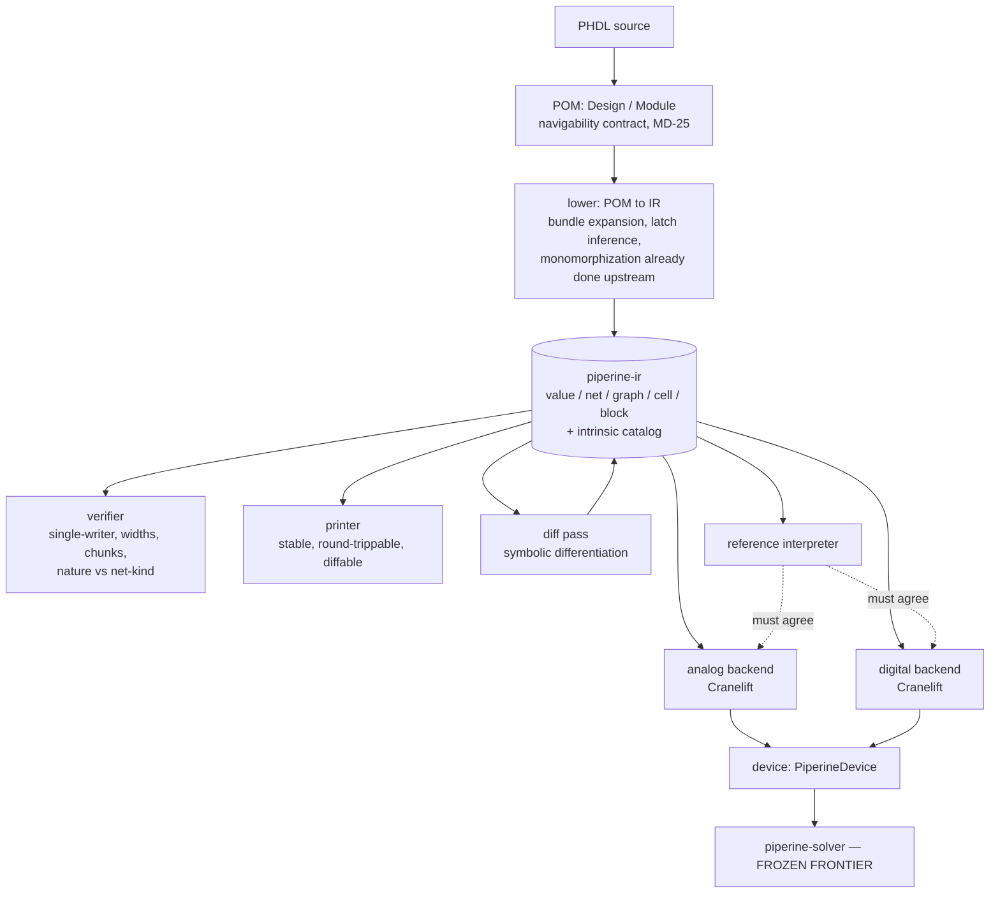

# language-overhaul Design

**Spec**: `.specs/features/language-overhaul/spec.md`
**Ideal**: `.specs/features/language-overhaul/ideal.md` rev 5 (settled design + reasoning of record)
**Status**: **Approved** (user, 2026-08-09) — arena + dense indices confirmed; MD-36 and MD-23 superseded by MD-40/MD-41; P4 stays last

---

## 0. Project decisions this design must answer to

`.specs/STATE.md` `## Decisions` read in full. Most are conformed to silently.
**Two are in genuine conflict and are resolved explicitly below; silently
ignoring them is not an option.**

| MD | Constraint | This design |
|---|---|---|
| **MD-36** | *Runtime semantics live in `piperine-signal`, a pure crate* — "computes values, derivatives, event predicates and running reductions; never stamps, never sees a matrix, never sees an `Element`, depends on no other crate in the tree" | **SUPERSEDE.** D8 makes that crate *become* `piperine-ir`. The purity invariant survives verbatim and gets *stronger* (an IR with no in-tree dependency is exactly what a differential oracle needs); what changes is the crate's remit — from "runtime semantics" to "the IR, of which runtime semantics are catalog entries". New entry **MD-40** proposed in §8. |
| **MD-23** | *Codegen module tree = pipeline stages* — `resolve → flatten → emit → kernel → device`, one module per stage | **SUPERSEDE.** The feature deletes `flatten` outright (D9) and turns `resolve` into POM→IR lowering. The *rule* (name modules by pipeline stage) is kept and honoured; the *stage list* changes. New entry **MD-41** proposed in §8. |
| MD-15 | *No `piperine-math` crate* — do not proliferate crates | **Conform.** `piperine-ir` is a **rename of an existing crate**, not a new one. Workspace crate count is unchanged. |
| MD-18 | Elaboration fixes devices; simulation never re-JITs | **Conform.** Params are cells whose single writer is the host (`ideal.md` §1.4); restamp keeps working because a param remains a runtime bank entry, never a folded constant. **LOV-25** counts the unknown budget from the IR so the shape still freezes before analysis. |
| MD-24 | Declared language surface | **Conform, and close its known gap.** The intrinsic catalog *is* the declared surface; it absorbs the four operators that resolve through a Rust-side registry today (`idtmod`, `absdelay`, `table`, `ac_stim` — `GAPS.md` B6). |
| MD-25 | POM navigability mirrors the source (UNBREAKABLE) | **Conform.** The IR is a separate artifact built *from* the POM, exactly as `Design::flat_modules` is. `Design::modules` is not touched. |
| MD-31 | A policy invariant lives in the gate, not a document | **Conform, load-bearing.** The concept budget, crate purity, and the single-writer rule are all guard tests (§6), never prose. |
| MD-13 | Rust idiom rules — contracts first, **no loose functions**, no macros, modules by system function | **Conform.** Note §7 flags one violation this session already introduced. |
| MD-28 | Test placement — unit inline, integration grouped by concern | **Conform.** IR tests in `crates/piperine-ir/tests/`; cross-crate differential proofs in root `tests/`. |
| MD-38 | ngspice parity is measured, not asserted | **Conform.** The parity matrix is the judge of P3 and runs unchanged. |
| MD-01 | One `Element` ABI, no downcast | **Conform for this feature.** D12 retired its justification and `ideal.md` §6.1 endorses a split — but the solver is out of scope here, so MD-01 stands untouched until that separate feature. |

---

## 1. Architecture Overview

Four partial forms collapse into one owned representation with three consumers.



**The load-bearing edge is the dotted one.** Everything else is ordinary
compiler plumbing; the interpreter-must-agree-with-JIT edge is what converts the
seam-defect class into red builds.

---

## 2. Approach exploration — how the IR is represented in Rust

*(Large scope requires this before components. All three deliver the same scoped
thing.)*

### Recommended: **arena + dense indices (SSA numbering)**

Values, cells, nets and blocks live in `Vec`s inside a `Module`; everything
refers to everything else by newtype index (`ValueId(u32)`, `CellId(u32)`, …).

- **For**: what Cranelift itself does, and Cranelift is already a dependency —
  the idiom will be familiar in this tree. Dataflow passes (cone extraction,
  differentiation) need cheap predecessor/successor walks over dense storage.
  Printing and round-tripping are trivial because ids are stable and orderable
  (**LOV-02**, **LOV-06** — byte-identical output falls out of dense ordering
  for free). Verification is a linear scan.
- **Against**: index soup if the newtypes are sloppy; needs discipline so a
  `CellId` can never be passed where a `ValueId` belongs (solved by distinct
  newtypes, no `usize` in the public API).
- **Fit with existing code**: the resolved form already interns names to
  `NodeId`/`VarId`/`ParamId`/`StateId`. This is that idea, finished.

### Alternative A: tree of enums (what exists today)

`Vec<Stmt>` with nested `Expr`, as `AnalogBody`/`DigitalBody` hold now.

- **For**: least new code; the lowering is nearly a copy.
- **Against**: no SSA, so no dataflow without rebuilding a graph anyway; sharing
  a subexpression needs `Rc` or duplication; and it is **the shape the current
  bugs grew in** — `LoweredBody` holding two tree forms with no ownership rule is
  A0d's substrate. Rejected: it fails the thesis.

### Alternative B: general graph library (petgraph)

- **For**: passes and traversals off the shelf.
- **Against**: a dependency in a crate whose defining invariant is *no
  dependencies* (MD-36/MD-40, **LOV-09**); poor locality; and node payloads end
  up as enums anyway, so it buys traversal helpers we can write in a page.
  Rejected on the purity invariant alone.

**Recommendation: arena + dense indices.** Confirm before §4 is built out.

---

## 3. Code Reuse Analysis

### Existing components to leverage

| Component | Location | How to use |
|---|---|---|
| `piperine-signal` (whole crate) | `crates/piperine-signal/` | **Becomes** `piperine-ir` (MD-40). Its families — operators, detectors, limiter, `table`, `Behavior`/`Measure`/`Wave`, digital edge logic — are the first catalog entries and their implementations. Rename + grow, not rewrite. |
| Purity guard | `crates/piperine-signal/tests/purity.rs` | Inherited as-is; it becomes **LOV-09**'s gate. |
| Symbolic differentiation | `crates/piperine-codegen/src/resolve/diff.rs` | **Port to an IR pass** (**LOV-15**). The rules are correct and expensive to re-derive; only the representation it walks changes. Structured control needs the `if/match` arms differentiated arm-wise — additive, not a rewrite. |
| Interned-symbol idea | `resolve/symbols.rs` (`NodeId`/`VarId`/`ParamId`/`StateId`) | The arena design is this, generalized. Names and provenance move onto the IR entity. |
| Cranelift emission machinery | `crates/piperine-codegen/src/emit/` (`Builder`, `Codegen`, CSE, `SimCtx`) | **Re-target onto IR** rather than rewrite. `SimCtx` (the runtime ABI) is unchanged. |
| `CircuitCompiler` / `PiperineDevice` | `crates/piperine-codegen/src/device/` | Unchanged interface to the solver; fed from IR-built kernels. |
| ngspice parity harness | `tests/support/ngspice.rs`, `tests/ngspice_*.rs`, `ngspice_parity_matrix.rs` | The judge for **LOV-20/21**. Not modified — modifying it would forfeit the oracle (MD-38). |
| `UnknownAllocator` seam | `crates/piperine-solver/src/core/element.rs` (`allocate_unknowns`) | Already the right seam; **LOV-25** makes the count derivable from the IR instead of hand-written per device. |
| Delegation guard pattern | `tests/delegation_guard.rs` | The template for the concept-budget and no-catch-all guards (§6). Source-walking, registry-driven, no hardcoded name lists. |

### Integration points

| System | Method |
|---|---|
| `piperine-lang` POM | `lower(&Design) -> ir::Program`; POM is read-only input (MD-25). |
| `piperine-solver` | Unchanged. `PiperineDevice` still implements `Element`; only how its kernels were produced changes. |
| `piperine-cli` | New `--emit=ir[-after-<pass>]` on `build`/`check` (**LOV-08**). |
| Plugins | Unchanged for this feature. Pass contribution is a later feature (`ideal.md` §9). |

---

## 4. Components

### `piperine-ir::core` — the five concepts

- **Purpose**: the representation itself; nothing executable.
- **Location**: `crates/piperine-ir/src/core/`
- **Interfaces** (shape, not final signatures):
  - `Program { modules: Vec<Module> }`
  - `Module { values, cells, nets, blocks, names }` — arenas
  - `Value { kind: ValueKind, ty: Ty }`; `Ty = Real | Bits(u32) | Array(Box<Ty>, u32)`
  - `Net { kind: NetKind }` where `NetKind = Node { across: NatureId, through: NatureId } | Signal`
  - `Cell { ty: Ty, init: ConstId, writer: BlockId }` — **writer is a field, not a convention**
  - `Block { domain: Domain, trigger: Trigger, ops: Vec<Op> }`
  - `SigRef(Vec<Chunk>)` where `Chunk = Slice { value, lo, hi } | Const(ConstId)`
- **Dependencies**: none in-tree (**LOV-09**).
- **Reuses**: the interning idea from `resolve/symbols.rs`.

### `piperine-ir::catalog` — intrinsics

- **Purpose**: one declaration per intrinsic: signature, private state shape,
  derivative rule, declared breakpoints, legal domains.
- **Location**: `crates/piperine-ir/src/catalog/`
- **Interfaces**: `trait Intrinsic { fn signature(); fn state_shape(); fn derivative(); fn breakpoints(); fn domains(); }` + a data table of entries (MD-13 rule 5: table + trait, never a macro).
- **Reuses**: every existing `piperine-signal` family, in place.

### `piperine-ir::verify` — the gate

- **Purpose**: reject malformed IR before any backend sees it.
- **Location**: `crates/piperine-ir/src/verify.rs`
- **Checks** (**LOV-03/04/13/14**): exactly one writer per cell; width agreement
  on every op; chunk bounds within source width; a nature access matching the
  net's kind (no `read_across` on a `Signal`); no `Signal` handed to analog
  stamping; block outputs declared.
- **Dependencies**: `core`.

### `piperine-ir::print` / `parse` — traceability

- **Purpose**: **LOV-02/06/08**. Textual, stable, round-trippable.
- **Location**: `crates/piperine-ir/src/print.rs`, `parse.rs`
- **Notes**: `\user` vs `$generated` name provenance adopted from RTLIL. Round-trip
  is what makes hand-written IR fixtures (P1/P2) possible without a front-end.

### `piperine-ir::diff` — symbolic differentiation

- **Purpose**: **LOV-15**. `d(value, wrt) -> ValueId`, over structured control.
- **Location**: `crates/piperine-ir/src/diff.rs`
- **Reuses**: `codegen/resolve/diff.rs` rules verbatim; representation changes, mathematics does not.
- **Note**: one pass serves the Jacobian, `.disto`'s higher derivatives, and dv-gradients' `∂F/∂p` — three code paths today.

### `piperine-ir::interp` — the reference evaluator

- **Purpose**: **LOV-10**. Slow, obvious, no Cranelift.
- **Location**: `crates/piperine-ir/src/interp.rs`
- **Interfaces**: `Interpreter::step(&Module, &mut State) -> Result<()>`, cell inspection for step-through.
- **Why in the IR crate**: it is the executable definition of the semantics; splitting it from the representation invites the two to drift, which is the whole disease.

### `piperine-codegen::lower` — POM → IR

- **Purpose**: replaces `resolve/pom/` + `flatten/`.
- **Location**: `crates/piperine-codegen/src/lower/`
- **Responsibilities**: bundle expansion (**LOV-22** — named error, never
  `=> Type::Real`), latch inference emitting explicit cells (**LOV-23**,
  raising `InferredLatch`), nature resolution, chunk-ref construction,
  unknown-budget counting (**LOV-25**).
- **Note**: the module name changes from `resolve` to `lower` because the stage
  changed (MD-41); MD-23's naming rule is honoured, not broken.

### `piperine-codegen::backend::{analog,digital}`

- **Purpose**: IR → Cranelift.
- **Location**: `crates/piperine-codegen/src/backend/`
- **Reuses**: `emit/` machinery — `Builder`, CSE, `SimCtx` unchanged.
- **Digital gains** what it never had: cone extraction and fusion as inspectable
  IR passes, memories as memories, width-native ops.

### Differential harness

- **Purpose**: **LOV-11**. Interpreter vs each JIT backend on every fixture.
- **Location**: `crates/piperine-ir/tests/` (IR-level) + root `tests/` (cross-crate), per MD-28.

---

## 5. Data Models

```rust
// Two value classes plus one aggregate (ideal.md §1.1). Not a type lattice.
enum Ty { Real, Bits(u32), Array(Box<Ty>, u32) }

// Nature-generic: the IR never names a volt (ideal.md §1.2).
enum NetKind { Node { across: NatureId, through: NatureId }, Signal { ty: Ty } }

// One state concept; depth lives in the type.
struct Cell { ty: Ty, init: ConstId, writer: BlockId, name: Name }

enum Domain  { Analog, Digital }
enum Trigger { Always, Edge(SigRef, EdgeKind), Cross(ValueId, CrossDir), Timer { period: ValueId, phase: ValueId }, Initial }

// Six net-access ops, no catch-all arm anywhere that dispatches on them.
enum Op {
    Pure { op: PureOp, args: Vec<ValueId>, out: ValueId },
    Call { intrinsic: IntrinsicId, args: Vec<ValueId>, out: ValueId },
    ReadAcross  { a: NetId, b: NetId, out: ValueId },
    ReadThrough { a: NetId, b: NetId, out: ValueId },
    ContributeThrough { a: NetId, b: NetId, value: ValueId },
    ForceAcross       { a: NetId, b: NetId, value: ValueId },
    ReadSignal  { net: NetId, out: ValueId },
    Drive       { net: NetId, value: ValueId },
    CellRead  { cell: CellId, addr: Option<ValueId>, out: ValueId },
    CellWrite { cell: CellId, addr: Option<ValueId>, value: ValueId },
    If    { cond: ValueId, then_ops: Vec<Op>, else_ops: Vec<Op> },
    Match { scrutinee: ValueId, arms: Vec<(Pattern, Vec<Op>)> },
}
```

**Relationships**: a `Cell`'s `writer` names exactly one `Block` — the
single-writer rule is a *field*, so violating it is a construction error, not a
review finding. `If`/`Match` carry op lists inline: control stays structured
(D9), and there is no flattening pass.

---

## 6. The gates (MD-31 — invariants live in tests, not prose)

| Invariant | Gate |
|---|---|
| Five concepts, no sixth | Source-walking guard over `core/`, registry-driven like `tests/delegation_guard.rs` |
| No in-tree dependency | Inherited `purity.rs` |
| One writer per cell | `verify.rs` + a fixture asserting rejection |
| No catch-all dispatch arm | Guard walking `lower/` and `backend/` for `_ =>` in matches over `Op`/net kinds (the A0c mechanism) |
| Interpreter ≡ JIT | Differential harness in CI |
| Byte-identical printing | Round-trip + repeat-print test |
| Parity unchanged | `tests/ngspice_*` untouched (MD-38) |

---

## 7. Risks & Concerns

| Concern | Location | Impact | Mitigation |
|---|---|---|---|
| **Loose function introduced this session** — violates MD-13 rule 2 ("no loose functions") | `crates/piperine-codegen/src/kernel/digital/layout.rs` (`fn collect_written`) | Small, but it is a live idiom violation in code this feature will touch | Fold into `DigitalLayout` as a method during the A0d follow-up, or delete with the file when `lower/` replaces it |
| `resolve/` is named in CLAUDE.md as *"files not to edit casually"* and is correctness-critical | `crates/piperine-codegen/src/resolve/` | Replacing it wholesale is the single riskiest step | D6's order: the IR is proven standalone (P1/P2) before `resolve` is touched at all. Parity gates every commit of P3 |
| `diff.rs` rules were learned from failures; a rewrite silently drops them | `resolve/diff.rs` | Wrong Jacobians — the worst possible silent bug | **Port, do not rewrite** (§3). Differential harness catches divergence |
| Structured control changes Cranelift output shape (branches, not selects) | new `backend/analog` | Perf regression risk on large models | Measure against current on the parity fixtures; optimization deferred but a flattening pass can be added if measurement demands (`ideal.md` §3) |
| Latch inference currently *derives* `regs`; making it emit explicit cells may change which vars are stateful | `kernel/digital/layout.rs`, `lower/` | Behavior change in digital models | **LOV-23** pins it: inference emits a cell *and* raises `InferredLatch`, so any change is visible rather than silent |
| Both bodies carry raw AST today (M1) — the analog side is less "resolved" than assumed | `resolve/mod.rs` | P3 is bigger than a re-target | Recorded in `ideal.md` §1.7; task breakdown must size analog lowering as new work, not porting |
| No test today covers a module with both bodies sharing a module-level var | — | The A0d class had no coverage at all | Add as a P1 fixture *and* a P3 PHDL test |
| `LaplaceKind`/`ZKind` may be vestigial | `resolve/symbols.rs` | Carrying dead vocabulary into the IR | Confirm before porting; if dead, delete (MD-35 forbids dead-architecture identifiers) |

---

## 8. Tech Decisions

| Decision | Choice | Rationale |
|---|---|---|
| IR representation | Arena + dense newtype indices | §2; matches Cranelift, makes printing/verification/dataflow cheap |
| Interpreter location | Inside `piperine-ir` | It *is* the semantics; separating invites drift |
| Control flow | Structured `If`/`Match` in `Op`; no flattening pass | D9 — symbolic diff is fine arm-wise; deletes a 1.3k-line stage |
| Cell depth | In the type (`Array`), not a cell modifier | D11 — one special form fewer |
| Catalog shape | Trait + data table | MD-13 rule 5 (no macros) |
| `resolve` → `lower` rename | Yes | MD-23's rule is "name by pipeline stage"; the stage changed |

### Project-level decisions to append to `.specs/STATE.md`

> **MD-40: `piperine-signal` becomes `piperine-ir`** — supersedes **MD-36**.
> The crate's purity invariant is unchanged and load-bearing; its remit widens
> from "runtime semantics" to "the compiler's intermediate representation, of
> which runtime semantics are catalog entries". No new crate is created
> (MD-15's spirit preserved). The purity gate becomes the IR's structural
> guarantee and the precondition for the interpreter being a trustworthy oracle.

> **MD-41: codegen pipeline stages are `lower → backend → kernel → device`** —
> **supersedes MD-23** (user chose supersede over amend — "estamos refatorando"). `flatten` is deleted (control stays structured in the IR);
> `resolve` becomes `lower` (POM → IR). MD-23's *rule* — modules named after
> the pipeline stage they perform, visibility narrowed by evidence — is retained
> unchanged; only the stage list moves.

---

## 9. Confirmed (user, 2026-08-09)

1. **§2's recommendation — arena + dense indices.** Accepted.
2. **MD-40 and MD-41** — both recorded as **supersedes** in `.specs/STATE.md`;
   MD-36 and MD-23 carry `Superseded by` status lines with the reason.
3. **Story ordering** — P4 (PHDL surface) stays last. The cheap parts are not
   pulled forward.
