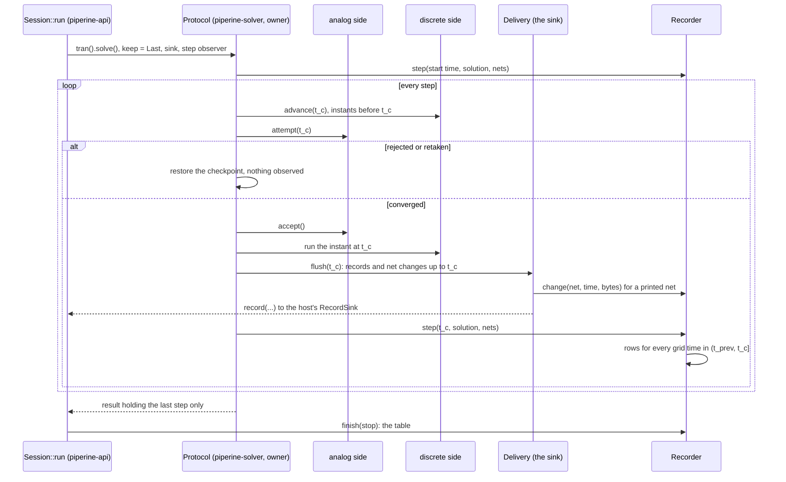

# Long Run Design

**Spec**: `.specs/features/long-run/spec.md`
**Context**: `.specs/features/long-run/context.md`
**Status**: Draft. Not approved; `tasks.md` is not written. Four product questions are open in the spec (Q1 to Q4); the parts of this design that depend on one say so.

Line numbers are those of `feature/long-run` at `dbcd8307`.

---

## What the code does today

### Where the full snapshot is built and kept

One `TransientStep` (`crates/piperine-solver/src/core/result.rs:129`) per accepted step, in a `Vec` that lives until the run returns:

| Part of a step | Built at | Size driver |
| -------------- | -------- | ----------- |
| `values: HashMap<Arc<AnalogVariable>, f64>`, every unknown | `TransientSolver::snapshot` (`analyses/transient.rs:778`), called by `execute_timestep` for every converged attempt | one map entry per unknown, a fresh map per attempt |
| `reentry: Option<Arc<ReentryState>>` (`result.rs:202`): the digital engine's `Checkpoint` (store, queue, dirty set), every net's bytes as `DigitalNets`, the analog `AssemblySnapshot` (the `ddt`, hold, delay and watch histories of every instance), the step cap | `device_reentry_state` (`transient.rs:1246`), attached by `device_capture` (`:1238`) at the top of the next attempt, from the state `DigitalSide::mark` leaves in `Settled` (`analyses/adapters.rs:51`, `:177`) | the whole discrete store and every analog history, per step |
| `digital: Option<Arc<DigitalNets>>` | shares the re-entry state's nets (`set_reentry`) | none of its own |
| `device_state` | only with `record_device_state` or a `probe_selection` (ABI-34) | empty in every host run |

The step is pushed by `record_step` (`transient.rs:712`, called from `device_accept` at `:1460`) when `t >= record_from`, and the start by `device_record_start` (`:1177`). After the loop the last step gets a final re-entry state (`:1091` to `:1098`). The result is `TransientAnalysisResult { values: Vec<TransientStep> }` (`result.rs:83`).

The 58 KB of `GAPS.md` §6 is this whole step for the buck; the re-entry state is most of it. 675 000 steps make about 39 GB.

`probe_selection` (ABI-34, `transient.rs:89`) does not help: it selects which device observables (`state`, `var`) go into `device_state`. It never narrows `values` or the re-entry state.

### How records already stream

Records never touch the result. The discrete side drains its observations (`DigitalSide::drain`, `adapters.rs:209`) into the protocol's `Delivery` (`protocol/sink.rs`), which buffers them under the checkpoint and hands them to the host's `Sink` at `flush(t_c)`, once the step that covers them is accepted (`protocol/transient.rs:323`, step 6 of the loop), in time order. A rejected attempt restores the buffer. `Solver::with_sink` installs the sink through `HostHooks` (`adapters.rs:403`, `:432`).

An `Observation` (`protocol/sides.rs:136`) is a path, a time and a kind. `ObservationKind::Change { bytes }` is one net's new bytes, with the net's name as the path (`piperine-digital-solver/src/run.rs:114`); `Record` is an `emit!`. So the sink already receives every discrete net's history as a stream, in constant memory. Only the analog solution has no such path.

### How `piperine-api` consumes steps

`Session::analysis` (`crates/piperine-api/src/session.rs:230`), the `transient` arm:

1. `TransientAnalysisOptions::new(stop, max_step)`, `with_record_from(from)`.
2. `Solver::new(circuit).with_tran_opts(options).with_sink(delivery)`; `tran().solve()` returns every kept step.
3. `Table::transient(&probes, &result)` (`table.rs:154`) walks every step and reads each probe: `step.get_node`, `step.get_branch`, `step.digital_named` decoded by `Cell::decode`.
4. With `plot`, the per-step table is cloned into `Session::accepted`.
5. With `print_step`, `Table::on_grid(step, from, stop)` (`table.rs:183`) makes the grid rows from the whole per-step table.

`Delivery` (`record.rs`) is the solver sink: it decodes `Record` observations and ignores every other kind. `piperine test` (`crates/piperine-cli/src/commands/test.rs:30`) collects every record of a run into a `Vec` and judges the slice afterwards.

### What `op`, `dc` and `ac` do

They are not affected. `op` holds one solution. `dc` solves one operating point per swept value and keeps one row of printed cells per point (`Table::point`). `ac` keeps one phasor row per frequency. None grows with simulated time, none builds a `TransientStep`, and none of their code is edited. The step observer is installed only on a transient's protocol.

---

## Architecture Overview

The solver gains one seam: the owner protocol hands each accepted step, once final, to a host observer by reference, and can be told to keep only the last step. `piperine-api` puts a recorder on that seam and on the sink it already has. The recorder holds one previous sample, the net changes since it, and the rows.



Where the rules run: every rule of what a row holds (the window, the grid, interpolation, hold) is in `piperine-api`'s recorder, under Rust tests (MD-65 item 1). The solver knows nothing of grids, probes or tables: it gives a time, a solution slice and a net reader (MD-60: the solver stays simple). The command line lays the table out and adds no rule.

### Approaches considered

| Approach | Verdict |
| -------- | ------- |
| **A. A step observer on the owner protocol, the recorder in `piperine-api`** | Chosen. The protocol is the one place that sees an accepted step with both sides settled; the sink already runs there. The solver's default result is untouched, so every solver, transpile and parity test reads what it read |
| B. Narrow `TransientStep` in the solver with a probe list (extend ABI-34 to unknowns and nets) and drop the re-entry state | Still one allocation per step in a `Vec` the run holds; the grid stays a second pass over all of them. It also puts "which signals" in the solver's options, the layer decision 1 keeps policy out of |
| C. The grid inside the solver: steps land on the print grid, or the solver interpolates | Decision 3 forbids the first (the internal step stays the solver's), and the second moves a print rule under the owner, against MD-65 and MD-60 |
| D. Send the analog solution through the sink as a new `ObservationKind` | The sink buffers, clones and sorts observations per step; a full solution per step through it costs an allocation per step and puts unknown indices into a stream made for named events |

---

## Code Reuse Analysis

### Existing Components to Leverage

| Component | Location | How to Use |
| --------- | -------- | ---------- |
| The acceptance point of the protocol | `crates/piperine-solver/src/protocol/transient.rs:323` | The observer is called right after `delivery.flush(t_c)`: the sink has every observation up to `t_c`, both sides are settled |
| `HostHooks` and `Solver::with_sink` | `analyses/adapters.rs:403`, `analyses/solver.rs:50` | The observer travels the same way: a field of `HostHooks`, a builder on `Solver`, installed in `install` |
| `Netlist::reference_for` and `AnalogReference::idx` | `crates/piperine-analog-solver/src/netlist.rs:219`, `:132` | A printed node or flow resolves to its index in the solution vector once, before the run |
| The digital plan's net list | `Session::discrete` (`session.rs`) already finds a net's id by name | The same lookup gives a printed net its id and its change path |
| `ObservationKind::Change` | `protocol/sides.rs:147` | The discrete columns between accepted steps |
| `Cell::decode` | `crates/piperine-api/src/table.rs:36` | Decoding a net's bytes, unchanged |
| `Table::on_grid` and `Table::transient` | `table.rs:183`, `:154` | Kept as they are. They become the oracle of the differential tests (LR-03 AC 2, LR-06) and stay public |
| `Delivery` | `crates/piperine-api/src/record.rs` | Gains one branch: a `Change` on a printed net goes to the recorder |
| `Waveform`, `Ngspice`, `ToleranceContract` | `crates/piperine-parity/src/` | `parity_grid` uses the harness and `TRAN_VOLTAGE` as they are |
| The shared-run pattern (`OnceLock`) | `crates/piperine-parity/tests/buck_closed_loop.rs`, `crates/piperine-cli/tests/buck.rs` | `buck_long` runs the converter once for all its tests |
| The key and flag pairing test | `crates/piperine-cli/src/cli.rs` (the test around line 331) | LR-07 AC 1; it already fails for a key with no flag |

### Integration Points

| System | Integration Method |
| ------ | ------------------ |
| `TransientSolver::solve` | reads `options.keep`; calls the protocol's first observation after `mark_start` |
| The protocol's sides | two methods with default bodies: `AnalogSide::solution`, `DiscreteSide::net`; test doubles compile unchanged |
| `Session::analysis` | the `transient` arm builds the recorder, shares it between `Delivery` and the observer, and takes its table |
| `piperine test` | `Verdict` becomes the `RecordSink` |
| `piperine-project` | none: it accepts and locates `[run]` and does not read it (MD-65). Only Q3 option b or c would add a key, and then in `piperine-api`'s `RUN_KEYS`, never here |

---

## Components

### `StepObserver` and `StepView` (solver)

- **Purpose**: Give the host each accepted step, final, by reference.
- **Location**: `crates/piperine-solver/src/protocol/step.rs` (new), exported from `protocol` and the prelude.
- **Interfaces**:
  - `pub trait StepObserver { fn step(&mut self, step: &StepView<'_>); }`
  - `StepView::time(&self) -> f64`
  - `StepView::unknown(&self, index: usize) -> Option<f64>`: the solution at an unknown's index (`AnalogReference::idx`)
  - `StepView::net(&self, id: u32) -> Option<&[u8]>`: a discrete net's bytes after the step's instant
  - `Protocol::with_step_observer(self, Box<dyn StepObserver>) -> Self`, and a crate-private `observe_step(&mut self)` called at the start (from `TransientSolver::solve`, after `mark_start`) and after each `flush(t_c)`
  - `AnalogSide::solution(&self) -> &[f64]` (default: empty), `DiscreteSide::net(&self, id: u32) -> Option<&[u8]>` (default: `None`); `TransientSide` returns the Newton solver's current guess, `DigitalSide` returns `Digital::read`
  - `Solver::with_step_observer(self, Box<dyn StepObserver>) -> Self`, stored in `HostHooks` beside the sink
- **Dependencies**: none new.
- **Reuses**: the sink's installation path.
- **Requirements**: LR-01.

### `Keep` (solver)

- **Purpose**: Say whether a transient keeps every accepted step or only the last.
- **Location**: `crates/piperine-solver/src/analyses/transient.rs`.
- **Interfaces**:
  - `pub enum Keep { Every, Last }`, `TransientAnalysisOptions::keep` (default `Every`), `with_keep(Keep)`
  - With `Last`: `record_step` and `device_record_start` push nothing; `DigitalSide::record_settled` is not called, so a mark no longer clones every net for a step nobody keeps; `device_capture` and `device_mark_start` do nothing; a converged attempt carries an empty snapshot instead of the map of every unknown. After the loop `solve` builds the one step from the final solution and attaches the final re-entry state with the code that is there today.
- **Dependencies**: none.
- **Reuses**: the end-of-run re-entry code (`transient.rs:1085` to `:1099`).
- **Requirements**: LR-02. `record_from`, `probe_selection` and `record_device_state` keep their meaning under `Every`; under `Last` they have nothing to act on, and the options refuse `Last` together with `record_device_state` or a non-empty `probe_selection` at setup (a selection that would be silently dropped).

### `Recorder` (api)

- **Purpose**: Turn the stream of accepted steps and net changes into the rows of a run.
- **Location**: `crates/piperine-api/src/recorder.rs` (new, crate-private).
- **Interfaces**:
  - `Recorder::new(columns: Vec<Column>, labels: Vec<String>, from: f64, stop: f64, grid: Option<f64>)`
  - `Recorder::step(&mut self, time: f64, read: &dyn Fn(&Column) -> Option<Cell>)`: one accepted step
  - `Recorder::change(&mut self, path: &str, time: f64, bytes: &[u8])`: one net change; a path no column prints returns at once
  - `Recorder::finish(self) -> Result<Table, Failure>`: the rows, after the trailing grid times
  - `Column`: `Unknown { index: usize }` for a node or a flow, `Net { id: u32, ty: ValueType }` for a discrete net
  - `Probe::column(&self, circuit: &CircuitInstance) -> Result<Column, Failure>` in `probe.rs`: the index or the net id, or the failure of LR-03 AC 3 before the run
- **Dependencies**: `piperine-solver` (the observer trait), `Cell::decode`.
- **Reuses**: the arithmetic of `Table::on_grid`, expression for expression.
- **Requirements**: LR-03, LR-05, LR-06.

How it makes rows:

- **No grid.** Each step whose time is not before `from` is one row: the time, each `Unknown` read from the solution, each `Net` read from the net reader.
- **Grid `h`.** `kmin = ceil(from/h - 1e-9)`, `kmax = floor(stop/h + 1e-9)`, `slack = 1e-9 * h`: the formulas `on_grid` has. The recorder keeps the previous step's time and cells. On a step at `t1` it makes a row for every pending `k*h <= t1`: a node or flow is the step's own value when `k*h == t1`, else `a + (b - a) * (k*h - t0) / (t1 - t0)`, the expression of `on_grid`, so a real column is bit-equal to it. A discrete column is the previous step's value with every buffered change of that net whose time is at most `k*h + slack` applied in order. After the rows the step becomes the previous one and the change buffer is emptied.
- **The end.** `finish` gives every remaining `k*h` within `slack` of the last step that step's values, and fails for one further past, with today's message.
- **A check that fails loud.** At each step, a discrete column built from the changes must equal the net reader's bytes at that step. A difference means the solver changed a net without an observation; the run fails naming the net. It is never papered over by taking the reader's value.

State held: one previous sample (`1 + n` cells), the changes of printed nets since the previous step (bounded by what one step holds), and the rows.

### `Delivery` and the step tap (api)

- **Purpose**: Feed the recorder from the two solver seams.
- **Location**: `crates/piperine-api/src/record.rs` (`Delivery`), `recorder.rs` (the `StepObserver` implementation).
- **Interfaces**: `Delivery` gains `recorder: Option<Rc<RefCell<Recorder>>>`; in `observe`, an `ObservationKind::Change` with bytes goes to `Recorder::change`. A `Change` with no bytes is an event firing and is ignored. The tap implements `StepObserver::step` by calling `Recorder::step` with a reader over the `StepView`.
- **Dependencies**: `Recorder`.
- **Reuses**: `Delivery` as it is for records.
- **Requirements**: LR-01 AC 3 (the order the recorder relies on), LR-05 AC 4.

### `Session::analysis`, the `transient` arm (api)

- **Purpose**: Run a transient that keeps nothing per step.
- **Location**: `crates/piperine-api/src/session.rs:230`.
- **Interfaces**: unchanged outside. Inside: resolve each probe to a `Column` against the bound circuit; `TransientAnalysisOptions` with `keep = Keep::Last` and no `record_from`; `Solver` with the sink and the observer; the "ended before its stop" check reads the one kept step, as now; the table is `Recorder::finish`.
- **Reuses**: every other arm, untouched.
- **Requirements**: LR-03 AC 4, LR-05 AC 7, LR-07 AC 3.
- **The plot (Q1).** Option a: `Session::plot` draws from the run's table; `Session::accepted` stops being a second, per-step table. Option b keeps a per-step table of the printed signals when `plot` is set. Option c adds an envelope builder beside the recorder. Only this bullet and LR-17 change with the answer.

### `Verdict` as a sink (api, cli)

- **Purpose**: Judge a run as its records arrive.
- **Location**: `crates/piperine-api/src/verdict.rs`, `crates/piperine-cli/src/commands/test.rs`.
- **Interfaces**: `Verdict::new()`, `impl RecordSink for Verdict` (count a `checks` record, keep it when `pass` is not true); `Verdict::judge(&[Record])` stays, written over the sink, so its tests stand. `TestCommand::judge` passes an `Rc<RefCell<Verdict>>` to `Session::run` and drops `Collected`.
- **Requirements**: LR-16.

### The tests

| Target | Crate | Holds |
| ------ | ----- | ----- |
| `tests/step_observer.rs` | `piperine-solver` | LR-01, LR-02: calls counted against `steps_accepted + 1`; each call's values against a second run with `Keep::Every`; no call for a rejected attempt; re-entry from the kept step against re-entry from a full run's last step |
| `tests/grid.rs` | `piperine-api` | LR-03 AC 1 to 3, LR-05, LR-06, LR-07 AC 2: the streamed tables of `tran_rc` on both backends against `Table::transient` and `Table::on_grid` over a `Keep::Every` run made in the test; a clocked design whose counter changes between analog steps |
| `tests/memory.rs` | `piperine-api` | LR-04: `examples/rc` to 5 µs and to 50 µs, 101 rows each, peaks within 256 KiB. One `#[test]`, so no other thread allocates while it measures |
| `tests/buck_long.rs` | `piperine-api` | LR-08 to LR-12: one shared run of the `Startup` bench, measured inside the `OnceLock` initializer |
| `tests/parity_grid.rs` | `piperine-parity` | LR-15; `piperine-api` becomes a dev-dependency of `piperine-parity` (no cycle: `piperine-api` does not depend on it) |
| `tests/twins.rs` | `piperine-cli` | LR-14 AC 1: `tran_rc`'s standard output against a golden file captured before any code changes |
| `tests/buck.rs`, `tests/book.rs`, `tests/docs.rs` | `piperine-cli` | LR-13, LR-18 |

The counting allocator of `memory.rs` and `buck_long.rs` is a `struct` over `std::alloc::System` with two atomics (live bytes, peak), written once in a file both targets include. It needs the `#[global_allocator]` attribute on one `static`; nothing else of it is a macro.

---

## Data Models

### A row, before and after

| | Today | After |
| - | ----- | ----- |
| Held per accepted step during the run | a `TransientStep`: about 58 KB for the buck | nothing |
| Held per row of the result | the same step, then a second copy as table cells | `Vec<Cell>`: 24 B of header and 32 B per cell (`Cell` is 32 B: its `i128` aligns to 16), so `56 + 32*n` B for `n` printed signals, plus the allocator's header |
| The buck, 600 µs, 3 signals, no grid (675 000 rows) | about 39 GB | about 108 MB |
| The buck, 600 µs, 4 signals, 10 ns grid (60 001 rows) | about 39 GB, then the grid | about 12 MB |
| The buck, `startup` as written (0.5 µs grid) | 58 KB per step of the last microsecond | 1 201 rows, about 0.2 MB, for the whole start |
| Held at the end | every step | one `TransientStep` with its re-entry state |

### `Column`

```rust
pub(crate) enum Column {
    /// A node's potential or a branch's flow: the solution at this index.
    Unknown { index: usize },
    /// A discrete net: its id in the digital plan, and the type its bytes decode as.
    Net { id: u32, ty: ValueType },
}
```

### `Keep`

```rust
pub enum Keep {
    /// One `TransientStep` per accepted step (the default).
    Every,
    /// The last accepted step only, with its re-entry state.
    Last,
}
```

---

## Error Handling Strategy

| Error Scenario | Handling | User Impact |
| -------------- | -------- | ----------- |
| A printed signal has no unknown and no net in the bound circuit (LR-03 AC 3) | `Probe::column` fails before the solver is built | `Failure::Backend` naming the signal, before any step; today it surfaces after the whole run |
| The transient ends before `stop` | as today: the kept step's time is compared with `stop` | the failure of CLI-05 AC 11; records already delivered stay; no table |
| A grid time lies past the last step by more than the slack | `Recorder::finish` fails | today's message |
| A net's changes do not add up to its bytes at a step | `Recorder::step` records the failure; the run reports it | `Failure::Backend` naming the net and the time: a solver defect, shown, not hidden |
| A record cannot be decoded | unchanged: `Delivery` keeps the first failure and the run reports it first | as today |
| `Keep::Last` with `record_device_state` or a `probe_selection` | refused at solver setup | a solver error naming the two options |
| The buck misses a limit of its SPEC (LR-09 to LR-11) | the test fails with the measured value | reported to the user as a finding; the limit and the model are the user's (Q4) |

---

## Risks & Concerns

| Concern | Location (file:line) | Impact | Mitigation |
| ------- | -------------------- | ------ | ---------- |
| A net could change without a `Change` observation (an `init`, a host write, a resolved net) | `crates/piperine-digital-solver/src/run.rs:114` is the one place read; other writers were not audited | a discrete column on the grid would be stale | the recorder compares its held value with the net reader at every step and fails loud; a task audits the writers first |
| A tick's time and a grid time are different floating-point products (`tick * seconds_per_tick` against `k * h`) | `analyses/adapters.rs:130`, the recorder | an edge exactly on a grid time could fall one row late | a change within `1e-9 * h` of the row's time counts as at it (spec edge case); a test puts an edge on a grid time |
| `feature/msl-cli` is still closing a verifier round | `session.rs`, `table.rs`, `commands/test.rs` | a rebase conflict in the three files this feature edits most | the edits are local (one arm of `analysis`, one new module, one sink); rebase before the first task |
| The buck's SPEC numbers are targets of an averaged model, never run on the MSL model | `examples/buck/SPEC.md` (header) | LR-09 to LR-11 may fail on first run | a failure is a finding for the user (Q4), never a retuned limit; the mean of `vout` is known to be 0.802849 V at the end, 2.8 mV above target |
| A third full run of the buck in the suite | `buck_closed_loop` (141 s), `piperine-cli` `buck` (about 2 min), `buck_long` | about two and a half more minutes of `cargo test --workspace` | one shared run per target; no further run is added. Merging the three is for the root e2e feature (`ROADMAP.md` 4b) |
| Peak-heap measurement in a multi-threaded test binary | `tests/memory.rs`, `tests/buck_long.rs` | another test's allocations would count | `memory.rs` is one test; `buck_long` measures inside the `OnceLock` initializer, while the other tests wait on it |
| The byte golden of `tran_rc` depends on `powf` in the step controller | the golden file of `tests/twins.rs` | a platform whose `powf` differs in the last bit could print a different digit | the differential test (LR-06 AC 1) is the authority and has no stored number; the golden is regenerated only with the user's consent |
| The first row of a gridded run with `from` appears where it was missing | `examples/buck` `startup`, the Book's listing, `crates/piperine-cli/tests/buck.rs` | the listing gains a row (3, not 2) unless Q2 replaces the run | spec Assumptions; the Book follows the binary under `tests/book.rs` |
| The wall time does not improve | `GAPS.md` §6 (the analog side lands near every 200 MHz instant; the first step after a jump, F-B7) | 600 µs still takes minutes | out of scope (decision 6: multi-rate is future); the test prints the time |
| The digital checkpoint still clones the store at every mark | `GAPS.md` §6 "The digital checkpoint clones every net on each mark" | CPU per step, not kept memory | not this feature; `Keep::Last` removes only the second clone, the one made for the step's re-entry state |
| A side that does not implement `solution` or `net` gives nothing | the default bodies of the two new trait methods | rows could not be read | `Recorder::step` fails loud when a column reads `None`; `TransientSide` and `DigitalSide` implement both |
| Re-entry is approximate (N1) | `GAPS.md` §6 | not made worse: the kept step carries the same state as today's last step | LR-02 AC 2 compares the two re-entries bit for bit |

---

## Tech Decisions (only non-obvious ones)

| Decision | Choice | Rationale |
| -------- | ------ | --------- |
| Where the solver hands over a step | the owner protocol, right after `flush(t_c)` | the one point where the analog solution is accepted, the instant at `t_c` has run and the sink is up to date; MD-60's owner |
| What the solver hands over | a time, the solution slice and a net reader, by reference | no allocation per step; the solver learns nothing about probes, grids or tables |
| The solver's default | unchanged (`Keep::Every`, no observer) | about 150 test call sites read full steps; periodic steady state shoots from kept steps; parity twins and `parity_baseline` run the default path and so cannot move |
| Where the grid lives | `piperine-api`'s recorder | MD-65: every rule of what a run prints is an api method with a Rust test |
| Discrete columns on the grid | from `Change` observations, checked against the net reader at each step | decision 3's "last committed value"; exact between analog steps; the check turns a missing observation into a failure |
| Real columns on the grid | `on_grid`'s own expression | bit-equality with the post-run grid, so the twins' bytes cannot move (LR-06, LR-14) |
| `Table::on_grid` and `Table::transient` | kept, public, unedited | they are the oracle of the differential tests, and a host with a full result can still use them |
| `Table` stays `Vec<Vec<Cell>>` | no columnar store | 160 B per row is 360 times under today's cost and meets the goal; a denser table would change a public type for no asked-for gain |
| Memory proof | a scaling test at equal row count, plus a cap on the buck | the scaling test fails for any per-step retention, whatever its size; the cap is a round number 40 times under today's need, not a measurement |
| The grid against ngspice | a new parity target that pairs rows by time, no interpolation in the test | `parity_tran` interpolates the solver's steps in the harness; this one checks the product's own grid against ngspice's TSTEP rows (decision 7) |
| The streamed path applies to both backends | yes | the seam is in the solver, under the backend |
| `piperine-project` | untouched | it does not read `[run]` (MD-65 item 2) |

> **Project-level decision, to append to `.specs/STATE.md` as MD-66 when the spec is approved:** observation is the run's, not the language's. A transient hands each accepted step to a host observer and a host keeps rows, never steps; a new observation option is a key of `[run.<name>]` with its flag; measurements over a waveform are host code. It does not supersede an active decision; it extends MD-65 item 1.

---

## What changes, by crate

| Crate | Change |
| ----- | ------ |
| `piperine-solver` | `protocol/step.rs` (`StepObserver`, `StepView`); `Protocol::with_step_observer` and the two call sites; default methods `AnalogSide::solution`, `DiscreteSide::net` and their two implementations; `HostHooks` and `Solver::with_step_observer`; `Keep` in `TransientAnalysisOptions` and its branches in `transient.rs`; prelude exports; `tests/step_observer.rs` |
| `piperine-analog-solver`, `piperine-digital-solver`, `piperine-abi` | none |
| `piperine-api` | `recorder.rs`; `Probe::column`; `Delivery` forwards net changes; the `transient` arm of `Session::analysis`; `Verdict` as a `RecordSink`; the plot per Q1; `tests/grid.rs`, `tests/memory.rs`, `tests/buck_long.rs` |
| `piperine-cli` | `commands/test.rs` uses the streaming verdict; `tests/twins.rs` gains the golden of `tran_rc`; `tests/buck.rs` follows the manifest (Q2). No flag changes unless Q3 adds a key |
| `piperine-project` | none |
| `piperine-parity` | `piperine-api` as a dev-dependency; `tests/parity_grid.rs`. `src/contract.rs` and every existing target unedited |
| `examples/buck` | `Piperine.toml` per Q2; `README.md` |
| Documents | `GAPS.md` §6 (the two entries on kept steps), `ROADMAP.md` (the future items of decision 6), the Book where a listing changes, `CLAUDE.md` and `AGENTS.md` if they describe the result of a transient |

## Size

About 17 tasks in five phases: the solver seam (3: observer, `Keep::Last`, their tests of record), the recorder (5: columns, per-step rows, real grid, discrete grid with the check, the session arm with the differential tests), the long-run proofs (3: memory scaling, the ngspice grid target, the twin golden captured first), the buck (3: manifest per Q2, `buck_long` measurements, memory cap and wall time), and the edges (3: streaming verdict, plot per Q1, documents and the Book). The golden capture is the first task, before any code changes. More than one batch: the sub-agent offer applies at Tasks.
