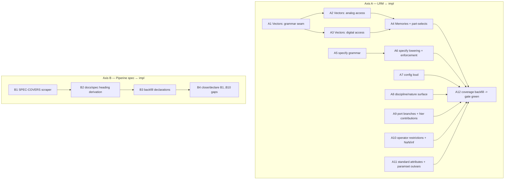

# Implementation ↔ Specification Gap Closure (wave 3) — Design

**Spec**: `.specs/features/lrm-conformance-wave3/spec.md`
**Status**: Draft (approach confirmed with the user 2026-08-27: scalarized
digital vectors; `SPEC-COVERS:` axis-B gate mirroring MD-51)

---

## §0 What the research changed

The spec was written from probe results ("vectors do not parse"). Reading the
source for this design found that **most of the vector machinery already
exists** and only three seams are missing. That reshapes the whole feature: the
largest requirement family is no longer "build vectors", it is "connect four
existing pieces".

| Piece | State today | Evidence |
|---|---|---|
| `NetType::Array(inner, width)` + `width()` | exists | `crates/piperine-lang/src/pom/net_type.rs:114` |
| Range → `NetType::Array` lowering | exists, **post-declarator form only** (`electrical bus[0:3]`) | `elab/lower/vams.rs::declarator_net_type` (~:1697) |
| One symbol node per element (`bus[0]`..`bus[N-1]`) | exists | `resolve/pom/structure.rs:117-127` |
| `NetRef { net, index }` binding + array lifting across the hierarchy | exists | `elab/lower/flatten.rs:459,570,582` |
| `Expr::Index` / `Expr::PartSelect` in the AST **and** the grammar | exists | `ast/expr.rs:51`, `grammar/expr.rs:158` |
| **Leading range** (`electrical [0:3] bus`, `input [0:3] p`, `reg [3:0] q`) | **missing** | `grammar/item.rs::parse_net_decl/parse_port_decl/parse_var_decl` |
| **Analog terminal resolution through an index** | **missing** — `ident_from_expr` accepts only `Expr::Ident`, so `V(bus[0], g)` never resolves | `resolve/pom/expr.rs:54-59` |
| **Digital index / part-select emission** | **missing** — one shared `unsupported` arm | `emit/digital_expr.rs:79` |
| **Memories** (`reg [3:0] mem [0:7]`) | missing (one range slot per declarator) | `grammar/item.rs::parse_declarator` |

The same re-reading corrected two other spec assumptions:

- **`specify` is not merely "unlowered"** — `parse_specify_block`
  (`grammar/item.rs:1338`) *bumps tokens* until `endspecify` and returns
  `items: vec![]`. There is no body to lower; the grammar itself must be
  written.
- **NaN/inf contribution is already caught**, but as the wrong error: the
  solver's non-finite-stamp rule (Part VII §16 `§15` row,
  `failure_rules.rs::section_15_a_non_finite_stamp_is_a_convergence_failure`)
  reports a *convergence failure*, not "§7.3.2.1 forbids this contribution".
  The work is retargeting a message and naming the branch, not new detection.

---

## Architecture Overview

Two independent axes, three delivery phases each, sharing one rule: **a claim
without a live test is a gate failure** (MD-31, MD-51).



Phase order is a dependency order, not a priority order: A1 unblocks A2/A3,
A5 unblocks A6, and A12/B4 are the closure gates that cannot run first.

---

## Code Reuse Analysis

### Existing components to leverage

| Component | Location | How it is used |
|---|---|---|
| `declarator_net_type` | `elab/lower/vams.rs` | Already turns a `Range` into `NetType::Array`; the leading-range work **feeds** it, it is not rewritten |
| `build_symbols_and_ports` element-node loop | `resolve/pom/structure.rs:117` | Already registers `name[i]` nodes with the right domain — analog and digital vectors both land here unchanged |
| `NetRef { net, index }` + `inline_sub_instances` | `elab/lower/flatten.rs` | Array lifting across the hierarchy already works; port-width broadcast rules already exist |
| `Expr::Index`/`Expr::PartSelect` | `ast/expr.rs`, `grammar/expr.rs:158` | Parse already; only resolution/emission arms are added |
| `unroll_loop` (elaboration-constant `for`/`while`/`repeat`) | `flatten/analog.rs:703` | The genvar-indexed vector access rides the existing unroller; the index folds to a constant per iteration |
| `DelayTable` / `TimingCheckTable` | `crates/piperine-solver/src/digital/delays.rs` | The `specify` lowering target — tables exist, are unit-tested, and are already checkpoint-aware |
| `ValidationFinding` / findings channel (dv-core) | `piperine-solver` `core/validation.rs`, `piperine-api/src/margins.rs` | Timing-check **violations** report through the existing channel; no new result type |
| `ElabContext::register_schema` + `seed_device_port_schemas` | `piperine-lang/src/lib.rs:304` | The four LRM standard attributes register the same way `device`/`port`/`rfport` do |
| Non-finite stamp detection | `piperine-solver` (§16 `§15` row) | NaN/inf contribution reuses it; only the error text and the named branch change |
| `AnalogOpRegistry` | `resolve/pom/analog_ops.rs` | The §4.5.15 checker asks it "is this name an analog operator?" instead of hardcoding a list |
| `lrm_sections()` heading parser + `declared_coverage()` scraper | `tests/lrm_section_coverage.rs` | The axis-B gate reuses both shapes verbatim over `docs/spec/*.md` |
| `suite_hygiene.rs::lrm_covers_declarations_are_well_formed` | `tests/suite_hygiene.rs` | The `SPEC-COVERS:` syntax check is the same rule with a second prefix |

### Integration points

| System | Integration |
|---|---|
| Elaboration passes | Leading ranges and `specify` lowering are `ElabModules` work; discipline/nature extensions are `LowerDeclarations` work; no new pass is added except the §4.5.15 checker, which folds into the existing `Typecheck` pass |
| Codegen resolve | Index-aware terminal resolution is one function (`ident_from_expr` → `terminal_name_of`), consumed unchanged by `flatten`, `emit`, and the switch-branch/indirect-contribution paths |
| Solver | `specify` writes existing tables; timing-check enforcement emits existing findings; **no `Element` ABI change** (MD-01 intact) |
| Hosts | No new host API. Memories/part-selects surface through existing net naming (`q[0]`), so `OpResult::v("q[0]")` works with no host change (MD-22 intact) |

---

## Components

### C1 — Leading-range declarations (grammar)

- **Purpose**: accept `discipline [msb:lsb] name, …;`, `input [msb:lsb] p;`,
  `reg [msb:lsb] q;` — Annex A.2.1.2/A.2.2.1's `range` slot.
- **Location**: `crates/piperine-lang/src/grammar/item.rs`
- **Interface**: one private helper on `Grammar`:
  `fn parse_optional_leading_range(&mut self) -> Result<Option<Range>, ParseError>`,
  called by `parse_net_decl`, `parse_port_decl` and `parse_var_decl` after the
  discipline/direction/type token and before the declarator list. The range
  applies to **every declarator in the list that carries none of its own**; a
  declarator that carries both is a loud error naming both spans.
- **Dependencies**: `Range`, `Declarator` (both exist).
- **Reuses**: `parse_range` (exists, used by `parse_ground_decl`).

### C2 — Memories (two ranges)

- **Purpose**: `reg [3:0] mem [0:7];` — a packed element type plus an unpacked
  depth.
- **Location**: `grammar/item.rs::parse_declarator` (accept a **second**
  trailing range) + `elab/lower/vams.rs::declarator_net_type` (nest
  `NetType::Array(Array(base, width), depth)`).
- **Interface**: `Declarator { name, range, depth_range, init }` — one added
  field, `None` everywhere else.
- **Reuses**: `NetType::Array` nesting and `NetType::width()`'s product rule
  (both already recursive).
- **Naming**: element nodes are `mem[d][b]` — `structure.rs`'s element loop
  becomes recursive over `NetType::Array`, which is the only change there.

### C3 — Analog access through an index

- **Purpose**: `V(bus[0], g)`, `I(bus[i], g)` inside a genvar loop.
- **Location**: `crates/piperine-codegen/src/resolve/pom/expr.rs`
- **Interface**: `ident_from_expr` is replaced by
  `fn terminal_name_of(e: Option<&Expr>, ctx: &LowerCtx) -> Option<String>`
  which resolves:
  - `Expr::Ident{name}` → `name` (today's behavior, unchanged);
  - `Expr::Index{base: Ident, index}` → `format!("{base}[{i}]")` when `index`
    folds to a constant **in the current unroll environment**;
  - anything else → `None`, which stays the existing loud "unresolved
    terminal" path.
- **Dependencies**: the const environment the unroller already threads for
  genvars.
- **Reuses**: `structure.rs`'s `name[i]` node names — the format string is the
  contract between the two, and a test pins that they agree.

### C4 — Digital access through an index / part-select

- **Purpose**: `q[2]`, `b[7:4]`, and whole-vector assignment `q <= 4'b0101`.
- **Location**: `crates/piperine-codegen/src/emit/digital_expr.rs` (the
  `Expr::Index | Expr::PartSelect` arm at :79) and the digital resolver
  (`emit/resolver.rs`).
- **Representation (confirmed decision, → MD-52)**: **scalarized per bit**. A
  width-N digital net is N independent `Quad` nets named `q[0]`..`q[N-1]`;
  `q[i]` resolves to one of them; a part-select resolves to an ordered chunk
  list; a whole-vector read/write expands to per-bit reads/writes emitted in
  declared bit order, in the region the assignment already selected
  (`=` → Active, `<=` → Nba). No digital ABI change, so `DriverTable`,
  strengths, regions, checkpoint/rollback and `$driver_*` all keep working
  untouched.
- **Bounds**: an index outside the declared range is a loud elaboration error
  naming net, index and bounds; a non-constant index is a loud error citing
  §5.5.2 ("the index must be a constant expression, though it may include
  genvar variables").

### C5 — `specify` blocks

- **Purpose**: replace the token-skipping stub with real productions and a
  lowering that reaches the solver.
- **Location**: grammar `grammar/item.rs::parse_specify_block`; AST
  `ast/item.rs::SpecifyBlock`; POM `pom/module.rs`; lowering
  `elab/lower/vams.rs`; circuit wiring `piperine-codegen/src/device/circuit.rs`.
- **Grammar scope (A.7.2–A.7.5.3)**: `specparam` declarations, simple path
  declarations (`(a => y) = (rise, fall[, turn_off])`, parallel `=>` and full
  `*>` forms), and the system timing checks `$setup`/`$hold`/`$setuphold`/
  `$width`/`$period`/`$recovery`/`$removal`/`$skew`. Edge-sensitive and
  state-dependent paths, PATHPULSE, `showcancelled` and the pulse-control
  family parse to a **named loud error** citing their production — never an
  unread span (this is the fail-loud half, and it is the whole point).
- **Lowering**: a path delay writes `DelayTable::set(dest_net,
  PathDelay{rise, fall, turn_off})`; a timing check writes a
  `TimingCheckLimit` into `TimingCheckTable`.
- **Enforcement**: the digital scheduler already sees every accepted event;
  a check whose limit is breached emits a `ValidationFinding` through the
  existing findings channel, so it surfaces on `OpResult`/`Trace` exactly like
  a constraint violation, under the run's posture (`strict`/`collect`/`off`).
- **Disclosed deviation**: `DelayTable` is **per destination net**, not per
  source→destination path. Two paths into one net collapse onto the last
  written record. The design keeps the table as-is (changing it is a solver
  data-model change with no user asking for it) and records the collapse as a
  deviation with its own pinning test.

### C6 — `config` loud rejection

- **Purpose**: stop consuming and discarding a `config` declaration.
- **Location**: `grammar/item.rs::parse_config_decl` (keep parsing so the
  error can name the construct) + `elab/lower/register.rs` (reject).
- **Interface**: `ElabErrorKind::UnsupportedConstruct { construct, clause,
  replacement }` — a new variant carrying "what replaces it"
  (`Piperine.toml` + the `SourceMap`), because the superset rule (spec §0
  rule 1) says an exclusion must name its replacement.
- **Reuses**: the same variant serves `specparam` (currently a silent no-op
  arm), in-module `task` declarations, and every unlowerable `specify` form.

### C7 — Discipline and nature surface

- **Purpose**: §3.6.2.5 attribute override, §3.6.2.6 nature derived from a
  discipline binding, §3.6.2.7 discipline user attributes, §3.10 out-of-module
  discipline declaration.
- **Location**: `grammar/item.rs` (three small production extensions),
  `elab/lower/disciplines.rs` (`LowerDeclarations`), `pom/nature.rs`.
- **Interfaces**:
  - `DisciplineDecl.attr_overrides: Vec<(NatureSlot, String, Value)>` where
    `NatureSlot ∈ {Potential, Flow}` — the `flow.abstol = 10u` form;
  - `Nature.derived_from: NatureSource` widened from a bare nature name to
    `NatureSource::{Nature(String), DisciplineBinding(String, NatureSlot)}`;
  - `DisciplineDecl.attributes: HashMap<String, Value>` for user attributes.
- **Solver reach**: an overridden `abstol` lands where the existing per-node
  `Tolerances::node_vntol_overrides` already lands (T48's path), so the
  override is *observable* (a tighter tolerance changes accepted iterations) —
  the same falsifiability standard T48 set.

### C8 — Port branches and hierarchical contributions

- **Purpose**: §3.12.1 `branch (<p>) probe_p;`, §5.5.4 unnamed hierarchical
  branches, §5.6.8 hierarchical contributions.
- **Location**: `grammar/item.rs` (`<port>` terminal form), `pom/branch.rs`
  (`BranchKind::Port` + endpoints), `elab/lower/flatten.rs` (do **not** merge
  the two sides of a port that carries a port branch), `resolve/pom/expr.rs`
  (hierarchical terminal names), `device/circuit.rs` (`resolve_node` for a
  dotted path).
- **Approach**: a port branch is the branch between the port's *upper* and
  *lower* connections. Flattening normally merges those into one node; when a
  port branch is declared, the flattener keeps them distinct and inserts the
  ideal 0 V source that already exists as a mechanism (the same
  force-branch/`HAS_INTERNAL_UNKNOWNS` machinery indirect contributions use),
  whose branch current **is** the port flow. No new solver concept.
- **Hierarchical contribution** rides the T50 hierarchical-reference resolution
  already in `resolve/pom/body.rs`; the missing half is that the resolver runs
  for *reads* but not for *contribution targets*, and that a probe like
  `V(u1.p, g)` still fails at circuit build (`unresolved node u1.p`). Both are
  the same lookup against `Design::flat_modules`.

### C9 — Illegal-construct checks

- **Purpose**: §4.5.15 and §5.8.4 restrictions; §7.3.2.1 NaN/inf.
- **Location**: `crates/piperine-lang/src/elab/typecheck.rs` (the existing
  Annex C subset checker) for the static half; the solver's non-finite stamp
  path for the runtime half.
- **Interface**: `fn check_analog_operator_placement(body, registry) ->
  Vec<ElabError>` — walks the analog body, tracks whether the current
  statement is under a conditional whose controlling expression is not
  elaboration-constant, under an event-triggered statement, inside a
  non-genvar loop, or inside a user function, and reports every analog operator
  or event-control call found there, citing the clause.
- **Reuses**: `AnalogOpRegistry` for "is this an analog operator", the const
  evaluator for "is this condition constant", and `Typecheck`'s existing
  accumulate-then-return-first shape.

### C10 — Standard attributes and paramset output variables

- **Purpose**: §2.9.2 `desc`/`units`/`op`/`multiplicity`; §3.6.3.1 net
  descriptions; §6.4.3 paramset output variables.
- **Location**: `piperine-lang/src/lib.rs` (schema seeding),
  `elab/lower/vams.rs` (attach), `piperine-solver` descriptors
  (`ParamDescriptor`/`ObservableDescriptor` gain `desc`/`units`/`op`/
  `multiplicity` where they do not already carry them), `grammar/item.rs`
  (paramset body accepts described variables and `.module_var` references).
- **Reuses**: MD-26's "atomic attributes, not role bundles" rule — each
  attribute is its own field, never a bundled `role`.

### C11 — Axis-B gate (`SPEC-COVERS`)

- **Purpose**: give Piperine's own surface the same falsifiability the LRM
  surface has (spec G7, PSW3-10).
- **Location**: new root target `tests/spec_section_coverage.rs`; syntax rule
  added to `tests/suite_hygiene.rs`; exclusions file
  `.specs/features/lrm-conformance-wave3/spec_coverage_exclusions.toml`.
- **Interfaces** (mirroring `lrm_section_coverage.rs` one-for-one):
  - `spec_sections() -> BTreeSet<String>` — parses `##`/`###` headings out of
    every `docs/spec/*.md` into ids of the form `part_viii#15.2`,
    `part_iv#9`, `appendix_c#3`.
  - `declared_coverage() -> Vec<Decl>` — scrapes `//! SPEC-COVERS: <ids>` from
    every test target and inline `#[cfg(test)]` module header.
  - `covered_and_excluded_partition_the_spec` — every heading is `Covered`,
    `DeclaredLimitation { reason }` (the honest verdict for a documented gap
    such as "Rust-only, no Python binding"), or `Informative { reason }`
    (prose/overview headings with nothing to prove).
  - `declaring_files_have_a_live_test` and `declared_ids_exist_in_the_spec` —
    the same two anti-drift checks MD-51 already requires.
- **Why it can fail**: deleting the test behind a claim turns the gate red;
  adding a spec heading with no verdict turns it red. Both are demonstrated
  during implementation (the wave-2 standard: prove the guard can fail).

---

## Data models

### Declarator (extended)

```rust
pub struct Declarator {
    pub name: String,
    pub range: Option<Range>,        // packed element range: [msb:lsb]
    pub depth_range: Option<Range>,  // NEW — unpacked memory depth: name [d0:d1]
    pub init: Option<Expr>,
}
```

### Specify block (replaces the empty stub)

```rust
pub struct SpecifyBlock {
    pub span: PreprocessedSpan,
    pub specparams: Vec<ParamDecl>,
    pub paths: Vec<PathDecl>,
    pub checks: Vec<TimingCheckDecl>,
}

pub struct PathDecl {
    pub span: PreprocessedSpan,
    pub inputs: Vec<String>,
    pub outputs: Vec<String>,
    pub full: bool,               // `*>` (full connection) vs `=>` (parallel)
    pub delays: Vec<Expr>,        // 1, 2, 3, 6 or 12 values per A.7.4
}

pub struct TimingCheckDecl {
    pub span: PreprocessedSpan,
    pub kind: TimingCheckKind,    // reuses the solver's own enum spelling
    pub data_event: EventSpec,
    pub reference_event: EventSpec,
    pub limit: Expr,
    pub notifier: Option<String>,
}
```

### Nature source (widened)

```rust
pub enum NatureSource {
    Nature(String),                                  // nature n : v;
    DisciplineBinding { discipline: String, slot: NatureSlot },  // nature n : ttl.flow;
}
```

---

## Error handling strategy

| Scenario | Handling | What the author sees |
|---|---|---|
| Leading range **and** declarator range on the same name | Loud elaboration error, both spans labelled | "net `bus` carries two ranges (§3.6.3)" |
| Non-constant vector index | Loud, cites §5.5.2 | names the expression and why a constant is required |
| Index outside declared bounds | Loud, cites §3.6.3 | names net, index, and the declared bounds |
| `config` declaration | Loud `UnsupportedConstruct`, cites A.1.5, names the replacement | "configurations are `Piperine.toml`'s job, not the HDL's" |
| `specify` form outside the implemented subset | Loud, cites its Annex A production | never a stored, unread span |
| Timing-check limit breached at run time | `ValidationFinding` through the existing channel, under the run posture | same surface as a constraint violation |
| Analog operator under a non-constant conditional | Loud at compile time, cites §4.5.15 | names the operator and the conditional |
| NaN/±inf contributed to a branch | Existing non-finite detection, **retargeted message** citing §7.3.2.1 and naming the branch | no longer reported as a generic convergence failure |
| A `docs/spec` claim with no test | Axis-B gate fails | names the heading and the missing declaration |

---

## Risks & Concerns

| Concern | Location | Impact | Mitigation |
|---|---|---|---|
| `ident_from_expr` is called from several places (contribution targets, noise scan, switch branches, indirect contributions) and silently returns `None` | `resolve/pom/expr.rs:54` | Widening it wrongly could make an unrelated malformed terminal resolve to a bogus node name | Replace with a named `terminal_name_of` that is explicit about each accepted shape; keep `None` for everything else; add a test that a *non*-constant index still fails loud |
| Element-node naming is a **string contract** between `structure.rs` and every resolver (`"{name}[{i}]"`) | `resolve/pom/structure.rs:117`, `device/circuit.rs::resolve_node` | A format drift silently unresolves nets | One helper owns the format, both sides call it, and a test asserts round-trip for a 2-D memory |
| Scalarized digital vectors multiply net count (`reg [3:0] mem [0:7]` = 32 nets) | `kernel/digital/*` | Compile-time and memory growth on wide memories | Accepted (confirmed decision, MD-52); add a width×depth cap with a loud error rather than an OOM, and record packing as the future optimization `piperine-ir`'s `Ty::Bits(N)`/`SigRef` already models |
| `DelayTable` is per net, `specify` paths are per path | `crates/piperine-solver/src/digital/delays.rs` | Two paths into one net collapse | Disclosed deviation with a pinning test; not a silent overwrite |
| Timing-check enforcement did not exist ("model half" only, T60's own words) | same file | Enforcement is new behavior in the scheduler's hot path | Enforce only on **accepted** events (never inside a rejected step), reuse the findings channel, and gate it behind the run posture so `off` costs nothing |
| Flattening currently merges the two sides of a port; port branches need them kept apart | `elab/lower/flatten.rs` | A naive change could alter every existing circuit's node count | Keep them distinct **only** when a port branch is declared on that port; add a test asserting node count is unchanged for a module without one |
| `Typecheck` accumulates every error but returns the first | `elab/lower/passes.rs` | A new checker could flood the LSP path | Reuse the existing accumulate-then-first shape; do not change the pass contract |
| The coverage gate's own failure message says its red state is "expected until wave-2's closure work lands" | `tests/lrm_section_coverage.rs:354` | A red gate that describes itself as expected is a gate nobody believes | PSW3-06 rewrites the message and the stale `piperine-signal` header in the same task that first turns a cell green |
| Wave-2's `coverage_exclusions.toml` lives in the wave-2 feature dir and is read by the gate | `.specs/features/lrm-conformance-wave2/coverage_exclusions.toml` | Wave 3 adding rows to another feature's file is confusing provenance | Keep the LRM exclusions file where it is (the gate's path is stable), and give axis B its **own** exclusions file under wave 3 |
| 105 uncovered ids include ~15 Annex C and ~13 ch. 12 headings that are delta/C-ABI sections | — | Backfilling them as "Covered" could over-claim | Annex C ids are **cross-declared** on the chapter tests that already prove the same clause; ch. 12 ids map to the existing `VpiCategory` entries and their `vpi_routines.rs` locks — each with a written reason, never a bare claim |

---

## Tech decisions

| Decision | Choice | Rationale |
|---|---|---|
| Digital vector representation | **Scalarized per bit** | No digital ABI change; `DriverTable`/regions/strengths/rollback keep working; matches how analog arrays already lower. Packing is a later optimization that `piperine-ir` already models (`Ty::Bits(N)` + `SigRef`) — project-level, recorded as **MD-52** |
| Axis-B gate shape | **`SPEC-COVERS:` declarations + derivation over `docs/spec`** | Mirrors MD-51 exactly, so there is one mental model for both axes and no hand-maintained registry to rot — project-level, recorded as **MD-53** |
| Vector element naming | `name[i]`, memories `name[d][b]`, one owning helper | Already the string `structure.rs` emits and `resolve_node` looks up; making it a helper turns an implicit contract into a checked one |
| Port branch mechanism | Keep the port's two nodes distinct + the existing ideal-source machinery | Reuses `HAS_INTERNAL_UNKNOWNS`/force branches; no new solver concept, no `Element` ABI change (MD-01) |
| `specify` unlowerable forms | Loud, per production | The fail-loud contract is the reason this item exists at all; a partial implementation that silently ignores the rest would repeat the original defect |
| Timing-check violations | Existing `ValidationFinding` channel | MD-27's host-purity rule and dv-core's posture semantics already answer "what does a violation do"; a second reporting channel would fork that answer |
| Standard attributes | Core-owned schemas seeded like `rfport` | MD-24's successor rule: schemas are core or plugin-system owned, never plugin-contributed |

> Two of these set project-wide conventions and are appended to
> `.specs/STATE.md` `## Macro Decisions` as **MD-52** and **MD-53**.

---

## Out of design scope (deliberate)

- Packed digital vectors (see MD-52's rationale) — a follow-up optimization.
- Per-path `DelayTable` records — a solver data-model change nobody has asked
  for; the collapse is disclosed instead.
- PLA modeling tasks (§9.8): they need memories (C2) as a precondition, so they
  are sequenced **after** A4 and may be re-scoped to a loud error if A4 lands
  late. The spec's P3 story already allows either outcome.
- Removing the unreachable POM/`Value`/`ElabErrorKind` variants (PSW3-02): a
  breaking public-API change; the design's position is to **prove them
  unreachable with a test** in this wave and schedule removal separately.
