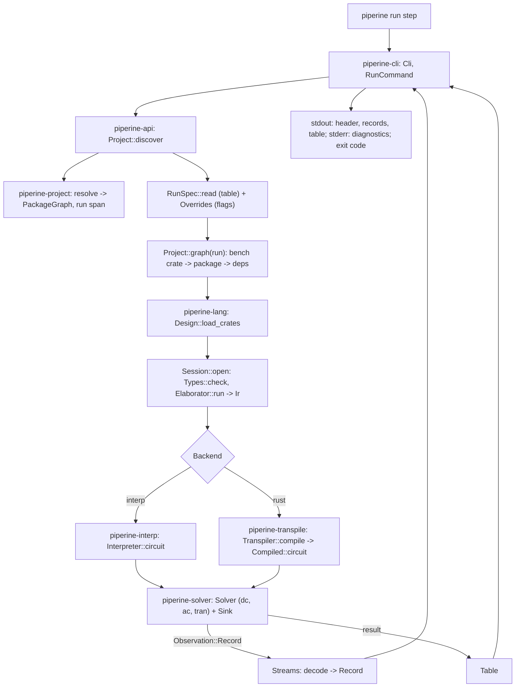
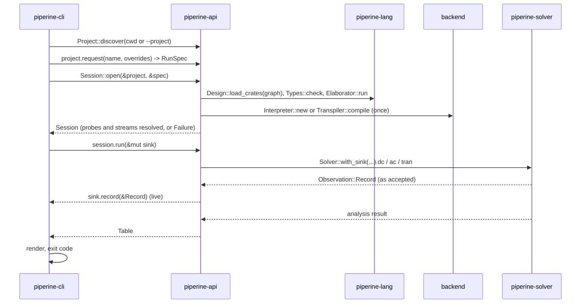

# MSL CLI Design

**Spec**: `.specs/features/msl-cli/spec.md`
**Status**: Approved with the spec (the user's answers to Q1 to Q8, 2026-11-15). Amended 2026-11-16: the language server left the feature (user: "O lang-server é o menos importante, vai ficar para bem depois."). The form of a plot and the way comments are kept are the planner's, inside the answers.

---

## Architecture Overview

Three layers run a project, each a crate with one job. One more piece stands beside them: a formatter inside `piperine-lang`.

- **`piperine-project`** finds and reads packages. It already resolves `Piperine.toml`, path and git dependencies and the lockfile into a `PackageGraph`. It gains one thing: it accepts a `[run]` table and reports where it is, without reading it (MD-58 keeps the host's meaning out of this crate).
- **`piperine-api`** is the host library (MD-20), rewritten from nothing on the device ABI. It turns a project and a run request into a result: `Project` (discovery, the crate graph of a run), `RunSpec` (the request, from the manifest and from flags), `Session` (source to a bound circuit on a backend, then analyses), `Table` (the result), `Record` (a decoded `emit!` record). It prints nothing and never exits.
- **`piperine-cli`** is a shell: it parses the command line with `clap`'s builder interface, calls `piperine-api`, renders tables, records and diagnostics, and turns the outcome into an exit code. Every rule that decides what a user sees (which signals, which rows, which records, pass or fail) lives in `piperine-api`, where a Rust test reaches it; the CLI owns only the text layout, which its own unit tests pin.

- **`piperine-lang`** gains `msl::format`: the formatter. The lexer hands plain comments over as a list beside the tokens; the tree, the parser, the POM and `msl::print` do not change.

The root package `piperine` stays what MD-20 says: `pub use piperine_api::*`.



A run, in order:



**Where the rules run.** Probe resolution, the default print list, the print grid, the sweep points, the stream filter, the test verdict and every validation of a run request are `piperine-api` methods with Rust tests. The CLI's `render` module only lays out text and is unit-tested against exact strings.

---

## Code Reuse Analysis

### Existing Components to Leverage

| Component | Location | How to Use |
| --------- | -------- | ---------- |
| Manifest, resolver, lockfile, `find_project_root`, `PackageError` | `crates/piperine-project/src/` | kept as they are; `Manifest` gains `run: Option<Span>` and the parser accepts the `run` table |
| `Design::load_crates`, `CrateGraph::{add_crate, add_dependency}` | `crates/piperine-lang/src/pom/{design,crates}.rs` | the bench crate is added to the resolved graph as its root |
| `Types::check`, `Elaborator::run` | `crates/piperine-lang/src/{types,elab}/` | called by `Session::open`, in the order `Bench::load_file_on` uses |
| `Diagnostic`, the `miette` impl and the graphical renderer | `crates/piperine-lang/src/msl/diag.rs` | the CLI renders every `DesignDiagnostic` and `PackageError` through it |
| `Interpreter::new`, `Interpreter::circuit` | `crates/piperine-interp/src/lib.rs` | the `interp` backend |
| `Transpiler::{new, compile}`, `Compiled::{circuit, report, source_path}`, `Settings` | `crates/piperine-transpile/src/` | the `rust` backend; `Report::hit` gives `compiled` or `cached`; `Settings::from_environment` gives the cache directory `clean --cache` removes |
| `Solver::{with_sink, with_tran_opts, dc, ac, tran}`, `CircuitInstance::set`, the result types | `crates/piperine-solver/src/{analyses/solver.rs,core/}` via `prelude` | every analysis; the DC sweep is the `set` and solve loop of `parity_dc` |
| `protocol::Sink`, `Observation`, `ObservationKind::Record` | `crates/piperine-solver/src/protocol/` | the record path |
| `Ir::{node_at, instance_at}`, the body's streams and record sites | `crates/piperine-ir/` (the stream accessors arrive with `msl-digital`) | probe resolution and record decoding |
| `Bench::{node, source}` | `crates/piperine-parity/src/bench.rs` | the pattern for a node id and for a source's flow branch (`b<k>.flow` of the first potential branch) |
| `Project` of the parity harness | `crates/piperine-parity/src/project.rs` (arrives with `msl-digital`) | the pattern for a bench crate over a dependency; not called, not moved |
| The book tests | `crates/piperine-lang/tests/book.rs` | the chapter list and numbering tests are extended; block extraction is repeated in the CLI's book target with the same string functions |
| The lexer's `LineComment` and `BlockComment` raw tokens | `crates/piperine-lang/src/msl/lexer.rs` | today they are recognised and dropped; they are collected with their spans instead |
| The canonical printer's layout functions | `crates/piperine-lang/src/msl/print.rs` | the formatter prints each node through them, so the two layouts cannot differ; `print(&File)` keeps its signature and its output |
| The round-trip corpus | `crates/piperine-lang/tests/msl_print.rs` (`sources()`), `tests/fixtures/gallery/`, `std/*.msl` | the formatter's corpus test walks the same sources, plus the examples, the twins and the Book's blocks |
| The workspace guards | `crates/piperine-solver/tests/workspace_shape.rs`, `crates/piperine-lang/tests/suite_hygiene.rs` | `DEFAULT_MEMBERS` gains the four host crates; the crate table of `CLAUDE.md` is checked by the first |

### Integration Points

| System | Integration Method |
| ------ | ------------------ |
| `Piperine.toml` | `piperine-project` validates `[package]` and `[dependencies]` and accepts `[run]`; `piperine-api` parses the same text again with `toml`'s spanned parser to read `[run]`, so a `P0010` points at the key |
| The language spec | one sentence of the manifest section (rule 3) and one row of its key table: the `run` table exists and the language does not define its content |
| The Book | a new chapter in `docs/book/content.html`; its blocks are compared with `examples/rc`, `examples/buck` and the binary's output by a test target of `piperine-cli` |
| The workspace | `default-members` gains `.`, `crates/piperine-api`, `crates/piperine-cli`, `crates/piperine-project`; `piperine-lang-server` stays a member outside the default set, untouched (deferred by the user) |
| The language spec, host part | Part VIII, the index, Appendix G's scope table and the sentence on sequences in Part IV: a bench is MSL; `spec_text` guards the wording |

---

## Components

### `Manifest::run` (in `piperine-project`)

- **Purpose**: let a manifest hold a `[run]` table without the project crate knowing what a run is.
- **Location**: `crates/piperine-project/src/manifest.rs`
- **Interfaces**:
  - `Manifest::run: Option<Span>` - the span of the `run` table's key when present.
  - the top-level key `run` is accepted when its value is a table; any other type is `E0171`.
- **Dependencies**: none new.
- **Reuses**: the hand-walked spanned TOML of the manifest parser.

### `Project`

- **Purpose**: the package a command works on, its runs, and the crate graph of one run.
- **Location**: `crates/piperine-api/src/project.rs`
- **Interfaces**:
  - `Project::discover(start: &Path) -> Result<Project, Failure>` - the nearest manifest upward (`E0170` when none).
  - `Project::at(dir: &Path) -> Result<Project, Failure>` - the package at `dir`, no search.
  - `Project::file(path: &Path) -> Result<Project, Failure>` - a lone file: a bench of the package found upward from its directory, a crate alone when there is none, `P0010` under `src/`.
  - `Project::name(&self) -> &str`, `Project::dir(&self) -> &Path`, `Project::runs(&self) -> &[RunSpec]`.
  - `Project::request(&self, name: Option<&str>, overrides: &Overrides) -> Result<RunSpec, Failure>` - the named run (or the only one) with flags applied, validated.
  - `Project::design(&self, spec: &RunSpec) -> Result<Design, Failure>` - the graph with the bench crate as root when the run has one.
  - `Project::check(&self) -> Result<Checked, Vec<Failure>>` - every stage of `check` for every run, no backend.
- **Dependencies**: `piperine-project`, `piperine-lang`, `toml`.
- **Reuses**: `resolve`, `find_project_root`, `CrateGraph`.

### `RunSpec`, `Analysis`, `Overrides`

- **Purpose**: one validated run request, whatever spelled it.
- **Location**: `crates/piperine-api/src/request.rs`
- **Interfaces**:
  - `RunSpec::read(manifest_text: &str, file: &Path) -> Result<Vec<RunSpec>, Vec<Failure>>` - every `[run.<name>]`, each fault a `P0010` at its span.
  - `RunSpec::merged(&self, overrides: &Overrides) -> Result<RunSpec, Failure>` - flag over key, then the rules of CLI-03 and CLI-09.
  - `RunSpec::from_flags(name: &str, overrides: &Overrides) -> Result<RunSpec, Failure>` - a lone file's run.
  - `Overrides` - one `Option` or `Vec` per key of CLI-03 AC 1; built by the CLI from flags.
- **Dependencies**: `toml`.
- **Reuses**: the manifest parser's way of making a coded diagnostic at a span.

### `Backend`

- **Purpose**: which backend runs, and the order of the three places that may name it.
- **Location**: `crates/piperine-api/src/backend.rs`
- **Interfaces**:
  - `Backend::{Interp, Rust}`, `Backend::name(&self) -> &'static str`, `Backend::parse(text: &str) -> Result<Backend, Failure>`.
  - `Backend::choose(flag: Option<&str>, variable: Option<&str>, key: Option<&str>) -> Result<Backend, Failure>` - pure over its three inputs, so no test sets a variable.
- **Dependencies**: none.
- **Reuses**: the names `interp` and `rust` of `piperine_parity::backend::Backend`. The parity enum stays where it is: there an unset variable means both, here it means `rust`.

### `Session`

- **Purpose**: a design compiled onto a backend, ready to run one request.
- **Location**: `crates/piperine-api/src/session.rs`
- **Interfaces**:
  - `Session::open(project: &Project, spec: &RunSpec, settings: &Settings) -> Result<Session, Failure>` - top choice, type check, elaboration, backend, circuit, probes and stream filter resolved, params set. Every failure before an analysis happens here.
  - `Session::top(&self) -> &str`, `Session::backend(&self) -> Backend`, `Session::ir(&self) -> &Ir`.
  - `Session::built(&self) -> Built` - `Compiled`, `Cached` or `Interpreted`, and the generated source path when there is one.
  - `Session::run(&mut self, sink: &mut dyn RecordSink) -> Result<Table, Failure>` - the analysis of the request; records reach `sink` as the solver accepts them.
- **Dependencies**: `piperine-lang`, `piperine-ir`, `piperine-interp`, `piperine-transpile`, `piperine-solver`.
- **Reuses**: the stage order of `Bench::load_file_on`; `Solver`.
- **Field order**: the circuit drops before the compiled library, as in `Bench`.

### `Probe`

- **Purpose**: a thing a table column shows.
- **Location**: `crates/piperine-api/src/probe.rs`
- **Interfaces**:
  - `Probe::{Node, Net, Flow}` with the full path and the solver identity.
  - `Probe::resolve(ir: &Ir, top: &str, entry: &str) -> Result<Probe, Failure>` - relative or full path, `i(...)` for a flow, `E0801` for nothing.
  - `Probe::defaults(ir: &Ir, top: &str) -> Vec<Probe>` - the top's own signals and ports in declaration order.
  - `Probe::label(&self) -> String`.
- **Dependencies**: `piperine-ir`, `piperine-solver`.
- **Reuses**: `Bench::node`, `Bench::source`.

### `Table`

- **Purpose**: the result of an analysis as columns and rows of typed cells.
- **Location**: `crates/piperine-api/src/table.rs`
- **Interfaces**:
  - `Table { columns: Vec<String>, rows: Vec<Vec<Cell>> }`, `Cell::{Real(f64), Bool(bool), Int(i128), Unknown}`.
  - `Table::operating_point(...)`, `Table::sweep(...)`, `Table::frequency(...)`, `Table::transient(...)` - one constructor per analysis.
  - `Table::on_grid(&self, step: f64, stop: f64) -> Table` - the print grid of CLI-11.
- **Dependencies**: `piperine-solver` result types.
- **Reuses**: the interpolation rule of `piperine_parity::waveform::Waveform` (linear, nothing extrapolated), written here for a table.

### `Record`, `Streams`, `RecordSink`

- **Purpose**: turn the solver's record observations into typed records and hand them to the host as they happen.
- **Location**: `crates/piperine-api/src/record.rs`
- **Interfaces**:
  - `Record { time: f64, instance: String, stream: String, fields: Vec<(String, Field)> }`, `Field::{Real, Bool, Int, Text, Unknown}`.
  - `Streams::of(ir: &Ir) -> Streams` - every stream of every instance with its layout and its sites.
  - `Streams::decode(&self, observation: &Observation) -> Option<Record>` - `None` for an observation that is not a record.
  - `Streams::keep(&mut self, entries: &[String]) -> Result<(), Failure>` - the filter of CLI-12; `E0801` for an entry that matches nothing.
  - `trait RecordSink { fn record(&mut self, record: &Record); }`.
- **Dependencies**: `piperine-ir`, `piperine-solver` (`protocol::Sink`, `Observation`).
- **Reuses**: the layout rule of `msl-digital` design A4: one field with a known byte per distinct non-text field of the stream's sites, absent fields with known byte 0; a text field is read from the IR site, never from the bytes.

### `Plot`

- **Purpose**: the geometry of a plot, as numbers: what is drawn where, before any SVG text exists.
- **Location**: `crates/piperine-api/src/plot.rs`
- **Interfaces**:
  - `Plot::of(table: &Table, analysis: &Analysis) -> Result<Plot, Failure>` - `P0010` for `Op`.
  - `Plot { width, height, panels: Vec<Panel>, lanes: Vec<Lane> }`; `Panel { area: Rect, x: Axis, y: Axis, series: Vec<Series> }`; `Axis { title, min, max, log: bool, ticks: Vec<Tick> }`; `Series { label, runs: Vec<Vec<(f64, f64)>> }` (one run of points per stretch between unknown values, already in drawing coordinates); `Lane { label, area: Rect, steps: Vec<(f64, Cell)> }`.
  - `Axis::place(&self, value: f64, from: f64, to: f64) -> f64` - the one mapping from a value to a coordinate, linear or logarithmic.
  - `Axis::ticks(min, max) -> Vec<Tick>` - 1, 2 or 5 times a power of ten, between 4 and 10 of them; decades on a logarithmic axis.
- **Dependencies**: none beyond `Table`.
- **Reuses**: `Table` at full resolution: `Session::run` keeps the table of accepted steps for the plot when the request has `plot`, whatever `print_step` is.
- **Fixed numbers**: 800 by 480 for one panel, 800 by 640 for the two of `ac`; a lane is 28 high; the axis range is the data's range widened to the enclosing ticks. Magnitude in dB is `20 log10`, a zero magnitude breaks the path.

### `Formatter` and `Comments` (in `piperine-lang`)

- **Purpose**: format a source text without losing a comment.
- **Location**: `crates/piperine-lang/src/msl/format.rs` (the formatter), `crates/piperine-lang/src/msl/comments.rs` (the list and its anchors)
- **Interfaces**:
  - `Comments::of(src: &str) -> Comments` - every plain comment (`//` that is no doc comment, `/* */` that is no doc comment) with its span, its text and whether it starts its line; doc comments stay tokens, as today.
  - `Comments::attach(&self, file: &ast::File, src: &str) -> Attached` - each comment anchored `Before(node)`, `After(node)` or `Inside(block)`, a node being an item, a member of a module, struct, enum, impl or trait, a statement, a match arm, or an element of a list printed one per line; a comment no anchor reaches marks its enclosing statement or member `Verbatim`.
  - `Formatter::format(src: &str) -> Result<String, Vec<Diagnostic>>`.
  - `Formatter::check(src: &str) -> Result<bool, Vec<Diagnostic>>` - whether the text is already formatted.
- **Dependencies**: the lexer, the parser, `print.rs`.
- **Reuses**: the printer's per-node layout. The formatter is a driver over it: before a node its `Before` comments, after it its `After` comment, before a closing brace the block's `Inside` comments, one blank line where the source had one or more, the source slice re-indented for a `Verbatim` node.
- **The guard inside**: after printing, the formatter lexes its own output and compares the comment texts, in order, with the source's; a difference is an internal-error diagnostic and no text. A formatter bug therefore fails loud instead of deleting a comment.

### `Verdict`

- **Purpose**: pass or fail of one run under `test`.
- **Location**: `crates/piperine-api/src/verdict.rs`
- **Interfaces**:
  - `Verdict::judge(records: &[Record]) -> Verdict` - counts the `checks` records and keeps those whose `pass` is false or unknown.
  - `Verdict::passed(&self) -> bool`, `Verdict::checks(&self) -> usize`, `Verdict::failed(&self) -> &[Record]`.
- **Dependencies**: none.
- **Reuses**: the reserved stream's field types (`pass: bool`).

### `Failure`

- **Purpose**: every way a command fails, typed, with what the CLI needs to render it.
- **Location**: `crates/piperine-api/src/failure.rs`
- **Interfaces**: `Failure::{Package(Vec<PackageError>), Diagnostics { stage, design, found }, Request(Diagnostic, file, text), Host { code, message }, Backend(String), Solver { analysis, error }, Io { path, error }}`; `Failure::stage(&self) -> &'static str`.
- **Dependencies**: `piperine-project`, `piperine-lang`, `piperine-solver`.
- **Reuses**: `PackageError`, `DesignDiagnostic`, `piperine_solver::prelude::Error`.

### `Cli`

- **Purpose**: the command tree and its parse into one typed invocation.
- **Location**: `crates/piperine-cli/src/cli.rs`
- **Interfaces**:
  - `Cli::command() -> clap::Command` - built from a data table of commands and of run flags (one row per key of CLI-03), no derive.
  - `Cli::parse(args) -> Result<Invocation, clap::Error>`, `Invocation::{Check, Build, Run, Test, New, Clean, Fmt}`.
  - `Cli::execute(invocation, out: &mut dyn Write, err: &mut dyn Write) -> Exit`.
- **Dependencies**: `clap` (no `derive` feature), `piperine-api`.
- **Reuses**: nothing of the old `lib.rs`.

### The seven commands

- **Purpose**: one struct per command; each calls `piperine-api` and writes to the two streams it is given.
- **Location**: `crates/piperine-cli/src/commands/{check,build,run,test,new,clean,fmt}.rs`
- **Interfaces**: `CheckCommand::execute(&self, out, err) -> Exit`, and the same for `BuildCommand`, `RunCommand`, `TestCommand`, `NewCommand`, `CleanCommand`, `FmtCommand`.
- **Dependencies**: `piperine-api`, `render`.
- **Reuses**: `NewCommand` embeds the four files of `examples/rc` with `include_str!` and replaces the package name; nothing else is a template.

### `render`

- **Purpose**: the text a user reads.
- **Location**: `crates/piperine-cli/src/render/{table,record,diagnostic,csv,json,svg}.rs`
- **Interfaces**:
  - `TextTable::write(table: &Table, out) -> io::Result<()>` - CLI-07 AC 2.
  - `CsvTable::write(table: &Table, out)`.
  - `RecordLine::write(record: &Record, out)` - CLI-06 AC 2; `JsonRecord::write(record, out)` - CLI-12 AC 3 and 5, written by hand (five value kinds, one string escape), no JSON crate.
  - `SvgPlot::write(plot: &Plot, out)` - the text of the SVG and nothing else: a `<rect>` per panel, `<line>` and `<text>` per tick, a `<text>` per axis title, one `<path class="series" data-signal="...">` per series with one `M`...`L` subpath per run of points, one `<path class="lane" data-signal="...">` per lane, a legend; a fixed palette by series index; coordinates printed with two decimals, so the same plot is the same bytes.
  - `Report::write(failure: &Failure, err)` - `miette`'s graphical handler, no color when standard error is not a terminal.
  - `Number::text(cell) -> String` - the one place a number becomes text.
- **Dependencies**: `miette`.
- **Reuses**: `piperine_lang::msl::diag`'s renderer.

### `Exit`

- **Purpose**: the three exit codes.
- **Location**: `crates/piperine-cli/src/exit.rs`
- **Interfaces**: `Exit::{Done, Failed, Usage}`, `Exit::code(&self) -> i32` (0, 1, 2).

### The example projects

- **`examples/rc`**: the RC low-pass. `src/lib.msl` holds `Resistor`, `Capacitor`, `Vsource`; `benches/step.msl` holds the top `Step` (source, R, C, the output held at 0 so the transient is the step response) and a monitor whose reaction fires on the crossing of half the step and calls `emit!("trip", ...)`, plus one `require`; `Piperine.toml` holds the runs `op` and `step`. It is the template of `new`, the fixture of most e2e tests and the Book's first example.
- **`examples/buck`**: gains `benches/startup.msl` (the bench of `msl-digital` DIG-16, moved to where a user finds it) and the runs `idle` and `startup`, whose `print`, `print_step` and `streams` are chosen so the output fits a Book page. `examples/buck/src` is not edited.
- **Fixture projects** under `crates/piperine-cli/tests/projects/`: one per failure a command must report (a type error, a bad run table, a failing `require`, a path dependency), each a few lines.

---

## Data Models

### The run table

```toml
[run.step]
bench      = "benches/step.msl"   # optional: the root crate is this file; absent, the package's crate
top        = "Step"               # optional: the one module without ports of the root crate
analysis   = "transient"          # op | dc | ac | transient
stop       = 10e-6                # transient
max_step   = 10e-9                # transient, optional
print_step = 1e-6                 # transient, optional
sweep      = "v1.dc"              # dc: a param path
from       = -1.0                 # dc, ac
to         = 0.8                  # dc, ac
step       = 0.05                 # dc
per_decade = 10                   # ac, or:
points     = 41                   # ac (linear)
print      = ["out", "i(v1)"]     # optional
streams    = ["trip", "checks"]   # optional: keep only these
params     = { "r1.r" = 2000.0 }  # optional
backend    = "rust"               # optional
csv        = "out/step.csv"       # optional
plot       = "out/step.svg"       # optional; not for op
records    = "out/step.jsonl"     # optional
```

Which keys an analysis reads: `op` none of the numbers; `dc` `sweep`, `from`, `to`, `step`; `ac` `from`, `to` and one of `per_decade`, `points`; `transient` `stop`, `max_step`, `print_step`. A key outside its analysis is `P0010` (CLI-03 AC 7).

### In Rust

```rust
pub struct RunSpec {
    pub name: String,
    pub bench: Option<PathBuf>,
    pub top: Option<String>,
    pub analysis: Analysis,
    pub print: Vec<String>,
    pub streams: Vec<String>,
    pub params: Vec<(String, f64)>,
    pub backend: Option<String>,
    pub csv: Option<PathBuf>,
    pub records: Option<PathBuf>,
}

pub enum Analysis {
    Op,
    Dc { sweep: String, from: f64, to: f64, step: f64 },
    Ac { from: f64, to: f64, grid: Grid },
    Transient { stop: f64, max_step: Option<f64>, print_step: Option<f64> },
}

pub enum Grid { PerDecade(u32), Points(u32) }
```

**How an analysis reaches the solver.**

| Analysis | Solver call |
| --- | --- |
| `Op` | `Solver::dc()?.solve()` |
| `Dc` | per point: `CircuitInstance::set(path, param, Real(value))`, then `dc()?.solve()` |
| `Ac` | `ac()?.solve_sweep(AcSweepAnalysisOptions { start_frequency: from, stop_frequency: to, steps, logarithmic })`; `steps` is `round(n * log10(to / from)) + 1` for `PerDecade(n)` and `n` for `Points(n)` |
| `Transient` | `TransientAnalysisOptions::new(stop, dt)` with `dt = max_step` and `dt_max = max_step` when given (as `parity_tran` does), else `dt = stop / 1000` and the solver's default `dt_max` |

### The output of `run`

```text
run step: transient, top Step, backend rust
@1.103178e-6 Step.mon trip v=5.000000e-1

time         Step.vin     Step.out
0.000000e0   1.000000e0   0.000000e0
1.000000e-6  1.000000e0   4.665120e-1
```

The numbers above illustrate the layout; the real ones are whatever the binary prints, and the Book's blocks are held to them by a test.

---

## Error Handling Strategy

| Error Scenario | Handling | User Impact |
| -------------- | -------- | ----------- |
| No manifest, a bad manifest, a dependency that cannot be located | `Failure::Package`, the package crate's own codes `E0170` to `E0176` | the graphical report at the manifest line; exit 1 |
| A malformed run table or a contradictory request | `Failure::Request`, `P0010` at the key's span | the report points into `Piperine.toml`; exit 1 |
| A wrong flag or a run name that does not exist | `clap`'s error, or the list of run names | usage on standard error; exit 2 |
| No top can be chosen | `Failure::Host`, `P0011`, the candidates listed | exit 1 |
| Parse, resolve, type-check or elaboration diagnostics | `Failure::Diagnostics` with the stage and the design that owns the sources | every diagnostic rendered with its excerpt, then `error: <stage> failed with <n> diagnostic(s)`; exit 1 |
| `rustc` missing, too old, or failing | `Failure::Backend` with the transpiler's message, unchanged | the message names `rustc` and the interpreter; exit 1 |
| The interpreter refuses a digital form | `Failure::Backend` with the rejection and `--backend rust` | exit 1 |
| A `print`, `streams`, `sweep` or `params` entry that names nothing | `Failure::Host`, `E0801`, before any analysis | exit 1 |
| `plot` on an `op` run | `Failure::Request`, `P0010` | exit 1 |
| `fmt` on a file that does not parse | the diagnostics; the file is not written; the other files go on | exit 1 |
| The formatter would lose or reorder a comment | an internal-error diagnostic from the formatter's own guard; the file is not written | exit 1; a bug report, never a lost comment |
| A `set` the design refuses | `Failure::Host`, `E0802` with path and value | no analysis runs; exit 1 |
| The solver fails | `Failure::Solver` with the analysis | records already printed stay; no table; exit 1 |
| An output file cannot be written | `Failure::Io` naming the path | exit 1 |
| Standard output closed | the write error ends the command | exit 1, no panic message |
| A panic in generated code | the solver reports it as a fault (`ir-rust` F-B9) | `Failure::Solver`; exit 1 |

No `unwrap()` and no `expect()` on a path a user's input reaches (AGENTS.md).

---

## Risks & Concerns

| Concern | Location (file:line) | Impact | Mitigation |
| ------- | -------------------- | ------ | ---------- |
| The record path does not exist on this branch yet: `emit!` is `P0001` here and the stream accessors of the IR arrive with `msl-digital` | `crates/piperine-lang/src/types/unsupported.rs:42` | names in this design come from that feature's design text | T1 reads the merged code and writes `contract.md` before any other task; a structural difference stops and reports, as `msl-digital` T1 did for `ir-rust` |
| `ObservationKind::Record` carries bytes and a path, no reaction or statement index | `crates/piperine-solver/src/protocol/sides.rs:153` | a text field lives in the IR site; if a record cannot name its site, its texts cannot be shown | T1 states how the merged code identifies the site. If it cannot, the task stops and reports: the solver crates are not edited here |
| The buck's closed loop (DIG-16) is P2 in `msl-digital` and rests on solver paths no MSL design used before | `.specs/features/msl-digital/spec.md` | CLI-08 AC 2, 3 and 5 have nothing to run | T1 reports whether DIG-16 merged; if not, `idle` carries CLI-08 and the three criteria wait, by the orchestrator's ruling |
| The closed-loop run is long in a dev build (600 µs at a 200 MHz clock) | `examples/buck` | a slow e2e test, and one Book block that takes minutes to refresh | one e2e test runs `startup`, once; its measured time is written in the task's commit; the Book guard reuses that one run's output through a shared fixture, not a second run |
| `piperine-project` pulls `git2`, which builds `libgit2` | `crates/piperine-project/Cargo.toml:7` | the default build gets slower | accepted: the crate already builds in this workspace; no new dependency |
| 19 000 lines and 36 test targets of `piperine-api` are deleted | `crates/piperine-api/` | features with no MSL counterpart leave the tree | approved (Q6: "Agora, pequeno"); the history keeps them; `GAPS.md` lists what left |
| The printer has no place for a comment inside an expression | `crates/piperine-lang/src/msl/print.rs:1` | a formatter built on it could drop one | the `Verbatim` rule (the statement is written as the source has it) and the formatter's own guard, which refuses to return a text whose comments differ |
| The formatter needs the printer's layout per node, with hooks between nodes | `crates/piperine-lang/src/msl/print.rs` | a refactor of the printer could change `print`'s output | CLI-23 AC 11: the existing targets `msl_print` and `msl_corpus` are not edited and stay green; the refactor is a task of its own, before any comment logic |
| Blank lines are kept (at most one), which the canonical printer never did | `crates/piperine-lang/src/msl/format.rs` | `format` and `print` differ on a source with blank lines | intended: `print` is the canonical text of a tree, `format` is what a person's file becomes. The Book block test and the POM use `print`, unchanged |
| The SVG is compared structurally, never as pixels | `crates/piperine-cli/src/render/svg.rs` | a plot can be well-formed and ugly | the geometry is tested as numbers in `piperine-api`; the Book embeds the real file, so a person sees it at every Book review |
| The old CLI and API tests are deleted, which the test-integrity rule forbids for tests of living code | `crates/piperine-cli/tests/`, `crates/piperine-api/tests/` | none of them compiles today | they are removed in the same commit as the code they test, and the commit body lists every target; no surviving assertion is edited |
| `AGENTS.md` rule 5 forbids macros; `clap` is usually used through its derive | `crates/piperine-cli/Cargo.toml:12` | a derive would be the first proc-macro of the rewritten host | the builder interface, the commands and flags as a data table |
| Each e2e test on the Rust backend runs `rustc` | `crates/piperine-cli/tests/` | minutes per target if every test compiles | one cache directory per test target, passed to the child as `PIPERINE_CACHE_DIR`; identical designs compile once |
| Byte-equal output across backends (CLI-13 AC 3) assumes the two backends agree to the printed digits | `crates/piperine-transpile/tests/differential.rs` | a last-digit difference fails the test | the backends are proven bit-equal function by function; a difference here is a real finding and is reported, the assertion is not loosened |
| The manifest rule of the language spec changes | `docs/spec/part_i_values.md:716` | `spec_text` and `pom_docs` guard that file | the edit is one sentence and one table row, in the task that makes `piperine-project` accept the table (MD-57) |
| `examples/Piperine.toml` is a manifest in a format nothing reads | `examples/Piperine.toml:1` | discovery upward from `examples/rc` would never reach it, but a user in `examples/` would get `E0171` | deleted with its lockfile |

---

## Tech Decisions (only non-obvious ones)

| Decision | Choice | Rationale |
| -------- | ------ | --------- |
| Where the run logic lives | `piperine-api`, with the CLI a shell | MD-20; the root e2e feature that follows needs the user's entry point from Rust |
| `[run]` in the manifest | `piperine-project` accepts and locates it; `piperine-api` parses it | MD-58 keeps host meaning out of the project crate; one file for the user |
| Flags and keys | the same names, flag over key | one data model; a lone file needs flags anyway |
| A bench is a crate | `benches/<name>.msl`, root of its own crate over the package | Cargo's integration-test rule; the stimulus never ships to dependents; `msl-digital` already runs the buck this way |
| The parity `Backend`, `Bench` and `Project` | left as they are | queue item 4 owns the harness; two small enums are cheaper than a dependency from the test harness on the host library decided in a hurry |
| The plot | geometry in `piperine-api` (`Plot`), text in the CLI (`SvgPlot`), no plotting crate, no terminal plot | the mapping from a value to a point is a rule and is tested as numbers; a terminal plot would make standard output depend on a width |
| How comments survive | a side list from the lexer, anchored to nodes by span; the tree does not carry them | the parser, the POM and every tree-equality test stay as they are |
| `format` beside `print` | two entry points over one layout | `print` is the canonical text of a tree and many tests pin it; `format` adds what only a source has: comments and blank lines |
| JSON Lines by hand | no `serde_json` in the CLI | five value kinds; a dependency for one function is not worth it |
| Text only, no color | plain text on standard output; `miette` without color unless standard error is a terminal | the Book compares bytes |
| One compile per command | `Session::open` compiles; `run` of an analysis never does | C7, MD-18 |
| Commands write to injected streams | `execute(out, err)` | unit tests capture text without a process; e2e tests still run the real binary |

**Project-level decision (written to `.specs/STATE.md` by the task that closes the feature, as the next free `MD-NN` after `msl-digital`'s MD-64):** the command line is a shell over `piperine-api`; a run is a `[run.<name>]` table of `Piperine.toml` whose keys are also flags; a bench is a crate under `benches/`; `piperine-project` accepts the table and does not read it (amends MD-58's "and nothing else"); the old content of `piperine-api` is gone and each of its features returns on the device ABI under its own spec (amends MD-20's module list, keeps its topology); a bench is MSL and the spec says so; `msl::format` is the formatter and `msl::print` stays the canonical text of a tree; the language server is deferred and untouched.
