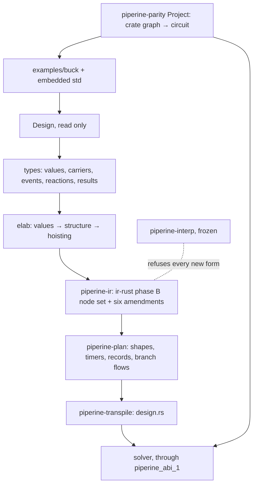

# Digital and Mixed MSL Through the Front End Design

**Spec**: `.specs/features/msl-digital/spec.md`
**Status**: Approved (2026-11-15, under the standing delegation, with the spec)

---

## Architecture Overview

The chain of M1 stays as it is: `Types::check` gives a side table over POM ids, `Elaborator::run` writes an `Ir` through `IrBuilder`, the POM is only read. This feature widens both stages and adds six forms to the three crates behind the IR.



Three ideas carry the design.

1. **Lower in the front end what the IR already says.** Enums, `match`, `Option`, tuples, `if let`, `rise`, `fall`, anonymous definitions and result modules become IR nodes `ir-rust` already defines. Only what has no IR spelling is an amendment.
2. **Unknown-ness is an analysis, not a type.** The checker types `count + 1` as `u9`. The elaborator knows `count` is a carrier read and gives the sum the IR type `Flagged(UInt(9))`.
3. **A result module is state of its caller.** Appendix C.1.1 and §8.3.12: its result is inlined at each read and its instance is hoisted. The POM keeps the placement; the IR body of the caller gains the carriers.

### What `ir-rust` gives and what this feature adds

`ir-rust` design, "Phase B: the IR additions", is the contract. This feature emits exactly those nodes and adds the rows marked **new**.

| Source form | IR | From |
| --- | --- | --- |
| `u9`, `i32`, literals, `&` `\|` `^` `<<` `>>`, `as`, `min` `max` `clamp` `floor` | `ValueType::{UInt, Int}`, `Expr::{Int, Cast, Method}`, `BinaryOp::*` | ir-rust T24 |
| a carrier read, `Unknown`, `known_or`, `is_known`, `high` | `ValueType::Flagged`, `Expr::{Carrier, Unknown, KnownOr, IsKnown, High}` | ir-rust T25, T26 |
| `signal`, discrete ports, `=` definitions, nets | `Carrier`, `Drive`, `NetData`, `InstanceData::nets` | ir-rust T26 |
| `changed`, `cross`, guards, `on`, `<-`, `after` | `Event`, `Reaction`, `Stmt::Commit` | ir-rust T27 |
| `now()` | `Expr::Env(Env::Time)` | **new A1** |
| `analysis(Static)` | `Expr::Env(Env::Static)`, of type `Bool` | **new A2** |
| `at(t)` | `EventSource::At(ExprId)` | **new A3** |
| `emit!("s", f = e, …)` | `Stmt::Emit { stream: u32, fields: Vec<EmitField> }`, `BodyData::streams: Vec<Stream>` | **new A4** |
| `i(a, b)` of a potential branch; `ddt` under a potential contribution | `Expr::Flow { branch: u32 }`; `Stmt::Contribute` accepts `Operator::Ddt` with `QuantityRole::Potential` | **new A5** |
| `Child(...) { r: r_top }` | `Child::params: Vec<(u32, ChildValue)>`, `ChildValue::{Const(Constant), Expr(ExprId)}` | **new A6** |

Each amendment follows the rule of `ir-rust` T24 to T27: model, builder method, `check()` rule, printer form written only when present, dependency set, and a refusal arm in `piperine-interp` and, until its own task lands, in `piperine-transpile`. Every earlier golden print stays byte-identical.

### From a source form to IR nodes the contract already has

| Source | Lowering | Why no IR node |
| --- | --- | --- |
| `enum Mode { Off, SoftStart, Regulate, Hiccup }` | `UInt(2)`; `Mode::Regulate` is `Int 2` | §2 rule 5 fixes the tag |
| `match m { A => x, B \| C => y, _ => z }` | `let s = m; if s == 0 { x } else if (s == 1) \| (s == 2) { y } else { z }` | the scrutinee is read once; the last arm of an exhaustive `match` is the final `else` |
| `Option<T>` value `o` | two IR values, `o.is: bool` and `o.val: T`; `None` is `(false, zero of T)` | scalar replacement |
| `x.known()` | `(x.is_known(), x.known_or(zero))` | the two flag-total reads |
| `if let Some(d) = o { A } else { B }` | `if o.is { let d = o.val; A } else { B }` | |
| `o.unwrap_or(d)`, `o.is_none()` | `if o.is { o.val } else { d }`, `!o.is` | folded when `o` is a literal `None` or `Some` |
| an `f64` argument for `Option<f64>` (§3.2.3) | `(true, arg)` | |
| `let (m, r) = (a, b);` | two `Let`s | |
| `a && b` with a `Flagged` operand | `BitAnd(a, b)` | §3.3.12 gives the same table as `&` |
| `c.rise()` | `Event { source: Changed(c), guard: High(c) }` | the ir-rust contract |
| `c.fall()` | `Event { source: Changed(c), guard: IsKnown(c) & !KnownOr(c, true) }` | |
| `Child(a, expr)` at an `in` port | carrier `Signal` named `child.port` in the parent, a `Drive` of it, the child's port bound to its net | §8.2.9 |
| `log(...)`, `require(...)` | the function body inlined: one `Stmt::Emit` | IR functions are values |

### Unknown-ness: the `Known` analysis

One pass per lowered expression, in `elab/known.rs`. Its answer is `Plain` or `Flagged`.

| Expression | Answer |
| --- | --- |
| literal, const, param, probe, `now()`, `analysis(Static)`, environment | `Plain` |
| carrier read, `Unknown` | `Flagged` |
| `known_or`, `is_known`, `high` | `Plain` |
| any other operator, cast, method or `if` | `Flagged` when an operand, the condition or an arm is |
| a local | what its initializer was |
| a call | the return answer of the variant chosen for its argument pattern |

A function is lowered once per **flag pattern** reached: `dithered_width(duty.known_or(0), frame + 1)` reaches the pattern `01` and lowers `dithered_width~01` with `frame: Flagged(UInt(3))`, which in turn reaches `rev3~1`. The all-plain pattern keeps the source name, so every M1 function prints as before. The variant table is keyed by `(DeclId, pattern)` and filled in first-reach order, which keeps function ids deterministic.

An `if` whose condition is `Flagged` is emitted as it is: the generated code decides it and faults when it is unknown (`ir-rust` RS-11 AC 5). The elaborator adds nothing and hides nothing.

### Events and reaction heads

A head is put in disjunctive form: `d₁ || d₂ || …`, each `dₖ = source && guard`. The guard is split by the `Continuity` side table of the checker (below) into a discrete conjunct list and a continuous one.

| Head | IR |
| --- | --- |
| every disjunct has no continuous conjunct | one `Reaction`, `on` listing one `Event { source, guard: discrete part }` per disjunct |
| one disjunct, with continuous conjuncts | one `Reaction` on its event; body is `if continuous part { body }` |
| several disjuncts, some with continuous conjuncts | one `Reaction` per disjunct, in source order, each as the row above; `P0001` when the body holds `emit!` |

The third row is sound because reactions of one microstep read one snapshot (§12.1.1): two of them that fire together commit equal values, and transport is per statement. It is what makes `above(e)`, which is `cross(e) || (init() && e > 0.0)`, work at time 0: the `init` disjunct becomes a reaction on `Changed(init.up)` whose body is `if e > 0.0 { … }`, and a reaction may probe (abi.md R2).

### Hoisting a module with a result

Done per enclosing module, before its blocks are lowered, by `elab/hoist.rs`.

1. Walk the module's body `let`s, definitions, connections, `analog` block and `on` heads in source order. Each placement whose callee has a result opens a **frame**: a name (`gate` for `let gate = transition(…)`, else `transition$0`), the binding of each value input to the caller's expression and the caller's frame, and the callee's params bound to the constants its param block gives.
2. In that frame, lower the callee's signals as carriers of the enclosing body named `frame.signal`, its definitions as drives, its `digital` blocks as reactions, and walk its own placements (step 1, nested: `ocp$0.init$0.up`).
3. A discrete `in` value input (`in x: Bit<f64>`) is a carrier `frame.x` driven by the caller's expression: an anonymous definition.
4. A read of the placement, or of the `let` bound to it, lowers the callee's result expression in the reader's position, resolving names through the frame chain. A value input read lowers the caller's expression in the caller's frame (§8.3.8, §8.3.13).
5. `cross` and `at` are core result modules: a placement of one is an `Event` of the enclosing body, not a frame.

No IR body, no `Child` and no instance is made for a hoisted module. A module that places itself through results is `E0341`, by the placement stack M1 already keeps. The check for `E0353` is the checker's: it sees the cycle before any frame exists.

`transition` from the stdlib, hoisted into `PowerSwitch`, gives the body: carriers `gate.x`, `gate.xd`, `gate.y0`, `gate.y1`, `gate.t0`, `gate.dt`; drives of `gate.x` (the caller's `if g.high() { 1.0 } else { 0.0 }`) and of `gate.xd` (`gate.x` after `0.0`, since `td` is `Some(0.0)`); events `At(t0 + dt)` guarded by `dt > 0.0`, `Changed(gate.x)` and `Changed(gate.xd)`; three reactions, the last two wrapped in `if static` and `if !static`; and the result expression inlined where `analog` reads `gate`.

### Amendments behind the IR

| | `piperine-plan` | `piperine-transpile` |
| --- | --- | --- |
| A1, A2 | `Source::Ambient(TIME)`, `Source::Ambient(STATIC)` among the reads of `terms`, `cross:*` and reactions; refused by `check()` in `drive:*`, `event:*` and an `At` argument (abi.md §4.2: no discrete function reads an input) | `cx.time()`, `cx.is_static()` reads; `TIME` is not differentiable |
| A3 | per `At` event: a `PRIVATE` `EVENT` pin; a `changed` event function per carrier its argument reads; one **arming reaction** on those events and on the global `START` pin, reading the carriers and `TIME`, with one `REPLACE` statement on the event pin | the arming body: `t` unknown or `t < now` commits with delay `+inf` (never due, and `REPLACE` has removed the pending firing); `t == now` commits with delay 0; else delay `t − now` |
| A4 | per stream of a body: a `PRIVATE` `DISCRETE` pin flagged `RECORD`, named by the stream, its layout one field with a known byte per distinct non-text field of the stream's sites; one statement per emit site, in source order among the reaction's commits | `rt::Commits::record(statement, bytes)`: the whole layout, absent fields with known byte 0 |
| A5 | the flow of a potential branch is the private continuous pin M1 already declares for it; `Expr::Flow` is a differentiable read of that pin; a `Ddt` addend of a potential contribution is a `DDT` term on the branch's equation row | `Dual` seeded on the flow pin; the affine rule unchanged |
| A6 | none: the netlist reads `InstanceData::params`, which stays constant per instance | none |

Text fields of a record never cross the ABI. `piperine_ir::Body::record_site(reaction, statement)` gives the stream name and the `(field, text)` pairs, which is how a host or a test decodes a record delivered by the solver's `Sink` (abi.md C5 gives instance, reaction and statement with every commit).

### The checker's new side tables

| Table | Content | Read by |
| --- | --- | --- |
| `Types::ty` | as M1, over the wider `Ty` | everything |
| `Types::continuity(ExprId)` | `Discrete` or `Continuous`: an expression is continuous when it reads a probe, `now()`, `analysis(Static)`, `gmin()`, `source_scale()` or a result that does (§8.2) | `E0336`, `E0316`, `E0442`; the guard split of the elaborator |
| `Types::emits(DeclId)` | whether a function reaches `emit!`, and on which streams | `E0601`, `E0603`; the elaborator's inlining |
| `Types::builtin(ExprId)` | the built-in a method call resolved to (`Known`, `KnownOr`, `IsKnown`, `High`, `Changed`, `Rise`, `Fall`), set only when the POM resolved the name to the stdlib's own declaration | lowering |
| `Types::literal(ExprId)` | the integer type an integer literal was given | lowering, `E0909` |

Literal typing is bidirectional and local, in the order the spec lists: an expected type from above wins; else, for a binary operator, the operand that is not a literal is checked first and its type is the expectation of the other; else, for `if` and `match`, the first arm that is not a literal; else `i32`.

---

## Code Reuse Analysis

### Existing Components to Leverage

| Component | Location | How to Use |
| --------- | -------- | ---------- |
| The checker's worklist, contexts and reporting | `crates/piperine-lang/src/types/check.rs` (`Checker`, `Context`, `report`) | extended: `Context` gains `Definition`, `Guard`, `Reaction`, `EventHead` |
| The exhaustive subset table | `crates/piperine-lang/src/types/unsupported.rs`, `src/elab/unlowered.rs` | rows leave it as forms become legal; no wildcard arm is added |
| The method catalogue | `crates/piperine-lang/src/types/catalogue.rs` | rows added per receiver type; core rows for `cross`, `at`, `now`, `analysis` |
| Placement checking of nodes and params | `crates/piperine-lang/src/types/module.rs` | extended with carrier ports and value inputs |
| `ConstEval` and `Bindings` | `crates/piperine-lang/src/elab/consts.rs` | gains integer, enum and `Option` constants; evaluates a child's param over the parent's bound values |
| Value lowering and `Scope` | `crates/piperine-lang/src/elab/lower.rs` | gains a frame chain; integer, cast and method arms |
| The placement walk and the node table | `crates/piperine-lang/src/elab/place.rs` | gains the net table and carrier bindings, the same shape as nodes |
| The contribution split | `crates/piperine-lang/src/elab/contribute.rs` | `DdtOffTop` is relaxed for potential contributions only |
| The front-end resolution of members | `crates/piperine-lang/src/pom/resolve/members.rs` | read, not edited: a `Deferred` or `Unresolved` method call is typed by the checker's catalogue or reported (G3) |
| The digital node set, its builder, `check()`, printer | `crates/piperine-ir` after `ir-rust` T24 to T28 | the target of every lowering |
| The buck-slice fixtures and their golden prints | `crates/piperine-ir/tests/support/digital.rs`, `tests/golden/` after `ir-rust` T29 | the oracle of DIG-14 AC 1 and 2 |
| The digital plan, `rt::{UInt, Int, Flagged, Commits}`, the digital printers, discrete nets | `piperine-plan`, `piperine-transpile` after `ir-rust` T31 to T41 | extended by the amendments only |
| The phase 8 tests | `crates/piperine-transpile/tests/{commits,dpwm,pid}.rs`, `crates/piperine-parity/tests/boundary.rs` after `ir-rust` T42 to T46 | how a net's changes are collected and a circuit run; the assertions are restated on IR from source |
| The twin loader and the tolerance contract | `crates/piperine-parity/src/{bench,contract}.rs` | `Project` sits beside `Bench`; `contract.rs` is not edited |
| The crate graph | `piperine_lang::pom::CrateGraph`, `Design::load_crates` | the bench crate depends on the buck package |
| The solver's record sink | `piperine_solver::protocol::Sink` | tests install one and decode with `Body::record_site` |

### Integration Points

| System | Integration Method |
| ------ | ------------------ |
| `piperine-lang` | new modules under `types/` and `elab/`; the two public entry points keep their signatures |
| `piperine-ir`, `piperine-plan`, `piperine-transpile` | additive: new variants, new plan entries, new printer arms |
| `piperine-interp` | one refusal arm per new variant and one test; nothing else (R1) |
| `piperine-parity` | `Project`, eight test targets, MSL bench sources under `tests/buck/` |
| `piperine-abi`, the three solver crates | unchanged |
| `examples/buck` | sources unchanged; `README.md` and `GAPS.md` updated at the end |
| `.specs/STATE.md` | MD-64: result modules are hoisted in the IR; unknown-ness is an elaboration analysis; a record's text stays in the IR |

---

## Components

### Value types of the checker

- **Purpose**: the types this feature adds, as data.
- **Location**: `crates/piperine-lang/src/types/ty.rs`
- **Interfaces**: `Ty::{UInt(u8), Int(u8), Enum(DeclId), Option(Box<Ty>), Tuple(Vec<Ty>), Carrier { nature: DeclId, value: Box<Ty> }, Event, Str}` beside the M1 variants; `Ty::is_integer()`, `Ty::has_repr(&Design)`.
- **Reuses**: `Ty::name` for messages.

### Checker modules

- **Purpose**: one file per family of rules, each an `impl Checker` block as in M1.
- **Location**: `crates/piperine-lang/src/types/{compound,control,carrier,definition,event,reaction,record,result}.rs`
- **Interfaces**: none public beyond `Types`; each adds diagnostics and fills the side tables above.
- **Dependencies**: the POM's `DeclKind::{Signal, Port, Definition, Behavior, Reaction}` and `StmtKind::{Commit, Reaction}`.

### `Known`

- **Purpose**: which lowered expressions may be unknown.
- **Location**: `crates/piperine-lang/src/elab/known.rs`
- **Interfaces**: `Known::of(&self, expr: piperine_ir::ExprId) -> Flag`; `Flag::{Plain, Flagged}`; `Flag::wrap(ValueType) -> ValueType`.

### `Variants`

- **Purpose**: one IR function per function and flag pattern.
- **Location**: `crates/piperine-lang/src/elab/variants.rs`
- **Interfaces**: `Variants::request(&mut self, function: DeclId, pattern: &[Flag]) -> FunctionId`; `Variants::name(function, pattern) -> String`.

### Compound lowering

- **Purpose**: enums, `match`, `Option`, tuples.
- **Location**: `crates/piperine-lang/src/elab/compound.rs`
- **Interfaces**: `Lowered::{One(ExprId), Pair { is: ExprId, val: ExprId }}`: what an expression lowers to; `EnumLayout::of(decl) -> { width: u8, tag_of: variant -> u64 }`.

### Structure lowering

- **Purpose**: carriers, drives, events, reactions, records.
- **Location**: `crates/piperine-lang/src/elab/{carriers,drives,events,reactions,records}.rs`
- **Interfaces**: each an `impl Elaboration` block: `lower_carriers(scope, module)`, `lower_definition(frame, decl)`, `lower_head(frame, expr) -> Vec<Head>`, `lower_reaction(frame, decl)`, `lower_emit(frame, expr)`.

### `Hoist`

- **Purpose**: frames of placed result modules.
- **Location**: `crates/piperine-lang/src/elab/hoist.rs`
- **Interfaces**: `Frame { name: String, parent: Option<FrameId>, inputs: BTreeMap<DeclId, (ExprId, FrameId)>, carriers: BTreeMap<DeclId, u32> }`; `Hoist::open(call: ExprId) -> FrameId`; `Hoist::result(frame, position) -> Lowered`.

### Nets in the placement walk

- **Purpose**: the discrete twin of the node table.
- **Location**: `crates/piperine-lang/src/elab/place.rs` (modify)
- **Interfaces**: per instance, one `NetData` per signal carrier, `InstanceData::nets` in carrier order; the top's discrete ports are nets declared by the top instance.

### IR amendments

- **Purpose**: A1 to A6.
- **Location**: `crates/piperine-ir/src/{model,check,print,deps,build}.rs`
- **Interfaces**: the variants of the table above; `Body::streams()`, `Body::record_site(reaction: u32, statement: u32) -> Option<RecordSite>`; `RecordSite { stream: &str, texts: &[(String, String)] }`.

### Plan and printer amendments

- **Purpose**: shapes and generated code for A1 to A5.
- **Location**: `crates/piperine-plan/src/plan.rs`; `crates/piperine-transpile/src/print/{digital,analog}.rs`, `src/rt/flag.rs`
- **Interfaces**: `Mode::Arm(u32)`; `Source::{Ambient(u32), BranchFlow(u32)}`; `Target::Record(u32)`; `StatementPlan::replace: bool`.

### `Project`

- **Purpose**: a crate graph from disk to a compiled circuit, for tests.
- **Location**: `crates/piperine-parity/src/project.rs`
- **Interfaces**: `Project::new(root: &Path).dependency(name: &str, lib: &Path)`; `elaborate(top: &str) -> Result<Ir, Vec<DesignDiagnostic>>`; `compile(top: &str) -> Result<Running, Rejection>`; `Running { ir: Arc<Ir>, circuit: CircuitInstance }`.
- **Reuses**: `Bench` for how a rejection is named; `Compiled::circuit`.

---

## Data Models

```rust
// piperine-ir, new
pub enum ChildValue { Const(Constant), Expr(ExprId) }
pub enum EventSource { Changed(u32), Cross(ExprId), At(ExprId) }        // At is new
pub struct Stream { pub name: String, pub fields: Vec<StreamField> }     // per body
pub struct StreamField { pub name: String, pub ty: ValueType }           // non-text fields, first-seen order
pub enum EmitField { Value { field: u32, value: ExprId }, Text { name: String, text: String } }
// Env gains Time and Static; Expr gains Flow { branch: u32 }; Stmt gains Emit { stream: u32, fields: Vec<EmitField> }
```

```rust
// piperine-lang, elab
pub(super) enum Flag { Plain, Flagged }
pub(super) enum Lowered { One(ExprId), Pair { is: ExprId, val: ExprId } }
pub(super) struct Head { events: Vec<u32>, wrap: Option<ExprId> }        // wrap: the continuous part of the guard
```

---

## Error Handling Strategy

| Error Scenario | Handling | User Impact |
| -------------- | -------- | ----------- |
| A rule of `docs/spec/` is broken | its `Eppnn` code at the construct, from the checker | the code the spec documents |
| A form not supported yet | `P0001` naming it, from the checker's table or `Unlowered` | what to avoid, by name |
| A plain type mismatch, a non-exhaustive `match` | `P0002` | both types named |
| A method with no catalogue row (G3) | `P0001` naming the method and the receiver's type | never a silent `Unresolved` |
| A constant that panics | `E0104` at the expression | |
| The elaborator emits an ill-formed IR | `P0004` per `check()` entry, as M1 | a bug report, never a wrong run |
| An amended form reaches the interpreter | `Rejected` naming the body | use the compiled backend |
| An unknown condition or guard at run time | the generated code's fault, with the origin | the model adds a `known_or` |
| A solver defect on a path first used here | the task stops; the defect is reported with a hand-written ABI device that reproduces it | no patch in a solver crate from this feature |

---

## Risks & Concerns

| Concern | Location (file:line) | Impact | Mitigation |
| ------- | -------------------- | ------ | ---------- |
| The `ir-rust` code is not merged; names in this design come from its design text | `feature/ir-rust`, at T4 of 46 when this was written | a builder method, a field or a fixture name differs | T1 reads the merged code and records every name in `contract.md` before any other task; a structural difference stops and reports |
| The T29 fixtures may transcribe a module differently from what source elaboration gives | `crates/piperine-ir/tests/support/digital.rs` | DIG-14 AC 1 fails on a choice, not on a defect | the source decides: the task reports the difference and which side misreads the `.msl`; a fixture is changed only with the phase 8 tests of `ir-rust` still green |
| M1 folds a child's params as constants and refuses a value that reads the parent | `crates/piperine-lang/src/elab/children.rs:1-3` | every hierarchy level of the buck passes params down | A6 and T32; the flat table stays constant, so no backend changes |
| M1 refuses `ddt` outside a flow contribution | `crates/piperine-lang/src/elab/unlowered.rs:22` (`DdtOffTop`) | the inductor does not elaborate | A5; an RL response against its analytic form (DIG-13 AC 4) |
| M1 refuses a top with a port | `crates/piperine-lang/src/elab/elaborator.rs:118` | `Buck` cannot be the top | discrete ports become nets (DIG-09 AC 5) |
| The checker has no integer and no type variable | `crates/piperine-lang/src/types/ty.rs:5-6` | literal typing as in Rust needs inference | local bidirectional typing; what it cannot type is `P0002`, never a wrong type |
| Negative tests of M1 assert `P0001` for forms this feature makes legal | `crates/piperine-lang/tests/{types_subset,elab_unlowered}.rs` | they would fail, or be weakened | each such row is replaced, in the task that legalizes its form, by a row of DIG-07 AC 1 that is still refused; the commit lists the rows. No assertion is loosened |
| Splitting an `\|\|` head runs a body twice when two disjuncts fire together | `elab/events.rs` | a double record | refused when the body emits; commits are idempotent by §12.1.1 |
| `rise` on a change to unknown differs from §22.1 | `std/values.msl:25` | a model relying on IEEE 1364 `x` edges misbehaves | `GAPS.md`; the buck never commits `Unknown` |
| `at` re-arming relies on `REPLACE` and a `+inf` delay | abi.md C1, C3 | a stale firing if the solver treats either differently | DIG-12 AC 2 is the detector; a failure is a solver report |
| The operating point with digital feedback (`above` at time 0, `transition` in `Static`) has had no MSL user | `crates/piperine-solver/src/protocol/` | the closed loop may not start | DIG-14 AC 9 and DIG-15 AC 6 prove the pieces first; the loop itself is P2 |
| The closed loop is long: 120 000 clock periods | `crates/piperine-parity/tests/buck_closed_loop.rs` | a slow test target | the 0.8 V start, the shortest the SPEC allows; its own target, run once by `check_proofs.py` |
| Hoisted names contain `.` and `$` | `piperine-transpile` `Text::ident` | not Rust identifiers | the printer already maps MSL names to identifiers; T1 confirms it covers both characters, else T33 names with `_` and keeps the path in the ABI name |
| A child's own signals read as ground in the authored `Child` | root `GAPS.md` §3 | unchanged by this feature | out of scope; the flat table is right |

---

## Tech Decisions

| Decision | Choice | Rationale |
| -------- | ------ | --------- |
| Where enums, `Option`, `match`, tuples go | lowered in the elaborator | no backend learns a form the IR can already spell |
| Unknown-ness | an elaboration analysis giving `Flagged` | §3.3: a flag, not a type; keeps the checker's types the source's |
| Result modules | hoisted into the caller's body | Appendix C.1.1; a result read by `analog` cannot cross an instance boundary of the ABI |
| Built-ins among stdlib methods | seven names, only when resolved to the stdlib's own declaration | §3.3.7; their bodies need forms out of scope |
| Continuous guards | an `if` in the reaction | abi.md F2 |
| Timers | an arming reaction with a `REPLACE` statement | abi.md R1: a timer is a delayed commit to an event pin |
| Record text | in the IR site, not in the layout | the ABI has no string leaf |
| Run-time tests | MSL benches in a crate that depends on the buck | no host API; the stimulus is ordinary MSL in scope |
| Scripted stimulus | a counter and `if` chains in the bench, mirrored in Rust in the test | arrays and `parse_hex` are out of scope |
| Slice equality | structural print against the T29 golden texts, with the allowed extra items as data in the test | "equal or a documented superset", checked by code |

MD-64 (written to `.specs/STATE.md` by T60): result modules are hoisted in the IR and keep their placement in the POM; unknown-ness is computed at elaboration; the text of a record stays in the IR.

## Dependencies on `ir-rust`

| This feature needs | From `ir-rust` task | Used by |
| --- | --- | --- |
| `piperine-plan`, `piperine-transpile`, `Compiled::circuit` | T1, T2, T16, T17 | T2, phases 8 to 10 |
| `Backend` in `piperine-parity` | T21 | T2 |
| Integer and unknown-value nodes | T24, T25 | phase 5 |
| Carriers, drives, nets | T26 | T28, T29 |
| Events, reactions, commits | T27 | T30, T31 |
| `check()` for the digital forms | T28 | every elaboration test (DIG-09 AC 14) |
| The buck-slice fixtures and their golden prints | T29 | T37 |
| The interpreter's refusal | T30 | T22 |
| The digital plan, `rt` integers and flags | T31 to T36 | phase 8 |
| The digital printers and discrete nets in the netlist | T37 to T41 | phases 8 to 10 |
| The phase 8 tests | T42 to T46 | phase 9, as the pattern for reading nets |

## Size

60 tasks in 10 phases (tasks.md). Opus implements the tasks where a mistake gives a wrong run with no error: the `Known` analysis, function variants, `Option` lowering, heads and guards, hoisting, the timer plan and its arming code, the branch-flow plan, and the closed loop. Sonnet implements the rest. A different Opus verifies.
