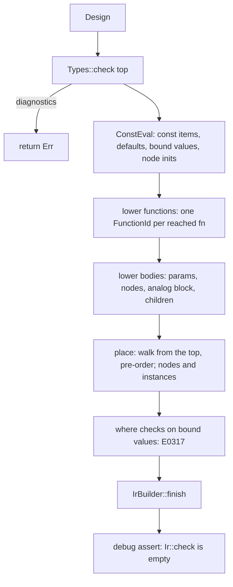

# MSL Elaboration (POM to IR, M1 subset) Design

**Spec**: `.specs/features/msl-elab/spec.md`
**Status**: Draft

---

## Architecture Overview

Elaboration is four passes over what `Types` reached, each writing through `IrBuilder`. The order is fixed so that ids are deterministic: natures, functions, bodies (in first-reach order), then the instance tree.



Bodies are lowered before anything is placed: a body is a function of its module alone (one variant per module in M1), so placement only binds. Placement is where a value meets a `where`: the condition is evaluated by `ConstEval` over the instance's bound values.

### What the split of a contribution looks like

`i(a, k) +> id + gmin() * vd + ddt(cj0 * vd);` is the tree `((id + gmin()*vd) + ddt(cj0*vd))`. The lowering flattens the top-level chain of `+` and `-` into signed leaves, then groups: each leaf that is a `ddt` call is its own addend (operator `Ddt`, value its argument); the leaves between them are re-joined, in order, into one direct addend. Parentheses are transparent at the top level only. A `ddt` deeper than a top-level leaf (`2.0 * ddt(x)`, `ddt(x) * y`) is ELAB-06 AC 2: abi.md A1 would need a private pin for it, and no M1 model asks for one.

### Who owns a node

Every continuous signal of every instance becomes one row of the node table, named by path. A port is not a node: it is a slot of the body, bound at each instance to its parent's node or to ground. So `DiodeSeries.b` exists once, and `d1` and `d2` each bind it. Nothing is merged or collapsed in M1 (no fixed zero-potential branch exists in the subset), so the table is exactly the authored signals.

---

## Code Reuse Analysis

### Existing Components to Leverage

| Component | Location | How to Use |
| --------- | -------- | ---------- |
| `Types` | `crates/piperine-lang/src/types/` (feature `msl-typeck`) | the reachable set, every expression's type, resolved methods and callees |
| POM handles | `pom/reflect/` (`Module`, `Param`, `Signal`, `Instance`, `Behavior`, `Contribution`, `Function`, `Const`) | every declaration is read through a handle |
| Spans to `file:line:col` | `msl/span.rs`, `pom/source.rs` | `Origin` of every IR item |
| Diagnostics | `msl/diag.rs`, `pom/design.rs` | the one diagnostic type |
| `IrBuilder` | `crates/piperine-ir/src/build.rs` (feature `msl-ir`) | the only writer |
| Golden-test pattern | `tests/pom_corpus.rs`, `tests/msl_print.rs` | printed text compared with a file under `tests/fixtures/` |

### Integration Points

| System | Integration Method |
| ------ | ------------------ |
| `piperine-ir` | new dependency of `piperine-lang` (path) |
| `piperine-interp`, `piperine-parity` | call `Elaborator::new(&design).run("Top")` |
| `tests/suite_hygiene.rs` | the new targets open with a `//!` scope header |

---

## Components

### `Elaborator`

- **Purpose**: the entry point and the pass order.
- **Location**: `crates/piperine-lang/src/elab/mod.rs`
- **Interfaces**: `Elaborator::new(design: &Design) -> Elaborator<'_>`; `run(self, top: &str) -> Result<piperine_ir::Ir, Vec<DesignDiagnostic>>`.
- **Dependencies**: `Types`, the four passes.

### `ConstEval`

- **Purpose**: evaluate a const expression of the subset to a `Constant`.
- **Location**: `crates/piperine-lang/src/elab/consts.rs`
- **Interfaces**: `ConstEval::value(ExprId, env: &Bindings) -> Result<Constant, Diagnostic>`, where `Bindings` maps a param declaration to its bound value (empty for a `const` item). Arithmetic and comparisons on `f64` and `bool`, `if`, blocks, calls of reached functions, the four catalogue methods. IEEE 754 throughout: `1.0 / 0.0` is `inf` (the prelude's `inf` is written that way), never an error. With `f64` and `bool` only, no const expression of the subset can panic, so `E0104` has no trigger in M1.
- **Reuses**: `Types` for callees and methods. It is a second small evaluator beside the interpreter's, on purpose: this one reads POM expressions at elaboration, has no duals and no solver; sharing would make `piperine-lang` depend on the interpreter.

### `FunctionLowering` and `BodyLowering`

- **Purpose**: POM expressions and statements to IR nodes.
- **Location**: `crates/piperine-lang/src/elab/lower.rs` (value code), `elab/analog.rs` (probes, sites, contributions, branches)
- **Interfaces** (crate-private): `function(DeclId) -> FunctionId` (memoized), `body(DeclId) -> BodyId` (memoized), `expr(ExprId) -> ir::ExprId`, `contribution(StmtId)`.
- **Details**: locals are numbered in declaration order per owner. A `const` read becomes `Real`/`Bool`. A param read becomes `Param(index)`. Branches are keyed by the unordered terminal pair; the first contribution fixes the orientation `(plus, minus)`.

### `Placement`

- **Purpose**: the instance tree, the node table, bound params.
- **Location**: `crates/piperine-lang/src/elab/place.rs`
- **Interfaces** (crate-private): `top(DeclId) -> InstanceId`; recursion carries the parent's node bindings and the path; a stack of module declarations detects `E0341`.

### `Unlowered`

- **Purpose**: the forms the type checker accepts and M1 elaboration refuses (ELAB-06), in one table.
- **Location**: `crates/piperine-lang/src/elab/unlowered.rs`
- **Interfaces**: `Unlowered::in_analog(..) -> Option<&'static str>`: site or contribution under `if`, `ddt` off the top of a flow contribution, `m`/`dtemp` given, `digital` block, `extern` module.

---

## Data Models

No new stored model: the output is `piperine_ir::Ir`. Internal state of one run:

```rust
struct Elaboration<'d> {
    design: &'d Design, types: &'d Types<'d>,
    ir: IrBuilder,
    functions: BTreeMap<DeclId, FunctionId>,
    bodies: BTreeMap<DeclId, BodyId>,
    consts: BTreeMap<DeclId, Constant>,
    diagnostics: Vec<DesignDiagnostic>,
}
```

---

## Error Handling Strategy

| Error Scenario | Handling | User Impact |
| -------------- | -------- | ----------- |
| The design or the type check has diagnostics | returned unchanged; no pass runs | the front end's own messages |
| A spec rule (`E0241`, `E0317`, `E0319`, `E0321`, `E0341`, `E0415`) | that code at the construct; an instance error also names the path | as the specification states |
| A form outside M1 lowering | `P0001` naming the form | the model is refused, never mis-simulated |
| Any diagnostic | the run continues to collect the rest of the same pass, then returns `Err`; `finish` is not called | several errors per run, no `Ir` |
| An `Ir` that fails `check()` | a bug of this feature: `debug_assert!` in debug builds, and the golden tests call `check()` | none for a user |

---

## Risks & Concerns

| Concern | Location (file:line) | Impact | Mitigation |
| ------- | -------------------- | ------ | ---------- |
| `piperine-lang` gains its first in-tree dependency | `crates/piperine-lang/Cargo.toml` | a guard may assume the crate is a leaf | no guard does today (`crate_boundaries.rs` constrains the solver crates and `piperine-abi` only); the task runs the whole suite |
| `CLAUDE.md` and `AGENTS.md` describe `piperine-lang` as having "no type checking, no elaboration" | `CLAUDE.md` crate table | stale instructions | the last task of this feature updates both files and the pipeline diagram |
| Appendix C.1.1 says "every function is inlined", S7 keeps functions | `docs/spec/appendix_c_implementation.md:12` | the informative appendix contradicts the implementation | Q8 asks when to amend it; nothing normative is broken |
| Two evaluators of value code exist (`ConstEval` here, the interpreter's) | this design | they could disagree on a corner of `f64` | both use Rust's `f64` operators and the same four `std` calls; a shared test table of expressions with expected bits is run by both features |
| The split treats parentheses as transparent at the top level | ELAB-04 AC 4 | `a - (b + ddt(x))` must negate the `ddt` | the flattening carries the sign through unary minus and through `-` on a parenthesized chain; a test pins exactly this form |

---

## Tech Decisions

| Decision | Choice | Rationale |
| -------- | ------ | --------- |
| Crate | a module of `piperine-lang` | ELAB-Q7, closed in the spec |
| Bodies before placement | yes | one variant per module in M1; placement is pure binding |
| Constants | folded; params never folded | §8 rule 8 for constants; ELAB-02 AC 6 keeps a host `set` free of re-elaboration (MD-18, C7) |
| Node ownership | one design node per authored continuous signal | names by path, and the solver binds by node |
| Where M1's limits are enforced | `msl-typeck` for the language subset, `Unlowered` here for forms inside it | each has one table; neither repeats the other |

## Size

10 tasks: entry point and pass skeleton; `ConstEval`; value lowering; function lowering with memoization; body params and nodes; probes, environment and sites; the contribution split and branches; placement, paths and bound values with `where`; `Unlowered` and the negative fixtures; golden files of the five twins plus the `CLAUDE.md`/`AGENTS.md` update. Sonnet implements, Opus verifies; the contribution split is Opus's task (a wrong sign or a misplaced `ddt` is a silent wrong answer).
