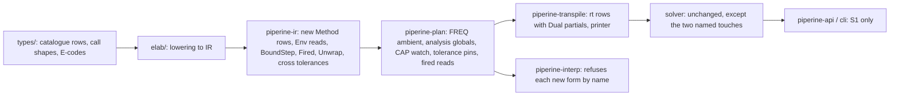

# MSL Fixes Design

**Spec**: `.specs/features/msl-fixes/spec.md`
**Context**: `.specs/features/msl-fixes/context.md`
**Status**: Approved with the spec (2026-11-17). Q1 to Q4 were answered (a), the recommended option (user: "Aceito todas (Recommended)").

Line numbers are those of `feature/msl-fixes` at `4293de6b`.

---

## What the code does today

Every item was reproduced on 2026-11-17 with the binary of this tree (`piperine run <file>`, Rust backend), probes under the session scratchpad.

| Item | Observed | Where it comes from |
| ---- | -------- | ------------------- |
| S1 | `on at(1n) { finish(); } on at(3n) { k <- 9; .. }` runs to `--stop`; `fatal("boom")` exits 0 | `print/reaction.rs:145` prints `Ok(Flow::Continue)` for every reaction; the protocol already ends on `Flow::Finish` (`protocol/transient.rs:344`, `operating_point.rs:71`); `piperine-api/src/verdict.rs:58` reads `checks` only; `session.rs:251` fails any transient whose last step is before `stop` |
| S5 | `c: f64 = 1.0 where c > d; d: f64 = 0.0;` is accepted, `d = 5.0` gives `E0317` | `types/module.rs:71` checks the `where` as `bool` only; nothing compares declaration order |
| B1 | `i(p, n) +> 1m;` gives `error[E0282]` at `let at_zero_ = Self::terms_block();` | `print/analog.rs:494-508`: a block with no read is called with no argument, so `R` is not inferred |
| B2 | `on absdelta(v(a), 0.2) { .. }` gives four `E0308` | the watch block of a `cross` whose argument reads a `Flagged` carrier mixes `R` and `rt::Flagged<f64>` (`print/cross.rs`) |
| L11 | `f(1.0)` and `f(1.0, z: 3.0)` give `P0002: expected 3 argument(s)`; `f(1.0, None, Some(3.0))` gives "an expression the type checker gave no value type" at elaboration | `types/call.rs:91` `apply` takes exactly as many positional arguments as parameters; `elab/functions.rs:24` binds an `Option` parameter as one local with no IR type |
| L17 | `Md::Lo < Md::Hi` gives `P0002: expected f64, found enum Md` | `types/expr.rs:226`: `<` types its operands as numbers; `==` has the `PartialEq` arm |
| L41 | `P0001: a second analog block` | `elab/analog.rs:13`, `elab/unlowered.rs:30` |
| L46, L47, L48 | `P0001: core primitive bound_step`, `freq`; `analysis of a kind other than Static` | `types/catalogue.rs:117` `CORE_ROWS` has no row; `core_call` judges `analysis` by name |
| L54 | `P0001: a ttol or etol given to cross`; a named argument of a core primitive is `P0001` (`types/analog.rs:188`) | the tolerances reach no IR field; the solver honours per-watch `ttol`/`etol` pins (`analog-solver/src/device/watch.rs:106`, `transient.rs:1443`) |
| L55 | `on above(v(a) - 0.5) { emit!(..) }` is `P0001` | `elab/events.rs:111`: a head split per disjunct over an emitting body is refused, since each disjunct's reaction would write the record |
| L14 to L16 | `method sin on f64` and the like | `types/catalogue.rs:10` (8 rows of `f64`), `:22` (3 integer rows), `:40` (3 `Option` rows) |

The solver side already has what most of these need: `Flow::Finish`, the `FREQ` ambient (`assembly.rs:577`), the `DC`/`TRAN`/`AC`/`NOISE` globals (`core/bind.rs:486`), `CAP` watches with `E0509` (`watch.rs:89`), and the `ttol`/`etol` pins of a `CROSS` watch. Two gaps are the solver's: a `CROSS` watch fails on NaN (`watch.rs:100`, abi.md A4), and an AC or noise analysis solves its operating point with the `DC` flag (`analyses/ac.rs:167` makes a `DcSolver`, which builds its side with `global::DC`, `dc.rs:236`).

---

## Architecture Overview

No new component. Each item follows the pipeline's own layers, and every layer keeps its present contract:



### Approaches considered for the catalogue

| Approach | Verdict |
| -------- | ------- |
| **New rows as IR `Method` variants**, typed by `ir::typing::method`, printed as `x.sin()` on `R` (a `Real` with a `Dual` partial) and as `.map(..)`/`.zip(..)` on `Flagged` | **Chosen.** `Method` already carries a receiver, arguments and the unknown flag through the transpiler (`print/value.rs:784`); one enum row, one typing row, one printer arm, one `Real` method per row |
| New rows as `MathFn` variants beside `exp`/`ln`/`sqrt`/`abs` | Rejected. `MathFn` refuses a value that may be unknown (`print/value.rs:665`), so the rows would be refused in reactions where §3.3 lets the flag travel |
| A library of generated helper functions in `rt` called by name | Rejected. It hides the row from the IR printer and the interpreter's refusal |

`exp`, `ln`, `sqrt` and `abs` on `f64` stay `MathFn`: moving them would change the generated text of the diode twins (PAR-01).

---

## Code Reuse Analysis

### Existing Components to Leverage

| Component | Location | How to Use |
| --------- | -------- | ---------- |
| `Catalogue::method` and its tables | `crates/piperine-lang/src/types/catalogue.rs` | Extend the row type with argument types and a result type (today: "each of the receiver's type", result `Self`) |
| `Checker::apply` | `crates/piperine-lang/src/types/call.rs:91` | Replace its arity test with §3.2's binding of positional, left-out and named arguments; record the binding per call |
| `lower_option`, `lower_option_method`, `lower_option_let` | `crates/piperine-lang/src/elab/compound.rs:521` | An `Option` is a pair `(is, val)` in the IR; every new `Option` row lowers to a pair, and an `Option` parameter becomes two parameters |
| `Disjunct`, `lower_reaction` | `crates/piperine-lang/src/elab/events.rs:92` | The split branch becomes one reaction on every disjunct's event with a guard read of which event fired |
| `ir::typing::method` | `crates/piperine-ir/src/typing.rs:112` | One arity and type row per new `Method` |
| `trait Real`, `Dual<N>` | `crates/piperine-transpile/src/rt/real.rs` | One method per differentiable row with its derivative; unit tests beside the existing `abs`/`min` ones |
| `UInt<N>`, `Int<N>` | `crates/piperine-transpile/src/rt/int.rs` | `abs`, `pow`, `rem_euclid`, `signum`, `saturating_*`, overflow tests; a panic names the operation like the division by zero (`int.rs:209`) |
| `Printer::method`, `Printer::cast` | `crates/piperine-transpile/src/print/value.rs:784` | One arm per row, flagged and plain |
| The analog terms printer | `crates/piperine-transpile/src/print/analog.rs:494` | B1: the block's type is named when no argument fixes it |
| `verify_partials` | `crates/piperine-abi` | The finite-difference oracle of CAT-01 AC 3 |
| `piperine_parity::project::Project` | `crates/piperine-parity/src/project.rs` | Runs MSL from source on the Rust backend in the new `source_*` targets, as `project.rs` and the `buck_*` targets do |
| `Verdict` as a `RecordSink`, `Delivery` | `crates/piperine-api/src/verdict.rs`, `record.rs:174` | S1: the verdict also reads `sim`; the session reads the finish instant off the record stream |

### Integration Points

| System | Integration Method |
| ------ | ------------------ |
| Device ABI | Nothing new in `piperine-abi`'s types. Q2 amends abi.md A4's text for `CROSS` watches only |
| `piperine-solver` | Q3: the operating-point solver takes the analysis's global flag; nothing else |
| `piperine-api`, `piperine-cli` | S1 only (below) |

---

## Components

### C1. `finish` and `fatal` (FIX-01, FIX-02)

- **Device (transpile).** The reaction printer gives a reaction that holds an `emit!` on the stream named `sim` a local `finish_`, set at that statement to the known-true value of its `finish` field (`known_or(false)` of a flagged one, so an unknown never ends a run). After `commits_.flush(cx_)?` the reaction returns `Flow::Finish` when `finish_` is true. The protocol already ends the transient and the operating point on it. `finish()` and `fatal()` are stdlib functions whose `emit!` the elaborator inlines into the reaction, so they need nothing of their own.
- **Host (cross-lane touch, lane B's crate `piperine-api`).** `Session::analysis`'s transient arm takes the time of the last `sim` record whose `finish` is known true as the run's end: the short-run check of `session.rs:251` compares the last step with that time instead of `stop`, and the recorder's grid stops at it (`Recorder::with_grid` gets the end, not `stop`). `Verdict` keeps the first `sim` record whose `failed` is known true, with its `msg`; `Verdict::passed` is false when it holds one; a new `Verdict::fatal()` returns it.
- **Command line (cross-lane touch, lane B's crate `piperine-cli`).** `piperine run` prints `fatal at <t:e>: <msg>` on standard error and exits 1 when the run's records hold that record; `piperine test` prints `FAIL <name> (fatal at <t:e>: <msg>)` for it. Nothing else of either command changes.

Lane B is editing `piperine-api` and `piperine-cli` in parallel. The three touches are one function each and come last (phase 5), so the merge with `host-ii` is small; the executor rebases on `main` before them if `host-ii` has merged.

### C2. `where` order (FIX-03)

`Checker::param` (`types/module.rs:57`) walks the `where` and reports `E0318` for a read of a param whose declaration index in its module is greater than the param's own. The module's params are in declaration order already (POM children).

### C3. Calls with optional and named arguments (FIX-06, part of FIX-12)

- **Types.** `apply` becomes the §3.2 binder: the optional parameters are the maximal trailing run of `Option<T>` parameters (§3.2.7); positional arguments bind in order; named ones bind optional parameters not bound yet, else `E0140`; a required parameter left unbound or an argument past the last parameter is `E0141`; an argument of type `T` for `Option<T>` is `Some` (§3.2.3), of `Option<T>` as it is (§3.2.10). The binding (one slot per parameter: an argument or "left out") is stored in `Types` per call expression. Core primitives (`cross`'s `etol:`) use the same binder; their own refusal of named arguments goes.
- **Elaboration.** An `Option<T>` parameter of a function lowers to two parameters, `name.is` (`bool`) and `name.val` (`T`), entered in `scope.options` like `lower_option_let`. A call lowers its slots in parameter order: a left-out slot passes `(false, T::default)`, a `Some`-wrapped `T` passes `(true, v)`, an `Option` argument passes its pair.

### C4. Ordered enums (FIX-07)

`binary` gives `<`, `<=`, `>`, `>=` an arm like `==`'s: an enum operand checks the other against it and requires `PartialOrd` (`P0002`, "a type that derives `PartialOrd`"). An enum is its tag in the IR, numbered in declaration order (§2 rule 5), so the elaborator lowers the comparison as the integer comparison of the tags; no IR change.

### C5. Several `analog` blocks (FIX-08)

`elab/analog.rs` lowers each `analog` block of the module in source order into the one IR analog body, each block in a fresh local scope (§10 rule 7). The `SecondAnalogBlock` refusal goes.

### C6. The catalogue (CAT-01 to CAT-04)

- **Types.** The catalogue row becomes `(name, Method, params: &[Arg], result: Res)` where `Arg` is `SelfTy | I32 | U32 | Closure(..)` and `Res` is `SelfTy | Bool | OptionSelf`. A miss on `f64`, an integer, `Option` or `bool` is `E0161` naming the method and the type (H rule 1); `abs` and `signum` exist on `Int` rows only. `Option` and `bool` rows that take a closure type it with the receiver's payload as the parameter type and infer the result from the body (`Checker::closure`, extended for these rows only).
- **IR.** `Method` gains `Sin Cos Tan Asin Acos Atan Atan2 Sinh Cosh Tanh Powf Powi Log10 Log2 Ceil Round Trunc Fract Signum RemEuclid Hypot IsNan IsFinite IsInfinite` (f64), `IntAbs Pow SaturatingAdd SaturatingSub SaturatingMul AddOverflows SubOverflows MulOverflows` (integers; `Signum` and `RemEuclid` shared). `typing::method` gets one row each. A new `Expr::Unwrap { is, value, message: Option<String> }` is the one fault form `Option` needs.
- **Elaboration.** Numeric rows lower to `Expr::Method`. `checked_op(a, b)` lowers to the pair `(is: !Method::OpOverflows(a, b), val: Binary op(a, b))` (the IR's integer arithmetic wraps). `Option` rows lower on the pair: `unwrap`/`expect` to `Unwrap`; `unwrap_or_else(|| d)` to `If { is, val, d }`; `map(|x| e)` to `(is, e[x := val])` by binding `x` as a local of a block; `and_then(|x| o)` to the pair of `o` under the same binding, its `is` conjoined with the receiver's; `a.or(b)` to `(a.is | b.is, If { a.is, a.val, b.val })`; `c.then(|| v)` and `c.then_some(v)` to `(c, v)`. A closure body is lowered once, in the receiver's scope, never as an IR closure.
- **Runtime.** `Real` gains the differentiable rows with their derivatives on `Dual` (`d sin = cos`, `d powf = (e·x^(e−1), x^e·ln x)`, `d atan2(y, x) = (x, −y)/(x²+y²)`, `d hypot = (x, y)/h`, …) and the piecewise rows with derivative 0 (`floor ceil round trunc signum`) or 1 (`fract`, `rem_euclid` in the receiver). `UInt`/`Int` gain the integer rows; `rem_euclid` by zero panics naming `rem_euclid`. `rt::unwrap(is, val, message)` panics with Rust's text for `unwrap` (`called \`Option::unwrap()\` on a \`None\` value`) or the `expect` message. A panic in a device call is a fault already (`piperine-abi/src/thunk.rs:96`).
- **Printer.** One arm per row in `Printer::method`, plain on `R` or on an integer, `.map`/`.zip` on `Flagged`, as `Floor` and `Min` do now.
- **Stdlib.** `db10`/`db20` need nothing beyond `log10` and `abs`.

### C7. B1, the block with no read (FIX-04)

The terms printer names the block's type when the argument list is empty: `Self::terms_block::<Dual<0>>()` (or the `f64` of a site block). Only bodies with no read change, so the generated text of every twin and every `tests/golden` body is byte-identical (PAR-01).

### C8. B2, a `cross` over a value that may be unknown (FIX-05; Q2)

- **Printer.** A `cross` watch block whose argument is `Flagged` returns `Flagged<R>`: every carrier read is mapped into `R` (`.map(R::constant)`), so the arithmetic stays on `Flagged<R>` and the partial of the probe survives. The watch function writes `known_or(NaN)` for the value and 0 for a partial of an unknown result.
- **Solver (cross-lane touch, lane C's crate `piperine-analog-solver`).** The finite check of a `CROSS` watch (`device/watch.rs:100`) admits NaN and keeps refusing ±infinity; the crossing located in the step (`assembly.rs:262`) already compares with `<=` and `>`, which are false for NaN, so it neither fires nor locates. The `before` value of the next solution is the NaN, so a known value right after an unknown one does not fire either (§13 rule 5). abi.md A4 gets the sentence "A `CROSS` watch whose value is NaN is unknown: it does not fire and is not located".

### C9. `bound_step` (FIX-09)

`bound_step(dt);` is a statement of `analog` (`CORE_ROWS` row, `Allowed::Analog`, result unit). The elaborator lowers it to a new `Stmt::BoundStep { site, value }` at the top level of the analog body; under an `if` or a `match` it is `P0001` (Q4). The plan declares one `CAP` watch per site and puts its value in the body's watch function; the solver takes the smallest cap and refuses one that is not finite and positive with `E0509` (`watch.rs:89`).

### C10. `freq()` and `analysis(kind)` (FIX-10, FIX-11; Q3)

- `freq()` becomes a `CORE_ROWS` row, `Allowed::Everywhere`, continuous. It lowers to `Expr::Env(Env::Freq)`; the plan reads the `FREQ` ambient in analog functions; in a reaction and a discrete function the elaborator lowers it to the constant 0.0 (§14.4.4), since the ABI gives `FREQ` to analog only.
- `analysis(Dc | Transient | Ac | Noise)` lowers to `Expr::Env(Env::Analysis(kind))`, discrete (constant during an analysis, §14.4.1). The plan reads the body's `GLOBAL` pin of that kind (`global::DC` and the others, already bound by `core/bind.rs:486`), as it reads `TEMPERATURE` (`plan.rs:388`).
- **Solver (cross-lane touch, `piperine-solver`).** A second constructor, `DcSolver::under(circuit, context, analysis)`, builds the operating point's digital side with the caller's analysis global; `DcSolver::new` stays `global::DC`, so its other callers (`tf`, `pz`, `sp`, `sens`, `adjoint`, `core/circuit.rs`) do not change. `ac.rs` passes `global::AC`, `noise.rs` `global::NOISE`, and `transient.rs` `global::TRAN` where its operating point is a `DcSolver` (T1 confirms which path the transient's operating point takes). No numeric path changes.

### C11. Tolerances of `cross` (FIX-12)

The IR's `EventSource::Cross` gains `ttol` and `etol` (`Option<ExprId>`), each a constant or param expression (else `P0001`, the elaborator's own check). The plan gives each present tolerance a `PRIVATE` discrete `F64` pin written by a discrete function in the parameter cone (the pattern of the `where` check pins, `plan.rs:396`) and names it in the watch's `ttol`/`etol`.

### C12. One reaction for a split head (FIX-13)

The split branch of `lower_reaction` becomes one reaction on every disjunct's event, its body under `if (fired(e₁) && c₁) || (fired(e₂) && c₂) || …`, where `fired(eₖ)` is a new `Expr::Fired(event)`: the event pin's `CHANGED` byte this microstep (abi.md: "one byte: 1 if it fired in this microstep"), and `cₖ` the disjunct's continuous conjuncts (true when it has none). A reaction runs once per microstep whichever events fired (abi.md R1), so the body runs once. The guard `let` refusal stays. The refusal "over a body that emits" goes.

### C13. The interpreter (FIX-14)

Every exhaustive match of `piperine-interp` over the IR gains arms for the new forms, each refusing with the form's name (`Method` rows by their MSL name, `Env::Freq` as `freq`, `Env::Analysis(k)` as `analysis(k)`, `BoundStep`, `Fired`, `Unwrap`, cross tolerances). The interpreter's own targets stay unedited except `frozen.rs`, which gains the refusal tests.

---

## Data Models

```rust
// piperine-ir/src/model.rs (additions)
pub enum Method { Min, Max, Clamp, Floor, /* new: */ Sin, Cos, /* … the rows of C6 … */ MulOverflows }
pub enum Env { Temperature, Gmin, SourceScale, Time, Static, /* new: */ Freq, Analysis(AnalysisKind) }
pub enum AnalysisKind { Dc, Transient, Ac, Noise }
pub enum Stmt { /* … */ BoundStep { site: u32, value: ExprId } }
pub enum Expr { /* … */ Fired(u32), Unwrap { is: ExprId, value: ExprId, message: Option<String> } }
pub enum EventSource { /* … */ Cross { e: ExprId, ttol: Option<ExprId>, etol: Option<ExprId> } }
```

`Env` is ordered as declared because `Deps::env` sorts by it (`model.rs:421`); the new variants go last so no existing order moves.

---

## Error Handling Strategy

| Error Scenario | Handling | User Impact |
| -------------- | -------- | ----------- |
| A `where` reads a later param | `E0318` at check | names the later param |
| Wrong arguments to a call | `E0140` (a name), `E0141` (a count) | the spec's codes instead of `P0002` |
| A method outside a complete catalogue | `E0161` | names method and type |
| `unwrap`/`expect` of `None`, `rem_euclid` by 0, `clamp` with `lo > hi` | panic in the device, fault of the run | the run fails naming the operation or the message |
| `bound_step` not finite or not positive | `E0509` from the solver | names the watch |
| `bound_step` under a branch; a cross tolerance that is not constant; `simparam`; `expect` with a non-literal message | `P0001` by name | as today for any refused form |
| `fatal` | the run ends; `run` exits 1; `test` prints `FAIL` | the message is printed |
| A new form on the interpreter | refused by name | `--backend interp` names the form |

---

## Risks & Concerns

| Concern | Location (file:line) | Impact | Mitigation |
| ------- | -------------------- | ------ | ---------- |
| Lane B edits `piperine-api` and `piperine-cli` in parallel | `crates/piperine-api/src/session.rs:231`, `verdict.rs`, `crates/piperine-cli/src/commands/{run,test}.rs` | merge conflicts in S1's touches | S1's host tasks come late (T30 to T32, phase 5), are one function each, and rebase on `main` first if `host-ii` merged |
| Lane C edits the solver | `piperine-analog-solver/src/device/watch.rs:100`, `piperine-solver/src/analyses/{dc,ac}.rs` | conflicts; a numeric change slipping in | each touch is one condition or one argument; `parity_baseline` and every parity target run unedited after it |
| The twins' generated text could move | `print/analog.rs:494` | a byte change of a twin | B1 changes only bodies with no read; `crates/piperine-transpile/tests/golden/` and the twins' goldens are run unedited after T22 |
| A new `Env` variant reorders `Deps::env` | `crates/piperine-ir/src/model.rs:421` | a pin order change in every body that reads the environment | new variants last; `amended_shape` and the transpile goldens unedited |
| `Real` grows a trait method every generated body sees | `rt/real.rs:9` | a name clash with a generated local | the rows are methods, called as `x.sin()`; no free function is added |
| NaN admitted in a `CROSS` watch hides a real NaN from a defect | `watch.rs:100` | a model whose watch is NaN by mistake no longer fails loud | only a `CROSS` watch admits it, only the generated `known_or(NaN)` writes it from an unknown, and ±infinity still fails; a run with a NaN that never resolves never fires, which is §13 rule 5's own outcome for an unknown |
| `freq()` in an analog function makes the AC sweep re-run that function per point | `assembly.rs:366` | cost only for bodies that read it | none needed; it is the ABI's rule |
| A reaction reading an event pin's `CHANGED` byte | abi.md table at `:314` | if the bind refuses a reaction reading an event pin, C12 fails | T1 confirms it on the solver; if refused, T27 refuses the form by name again and FIX-13 is reported to the user |
| The Book's cycle listing could hold a long table | `docs/book/content.html:2315` | a listing of hundreds of rows | the listing's command prints `count` on a print grid (`--print count --print-step 5e-4`), and the prose says so |

---

## Tech Decisions (only non-obvious ones)

| Decision | Choice | Rationale |
| -------- | ------ | --------- |
| Where `finish` is decided | in the generated reaction (`Flow::Finish`) | the ABI's own status for it (abi.md, status `FINISH`); the protocol already ends on it |
| How the host learns the run ended on `finish` | from the `sim` record stream it already receives | no solver change; the record carries the instant |
| New rows in the IR | `Method` variants, not `MathFn` | C6: the unknown flag travels through `Method`; `exp`/`ln`/`sqrt`/`abs` stay put so the twins' text does not move |
| `Option` in the IR | the existing `(is, val)` pair; `Option` parameters become two parameters | the IR has no `Option` type and the pair is what `if let` and `unwrap_or` already lower to |
| `checked_*` | wrapping op plus an overflow test | the IR's integer arithmetic wraps already; one bool row per op |
| A closure argument of an `Option` row | inlined at the call | the IR closure is the `limit` argument only; inlining needs no new value form |
| Unknown in a `CROSS` watch | NaN (Q2) | the detector's comparisons already give §13 rule 5 for NaN |
| The analysis flag of an AC or noise operating point | passed by the caller (Q3) | §11.1.1: the flag holds "its operating point included" |
| The interpreter | refuses every new form by name | R1 |
| Tests from source | new targets of `piperine-parity` through `Project` | the crate already runs MSL from source on the Rust backend (`project.rs`, `buck_*`); `piperine-api` is lane B's |

> **Project-level decision, to append to `.specs/STATE.md` as MD-67 when the spec is approved:** the inherited library is the closed catalogue of Appendix H, implemented as IR `Method` rows on the Rust backend with Rust's semantics; a method outside a complete receiver type's rows is `E0161`; an `Option` is the pair `(is, val)` in the IR, an `Option` parameter two parameters. With Q2 (a): a `CROSS` watch value NaN is unknown (amends abi.md A4).

---

## What changes, by crate

| Crate | Change |
| ----- | ------ |
| `piperine-lang` | `types/`: `catalogue.rs`, `call.rs`, `expr.rs`, `module.rs`, `analog.rs`, `event.rs`; `elab/`: `analog.rs`, `functions.rs`, `lower.rs`, `compound.rs`, `events.rs`, `unlowered.rs`; tests `types_*`, `elab_*` |
| `piperine-ir` | `model.rs`, `typing.rs`, `print.rs`, `check.rs`; `tests/amendments.rs` |
| `piperine-plan` | `plan.rs` (`FREQ`, analysis globals, `CAP` watches, tolerance pins, fired reads); `tests/amended_shape.rs` |
| `piperine-transpile` | `rt/real.rs`, `rt/int.rs`, `rt/flag.rs` (`unwrap`), `print/value.rs`, `print/analog.rs`, `print/cross.rs`, `print/reaction.rs` |
| `piperine-interp` | refusal arms; `tests/frozen.rs` |
| `piperine-parity` | new targets `tests/source_fixes.rs`, `tests/source_catalogue.rs`, `tests/source_environment.rs`; nothing else |
| `piperine-solver` (cross-lane) | `analyses/dc.rs` (`DcSolver::under`), and its calls in `ac.rs`, `noise.rs`, `transient.rs`: the operating point's flag (Q3) |
| `piperine-analog-solver` (cross-lane) | `device/watch.rs`: NaN in a `CROSS` watch (Q2) |
| `piperine-api` (cross-lane) | `session.rs` (the run's end), `recorder.rs` (grid end), `verdict.rs` (`fatal`) |
| `piperine-cli` (cross-lane) | `commands/run.rs`, `commands/test.rs`: the `fatal` line and exit code |
| Documents | `docs/book/content.html` (cycles, clipper), `GAPS.md`, `ROADMAP.md`, `.specs/STATE.md`, `.specs/features/device-abi/abi.md` A4 (Q2) |

## Size

39 tasks in six phases; see `tasks.md`.
