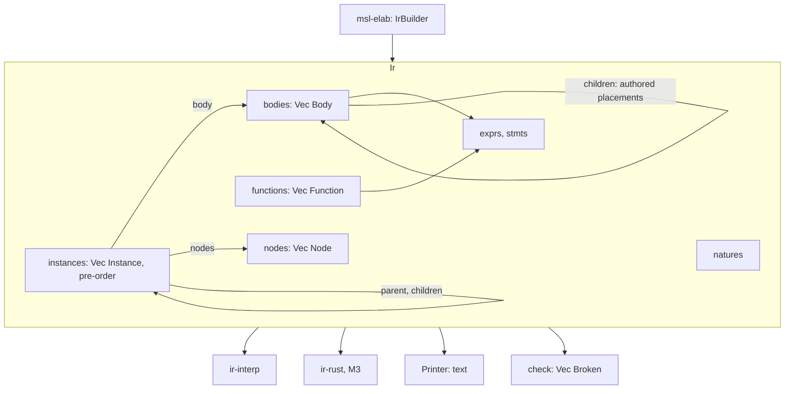

# MSL IR (object model, M1 node set) Design

**Spec**: `.specs/features/msl-ir/spec.md`
**Status**: Draft

---

## Architecture Overview

One crate, no in-tree dependency, in the shape of `piperine_lang::pom`: storage structs in arenas, `u32` ids, `Copy` handles for reading, a builder for writing, a printer and a checker. Two layers of content:

- **Bodies and functions**: what a module variant computes. Shared by every instance of the variant. A backend compiles (or plans) one per body.
- **The instance table and the node table**: what was placed. A backend binds one device per instance.



### The node set (IR-Q1, closed)

Three shapes were on the table: (a) value nodes mirroring the POM with dedicated nodes for the lowered forms, (b) an SSA value graph, (c) POM ids plus elaboration tables. (a) is chosen. (b) is the shape of the retired IR and the reason it could not be read. (c) ties a serialized IR to its sources and breaks once a module is monomorphized. With (a) the printer's output reads like the model, and the transpiler of M3 reprints value code nearly as is (C4).

What is lowered, and why each is its own node:

| Source form | IR node | Why not left as a call |
| --- | --- | --- |
| `v(a, k)`, `v(a)` | `Probe { plus, minus }` over body terminals | the nature's alias is resolved; the backend needs terminals, not names |
| `temperature()`, `gmin()`, `source_scale()` | `Env(..)` | each is a different ABI cell (a `GLOBAL` pin, two ambient inputs) |
| `limit(x, f, seed)` | `Limit { site, x, f, seed }` | the site is an ABI `LIMIT` input; its index is the instance's identity |
| `ac_stim(mag, phase)` | `Stim { site, mag, phase }` | the site is an ABI `STIM` input |
| `probe +> a + ddt(b)` | `Contribute { branch, quantity, addends: [direct a, ddt b] }` | abi.md A1: an operator is linear at the top of a row; the split is made once, here, not in each backend |
| `K_B`, `Q`, any `const` | `Real(..)` | constants are folded at elaboration (§8 rule 8) |
| `.exp()` | `Math { f: Exp, args }` | the catalogue row is resolved; a backend maps it to one libm call and one derivative rule |

`ddt` is not an expression node. In M1 it exists only as the operator of an addend, which is exactly the set of positions abi.md A1 can express without hoisting. `msl-elab` refuses any other placement.

---

## Code Reuse Analysis

### Existing Components to Leverage

| Component | Location | How to Use |
| --------- | -------- | ---------- |
| Id style | `crates/piperine-lang/src/pom/ids.rs` | copy the pattern: one `u32` newtype per arena, `Serialize`, `Deserialize`, `Ord`, written out by hand |
| Handle style | `crates/piperine-lang/src/pom/reflect/mod.rs` | `#[derive(Clone, Copy)] struct Body<'a> { ir: &'a Ir, id: BodyId }` with methods returning handles |
| Checker style | `crates/piperine-lang/src/pom/check.rs` | `check()` returns a list of broken invariants, never panics |
| Dump style | `Design::dump` in `pom/design.rs` | a deterministic text for golden tests |

Nothing is imported from `piperine-lang`: the patterns are copied, the crate stays a leaf. `serde` (workspace) is the only dependency; `serde_json` is a dev-dependency.

### Integration Points

| System | Integration Method |
| ------ | ------------------ |
| `piperine-lang` (`msl-elab`) | depends on this crate; writes through `IrBuilder` |
| `piperine-interp` | depends on this crate; reads through handles and `Body::dependencies` |
| `crates/piperine-solver/tests/workspace_shape.rs` | `RETIRED_CRATES` drops `piperine-ir` and `DEFAULT_MEMBERS` gains the new crate, in the task that creates it (Q6) |

---

## Components

### Storage (`model.rs`, `ids.rs`)

- **Purpose**: the data.
- **Location**: `crates/piperine-ir/src/`
- **Interfaces**: the structs under Data Models; all fields private to the crate, read through handles.
- **Dependencies**: `serde`.

### `IrBuilder` (`build.rs`)

- **Purpose**: the only way to make an `Ir`.
- **Interfaces**: `IrBuilder::new()`, `nature(..) -> NatureId`, `body(BodySpec) -> BodyId`, `function(..) -> FunctionId`, `expr(Expr) -> ExprId`, `stmt(Stmt) -> StmtId`, `node(..) -> NodeId`, `instance(..) -> InstanceId`, `finish(top: InstanceId) -> Ir`. Ids are handed out in call order, which is what makes them deterministic (IR-01 AC 3).
- **Dependencies**: storage.

### Handles (`handle.rs`)

- **Purpose**: reading.
- **Interfaces**: `Ir::top()`, `Ir::bodies()`, `Ir::instances()`, `Ir::nodes()`, `Ir::instance_at(path)`, `Ir::node_at(path)`; `Body::{name, origin, params, nodes, branches, limits, stims, analog, children}`; `Instance::{path, body, parent, children, node(i), param(i)}`; `Node::{path, nature, declared_by, init, instances}`; `Function::{name, params, body}`; `Ir::expr(ExprId) -> &Expr`, `Ir::stmt(StmtId) -> &Stmt`.

### `Deps` (`deps.rs`)

- **Purpose**: the static dependency sets and the affine test (IR-09).
- **Interfaces**: `Body::dependencies(Target) -> Deps` with `enum Target { Flow(BranchIndex), Charge(BranchIndex), Limit(SiteIndex), Stim(SiteIndex), Check(ParamIndex) }`; `Deps { nodes, params, env, limits, stims }`, each a sorted `Vec`; `Body::is_affine(BranchIndex) -> bool`.
- **How**: one abstract walk of the `analog` block per body, memoized on first use behind a `OnceLock`. Each local carries a pair (set of sources, class), the class being one of `Constant < Affine < Nonlinear`. `+`, `-` join; `*` and `/` by a `Constant` right operand keep the class; anything else that touches a probe gives `Nonlinear`; a function call joins its arguments and gives `Nonlinear` when any is not `Constant`; an `if` joins its arms and gives `Nonlinear` when its condition is not `Constant`.
- **Dependencies**: handles.

### `Printer` (`print.rs`) and `Ir::check` (`check.rs`)

- **Purpose**: IR-04, IR-11 and IR-06.
- **Interfaces**: `impl Display for Ir` (the full text); `Ir::print_structural(&self) -> String` (the structural form, IR-11); `Ir::check(&self) -> Vec<Broken>` with `Broken { item: String, origin: Origin, what: String }`.

**Two printed forms.** The full text (`Display`, IR-04) is the tree followed by an `arenas` section (every expression and statement by id with its type, form by ids and origin): it prints every field equality compares, so unequal IRs print differently. The **structural form** (`print_structural`, IR-11) is the cross-feature contract: what `msl-elab` must reproduce from `devices.msl`, byte for byte, against `crates/piperine-ir/tests/golden/*.txt`. It is the tree alone, with these rules:

| Rule | Why |
| --- | --- |
| No `@origin` anywhere, no `arenas` section, no arena id | origins and arena order are the producer's, not the design's |
| Natures, bodies, functions, an owner's locals and the node table sorted by their printed text | their arena order is the order a producer happened to build in |
| Instances in table order | IR-08 AC 2 fixes the pre-order: it is structure |
| Params, body nodes, branches, sites, children, statements in declaration order | IR-02 AC 2 fixes it, and indices into them are semantic |
| Locals, params, terminals, functions and sites by name or site index | names are what the source wrote |
| An expression is written out in full wherever it is reached; reached again in the same statement it prints `^k` (the `k`-th written out in that statement, pre-order), `<cycle ^k>` while still being written | the numbering follows the tree; a DAG or a broken IR still terminates |
| `(<expr> : <type>)` when the recorded type differs from the type the form implies (constants, operators, probes, environment reads, math, sites: their fixed type; a local or param: its declared type; a call: the callee's return; an `if`: its `then` arm; a block: its value, else `()`; a closure: `fn(param types) -> body type`) | every type is recoverable without annotating what the form already fixes |

**Origins in an elaborated IR** (the rule `msl-elab` follows, tested by a later feature, not by this one): an expression's origin is the start of the POM span of the construct it lowers from; a synthesized expression (a folded constant, an implied operand) carries the origin of the construct that produced it. The hand-built fixtures of `tests/support/devices.rs` share one hand-picked origin per statement and are compared in structural form only.

Printed form (structural, as `print_structural` writes it), for orientation (the golden tests fix it):

```text
body Diode
  param is: f64 = 1e-14 where (is > 0.0)
  param n: f64 = 1.0 where (n > 0.0)
  param cj0: f64 = 0.0 where (cj0 >= 0.0)
  node a: Electrical port
  node k: Electrical port
  branch b0 (a, k) flow
  limit L0 "vd"
  local id: f64
  ...
  analog
    let nvt = (n * vt())
    let vcrit = (nvt * ln((nvt / (sqrt(2.0) * is))))
    let vd = limit L0 (probe(a, k), |new, old| pnjlim(new, old, nvt, vcrit), seed vcrit)
    let id = (is * (exp((vd / nvt)) - 1.0))
    b0.flow +> direct (id + (gmin() * vd)), ddt (cj0 * vd)
instance Divider.r1: Resistor  nodes (Divider.vin, Divider.mid)  params (r = 1000.0)
node Divider.mid: Electrical  declared by Divider
```

---

## Data Models

```rust
pub struct Ir {
    natures: Vec<NatureData>, bodies: Vec<BodyData>, functions: Vec<FunctionData>,
    exprs: Vec<ExprData>, stmts: Vec<Stmt>,
    instances: Vec<InstanceData>, nodes: Vec<NodeData>, top: InstanceId,
}

pub struct Origin { pub file: String, pub line: u32, pub col: u32 }   // printed "file:line:col", the ABI's `origin`

pub struct NatureData { name: String, potential: Quantity, flow: Option<Quantity> }
pub struct Quantity   { name: String, access: String, units: String, abstol: f64 }

pub struct BodyData {
    name: String, origin: Origin,
    params: Vec<Param>, nodes: Vec<BodyNode>, branches: Vec<Branch>,
    limits: Vec<Site>, stims: Vec<Site>, locals: Vec<Local>,
    analog: Option<Vec<StmtId>>, children: Vec<Child>,
}
pub struct Param    { name: String, ty: ValueType, default: Option<Constant>, check: Option<ExprId>, structural: bool, origin: Origin }
pub struct BodyNode { name: String, nature: NatureId, role: NodeRole /* Port | Signal */, init: Option<f64>, origin: Origin }
pub enum  Terminal  { Node(u32), Ground }
pub struct Branch   { plus: Terminal, minus: Terminal, kind: BranchKind /* Flow | Potential */ }
pub struct Site     { name: String, origin: Origin }
pub struct Local    { name: String, ty: ValueType }
pub struct Child    { name: String, body: BodyId, nodes: Vec<Terminal>, params: Vec<(u32, Constant)>, origin: Origin }

pub struct FunctionData { name: String, origin: Origin, params: Vec<Local>, ret: ValueType, locals: Vec<Local>, body: ExprId }

pub struct ExprData { kind: Expr, ty: ValueType, origin: Origin }
pub enum Expr {
    Real(f64), Bool(bool), Unit,
    Local(u32), Param(u32),
    Unary { op: UnaryOp, expr: ExprId },
    Binary { op: BinaryOp, lhs: ExprId, rhs: ExprId },
    If { cond: ExprId, then: ExprId, otherwise: ExprId },
    Block { stmts: Vec<StmtId>, value: Option<ExprId> },
    Call { function: FunctionId, args: Vec<ExprId> },
    Math { f: MathFn /* Exp | Ln | Sqrt | Abs */, args: Vec<ExprId> },
    Closure { params: Vec<u32>, body: ExprId },
    Probe { plus: Terminal, minus: Terminal },
    Env(Env /* Temperature | Gmin | SourceScale */),
    Limit { site: u32, x: ExprId, f: ExprId, seed: Option<ExprId> },
    Stim { site: u32, mag: ExprId, phase: Option<ExprId> },
}
pub enum Stmt {
    Let { local: u32, init: ExprId },
    Expr(ExprId),
    Contribute { branch: u32, quantity: QuantityRole /* Flow | Potential */, addends: Vec<Addend> },
}
pub struct Addend { operator: Operator /* Direct | Ddt */, negated: bool, value: ExprId }

pub enum ValueType { F64, Bool, Unit, Fn(Vec<ValueType>, Box<ValueType>) }
pub enum Constant  { Real(f64), Bool(bool) }

pub struct InstanceData { path: String, name: String, body: BodyId, parent: Option<InstanceId>,
                          children: Vec<InstanceId>, nodes: Vec<NodeRef>, params: Vec<Constant>, origin: Origin }
pub enum  NodeRef { Node(NodeId), Ground }
pub struct NodeData { path: String, nature: NatureId, declared_by: InstanceId, init: Option<f64>, origin: Origin }
```

**Relationships**: an `InstanceData.nodes[i]` binds `BodyData.nodes[i]`; an `InstanceData.params[i]` is the bound value of `BodyData.params[i]`, default applied. `Child` is the authored placement inside a body (the tree a device author wrote); `InstanceData` is the elaborated copy. Locals are indexed per owner (a body's `analog` block or a function); a closure's body reads the locals of the block that wrote it.

Operators are the IR's own enums (`UnaryOp { Neg, Not }`, `BinaryOp { Add, Sub, Mul, Div, Lt, Le, Gt, Ge, Eq, Ne, And, Or }`): `And` and `Or` short-circuit, as in the source.

---

## Error Handling Strategy

| Error Scenario | Handling | User Impact |
| -------------- | -------- | ----------- |
| A broken invariant | an entry of `Ir::check()`; the crate never panics on a bad id reached through `check` | a backend refuses the IR and prints the entries |
| Bad serialized input | `serde`'s error | no `Ir` |
| A handle asked for an id out of range | a panic, as an out-of-range arena index is in the POM; `check()` is the gate that makes it unreachable | none after `check` |

---

## Risks & Concerns

| Concern | Location (file:line) | Impact | Mitigation |
| ------- | -------------------- | ------ | ---------- |
| A crate named `piperine-ir` trips two guards | `crates/piperine-solver/tests/workspace_shape.rs:22`, `:99` | `cargo test` red on the first commit of the crate | the creating task edits `RETIRED_CRATES` and `DEFAULT_MEMBERS` in the same commit; Q6 lets the user pick another name instead |
| `suite_hygiene` carries a note about `piperine-ir` as a once-dead identifier | `crates/piperine-lang/tests/suite_hygiene.rs:441` | none today (the identifier is off the list); the comment goes stale | the creating task updates the comment |
| `f64` in `PartialEq` and JSON: NaN and infinity | `Expr::Real`, `Constant::Real` | `inf` is a prelude constant; `serde_json` writes non-finite floats as `null` | reals are serialized as their bit pattern (`u64`); equality is bitwise; a test round-trips `inf` |
| The M1 node set will grow in M2 | this design | serialized M1 IRs will not load in M2 | no IR is persisted in M1; the cache is M3's |

---

## Tech Decisions

| Decision | Choice | Rationale |
| -------- | ------ | --------- |
| Node set | POM-like value nodes plus dedicated analog nodes | IR-Q1, argued above |
| Contributions | split into addends at elaboration | one place applies abi.md A1 |
| Origins | text (`file:line:col`), not POM ids | self-sufficient IR; the ABI wants exactly this string |
| Dependency analysis | a query in this crate | one answer for every backend |
| Reals | stored and compared by bit pattern | deterministic equality and lossless JSON |

## Size

8 tasks: crate, ids and storage with the guard edits; builder; handles and path lookup; the node set with its hand-built device bodies as test fixtures; serde with bitwise reals; printer and golden texts; `check()`; `Deps` and the affine test. Sonnet implements, Opus verifies; the `Deps` task is Opus's (it decides what the Jacobian pattern is).
