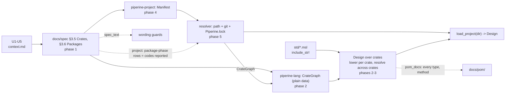

# MSL Packages Design

**Spec**: `.specs/features/msl-packages/spec.md`
**Status**: Draft

---

## Architecture Overview

Three layers, in the order the truth flows. The specification says what a crate and a package are. `piperine-lang` builds one `Design` over a crate graph it receives as data. `piperine-project` reads manifests, locates packages and produces that graph.



```mermaid
sequenceDiagram
    participant H as host
    participant P as piperine-project
    participant F as filesystem / git
    participant L as piperine-lang
    H->>P: load_project(dir)
    P->>F: read Piperine.toml (root)
    P->>F: read Piperine.lock
    loop each dependency, depth first
        P->>F: locate (path, or checkout of the locked / resolved commit)
        P->>F: read its Piperine.toml
        P->>P: check name, version, cycle; add crate + edge
    end
    P->>F: write Piperine.lock (when it changed)
    P->>L: Design::load_crates(graph)
    L->>F: read each crate's src/lib.msl and its mod files
    L->>L: lower every crate, then std; resolve; index
    L-->>P: Design (diagnostics inside)
    P-->>H: Ok(Design) or Err(Vec<PackageError>)
```

**The dependency direction.** `piperine-project` depends on `piperine-lang`; never the reverse. `piperine-lang` gains no dependency (PKG-03 AC 6): it never sees TOML, a URL or a lockfile, only names, root paths and edges.

**Approaches considered.** All three deliver the same scope.

1. *A crate graph as data, one `Design`* (chosen). The front end takes `CrateGraph` and builds one arena model in which each crate is its own tree. A dependency name resolves to the root namespace of another crate: an ordinary `Resolution::Decl`. Trade-off: the `Design` gets a crate table and a file-to-crate link, and its serialized form changes.
2. *One `Design` per crate, linked by a host.* Each crate keeps today's single-tree design and a `Workspace` object resolves across them. Rejected: every cross-crate link would be a pair (design, id), `Resolution` would need a second variant, and `references()` and `writers()` would stop at the crate boundary.
3. *Mount each dependency as a `mod` of the root crate.* No new storage. Rejected: it breaks the navigability rule (a crate would appear as a child of another), makes `crate::` wrong inside a dependency, and exposes private items to the root crate.

**Where the rules run.** Name rules run in `piperine-lang` (`pom/resolve/`), reached by `pom_crates`. Manifest, location, version, cycle and lockfile rules run in `piperine-project`, reached by its four integration targets. No rule is left to a CLI.

**Where a spec edit lands (MD-57).**

| Spec edit | Guard that reads it | Lands in |
| --- | --- | --- |
| §3.5, §3.6, §0.3, the glossary, Appendix G: prose, rules, `Resolution` notes, rows of phase `elaboration` and `package` | `spec_text` | phase 1 (T1 to T3, T5) |
| the `extern crate` row of B.3.6 | `spec_text::b36_lists_every_removed_form`, `msl_errors` (one fixture per row, matched by the first cell) | T4, with the parser change |
| a `rust` fence in §3.5 | `msl_corpus`, `pom_corpus` (parse and round trip only) | T1: the fences use syntax the parser already takes (`use a::b::C;`) |
| rows of phase `package` | new: `project::the_crate_reports_exactly_the_package_phase_codes` | written in T3; the guard arrives in T25, when every code is reported |

---

## Specification text (what phase 1 writes)

The workers write it in the style of `.specs/features/msl-spec/STYLE.md`. The content is fixed here.

### §3.5 Crates

Lead: a **crate** is one tree of namespace modules rooted at one file; a crate reaches another only through a dependency.

1. The **crate root** is the file the tree starts from. Its namespace has no name; `mod` items add the files below it (§3.6 rule 2).
2. A crate has a name and a set of dependencies. A **dependency name** names one other crate inside this crate. It need not be the other crate's own name (§3.6 rule 8).
3. `std` is a dependency of every crate. No manifest names it and no dependency may be called `std`.
4. The first segment of a path, in an expression, a type, a pattern or a `use`, that is not `crate`, `self` or `super` is looked up in this order; the first hit wins: (a) the scopes of the enclosing blocks and declarations; (b) the items and imports of the enclosing namespace; (c) the dependency names of the crate; (d) the prelude; (e) the core names.
5. Where an item or an import of the enclosing namespace has the name of a dependency, an ordinary path follows rule 4: the item or import wins, without a diagnostic. A `use` path whose first segment is that name is ambiguous (`E0163`). There is no leading `::` (B.3.6): the dependency is reached under another key (`other = { package = "<name>", .. }`, §3.6 rule 8) and the local one as `crate::<name>`.
6. A dependency name resolves to the root namespace of that crate. A crate's own name is not in scope inside it.
7. `crate` names the root of the crate that contains the path. `self` and `super` are relative to the namespace that contains it. `super` at a crate root does not resolve (`E0161`).
8. From another crate an item is visible only when it is `pub` and every namespace on the path from its crate root to it is `pub`. `pub use` re-exports, as in Rust.
9. The prelude (§3.4.2) is implied in every file of every crate, `std`'s own files included.
10. The dependencies of the crates form no cycle (§3.6, `E0174`).
11. `extern crate` is not part of the language (B.3.6).

`Resolution` notes: rules 4 and 5 are Rust 2018's exactly (dependency names sit below a namespace's own names in a path; an import that could mean either is an error, never a silent choice), stated because no `::` exists to disambiguate; a dependency name against a prelude item is not a clash, the dependency wins; rule 9 has no exception for `std`, so one rule holds everywhere.

Errors: the defining row `E0163` (a `use` path whose first segment names both a dependency and an item or import of the enclosing namespace; phase elaboration), then rows keyed by section, as §0.2 prescribes: `[§3.4]` a first segment that names no item, import, dependency, prelude item or core name, or an item not visible from the crate (`E0161`); `[§3.6]` a cycle (`E0174`).

Also edited: the lead of §3.4 ("a package of models is a crate" becomes a pointer to §3.5 and §3.6); §3.4.2 (the **prelude** is the `pub` items of `std::prelude`, which re-exports the standard library of §22); the `E0161` row (adds "a first segment that names no dependency of the crate (§3.5)"); "Terms defined here" of Part I.

### §3.6 Packages

Lead: a **package** is a directory with a manifest; it holds one crate.

1. The **manifest** is the file `Piperine.toml` in the package directory, written in TOML.
2. The crate root is `src/lib.msl`. A source file has the extension `.msl`. `mod name;` loads `name.msl` or `name/mod.msl` below the declaring file, as Rust places `name.rs` and `name/mod.rs`; neither or both is `E0161`.
3. The manifest holds the tables and keys of the table below and no other (`E0171`).
4. A package name and a dependency name are identifiers (A.1) that are no keyword of the language and not `std`. The package name is the crate's name.
5. A version is `MAJOR.MINOR.PATCH`, three decimal integers.
6. A **dependency** is an entry of `[dependencies]`; its key is the dependency name. It has exactly one source: `path` or `git`.
7. `path` is a directory, relative to the directory of the manifest that names it, or absolute. `git` is a repository URL; it takes at most one of `branch`, `tag` and `rev`, and none means the repository's default branch. The package is at the root of the repository.
8. `package` gives the located package's own name when it differs from the key. The located package's name **MUST** equal `package`, or the key when there is none (`E0173`).
9. `version` is a requirement the located package's version **MUST** satisfy (`E0173`), in one of the forms of the requirement table.
10. Two dependencies that locate the same package (one directory; one repository at one commit) name the same crate.
11. Dependencies are followed transitively. The graph **MUST NOT** hold a cycle (`E0174`).
12. A crate is reached through a dependency and in no other way: an implementation **MUST NOT** find a crate through a search path, a registry or an environment variable.
13. The **lockfile** is `Piperine.lock` beside the root package's manifest. It records the commit each git package resolved to. While an entry's source (URL and requested reference) equals a dependency's, the recorded commit **MUST** be used. An explicit update resolves again. A lockfile inside a dependency is not read.
14. The lockfile is TOML: `version = 1`, then one `[[package]]` per git package with `name`, `version`, `source` (`git+<url>`, then `?branch=<b>`, `?tag=<t>` or `?rev=<r>` when one is given) and `commit` (40 hexadecimal digits), sorted by `name`, then `source`.

Manifest keys (one table, columns Table, Key, Type, Required, Meaning):

| Table | Key | Type | Required |
| --- | --- | --- | --- |
| `[package]` | `name` | string | yes |
| `[package]` | `version` | string | yes |
| `[package]` | `authors` | array of strings | no |
| `[package]` | `description` | string | no |
| `[dependencies]` entry | `path` | string | one of `path`, `git` |
| `[dependencies]` entry | `git` | string | one of `path`, `git` |
| `[dependencies]` entry | `branch`, `tag`, `rev` | string | no, at most one, with `git` only |
| `[dependencies]` entry | `version` | string | no |
| `[dependencies]` entry | `package` | string | no |

Requirement table (Cargo's caret rule):

| Requirement | Admits |
| --- | --- |
| `1.2.3` | `>=1.2.3, <2.0.0` |
| `1.2` | `>=1.2.0, <2.0.0` |
| `1` | `>=1.0.0, <2.0.0` |
| `0.2.3` | `>=0.2.3, <0.3.0` |
| `0.2` | `>=0.2.0, <0.3.0` |
| `0.0.3` | `>=0.0.3, <0.0.4` |
| `0.0` | `>=0.0.0, <0.1.0` |
| `0` | `>=0.0.0, <1.0.0` |

Errors (`Code | Condition | Phase`):

| Code | Condition | Phase |
| --- | --- | --- |
| `E0170` | a package directory without `Piperine.toml`, or a manifest that is not UTF-8 or not valid TOML | package |
| `E0171` | a manifest entry rules 3 to 9 do not allow: an unknown table or key, a missing `name` or `version`, a value of the wrong type, a name that breaks rule 4, a version or requirement of another form, a dependency without exactly one source, a `branch`, `tag` or `rev` beside another or beside `path` | package |
| `E0172` | a dependency that cannot be located: a `path` with no manifest, a repository that cannot be fetched, a reference the repository does not hold | package |
| `E0173` | a located package that is not the one asked for: another name, or a version that does not satisfy `version` | package |
| `E0174` | a cycle among the dependencies | package |
| `E0175` | a package without its crate root `src/lib.msl` | package |
| `E0176` | a lockfile that is not valid TOML or whose `version` is not `1` | package |

§0.3 gains the phase **package** ("the manifests are read, the dependencies located and the crate graph fixed", defined in §3.6), first in the table; "one of four phases" becomes "five"; rule 3 adds it to the phases that reject a model.

Appendix G: G.0 gains "source search paths (`-I`)" (use: a dependency named in the manifest, §3.6 rule 12) and "a package registry" (use: `path` and `git` dependencies). The closed table gains P1 to P6: P1 crate root `src/lib.msl` and the extension `.msl` (§3.6 rule 2); P2 dependency names in paths; a local name wins in an ordinary path and clashes in a `use` (`E0163`); no `extern crate` (§3.5 rules 4, 5, 11); P3 `std` implicit, the prelude is `std::prelude` (§3.5 rules 3 and 9, §3.4.2); P4 the closed manifest (§3.6 rule 3); P5 git references and the lockfile (§3.6 rules 7, 13, 14); P6 the `package` phase (§0.3).

---

## Code Reuse Analysis

### Existing Components to Leverage

| Component | Location | How to Use |
| --- | --- | --- |
| `SourceProvider`, `MemorySources`, `DiskSources`, `mod_candidates` | `crates/piperine-lang/src/pom/source.rs` | unchanged: each crate root is a "root file" for `mod` lookup (`is_root = true` per crate); `std` reads from a `MemorySources` of the embedded texts |
| `Design::add_file`, `lower_file`, `Lowerer::load_mod` | `pom/design.rs`, `pom/lower/files.rs` | called once per crate root instead of once; the cycle chain of `load_mod` stays per crate |
| `Ctx::walk`, `scope_lookup`, `ns_item`, `within` | `pom/resolve/imports.rs` | `walk`'s `"crate"` arm takes the crate of `ns`; `scope_lookup` gains the dependency step and reads the prelude from `std::prelude`. `within` already answers "not inside" across crates, so `pub` across crates needs no new code path |
| `path_diagnostic` | `pom/resolve/imports.rs` | gains the help line for a first segment that names a crate of the graph that is no dependency |
| `Design::check` | `pom/check.rs` | extended with the crate invariants (PKG-08) |
| `first_named`, `authored` | `pom/reflect/mod.rs` | "non-prelude files" becomes "the root crate"; the precedence code is kept |
| `msl::Diagnostic`, `msl::render` | `crates/piperine-lang/src/msl/diag.rs` | the diagnostic and the renderer of `PackageError` |
| `msl::lexer::lex` | `crates/piperine-lang/src/msl/lexer.rs` | `pom::is_crate_name`: a name is valid when it lexes to one `Token::Ident` |
| `RemovedForm` table, `removed(row, span)` | `msl/parser/base.rs`, `msl/parser/item.rs` | one more row for `extern crate` |
| `spec(file)`, `section`, `table_rows`, `codes_in`, `g_entry` | `crates/piperine-lang/tests/spec_text.rs` | every new `spec_text` test |
| `sync_and_checkout` | `crates/piperine-project/src/git.rs` | kept, with the reference resolution fixed (Risks); `GitSource` is deleted |
| `find_project_root` | `crates/piperine-project/src/lib.rs` | kept as is |
| `toml::de::DeTable::parse` | `toml` 1.1.2 (already a dependency) | a table whose keys and values carry spans: the manifest and lockfile reader walks it by hand, so every diagnostic has an exact span and unknown keys are found by iteration |
| `git2` | already a dependency | fetch and checkout; also the test fixtures (`Repository::init`, commits, branches, tags in a temporary directory) |

### Integration Points

| System | Integration Method |
| --- | --- |
| `docs/spec/` | edited in place; `spec_text` asserts each decided fact |
| `docs/pom/` | `model.md` (storage types), `reflection.md` (`Crate`, new methods), `resolution.md` (scope order), `mapping.md` (crate row), `index.md`; `pom_docs` enforces headings and methods in the task that adds them |
| serialized `Design` | the JSON shape changes (`crates`, `root_crate`, `std_crate`, `krate` per file; `root_file` and `prelude` go). No stored design exists outside tests |
| other workspace crates | not built, not repaired. `piperine-cli`, `piperine-lang-server`, `piperine-python` and `piperine-plugin` call the deleted surface of `piperine-project` and stay broken, as the brief allows |

---

## Components

### `CrateGraph` (new, `piperine-lang`)

- **Purpose**: the resolved crate graph, as the data the front end is built from.
- **Location**: `crates/piperine-lang/src/pom/crates.rs` (`CrateId` in `ids.rs`)
- **Interfaces**:
  - `CrateGraph::new() -> CrateGraph`
  - `add_crate(&mut self, name: &str, root: impl Into<PathBuf>) -> Result<CrateId, GraphError>` - the first crate added is the root crate
  - `add_dependency(&mut self, from: CrateId, name: &str, to: CrateId) -> Result<(), GraphError>` - rejects an invalid or repeated name, a foreign id and an edge that closes a cycle; a rejected call changes nothing
  - `crates(&self) -> &[CrateNode]`
  - `pom::is_crate_name(name: &str) -> bool` - an identifier that is no keyword and not `std`
- **Dependencies**: the lexer.
- **Reuses**: the storage derives of the POM.

### Crates in the `Design` (`piperine-lang`)

- **Purpose**: hold every crate as authored and say which crate each file belongs to.
- **Location**: `pom/design.rs`, `pom/lower/`, `pom/stdlib.rs` (new: the embedded texts), `crates/piperine-lang/std/lib.msl`, `std/prelude.msl` (new)
- **Interfaces**:
  - `DesignBuilder::crates(self, graph: CrateGraph) -> Self` - the crates; their root paths are read from the virtual sources when any `source` was given, else from disk
  - `DesignBuilder::std_source(self, path, text) -> Self` - virtual files of `std`, replacing the embedded ones; the first is its root
  - `Design::load_crates(graph: CrateGraph) -> Design` - from disk
  - `source`, `root_file`, `Design::load` unchanged: one root crate named by the stem of the root file
  - removed: `DesignBuilder::prelude`, `SourceFile::is_prelude`, `Design::prelude_files`, `SourceFileData::prelude`
- **Build order**: lower the crates in graph order (the root crate first, so its files are numbered first), then `std`; then one resolution pass over everything.
- **Dependencies**: `CrateGraph`.
- **Reuses**: `add_file`, `lower_file`, `MemorySources`.

### Resolution across crates (`piperine-lang`)

- **Purpose**: §3.5 rules 4 to 9.
- **Location**: `pom/resolve/imports.rs`, `pom/resolve/mod.rs`
- **Changes**:
  - `Ctx` gets, per namespace, its crate (through `decl.file` and the file's crate), and per crate its dependency names; `std` is added to every crate's names.
  - `walk`: `"crate"` is the root of the crate of `ns`.
  - `scope_lookup`: namespace items and imports, then dependency names (a hit is `Resolution::Decl(root namespace of that crate)`), then the `pub` items of the namespace `prelude` of `std`'s root, then the built-in table.
  - `resolve_imports` (and the block-level `use`): when segment 0 of a `use` path is found among the namespace's items or imports and is also a dependency name of the crate, the walk ends with a new `WalkError::CrateClash` and `path_diagnostic` reports `E0163` with the two-remedy help; the segments stay `Unresolved`. Other paths never take this branch.
  - `path_diagnostic`: when segment 0 is missing and names a crate of the design, the `E0161` carries the help "name it under `[dependencies]` in `Piperine.toml`".
- **One new code (`E0163`, U6) and no new `Resolution` variant**: a crate is its root `Namespace` declaration.
- **Reuses**: `ns_item`, `within`, the glob and cycle guards.

### `Crate` handle (`piperine-lang`)

- **Purpose**: Java-reflection-style access to a crate.
- **Location**: `pom/reflect/crates.rs` (new)
- **Interfaces**:
  - `Design::crates() -> Vec<Crate>`, `Design::krate(name) -> Option<Crate>`, `Design::root_crate() -> Crate`, `Design::std_crate() -> Crate`
  - `Crate::id()`, `name()`, `root() -> Namespace`, `files() -> Vec<SourceFile>`, `is_root()`, `is_std()`
  - `Crate::dependencies() -> Vec<(&str, Crate)>`, `Crate::dependency(name) -> Option<Crate>`
  - `Crate::decls()`, `Crate::modules()`, `Crate::module(name)`, `Crate::find(qualified) -> Option<Decl>`
  - `SourceFile::krate() -> Crate`, `Reflect::krate(self) -> Crate`
- **Semantics kept**: `qualified_name()` stays relative to the declaration's own crate; `Design::find` and the by-name lookups prefer the root crate, then crate order.

### `piperine-project` (cut down and ported)

- **Purpose**: manifest, dependencies, lockfile; one call that loads a project.
- **Location**: `crates/piperine-project/src/`: `lib.rs` (`find_project_root`, `load_project`, re-exports), `error.rs` (`PackageError`), `manifest.rs`, `resolver.rs`, `git.rs`, `lockfile.rs`. Deleted: `release.rs`, `source_map.rs`, `tests/release.rs`, `GitSource`, `resolve_plugins`, `declares_contributions`, the plugin fields of the lockfile.
- **Interfaces**:
  - `Manifest::parse(text: &str) -> Result<Manifest, Vec<Diagnostic>>` - every fault, in source order
  - `Manifest::load(dir: &Path) -> Result<Manifest, Vec<PackageError>>`
  - `Requirement::admits(&self, version: Version) -> bool`
  - `resolve(dir: &Path, options: Options) -> Result<PackageGraph, Vec<PackageError>>`
  - `load_project(dir: &Path) -> Result<Design, Vec<PackageError>>`
  - `find_project_root(dir: &Path) -> Option<PathBuf>`
  - `PackageError::code()`, `PackageError::render() -> String`
- **Dependencies**: `piperine-lang`, `toml`, `git2`. Dropped: `ureq`, `sha2`, `serde`, `serde_json`, `thiserror`.
- **Reuses**: `sync_and_checkout`, `find_project_root`, `msl::Diagnostic`, `msl::render`, `pom::is_crate_name`.
- **Resolver**: a depth-first walk from the root package. A package's identity is its canonical directory (path) or `(url, commit)` (git); a map from identity to `CrateId` makes a shared dependency one crate. The stack of packages being walked is the cycle check: a dependency that locates a package on the stack is `E0174` at that dependency's key, with the chain. `CrateGraph::add_dependency` can therefore not fail on a cycle; an `Err` from it is reported as `E0174` all the same, never unwrapped.
- **Git layout**: `<root>/target/deps/<sanitized url>/db` is a clone used to resolve references; `<root>/target/deps/<sanitized url>/<commit>` is the checkout of one commit (cloned from `db`). `<sanitized url>` replaces every character outside `[A-Za-z0-9._-]` by `_`. With a lockfile entry and an existing checkout, nothing is fetched.

---

## Data Models

### Front end (`piperine_lang::pom`)

```rust
pub struct CrateId(pub u32);                       // ids.rs, like FileId

pub struct CrateGraph { crates: Vec<CrateNode> }   // input; Debug, Clone, Default, PartialEq
pub struct CrateNode {
    pub name: String,
    pub root: PathBuf,                             // the crate root file
    pub dependencies: Vec<DependencyData>,
}
pub struct DependencyData { pub name: String, pub krate: CrateId }   // dependency name, target
pub enum GraphError {
    InvalidName { name: String },
    DuplicateDependency { krate: String, name: String },
    UnknownCrate { id: CrateId },
    Cycle { names: Vec<String> },                  // a, b, c, a
}

pub struct CrateData {                             // stored in the Design
    pub name: String,
    pub root_file: FileId,
    pub root: DeclId,                              // the root Namespace declaration
    pub dependencies: Vec<DependencyData>,         // as declared; std is implicit, not listed
}

pub struct Design {
    crates: Vec<CrateData>,                        // graph order, std last
    root_crate: CrateId,                           // replaces root_file
    std_crate: CrateId,
    /* arenas, diagnostics, index: unchanged */
}
pub struct SourceFileData { /* name, path, text, ast, root */ pub krate: CrateId }   // replaces `prelude: bool`
```

**Relationships**: a crate owns its root file; a file belongs to one crate; a declaration reaches its crate through its file. No declaration has a parent in another crate. Every storage type derives `Debug, Clone, PartialEq, Serialize, Deserialize`.

### Project (`piperine_project`)

```rust
pub struct Manifest { pub package: Package, pub dependencies: Vec<Dependency> }
pub struct Package { pub name: String, pub version: Version, pub authors: Vec<String>, pub description: String }
pub struct Version { pub major: u64, pub minor: u64, pub patch: u64 }
pub struct Requirement { pub major: u64, pub minor: Option<u64>, pub patch: Option<u64> }
pub struct Dependency {
    pub name: String,
    pub name_span: Span,                           // where package-phase errors about it point
    pub source: Source,
    pub version: Option<Requirement>,
    pub package: Option<String>,
}
pub enum Source { Path(PathBuf), Git { url: String, reference: GitRef } }
pub enum GitRef { DefaultBranch, Branch(String), Tag(String), Rev(String) }

pub struct Options { pub update: bool }
pub struct PackageGraph { pub graph: CrateGraph, pub packages: Vec<ResolvedPackage> }
pub struct ResolvedPackage { pub krate: CrateId, pub dir: PathBuf, pub manifest: Manifest, pub commit: Option<String> }

pub struct PackageError { pub file: PathBuf, pub text: String, pub diagnostic: Diagnostic }

pub struct Lockfile { pub packages: Vec<LockedPackage> }
pub struct LockedPackage { pub name: String, pub version: Version, pub source: String, pub commit: String }
```

---

## Error Handling Strategy

| Error Scenario | Handling | User Impact |
| --- | --- | --- |
| a path starts with a name that is no item, import, dependency, prelude item or core name | `E0161` in the design's diagnostics; help line when the name is a crate of the graph | the design is still built; the path's segments stay `Unresolved` |
| a private item or namespace of another crate | `E0161` "`x` is private" | as above |
| a `use` path whose first segment is both a local name and a dependency | one `E0163` at the path; help: rename the dependency in the manifest (`package = "…"`) or write `crate::<name>` | the import's segments stay `Unresolved`; no `E0161` beside it |
| a crate root that cannot be read | one `E0161` on the crate's empty root file; the other crates build | paths into that crate report `E0161` |
| an invalid `CrateGraph` call | `Err(GraphError)`; the graph is unchanged | an API error for the host, never a panic |
| an empty `CrateGraph` given to the builder | treated as no graph: the virtual sources or the root file decide the root crate | never a panic |
| a manifest fault | `Vec<Diagnostic>` with spans, every fault of that manifest | a rendered report per fault |
| a dependency that cannot be located, a wrong package, a cycle, a missing crate root | one `PackageError` at the dependency's key in the declaring manifest; resolution stops at the first such error | `load_project` returns `Err`, no design |
| git failure | `E0172` with git2's message in the help | as above; nothing is half-checked-out under a commit directory (a failed checkout directory is removed) |
| an invalid lockfile | `E0176`, before any fetch | the user deletes or repairs the file |
| a JSON design with broken crate links | `Design::from_json` returns `Err(Vec<String>)` | never a panic |

---

## Risks & Concerns

| Concern | Location (file:line) | Impact | Mitigation |
| ------- | -------------------- | ------ | ---------- |
| `crate` is one global root | `crates/piperine-lang/src/pom/resolve/imports.rs:248` (`"crate" => Some(Resolution::Decl(self.root))`) | inside a dependency `crate::x` would name the root crate | T10 makes it per crate; `crate_names_the_root_of_the_containing_crate` |
| the prelude is "every prelude root", by a `bool` on the file | `pom/resolve/mod.rs:63`, `pom/resolve/imports.rs:224` | cannot express `std::prelude`; every `pub` item of any prelude source leaks | T7 replaces it by the namespace `prelude` of `std` |
| existing tests assume `files().len() == 1`, `files().last()`, `prelude_files()` and `is_prelude()` | `crates/piperine-lang/tests/pom_design.rs:70,123,141,187,254`, `pom_body.rs:278`, `pom_corpus.rs:60`, `pom_reflect.rs` (8 sites), `pom_resolve.rs:204`, `pom_classify.rs:18`, five fences of `docs/pom/` | an always-present `std` adds files; the prelude API goes | the root crate's files are numbered first, so `files()[0]` and `FileId(0)` keep their meaning; T7 and T8 name each migration (a count becomes a count of the root crate's files; the expected values do not move) |
| every design now parses the embedded library | `pom/design.rs` (`build`) | build time of each test grows when `msl-stdlib` fills the library | the placeholder is two short files; `msl-stdlib` measures and, if needed, caches the parsed tree |
| a path dependency is resolved against the process's working directory | `crates/piperine-project/src/resolver.rs:208` (`PathBuf::from(path_dep.path)`) | a transitive `path` points at the wrong directory | the resolver is rewritten; PKG-11 AC 1 |
| a package is identified by its dependency name | `resolver.rs:200` (`visited.contains(&pkg_name)`), `:230` (`Conflict`) | two packages of one name are conflated; two requirements of one name are an error, which Rust's model does not have | identity is the location; PKG-11 AC 3, PKG-12 AC 4 and 5 |
| a branch is resolved through the stale local branch | `crates/piperine-project/src/git.rs:122` (`revparse_single(target)` before `origin/<target>`) | after a fetch, `main` still names the old commit, so an update never moves | T22 resolves a branch as `refs/remotes/origin/<b>`, a tag as `refs/tags/<t>`, a rev as given; `update_moves_the_lock_to_the_new_commit` |
| tags are not fetched on a re-fetch | `git.rs:110` (refspec `+refs/heads/*` only) | a tag created after the first clone is not found | T22 adds `+refs/tags/*:refs/tags/*` |
| `version` maps to a ref `release/v<version>`, "latest" to a ref named `latest` | `resolver.rs:246-249` | conventions of the deleted plugin flow | deleted; §3.6 rules 7 and 9 |
| the lockfile carries plugin trust fields | `crates/piperine-project/src/lockfile.rs:20-37` | dead with U3 | rewritten in T23 |
| `piperine-project` does not build today | `crates/piperine-project/src/source_map.rs:9` (`piperine_lang::SourceMap`) | the `**Build**` line of `tasks.md` cannot include it before T15 | the build line covers `piperine-lang`; the project crate's build is C117's lone proof and part of every gate from T15 on |
| tests of the old resolver write under `std::env::temp_dir()` with fixed names | `resolver.rs:301-344` | collisions between runs | every new test uses `tempfile::tempdir()` |
| `toml::de::DeTable` spans are byte ranges of the manifest text | `toml` 1.1.2, `src/de/parser/detable.rs:16` | none: verified in the vendored source; it is under the default `parse` feature | used as is |
| the worktree's `CLAUDE.md` describes the retired Verilog-AMS pipeline | `CLAUDE.md` | a worker could follow it | the tasks header says the facts are in `spec.md` and `design.md` |

---

## Tech Decisions (only non-obvious ones)

| Decision | Choice | Rationale |
| -------- | ------ | --------- |
| What a dependency name resolves to | `Resolution::Decl` of the other crate's root `Namespace` | no new variant; `references()` of a crate root lists who names the crate |
| Where cycles are refused | at `CrateGraph::add_dependency` (data) and in the resolver's walk (diagnostic) | the front end can never hold a cyclic graph; the user still gets a span and the chain |
| Crate ids | graph ids are design ids; `std` is appended | `piperine-project` keeps one id per package from resolution to reflection |
| The first crate is the root | by position, as `source()` already does for files | no second argument that could be out of range |
| `std` in `dependencies()` | not listed | the list mirrors what the manifest wrote (navigability); `std_crate()` reaches it |
| The prelude inside `std` | implied there too | one rule (§3.5 rule 9); lookups are on demand with a cycle guard, so nothing bootstraps |
| Manifest reader | a hand walk over `DeTable`, not `serde` derive | exact spans for keys and values, every fault reported, unknown keys by iteration |
| Requirement check | hand-written caret rule, three forms | no `semver` crate; the rule is eight rows |
| Lockfile writer | a plain string builder | the format is four keys; byte-identical output is a criterion |
| Checkout directory | named by the sanitized URL and the commit | readable, deterministic, no hash crate; two commits of one repository coexist |
| Test repositories | built with `git2` in a `tempdir`, referenced by filesystem path | no test touches the network |

**Project-level decisions** (T1 appends them to `.specs/STATE.md` `## Decisions`, status `Locked (msl-packages spec approved <date>)`):

- **MD-58: packages follow Cargo; the front end takes a crate graph as data.** A crate reaches another only through a dependency named in `Piperine.toml` (user, 2026-11-14: "faremos modelo RUST 100%"); there is no search path. A local name that equals a dependency name wins in an ordinary path and is an ambiguity error (`E0163`) in a `use` path (user, U6). `piperine-lang` takes a `CrateGraph` (names, root files, named edges, acyclic by construction) and never reads a manifest or a repository; `piperine-project` owns `Piperine.toml`, path and git resolution and `Piperine.lock`, and nothing else. One `Design` holds every crate as its own tree (navigability rule); a dependency name resolves to the root namespace of the other crate. Trade-off: no include path, ever, and a `Design` whose serialized form carries crates. Scope: `docs/spec` §3.5 and §3.6, `piperine-lang`, `piperine-project`, and every host.
- **MD-59: `std` is a crate embedded in `piperine-lang`; the prelude is `std::prelude`.** (user, 2026-11-14: "std fica embutida o binário"). Its sources are `crates/piperine-lang/std/*.msl`, compiled in with `include_str!`; every crate depends on it implicitly; the builder's prelude sources are gone (`std_source` replaces the library in tests). Supersedes the "prelude sources" of MD-54's builder and closes the open half of MD-55 (the extension `.msl` is now in §3.6). Scope: `piperine-lang`, `msl-stdlib`.
