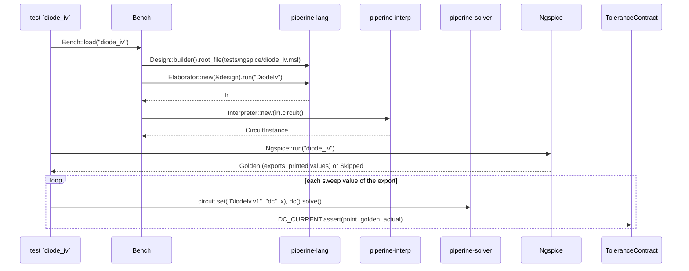

# MSL Parity Harness (M1) Design

**Spec**: `.specs/features/msl-parity/spec.md`
**Status**: Draft

---

## Architecture Overview

One crate, `piperine-parity`. Its library is the harness; its integration targets are the claims. A test has three lines of substance: load the twin, run the golden, compare under a contract.



The MSL side always runs, with or without ngspice (PAR-04 AC 4): `Ngspice::run` returns `Golden` or `Skipped`, and a test's comparison loop is over the golden's points, so a skipped golden compares nothing after the solve has succeeded.

---

## Code Reuse Analysis

### Existing Components to Leverage

| Component | Location | How to Use |
| --------- | -------- | ---------- |
| The old harness | `git show 16bddaae^:tests/support/ngspice.rs` | `ToleranceContract` (shape, `holds`, rationale printed on failure), `ScratchDir` (one directory per run, removed on drop), the strict `wrdata` parser: ported, not redesigned |
| The fixtures | `tests/ngspice/*.cir` | run as they are |
| The M1 models | `.specs/features/e2e-m1/models/*.msl` | moved to `tests/ngspice/` |
| The chain | `piperine_lang::pom::Design`, `piperine_lang::elab::Elaborator`, `piperine_interp::Interpreter` | called in order by `Bench::load` |
| Solver drivers | `piperine_solver::prelude` (`CircuitInstance::{dc, ac, transient, set}`, `AcSweepAnalysisOptions`, `TransientAnalysisOptions`, result getters) | the tests call them directly; there is no host session |
| `tempfile` | workspace dependency | the scratch directory |
| Corpus-guard pattern | `crates/piperine-lang/tests/suite_hygiene.rs`, `std_galleries.rs` | a check is a plain function returning its failures, asserted empty on the tree and non-empty on planted text |

### Integration Points

| System | Integration Method |
| ------ | ------------------ |
| Workspace | `crates/piperine-parity` joins `members` and `default-members`; `workspace_shape.rs::DEFAULT_MEMBERS` gains it |
| CI | `.github/workflows/ci.yml` installs ngspice, or sets `PIPERINE_NGSPICE=skip`, according to Q2 |
| `suite_hygiene.rs` | each new target opens with a `//!` scope header; no `#[ignore]` |

---

## Components

### `ToleranceContract` (`contract.rs`)

- **Purpose**: the only place a tolerance is written.
- **Interfaces**: `const DC_VOLTAGE, DC_CURRENT, AC_MAGNITUDE, AC_PHASE, TRAN_VOLTAGE: ToleranceContract`; `holds(&self, golden: f64, actual: f64) -> bool`; `assert(&self, at: &Point, golden: f64, actual: f64)` which panics with fixture, quantity, point, both values, the bound and `rationale`; `floor(&self) -> f64` (the phase gate reads `AC_MAGNITUDE.floor()`).
- **Data**: `Point { fixture: &str, quantity: &str, at: Coordinate }`, `enum Coordinate { OperatingPoint, Sweep(f64), Frequency(f64), Time(f64) }`.

| Contract | reltol | abstol | Rationale printed |
| --- | --- | --- | --- |
| `DC_VOLTAGE` | 1e-3 | 1e-6 V | both solvers stop Newton at `reltol` 1e-3 and 1 µV |
| `DC_CURRENT` | 1e-3 | 1e-12 A | the same `reltol`; the floor is both solvers' 1 pA flow tolerance, so a reverse-biased junction is not compared relatively against about zero |
| `AC_MAGNITUDE` | 1e-3 | 1e-12 | a linear solve at a frozen operating point; the floor governs the deep stopband |
| `AC_PHASE` | 0 | 1e-4 rad | absolute; compared only where the magnitude clears its floor |
| `TRAN_VOLTAGE` | 1e-3 | 1e-6 V | two integrators under the same `reltol`; the interpolation onto ngspice's grid is kept a decade below by the harness's step cap |

The values are Q3's recommendation.

### `Ngspice` and `Golden` (`ngspice.rs`, `golden.rs`)

- **Purpose**: run a `.cir`, parse what it produced.
- **Interfaces**:
  - `Ngspice::run(fixture: &str) -> Reference` with `enum Reference { Golden(Golden), Skipped }`; a missing binary or a failed run panics with the message of PAR-03 or PAR-04.
  - `Golden::printed(&self, name: &str) -> f64` for `print` output (`v(mid) = 7.500000e+00`).
  - `Golden::real(&self, export: &str) -> Vec<(f64, f64)>`, `Golden::complex(&self, export: &str) -> Vec<(f64, Complex)>` for `wrdata` files.
- **Details**: the binary is `PIPERINE_NGSPICE` when it is a path, else `ngspice` on `PATH`; the literal value `skip` gives `Skipped` and prints the `SKIP` line. ngspice-47 writes `wrdata diode_iv_sweep` to a file of that exact name; older builds append `.data`: both are tried. A `wrdata` row is `x y` for a real vector and `x re im` for a complex one. `Complex` is a two-field struct of the crate: no new dependency.

### `Bench` (`bench.rs`)

- **Purpose**: a twin as a bound circuit with the fixture's names.
- **Interfaces**: `Bench::load(fixture: &str) -> Bench`; `circuit(&mut self) -> &mut CircuitInstance`; `node(&self, name: &str) -> NodeIdentifier` (maps `mid` to `<Top>.mid`); `source(&self, name: &str) -> BranchIdentifier` (maps `v1` to the private flow pin of `<Top>.v1`); `path(&self, instance: &str) -> String` for `set`.
- **Details**: the top is the root file's one module without ports. Failures panic with the stage (`parse`, `typeck`, `elaborate`, `interpret`, `bind`) and the rendered diagnostics: a harness for tests, so a panic with a full message is the right failure.

### `Waveform` (`waveform.rs`)

- **Purpose**: read a transient result at ngspice's times.
- **Interfaces**: `Waveform::new(times: Vec<f64>, values: Vec<f64>)`; `at(&self, t: f64) -> Option<f64>`, linear between the two bracketing steps, `None` outside the result.

### Targets

| Target | Tests | Contracts |
| --- | --- | --- |
| `tests/parity_op.rs` | `divider`, `diode_series` (and `isrc_r`, PAR-08) | `DC_VOLTAGE` |
| `tests/parity_dc.rs` | `diode_iv` | `DC_CURRENT` |
| `tests/parity_ac.rs` | `ac_rc` | `AC_MAGNITUDE`, `AC_PHASE` |
| `tests/parity_tran.rs` | `tran_rc` | `TRAN_VOLTAGE` |
| `tests/parity_corpus.rs` | the guard of PAR-07 | none |

One target per domain, as the old suite had, and one test function per fixture, named after it: that name is what PAR-07 looks for.

---

## Data Models

```rust
pub struct ToleranceContract { reltol: f64, abstol: f64, rationale: &'static str }

pub struct Golden {
    fixture: String,
    printed: BTreeMap<String, f64>,        // from stdout
    scratch: ScratchDir,                   // exports are read lazily from here; removed on drop
    version: String,                       // first line of `ngspice --version`
}
```

---

## Error Handling Strategy

| Error Scenario | Handling | User Impact |
| -------------- | -------- | ----------- |
| ngspice not found | panic: what was looked for, and `PIPERINE_NGSPICE=skip` as the opt-out | the test is red and says how to proceed |
| `PIPERINE_NGSPICE=skip` | `Reference::Skipped`, one `SKIP` line on stdout | green, visibly not compared |
| ngspice exits non-zero, or an export is missing | panic with the fixture and the captured stdout and stderr | red, with ngspice's own words |
| An unparsable row | panic naming file and row | red; never a silently shorter golden |
| A stage of the MSL side fails | panic naming the stage, with every diagnostic | red, even under `skip` |
| A pair outside its contract | `ToleranceContract::assert` panics with the full context | red, with the bound and its reason |

---

## Risks & Concerns

| Concern | Location (file:line) | Impact | Mitigation |
| ------- | -------------------- | ------ | ---------- |
| CI does not install ngspice | `.github/workflows/ci.yml` | with the recommended policy, CI goes red on the first parity commit | the task that adds the first fixture test edits the workflow in the same commit, per Q2's answer |
| `AcSweepAnalysisOptions.steps` may mean points in total or per decade | `crates/piperine-solver/src/analyses/ac.rs:26` | a grid that differs from `dec 10` | PAR-06 AC 5 fails loud on any grid mismatch; the test builds the options from the count and the end points of the export's frequencies |
| Linear interpolation of an adaptive transient onto a print grid adds error | PAR-06 AC 6 | at the solver's default `dt_max` (stop/100, the print step) the error is about 5e-4, above the bound at early times | PAR-06 AC 7: the test caps the step at a tenth of the print step, which puts the error near 5e-6 |
| ngspice's `print` gives seven digits | `divider.cir`, `diode_series.cir` | a golden rounded at 1e-7 relative | four decades under the contract; no fixture is edited |
| The diode twin is not ngspice's full model | `devices.msl` `Diode` | a difference outside the modelled regime (series resistance, breakdown, temperature other than nominal) would be a modelling gap, not a solver bug | the twins stay inside the regime; the spec's assumption row states what is modelled |
| Tests share the process-wide leak of interpreted modules | `piperine-interp` `Interpreter::new` | a few hundred bytes per twin per test process | accepted, see `ir-interp/design.md` |
| The guard's "difference against a literal" check is textual | PAR-07 AC 2 | a determined author can evade it | it catches the honest mistake; review catches the rest, and the planted-text test keeps the check itself alive |

---

## Tech Decisions

| Decision | Choice | Rationale |
| -------- | ------ | --------- |
| Host crate | new `piperine-parity` | spec assumption; the only place that depends on the whole chain |
| Golden source | ngspice run at test time, not stored numbers | the old suite's choice; a stored golden hides an ngspice change and a fixture edit alike |
| Absent ngspice | fail, with an explicit `skip` | Q2's recommendation |
| Failure mechanism | panics with full context | the library serves tests only |
| DC sweep | `set` and re-solve per point | MD-18: nothing is re-elaborated or recompiled during a sweep; it also exercises the param path end to end |

## Size

8 tasks: crate, guard edits and the fixtures moved in; `ToleranceContract` with its unit tests; `Ngspice`, `ScratchDir` and the absent policy; `Golden` parsers; `Bench`; `parity_op` (two tests) with the CI edit; `parity_dc` and `parity_ac`; `parity_tran`, `Waveform` and the corpus guard. PAR-08 adds one small task if Q7 is yes. Sonnet implements, Opus verifies.
