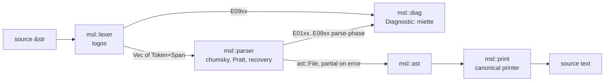

# MSL Parser Design

**Spec**: `.specs/features/msl-parser/spec.md`
**Status**: Approved

---

## Architecture Overview

A pure front stage: text → tokens → AST (+ diagnostics) → text. No dependency on the VAMS modules of `piperine-lang`; nothing outside `msl/` calls it yet.



Public entry points (`piperine_lang::msl`):

- `lex(src: &str) -> (Vec<(Token, Span)>, Vec<Diagnostic>)`
- `parse(src: &str) -> ParseResult { file: ast::File, diagnostics: Vec<Diagnostic> }` — always returns a file (partial on error).
- `print(file: &ast::File) -> String`
- `Diagnostic: miette::Diagnostic + std::error::Error` with `code()`, `labels()`, `help()`; `render(&Diagnostic, name, src) -> String` for graphical output.

---

## Code Reuse Analysis

| Component | Location | How to Use |
| --- | --- | --- |
| `miette` (fancy) | `crates/piperine-lang/Cargo.toml` | diagnostic trait + graphical renderer, already a dependency |
| VAMS lexer/parser | `crates/piperine-lang/src/{lexer.rs,parser.rs,grammar/}` | style reference only (span handling, error tone); no code shared — different grammar |
| test layout + `//!` header rule | `crates/piperine-lang/tests/*.rs`, `tests/suite_hygiene.rs` | one concern per target, `//!` scope header, no `#[ignore]`, no file-scope `allow` |
| spec corpus | `docs/spec/*.md` ` ```rust ` fences | the acceptance corpus (extracted at test time, not copied) |

## Components

### `msl::span` + `msl::diag`
- **Purpose**: byte-range spans; one `Diagnostic` type for every MSL error.
- **Location**: `crates/piperine-lang/src/msl/{span.rs,diag.rs}`
- **Interfaces**: `Span { start, end }`; `Diagnostic { code: &'static str, message, primary: (Span, String), secondary: Vec<(Span,String)>, help: Option<String> }`; `impl miette::Diagnostic`.
- **Dependencies**: miette.

### `msl::lexer`
- **Purpose**: Appendix A tokens.
- **Location**: `crates/piperine-lang/src/msl/lexer.rs`
- **Interfaces**: `Token` enum (idents, reserved keywords incl. `module nature signal on out flip after`, Rust keywords, `Unknown`, literals with SI value + raw text, punctuation incl. `+>` `<-`, doc comments); `lex()`.
- **Dependencies**: logos. Contextual keywords (`analog`, `digital`, `potential`, `flow`, `value`, `resolve`, `in`-as-direction) are plain `Ident` tokens; the parser decides by position.

### `msl::ast`
- **Purpose**: one node per B.3 production + inherited Rust value forms; every node has `span`.
- **Location**: `crates/piperine-lang/src/msl/ast.rs` (split into `ast/{item,expr,ty,pat,msl}.rs` if > 800 lines)
- **Interfaces**: `File { items: Vec<Item> }`, `Item` (Fn, Struct, Enum, Impl, Const, Use, Mod, Nature, Module, Behavior{Analog,Digital}), `Expr`, `Stmt` (incl. `Contribution`, `Commit`), `Pat`, `Type`, `Attr`, `DocComment`. `PartialEq` that ignores spans via a `SpanEq`/strip helper for round-trip tests.

### `msl::parser`
- **Purpose**: tokens → AST with recovery.
- **Location**: `crates/piperine-lang/src/msl/parser/{mod.rs,ty.rs,pat.rs,expr.rs,item.rs,msl.rs}`
- **Interfaces**: `parse()`; internal chumsky parsers per area; recovery via `recover_with(via_parser(...))` / skip-until at `;`, `}`, item keywords; nesting depth counter → `E0910` (see Tech Decisions).
- **Dependencies**: chumsky (stable line, pinned exactly at T1), lexer, ast, diag.

### `msl::print`
- **Purpose**: canonical AST → text (4-space indent, one item per blank-line-separated block, trailing commas in multi-line lists).
- **Location**: `crates/piperine-lang/src/msl/print.rs`

---

## Error Handling Strategy

| Error Scenario | Handling | User Impact |
| --- | --- | --- |
| Spec-listed parse condition (17 rows) | dedicated check at the production, the row's code | `error[E0907]: `+>` inside an expression` + label + help naming the statement form |
| Generic unexpected token | chumsky `Rich` error mapped to code `E0900` (generic syntax) | "expected `;` or `}`, found `signal`" with label at the token |
| Several errors | recovery continues; diagnostics sorted by span start | every error listed in one run |
| Depth > 256 | stop descending, diagnostic, return `Expr::Error` node | no crash |
| Non-UTF-8 input | `parse_bytes` reports one diagnostic, no AST | clear message |

## Risks & Concerns

| Concern | Location | Impact | Mitigation |
| --- | --- | --- | --- |
| chumsky API changes between 0.10 and 1.0 alphas | `Cargo.toml` | executor writes code for the wrong API | T1 pins one exact stable version and records it; executors read docs.rs for that version |
| `logos` is derive-macro based (project memory: user dislikes macro magic) | `msl/lexer.rs` | style friction | derive limited to the `Token` enum; all logic in plain functions; reviewer may swap to a chumsky lexer later without touching the parser |
| Spec fences that are fragments (a body without its module, a single statement) | `docs/spec/*.md` | corpus test fails on non-files | T12 classifies: a fence is parsed as a file; a fragment fence is re-fenced `rust,fragment` and parsed with the matching entry (`parse_items`, `parse_stmts`); listed in the test's header |
| Disk at 92% | worktree build | build fails mid-run | every command uses `CARGO_TARGET_DIR=/home/keslarek/Git/piperine/target` (shares deps with the main tree) |
| New codes not in the spec (`E0900` generic syntax, `E0910` depth) | `docs/spec/appendix_a_lexical.md` | spec/impl drift | T11 adds both rows to Appendix A's error table in the same commit |

## Tech Decisions

| Decision | Choice | Rationale |
| --- | --- | --- |
| Lexer | logos | fast, span-native, keeps chumsky on tokens (better error messages than char-level) |
| Parser | chumsky stable, `Rich` errors, Pratt | recovery + expected-token sets out of the box (user: "mensagens completas e profissionais") |
| Renderer | miette graphical | already in the crate; same look as VAMS errors |
| AST equality for round-trip | strip spans then `==` | printer cannot reproduce original spans |
| Snapshot tests | plain `assert_eq!` on rendered strings, no new snapshot crate | fewer deps |
