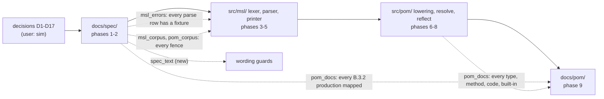

# MSL Polish Design

**Spec**: `.specs/features/msl-polish/spec.md`
**Status**: Approved

---

## Architecture Overview

Nothing new is built. Three existing layers are brought into agreement, in the order the truth flows: the specification decides, the parser implements the grammar, the POM implements name resolution, the reference docs describe the POM.



The dotted edges are guards that already tie the layers together (one is new). They decide where a spec edit may land:

| Spec edit | Guard that reads it | Lands in |
| --- | --- | --- |
| prose, a rule, a `Resolution`, an elaboration-phase error row | `spec_text` (new) | the spec phases (T1 to T10) |
| an error row of phase `parse` (`E0909`) or a rewording that changes what a fixture must show (`E0910`) | `msl_errors::every_parse_phase_row_has_a_fixture` | the parser task that reports it (T17, T23) |
| a `rust` / `rust,fragment` fence using a newly accepted form (`fn(..) -> ..`, `r#out`, a documented reaction) | `msl_corpus`, `pom_corpus` | the parser task that accepts it (T12, T13, T16) |
| a new production name in B.3.2 | `pom_docs::every_b3_production_is_mapped` | avoided: existing productions are edited in place |

**Approaches considered.** (1) *Layer order with coupled rows* (chosen): spec text first, each layer after, the three guarded kinds of edit travelling with their implementation. Every commit is green and the spec leads. (2) *One vertical slice per decision* (spec + parser + POM + docs in one task): each task would touch four layers and a dozen files, and a Sonnet worker would hold the spec style, the chumsky parser and the resolver in one context. (3) *All spec edits first, guards relaxed until the code catches up*: forbidden by the rule that a test is never weakened. The user's brief names order (1).

**Where the rules run.** Every rule this feature adds runs in `piperine-lang` and is reached by its integration targets: lexical rules in `lexer.rs`, placement rules in `parser/check.rs`, name and structure rules in `pom/resolve/`. Nothing is left to a host or a printer.

---

## Code Reuse Analysis

### Existing Components to Leverage

| Component | Location | How to Use |
| --- | --- | --- |
| Fence extraction | `crates/piperine-lang/tests/support/spec_corpus.rs` | `spec_text` includes it with `#[path]` for the method scan of POL-02 AC 2 |
| Error-table scraping | `tests/msl_errors.rs::spec_parse_phase_codes` | the pattern for `spec_text`'s `table_rows`: split a `|` row into cells, first cell is the key |
| Parse-phase fixtures | `tests/msl_errors.rs::fixtures`, `fixture(code, prefix, at, suffix)` | `E0909` joins it; the removed-form table of T22 has the same shape plus a message key |
| Context checks | `src/msl/parser/check.rs` (`Ctx`, `misplaced`) | D14 is two more arms of `StmtKind::Signal` and a module-body context |
| Depth pre-pass | `src/msl/parser/entry.rs` (`is_nesting`, `skip_overflow`, `overflow`) | D8 splits its one counter in two |
| Item metadata | `ast::Meta`, the `attrs` parser of `parser/item.rs`, `pom/lower/meta.rs`, `Reflect::docs` | D9 reuses all four for statements and hardware items |
| Built-in table | `src/pom/builtin.rs` (`BUILTINS`, `row`, `builtin`, `builtin_method`) | D2 and D3 are rows and two kinds; A-09 is a third kind and a lookup |
| Member check | `src/pom/resolve/scopes.rs` (`E0330` over a module's members) | `E0162` is the same walk over a namespace, with two tables |
| Resolver pass shape | `src/pom/resolve/behaviors.rs` (read declarations, push `(file, Diagnostic)`) | the structural pass `shape.rs` of T36 |
| Invariant checker | `src/pom/check.rs`, `Design::check()` | `Design::from_json` is `serde_json::from_str` then `check()` |
| Docs guards | `tests/pom_docs.rs` (`reflect_methods`, `b32_productions`) | three more guards of the same shape (T47, T48) |

### Integration Points

| System | Integration Method |
| --- | --- |
| `docs/spec/` | edited under `.specs/features/msl-spec/STYLE.md`; read at test time by `spec_text`, `msl_errors`, `msl_corpus`, `pom_corpus`, `pom_docs` |
| `mkdocs.yml` | one nav line for Appendix H (asserted by `spec_text`) |
| `piperine_lang::msl` public surface | additive: `Ident.raw`, `FieldInit.shorthand`, `Stmt.meta`, `TypeKind::FnPtr`, `Lit::{str_value, int_value, suffix}`, `MAX_CHAIN` |
| `piperine_lang::pom` public surface | additive except three changes of meaning listed under Tech Decisions (collections, `Generation::items`, `body()` return type) |

---

## Components

### `spec_text` (new test target)

- **Purpose**: Hold the specification to the wording the decisions fix, and to two invariants (every code defined once, B.1 counts 65).
- **Location**: `crates/piperine-lang/tests/spec_text.rs`
- **Interfaces** (test helpers, plain functions):
  - `spec(file: &str) -> String` - the text of `docs/spec/<file>`
  - `section<'a>(text: &'a str, heading: &str) -> &'a str` - from a heading to the next of the same or a higher level
  - `table_rows(section: &str) -> Vec<Vec<String>>` - the cells of each `|` row, header and rule lines dropped
  - `rule<'a>(text: &'a str, label: &str) -> &'a str` - the text of one numbered rule (`§10 rule 6`, `B.3.3 item 14`)
- **Dependencies**: `docs/spec/`, `mkdocs.yml`, the crate's lexer (method scan)
- **Reuses**: `support/spec_corpus.rs`
- **Rule**: a test asserts the presence of the decided fact (a row, a code, a phrase of two or three words taken from the criterion), never a whole sentence, so the spec can still be edited for style.

### Specification edits

- **Purpose**: State D1 to D3 and D5 to D17 normatively.
- **Location**: `docs/spec/` - `appendix_b_grammar.md` (B.2.1, B.3.2, B.3.3, B.3.4, B.3.6), `appendix_a_lexical.md` (A.1, A.2, A.4, A.6), `part_i_values.md` (§1, §3, §3.4), `part_ii_carriers.md` (§6), `part_iii_structure.md` (§8), `part_iv_behavior.md` (§10), `part_vi_io.md` (§21), `appendix_g_scope.md`, `index.md` (§0.4, §0.8), new `appendix_h_library.md`
- **Interfaces**: the amended productions of B.3.2, edited in place:
  - `nature_field ::= attrs ( ... )`
  - `module_item ::= attrs 'pub'? ( param | signal_decl | 'let' pat '=' expr ';' ) | attrs place '=' expr ( 'after' expr )? ';' | attrs gen<module_item>`
  - `digital_item ::= attrs reaction | attrs gen<digital_item>`
  - `contribution ::= attrs expr '+>' expr ';'`, `commit ::= attrs place '<-' expr ( 'after' expr )? ';'`
  - `instance`, `template`: field `IDENT ( ':' expr )?`
- **Dependencies**: STYLE.md
- **Reuses**: the existing rule numbering; a new rule takes the next free number of its section, nothing is renumbered.

### Appendix H (new page)

- **Purpose**: The closed catalogue of what the language inherits from Rust's library.
- **Location**: `docs/spec/appendix_h_library.md`
- **Interfaces**: sections H.1 integers, H.2 floats, H.3 `bool`, H.4 `Option`, H.5 arrays and slices, H.6 ranges, H.7 iterator adaptors, H.8 traits, H.9 types; each a table `Name | Signature | Note`.
- **Dependencies**: the methods the spec's fences call (found by the scan of POL-02 AC 2, run first as a listing).
- **Reuses**: the layout of B.1.2.
- **Seed content** (the worker completes it from the scan; nothing outside D2's families is added): floats `abs`, `sqrt`, `exp`, `ln`, `log10`, `powf`, `powi`, `sin`, `cos`, `tan`, `atan`, `atan2`, `tanh`, `floor`, `ceil`, `round`, `min`, `max`, `clamp`, `rem_euclid`, `is_finite`, `is_nan`, consts `MAX`, `MIN`, `EPSILON`, `INFINITY`; integers `abs`, `min`, `max`, `clamp`, `pow`, `rem_euclid`, `checked_*`, `saturating_*`, `wrapping_*`, `count_ones`, `leading_zeros`, `trailing_zeros`, consts `MAX`, `MIN`, `BITS`; `Option` `is_some`, `is_none`, `unwrap`, `unwrap_or`, `unwrap_or_else`, `map`, `and_then`, `or`; arrays and slices `len`, `iter`, `contains`, `first`, `last`, indexing; ranges `contains`, iteration; adaptors `map`, `filter`, `fold`, `sum`, `count`, `zip`, `enumerate`, `rev`, `any`, `all`; traits `Clone`, `Copy`, `PartialEq`, `Eq`, `PartialOrd`, `Ord`, `Default`, `Debug`, `Iterator`, `IntoIterator`; types `Range`, `RangeInclusive`.

### Lexer changes

- **Purpose**: Raw identifiers, literal range, escapes, raw-string spelling.
- **Location**: `crates/piperine-lang/src/msl/lexer.rs`
- **Interfaces**:
  - token `Ident { name, raw }` for `r#word` when `word` is one of the seven added keywords; any other `r#word` is one `E0900`
  - `E0909` from `parse_f64` (result is infinite) and from the integer reader (value against the suffix's range, or `u128`)
  - `E0900` at each undefined escape of a string literal
  - `Lit::str_value(&self) -> Option<String>`, `Lit::int_value(&self) -> Option<u128>`, `Lit::suffix(&self) -> Option<&str>`
- **Dependencies**: none new
- **Reuses**: the existing raw-string and suffix readers

### Parser changes

- **Purpose**: Accept what the decisions take in; reject what the grammar forbids, with one targeted diagnostic each; recover locally.
- **Location**: `crates/piperine-lang/src/msl/parser/` (`ty.rs`, `expr.rs`, `msl.rs`, `item.rs`, `pat.rs`, `check.rs`, `entry.rs`)
- **Interfaces**:
  - `ty.rs`: `'-' literal` const argument; `fn '(' ( type ',' )* ')' ( '->' type )?` as a type
  - `expr.rs`: `attrs` before a statement; `FieldInit.shorthand`; `is_place(&Expr) -> bool` shared by the definition and the commit; statement-level recovery to `;` or `}`
  - `msl.rs`: `attrs` before reactions, definitions, generation, nature fields; module-body commit, contribution and reaction parsed as statements (then reported by `check.rs`); `pub` before a behavior block; per-port recovery; the three forms of A-29
  - `check.rs`: `Ctx::ModuleBody`; `signal` reported in `Analog`, `Reaction`, `Closure`
  - `entry.rs`: `pub const MAX_CHAIN: usize = 4096`; the pre-pass counts nesting tokens and chain-link tokens apart
  - `item.rs`, `pat.rs`: the removed-form recognizers, driven by one `const REMOVED: &[RemovedForm]` (`form`, `code`, `message`, `help`)
- **Dependencies**: chumsky 0.13 (unchanged), `stacker` as a direct dependency
- **Reuses**: `check.rs::misplaced`, the item-level `attrs` parser, the recovery strategies of `base.rs`

### Printer changes

- **Purpose**: Print every new form as written.
- **Location**: `crates/piperine-lang/src/msl/print.rs`
- **Interfaces**: unchanged signature (`print(&File) -> String`); new cases for `r#`, shorthand fields, statement and hardware metadata, `FnPtr`, raw strings.
- **Reuses**: `printer_preserves_docs_and_attrs` path for items.

### POM: built-ins and names

- **Purpose**: The language's own names resolve; duplicates are reported; identifier patterns follow Rust.
- **Location**: `crates/piperine-lang/src/pom/builtin.rs`, `resolve/scopes.rs`, `resolve/imports.rs`, `resolve/names.rs`, `resolve/behaviors.rs`
- **Interfaces**:
  - `BuiltinKind::{Node, ImplicitParam, Member}`; rows `str`, `Nature`, `gnd`, `m`, `dtemp`, `Repr::WIDTH`, `Repr::encode`, `Repr::decode`, and one row per trait and type of Appendix H
  - `builtin_in_module(name) -> Option<BuiltinId>` - `m`, `dtemp`: consulted only when the resolving scope is a module body or a block bound to a module
  - `builtin_member(of: BuiltinId, name) -> Option<BuiltinId>`
  - `DeferReason::BuiltinTraitMember`
  - `PatKind::Ident { .., binding: DeclId, res: Resolution }`; `Binding::is_binding() -> bool`
- **Dependencies**: the scope order of `docs/pom/resolution.md` (a local or an item still wins over a built-in)
- **Reuses**: `builtin`, the `E0330` walk

### POM: structural checks and classification

- **Purpose**: Report `E0320`, `E0140`, `E0263`, `E0370`, `E0125`, `E0201`, `E0206`, `E0211` under the spec's codes; never link to a guess.
- **Location**: `crates/piperine-lang/src/pom/resolve/classify.rs`, `members.rs`, new `shape.rs`, `pom/index.rs`
- **Interfaces**: `shape::run(design, out)` in the pass list of `resolve/mod.rs`, after `behaviors`; no new public type.
- **Dependencies**: the slots the classifier already fills
- **Reuses**: the `(FileId, Diagnostic)` output of the other passes

### POM: reflection

- **Purpose**: Walk a body and list every item kind by handle; read a design back safely.
- **Location**: `crates/piperine-lang/src/pom/reflect/` (`mod.rs`, `body.rs`, `items.rs`, `hardware.rs`), `pom/design.rs`
- **Interfaces**:
  - `Design::{enums, traits, consts, impls, struct_named, function, prelude_files}`; `Design::from_json(&str) -> Result<Design, Vec<String>>`
  - `Expr::{children, parent, stmt, args, fields}`; `Stmt::{children, docs}`; `Decl::exprs`
  - `Block<'d>` with `stmts()`, `value()`, `span()`, `node()`
  - `Argument<'d>`, `FieldBinding<'d>` with `name()`, `value()`, `target()`; `FieldBinding::is_shorthand()`
  - `Instance::builtin() -> Option<BuiltinId>`; `Struct::{impls, method}`, `Enum::{impls, method}`, `Trait::impls`
  - `Reaction::docs`, `Quantity::docs`, `Definition::docs`, `Generation::docs`
- **Dependencies**: a parent side table (`Vec<Option<ExprId>>` indexed by `ExprId`) filled by lowering
- **Reuses**: `Nature::impls`, `Reflect::docs`, `check()`

---

## Data Models

Deltas only. Storage types keep `Debug, Clone, PartialEq, Serialize, Deserialize`.

### Syntax tree (`msl::ast`)

```rust
pub struct Ident { pub name: String, pub raw: bool, pub span: Loc }          // name has no `r#`
pub struct FieldInit { pub name: Ident, pub value: Expr, pub shorthand: bool, pub span: Loc }
pub struct Stmt { pub meta: Meta, pub kind: StmtKind, pub span: Loc }
pub enum TypeKind { /* ... */ FnPtr { params: Vec<Type>, ret: Option<Box<Type>> } }
pub enum LitKind {
    Int(String),
    Float { value: f64, raw: String },      // serialized as `raw` only; `value` recomputed on read
    Str { text: String, raw_hashes: Option<u8> },   // None: an ordinary string
    Bool(bool),
    Unknown,
}
// `meta: Meta` added to Reaction, to the definition and generation forms of ModuleItem and
// DigitalItem, and to NatureField.
```

**Relationships**: tree equality includes `raw`, `shorthand` and `meta`, so the round-trip tests of `msl_print` and `pom_corpus` prove that the printer and `to_ast` carry them.

### Object model (`pom`)

```rust
pub enum BuiltinKind { Type, Trait, Const, Variant, Fn, Module, Method, Event, Statement,
                       Node, ImplicitParam, Member }
pub enum DeferReason { ReceiverTypeUnknown, AmbiguousAccess, InferredGenerics, BuiltinTraitMember }
pub enum PatKind { /* ... */ Ident { by_ref: bool, mutable: bool, name: Name, sub: Option<PatId>,
                                     binding: DeclId, res: Resolution } }
pub struct Name { pub text: String, pub raw: bool, pub span: Span }
pub struct FieldInit { /* ... */ pub shorthand: bool }
pub struct StmtNode { /* ... */ pub meta: MetaData }
pub enum TypeKind { /* ... */ FnPtr { params: Vec<TypeId>, ret: Option<TypeId> } }
// Design: `expr_parent: Vec<Option<ExprId>>`; name tables `BTreeMap<String, DeclId>` per
// namespace table and per module, rebuilt on read.
```

**Relationships**: MD-54 holds. `PatKind::Ident.res` is a slot resolution writes; the `Binding` declaration it would have introduced stays in the arena and answers `is_binding() == false`. No node is added or removed after lowering.

---

## Error Handling Strategy

| Error Scenario | Handling | User Impact |
| --- | --- | --- |
| A removed Rust form (B.3.6) | one diagnostic with the row's code, a message naming the form, a help naming the replacement; the parser recovers at the item or statement | "type aliases are not part of the language", not "`type` is a reserved keyword" |
| A commit whose target is not a place | `E0900` over the left side; the commit node is kept | the write that went nowhere is now an error |
| A statement in a block that is not its own | `E0121` in a `fn` (closures inside it included), `E0404` everywhere else, the module body included | one code per situation, stated in both tables |
| A literal out of range | `E0909` at the literal; the token is still produced | no `inf` enters the tree silently; the design still serializes |
| Nesting past 256 or a chain past 4096 links | one `E0910` naming which bound | generated flat code parses |
| A bad port, a bad statement, a comma in a `where` | one diagnostic at the fault; the module, the block and the function survive | no cascade of `E0161`/`E0401` |
| A name declared twice, a colliding import, an ambiguous glob in use | `E0162`; every declaration kept; first declaration wins lookups | silent first-wins is gone |
| An unknown param, named argument, bundle field | `E0320`, `E0140`, `E0263`; the slot stays `Unresolved`; no `E0161` beside it | the spec's code, once |
| An access or a carrier method the declared type cannot have | `E0206`, `E0211`; the slot stays `Unresolved` | no link to another nature's quantity or to the element's `impl` |
| A corrupted or foreign JSON | `Design::from_json` returns `Err(problems)` | no panic in a handle |

---

## Risks & Concerns

| Concern | Location (file:line) | Impact | Mitigation |
| --- | --- | --- | --- |
| A chain of 4096 links is a tree 4096 deep; the printer, the lowering, the resolver, `to_ast` and the derived `Drop`/`PartialEq` recurse over it | `src/msl/print.rs`, `src/pom/lower/body.rs`, `src/pom/to_ast.rs`, `src/pom/resolve/names.rs`; today's guard `src/msl/parser/entry.rs:272` keeps every tree under 256 | stack overflow on input the parser accepted | T23 routes the four walkers through one `deep(|| ..)` helper over `stacker::maybe_grow`; the test runs all of them at 4096 links on an 8 MiB debug stack; links are summed along a path so depth is bounded by 256 + 4096. If the bound cannot be met the worker stops and reports |
| The depth pre-pass is token-level and knows chains only as "nesting tokens since the last boundary" | `src/msl/parser/entry.rs:282-460` | splitting it in two counters can misclassify a token (`<` generic versus comparison, `-` prefix versus infix) | the AC lists each chain kind and each nesting kind with a clean case just under and a failing case just over; `depth_over_256_is_diagnostic_not_overflow` stays unchanged |
| `check.rs` reports misplaced statements only in contexts it enumerates; the module body is `Ctx::Other` and its commits never reach it because the module-item parser rejects them first | `src/msl/parser/check.rs:14-24`, `src/msl/parser/msl.rs` | `E0907`/`E0900` instead of `E0404` (A-24) | T20 makes the module-item parser accept the statement forms and leaves the verdict to `check.rs` |
| Item-level recovery restarts on item keywords inside `<..>` and `(..)` | `src/msl/parser/item.rs`, `base.rs` | spurious diagnostics and lost modules (A-26) | T24 to T26, one recovery point each, with `one_fault_is_one_diagnostic` as the regression guard |
| `LitKind::Float` holds a bare `f64` that derives `Serialize` | `src/msl/ast.rs:249` | JSON `null` for a non-finite value (A-11) | T17 keeps `inf` out of accepted sources; T45 serializes from `raw` so even a rejected source round-trips |
| Three spec-to-code guards can turn red on a spec edit made in the wrong task | `tests/msl_errors.rs:561`, `tests/msl_corpus.rs:47`, `tests/pom_docs.rs:140` | a red commit in a spec phase | the placement table above; the rule is repeated in `tasks.md` |
| `spec_text` asserts prose | `tests/spec_text.rs` | a brittle test blocks a harmless rewording | assertions look for a row, a code or a two-to-three-word phrase, never a sentence |
| The fixture prelude holds stand-ins for standard-library items | `tests/fixtures/pom/prelude.msl:7-15` | resolution of the stdlib is proven only on stand-ins | `Nature` goes in T27; `State`, `Logic`, `init` stay until `msl-stdlib` (Out of Scope) |
| The two scaling tests measure time | `tests/pom_design.rs` (T46) | flakiness on a loaded machine | ratios, not absolute times; best of three; thresholds at half the quadratic or linear ratio |
| `E0162` and the stricter parser can turn existing fixtures red (a name declared twice by accident, an empty nature used as a stand-in) | `tests/pom_resolve.rs`, `tests/pom_classify.rs`, `tests/pom_tree.rs` | a worker "fixes" the test instead of the fixture | each affected task has an **Existing tests** line saying what may change; anything else red stops the task |
| `CLAUDE.md` and `AGENTS.md` describe the retired Verilog-AMS pipeline | repo root | a worker follows stale instructions | `tasks.md` says so in its header; only `-p piperine-lang` is ever built |

---

## Tech Decisions (only non-obvious ones)

| Decision | Choice | Rationale |
| --- | --- | --- |
| Where the wording of the spec is tested | a new target `spec_text`, one test per decided wording | doc-only criteria need a proof that fails when the text regresses; the existing targets each have another concern (MD-28) |
| Codes of the removed forms | the code the parser already uses for that token class (`E0903` for a reserved keyword with no production, `E0101` for §1 rule 2's forms, `E0905` for labels, `E0900` otherwise), with a targeted message | no new code without a decision; existing fixtures keep holding |
| Chain bound | `MAX_CHAIN = 4096` links summed along one path, reported as `E0910` | D8 leaves "a separate, larger bound or none"; none is unsafe for a recursive tree (see Risks) |
| Stack safety of the walkers | `stacker::maybe_grow` behind one helper; `stacker` declared directly | it is already compiled as chumsky's feature; rewriting four walkers iteratively is a larger, riskier change |
| `m` and `dtemp` | built-in rows consulted only from a module scope | D3 says "visible only inside a module body and its blocks"; a function has no instance to read them from |
| Identifier pattern | a `res` slot on `PatKind::Ident`; the `Binding` stays | MD-54 rule 1: resolution adds links, never nodes; `to_ast` stays trivial |
| `E0162` and `E0143` | the POM skips a function pair the parser already reported | one fault, one diagnostic |
| Structural checks | a separate pass `resolve/shape.rs` | `classify.rs` is 488 lines and classifies; the three checks of T36 read declarations only |
| Prelude in collections | typed collections list project files; `prelude_files()` and `decls()` reach the rest | one rule; today `modules()` and `structs()` disagree |
| `Function::body()` and `Reaction::body()` | return the `Block` handle; the raw block is `node()` | the audit's point is that raw storage should not be needed; a second accessor would leave two ways |
| Float serialization | a hand-written `Serialize`/`Deserialize` for `LitKind::Float` holding `raw` | plain functions, no macro; the value is a function of the text |
| `from_json` error type | `Vec<String>`, the type `check()` already returns | no new error enum for one call |

Project-level decisions recorded in `.specs/STATE.md`: MD-56 (the sixteen language decisions and the deferral of D4), MD-57 (the placement rule for spec edits and the `spec_text` target).
