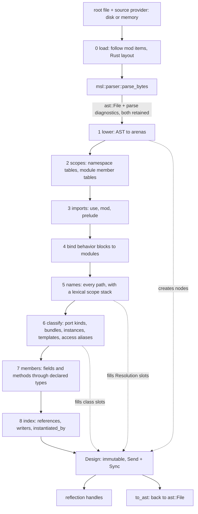

# MSL POM Design

**Spec**: `.specs/features/msl-pom/spec.md`
**Status**: Draft

---

## Architecture Overview

The POM is a new module `piperine_lang::pom`, beside `piperine_lang::msl`. One call builds it:

```rust
// From disk: the root file, then every `mod b;` by Rust's rules (b.msl or b/mod.msl).
let design = Design::load("models/top.msl");

// In memory: the same rules over a virtual file set (tests, tools, the LSP's unsaved buffers).
let design = Design::builder()
    .prelude("std.msl", STD)            // optional: pub items visible everywhere
    .source("top.msl", TOP)             // the first source is the root
    .source("dac.msl", DAC)             // found by `mod dac;` in top.msl
    .build();                           // never fails
```

`build()` runs a fixed pipeline. Only the first stage creates nodes. Every later stage writes into slots the first stage left empty (resolutions, classifications), into side tables, or into the diagnostics list. That is how the project rule "POM navigability mirrors the source" is enforced by construction.



### Approaches considered

| | A. Arenas + typed ids, handles as views (chosen) | B. `Rc`/`Weak` object graph | C. Declarations in an arena, bodies left as `ast::Expr` with span-keyed side tables |
| --- | --- | --- | --- |
| Reflection ergonomics | handles are `Copy`, borrow the design, compare by id | natural `a.b.c`, but every up-link is a `Weak` to upgrade | declarations fine; bodies expose two vocabularies (POM and AST) |
| Immutability, threads | no interior mutability: `Send + Sync` for free | `Rc` is not `Send`; `Arc` + `RefCell`-style slots are needed to fill links after construction | same as A for declarations |
| Serde | ids are integers: plain derives, flat JSON | cycles need custom (de)serialization | span-keyed maps serialize, but are fragile |
| Attaching later results (types, const values) | a side `Vec` indexed by `ExprId` | fields added to shared nodes | no stable key for an expression except its span |
| "Passes only add" | slots and side tables; node count is fixed after stage 1 | any pass can re-link the graph | same as A |
| Cost | lowering and a reverse conversion: two mechanical walks over the grammar | similar | about half the code |

A is chosen. B loses `Send + Sync` and serde for a small gain in spelling. C is cheaper but leaves expressions without identity, which the type checker (next feature) needs, and it makes the reference doc describe two models.

---

## Code Reuse Analysis

### Existing Components to Leverage

| Component | Location | How to Use |
| --------- | -------- | ---------- |
| Parser entry | `crates/piperine-lang/src/msl/parser/entry.rs` (`parse`, `ParseResult`) | the builder calls it once per source and keeps both fields |
| Syntax tree | `crates/piperine-lang/src/msl/ast.rs` | input of lowering, output of `to_ast`; its leaf enums (`UnOp`, `BinOp`, `LitKind`, `Dir`, `Quantity`, `BehaviorKind`) are re-exported by `pom`, not copied |
| Structural equality of the AST | `ast::Loc` (compares equal to any `Loc`) | the lossless test is `file.to_ast() == parsed.file` |
| Diagnostics | `crates/piperine-lang/src/msl/diag.rs` (`Diagnostic`, `render`) | POM diagnostics are the same type, wrapped with a `FileId` |
| Spans | `crates/piperine-lang/src/msl/span.rs` | every node stores a `Span` |
| Spec corpus extraction | `crates/piperine-lang/tests/support/spec_corpus.rs` (`corpus`, `extract`, `Class`) | `#[path]`-included by `pom_corpus.rs`, `pom_reflect.rs` and `pom_docs.rs` |
| Prior art, not a template | `git show 2a5db571:crates/piperine-lang/src/pom/mod.rs` | the old VAMS POM; read for the navigability lesson only |

### Integration Points

| System | Integration Method |
| ------ | ------------------ |
| `crates/piperine-lang/Cargo.toml` | `serde.workspace = true` (dependency); `serde_json = "1"` and `tempfile.workspace = true` (dev-dependencies) |
| `msl/diag.rs`, `msl/span.rs`, `msl/ast.rs` | `Diagnostic.code` becomes `Cow<'static, str>` (constructors unchanged: they still take `&'static str`); `Serialize`/`Deserialize` derived on `Diagnostic`, `Span`, `Loc` and the leaf enums the POM reuses. No other parser or AST edit |
| `piperine-lang` crate root | `pub mod pom;` in `lib.rs`; the crate doc line "MSL elaboration is not built yet" is rewritten |
| `mkdocs.yml` | a nav section "Object model" listing `docs/pom/*.md` |
| rustdoc | `pom::guide` includes each `docs/pom/*.md` with `#[doc = include_str!(...)]`, so their `rust` fences run as doctests |
| Later features (type checker, elaborator, LSP) | read the `Design`; attach results in side tables keyed by the ids |

---

## Components

All paths are under `crates/piperine-lang/src/pom/`.

### Ids (`ids.rs`)

- **Purpose**: the seven index types of the arenas.
- **Interfaces**: `FileId`, `DeclId`, `ExprId`, `StmtId`, `PatId`, `TypeId`, `PathId`: each a `pub struct X(pub u32)` with `Debug, Clone, Copy, PartialEq, Eq, Hash, PartialOrd, Ord` and `fn index(self) -> usize`. Written out by hand, one after another: no macro (project preference).
- **Dependencies**: none.

### Design and builder (`design.rs`)

- **Purpose**: own everything; build it.
- **Interfaces**:
  - `Design::builder() -> DesignBuilder`
  - `Design::load(root_path) -> Design` (disk)
  - `DesignBuilder::source(path, text)` (a virtual file; the first is the root), `root_file(path)` (read from disk), `prelude(name, text)`, `build() -> Design`
  - `Design::files()`, `root()`, `diagnostics() -> &[DesignDiagnostic]`, `dump() -> String`, `check() -> Vec<String>`
  - raw access for tools: `decl_data(DeclId)`, `expr_node(ExprId)`, `stmt_node(StmtId)`, `pat_node(PatId)`, `type_node(TypeId)`, `path_node(PathId)`, and the counts `decl_count()` ... `path_count()`
- **Storage** (all private fields): `files: Vec<SourceFileData>`, `decls: Vec<DeclData>`, `exprs: Vec<ExprNode>`, `stmts: Vec<StmtNode>`, `pats: Vec<PatNode>`, `types: Vec<TypeNode>`, `paths: Vec<PathNode>`, side tables `scopes`, `members`, `index`, and `diagnostics`.
- **Rules**: no `&mut self` method is public; no `Cell`, `RefCell`, `Rc`. Ids are assigned in source order; files are numbered prelude sources first, then the root, then each loaded file in the order its `mod` item is met (depth first). Side tables are `BTreeMap` or `Vec`, never `HashMap`, so `dump()`, diagnostics and the serialized form are deterministic.
- **Derives**: `Design` and every storage type derive `Debug, Clone, PartialEq, Serialize, Deserialize`. These are the standard derives; no project macro is written.

### Source loading (`source.rs`)

- **Purpose**: stage 0: find and read the files of one tree.
- **Interfaces**:
  - `pub trait SourceProvider { fn read(&self, path: &Path) -> Option<Vec<u8>>; fn canonical(&self, path: &Path) -> PathBuf; }`
  - `pub struct DiskSources;` (reads the filesystem; `canonical` is `std::fs::canonicalize`, falling back to the path) and `pub struct MemorySources` (a `BTreeMap<PathBuf, String>`; `canonical` is the normalized path).
  - `pub(crate) fn mod_candidates(declaring_file: &Path, inline_mods: &[String], name: &str) -> [PathBuf; 2]`
- **The rule** (rustc's, with `.msl` for `.rs` and `mod.msl` for `mod.rs`). Let `dir` be the directory that holds the children of the declaring file: the file's own directory when the file is the root or is named `mod.msl`; otherwise `<file's directory>/<file stem>`. Inside inline modules `a`, `b` add `a/b`. Then `mod c;` has the candidates `dir/c.msl` and `dir/c/mod.msl`.
- **Outcomes**: exactly one candidate readable → that file is parsed with `parse_bytes` (invalid UTF-8 is the parser's own diagnostic) and lowered under an `External` namespace. None, both, or a canonical path already on the chain of files being loaded → no file, an empty namespace, `E0161` at the `mod` item naming the candidates (and "cycle" in the third case). An unreadable root → an empty root file and one `E0161`.
- `#[path]` has no meaning (spec B.1).
- **Dependencies**: `std::fs`, `std::path` only.

### Serialization

- **Purpose**: POM-15.
- **Shape**: plain derives everywhere. The one exception is `SourceFileData`, which is `#[serde(from = "SourceFileRepr", into = "SourceFileRepr")]`: `SourceFileRepr` holds every field but `ast`, and `From<SourceFileRepr>` rebuilds `ast` with `parse(&text).file`. The retained tree therefore never enters the format, and `serde_json`'s nesting limit (128) is never met: arenas are flat, children are ids.
- **Equality**: `Design: PartialEq` compares arenas, side tables, diagnostics and files (the AST by `ast::File`'s structural equality).
- **Location**: derive lines in each storage file; `SourceFileRepr` in `design.rs`.

### Declarations (`decl.rs`, `meta.rs`)

- **Purpose**: one node per declared thing or structural container, in one arena.
- **Interfaces**: `DeclData { kind: DeclKind, name: Option<Name>, parent: Option<DeclId>, children: Vec<DeclId>, file: FileId, span: Span, meta: Meta, public: bool }`. `children` is in source order and is complete: every declaration lexically inside, at the first level.
- **Kinds** (`DeclKind`, each variant holds its payload struct):

| Kind | Payload highlights | Children |
| --- | --- | --- |
| `Namespace` | `origin`: `Root`, `Inline` (`mod a { }`), `External { file: Option<FileId> }` (`mod a;`, none when no file was loaded) | items |
| `Use` | `tree: UseTreeNode`, `imports: Vec<Import { path: PathId, alias: Option<Name>, glob: bool }>` | none |
| `Const` | `ty: TypeId`, `value: Option<ExprId>` | none |
| `Fn` | `is_const`, `abi: Option<Lit>`, `ret: Option<TypeId>`, `where_: Option<ExprId>`, `body: Option<Block>` | generics, params, bindings and items of the body |
| `FnParam` | `SelfValue`, `Named { ty }` or `Error` | none |
| `Struct` | `fields_form`: named, tuple or unit; `bundle: Option<bool>` (classification slot) | generics, fields |
| `Field` | `dir: Option<Dir>`, `ty: TypeId` | none |
| `Enum`, `Variant` | variant: `fields_form`, `discriminant: Option<ExprId>` | generics, variants; fields |
| `Trait` | `supertraits: Vec<PathId>` | generics, items |
| `Impl` | `trait_: Option<PathId>`, `self_ty: TypeId` | generics, items |
| `GenericParam` | `Type { bounds: Vec<PathId>, default: Option<TypeId> }` or `Const { ty, default }` | none |
| `Nature` | `fields: Vec<NatureFieldNode>` in source order (`Quantity(DeclId)`, `Value(TypeId)`, `Resolve(ExprId)`), `kind: NatureKind` | generics, quantities |
| `Quantity` | `role: Quantity` (potential or flow), `attrs: Vec<FieldInit>` | none |
| `Module` | `abi: Option<Lit>`, `ret: Option<TypeId>`, `where_`, `result: Option<ExprId>`, `behaviors: Vec<DeclId>` (link, filled at stage 4), `instances: Vec<ExprId>` (index, stage 6) | generics, ports, body items |
| `Port` | `dir`, `ty`, `default`, `kind: PortKind` (slot) | none |
| `Param` | `ty`, `default`, `where_` | none |
| `Signal` | `ty`, `init` | none |
| `Let` | `pat: PatId`, `value: ExprId` (the body item `let pat = expr;`) | its bindings |
| `Binding` | `pat: PatId`, `origin`: `BodyLet`, `Local`, `ClosureParam`, `MatchArm`, `For`, `IfLet`, `GenFor` | none |
| `Definition` | `place: ExprId`, `value: ExprId`, `after: Option<ExprId>` | none |
| `Generation` | `For { pat, iter, body: Vec<DeclId> }` or `If { cond, then: Vec<DeclId>, else_: Option<GenElseNode> }` with `GenElseNode::Block(Vec<DeclId>)` or `If(DeclId)` | every item of every arm, and the bindings of a `for` pattern |
| `Behavior` | `kind: BehaviorKind`, `names: Vec<Name>`, `target: PathId`, `module: Option<DeclId>` (slot), `body: Vec<StmtId>` for `analog` | `analog`: bindings and items; `digital`: reactions and generations |
| `Reaction` | `event: ExprId`, `body: Block` | bindings and items of the body |
| `Error` | the span of a malformed item | none |

- `Meta { docs: Vec<Doc>, attrs: Vec<AttrNode> }`, `Doc { text, block, span }`, `AttrNode { path: PathId, input: AttrInputNode, span }`. Attribute paths are kept as written and are not resolved.
- **Reuses**: `ast::Dir`, `ast::Quantity`, `ast::BehaviorKind`, `ast::Lit`.

### Bodies (`body.rs`)

- **Purpose**: every statement, expression, pattern, type and path as an id-addressed node, one variant per AST variant, nothing desugared.
- **Interfaces**:
  - `ExprNode { kind: ExprKind, span, owner: DeclId }`. `ExprKind` has the 33 variants of `ast::ExprKind` with child ids. Three carry slots: `Call { callee, args, params, class: CallClass }`, `Struct { path, fields, class: StructClass }`, `Field { expr, name, res: Resolution }`, and `MethodCall { ..., res: Resolution }`.
  - `StmtNode { kind: StmtKind, span, owner }`: `Let`, `Expr`, `Item(DeclId)`, `Contribution { lhs, rhs }`, `Commit { place, value, after }`, `Empty`, `Signal(DeclId)`, `Reaction(DeclId)`.
  - `PatNode`, `TypeNode`: the 12 and 7 variants of the AST.
  - `PathNode { segments: Vec<PathSegment { name: Name, args: Option<GenericArgsNode>, res: Resolution }>, span, owner }`. A path's resolution is its last segment's.
  - `Arg { name: Option<Name>, value: ExprId, res: Resolution }`, `FieldInit { name: Name, value: ExprId, res: Resolution }`: the name of a named argument, a param binding or a literal field links to the port, param or field it names once the callee is classified.
  - `Block { stmts: Vec<StmtId>, span }`, held by value.
- `owner` is the nearest enclosing declaration; it gives `enclosing()` and the file.

### Resolution values (`resolution.rs`)

```rust
pub enum Resolution {
    Unresolved,                 // not looked at yet, or nothing has that name (then E0161)
    Decl(DeclId),               // a declaration of this design
    Builtin(BuiltinId),         // an entry of the built-in table
    Deferred(DeferReason),      // needs type inference; no diagnostic
}
pub enum DeferReason { ReceiverTypeUnknown, AmbiguousAccess, InferredGenerics }
pub enum CallClass  { Unclassified, Function, Instance { module: Option<DeclId>, via: Option<DeclId> }, Probe }
pub enum StructClass { Unclassified, StructLiteral, BundleLiteral, Template(DeclId) }
pub enum PortKind   { Unknown, Carrier, Bundle, ValueInput }
pub enum NatureKind { Discrete, Resolved, Conservative, SignalFlow, Invalid }
```

`CallClass::Probe` is a call whose callee resolved to a nature quantity (`v(p, n)`) or to the built-in `potential` / `flow`.

### Lowering (`lower/`)

- **Purpose**: stage 1, AST to arenas. A pure function of the AST: it reads no scope and resolves nothing.
- **Location**: `lower/mod.rs` (context: the arenas under construction, the current owner), `lower/body.rs` (paths, types, patterns, expressions, statements), `lower/items.rs` (value items), `lower/hardware.rs` (natures, modules, behavior).
- **Interfaces**: `pub(crate) fn lower_file(design: &mut Design, file: FileId, ns: DeclId, ast: &ast::File)`.
- **Rules**: one POM node per AST node; error nodes become `Error` nodes; a pattern creates one `Binding` declaration per identifier it binds, parented to the current owner.

### Reverse conversion (`to_ast.rs`)

- **Purpose**: prove losslessness, and give tools the printer for free (`msl::print(&file.to_ast())`).
- **Interfaces**: `SourceFile::to_ast() -> ast::File`; `Decl::to_ast_item()` is not offered (one entry point is enough).
- **Rules**: rebuilds from the arenas only. It never reads the retained `ast::File`.

### Built-in table (`builtin.rs`)

- **Purpose**: the closed set of names the language itself provides.
- **Interfaces**: `pub struct BuiltinInfo { pub name: &'static str, pub kind: BuiltinKind, pub section: &'static str }`, `pub const BUILTINS: &[BuiltinInfo]`, `pub fn builtin(name: &str) -> Option<BuiltinId>`, `BuiltinId::info()`.
- **Content** (plain data, one row per name): primitive types of §1 (`bool`, `str`, `UInt`, `Int`, `Float`, `usize`, `isize`, `Option`, `Event`, `Analysis`; `uN`/`iN` for N in 1..=128 and `f16`..`f128` are matched by a helper, not listed), `Some`/`None`, the bounds `Repr`, `Nature`, `Fn`, `Clone`, `Copy`, `PartialEq`, the prelude constants of §1 (`Q`, `K_B`, `EPS0`, `PI`, `E`, `inf`), and every row of the §14 table (probes `potential`, `flow`; `ddx`, `ac_stim`, `temperature`, `simparam`, `analysis`, `now`, `freq`, `ddt`, `delay`, `limit`, `noise`, `cross`, `at`, `settle`, `bound_step`; carrier methods `changed`, `prev`, `others`, `inflow`, `level`).
- `BuiltinKind`: `Type`, `Trait`, `Const`, `Variant`, `Fn`, `Module`, `Method`, `Event`, `Statement`. A built-in of kind `Module` (`ddt`, `delay`, `limit`, `noise`, `cross`, `at`) classifies its call as an `Instance` with `module: None`.
- Standard-library names (§22) are not in the table (spec Q2).

### Resolver (`resolve/`)

- **Purpose**: stages 2 to 7.
- **Location and interfaces** (all `pub(crate) fn run(design: &mut Design)`):
  - `resolve/scopes.rs`: per namespace a type table and a value table (a module name is in both, §3.4.5; a nature, struct, enum, trait is a type; a `fn`, `const` is a value); per module one member table (ports, params, signals, body `let` bindings, generics; §8.2.11). Reports `E0330`, `E0457`. (`mod b;` is already bound: stage 0 loaded its file.)
  - `resolve/imports.rs`: `use` to a fixpoint (globs may feed globs); `self`/`super`/`crate`; visibility. A local item wins over a glob.
  - `resolve/behaviors.rs`: target path to a module of the same file; `names` against the module's generics. `E0401`, `E0402`, `E0403`.
  - `resolve/names.rs`: one walk per declaration with a scope stack. Lookup order for a single-segment name: block locals (innermost first, sequential, shadowing) → binders (closure, arm, `for`, `if let`, fn params) → generics of the enclosing declarations → members of the enclosing module (order-independent, visible in the whole body and in the module's blocks; a behavior block enters its module's member scope) → items of the enclosing function bodies → items and imports of the namespace → prelude sources → built-ins. Multi-segment paths resolve segment by segment: namespace, then enum variant or associated item of the type's `impl`s. `Self` resolves to the `impl`'s self type or the trait. Reports `E0161`.
  - `resolve/classify.rs`: `declared_type(DeclId) -> Option<TypeId>` (port, param, signal, field, const, fn param, annotated local), `nature_of(TypeId)` (through arrays and `flip`), port kinds, the bundle flag (memoized with a visiting set, so a self-referential struct ends), `CallClass`, `StructClass`, the names of `Arg` and `FieldInit`, access aliases, `Module.instances`, `E0130`.
  - `resolve/members.rs`: `e.name` and `e.m()` when `e` is a path chain whose root has a declared type: instance `pub` items (`E0343`), bundle fields, struct fields; methods in the order of §3.1.7 (carrier built-ins, the nature's `impl`s, the value type's `impl`s). Everything else `Deferred`.
- **Write discipline**: each pass computes `(slot, value)` pairs while reading the design, then applies them. No pass pushes to `decls`, `exprs`, `stmts`, `pats`, `types` or `paths`.

### Index (`index.rs`)

- **Purpose**: stage 8, reverse lookups.
- **Interfaces**: `references: Vec<Vec<Reference>>` indexed by `DeclId` (`Reference::Path(PathId)`, `Reference::Member(ExprId)`), `writers: Vec<Vec<Writer>>` (`Writer::Definition(DeclId)`, `Writer::Commit(StmtId)`), `instantiated_by: Vec<Vec<ExprId>>`. The root of a place is found by stripping `Field`, `Index` and `Paren` down to a path.

### Reflection (`reflect/`)

- **Purpose**: the public, Java-reflection-style face. Storage types end in `Data` or `Node`; handles have the plain names.
- **Location**: `reflect/mod.rs` (trait `Reflect`, `Decl`), `reflect/items.rs` (`Namespace`, `Use`, `Const`, `Function`, `FnParam`, `Struct`, `Field`, `Enum`, `Variant`, `Trait`, `Impl`, `GenericParam`), `reflect/hardware.rs` (`Nature`, `Quantity`, `Module`, `Port`, `Param`, `Signal`, `Let`, `Binding`, `Definition`, `Generation`, `GenArm`, `Behavior`, `Reaction`, `Instance`), `reflect/body.rs` (`Expr`, `Stmt`, `Pat`, `Type`, `Path`, `Contribution`, `Commit`, `SourceFile`).
- **Shape**: every handle is `#[derive(Clone, Copy)] pub struct X<'d> { design: &'d Design, id: ... }`; equality compares the design by address and the id.
- **Interfaces** (the complete list is the content of `docs/pom/reflection.md`):
  - `trait Reflect<'d>`: required `fn decl(self) -> Decl<'d>`; provided `name()`, `span()`, `file()`, `text()`, `docs()`, `attrs()`, `attr(name)`, `is_pub()`, `declared_in()`, `module()`, `qualified_name()`, `references()`. Plain provided methods: no macro generates the per-handle copies.
  - `Decl`: `kind()`, `children()`, `data()`, and the casts `as_namespace()`, `as_module()`, `as_signal()`, ... one per handle.
  - `Design`: `root()`, `namespaces()`, `modules()`, `module(name)`, `natures()`, `nature(name)`, `functions()`, `structs()`, `find(path)`.
  - `Module`: `generics()`, `ports()`, `port(name)`, `params()`, `param(name)`, `signals()`, `signal(name)`, `lets()`, `named(name)`, `definitions()`, `generations()`, `items()`, `member(name)`, `instances()`, `instance(name)`, `behaviors()`, `analog_blocks()`, `digital_blocks()`, `result()`, `result_type()`, `where_clause()`, `is_extern()`, `abi()`, `instantiated_by()`. `signals()`, `lets()` and `definitions()` are deep: they include items written inside generation.
  - `Port`: `index()`, `direction()`, `ty()`, `default()`, `kind()`, `nature()`, `writers()`. `Param`: `ty()`, `default()`, `where_clause()`, `is_required()`. `Signal`: `ty()`, `init()`, `nature()`, `generation()`, `writers()`. `Binding`: `let_item()`, `value()`, `instance()`, `origin()`.
  - `Instance`: `name()`, `is_anonymous()`, `module()`, `via_template()`, `via()`, `callee()`, `connections()`, `connection(port)`, `param_bindings()`, `expr()`, `declared_in()`.
  - `Behavior`: `kind()`, `names()`, `target()`, `module()`, `statements()`, `contributions()`, `reactions()`, `generations()`. `Reaction`: `event()`, `body()`, `commits()`.
  - `Nature`: `kind()`, `quantities()`, `potential()`, `flow()`, `value_type()`, `resolve_fn()`, `impls()`. `Quantity`: `role()`, `access()`, `units()`, `abstol()`.
  - `Expr`: `kind()`, `span()`, `text()`, `enclosing()`, `resolution()`, `as_instance()`, `as_path()`. `Path`: `segments()`, `resolution()`, `target()`.

### Documentation (`docs/pom/`)

| File | Content |
| --- | --- |
| `index.md` | what the POM is, the one unbreakable rule, the build call, a quick tour on the `Front` model of §0.7, what the POM does not do |
| `model.md` | storage: every id, `DesignData`-level type, every `DeclKind` payload, every body node and enum, one `### ` heading each with a field table |
| `reflection.md` | every handle and every method: signature, what it returns, an example |
| `mapping.md` | "language construct → POM": one row per B.3.2 production and per inherited Rust item, with the source form, the POM node, the handle and the query that reaches it; worked examples in `msl` + `rust` pairs |
| `resolution.md` | the scope order, the built-in table, the classifications of B.3.3, `Deferred`, every diagnostic code the POM reports |

---

## Data Models

```rust
pub struct Name { pub text: String, pub span: Span }

pub struct SourceFileData {
    pub name: String,              // as registered, or the file name on disk
    pub path: Option<PathBuf>,     // the path it was read from (virtual or on disk)
    pub prelude: bool,
    pub text: String,
    pub ast: ast::File,            // retained whole; not serialized, rebuilt from `text`
    pub root: DeclId,              // its Namespace
}

pub struct DesignDiagnostic { pub file: FileId, pub diagnostic: msl::Diagnostic }
```

**Relationships**: `DeclData.parent` / `children` form the authored tree. `ExprNode.owner` ties bodies to it. Links across the tree (`Behavior.module`, `Module.behaviors`, `Resolution::Decl`, `CallClass::Instance.module`) are ids, never ownership.

An `Instance` is not a declaration. It is a view over a `Call` expression classified `Instance`, so classification creates no node. Its name is the binding of the body `let` whose whole value is that call and whose pattern is one identifier; otherwise it is anonymous.

---

## Error Handling Strategy

| Error Scenario | Handling | User Impact |
| -------------- | -------- | ----------- |
| parse diagnostics in a source | copied into `diagnostics()` with the `FileId`; the recovered AST is lowered | the `Design` still exists |
| AST error nodes | lowered to `Error` nodes | holes are visible, never silently dropped |
| a name that resolves to nothing | `Resolution::Unresolved` + `E0161` at the path | navigation stops at that link only |
| a private item reached from outside | linked + `E0161` ("private") | navigation works; the misuse is reported |
| a member whose receiver needs inference | `Resolution::Deferred(ReceiverTypeUnknown)`, no diagnostic | the type checker fills it later |
| `mod b;` with no file, two candidate files, or a cycle | empty `Namespace` + `E0161` naming the candidate paths | paths through `b` are unresolved |
| an unreadable root file | a `Design` with an empty root and one `E0161` | the caller still gets a value |
| a file that is not UTF-8 | the parser's own diagnostic (`parse_bytes`) and an empty file | reported like any parse error |
| behavior block without a module | `E0401` / `E0402` / `E0403`; the block stays, `module()` is none | the block is still readable |
| duplicate member names | `E0330`; lookup returns the first | both declarations stay in the tree |
| an internal inconsistency | `Design::check()` lists it; the corpus test fails | never reaches a user as a panic |

No POM function panics on any input. `unwrap`/`expect` appear only where an invariant of the arenas guarantees the value, with the invariant named in the message.

---

## Risks & Concerns

| Concern | Location (file:line) | Impact | Mitigation |
| ------- | -------------------- | ------ | ---------- |
| `ast::Loc` compares equal to every `Loc`, so the lossless test cannot see a wrong span | `crates/piperine-lang/src/msl/ast.rs:38` | a POM node with a wrong span passes `to_ast` equality | spans are tested on their own: POM-06 AC 2 compares `text()` with the authored text (T18) |
| Recursive lowering over 256 nested levels | `crates/piperine-lang/src/msl/parser/entry.rs:272` (`MAX_DEPTH`) | stack overflow on a 2 MiB test thread | POM-14 AC 3 (T18); if it overflows, wrap the recursive body functions in `stacker::maybe_grow` (`stacker` is already in the dependency graph through `chumsky`) |
| The value grammar is Rust's: full name resolution is large | `docs/spec/index.md` §0.4 | scope creep into a Rust front end | lookup order fixed above; traits are names only; anything needing inference is `Deferred` |
| No standard-library source exists | `docs/spec/part_vii_stdlib.md` | galleries report `E0161` on `Bit`, `Electrical`, `idt` | prelude-source mechanism; a fixture prelude for tests (`tests/fixtures/pom/prelude.msl`); spec Q2 |
| The spec has never been compiled (G.38) | `docs/spec/appendix_g_scope.md` | a gallery may hold a name error the POM now reports | corpus tests assert no panic and consistent invariants, not zero diagnostics; real findings are reported to the user, the spec is not edited by this feature |
| Other workspace crates do not build | workspace root | `--workspace` commands fail | every command is `-p piperine-lang`; `suite_hygiene` (root crate) cannot run, so its rules are followed by hand: `//!` header, no `#[ignore]`, no file-scope `#![allow]` |
| Handle boilerplate without macros | `src/pom/reflect/` | repeated accessors drift apart | the common accessors are provided methods of `Reflect`; POM-13 AC 2 forces every method into the reference |
| `Diagnostic.code` is `&'static str`, which `Deserialize` cannot produce | `crates/piperine-lang/src/msl/diag.rs:15` | the design could not be deserialized | the field becomes `Cow<'static, str>`; `Diagnostic::new` keeps its signature; the five `msl_*` targets must stay green in the task that changes it (T1) |
| `serde_json` refuses input nested deeper than 128 | the retained `ast::File` | a deep model would serialize but not deserialize | the AST is not serialized (rebuilt from text); arenas are flat |
| Symlinked directories can make `mod` loading loop | `source.rs` | endless loading | the chain of canonical paths being loaded is checked before each read (POM-01 AC 9) |
| `CLAUDE.md` still describes the VAMS pipeline | `CLAUDE.md` | misleads workers | out of scope here; tasks.md states the facts workers need |

---

## Tech Decisions (only non-obvious ones)

| Decision | Choice | Rationale |
| -------- | ------ | --------- |
| Data model | arenas + typed ids; handles are `Copy` views | table above |
| One declaration arena, not one per kind | `DeclId` for every kind, payload in `DeclKind` | one `Resolution::Decl`, one `declared_in()`, one `children()`; typed handles restore the static types |
| Paths in their own arena | `PathId` | resolution writes to one place; `references()` is a list of `PathId` |
| Instances are views over call expressions | no `Instance` declaration | classification creates no node (POM-12) |
| The AST is retained whole per file, and the POM does not point into it | `SourceFile::ast()`; nodes carry spans | no self-references; the POM alone is lossless (`to_ast`) |
| Generation stays as written | a `Generation` declaration holding its items once | unrolling is elaboration; it will be a side artifact |
| Classification slots live on the source-shaped node | `Call { class }`, not a separate `Placement` node kind | the node keeps the shape the author wrote; the class is added information |
| Diagnostics type | `msl::Diagnostic` + `FileId` | one diagnostic vocabulary and one renderer |
| MSL fences in `docs/pom/` are `msl` | `rust` fences are doctests | examples in the reference are executed |
| Multi-file model | Rust's on-disk `mod` rules behind a `SourceProvider`, with a disk and a memory implementation | user: "Regras do Rust no disco"; one rule set, testable without a disk |
| File extension | `.msl` | the spec names none |
| Serde | derived now on every storage type; the AST is rebuilt from text | user: "Derive já" |
| Dependencies | `serde` (workspace); dev: `serde_json`, `tempfile` (`stacker` only if POM-14 AC 3 needs it) | what the two answers require, nothing else |

**Project-level decisions** are recorded in `.specs/STATE.md` as MD-54 (the shape of the POM) and MD-55 (source files and `mod` loading).

`.specs/STATE.md` was read: its decisions (`MD-NN`) concern the retired VAMS pipeline, the solver and the host. The one that binds here is the navigability rule (also `CLAUDE.md`), which this design conforms to. No confirmed lessons are stored (`lessons.py list --status confirmed`: none).
