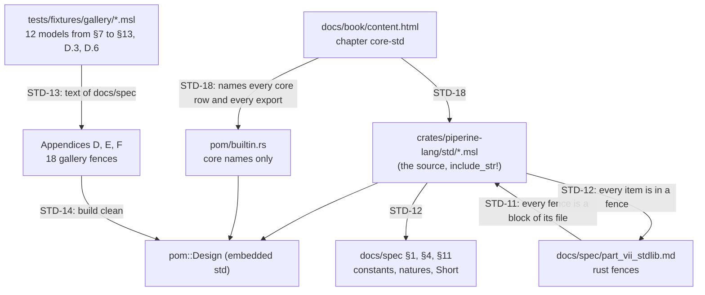

# MSL Standard Library Design

**Spec**: `.specs/features/msl-stdlib/spec.md`
**Status**: Draft (Q1 to Q5 answered by the user, `context.md` "Answers")

---

## Architecture Overview

The library is text in three places that must say the same thing: `docs/spec/` (normative prose and fences), `crates/piperine-lang/std/*.msl` (what the compiler loads) and The MSL Book (what a newcomer reads). The design makes `std/*.msl` the one source and ties the other two to it with tests. No generator: the fences are edited by hand and a guard compares text.



Order of work (MD-57, the specification leads):

1. Spec rules that make the library's forms legal (`extern "intrinsic"`, the normative-source rules), and the rename of the analysis kind to `Transient`, each with a `spec_text` test.
2. The three POM changes, each with tests on small sources: the intrinsic ABI on a function, `Self::` through a supertrait, methods of a blanket implementation.
3. The library, one namespace per task. Each task writes the `std` file, edits the fences of its section to be excerpts (`pub`, bodies, `extern "intrinsic"`), and extends the section table the two guards read. A fence edit travels with its file because `msl_corpus` and `pom_corpus` read fences (MD-57 rule 2).
4. The gates: gallery fixtures, the gallery gate, the built-in table without constants, the fixture prelude retired.
5. The Book. Reference docs (`docs/pom/`) travel with the task that changes what they describe (`pom_docs` enforces it).

### Engine-implemented items (Q1, decided)

The user chose `extern "intrinsic"` (Q1). The grammar already has the slot (`fn_decl ::= 'const'? ( 'extern' STRING )? 'fn' ...`), and §22 rule 4 already has the concept ("a signature and a contract"). The alternatives were moving those items to §14 (they stop being replaceable, §14.13 is reversed) and writing everything in MSL (needs `str` methods the language does not have).

Q1's answer covers `fn` and `module`. After Q2 no module needs it, so only the function form is specified and implemented. Adding the module form later is one sentence in §8.5 and one branch of `E0370`.

### The split (Q2, decided: "as many as possible")

Rule applied to each of the 16 items Part VII gives without a definition: it gets an MSL body unless no MSL text can compute it. The only thing MSL cannot do today is read the content of a string: Appendix H lists no method of `str`, and character and byte literals are not tokens (`E0905`).

| Item | Part VII today | Now | Why |
| ---- | -------------- | --- | --- |
| `same` | signature | MSL | a loop over `level` (§22.1.4 rule 2 says so) |
| `matches_bits` | signature | **intrinsic** | reads the characters of `pattern: &str` |
| `logic` | signature | **intrinsic** | reads the characters of `pattern: &str` |
| `deltalim` | signature | MSL | `new.clamp(old - delta, old + delta)` (§22.2.4 Resolution) |
| `pnjlim`, `fetlim`, `limvds` | signature | MSL | comparisons, `abs`, `ln` on `f64` (Appendix H.2) |
| `noise_table` | head and params | MSL | `noise(table_model(freq(), &table, "1C"), name)` (§22.2.3 Resolution) |
| `table_model` | signature | **intrinsic** | reads the characters of `control: &str` to pick the degree and the extrapolation |
| `db10`, `db20` | signature | MSL | `log10`, `abs` |
| `normal` | signature | MSL | wrapping `u64` arithmetic, shifts, `as f64`, `ln`, `sqrt`, `cos` |
| `zi_np`, `zi_zd`, `zi_zp` | head and params | MSL | a `const fn` multiplies the root factors; the module places one `zi_nd` |
| `laplace_nd` | head and params | MSL | an array of `State` signals and an `analog` block with loops, as `zi_nd` has |
| `laplace_np`, `laplace_zd`, `laplace_zp` | head and params | MSL | the same `const fn` idea; the module places one `laplace_nd` |
| `parse_table` | signature | **intrinsic** | reads the characters of `text: &str`; its result type comes from the `const` it initializes |
| `parse_hex` | signature | **intrinsic** | reads the characters of `text: &str`; the same |

The intrinsic set is therefore "the functions that read a string": five names, each with a `&str` parameter. Two tests hold it: the set equals the table of §22 (STD-08 AC 3) and each member takes a `&str` (STD-08 AC 4). A sixth intrinsic needs a row with a reason and a string to read.

---

## Code Reuse Analysis

### Existing Components to Leverage

| Component | Location | How to Use |
| --------- | -------- | ---------- |
| Embedded library list | `crates/piperine-lang/src/pom/stdlib.rs` (`EMBEDDED`) | grows from 2 to 10 `include_str!` rows; nothing else changes in the builder |
| `DesignBuilder::std_source` | `src/pom/design.rs:461` | tests that prove a prelude rule keep their own library; the gate's control (STD-14 AC 7) uses an empty prelude |
| Fence extraction | `tests/support/spec_corpus.rs` (`corpus`, `extract`, `Class`) | both excerpt guards and the gallery gate read fences through it; no second parser of markdown |
| Fragment ladder | `tests/msl_corpus.rs` (`fragment_diagnostics`) | moved to `tests/support/spec_corpus.rs` so the Book check uses the same four forms (STD-18 AC 9) |
| Section and table helpers | `tests/spec_text.rs` (`section`, `table_rows`, `codes_in`) | the §22 Index and the "Implemented by the engine" table are read with them |
| Shape stage | `src/pom/resolve/shape.rs` (`E0125`) | the intrinsic condition is one more branch of a check that already runs there |
| Member resolution | `src/pom/resolve/members.rs` | the blanket rule is one more step after the three it has |
| Name resolution of generics' bounds | `src/pom/resolve/names.rs` (`A::WIDTH` through bounds) | `Self::NAME` in a trait walks the supertraits with the same code path |
| `Function::abi()` | `src/pom/reflect/items.rs:78` | `is_intrinsic()` is `abi() == Some("intrinsic")` |
| `Decl::references()`, `Crate::is_std()` | `src/pom/reflect/` | the gate's positive check (STD-14 AC 4) |
| `pom_docs` | `tests/pom_docs.rs` | already runs the examples of `docs/pom/`; they move to the embedded library |

### Integration Points

| System | Integration Method |
| ------ | ------------------ |
| `msl-packages` (branch `feature/msl-packages`, base of this branch) | this feature starts when that branch is merged or rebased onto; it uses PKG-05, PKG-06 as delivered. `pub use` globs through a crate are tested there (`pom_crates.rs:601`, `pom_resolve.rs:163`) |
| `docs/spec/` guards | `spec_text` (wording), `msl_corpus` and `pom_corpus` (every fence parses and round-trips) keep running unchanged; an intrinsic fence must parse with zero diagnostics, which it does today (`E0125` is a POM code, stage 8) |
| `mkdocs.yml` | `docs/book/` sits under `docs_dir`; the Book is not a page of the site. Add `docs/book/` to `exclude_docs` |
| `tests/suite_hygiene.rs` (root) | every new target opens with a `//!` scope header; no `#[ignore]`, no file-scope lint suppression |

---

## Components

### The crate `std`

- **Purpose**: the standard library as source.
- **Location**: `crates/piperine-lang/std/`
- **Files**:

| File | Namespace | Spec | Holds |
| ---- | --------- | ---- | ----- |
| `lib.msl` | root | §22 | nine `pub mod` items |
| `prelude.msl` | `std::prelude` | §3.4.2 | eight `pub use crate::<ns>::*;` |
| `constants.msl` | `std::constants` | §1 rule 3 | `Q`, `K_B`, `EPS0`, `PI`, `E`, `inf` |
| `carriers.msl` | `std::carriers` | §4, §11 | `Bit`, `Electrical`, `Thermal`, `VSignal`, `Short` |
| `values.msl` | `std::values` | §22.1 | `Known`, `merge`, `cast`, `same`, `matches_bits`, `logic`, `impl Bit`, `init`, `every`, `since` |
| `analog.msl` | `std::analog` | §22.2 | `State`, `vt`, the noise modules, `limexp` and the limiters, `above`, `absdelta`, `last_crossing`, `idt`, `idtmod`, `slew`, `transition`, `zi_*`, `laplace_*`, `table_model`, `db10`, `db20`, `normal` |
| `nets.msl` | `std::nets` | §22.3 | `Strength`, `Logic`, `Wire`, `tri`, `Tri`, `sum`, `SumNet`, `Tribuf`, `Pullup`, `Pulldown`, `Keeper`, `Tran`, `Tgate` |
| `convert.msl` | `std::convert` | §22.4 | `D2A`, `A2D`, `Bidir` |
| `monitor.msl` | `std::monitor` | §22.5 | `AckWithin`, `Never`, `Stable`, `Setup`, `Hold`, `MinPulse`, `inertial`, `TribufDelayed` |
| `io.msl` | `std::io` | §22.6 | `Severity`, `log`, `finish`, `fatal`, `require`, `cover`, `target`, `parse_table`, `parse_hex` |

- **Rules of the text**: each file is its section's fences in section order, separated by blank lines, with a `//!` header and nothing else. No `use`: a `std` file reaches the other namespaces through the prelude (§3.5 rule 9). `impl Bit` is in `values.msl` while `nature Bit` is in `carriers.msl`; an `impl` for a nature of another namespace of the same crate is ordinary Rust.
- **Intrinsic declarations** (the table "Implemented by the engine" of §22):

```rust
pub extern "intrinsic" fn matches_bits<T: Repr>(s: T, pattern: &str) -> bool;
pub extern "intrinsic" fn logic<T: Repr>(pattern: &str) -> T;
pub extern "intrinsic" fn table_model<const N: usize>(x: f64, table: &[(f64, f64); N], control: &str) -> f64;
pub const extern "intrinsic" fn parse_table<Row, const N: usize>(text: &str) -> [Row; N];   // Row: f64 or a tuple of f64
pub const extern "intrinsic" fn parse_hex<T, const N: usize>(text: &str) -> [T; N];         // T: an integer type
```

- **Bodies written by this feature.** This is the text the tasks start from. Nothing can run it, so each task checks that it parses and resolves with zero diagnostics and has the structure the spec names (STD-08 AC 8 to 12), and the Verifier reads it against its entry in Part VII. A body the parser or the POM rejects is a stop: report it, do not weaken the body into an intrinsic.

```rust
pub fn same<T: Repr>(a: T, b: T) -> bool { (0..T::WIDTH).all(|k| a.level(k) == b.level(k)) }

pub fn deltalim(new: f64, old: f64, delta: f64) -> f64 { new.clamp(old - delta, old + delta) }

pub fn db10(x: f64) -> f64 { 10.0 * x.log10() }
pub fn db20(x: f64) -> f64 { 20.0 * x.abs().log10() }

pub module noise_table<const N: usize>(name: Option<&str>) -> f64 {
    table: [(f64, f64); N];
    noise(table_model(freq(), &table, "1C"), name)
}
```

The three limiters are `crates/piperine-ir/src/limit.rs` (`pnjlim`, `fetlim`, `limvds`) transliterated: same branches, same constants, plain comparisons where that file uses `ng_min` and `ng_max`. The task compares branch by branch.

```rust
pub fn pnjlim(new: f64, old: f64, nvt: f64, vcrit: f64) -> f64 {
    if !(new > vcrit && (new - old).abs() > 2.0 * nvt) { new }
    else if old > 0.0 {
        let arg = 1.0 + (new - old) / nvt;
        if arg > 0.0 { old + nvt * arg.ln() } else { vcrit }
    } else { nvt * (new / nvt).ln() }
}

pub fn limvds(new: f64, old: f64) -> f64 {
    if old >= 3.5 {
        if new > old { if new < 3.0 * old + 2.0 { new } else { 3.0 * old + 2.0 } }
        else if new < 3.5 { if new > 2.0 { new } else { 2.0 } }
        else { new }
    } else if new > old { if new < 4.0 { new } else { 4.0 } }
    else if new > -0.5 { new } else { -0.5 }
}

pub fn fetlim(new: f64, old: f64, vth: f64) -> f64 {
    let hi = (2.0 * (old - vth)).abs() + 2.0;
    let lo = (old - vth).abs() + 1.0;
    let vtox = vth + 3.5;
    let delv = new - old;
    if old >= vth {
        if old >= vtox {
            if delv <= 0.0 {
                if new >= vtox { if -delv > lo { old - lo } else { new } }
                else if new > vth + 2.0 { new } else { vth + 2.0 }
            } else if delv >= hi { old + hi } else { new }
        } else if delv <= 0.0 { if new > vth - 0.5 { new } else { vth - 0.5 } }
        else if new < vth + 4.0 { new } else { vth + 4.0 }
    } else if delv <= 0.0 { if -delv > hi { old - hi } else { new } }
    else if new <= vth + 0.5 { if delv > lo { old + lo } else { new } }
    else { vth + 0.5 }
}
```

`normal` is SplitMix64 for two uniform draws and Box-Muller for the sample. `1.0 - a` is in `(0, 1]`, so the logarithm is finite; with `sigma == 0.0` the sample is `mean` (§22.2.17 rule 3); integer arithmetic wraps (§1).

```rust
/// One step of SplitMix64: a uniform real in [0, 1) and the next state.
fn uniform(rng: u64) -> (f64, u64) {
    let s = rng + 0x9E3779B97F4A7C15;
    let z = (s ^ (s >> 30)) * 0xBF58476D1CE4E5B9;
    let z = (z ^ (z >> 27)) * 0x94D049BB133111EB;
    let z = z ^ (z >> 31);
    ((z >> 11) as f64 / 9007199254740992.0, s)
}

pub fn normal(rng: u64, mean: f64, sigma: f64) -> (f64, u64) {
    let (a, s1) = uniform(rng);
    let (b, s2) = uniform(s1);
    let z = (-2.0 * (1.0 - a).ln()).sqrt() * (2.0 * PI * b).cos();
    (mean + sigma * z, s2)
}
```

The root forms share three private `const fn`. A root is `(real, imaginary)`. Products are carried as complex pairs and the real parts returned; with conjugate-closed roots the imaginary parts cancel.

```rust
/// True when each complex root has its conjugate as often as itself.
const fn conjugate_closed<const N: usize>(roots: &[(f64, f64); N]) -> bool {
    roots.iter().all(|r| r.1 == 0.0
        || roots.iter().filter(|c| c.0 == r.0 && c.1 == -r.1).count()
        == roots.iter().filter(|c| c.0 == r.0 && c.1 == r.1).count())
}

/// Coefficients, ascending in `q = z^−1`, of the product of `1 − ρ·q` over the roots.
const fn poly_q<const N: usize>(roots: &[(f64, f64); N]) -> [f64; N + 1] {
    let mut c = [(0.0, 0.0); N + 1];
    c[0] = (1.0, 0.0);
    for n in 0..N {
        let (a, b) = roots[n];
        for k in (1..=n + 1).rev() {
            let (pr, pi) = c[k - 1];
            c[k] = (c[k].0 - (a * pr - b * pi), c[k].1 - (a * pi + b * pr));
        }
    }
    let mut re = [0.0; N + 1];
    for k in 0..=N { re[k] = c[k].0; }
    re
}

/// The same product without its leading 1: the `den` of `zi_nd` (§22.2.12 rule 1).
const fn den_q<const D: usize>(poles: &[(f64, f64); D]) -> [f64; D] {
    let c = poly_q(poles);
    let mut d = [0.0; D];
    for k in 0..D { d[k] = c[k + 1]; }
    d
}

/// Coefficients, ascending in `s`, of the product of `1 − s/ρ`; a root at zero gives the factor `s`.
const fn poly_s<const N: usize>(roots: &[(f64, f64); N]) -> [f64; N + 1] {
    let mut c = [(0.0, 0.0); N + 1];
    c[0] = (1.0, 0.0);
    for n in 0..N {
        let (a, b) = roots[n];
        let zero = a == 0.0 && b == 0.0;
        let m = a * a + b * b;
        let (ia, ib) = if zero { (0.0, 0.0) } else { (a / m, -b / m) };        // 1/ρ
        for k in (1..=n + 1).rev() {
            let (pr, pi) = c[k - 1];
            c[k] = if zero { (pr, pi) } else { (c[k].0 - (ia * pr - ib * pi), c[k].1 - (ia * pi + ib * pr)) };
        }
        if zero { c[0] = (0.0, 0.0); }
    }
    let mut re = [0.0; N + 1];
    for k in 0..=N { re[k] = c[k].0; }
    re
}

pub module zi_zp<const N: usize, const D: usize>(x: f64, period: f64) -> f64 {
    zeros: [(f64, f64); N] where conjugate_closed(&zeros);
    poles: [(f64, f64); D] where conjugate_closed(&poles);
    zi_nd(x, period) { num: poly_q(&zeros), den: den_q(&poles) }
}
pub module zi_zd<const N: usize, const D: usize>(x: f64, period: f64) -> f64 {
    zeros: [(f64, f64); N] where conjugate_closed(&zeros);
    den: [f64; D];
    zi_nd(x, period) { num: poly_q(&zeros), den }
}
pub module zi_np<const N: usize, const D: usize>(x: f64, period: f64) -> f64 {
    num: [f64; N];
    poles: [(f64, f64); D] where conjugate_closed(&poles);
    zi_nd(x, period) { num, den: den_q(&poles) }
}
```

`laplace_nd` is the controllable canonical form. `den` has `D` coefficients, so the denominator has degree `D − 1`: one `State` per pole, as §22.2.14 says. `w[k]` is the `k`-th derivative of an internal variable `W` with `den(s)·W = x`; the output is `num(s)·W`. `top` is the derivative of order `D − 1`. With `D == 1` there is no state and the result is `num[0] * x / den[0]`.

```rust
pub module laplace_nd<const N: usize, const D: usize>(x: f64) -> f64 where D >= 1 && N <= D {
    num: [f64; N];
    den: [f64; D] where den.iter().any(|d| *d != 0.0);
    signal w: [State; D - 1];                // w[k]: the k-th derivative of W, where den(s)·W = x
    let top = if D > 1 { ddt(pos(w[D - 2])) } else { x / den[0] };
    let y = (0..N).map(|k| num[k] * if k + 1 < D { pos(w[k]) } else { top }).sum();
    y
}
analog<N, D> for laplace_nd<N, D> {
    for k in 0..D - 1 {
        if k + 2 < D { rate(w[k]) +> ddt(pos(w[k])) - pos(w[k + 1]); }
    }
    if D > 1 {
        let mut acc = den[D - 1] * top - x;
        for j in 0..D - 1 { acc += den[j] * pos(w[j]); }
        rate(w[D - 2]) +> acc;               // the row of the last state: den(s)·W = x
    }
}

pub module laplace_zp<const N: usize, const D: usize>(x: f64) -> f64 where N <= D {
    zeros: [(f64, f64); N] where conjugate_closed(&zeros);
    poles: [(f64, f64); D] where conjugate_closed(&poles);
    laplace_nd(x) { num: poly_s(&zeros), den: poly_s(&poles) }
}
pub module laplace_zd<const N: usize, const D: usize>(x: f64) -> f64 where N < D {
    zeros: [(f64, f64); N] where conjugate_closed(&zeros);
    den: [f64; D];
    laplace_nd(x) { num: poly_s(&zeros), den }
}
pub module laplace_np<const N: usize, const D: usize>(x: f64) -> f64 where N <= D + 1 {
    num: [f64; N];
    poles: [(f64, f64); D] where conjugate_closed(&poles);
    laplace_nd(x) { num, den: poly_s(&poles) }
}
```

Consequences written into Part VII with these bodies: the `E0707` row goes (a complex root without its conjugate and a zero denominator are a false `where`, `E0317`); §22.2.14 gains the rule `D >= 1` and `N <= D` (`E0304`); the phrases "the listing gives heads and params only" go; G.64 names the generator.

- **Dependencies**: the core names of §14 and Appendix H. Nothing else.
- **Reuses**: Part VII's text as it is, with `pub` added to `State`, `Wire`, `Tri`, `SumNet`, `Tribuf`, `Pullup`, `Pulldown`, `Keeper`, `Tran`, `Tgate`, `D2A`, `A2D`, `Bidir`, `TribufDelayed`. `Slewing` and the helper functions stay private. `zi_nd`'s `analysis(Tran)` becomes `analysis(Transient)`.

### Spec edits

- **Purpose**: make the forms legal and the library normative (STD-01, STD-02), rename the analysis kind, and turn fences into excerpts (STD-11, STD-12).
- **Location**: `docs/spec/`
- **Edits that lead** (each with a `spec_text` test, before any code):
  - `part_i_values.md` §3 rule 2 and rule 10, the `E0125` row; §1 rule 3 and its table.
  - `part_vii_stdlib.md` §22: rules 1 and 4 reworded, the "Sources" table (section, namespace, file), the "Implemented by the engine" table (item, entry, reason), the `pub` Resolution removed.
  - `appendix_g_scope.md`: S1 to S5 in the decision table.
- **The rename `Tran` to `Transient`** (one task; the spec, the built-in row and `docs/pom/` in one commit, because `pom_docs` and the corpus tests read all three). Every occurrence was listed while planning:

| File | Occurrences that are the analysis kind | Occurrences that are the module (stay) |
| ---- | -------------------------------------- | -------------------------------------- |
| `part_iv_behavior.md` | §11.1 (lines 263, 269, 274, 300), §13 (648), §14.4 (865) | none |
| `part_v_execution.md` | §16 (321, 333, 355), §16.3 table (450), §16.4 (474); the phrase "transient step" is prose and stays | none |
| `part_vii_stdlib.md` | §22.1.6 rule 6, the fence and prose of §22.2.12 | the Index rows, §22.3.7, §22.3.8, the §22.3 table |
| `part_iii_structure.md` | none | the fence at line 454 |
| `appendix_b_grammar.md` | row 23 of B.1 | none |
| `appendix_d_gallery_analog.md` | line 232 | none |
| `appendix_f_gallery_mixed.md` | any `analysis(Tran)` | the table "Models referenced", F.4 |
| `appendix_g_scope.md` | lines 243, 258, 288, 365 | line 301 |
| `appendix_c_implementation.md` | none | line 120 |
| `docs/pom/resolution.md`, `docs/pom/model.md` | the `Variant` rows | none |
| `src/pom/builtin.rs` | the row `Tran` | none |

  Three tests hold the result: the kind lists read `Transient` (STD-01 AC 7), `analysis(Tran)` occurs nowhere (AC 8), and in every fence `Tran` is followed by `(` (AC 9: a declaration or a placement of the module, never a value).
- **Edits that travel with a `std` file**: the fences of that file's section. Usage examples become `rust,fragment` (the `Pi` example of §22.2.8, the `MeasuredDiode` example of §22.2.15, the `IV`/`ROM` example of §22.6.4, and any other `rust` fence of Part VII that declares no `std` item; the guard of STD-11 finds each).
- **Edits that close the feature** (with the gallery gate): G.38 `Closed`, the line of Appendix C.
- **Reuses**: MD-57 as the rule for which edit goes where.

### POM: the intrinsic ABI (STD-04)

- **Purpose**: accept `extern "intrinsic" fn` in `std`, reject it elsewhere.
- **Location**: `src/pom/resolve/shape.rs`, `src/pom/reflect/items.rs`
- **Interfaces**:
  - `Function::is_intrinsic(self) -> bool`
- **Behavior**: stage 8 gains one check. A function whose ABI is `intrinsic`, in a crate that is not `std`, is `E0125` at its name, with the help "only the standard library declares intrinsic functions; write a body or use `extern \"C\"`". The existing branches already give `E0125` for an `extern` function with a body and accept one without. A call to an intrinsic is an ordinary `CallClass::Function`.
- **Dependencies**: `Crate::is_std()`.
- **Reuses**: the existing `E0125` branches.

### POM: `Self::NAME` through a supertrait (STD-05)

- **Purpose**: `Self::WIDTH` in `trait Known: Repr`.
- **Location**: `src/pom/resolve/names.rs`
- **Behavior**: `Self::NAME` inside a trait looks in the trait's own items, then in each supertrait in the order written: a user trait's items, or the `Repr` member rows (`builtin_member("Repr", name)`). Another built-in supertrait gives `Deferred(BuiltinTraitMember)`, as a generic bounded by it does today. Nothing found is `E0161`.
- **Reuses**: the code that resolves `A::WIDTH` through the bounds of a generic `A`; the supertrait list is the same shape as a bound list.

### POM: methods of a blanket implementation (STD-06)

- **Purpose**: link `d.known()`, `d.known_or(x)`, `d.is_known()` on a carrier. §3.3.7 names these four functions as the ones an implementation must recognize; an unlinked call cannot be recognized.
- **Location**: `src/pom/resolve/members.rs`
- **Behavior**: a fourth step for a carrier receiver and for `self` in an `impl` of a nature, after the carrier built-ins, the nature's `impl` blocks and the value type's `impl` blocks. It scans the `impl` blocks of the form `impl<T: B> Tr for T` (the self type is the block's own generic) where `B` is absent or resolves to the core `Repr`, visible traits first in declaration order, and resolves the method to the item of `Tr` with that name. The value type of a nature is `Repr` by §4, so the bound holds without a type checker. Any other bound is left to the type checker: the slot stays as it is today.
- **What it does not do**: no trait solving, no receiver other than a carrier or `self` of a nature's `impl`. A value receiver (`self.level(k)?` inside `Known` itself) stays `Deferred(ReceiverTypeUnknown)`.

### Built-in table (STD-15)

- **Purpose**: `Resolution::Builtin` means core.
- **Location**: `src/pom/builtin.rs`, `docs/pom/resolution.md`
- **Change**: the six `Const` rows and `BuiltinKind::Const` go, and the variant row `Tran` is renamed `Transient` (with the spec rename, before any `std` file lands). Everything else stays: the table already holds no Part VII module.

| Kind | Stays built in | Why it is not `std` |
| ---- | -------------- | ------------------- |
| `Type` | `uN`, `iN`, `fN`, `bool`, `usize`, `isize`, `UInt`, `Int`, `Float`, `Option`, `Event`, `Analysis`, `str` | §1, §13, §11.1; Appendix H.9 |
| `Variant` | `Some`, `None`, `Dc`, `Transient`, `Ac`, `Noise`, `Static` | §1, §11.1.1 |
| `Trait` | `Repr`, `Nature`, `Fn`, and the nine of H.8 | language traits; the catalogue of Appendix H |
| `Fn`, `Module`, `Event`, `Statement`, `Method` | the rows of §14 | "what only the simulator can provide" |
| `Node`, `ImplicitParam`, `Member` | `gnd`; `m`, `dtemp`; `Repr::WIDTH`, `encode`, `decode` | D3; §2 |
| `Const` | none | moved to `std::constants` (§1 rule 3 says "the prelude has") |

- **Consequence**: `BuiltinId` is a row index, so every id after the removed rows changes. No design is stored anywhere; the serde tests build their own.
- **Guard**: one test asserts that no name exported by `std::prelude` is a row of the table (STD-09 AC 5). It is what would have caught `Tran`, and it is why the rename lands before `nets.msl`.

### Library checks (STD-07 to STD-10, STD-16)

- **Purpose**: the layout, the content and the cleanliness of the embedded library, as tests over the embedded design.
- **Location**: `crates/piperine-lang/tests/std_library.rs` (new target)
- **How**: one design built from an empty source, read through reflection. Layout: the items of the root, of `prelude` and of each namespace. Content: the §22 Index and the "Implemented by the engine" table are read from the spec and compared with the declarations (`Function::is_intrinsic`, `Function::body`, a module's result expression, a param's `where`, `Module::instances`). Cleanliness: `diagnostics()`, `check()`, and a walk of the expressions of the `std` files for `Field` and `MethodCall` slots that are `Unresolved`.
- **Structure checks of the new bodies** (the mechanical part of "each body resolves clean"): each root form places exactly one coefficient form; each `zeros` and `poles` param has a `where`; `laplace_nd` has a `State` array and one `analog` block; `noise_table` places `noise` and calls `table_model`; the eight pure functions name no §14 primitive but `level`.
- **Reuses**: `spec_corpus`, the `section` and `table_rows` helpers, `Decl::references()`.

### Excerpt guards (STD-11, STD-12)

- **Purpose**: Part VII and `std` cannot drift.
- **Location**: `crates/piperine-lang/tests/std_excerpts.rs` (new target)
- **Inputs**: the "Sources" table of §22 (read from the spec, not repeated in the test), `corpus()`, the `std` files read from disk.
- **Forward** (STD-11): for each `rust` fence of Part VII, find its section from the nearest heading `### 22.k` above it, take that section's file, normalize both (strip trailing whitespace per line; drop leading and trailing blank lines of the fence), and require the fence's lines to be consecutive lines of the file.
- **Reverse** (STD-12): build a design from the embedded library, walk the top-level declarations and behavior blocks of each `std` file except `lib.msl` and `prelude.msl`, take each one's source text from its span (attributes and docs included), and require it to be a substring of some `rust` fence of `docs/spec/`.
- **Growth**: the forward guard runs over the sections whose row in the "Sources" table names a file that exists; the task that lands the last file adds the assertion that all six rows are present and the floor counts of STD-11 AC 3 and STD-12 AC 5. So the target is green at every commit and complete at the end.
- **Reuses**: `spec_corpus`, `spec_text`'s `section` and `table_rows` (copied into `tests/support/` as plain functions if `spec_text.rs` cannot be `#[path]`-shared without warnings).

### Gallery gate (STD-13, STD-14)

- **Purpose**: D4's gate.
- **Location**: `crates/piperine-lang/tests/std_galleries.rs` (new target), `tests/fixtures/gallery/*.msl`
- **What "clean" means**, given a front end that parses and resolves and nothing more:
  1. zero diagnostics in the whole design: the gallery file and every `std` file;
  2. `Design::check()` empty;
  3. no `Field` or `MethodCall` slot of the gallery file is `Unresolved`. This is the one silent miss the POM has: a member a known receiver lacks gets no diagnostic (`docs/pom/resolution.md`, Members). `Deferred(ReceiverTypeUnknown)` is allowed: it is the type checker's work;
  4. each `std` item the table lists for the gallery has a reference in the gallery file and belongs to a crate that `is_std()`.
- **What it does not mean**: nothing is type-checked, elaborated or run. A wrong argument type, a missing param or a wrong body in `std` passes this gate. The spec says so (STD-01 AC 5).
- **Data**: one table in the test, a row per gallery section.

| Gallery | Fixture models appended | `std` items it must reference (at least) |
| ------- | ----------------------- | ---------------------------------------- |
| D.1 to D.6 | `Resistor`, `Capacitor`, `Switch` as used | `Electrical`, `Bit`; D.2 `normal`; D.3 `idtmod`; D.4 `transition`; D.5, D.6 `above` (to be fixed per fence by the task, from the fence's own text) |
| E.1 to E.7 | `Stream`, `Tx` as used | `Bit`; E.7 `Wire`, `Pullup`, `Logic` |
| F.1 to F.5 | `SampleHold`, `Comparator`, `Resistor`, `Capacitor`, `Switch`, `Cell`, `Dram1T1C`, `MemoryBank`, `Vco`, `RSwitch` as used | `Electrical`, `Bit`; F.4 `Tran`, `Keeper`, `Wire` |

- **Assembly**: the root file is the fence followed by the fixture files of its row. A fixture is never appended to the fence that defines the same model (`Vco` in D.3, `RSwitch` in D.6).
- **Fixture check**: each line of a fixture file occurs in `docs/spec/`: in a `rust` fence, or, for the declarations Appendix D only assumes (`Capacitor`, the short `Resistor`), in a code span of its table "Models referenced from the normative parts".
- **Control**: the same assembly against `std_source("lib.msl", "pub mod prelude {}")` reports `E0161` in all 18.

### The MSL Book (STD-18)

- **Purpose**: a chapter that tells a newcomer what is core and what is `std`; the Book's source in the repository.
- **Location**: `docs/book/{content.html,template.html,build.py}`; check in `crates/piperine-lang/tests/book.rs` (new target)
- **Move**: the three files are copied from the session scratchpad as they are (`/tmp/claude-1000/-home-keslarek-Git-piperine/570f7032-f229-4af2-937c-a6378b382406/scratchpad/manual/build/`). Two lines of `build.py` change: the output is `HERE / "index.html"` instead of `HERE.parent / "index.html"`, and `Transient` joins `CONSTS`. `docs/book/index.html` goes in `.gitignore`. If the scratchpad is gone when the task runs, the orchestrator supplies the three files from the published artifact; the task does not rewrite the Book from memory.
- **Chapter**: `<section id="core-std" class="chapter">`, "Chapter 10", after `packages`; `errors`, `pom` and `cheatsheet` become 11, 12, 13. Content, in this order:
  1. the idea in one paragraph: core is what only the simulator can provide; everything else is ordinary source you can read, in `std`;
  2. core, in three small tables: the core names (`gnd`, `Nature`, `m`, `dtemp`, `str`), the primitives of §14 by kind (probes, environment, the six core modules, events, statements, carrier methods), the two `!` forms;
  3. `std::prelude`: implied in every file, what it re-exports;
  4. one part per namespace (`std::constants` to `std::io`): one sentence each item, one small example per namespace;
  5. "implemented by the engine": the intrinsic items and what that means for a reader (a signature and a contract, no body to read);
  6. replacing a library item (§22 rule 3) in two sentences.
- **Other edits**: chapter 9 (`packages`) says `std` is a dependency of every crate and names `std::prelude`; the cheat sheet gains a "where names come from" block with the eight namespaces; every `analysis(Tran)` of the Book becomes `analysis(Transient)`.
- **Check** (`book.rs`): reads `content.html` with plain string functions (sections by `<section id="..">`, blocks by `<pre data-lang="..">`, code spans by `<code>`), decodes the five HTML entities, and asserts STD-18 AC 3 to 12. The lists come from the code, not from the test: core names from `BUILTINS` (kinds `Fn`, `Module`, `Event`, `Statement`, `Method`, `Node`, `ImplicitParam`, plus `Nature`, `str`) and the two `!` forms; namespaces and exports from the embedded design. AC 2 runs `python3 docs/book/build.py` and checks the output file exists and holds the chapter's nav entry.
- **Publishing**: not a task. The orchestrator runs `build.py` and publishes `docs/book/index.html` to the existing artifact after the merge.
- **Reuses**: `fragment_diagnostics` (moved to `tests/support/spec_corpus.rs`); `Design::builder()` for AC 8.

---

## Data Models

None new. One enum variant leaves (`BuiltinKind::Const`), one built-in row is renamed (`Transient`), one method is added (`Function::is_intrinsic`). The "Sources" and "Implemented by the engine" tables live in §22 and are read by the tests as data.

---

## Error Handling Strategy

| Error Scenario | Handling | User Impact |
| -------------- | -------- | ----------- |
| `extern "intrinsic" fn` in a user crate | `E0125` at the name, with a help line | the model is rejected at the POM |
| A list of roots that is not conjugate-closed; a zero denominator | the param's `where` is false: `E0317` (elaboration, not this feature's POM) | the placement is rejected when an elaborator exists |
| `laplace_nd` with `N > D` or `D == 0` | the module's `where` is false: `E0304` | the same |
| A model redefines a `std` item | none: the model's item hides the prelude's (§22 rule 3) | works as written |
| A model names a private `std` item | `E0161`, label "private item" | existing behavior |
| Two `std` namespaces export one name | `E0162` at each use (two globs) | cannot ship: STD-10 AC 1 fails the build of `std` itself in the test |
| A fence and `std` differ | `std_excerpts` fails, naming the spec line and the first unmatched line | a contributor fixes one of the two |
| A gallery stops building clean | `std_galleries` fails with the per-fence report of STD-14 AC 6 | the same |
| The Book omits a name | `book` fails listing every missing name | the chapter is completed |

---

## Risks & Concerns

| Concern | Location (file:line) | Impact | Mitigation |
| ------- | -------------------- | ------ | ---------- |
| `Tran` is both a `std` module and an analysis kind; the prelude wins, silently | `docs/spec/part_vii_stdlib.md` §22.3.7; `src/pom/builtin.rs:67` | `analysis(Tran)` names a module in every model once `std` is real | Q3: the kind becomes `Transient` in the first phase; STD-01 AC 8 and 9 find a leftover; guard STD-09 AC 5 for the whole class |
| A member a known receiver lacks is silently `Unresolved` | `docs/pom/resolution.md`, Members | a gate on diagnostics alone would pass with `known` unlinked (measured: every such call) | STD-06 links them; STD-10 AC 2 and STD-14 AC 3 forbid `Unresolved` member slots |
| The prelude lookup may read declared items only, not `pub use` globs | `src/pom/resolve/names.rs` (step 4 of the scope order) | `prelude.msl` of re-exports would export nothing | the first `std` task proves it with `constants` and `carriers`; if it fails, extending the prelude step to imports is part of that task (§3.4.2 says the prelude "re-exports"). Fallback kept out: declaring items directly in `prelude.msl` would lose the namespaces |
| Glob imports between `std` files and the prelude form a cycle (a `std` file sees the prelude, the prelude globs the file) | `src/pom/resolve/imports.rs` | a fixpoint that does not converge, or a false `E0162` | own items shadow globs (§3.4.8); covered by STD-10 AC 1 on the real library, and by a two-file test in the first `std` task |
| `impl Bit` in `values.msl` for a nature of `carriers.msl` | `src/pom/resolve/members.rs` | `clk.rise()` unlinked if `impl` lookup is per file | measured through the probe with one file only; the `values` task asserts `rise` is linked from a user crate. If per-file, widen to the crate (Rust's rule) |
| Bodies in `std` are never executed | `std/analog.msl`: 16 new bodies, about 120 lines | a wrong definition is now normative and no test can see it (user's choice, Q2) | the bodies are fixed in this design, not invented per task; the limiters are transliterated from in-tree code already checked against ngspice; structure checks (STD-08 AC 8 to 12); the Verifier hand-traces `poly_q`, `poly_s` and `laplace_nd` on one example each (two real roots; one conjugate pair; `D = 2`) and records the trace in `verification.md` |
| A body uses a form the parser or the POM does not take yet (`[f64; N + 1]` in a signature, `c[k] = v` on a local array, a `where` that calls a function, a placement with a param block as a result expression) | `src/msl/parser/`, `src/pom/resolve/` | a diagnostic in `std` | each is Rust or a form the spec already uses (`UInt<{A + 1}>` §1, `zi_nd(..) { num: .. }` §22.2.12 rule 2); if one fails, the task stops and reports: fixing the front end is a decision, turning the body into an intrinsic is not allowed |
| `laplace_nd` is narrower than Part VII's contract (`N <= D`) | `docs/spec/part_vii_stdlib.md` §22.2.14 | an improper transfer function is rejected | written as a rule of §22.2.14 (STD-02 AC 8) and reported to the user as an open point |
| `spec_text.rs` helpers are private to that target | `crates/piperine-lang/tests/spec_text.rs:46` | two more targets need `section` and `table_rows` | move the three helpers to `tests/support/` and `#[path]`-include them, as `spec_corpus` is |
| Existing Book blocks may not parse | `docs/book/content.html` (43 `msl` blocks, never checked) | STD-18 AC 9 fails on text this feature did not write | fix the block where it is wrong MSL; where it is a deliberate error illustration, mark it `data-lang="msl-error"` and require at least one diagnostic, as `rust,compile_fail` does |
| `python3` in a cargo test | `tests/book.rs` | a machine without Python fails the suite | the skill's gates and `piperine-python` already require Python 3; the test fails loud, never skips |
| The base branch is still being implemented | `feature/msl-packages` | the builder, `EMBEDDED` and the prelude step may still move | execution starts after that branch is merged; the first task re-reads `stdlib.rs` and `design.rs` |
| `BuiltinId` values shift | `src/pom/builtin.rs:120` | a stored design would point at the wrong row | nothing stores one; `pom_design` serde tests build fresh |
| Disk space | `/var/tmp/piperine-target`, 12 GB free on `/home` | a full disk mid-run | three new test targets in an existing crate; no new crate, no new dependency |

---

## Tech Decisions

| Decision | Choice | Rationale |
| -------- | ------ | --------- |
| Source of truth | `std/*.msl`; fences are edited by hand and compared | a generator would write into normative prose; a comparison fails loudly and keeps both readable |
| Guard granularity | forward by fence, reverse by item | forward alone lets `std` hold text the spec never shows; reverse alone lets the spec show text that is not there |
| Section-to-file map | a table in §22, read by the tests | one copy; the reader of the spec learns the layout from the same table |
| Examples in Part VII | `rust,fragment` | keeps "a `rust` fence of Part VII is `std` text" without a new fence class |
| Gallery support | fixture files checked as spec text, and a per-gallery table | no model is invented; a gallery that defines a model is never given a second one |
| "Clean" | diagnostics, invariants, no `Unresolved` member, positive references, a control | each closes one way the gate could pass while resolving nothing |
| Constants | `pub const` in `std::constants` | §1 rule 3; one place per name |
| Analysis kind | `Transient` | Q3; a whole word like `Noise` and `Static`, and the word Parts V and VIII already use in prose |
| Intrinsic form | functions only | no module needs it after Q2 |
| Root-form errors | a `where` on the param (`E0317`), `E0707` removed | the language's own form; an MSL body cannot raise a code |
| `normal` | SplitMix64 and Box-Muller | small, total, wrapping integer arithmetic only; the source documents it |
| Book build output | not committed | generated; the test checks the source and that the build runs |
| Codes | none new; `E0707` removed | `E0125` already owns "ABI and shape of an `extern` function" |

**Project-level decision to record on approval** (`.specs/STATE.md`, next id `MD-60`): "`std/*.msl` is the normative text of Part VII; an item MSL cannot express is an `extern "intrinsic" fn`, legal in `std` only, and the list is held to the functions that read a string; the analysis kind is `Transient`; `Resolution::Builtin` means a core name." Written when the user approves the spec.

---

## Size

One feature: 24 tasks in 6 phases, 113 checks, 4 batches of whole phases (`tasks.md`).

| Phase | Tasks | Content |
| ----- | ----- | ------- |
| 1. Specification | T1 to T4 | intrinsic ABI (§3); §22 rules and tables; the rename to `Transient`; S1 to S5 and §1 |
| 2. POM | T5 to T7 | intrinsic functions; `Self::` through a supertrait; blanket methods |
| 3. Library I | T8 to T12 | guards' harness; `constants`, `carriers`, prelude; `values`; `analog` (two tasks) |
| 4. Library II | T13 to T17 | `nets`; `convert`; `monitor`; `io`; completeness of the layout, the content and the guards |
| 5. Gates | T18 to T21 | gallery fixtures; gallery gate and G.38; built-in table without constants; fixture prelude retired |
| 6. Book | T22 to T24 | Book moved and checked; chapter `core-std`; chapter 9 and cheat sheet |

Execution starts after `feature/msl-packages` is merged to `main` and this branch is rebased onto it.
