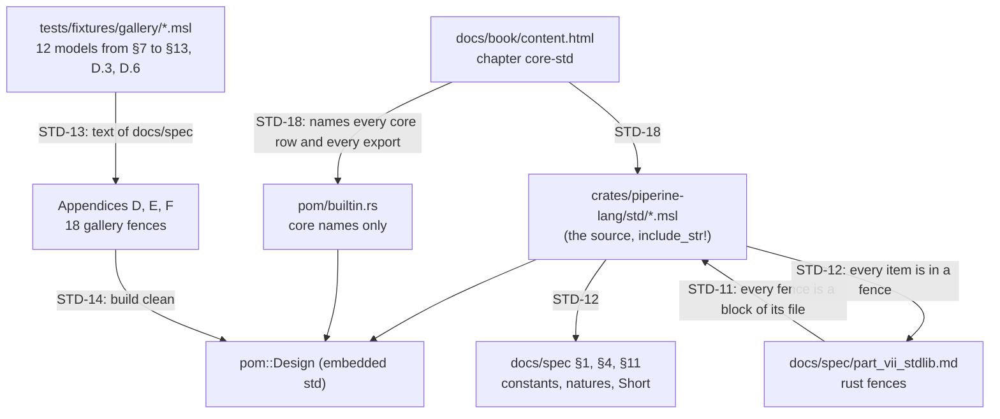

# MSL Standard Library Design

**Spec**: `.specs/features/msl-stdlib/spec.md`
**Status**: Draft (written under the recommended answers of Q1 to Q5, `context.md`)

---

## Architecture Overview

The library is text in three places that must say the same thing: `docs/spec/` (normative prose and fences), `crates/piperine-lang/std/*.msl` (what the compiler loads) and The MSL Book (what a newcomer reads). The design makes `std/*.msl` the one source and ties the other two to it with tests. No generator: the fences are edited by hand and a guard compares text.



Order of work (MD-57, the specification leads):

1. Spec rules that make the library's forms legal (`extern "intrinsic"`, the normative-source rules, the rename), each with a `spec_text` test.
2. The three POM changes, each with tests on small sources: the intrinsic ABI, `Self::` through a supertrait, methods of a blanket implementation.
3. The library, one namespace per task. Each task writes the `std` file, edits the fences of its section to be excerpts (`pub`, bodies, `extern "intrinsic"`), and extends the section table the two guards read. A fence edit travels with its file because `msl_corpus` and `pom_corpus` read fences (MD-57 rule 2).
4. The gates: gallery fixtures, the gallery gate, the built-in table without constants, the fixture prelude retired.
5. Reference docs and the Book.

### Approaches considered for engine-implemented items (Q1)

| | A. `extern "intrinsic"` (chosen) | B. Move to §14 | C. Write all in MSL |
| - | - | - | - |
| Language change | one ABI string; no production, no construct, no code | 16 more core names | `str` methods in Appendix H, const-generic arithmetic |
| Part VII | fences become real declarations | 16 entries leave Part VII | fences gain unrun bodies |
| Replaceable by a project (§22 rule 3) | yes | no | yes |
| Risk | the ABI must be closed to user crates (STD-04 AC 2, 5) | §14.13 reversed | wrong numerics become normative |

A is chosen because the grammar already has the slot (`fn_decl ::= 'const'? ( 'extern' STRING )? 'fn' ...`, `module_decl ::= ... ( 'extern' STRING )? 'module' ...`), §22 rule 4 already has the concept ("a signature and a contract"), and a core module is already "a module the simulator implements, with a result and value inputs" (§14 rule 3). An intrinsic module is that, declared in `std`.

---

## Code Reuse Analysis

### Existing Components to Leverage

| Component | Location | How to Use |
| --------- | -------- | ---------- |
| Embedded library list | `crates/piperine-lang/src/pom/stdlib.rs` (`EMBEDDED`) | grows from 2 to 10 `include_str!` rows; nothing else changes in the builder |
| `DesignBuilder::std_source` | `src/pom/design.rs:461` | tests that prove a prelude rule keep their own library; the gate's control (STD-14 AC 7) uses an empty prelude |
| Fence extraction | `tests/support/spec_corpus.rs` (`corpus`, `extract`, `Class`) | both excerpt guards and the gallery gate read fences through it; no second parser of markdown |
| Fragment ladder | `tests/msl_corpus.rs` (`fragment_diagnostics`) | moved to `tests/support/spec_corpus.rs` so the Book check uses the same four forms (STD-18 AC 9) |
| Section and table helpers | `tests/spec_text.rs` (`section`, `table_rows`, `codes_in`) | the §22 Index and the "Implemented by the engine" table are read with them |
| Shape stage | `src/pom/resolve/shape.rs` (`E0125`, `E0370`) | the intrinsic conditions are two more branches of checks that already run there |
| Member resolution | `src/pom/resolve/members.rs` | the blanket rule is one more step after the three it has |
| Name resolution of generics' bounds | `src/pom/resolve/names.rs` (`A::WIDTH` through bounds) | `Self::NAME` in a trait walks the supertraits with the same code path |
| `Function::abi()`, `Module::abi()` | `src/pom/reflect/items.rs:78`, `reflect/hardware.rs:288` | `is_intrinsic()` is `abi() == Some("intrinsic")` |
| `Decl::references()`, `Crate::is_std()` | `src/pom/reflect/` | the gate's positive check (STD-14 AC 4) |
| `pom_docs` | `tests/pom_docs.rs` | already runs the examples of `docs/pom/`; they move to the embedded library |

### Integration Points

| System | Integration Method |
| ------ | ------------------ |
| `msl-packages` (branch `feature/msl-packages`, base of this branch) | this feature starts when that branch is merged or rebased onto; it uses PKG-05, PKG-06 as delivered. `pub use` globs through a crate are tested there (`pom_crates.rs:601`, `pom_resolve.rs:163`) |
| `docs/spec/` guards | `spec_text` (wording), `msl_corpus` and `pom_corpus` (every fence parses and round-trips) keep running unchanged; an intrinsic fence must parse with zero diagnostics, which it does today (`E0125` is a POM code, stage 8) |
| `mkdocs.yml` | `docs/book/` sits under `docs_dir`; the Book is not a page of the site. Add `docs/book/` to `exclude_docs` |
| `tests/suite_hygiene.rs` (root) | every new target opens with a `//!` scope header; no `#[ignore]`, no file-scope lint suppression |

---

## Components

### The crate `std`

- **Purpose**: the standard library as source.
- **Location**: `crates/piperine-lang/std/`
- **Files**:

| File | Namespace | Spec | Holds |
| ---- | --------- | ---- | ----- |
| `lib.msl` | root | §22 | nine `pub mod` items |
| `prelude.msl` | `std::prelude` | §3.4.2 | eight `pub use crate::<ns>::*;` |
| `constants.msl` | `std::constants` | §1 rule 3 | `Q`, `K_B`, `EPS0`, `PI`, `E`, `inf` |
| `carriers.msl` | `std::carriers` | §4, §11 | `Bit`, `Electrical`, `Thermal`, `VSignal`, `Short` |
| `values.msl` | `std::values` | §22.1 | `Known`, `merge`, `cast`, `same`, `matches_bits`, `logic`, `impl Bit`, `init`, `every`, `since` |
| `analog.msl` | `std::analog` | §22.2 | `State`, `vt`, the noise modules, `limexp` and the limiters, `above`, `absdelta`, `last_crossing`, `idt`, `idtmod`, `slew`, `transition`, `zi_*`, `laplace_*`, `table_model`, `db10`, `db20`, `normal` |
| `nets.msl` | `std::nets` | §22.3 | `Strength`, `Logic`, `Wire`, `tri`, `Tri`, `sum`, `SumNet`, `Tribuf`, `Pullup`, `Pulldown`, `Keeper`, `TranIf`, `Tgate` |
| `convert.msl` | `std::convert` | §22.4 | `D2A`, `A2D`, `Bidir` |
| `monitor.msl` | `std::monitor` | §22.5 | `AckWithin`, `Never`, `Stable`, `Setup`, `Hold`, `MinPulse`, `inertial`, `TribufDelayed` |
| `io.msl` | `std::io` | §22.6 | `Severity`, `log`, `finish`, `fatal`, `require`, `cover`, `target`, `parse_table`, `parse_hex` |

- **Rules of the text**: each file is its section's fences in section order, separated by blank lines, with a `//!` header and nothing else. No `use`: a `std` file reaches the other namespaces through the prelude (§3.5 rule 9). `impl Bit` is in `values.msl` while `nature Bit` is in `carriers.msl`; an `impl` for a nature of another namespace of the same crate is ordinary Rust.
- **Bodies written by this feature** (definitions Part VII states in prose today):

```rust
pub fn same<T: Repr>(a: T, b: T) -> bool { (0..T::WIDTH).all(|k| a.level(k) == b.level(k)) }
pub fn deltalim(new: f64, old: f64, delta: f64) -> f64 { new.clamp(old - delta, old + delta) }
pub fn db10(x: f64) -> f64 { 10.0 * x.log10() }
pub fn db20(x: f64) -> f64 { 20.0 * x.abs().log10() }
pub module noise_table<const N: usize>(name: Option<&str>) -> f64 {
    table: [(f64, f64); N];
    noise(table_model(freq(), &table, "1C"), name)
}
```

- **Intrinsic declarations** (the table "Implemented by the engine" of §22): functions `matches_bits`, `logic`, `pnjlim`, `fetlim`, `limvds`, `table_model`, `normal`, `parse_table`, `parse_hex`; modules `zi_np`, `zi_zd`, `zi_zp`, `laplace_nd`, `laplace_np`, `laplace_zd`, `laplace_zp`. Shapes:

```rust
pub extern "intrinsic" fn pnjlim(new: f64, old: f64, nvt: f64, vcrit: f64) -> f64;
pub const extern "intrinsic" fn parse_table<Row, const N: usize>(text: &str) -> [Row; N];
pub extern "intrinsic" module laplace_nd<const N: usize, const D: usize>(x: f64) -> f64 { num: [f64; N]; den: [f64; D]; }
```

- **Dependencies**: the core names of §14 and Appendix H. Nothing else.
- **Reuses**: Part VII's text as it is, with `pub` added to `State`, `Wire`, `Tri`, `SumNet`, `Tribuf`, `Pullup`, `Pulldown`, `Keeper`, `TranIf`, `Tgate`, `D2A`, `A2D`, `Bidir`, `TribufDelayed`. `Slewing` stays private.

### Spec edits

- **Purpose**: make the forms legal and the library normative (STD-01, STD-02), and turn fences into excerpts (STD-11, STD-12).
- **Location**: `docs/spec/`
- **Edits that lead** (each with a `spec_text` test, before any code):
  - `part_i_values.md` §3 rule 2 and rule 10, the `E0125` row; §1 rule 3 and its table.
  - `part_iii_structure.md` §8.5: the intrinsic module, the `E0370` row.
  - `part_vii_stdlib.md` §22: rules 1 and 4 reworded, the "Sources" table (section, namespace, file), the "Implemented by the engine" table, the `pub` Resolution removed, `Tran` renamed `TranIf` (also Appendix F, §14.13 if it names it, the Index).
  - `appendix_g_scope.md`: G.38 `Closed`; S1 to S5 in the decision table; G.64 notes that `normal` is intrinsic and its generator stays implementation-defined.
  - `appendix_c_implementation.md`: the line about nothing being compiled.
- **Edits that travel with a `std` file**: the fences of that file's section. Usage examples become `rust,fragment` (the `Pi` example of §22.2.8, the `MeasuredDiode` example of §22.2.15, the `IV`/`ROM` example of §22.6.4, and any other `rust` fence of Part VII that declares no `std` item; the guard of STD-11 finds each).
- **Reuses**: MD-57 as the rule for which edit goes where.

### POM: the intrinsic ABI (STD-04)

- **Purpose**: accept `extern "intrinsic"` in `std`, reject it elsewhere.
- **Location**: `src/pom/resolve/shape.rs`, `src/pom/reflect/items.rs`, `src/pom/reflect/hardware.rs`
- **Interfaces**:
  - `Function::is_intrinsic(self) -> bool`
  - `Module::is_intrinsic(self) -> bool`
- **Behavior**: stage 8 gains two checks. A function or module whose ABI is `intrinsic`, in a crate that is not `std`, is `E0125` or `E0370` at its name. For a module whose ABI is `intrinsic`, the "no result type, no value input" branches of `E0370` are skipped; "body holds params only" stays. `E0402` and `CallClass::Instance` need no change: they key on "is `extern`" and "names a module".
- **Dependencies**: `Crate::is_std()`.
- **Reuses**: the existing `E0125` and `E0370` branches.

### POM: `Self::NAME` through a supertrait (STD-05)

- **Purpose**: `Self::WIDTH` in `trait Known: Repr`.
- **Location**: `src/pom/resolve/names.rs`
- **Behavior**: `Self::NAME` inside a trait looks in the trait's own items, then in each supertrait in the order written: a user trait's items, or the `Repr` member rows (`builtin_member("Repr", name)`). Another built-in supertrait gives `Deferred(BuiltinTraitMember)`, as a generic bounded by it does today. Nothing found is `E0161`.
- **Reuses**: the code that resolves `A::WIDTH` through the bounds of a generic `A`; the supertrait list is the same shape as a bound list.

### POM: methods of a blanket implementation (STD-06)

- **Purpose**: link `d.known()`, `d.known_or(x)`, `d.is_known()` on a carrier. §3.3.7 names these four functions as the ones an implementation must recognize; an unlinked call cannot be recognized.
- **Location**: `src/pom/resolve/members.rs`
- **Behavior**: a fourth step for a carrier receiver and for `self` in an `impl` of a nature, after the carrier built-ins, the nature's `impl` blocks and the value type's `impl` blocks. It scans the `impl` blocks of the form `impl<T: B> Tr for T` (the self type is the block's own generic) where `B` is absent or resolves to the core `Repr`, visible traits first in declaration order, and resolves the method to the item of `Tr` with that name. The value type of a nature is `Repr` by §4, so the bound holds without a type checker. Any other bound is left to the type checker: the slot stays as it is today.
- **What it does not do**: no trait solving, no receiver other than a carrier or `self` of a nature's `impl`. A value receiver (`self.level(k)?` inside `Known` itself) stays `Deferred(ReceiverTypeUnknown)`.

### Built-in table (STD-15)

- **Purpose**: `Resolution::Builtin` means core.
- **Location**: `src/pom/builtin.rs`, `docs/pom/resolution.md`
- **Change**: the six `Const` rows and `BuiltinKind::Const` go. Everything else stays: the table already holds no Part VII module.

| Kind | Stays built in | Why it is not `std` |
| ---- | -------------- | ------------------- |
| `Type` | `uN`, `iN`, `fN`, `bool`, `usize`, `isize`, `UInt`, `Int`, `Float`, `Option`, `Event`, `Analysis`, `str` | §1, §13, §11.1; Appendix H.9 |
| `Variant` | `Some`, `None`, `Dc`, `Tran`, `Ac`, `Noise`, `Static` | §1, §11.1.1 |
| `Trait` | `Repr`, `Nature`, `Fn`, and the nine of H.8 | language traits; the catalogue of Appendix H |
| `Fn`, `Module`, `Event`, `Statement`, `Method` | the rows of §14 | "what only the simulator can provide" |
| `Node`, `ImplicitParam`, `Member` | `gnd`; `m`, `dtemp`; `Repr::WIDTH`, `encode`, `decode` | D3; §2 |
| `Const` | none | moved to `std::constants` (§1 rule 3 says "the prelude has") |

- **Consequence**: `BuiltinId` is a row index, so every id after the removed rows changes. No design is stored anywhere; the serde tests build their own.
- **Guard**: one test asserts that no name exported by `std::prelude` is a row of the table (STD-09 AC 5). It is what would have caught `Tran`.

### Excerpt guards (STD-11, STD-12)

- **Purpose**: Part VII and `std` cannot drift.
- **Location**: `crates/piperine-lang/tests/std_excerpts.rs` (new target)
- **Inputs**: the "Sources" table of §22 (read from the spec, not repeated in the test), `corpus()`, the `std` files read from disk.
- **Forward** (STD-11): for each `rust` fence of Part VII, find its section from the nearest heading `### 22.k` above it, take that section's file, normalize both (strip trailing whitespace per line; drop leading and trailing blank lines of the fence), and require the fence's lines to be consecutive lines of the file.
- **Reverse** (STD-12): build a design from the embedded library, walk the top-level declarations and behavior blocks of each `std` file except `lib.msl` and `prelude.msl`, take each one's source text from its span (attributes and docs included), and require it to be a substring of some `rust` fence of `docs/spec/`.
- **Growth**: the forward guard runs over the sections whose row in the "Sources" table names a file that exists; the task that lands the last file adds the assertion that all six rows are present and the floor counts of STD-11 AC 3 and STD-12 AC 5. So the target is green at every commit and complete at the end.
- **Reuses**: `spec_corpus`, `spec_text`'s `section` and `table_rows` (copied into `tests/support/` as plain functions if `spec_text.rs` cannot be `#[path]`-shared without warnings).

### Gallery gate (STD-13, STD-14)

- **Purpose**: D4's gate.
- **Location**: `crates/piperine-lang/tests/std_galleries.rs` (new target), `tests/fixtures/gallery/*.msl`
- **What "clean" means**, given a front end that parses and resolves and nothing more:
  1. zero diagnostics in the whole design: the gallery file and every `std` file;
  2. `Design::check()` empty;
  3. no `Field` or `MethodCall` slot of the gallery file is `Unresolved`. This is the one silent miss the POM has: a member a known receiver lacks gets no diagnostic (`docs/pom/resolution.md`, Members). `Deferred(ReceiverTypeUnknown)` is allowed: it is the type checker's work;
  4. each `std` item the table lists for the gallery has a reference in the gallery file and belongs to a crate that `is_std()`.
- **What it does not mean**: nothing is type-checked, elaborated or run. A wrong argument type, a missing param or a wrong body in `std` passes this gate. The spec says so (STD-01 AC 5).
- **Data**: one table in the test, a row per gallery section.

| Gallery | Fixture models appended | `std` items it must reference (at least) |
| ------- | ----------------------- | ---------------------------------------- |
| D.1 to D.6 | `Resistor`, `Capacitor`, `Switch` as used | `Electrical`, `Bit`; D.2 `normal`; D.3 `idtmod`; D.4 `transition`; D.5, D.6 `above` (to be fixed per fence by the task, from the fence's own text) |
| E.1 to E.7 | `Stream`, `Tx` as used | `Bit`; E.7 `Wire`, `Pullup`, `Logic` |
| F.1 to F.5 | `SampleHold`, `Comparator`, `Resistor`, `Capacitor`, `Switch`, `Cell`, `Dram1T1C`, `MemoryBank`, `Vco`, `RSwitch` as used | `Electrical`, `Bit`; F.4 `TranIf`, `Keeper`, `Wire` |

- **Assembly**: the root file is the fence followed by the fixture files of its row. A fixture is never appended to the fence that defines the same model (`Vco` in D.3, `RSwitch` in D.6).
- **Fixture check**: each line of a fixture file occurs in `docs/spec/`: in a `rust` fence, or, for the declarations Appendix D only assumes (`Capacitor`, the short `Resistor`), in a code span of its table "Models referenced from the normative parts".
- **Control**: the same assembly against `std_source("lib.msl", "pub mod prelude {}")` reports `E0161` in all 18.

### The MSL Book (STD-18)

- **Purpose**: a chapter that tells a newcomer what is core and what is `std`; the Book's source in the repository.
- **Location**: `docs/book/{content.html,template.html,build.py}`; check in `crates/piperine-lang/tests/book.rs` (new target)
- **Move**: the three files are copied from the session scratchpad as they are. One line of `build.py` changes: the output is `HERE / "index.html"` instead of `HERE.parent / "index.html"`. `docs/book/index.html` goes in `.gitignore`.
- **Chapter**: `<section id="core-std" class="chapter">`, "Chapter 10", after `packages`; `errors`, `pom` and `cheatsheet` become 11, 12, 13. Content, in this order:
  1. the idea in one paragraph: core is what only the simulator can provide; everything else is ordinary source you can read, in `std`;
  2. core, in three small tables: the core names (`gnd`, `Nature`, `m`, `dtemp`, `str`), the primitives of §14 by kind (probes, environment, the six core modules, events, statements, carrier methods), the two `!` forms;
  3. `std::prelude`: implied in every file, what it re-exports;
  4. one part per namespace (`std::constants` to `std::io`): one sentence each item, one small example per namespace;
  5. "implemented by the engine": the intrinsic items and what that means for a reader (a signature and a contract, no body to read);
  6. replacing a library item (§22 rule 3) in two sentences.
- **Other edits**: chapter 9 (`packages`) says `std` is a dependency of every crate and names `std::prelude`; the cheat sheet gains a "where names come from" block with the eight namespaces.
- **Check** (`book.rs`): reads `content.html` with plain string functions (sections by `<section id="..">`, blocks by `<pre data-lang="..">`, code spans by `<code>`), decodes the five HTML entities, and asserts STD-18 AC 3 to 12. The lists come from the code, not from the test: core names from `BUILTINS` (kinds `Fn`, `Module`, `Event`, `Statement`, `Method`, `Node`, `ImplicitParam`, plus `Nature`, `str`) and the two `!` forms; namespaces and exports from the embedded design. AC 2 runs `python3 docs/book/build.py` and checks the output file exists and holds the chapter's nav entry.
- **Publishing**: not a task. The orchestrator runs `build.py` and publishes `docs/book/index.html` to the existing artifact after the merge.
- **Reuses**: `fragment_diagnostics` (moved to `tests/support/spec_corpus.rs`); `Design::builder()` for AC 8.

---

## Data Models

None new. One enum variant leaves (`BuiltinKind::Const`); two methods are added (`is_intrinsic`). The "Sources" and "Implemented by the engine" tables live in §22 and are read by the tests as data.

---

## Error Handling Strategy

| Error Scenario | Handling | User Impact |
| -------------- | -------- | ----------- |
| `extern "intrinsic" fn` in a user crate | `E0125` at the name; help: "only the standard library declares intrinsic functions; write a body or use `extern \"C\"`" | the model is rejected at the POM |
| `extern "intrinsic" module` in a user crate | `E0370` at the name | the same |
| A model redefines a `std` item | none: the model's item hides the prelude's (§22 rule 3) | works as written |
| A model names a private `std` item | `E0161`, label "private item" | existing behavior |
| Two `std` namespaces export one name | `E0162` at each use (two globs) | cannot ship: STD-10 AC 1 fails the build of `std` itself in the test |
| A fence and `std` differ | `std_excerpts` fails, naming the spec line and the first unmatched line | a contributor fixes one of the two |
| A gallery stops building clean | `std_galleries` fails with the per-fence report of STD-14 AC 6 | the same |
| The Book omits a name | `book` fails listing every missing name | the chapter is completed |

---

## Risks & Concerns

| Concern | Location (file:line) | Impact | Mitigation |
| ------- | -------------------- | ------ | ---------- |
| `Tran` is both a `std` module and an analysis kind; the prelude wins, silently | `docs/spec/part_vii_stdlib.md` §22.3.7; `src/pom/builtin.rs:67` | `analysis(Tran)` names a module in every model once `std` is real | Q3: rename to `TranIf`; guard STD-09 AC 5 for the whole class |
| A member a known receiver lacks is silently `Unresolved` | `docs/pom/resolution.md`, Members | a gate on diagnostics alone would pass with `known` unlinked (measured: every such call) | STD-06 links them; STD-10 AC 2 and STD-14 AC 3 forbid `Unresolved` member slots |
| The prelude lookup may read declared items only, not `pub use` globs | `src/pom/resolve/names.rs` (step 4 of the scope order) | `prelude.msl` of re-exports would export nothing | the first `std` task proves it with `constants` and `carriers`; if it fails, extending the prelude step to imports is part of that task (§3.4.2 says the prelude "re-exports"). Fallback kept out: declaring items directly in `prelude.msl` would lose the namespaces |
| Glob imports between `std` files and the prelude form a cycle (a `std` file sees the prelude, the prelude globs the file) | `src/pom/resolve/imports.rs` | a fixpoint that does not converge, or a false `E0162` | own items shadow globs (§3.4.8); covered by STD-10 AC 1 on the real library, and by a two-file test in the first `std` task |
| `impl Bit` in `values.msl` for a nature of `carriers.msl` | `src/pom/resolve/members.rs` | `clk.rise()` unlinked if `impl` lookup is per file | measured through the probe with one file only; the `values` task asserts `rise` is linked from a user crate. If per-file, widen to the crate (Rust's rule) |
| Bodies and contracts in `std` are never executed | whole feature | a wrong definition is now normative and no test can see it | the feature adds five one-line bodies only, each already stated in Part VII's prose; everything else is text that was already normative, or intrinsic. The Verifier reads the five against their entries |
| `spec_text.rs` helpers are private to that target | `crates/piperine-lang/tests/spec_text.rs:46` | two more targets need `section` and `table_rows` | move the three helpers to `tests/support/` and `#[path]`-include them, as `spec_corpus` is |
| Existing Book blocks may not parse | `docs/book/content.html` (43 `msl` blocks, never checked) | STD-18 AC 9 fails on text this feature did not write | fix the block where it is wrong MSL; where it is a deliberate error illustration, mark it `data-lang="msl-error"` and require at least one diagnostic, as `rust,compile_fail` does |
| `python3` in a cargo test | `tests/book.rs` | a machine without Python fails the suite | the skill's gates and `piperine-python` already require Python 3; the test fails loud, never skips |
| The base branch is still being implemented | `feature/msl-packages` | the builder, `EMBEDDED` and the prelude step may still move | execution starts after that branch is merged; the first task re-reads `stdlib.rs` and `design.rs` |
| `BuiltinId` values shift | `src/pom/builtin.rs:120` | a stored design would point at the wrong row | nothing stores one; `pom_design` serde tests build fresh |
| Disk space | `/var/tmp/piperine-target`, 12 GB free on `/home` | a full disk mid-run | three new test targets in an existing crate; no new crate, no new dependency |

---

## Tech Decisions

| Decision | Choice | Rationale |
| -------- | ------ | --------- |
| Source of truth | `std/*.msl`; fences are edited by hand and compared | a generator would write into normative prose; a comparison fails loudly and keeps both readable |
| Guard granularity | forward by fence, reverse by item | forward alone lets `std` hold text the spec never shows; reverse alone lets the spec show text that is not there |
| Section-to-file map | a table in §22, read by the tests | one copy; the reader of the spec learns the layout from the same table |
| Examples in Part VII | `rust,fragment` | keeps "a `rust` fence of Part VII is `std` text" without a new fence class |
| Gallery support | fixture files checked as spec text, and a per-gallery table | no model is invented; a gallery that defines a model is never given a second one |
| "Clean" | diagnostics, invariants, no `Unresolved` member, positive references, a control | each closes one way the gate could pass while resolving nothing |
| Constants | `pub const` in `std::constants` | §1 rule 3; one place per name |
| Book build output | not committed | generated; the test checks the source and that the build runs |
| Codes | none new | `E0125` and `E0370` already own "ABI and shape of an `extern` item" |

**Project-level decision to record on approval** (`.specs/STATE.md`, next id `MD-60`): "`std/*.msl` is the normative text of Part VII; an item the engine implements is `extern "intrinsic"`, legal in `std` only; `Resolution::Builtin` means a core name." Not written now: Q1 is the user's.

---

## Size

One feature. Rough breakdown, 26 tasks in 5 phases:

| Phase | Tasks | Content |
| ----- | ----- | ------- |
| 1. Specification | 4 | intrinsic ABI (§3, §8.5); §22 rules and tables; rename `TranIf`; G.38, Appendix C, S1 to S5 |
| 2. POM | 4 | intrinsic ABI and `is_intrinsic`; `Self::` through a supertrait; blanket methods; shared test helpers |
| 3. Library | 9 | guards' harness; `constants` + `carriers` + prelude; `values`; `analog` (two tasks); `nets`; `convert` + `monitor`; `io`; completeness of the guards and the Index |
| 4. Gates | 5 | gallery fixtures; gallery gate; built-in table without constants; fixture prelude retired (two tasks, three targets) |
| 5. Docs and Book | 4 | `docs/pom/`; Book moved and checked; chapter `core-std`; chapter 9 and cheat sheet |

Three or four batches of about seven tasks. A split is possible but not needed: phases 1 to 4 are the library (D4) and phase 5 is documentation; if the Book should not wait for the gates, phase 5's Book tasks can be a second feature that depends only on phase 3.
