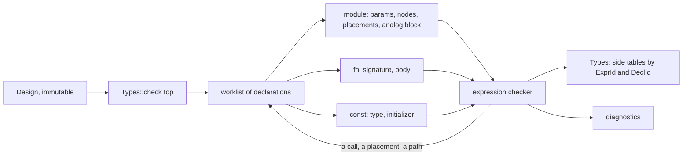

# MSL Type Checking (M1 subset) Design

**Spec**: `.specs/features/msl-typeck/spec.md`
**Status**: Draft

---

## Architecture Overview

A bidirectional checker over POM ids. It starts at one module and follows what that module reaches: placements lead to modules, calls to functions, paths to constants. Each declaration is checked once and memoized. Expressions are checked against an expected type where the position gives one (a param default, an argument, the right side of `+>`) and inferred otherwise. There is no unification and no type variable: the subset has no generics, so every type is known where it is needed, and a closure takes its parameter types from the function type it is passed to.



The result is `Result<Types<'d>, Vec<DesignDiagnostic>>`: a table or the reasons, never both (TYP-06).

---

## Code Reuse Analysis

### Existing Components to Leverage

| Component | Location | How to Use |
| --------- | -------- | ---------- |
| Resolved names and classified calls | `crates/piperine-lang/src/pom/resolution.rs` (`Resolution`, `CallClass`) | the checker never resolves a name; it reads `Decl`, `Builtin`, `Probe`, `Instance { module }` |
| Built-in table | `pom/builtin.rs` (`BUILTINS`, `BuiltinId::info`) | the signature table of core primitives is keyed by these rows |
| Reflection handles | `pom/reflect/` (`Module::ports`, `params`, `signals`, `Behavior`, `Function`) | walking declarations; no arena is indexed by hand where a handle exists |
| Diagnostics | `msl/diag.rs` (`Diagnostic`), `pom/design.rs` (`DesignDiagnostic`) | the one diagnostic type; miette rendering comes with it |
| Deep recursion guard | `src/stack.rs` (`stack::deep`) | the expression checker recurses through it, as `pom/body.rs::preorder` does |
| Test support | `tests/support/pom.rs` | building designs from text in the new target |

### Integration Points

| System | Integration Method |
| ------ | ------------------ |
| `msl-elab` | calls `Types::check`, then reads `ty(expr)`, `method(expr)`, `callee(expr)` while lowering |
| The language server (does not build today) | none in M1 |

---

## Components

### `Ty`

- **Purpose**: the types of the subset, as data.
- **Location**: `crates/piperine-lang/src/types/ty.rs`
- **Interfaces**: `enum Ty { F64, Bool, Unit, Node(DeclId /* nature */), AnyNode /* gnd */, Fn(Vec<Ty>, Box<Ty>), Module(DeclId) }`; `Ty::name(&self, &Design) -> String` for messages.
- **Dependencies**: `pom::DeclId`.
- **Reuses**: nothing.

### `Types`

- **Purpose**: the side table and the entry point.
- **Location**: `crates/piperine-lang/src/types/mod.rs`
- **Interfaces**:
  - `Types::check(design: &'d Design, top: &str) -> Result<Types<'d>, Vec<DesignDiagnostic>>`
  - `ty(&self, ExprId) -> Option<&Ty>` - `None` outside the reachable set
  - `method(&self, ExprId) -> Option<Method>` - the catalogue row of a `Deferred` method call
  - `callee(&self, ExprId) -> Option<Callee>` - `Function(DeclId)`, `Core(BuiltinId)`, `Module(DeclId)`
  - `local(&self, DeclId /* a Binding */) -> Option<&Ty>`
  - `reached(&self) -> &[DeclId]` - the modules, functions and constants checked, in first-reach order (elaboration lowers exactly these)
- **Dependencies**: `Checker`.
- **Reuses**: `Design` ids as keys: `Vec<Option<Ty>>` indexed by `ExprId`, the way the POM's arenas are indexed.

### `Checker`

- **Purpose**: one pass over the reachable set.
- **Location**: `crates/piperine-lang/src/types/check.rs` (declarations), `types/expr.rs` (expressions), `types/analog.rs` (probes, contributions, core primitives)
- **Interfaces** (crate-private methods of `Checker<'d>`): `module(DeclId)`, `function(DeclId)`, `constant(DeclId)`, `check(ExprId, &Ty)`, `infer(ExprId) -> Ty`, `contribution(StmtId)`, `placement(ExprId)`.
- **Dependencies**: `Catalogue`, `Core`.
- **Reuses**: `CallClass` to tell a function call from a probe from a placement before looking at any type.

### `Catalogue` and `Core`

- **Purpose**: the two closed signature tables: the Appendix H methods of the subset, and the §14 primitives of the subset.
- **Location**: `crates/piperine-lang/src/types/catalogue.rs`
- **Interfaces**: `Catalogue::method(recv: &Ty, name: &str) -> Option<Method>` over `const F64_METHODS: &[(&str, Method)]` (`exp`, `ln`, `sqrt`, `abs`); `Core::signature(BuiltinId) -> Option<CoreSig>` over a `const` table (`ddt`, `limit`, `ac_stim`, `temperature`, `gmin`, `source_scale`, `potential`).
- **Dependencies**: none.
- **Reuses**: the row order and names of `pom/builtin.rs`. A built-in with no row in `Core` is `P0001`, which is how `delay`, `noise` and the rest stay refused without a line of code each.

### `Unsupported`

- **Purpose**: the one place that names a construct outside the subset.
- **Location**: `crates/piperine-lang/src/types/unsupported.rs`
- **Interfaces**: `Unsupported::expr(&ExprKind) -> &'static str`, `::stmt`, `::pat`, `::ty`, `::item`: exhaustive `match`es with no wildcard arm, so a new POM variant fails to compile until it is classified.
- **Dependencies**: `pom` node enums.
- **Reuses**: nothing.

---

## Data Models

```rust
pub struct Types<'d> {
    design: &'d Design,
    exprs: Vec<Option<Ty>>,            // by ExprId
    locals: BTreeMap<DeclId, Ty>,      // Binding declarations
    methods: BTreeMap<ExprId, Method>,
    callees: BTreeMap<ExprId, Callee>,
    reached: Vec<DeclId>,
}

#[derive(Clone, Copy, PartialEq, Eq)]
pub enum Method { Exp, Ln, Sqrt, Abs }

pub enum Callee { Function(DeclId), Core(BuiltinId), Module(DeclId) }
```

`BTreeMap`, not `HashMap`: iteration order must be deterministic (TYP-01 AC 4).

---

## Error Handling Strategy

| Error Scenario | Handling | User Impact |
| -------------- | -------- | ----------- |
| A mismatched type | one diagnostic at the expression, expected and found named; the expression is given the expected type so one mistake is one diagnostic | `P0002` (Q5) with a span |
| A spec rule with its own code (`E0210`, `E0240`, `E0251`, `E0312`, `E0318`, `E0320`, `E0410`, `E0417`, `E0450`) | that code | as the specification states |
| A construct outside the subset | `P0001`, the construct named by `Unsupported`; the expression's type becomes an internal error type that silences every diagnostic above it | one diagnostic per construct |
| The design already has diagnostics, or no such top | returned as they are; nothing is checked | no table |

---

## Risks & Concerns

| Concern | Location (file:line) | Impact | Mitigation |
| ------- | -------------------- | ------ | ---------- |
| The POM classifies a placement of a core module as `Instance { module: None }` and a user module as `Instance { module: Some(..) }` | `pom/resolution.rs:36` | a core primitive and a module placement arrive through the same variant | `Checker::placement` branches on the callee path's `Resolution::Builtin` first; a test pins both shapes on the diode |
| Optional trailing arguments (`limit`'s `seed`, `ac_stim`'s `phase`) are §3.2 calls with parameters left out | `docs/spec/part_i_values.md` §3.2 | arity checks must accept both forms | `CoreSig` holds required and optional parameter lists; TYP-02 AC 5 and TYP-04 AC 5, 6 each test both |
| `out` is a keyword: a node called `out` is written `r#out` | found while writing `tran_rc.msl` | none for the checker; noted for fixture authors | the twins use `r#out`; `msl-parity` maps the name `out` |
| No spec code exists for a type mismatch or for an unsupported construct | `docs/spec/index.md:75` | codes invented here could collide with a later spec edit | the `P` prefix cannot collide with `Eppnn`; Q5 asks the user |

---

## Tech Decisions

| Decision | Choice | Rationale |
| -------- | ------ | --------- |
| Algorithm | bidirectional checking, no unification | the subset has no generics; every closure is an argument with a declared function type |
| Reach | demand-driven from the top | the embedded `std` is ordinary source and holds the whole language |
| Where the subset is enforced | here, not in elaboration | one exhaustive classifier (`Unsupported`); elaboration then lowers a set it knows is inside the subset |
| Storage | side tables keyed by POM ids | the POM is immutable; ids are stable for the life of a `Design` |

## Size

9 tasks: `Ty` and tables; declaration walk and worklist; value expressions; functions and closures; catalogue methods; modules, params and placements; analog forms and `Core`; `Unsupported` and its negative tests; the entry point with the twins as the positive corpus. Sonnet implements, Opus verifies.
