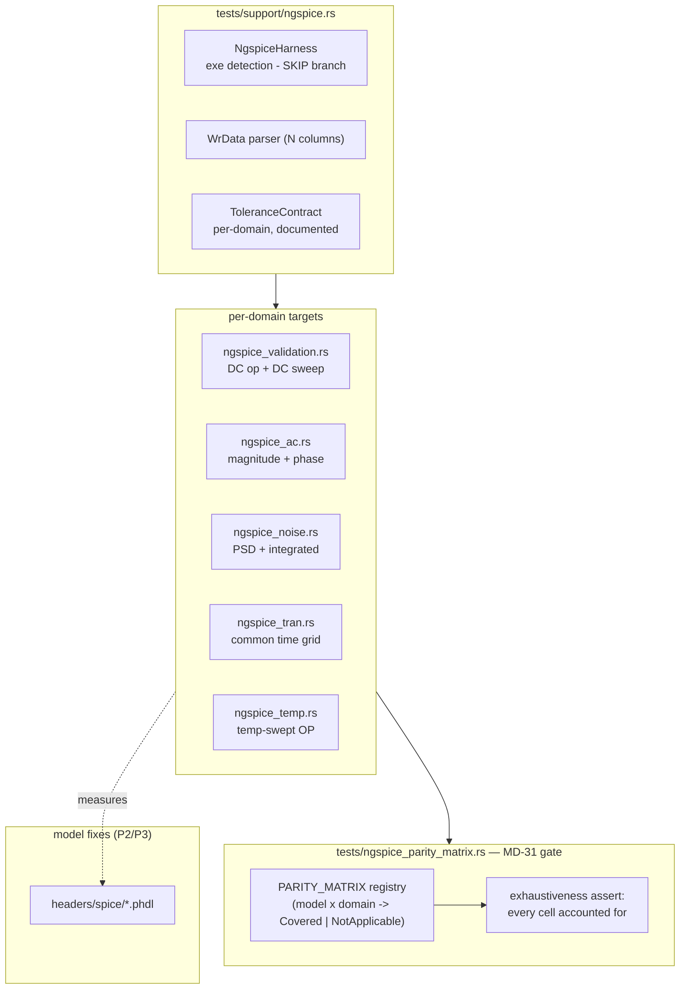

# ngspice-parity Design

**Spec**: `.specs/features/ngspice-parity/spec.md`
**Status**: Draft

**Governing decisions applied:** MD-38 (parity measured, not asserted),
MD-39 (no device PHDL already is), MD-31 (a policy invariant lives in the gate),
MD-28 (test placement), MD-13 (Rust idiom rules), MD-18 (no re-JIT).

---

## Research findings (verified, not assumed)

Run against **ngspice-46** on this machine. Every format below was probed with a
throwaway circuit rather than taken from documentation.

### `wrdata` column formats

`wrdata` is ngspice's general vector export and is the mechanism for every new
domain. Column shapes differ per domain:

| Domain | `.control` export | Columns | Shape |
| ------ | ----------------- | ------- | ----- |
| DC sweep (existing) | `wrdata f v(out)` | 2 | `sweep value` |
| Transient | `wrdata f v(out)` | 2 | `time value` |
| Noise | `setplot noise1` + `wrdata f onoise_spectrum` | 2 | `freq spectrum` |
| **AC** | `wrdata f v(out)` | **3** | `freq real imag` — a complex vector expands to two columns |

The existing `parse_wrdata` is a strict two-float parser. AC needs three. This
is the one parser change; everything else is additive.

### ⚠ Noise units differ — the highest-risk finding

ngspice's `onoise_spectrum` is in **V/√Hz**. Piperine reports output noise PSD
in **V²/Hz** (Part VII §12). Verified numerically: a 1 kΩ resistor at 1 kHz
gives ngspice `4.071e-9`, and √(4kTR) = √(4·1.38e-23·300·1000) = 4.07e-9 V/√Hz —
so ngspice is reporting the *amplitude* spectrum, not the power spectrum.

**Comparing the two directly would be wrong by a square** and would read as "the
noise model is broken" rather than "the units disagree". The design reconciles
explicitly in one named place (`NoiseCase`), never inline at a call site.

`onoise_total` (3.859e-7 for the probe) is an integrated RMS in **V**, and maps
to piperine's `NoiseTrace::total()`.

### Piperine-side surfaces (already exist — no new host API)

| Domain | Call | Result | Reuse note |
| ------ | ---- | ------ | ---------- |
| AC | `Session::ac(fstart, fstop, points, log, &cfg)` | `Trace<ComplexWaveform>` | `.v(net)?` → `.mag()`/`.phase()` |
| Noise | `Session::noise(out, ref, fstart, fstop, points, log, &cfg)` | `NoiseTrace` | `.psd()`, `.total()` |
| Transient | `Session::tran(stop, step, start, &cfg, …)` | `Trace<Waveform>` | **`Waveform::at(t)` interpolates** — this is how NGP-03's common time grid is met without touching the solver |
| Temperature | `SolverConfig { temperature, .. }` + `.op()` | `OpResult` | ngspice side is a `.temp` card |

**No new host API is required.** Every domain is reachable from `piperine-api`
as shipped; this feature is test infrastructure plus model fixes.

---

## Approach exploration

All three deliver the same scope; they differ in where the code lives.

### A — Grow `tests/ngspice_validation.rs` in place

Add per-domain methods to the existing `NgspiceHarness`, generalize the parser,
keep one file.

- ➕ Smallest diff; the file is already the named numeric oracle in CLAUDE.md.
- ➖ The file is ~870 lines today; four new domains plus fixtures push it past
  1500. Violates MD-28's "one concern per target" in spirit.
- ➖ A per-domain failure forces a reader through unrelated domains.

### B — Shared harness module + per-domain targets + a coverage guard ⭐ RECOMMENDED

Extract `NgspiceHarness` into `tests/support/ngspice.rs`; one integration target
per domain (`ngspice_ac.rs`, `ngspice_noise.rs`, `ngspice_tran.rs`,
`ngspice_temp.rs`); the existing `ngspice_validation.rs` keeps DC and the
harness's own self-tests. Add `ngspice_parity_matrix.rs` — the MD-31
registry+exhaustiveness guard over the model × domain matrix.

- ➕ Matches MD-28 (one concern per target) and MD-31 (the rule is a gate).
- ➕ The coverage guard is what actually delivers the spec's headline goal: "no
  unfalsifiable ✅". It fails naming any (model, domain) cell that is neither
  covered by a fixture nor explicitly marked not-applicable.
- ➕ Each domain's tolerance rationale lives next to its comparator.
- ➖ Touches the frozen `ngspice_validation.rs` to extract the harness (a move,
  not a rewrite — existing tests keep their bodies).

### C — Fully data-driven manifest runner

One TOML/table manifest (fixture → domains → tolerances) driving a single
generic runner.

- ➕ Adding a fixture is a data edit.
- ➖ Per-domain comparison logic genuinely differs (complex vs interpolated vs
  unit-converted); a generic runner ends up a match on domain anyway — the
  abstraction hides rather than removes the difference.
- ➖ Loses per-test names in failure output unless each row is its own `#[test]`,
  which without macros (MD-13 rule 5) means hand-writing them regardless.

**Recommendation: B.** It is the only option that turns the spec's central goal
into a mechanical gate instead of a promise. C's data table is kept — but as the
*coverage registry* inside B's guard, which is where a table earns its keep.

---

## Architecture Overview



---

## Code Reuse Analysis

### Existing components to leverage

| Component | Location | How to use |
| --------- | -------- | ---------- |
| `NgspiceHarness` | `tests/ngspice_validation.rs:24` | **Move** to `tests/support/ngspice.rs`; keep every method body |
| `detect_with_path` | same, `:42` | Reuse unchanged — the PATH-injectable SKIP seam already exists and is self-tested |
| `within_tolerance` | same, `:51` | Generalize: take `(abstol, reltol)` from the domain's contract instead of the DC constants |
| `parse_wrdata` | same, `:190` | Generalize from 2 floats to N columns; the strictness contract (any malformed line fails loud) is preserved |
| `ngspice_sweep` scratch-dir pattern | same, `:170` | Reuse verbatim for every new domain's `wrdata` export |
| `headers_source_map` | same, `:63` | Reuse unchanged |
| `Waveform::at(t)` | `piperine-api` waveform | Interpolates piperine's adaptive grid onto ngspice's print times — **NGP-03 without solver changes** |
| `NoiseTrace::psd()/total()` | `piperine-api` | Noise comparison inputs |
| `capabilities_contract.rs` registry pattern | `crates/piperine-solver/tests/` | The MD-31 shape the parity matrix copies |
| `@initial` UIC seeds | `flatten/analog.rs:876` + `transient.rs:228` | **Already works** — NGP-10 wires models to an existing mechanism |

### Integration points

| System | Integration |
| ------ | ----------- |
| `tests/ngspice/` fixture corpus | New `.cir`/`.phdl` twins added; **existing pairs untouched** (frozen corpus, CLAUDE.md) |
| `Session` host API | Consumed as-is; no new methods |
| `headers/spice/*.phdl` | P2/P3 edit model bodies only — no grammar, no codegen change |
| `flatten.rs` `remap` | P4 (`gap-3`) is the one non-test code change outside the models |

---

## Components

### `NgspiceHarness` (moved)

- **Purpose**: Own ngspice invocation, the SKIP branch, and fixture paths.
- **Location**: `tests/support/ngspice.rs`
- **Interfaces**:
  - `detect() -> Option<Self>` — unchanged
  - `run_export(circuit: &str, exports: &[&str]) -> Result<Vec<WrData>, String>` — run `.cir` in a scratch dir, read back N `wrdata` files
- **Dependencies**: `std::process`, `piperine`, `piperine_lang`
- **Reuses**: every existing method body; this is a move plus two generalizations

### `WrData`

- **Purpose**: One parsed `wrdata` export — N columns, strictly parsed.
- **Location**: `tests/support/ngspice.rs`
- **Interfaces**:
  - `parse(circuit: &str, content: &str, columns: usize) -> Result<Self, String>`
  - `pairs(&self) -> &[(f64, f64)]` — 2-column domains
  - `complex(&self) -> Vec<(f64, Complex64)>` — 3-column AC form
- **Dependencies**: none
- **Reuses**: `parse_wrdata`'s strictness contract (malformed line ⇒ loud; empty ⇒ loud)

### `ToleranceContract` — NGP-07

- **Purpose**: The per-domain numeric contract, as data with a stated rationale.
  MD-31: it is read by the comparators, never retyped in a test body.
- **Location**: `tests/support/ngspice.rs`
- **Interfaces**:
  - `const DC: Self`, `AC_MAG`, `AC_PHASE`, `NOISE_PSD`, `NOISE_TOTAL`, `TRAN`, `TEMP`
  - `holds(&self, golden: f64, actual: f64) -> bool`
  - `rationale(&self) -> &'static str` — surfaced in the failure message
- **Dependencies**: none
- **Reuses**: `within_tolerance`'s `|a−b| ≤ abstol + reltol·max(|a|,|b|)` form

Proposed values (each carries its reason; refined by first measurement):

| Domain | reltol | abstol | Rationale |
| ------ | ------ | ------ | --------- |
| DC voltage | 1e-3 | 1e-6 V | ngspice's own defaults — the existing, unchanged contract |
| AC magnitude | 1e-3 | 1e-12 | Linear solve at a frozen OP; agreement should be near machine-level, abstol floors the deep-stopband |
| AC phase | — | 1e-4 rad | Phase is meaningless where magnitude ≈ 0; comparison **gated** on magnitude clearing `AC_MAG`'s abstol |
| Noise PSD | 1e-3 | 1e-24 V²/Hz | After the V/√Hz → V²/Hz reconciliation; abstol is the squared amplitude floor |
| Noise integrated | 1e-3 | 1e-15 V | `onoise_total` vs `NoiseTrace::total()` |
| Transient | 1e-3 | 1e-6 V | Interpolation onto ngspice's print grid adds error bounded by the LTE contract |
| Temperature OP | 1e-3 | 1e-6 V | A DC comparison; same contract, different `SolverConfig.temperature` |

### `AcCase` / `NoiseCase` / `TranCase` / `TempCase`

- **Purpose**: One comparator per domain — each owns its coordinate type and its
  failure message.
- **Location**: `tests/ngspice_ac.rs`, `_noise.rs`, `_tran.rs`, `_temp.rs`
- **Interfaces**: `run(&self, harness: &NgspiceHarness, circuit: &str)`
- **Dependencies**: `support::ngspice`
- **Notes**:
  - `AcCase` compares magnitude and phase per frequency; phase is skipped where
    magnitude is below the floor, and the skip is *reported*, never silent.
  - **`NoiseCase` owns the unit reconciliation**: ngspice V/√Hz is squared to
    V²/Hz in exactly one place, with the derivation in a comment. NGP-02.
  - `TranCase` evaluates `Waveform::at(t)` at each ngspice print time. NGP-03.
  - `TempCase` sets `SolverConfig.temperature` to match the `.temp` card.

### `ParityMatrix` — the MD-31 gate

- **Purpose**: Make "no unfalsifiable ✅" mechanical. Enumerate every
  (model, domain) cell; each must be `Covered { fixture }` or
  `NotApplicable { reason }`. Fail naming any unaccounted cell.
- **Location**: `tests/ngspice_parity_matrix.rs`
- **Interfaces**:
  - `const MATRIX: &[(Model, Domain, Coverage)]`
  - `every_model_domain_cell_is_accounted_for()` — the assert
  - `every_covered_cell_names_an_existing_fixture()` — a `Covered` row whose
    `.cir`/`.phdl` twin is missing fails loud
- **Dependencies**: filesystem read of `tests/ngspice/`
- **Reuses**: `capabilities_contract.rs`'s registry+exhaustiveness pattern
- **Proof obligation (MD-31)**: the guard must be shown able to fail — add a
  model row with no coverage, watch it fail, revert.

---

## Data Models

```rust
/// One parsed `wrdata` export.
struct WrData { columns: usize, rows: Vec<Vec<f64>> }

/// The per-domain numeric contract (NGP-07).
struct ToleranceContract { reltol: f64, abstol: f64, rationale: &'static str }

/// A cell of the parity matrix (MD-31).
enum Coverage {
    Covered { fixture: &'static str },
    NotApplicable { reason: &'static str },
}

#[derive(PartialEq)]
enum Domain { DcOp, DcSweep, Ac, Noise, Transient, Temperature }
```

`NotApplicable` is load-bearing: `controlled.phdl`'s VCVS has no noise model in
ngspice either, so its Noise cell is `NotApplicable { reason: "ngspice's
controlled sources are noiseless" }` — a recorded fact, not a coverage hole.

---

## Error Handling Strategy

| Scenario | Handling | Impact |
| -------- | -------- | ------ |
| `ngspice` absent | Existing SKIP branch, reused unchanged (NGP-06) | Suite passes; notice printed |
| ngspice writes no `wrdata` file | Loud, naming circuit + expected path | Test fails |
| Malformed `wrdata` line | Loud, naming the line (existing strictness) | Test fails |
| Zero shared coordinates | Contract violation, loud — never a vacuous pass | Test fails |
| Piperine fails to converge | Loud, naming analysis + fixture — **distinct message from a tolerance miss** | Test fails |
| Tolerance exceeded | Loud: model, domain, coordinate, both values, Δ, and the contract's `rationale()` (NGP-05) | Test fails |
| AC phase where magnitude ≈ 0 | Skipped and **counted**; a fixture whose every point skips fails as vacuous | Test fails |
| Deviation traced to an ngspice defect | Documented deviation; test asserts piperine's value (MD-38) | Recorded |

---

## Risks & Concerns

| Concern | Location | Impact | Mitigation |
| ------- | -------- | ------ | ---------- |
| **Noise unit mismatch (V/√Hz vs V²/Hz)** | ngspice `onoise_spectrum` vs Part VII §12 | Silent square-order error read as a broken model | Reconciled in one named place (`NoiseCase`) with the derivation in-comment; a unit-probe test asserts the 1 kΩ Johnson value 4.07e-9 V/√Hz |
| `gm_est` is saturation-only | `mos.phdl:471,1209,1768`, `jfet.phdl:285` | Noise wrong in linear/transition — the defect P2 exists to fix | NGP-08; fixture must sweep *into* the linear region or it proves nothing |
| Extracting the harness touches a frozen test of record | `tests/ngspice_validation.rs` | Regression risk in the DC oracle | Extraction is a **move**: method bodies unchanged, DC tests keep their assertions; verified by the 26 existing checks still passing |
| Test parallelism + scratch dirs | `ngspice_sweep` scratch path uses PID only | Two domains for the same circuit could collide | Scratch key becomes `{circuit}-{domain}-{pid}` |
| ngspice version drift (46 here) | machine-dependent | Output shape could change | Parsers already fail loud on unexpected shape; version recorded in the failure message |
| `gap-3` scope creep | `flatten.rs` `remap` | An open-ended flattener change could swallow the feature | P4's ACs bound it: const index expands, non-const still fails loud. Nothing else moves |
| Fixtures are a frozen corpus | `tests/ngspice/` | Editing existing pairs would invalidate baselines | New domains add **new** twins; existing pairs are not touched |

---

## Tech Decisions

| Decision | Choice | Rationale |
| -------- | ------ | --------- |
| Where the tolerance contract lives | A `ToleranceContract` data table read by comparators | MD-31: the invariant is a gate, not a doc paragraph. NGP-07 requires a stated rationale per domain, surfaced in failures |
| Coverage tracking | `ParityMatrix` registry + exhaustiveness assert | The only mechanical way to deliver "no unfalsifiable ✅"; copies `capabilities_contract.rs` |
| Transient grid reconciliation | Interpolate piperine onto ngspice's print times via `Waveform::at` | Reuses shipped behaviour; comparing raw adaptive samples would be meaningless |
| Noise units | Square ngspice's V/√Hz, in `NoiseCase` only | Verified empirically; one conversion site, never inline |
| File organisation | One target per domain + shared support module | MD-28 |
| No test-generating macros | Hand-written `#[test]` per fixture, looping the registry inside | MD-13 rule 5 |
| No new host API | Every domain reachable from `piperine-api` as shipped | Confirmed against Appendix C; keeps this feature test-side + models |

> **Project-level:** none new. This design conforms to MD-13/28/31/38/39; no
> decision here supersedes an existing one.

---

## Open Design Question (deferred to Tasks, not blocking)

`urc`'s `FMAX → N` auto-selection (NGP-19) computes `N` from a parameter. Whether
that lands as an elaboration-time const-fold inside `urc[N]` or as a host-side
helper depends on what `gap-3` (P4) delivers. Sequenced so P4 is done first;
Tasks will fix the shape once its result is real rather than predicted.
