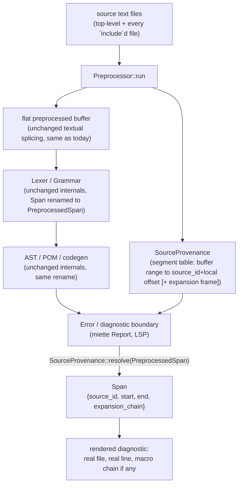

# Preprocessor Span-Mapping Design

**Spec**: `.specs/features/preprocessor-span-mapping/spec.md`
**Status**: Draft

---

## Architecture Overview

Today, `Preprocessor::run` textually splices `` `include ``d and
`` `define ``-expanded content into one flat `String`; every `Span` minted
by the lexer/grammar afterward is a `{start, end}` byte offset into that
flat string, with no memory of which original file (or macro) those
bytes came from. Every render boundary (miette `Report`, LSP
`text_pos.rs`) then wrongly assumes that offset indexes the *original
top-level file's own text* — correct only when nothing expanded.

The fix has two parts that must both exist, chosen and confirmed with the
user (see spec Assumptions and the two architecture rounds below):

1. **The preprocessor keeps every splice's provenance** instead of
   discarding it — a `SourceProvenance` registry built alongside the flat
   buffer, recording, for every byte range in that buffer, which loaded
   source text (and, for macro-expanded ranges, which invocation chain)
   it really came from.
2. **The type system makes "resolved" and "unresolved" spans impossible
   to confuse.** The type the lexer/grammar/AST/codegen mint and pass
   around internally is renamed `PreprocessedSpan` — same shape as
   today's `Span` (`{start, end}`, a flat offset into the preprocessed
   buffer), same call sites, same logic, zero behavior change. A new
   type, `Span`, exists **only** as the output of
   `SourceProvenance::resolve(PreprocessedSpan) -> Span` — `{source_id,
   start, end, expansion_chain}` — real file identity, a byte range valid
   *within that file's own text*, and (when the span fell inside
   macro-expanded text) the invocation→definition chain SPANMAP-04/05/06
   need. Every human-facing boundary (miette report construction, LSP
   diagnostics/hover/goto) is required by the type checker to call
   `resolve()` before it can build anything renderable — there is no
   `PreprocessedSpan` field left lying around that a future call site
   could misuse as if it were already file-real, because nothing outside
   this feature's boundary code ever sees a bare flat offset presented as
   a location.



---

## Approach Exploration (confirmed with user)

Three approaches were presented; the user picked **Approach C** in round
one, then asked for a better name than the initial `RawSpan` proposal —
settled on **`PreprocessedSpan`** in round two.

| # | Approach | Blast radius | Runtime cost | Forgets-to-resolve risk |
|---|---|---|---|---|
| A | Resolve only at the render boundary; today's `Span` type keeps its name and shape unchanged | Smallest — zero touched call sites in `lexer.rs`/`grammar/*.rs`/`piperine-codegen` | Lowest | **High** — nothing stops a future call site from treating the unresolved offset as if it were already file-real (the exact bug class this feature exists to close) |
| B | `Span` gains a real `source_id` field, computed per-token *inside the lexer* as each token is minted | Largest — lexer needs a live reference to the segment table through its whole scan; still needs a *separate* structure for the macro invocation→definition chain (a single `source_id` per span can't carry a multi-frame chain), so `SourceProvenance` has to exist anyway, redundantly | Highest — resolves every token, not just the handful that end up in a rendered error | Low |
| **C (chosen)** | Rename today's `Span` to `PreprocessedSpan` (pure mechanical rename, ~80 call sites, zero logic change, compiler-verified); a *new* `Span` type exists only as `SourceProvenance::resolve()`'s output | Same call-site count as B (every `PreprocessedSpan` user gets touched by the rename), but each touch is a type-only rename, not new logic | Lowest — resolution happens lazily, only for the few spans that actually reach a human | **None** — a bare flat offset literally cannot be handed to a diagnostic renderer; the type system enforces the resolve step |

**Recommendation and why C won:** A is cheapest but reintroduces exactly
the silent-misuse risk that created this bug in the first place — a
future consumer crate (or a future `piperine-lang` internal) can still
construct/consume an unresolved offset as if it were real. B pays B's
runtime and mechanical cost while still needing the same
`SourceProvenance` chain machinery C needs, so it strictly dominates
worse than C. C pays the same one-time mechanical cost as B but for a
compile-time safety guarantee instead of a runtime one, with no
per-token resolution cost. The user confirmed C explicitly, after seeing
this comparison, and separately asked for `RawSpan` to be renamed to the
clearer `PreprocessedSpan` — done above.

---

## Code Reuse Analysis

### Existing Components to Leverage

| Component | Location | How to Use |
|---|---|---|
| `Preprocessor` (macro expansion, conditional compilation, `` `include `` splicing) | `crates/piperine-lang/src/preprocessor.rs` | Behavior is unchanged (spec: "existing preprocessor behavior... is unchanged"); every place it already writes into the output buffer (`out.push_str(...)`, the ~9 call sites found earlier) gets one paired call recording the same bytes' provenance into the new `SourceProvenance` builder |
| `IncludeResolver` trait + `SourceMapIncludeResolver` | `vams_include.rs` | Unchanged — still the only filesystem-I/O boundary (MD-43's purity concern is retired per MD-47, but the *shape* of "resolver supplies text, preprocessor never touches disk itself" is worth keeping as-is; no reason to disturb a clean seam) |
| `piperine_lang::source_map::SourceMap` (namespace → search-path resolver) | `source_map.rs` | Unchanged, untouched — spec flagged the naming collision risk explicitly; the new registry is named `SourceProvenance`, never `SourceMap` |
| `ParseError`/`ElabError`/`ElabErrorKind` (typed error enums, existing span fields) | `error.rs`, `pom/error.rs` | Every existing `span: Span` field is mechanically renamed to `span: PreprocessedSpan`; the enums' shape, variants, and `Display`/`thiserror` derives are untouched |
| `Design`'s existing `#[serde(skip)]` side-artifact precedent (`flat_modules`, per the POM-navigability rule) | `pom/design.rs` (or wherever `Design` is defined) | `SourceProvenance` rides along the same way — a `#[serde(skip)]` field on `Design`, populated at parse time, carried through elaboration and into `piperine-codegen` without new plumbing, exactly how `flat_modules` already rides alongside the authored hierarchy without being part of it |

### Integration Points

| System | Integration Method |
|---|---|
| `piperine-lang::lib.rs` (`parse_and_elaborate_seeded_with_context`) | The two `.with_source_code(input.to_string())` call sites are replaced: instead of blindly attaching the top-level file's raw text, the error path resolves the failing `PreprocessedSpan` via `design.source_provenance` (or, for a pure parse failure before a `Design` exists, the `SourceProvenance` `Preprocessor::run` already returned) and attaches a `NamedSource` built from the *real* originating file's text, with the resolved local span |
| `piperine-lang-server::text_pos.rs` / `symbol_index.rs` | Gains the reverse query `SourceProvenance::segments_covering(source_id, local_offset) -> impl Iterator<Item = PreprocessedSpan>` — needed to go from "cursor position in the open document" to "which `PreprocessedSpan`(s) in AST-space does this correspond to" (P3, SPANMAP-08) |
| `piperine-codegen` (10 files importing `piperine_lang::error::Span`) | Mechanical rename only (`Span` → `PreprocessedSpan`); codegen's own error surfaces gain the same resolve-before-render discipline wherever they currently build a `miette::Report`, reusing `Design::source_provenance` |

---

## Components

### `SourceProvenance` (new)

- **Purpose**: The registry of every loaded source text plus a segment
  table mapping preprocessed-buffer byte ranges back to real
  `(source_id, local_offset)`, with macro-expansion chains where
  applicable. The single source of truth `resolve()` reads from.
- **Location**: new module `crates/piperine-lang/src/source_provenance.rs`
- **Interfaces**:
  - `SourceProvenance::resolve(&self, span: PreprocessedSpan) -> Span` — forward lookup (binary search over segment start offsets), builds the full `expansion_chain` by following each segment's recorded `expanded_from: Option<PreprocessedSpan>` link recursively (SPANMAP-06's N-deep case)
  - `SourceProvenance::text(&self, source_id: SourceId) -> &str` — the named source's own full text, for `NamedSource`/LSP document lookups
  - `SourceProvenance::name(&self, source_id: SourceId) -> &str` — the file path (or a synthetic name for the top-level string-only input, e.g. `"<input>"`, matching what `.with_source_code` callers pass today when there's no real file path)
  - `SourceProvenance::segments_covering(&self, source_id: SourceId, local_range: Range<usize>) -> impl Iterator<Item = PreprocessedSpan>` — reverse lookup for LSP (P3)
- **Dependencies**: none beyond `std` — a plain data structure built by the preprocessor, consulted everywhere else
- **Reuses**: nothing existing (this is the new piece); mirrors the shape of rustc's own `SourceMap`/`FileMap` in spirit, not in API

### `PreprocessedSpan` (renamed from today's `Span`)

- **Purpose**: The lexer/grammar/AST/codegen-internal position type —
  exactly today's `Span {start, end}`, renamed, zero logic change.
- **Location**: `crates/piperine-lang/src/error.rs` (same file `Span` lives in today)
- **Interfaces**: identical to today's `Span::new(start, end)`; every existing method/derive carries over under the new name
- **Dependencies**: none (unchanged)
- **Reuses**: 100% of today's `Span` — this is a rename, not new code

### `Span` (new — the resolved, human-facing type)

- **Purpose**: A location that is *always* real — a source id, a byte
  range valid in that source's own text, and (optionally) the chain of
  macro invocation/definition frames that produced it. This is the only
  type miette `Report`/LSP code is allowed to build a snippet from.
- **Location**: `source_provenance.rs`, alongside `SourceProvenance`
- **Interfaces**:
  - fields: `source_id: SourceId`, `start: usize`, `end: usize`, `expansion_chain: Vec<ExpansionFrame>` (empty for plain/include-only spans; SPANMAP-04's primary label is `(source_id, start, end)` itself, SPANMAP-05/06's secondary labels are `expansion_chain`)
  - `Span::to_named_source_span(&self, prov: &SourceProvenance) -> (miette::NamedSource<String>, miette::SourceSpan)` — the one helper every render boundary calls
- **Dependencies**: `SourceProvenance` (can only be constructed by it)
- **Reuses**: n/a (new type, small)

### `ExpansionFrame` (new)

- **Purpose**: One hop in a macro-expansion chain — the invocation site's
  `Span` and a label distinguishing "expanded from here" (definition) vs
  further nested invocation, per SPANMAP-06.
- **Location**: `source_provenance.rs`
- **Interfaces**: `{ macro_name: String, invocation: Span, definition: Span, args: Vec<(String, Span)> }` (`args` added post-confirmation, user's explicit ask — param name paired with the *resolved* `Span` of the argument text actually passed at this invocation, so a debugger can see both the value and where it came from; both `invocation`/`definition` resolved eagerly when the chain is built — SPANMAP-06 needs the *whole* chain resolved together, not lazily re-resolved per hop)
- **Dependencies**: `Span` (self-referential structure, boxed at the `Vec` level to avoid recursion issues — a `Vec<ExpansionFrame>` is not self-referential the way a linked `Box<ExpansionFrame>` chain would be, so no `Box` is actually needed here)
- **Reuses**: n/a

### `piperine expand` CLI command (new)

- **Purpose**: Developer/designer debug tooling (user's explicit ask,
  "igual ao que temos nas procs do rust") — prints the fully preprocessed
  text (SPANMAP-10), optionally annotated with macro name/args/location
  per expanded region (SPANMAP-11, `--trace` flag). Not part of the
  compile pipeline — reuses `Preprocessor::run` and `SourceProvenance`
  exactly as `check`/`build` do, adds no new preprocessing logic of its
  own.
- **Location**: `crates/piperine-cli/src/commands/expand.rs` (new file,
  siblings with the existing `check.rs`/`build.rs`), wired into
  `Commands::Expand { file, trace }` in `crates/piperine-cli/src/lib.rs`
- **Interfaces**:
  - `execute(file: Option<String>, trace: bool)` — same shape as `check::execute`/`build::execute`
  - default (no `--trace`): prints `Preprocessor::run`'s flat output string verbatim (SPANMAP-10's "byte-identical to input when no directives" AC falls out for free — no directives means no splicing, output equals input)
  - `--trace`: walks `SourceProvenance`'s segments in buffer order; at each segment boundary whose `expanded_from` is `Some`, prints an annotation line (macro name, `param=value` pairs read from `ExpansionFrame::args` via `SourceProvenance::text`, and the invocation's real file:line) before the expanded text it produced
- **Dependencies**: `piperine_lang::Parser`/`Preprocessor` (reuses the same `SourceMapIncludeResolver`/`SourceMap` construction `check::execute` already does via `super::utils::build_source_map()`), `piperine_lang::error::ParseError` for SPANMAP-10 AC3 (same typed error `check` surfaces, via the same `.with_source_code`-replacement path T8 builds)
- **Reuses**: `commands::utils::build_source_map()` (existing helper `check.rs`/`build.rs` already call), `CheckError`-style error printing pattern from `check.rs` (own small `ExpandError` enum following the same shape, not literally reused code since the two commands' success paths differ)

### `Preprocessor` (modified, not rewritten)

- **Purpose**: Same LRM ch.10 textual substitution as today; additionally
  builds a `SourceProvenance` alongside its output buffer.
- **Location**: `preprocessor.rs` (existing file)
- **Interfaces**: `Preprocessor::run(&mut self, source: &str) -> Result<(String, SourceProvenance), ParseError>` — return type gains the provenance registry; every existing internal call site that pushes text into `out` (plain pass-through, `` `include `` expansion, macro-body substitution) pairs that push with a `SourceProvenance::Builder::record(buffer_range, source_id, local_range, expanded_from)` call
- **Dependencies**: unchanged (`IncludeResolver`)
- **Reuses**: ~95% of existing logic; the ~9 `push_str`/expansion call sites gain one paired line each, no control-flow changes
- **One real (non-rename) change needed for SPANMAP-09**: `scan_call_args` (macro-invocation argument scanner) today returns `Vec<String>` — trimmed argument *text*, position discarded. It must additionally return each argument's raw `(start, end)` offset in the invoking buffer, so the paired `ExpansionFrame` can carry a resolved `Span` per argument instead of a bare string. `substitute_params` (body-substitution) is unaffected — it still works on the trimmed text values exactly as today; only the recording side needs the offsets `scan_call_args` currently throws away.

---

## Data Models

```rust
/// Opaque handle into `SourceProvenance`'s source table — one per unique
/// loaded file path (repeated `` `include ``s of the same path share one
/// id, SPANMAP-03) plus one for the top-level input string itself.
struct SourceId(u32);

/// Unresolved — lexer/grammar/AST/codegen's internal currency. Renamed
/// from today's `Span`; identical shape.
struct PreprocessedSpan { start: usize, end: usize }

/// Resolved — the only type a diagnostic renderer may consume.
struct Span {
    source_id: SourceId,
    start: usize,
    end: usize,
    /// Empty for plain source / include-only spans. One frame per
    /// expansion hop for macro-expanded spans, innermost first
    /// (SPANMAP-04/05/06).
    expansion_chain: Vec<ExpansionFrame>,
}

struct ExpansionFrame {
    macro_name: String,
    /// Where the macro was invoked (`` `NAME(...) `` in the calling text) — primary attribution (SPANMAP-04).
    invocation: Span,
    /// Where the macro's own `` `define `` body text lives — secondary "expanded from here" label (SPANMAP-05).
    definition: Span,
    /// Each declared parameter paired with the *resolved* `Span` of the
    /// actual argument text passed at this invocation (SPANMAP-09, added
    /// after initial spec confirmation) — the argument's value is
    /// recoverable via `SourceProvenance::text(span.source_id)[span.start..span.end]`,
    /// not duplicated into a second string field.
    args: Vec<(String, Span)>,
}

/// Built by `Preprocessor::run`; consulted by every render boundary.
struct SourceProvenance {
    sources: Vec<(String /* name/path */, String /* full text */)>,
    /// Sorted by buffer start offset — binary-searchable.
    segments: Vec<Segment>,
}

struct Segment {
    /// Range in the flat preprocessed buffer this segment covers.
    buffer_range: Range<usize>,
    source_id: SourceId,
    /// Where `buffer_range.start` maps to in `source_id`'s own text
    /// (the rest of the range follows contiguously, since a segment
    /// never straddles a splice boundary by construction).
    local_start: usize,
    /// `Some` only for segments produced by macro-body substitution —
    /// the frame linking this expanded text back to its invocation.
    expanded_from: Option<ExpansionFrame>,
}
```

**Relationships**: `SourceProvenance` owns `sources` and `segments`.
`Span::resolve` looks up the segment covering a `PreprocessedSpan`'s
start offset, computes `local_start + (span.start - segment.buffer_range.start)`,
and walks `expanded_from` links (if present) to build `expansion_chain`.
A span that straddles two segments (spec's edge case: a construct that
starts before an `` `include `` and detected-unterminated after it)
resolves using the segment covering its *start* offset, matching the
existing "unterminated X anchors on start" convention already in
`ParseErrorKind`.

---

## Error Handling Strategy

| Error Scenario | Handling | User Impact |
|---|---|---|
| `PreprocessedSpan` offset falls outside every recorded segment (should be unreachable if every `push_str` call site is paired correctly) | `resolve()` returns a typed `Err`/panics loud in debug builds with the offset and segment table dumped — this is a bug in the paired-recording invariant, not a user-facing input error, so it fails loud per the project's "never silently emit a no-op" rule rather than degrading to a guess | Only reachable by a `piperine-lang` internal bug, not by any real `.va` input; a debug assertion catches it in CI before release |
| Zero-length `PreprocessedSpan` (existing deliberate test case) | Segment lookup uses `<=`/`<` range containment that treats a zero-length span as anchored at its `start` offset — no division, no special-casing needed beyond correct range-containment logic | Resolves to a valid zero-width `Span` at the right location, unchanged from what a normal span there would show |
| `` `include `` target unresolved (`IncludeNotFound`) | Unaffected — this error is raised *before* any content from the unresolved path enters the buffer, so it already carries a `PreprocessedSpan` for the *including* file's own directive text, resolvable exactly like any other in-source span | No change from today |
| Included file re-included under an `` `ifndef `` guard, second occurrence skipped | The guarded-out text is never pushed into the buffer (existing conditional-compilation behavior, unaffected) — no segment is ever recorded for it, so there's nothing to resolve | No change from today |

---

## Risks & Concerns

| Concern | Location | Impact | Mitigation |
|---|---|---|---|
| ~80 mechanical rename call sites (`Span::new(` in `grammar/*.rs` × 69, `lexer.rs` × 31 minus overlap) plus 10 `piperine-codegen` files plus `piperine-lang-server` | `grammar/{expr,stmt,item}.rs`, `lexer.rs`, `piperine-codegen/src/{resolve,kernel,emit,flatten}/**` | A rename this wide, done by hand, risks a missed site compiling against the wrong type accidentally (e.g. if some code path still expects the old `Span` name via a re-export) | The rename is compiler-enforced: keep `error.rs` exporting only `PreprocessedSpan` (no `Span` alias) during the rename task so every stale reference is a hard compile error, not a silent pass — Tasks phase should do this as one atomic mechanical-rename task before any provenance logic lands, verified by `cargo build --workspace` (zero warnings, per project bar) |
| `lexer.rs`/`grammar/*.rs` are flagged in `CLAUDE.md` as "not to edit casually" (hand-written LRM-Annex-A parser, ripple risk) | `crates/piperine-lang/src/{grammar,lexer.rs}` | This feature's rename touches nearly every line that constructs a `Span` in those files | The rename changes zero *parsing logic* — every touched line is `Span::new(` → `PreprocessedSpan::new(`, nothing else; the mitigation is scope discipline (Tasks phase must reject any temptation to "clean up" nearby code in the same commit) plus the full existing grammar/lexer test suite as the regression gate |
| `Preprocessor`'s ~9 `out.push_str(...)` call sites must each get a *correctly paired* provenance-recording call, by hand | `preprocessor.rs` (plain pass-through, `` `include `` expansion at `handle_include`, macro-body substitution in the rescan-expansion path) | A missed or mis-paired recording call produces a segment table with gaps or wrong offsets — silently wrong locations are worse than the crash this feature fixes, if not caught | Property-test-style regression: build a check that for every byte in the flat buffer, some segment covers it (no gaps) — run against the full existing test corpus plus the 86-file `vams-corpus` sweep as part of the gate, not just hand-picked unit tests |
| `SourceProvenance` living on `Design` as a `#[serde(skip)]` field means any code path that constructs a bare `Design` without going through the normal parse pipeline (existing test helpers that hand-build a `Design` directly, if any) gets an empty/absent provenance | `pom/` test helpers, if they exist | `resolve()` on a span with no matching segment in an empty `SourceProvenance` would hit the "unreachable" error-handling path above for legitimately-constructed test `Design`s that were never parsed | Scope this explicitly at Tasks time: give `SourceProvenance` a documented "empty/test" constructor that makes `resolve()` degrade to "same offset, synthetic `<test>` source name" rather than the loud-fail path, so hand-built test `Design`s don't need touching |

---

## Tech Decisions (only non-obvious ones)

| Decision | Choice | Rationale |
|---|---|---|
| New type name for the resolved span | `Span` (reusing the name), unresolved renamed to `PreprocessedSpan` | Keeps the *public*, human-facing name unadorned (`Span` reads naturally in error messages/docs) and pushes the "this is internal, not yet real" connotation onto the internal type instead — matches the user's stated preference for a name that says what it is |
| Provenance registry name | `SourceProvenance` (not `SourceMap`) | The existing `piperine_lang::SourceMap` (namespace → search-path resolver for `` `include``) is a different, unrelated concept; spec explicitly flagged this collision risk |
| Where `SourceProvenance` lives after parsing | A `#[serde(skip)]` field on `Design`, mirroring the existing `flat_modules` side-artifact precedent | Matches the POM-navigability rule's established pattern for "derived, not authored" data riding alongside `Design` without being part of its authored structure; avoids inventing a second plumbing mechanism |
| Expansion chain resolved eagerly (whole chain built at `resolve()` time) vs. lazily (re-resolve each hop on demand) | Eagerly | A rendered diagnostic needs the whole chain at once anyway (SPANMAP-06); eager resolution is simpler and the cost is bounded by chain depth (real macros nest at most a handful of levels), not worth a lazy-iterator abstraction |
| Reverse lookup (`segments_covering`) scoped to P3 (LSP) only, not built as part of the P1 critical path | Confirmed by spec's priority ordering | P1 (SPANMAP-01/02/03/07) only needs forward resolution; deferring the reverse-lookup implementation keeps the first shippable increment smaller without narrowing the spec |
