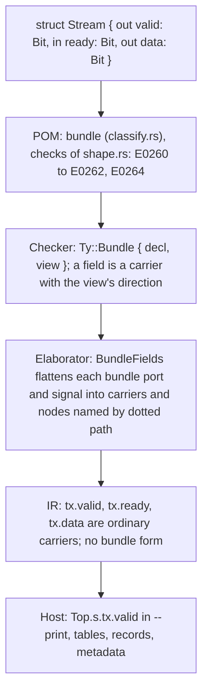

# Resolved Nets: Bundles Design

**Spec**: `.specs/features/resolved-nets-bundles/spec.md`
**Status**: Approved
**Approved**: 2026-11-21 - under the user's standing AFK rule - user: "Eu gostaria que engatilhasse até o 12" and, 2026-11-21, "pode ir tocando como previsto, parando só depois da revisão no item 13"

Companion of `.specs/features/resolved-nets/design.md`; its D2 and D20 put both features on
`feature/resolved-nets`.

---

## What the code does today (`main` at `7df9e17c`)

| Concern | Where | Today |
| ------- | ----- | ----- |
| Parsing | `msl/parser/ty.rs`, `msl/ast.rs` | `flip T`, `[T; N]` sigtypes and `in`/`out` on struct fields parse; `TypeKind::Flip` reaches the POM |
| Bundle classification | `pom/resolve/classify.rs` (`bundle_structs`, a fixpoint), `StructData::bundle`, `PortKind::Bundle`, `StructClass::BundleLiteral` | the POM already knows which structs are bundles, which ports are bundle ports, and which struct expressions are bundle literals; `E0263` (a literal's missing, repeated or unknown field) is raised there |
| Carrier methods | `pom/resolve/members.rs` | `E0211` for a carrier method on an array of carriers; a bundle receiver is not refused |
| Checker | `types/check.rs`, `types/unsupported.rs` | a struct used as a type is `P0001` ("`struct` item used as a type"), `flip` is `P0001` ("`flip` type") |
| Elaborator | — | no bundle form |

On `composite-values` (phase B, not yet on `main`) structs become value types in the checker
(its T38, T39); a bundle is not a value (§7 rule 9), so the bundle arm must be decided before
the value arm in `port_type` and in field access. That is why phases 3 to 5 wait for it.

## Architecture Overview



- **POM** (MD-25): keeps the bundle, its ports with their type and view, and every literal as written.
- **Declaration checks** (phase 1, needs nothing): `BundleShape` in `pom/resolve/shape.rs`, beside `E0201`.
- **Checker** (phase 3): `Ty::Bundle { decl, view: View }` with `View::{Producer, Consumer, Observer}`;
  `flip` toggles `Producer`/`Consumer` and composes through nested bundles (§7 rules 3, 5); a field
  read `tx.valid` has type `Ty::Carrier` with the direction the view gives; writing an input field
  is `E0222`; a carrier method on the whole bundle is `E0211`.
- **Elaborator** (phase 4): `BundleFields::flatten(port or signal)` yields one IR carrier or node per
  leaf field, named `<bundle>.<field>` (nested: `tx.inner.x`); a connection of a bundle, carrier or
  literal, is one connection per leaf field of the same name (§7 rule 14). The one-driver rule is
  checked after placement per field (§7 rule 15).

## Code Reuse Analysis

| Component | Location | How to Use |
| --------- | -------- | ---------- |
| `bundle_structs`, `PortKind::Bundle`, `StructClass::BundleLiteral` | `pom/resolve/classify.rs` | the classification all checks read |
| Stage 8 shape checks | `pom/resolve/shape.rs` | `BundleShape` joins them |
| `E0211` site | `pom/resolve/members.rs` | the receiver kind `Recv::Bundle` joins `on_array` |
| Carrier types, drive rules | `types/carrier.rs`, `types/module.rs`, `NatureRules` (`resolved-nets` C2) | a field is a carrier; its view gives the direction |
| Carriers, nodes, placement | `elab/carriers.rs`, `elab/place.rs`, `elab/children.rs` | a leaf field is one carrier or node; a connection is per field |
| Struct types and field access (`composite-values` T38, T39) | `types/` | the bundle arm comes first |
| Handles (`generics` B) | `types/`, `elab/` | `self` on a bundle is a handle; `E0133` |
| Functions returning `Event` (`unknown-semantics-events` B5) | `elab/events.rs` | `on rx.beat(clk)` |

## Components

### C1. `BundleShape` (`pom/resolve/shape.rs`)

- `E0260` a struct mixing carrier and value fields (naming one of each); `E0261` a one-driver field without a direction, or a direction on another field; `E0262` `flip` on a non-bundle, `out` on a bundle port, a direction on a nested bundle field; `E0264` a bundle as a param type, a nature's type argument, a function result, or with an initial value.

### C2. Bundle types (`types/bundle.rs`, new)

- `Ty::Bundle { decl: DeclId, view: View }`, `View::flip()`, `BundleView::field_direction(field) -> Option<Direction>`; `E0264` for a bundle as an operand of a value operator and a literal outside a connection.

### C3. `BundleFields` (`elab/bundles.rs`, new)

- `BundleFields::flatten(decl, view) -> Vec<LeafField { path: String, nature, direction }>`; `BundleConnection::bind(parent, child)` field by field (carrier or literal).

### C4. Field drivers (`elab/place.rs`)

- After placement, for every one-driver leaf field, the instances whose view makes it `out`: more than one is `E0220` naming the field's path (§7 rule 15).

### C5. Host names

- No new type: a leaf field is a carrier or node named by its dotted path, so `--print`, tables, records and `Metadata` name it so; `pom/reflect` shows the bundle port with its type and view.

## Data Models

```rust
/// The way one module sees a bundle (§7, the use table).
pub enum View {
    /// `tx: Stream`: drives the `out` fields, reads the `in` fields.
    Producer,
    /// `rx: flip Stream`: every direction reversed.
    Consumer,
    /// `in s: Stream`: every one-driver field an input.
    Observer,
}
```

## Error Handling Strategy

| Error Scenario | Handling | User Impact |
| -------------- | -------- | ----------- |
| mixed struct; bad directions; `flip`/`out` misuse; bundle as a value at a declaration | `E0260`, `E0261`, `E0262`, `E0264` at `piperine check` | names the field or the position |
| a literal's field missing, repeated, unknown (exists) or of another nature | `E0263` | names the field |
| driving an input field | `E0222` | names the field's path |
| two producers of one one-driver field | `E0220` | names the field's path |
| a carrier method on the whole bundle | `E0211` | names the bundle and the method |
| a write through a handle | `E0133` (`generics` B) | names the field |

## Goldens, pins and tests that may move

| What | Task | Rule |
| ---- | ---- | ---- |
| `types_*` tests pinning "`struct` item used as a type" or "`flip` type" as `P0001` for a bundle | T6 | replaced by the acceptance tests |
| Book `natures#8`, `natures~52790298` | T21 | the refusal becomes a run (with `Slice<T>` once `generics` C is on `main`) |
| `GAPS.md` L25, §9 share, §11 rows | T21 | removed in the closing commit |
| `code_owners.tsv` rows `E0260`, `E0261`, `E0262`, `E0264` | T1 to T4 | deleted when raised (`resolved-nets` D16) |
| Transpile goldens, twin goldens, contracts | none | never |

## Risks & Concerns

| Concern | Location | Impact | Mitigation |
| ------- | -------- | ------ | ---------- |
| `composite-values` makes structs value types in the same checker paths | `types/carrier.rs` `port_type`, field access | a bundle read as a value | T5 re-reads the anchors; C2's arm is matched before the value arm, with a test (`a_bundle_port_is_not_a_value_input`) |
| Generic bundles need `generics`' generic value types | phase 7 | BN-06 AC 3 blocked | waits; the non-generic bundle stands alone |
| The Book's `natures#8` uses `Slice<T>`, a generic module | T21 | the row cannot run before `generics` C | T21 runs after phase 7; if `generics` C is late the row keeps only that refusal, owner `generics` |

## Divergences found (current code vs docs/spec in this area), each a fix task

| Divergence | Spec | Fix |
| ---------- | ---- | --- |
| A carrier method on a whole bundle is not refused | §5.1 `E0211`, §7 rule 12 | T8 |
| Bundle declarations are accepted by `piperine check` with no rule of §7 | §7 rules 1, 2, 5, 6, 9, 10 | T1 to T4 |

## Decisions taken (user AFK)

User's standing words: "Eu gostaria que engatilhasse até o 12" and "pode ir tocando como
previsto, parando só depois da revisão no item 13".

| # | Open point | Default taken | Why |
| - | ---------- | ------------- | --- |
| D1 | Delivery against the dependencies | declaration checks now (POM, needs nothing); views, fields, literals and elaboration after `composite-values` A–B; functions after `generics` B and `unknown-semantics-events` B5; generic and array bundles after `generics` A and C and `composite-values` C | `resolved-nets` Q1 = B, same rule |
| D2 | Where the declaration checks run | POM stage 8 (`shape.rs`), beside `E0201` and `E0263`'s classification | `piperine check` reports them unreached; the POM already classifies bundles |
| D3 | How a bundle reaches the IR | flattened into its leaf carriers and nodes by dotted path; no IR bundle form | §7 rule 14; MD-25 keeps the bundle in the POM |
| D4 | How the host names a field | `<instance path>.<bundle>.<field>` | §7 rule 12; the host names nets by path |
| D5 | BN-04 AC 3's code | `E0211` | §5.1's table names bundles |
| D6 | BN-05 AC 4's code | `E0133` | §3.1.5 |
| D7 | `E0264` split | declaration positions in the POM (T4), operand and literal positions in the checker (T7) | each where the information exists |
| D8 | An observer view of a bundle with a resolved field | the resolved field is drivable in every view, the observer's included (§7 rule 4: fields without a direction are the same in every view) | §5.2.2 any module that sees it may drive |

## Tech Decisions

| Decision | Choice | Rationale |
| -------- | ------ | --------- |
| `View` as an enum on `Ty::Bundle` | one place answers a field's direction | code clarity: one purpose per type |
| No IR change | bundles vanish at elaboration | the plan, printer and solvers need nothing |
