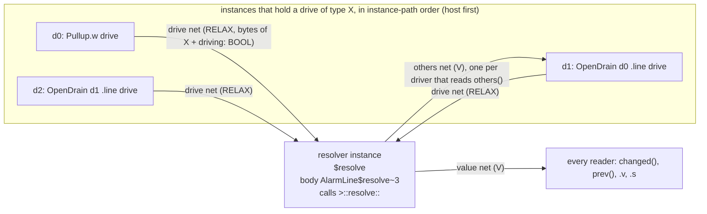
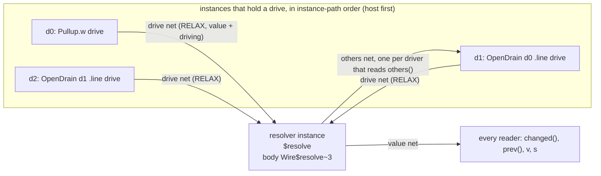

# Resolved Nets Design

**Spec**: `.specs/features/resolved-nets/spec.md`
**Status**: Approved
**Approved**: 2026-11-21 - under the user's standing AFK rule - user: "Eu gostaria que engatilhasse até o 12" and, 2026-11-21, "pode ir tocando como previsto, parando só depois da revisão no item 13"
**Amended**: 2026-11-22 - the explicit-unknowns model (MD-78, spec amendment A6). The section "Amendment of 2026-11-22" below rules over every older sentence of this file; the components it rewrites are rewritten in place, and the decisions it supersedes are marked so in "Decisions taken (user AFK)".

---

## Amendment of 2026-11-22: the explicit-unknowns model (MD-78)

What changes, in the order a reader of the older text meets it. Each row cites the user's
decision of 2026-11-21 as spec.md A6 quotes it.

| Older text | Now | Decision |
| ---------- | --- | -------- |
| "a nature with `resolve`", `NatureKind::Resolved` from the field, `Nature::resolve_fn` | a nature is resolved when an `impl Resolve<X, V> for N` exists for it; the field, `NatureFieldNode::Resolve` and `Nature::resolve_fn` leave the code (T16) | A6.1 |
| `resolve: f` with `fn f<const N: usize>([T; N]) -> T` | the trait function `<N as Resolve<X, V>>::resolve::<k>`: drives of type `X`, a result of type `V`, `V` the nature's `value` (`E0203`) | A6.2 |
| `Wire`, `Tri<T>`, `tri`, `SumNet`, `Logic::wired` | none in the library; tests and the Book declare their natures; `Driven::strongest` and `sum` are the library's resolution functions | A6.3 |
| D3: a drive net is the value then `driving: BOOL` **with a known byte**; zero bytes absent; an unknown drive present | a drive net is the bytes of `X` then a plain `driving: BOOL` (abi.md D1 as `explicit-unknowns` T36, T37 left it); 0 is absent, 1 present; no drive is unknown | A6.5, A6.7 |
| D9, C9: one `log` record per unsettled loop and analysis | the run stops with `E0511` (the engine's fault, `explicit-unknowns` T37); this feature names every drive of the loop by its holder's instance path, in drive order (D24) | A6.4 |
| D14: `std/nets.msl` as `value-semantics` left it | `std/nets.msl` as `explicit-unknowns` T23 wrote it (`Strength`, `Driven`, `strongest`, `sum`, the generic modules) and `std/logic.msl` (its T44) | A6.3, A6.6 |
| D17: a relaxed field without a known byte | no field has a known byte; the decision has no object | A6.5 |
| D19: `Tri<T>` and a project's generic resolved nature | `Tri<T>` is not built; a nature with two `impl`s and `DataBus` (`Resolve<Option<u8>, Data>`) prove `X` and `V` apart (T28) | A6.3 |
| The §22.3 modules on `Wire` | generic modules over `W: Nature + Resolve<Driven>`, which need `generics` phase C (D25, spec Q2) | A6.3 |
| The Book's alarm row and "the other rows" | exactly natures#2, natures#3 with natures~e99c1920 and natures~91c3bffe, digital#16 to digital#20, core-std#6 (T34, T35, T39) | A6.8 |

### Architecture after the amendment



- **Checker** (T16, T17, T37): `NatureRules::of` answers "resolved" from the nature's `impl Resolve`s; a drive's type picks the `impl` (`E0180`, `E0181`); `E0220` names the nature and `Resolve`.
- **Elaborator** (T18 to T21, T38): `ResolverBodies` groups a net's drives, checks that they share one `X` (`E0225`, D22), picks the `impl` (D21, spec Q4), and instantiates its `resolve` for every count `0..=N`.
- **Host** (T25): the `E0511` failure names drives by holder path, from `NetData::resolution` (D24).

### Data model after the amendment

```rust
/// What a resolved net is made of below the POM (C4).
pub struct Resolution {
    /// The generated resolver instance (`<net path>$resolve`).
    pub resolver: InstanceId,
    /// The driven type `X` every drive of the net holds (§5.2.15).
    pub driven: TypeId,
    /// One drive net per drive, in instance-path order, the host's first (§4 rule 2).
    pub drives: Vec<NetId>,
    /// The instance holding each drive, index for index with `drives` (`None`: the host).
    pub holders: Vec<Option<InstanceId>>,
    /// The others net of each holder that reads `others()`, by drive index.
    pub others: Vec<(u32, NetId)>,
}
```

`CarrierRole::Resolved { driven: TypeId }`: the body's carrier has the type `V`, its drive the
type `X`. `Expr::Resolve::by_count` names instances of the trait function of the one `impl` the
net uses. Names are unchanged; the resolver body's key is `<Nature>$resolve~<N>` with the
`impl`'s `X` added when the nature has several (`Bus$resolve<bool>~3`).

### Divergences found by the amendment

| Divergence | Spec | Fix |
| ---------- | ---- | --- |
| Part VII §22.3.6 writes `digital for Keeper {` and §22.4.3 `analog for Bidir {`, `digital for Bidir {` for modules generic over `W`; §10 rule 6 requires `digital<W> for Keeper<W>` (`E0403` otherwise) | §10 rule 6 | T30 and T32 amend the two fences and their `std` sources, with a `spec_text` guard (MD-57) |
| The code reads a `resolve` field the specification removed (§4 syntax) | §4 | T16 |
| `E0220`'s diagnostic does not name the nature and `Resolve` | §5.2.1 | T17 |

---

## What the code does today (`main` at `7df9e17c`)

| Concern | Where | Today |
| ------- | ----- | ----- |
| Nature kinds | `pom/lower/hardware.rs` | the POM classifies every nature: `Conservative`, `SignalFlow`, `Discrete`, `Resolved`, `Invalid`; `E0201` (fields) is raised in `pom/resolve/shape.rs` |
| Carrier types | `types/carrier.rs` (`port_type`, `bit_type`, `carried_type`) | `Bit<T>` of the stdlib is the only discrete nature; a project discrete nature, a resolved nature and a signal-flow nature are each one `P0001` (`discrete nature`, `resolved nature`, `signal-flow nature`) |
| Drives | `types/module.rs` (`E0220`, `E0223`, `E0310`, `E0250`, `E0251`), `types/definition.rs` (`E0222`, `E0335` to `E0339`), `types/reaction.rs` (`E0221`) | one-driver rules only; `E0339` is module-local: a loop of undelayed definitions through one-driver carriers of one module |
| Carrier methods | `types/call.rs` (`CARRIER_METHODS` holds `others`) | `others()` reaches no rule: `P0001` |
| IR | `piperine-ir/src/model.rs` | `Carrier { ty, role: In/Out/Signal/Reached }`, `Drive`, `NetData`; `NatureData::flow: Option<Quantity>` already admits a nature without flow |
| Placement | `elab/place.rs` | one net per signal carrier of every instance, named by path; a carrier port is bound to the parent's net |
| Plan, printer | `piperine-plan/src/digital.rs` (`CarrierLayout`), `piperine-transpile/src/print/digital.rs` | one pin per carrier; a definition is a discrete function writing its carrier's pin |
| Digital solver | `piperine-digital-solver/src/dag.rs`, `run.rs` (`relax`), `observe.rs` | abi.md §9 D1 is built: a cycle through `RELAX` nets is one `Step::Relax`; its nets start at zero bytes, passes repeat to `nets + 1`, a moving field with a known byte is zeroed and one `Observation::Unsettled { net, at }` is pushed **per net** |
| Owner | `piperine-solver/src/analyses/adapters.rs` | `Unsettled` becomes `ObservationKind::Record { site: None, bytes: [] }` on the net's path; nothing downstream reads it |
| Stdlib | `std/nets.msl`, `std/carriers.msl` | `Logic`, `Wire`, `Tri`, `SumNet` and the §22.3 modules, in the earlier spelling (`&[T]`); `value-semantics` T6 rewrites them to `[T; N]` under `const N` |

## Architecture Overview

A resolved carrier is three kinds of net and one generated instance, all below the POM:



- **POM** (MD-25): untouched. Every resolved carrier, drive and `others()` call stays as written.
- **Checker**: a resolved nature's carrier is `Ty::Carrier { nature, value }` like `Bit<T>`; the rules
  that differ are rules of the nature kind (no direction, any module may drive, `others()`).
- **Elaborator**: a body's resolved carrier has role `Resolved`; its definition or commits write the
  body's own drive; `s.others()` lowers to `Expr::Others(carrier)`. After placement, `ResolverBodies`
  counts each resolved net's drives, lowers the nature's `resolve` once per count `0..=N` through
  `generics`' `Instantiations`, builds one resolver body per (nature, `N`, readers of `others`) and
  places one resolver instance per net.
- **Plan and printer**: a `Resolved` carrier is up to three pins: the value (read), the drive
  (written, `RELAX`, the drive layout) and the others (read, only when the body calls `others()`).
  `Expr::Resolve` gathers the present drives in order and calls the instance of their count.
- **Digital solver**: unchanged in mechanism (D1 exists); one `Unsettled` observation per relaxation
  step that does not settle, naming every drive net of the step.
- **Host**: `piperine-api` turns that observation into one `log` record of the first drive's
  instance, once per loop and analysis.

### Absent and unknown drives (D3)

§8.2.3 step 1 makes a drive of a relaxing loop *absent* ("absent from what `resolve` receives");
§5.2.12 makes a drive with no initial value *present and unknown*. abi.md D1 starts a relaxing
net at zero bytes, and zero bytes are the all-unknown value (P3). Both cannot be one encoding, or
a `Tribuf` with `oe` unknown (strength and level unknown, §22.3.5) would vanish from `wired`.
So a drive net's layout is the value's layout followed by one field `driving: BOOL` with a known
byte (`DriveLayout`). A driver writes `driving = known true` with every value it writes. Zero
bytes, the state relaxation starts from, read as `driving` unknown: absent. The resolver reads
`driving` per drive and passes only the present ones. abi.md §9 D1 gains that sentence (T7).

### Instances of `resolve` (D4)

A resolver with `N` drive pins can receive any count `0..=N`: all drives, the drives outside a
relaxing loop in its first pass, minus one for each `others` reader, and zero. `ResolverBodies`
asks `Instantiations` for `resolve::<k>` (with the nature's type arguments first, `tri::<u8, k>`)
for every `k` in `0..=N` and records them in `Expr::Resolve::by_count`. The generated Rust
gathers the present drives into a buffer in order and `match`es on their count. Choosing every
count instead of the reachable ones keeps the elaborator free of a second loop analysis (the
digital solver's dag already finds the loops at bind); the cost is `N + 1` small functions per
distinct (nature, `N`).

### `others()` (D6, D7)

`s.others()` in a body that holds a drive of `s` reads the body's others pin, bound to the
resolver's `others_k` net, `k` the body's drive index; the resolver defines it as `resolve` of
the present drives but `k`. In a body that holds no drive of `s`, the others pin is bound to the
value net (§5.2.11). The dependency graph is per drive by construction: `others_k` reads every
drive net but `k`'s, so `a = b.others()` in `Tran` depends on the other drives of `b`, not on
this module's own (§8.2.3).

### The record of a loop that does not settle (D9)

The digital solver's `relax` pushes one `Observation::Unsettled { nets, at }` per relaxation
step that is still moving after its last pass, `nets` every `RELAX` net of the step in name
order. The owner passes it on as `ObservationKind::Unsettled { nets }` (appended). The host maps
each drive net to the instance that holds the drive (the IR's `NetData::resolution`), sorts the
instances by path (§4 rule 2) and, the first time this set of nets is seen in the analysis,
writes one record on the stream `<first instance path>.log` with the fields
`log(Severity::Warning, msg)` writes: `severity = Warning`, `msg = "a loop of resolved drives
did not settle: <path>, <path>, …"`. The zeroed levels are already in the nets.

### Signal-flow nodes (D10, D11)

A node of a nature without `flow` is an ordinary MNA node of the analog solver. Its one potential
driver is a potential branch `(n, gnd)` whose current has no other path, so it is zero; readers
probe `v(n)` and add no branch. Nothing in the solver changes. Elaboration adds the rules: after
placement `SignalFlowCheck` walks every node whose natures (of every port and signal bound to it)
all lack `flow` and counts the instances that hold a potential contribution to `(n, gnd)`, under
a condition or not (a contribution under a runtime `if` is a driver when any branch drives).
Zero or more than one is `E0242` naming the node and the drivers. A node where any nature has
`flow` is conservative (§4 rule 13 Resolution) and is not counted. `E0413` (a flow contribution)
and `E0206` (a flow probe) are checker rules on the branch's nature.

### Project discrete natures (RN-01)

`bit_type` generalises to `discrete_carrier_type(nature, path)`: any `NatureKind::Discrete` nature,
from the stdlib or the project, generic with defaults (§4 rule 12) or not, gives
`Ty::Carrier { nature, value }`. Every rule already written for `Bit` is a rule of the kind. `E0251`
already compares natures; a project nature makes the comparison reachable.

## Code Reuse Analysis

### Existing Components to Leverage

| Component | Location | How to Use |
| --------- | -------- | ---------- |
| Nature kinds | `pom/lower/hardware.rs`, `NatureKind` | read as they are; no POM change |
| `Checker::bit_type`, `port_type`, `carried_type` | `types/carrier.rs` | generalised to every discrete nature, then to resolved ones |
| One-driver checks | `types/module.rs` (`E0220`, `E0310`), `types/definition.rs` (`E0339`), `types/reaction.rs` (`E0221`) | the rule reads the nature kind: a resolved carrier skips `E0220`, inverts `E0310`, keeps `E0221` |
| `Structure`, `Frame` | `elab/carriers.rs`, `elab/drives.rs` | a resolved carrier is added as a carrier of role `Resolved`; its definition is a `Drive` of the body |
| Placement and nets | `elab/place.rs` | drive nets and others nets are added beside the value net; the resolver instance is placed after the walk |
| `Instantiations` (`generics` phase A) | `crates/piperine-lang/src/elab/instances.rs` (on `generics`) | `resolve::<k>` per count |
| `CarrierLayout` | `piperine-plan/src/digital.rs` | `DriveLayout::of(value)` composes on it |
| `relax`, `Step::Relax` | `piperine-digital-solver/src/run.rs`, `dag.rs` | unchanged; `Unsettled` grouped per step |
| `Streams`, `Record` | `piperine-api/src/record.rs`, `recorder.rs` | the unsettled-loop record joins the `log` stream |
| `Refusal`, `Chapter` | `tests/book/support` | the Book rows |

### Integration Points

| System | Integration Method |
| ------ | ------------------ |
| `generics` | `Instantiations::concrete(resolve, [type args.., N = k])` per count; `impl Logic` and `Logic::Z` through its phase A |
| `composite-values` | `Logic` is a carried struct (its T57); `[T; N]` parameters, `iter().fold` and closures (its phases A–B) |
| `value-semantics` | `std/nets.msl` already in the `[T; N]` spelling; this feature does not respell it |
| `params-and-io` | `code_owners.tsv` rows leave when a code is raised (D16) |
| abi.md | §9 D1 gains the `driving` field sentence (T7) |

## Components

### C1. Discrete carrier types (`types/carrier.rs`)

- **Purpose**: the type of a port or signal of any discrete nature.
- **Interfaces**: `Checker::discrete_carrier_type(nature: DeclId, file, span, path) -> Option<Ty>` (replaces `bit_type`); `Checker::port_type` gains the `Discrete`, `Resolved` and `SignalFlow` arms.
- **Reuses**: `carried_type` (`E0112`), the default of a nature's generic.

### C2. Drive rules by nature kind (`types/module.rs`, `types/definition.rs`, `types/call.rs`)

- **Purpose**: the static rules of §5.2 that read the kind: `E0310` both ways, `E0220` only without `resolve`, `E0224`, `E0339` only through one-driver carriers, the type of `others()`.
- **Interfaces**: `NatureRules::of(design, nature) -> NatureRules { one_driver: bool, resolved: bool, flow: bool }` (one owner of the question "what kind is this carrier").

### C3. Resolved nature check (`types/nature.rs`, new; rewritten by the amendment)

- **Purpose**: `E0203` at each `impl Resolve<X, V> for N`: `N` discrete, `V` its `value` type, `resolve` a pure function with one const parameter `N: usize`, one parameter `[X; N]`, result `V` (§4 rule 8), checked once at the `impl` (generics Q1 (c)); a nature with at least one such `impl` is resolved.
- **Interfaces**: `ResolveImpls::of(checker, nature) -> Vec<ResolveImpl { driven: Ty, implementation: DeclId }>`; `ResolveImpls::check(checker, item) -> Option<Diagnostic>`; `ResolveImpls::pick(driven) -> Result<ResolveImpl, Diagnostic>` (`E0180`, `E0181`, T37).

### C4. IR (`piperine-ir/src/model.rs`)

- `CarrierRole::Resolved` (appended): a carrier of a resolved nature in a body.
- `Expr::Others(u32)` (appended): `s.others()` of the body's carrier.
- `Expr::Resolve { by_count: Vec<FunctionId>, drives: Vec<u32>, except: Option<u32> }` (appended): `resolve` of the present drives among the resolver body's `drives` carriers, but `except`; `by_count[k]` is the instance `resolve::<k>` of the net's one `impl Resolve<X, V>`, taking `[X; k]` and returning `V` (amendment).
- `NetData::resolution: Option<Resolution>` with `Resolution { resolver, drives, holders, others }` (Data Models): the drive nets in instance-path order (host first) and who holds each.
- `Ir::check`: a `Resolve` has `by_count.len() == drives.len() + 1`, each function takes `[X; k]` and returns `V`; `Others` reads a `Resolved` carrier and has its type `V`. The interpreter refuses all three by name (R1).

### C5. Plan (`piperine-plan/src/digital.rs`)

- `DriveLayout::of(driven: &Layout) -> ShapeBuf layout`: the fields of `X` then a plain `driving: BOOL` (amendment; abi.md D1 as `explicit-unknowns` T36 left it).
- A `Resolved` carrier: value pin of `V` (read), drive pin of `DriveLayout::of(X)` (`RELAX`), others pin of `V` when `Expr::Others` reads it. A definition or commit targets the drive pin and writes `driving = 1`.

### C6. Printer (`piperine-transpile/src/print/digital.rs`, `print/resolve.rs` new)

- `ResolvePrinter`: prints `Expr::Resolve` as a gather of present drives (`driving == 1`) into `[X; N]` scratch and a `match` on the count calling `by_count[k]`; prints the `driving = 1` write of a drive.

### C7. Resolvers (`elab/resolvers.rs`, new)

- **Purpose**: after placement, one resolver body per (nature, `impl`, `N`, others readers) and one resolver instance per resolved net; every drive of a net has one `X` (`E0225`, D22), which picks the `impl` (D21).
- **Interfaces**: `ResolverBodies::build(elaborator, placed) -> Result<(), Diagnostics>`; `DriveOrder::of(paths)` (§4 rule 2: segment by segment, names by code point, array indices numerically; host first).
- **Reuses**: `Instantiations`, `IrBuilder`.

### C8. Signal-flow check (`elab/signal_flow.rs`, new)

- `SignalFlowCheck::run(placed) -> Vec<Diagnostic>`: `E0242` per node (D10, D11).

### C9. Unsettled loops (`piperine-digital-solver/src/run.rs`, `observe.rs`; `piperine-solver/src/protocol/sides.rs`, `analyses/adapters.rs`; `piperine-api/src/failure.rs`)

- B2 built `Observation::Unsettled { nets: Vec<String>, at }` (one per step) and `ObservationKind::Unsettled { nets }`. `explicit-unknowns` T37 turns the step that does not settle into a fault the owner reports as `E0511` and removes `ObservationKind::Unsettled`. Amendment: `LoopDrives` in `failure.rs` maps the fault's drive nets to their holders through `NetData::resolution` and writes them in drive order in the `E0511` message (D24). No `log` record.

## Data Models

```rust
/// What a resolved net is made of below the POM (C4).
pub struct Resolution {
    /// The generated resolver instance (`<net path>$resolve`).
    pub resolver: InstanceId,
    /// One drive net per drive, in instance-path order, the host's first (§4 rule 2).
    pub drives: Vec<NetId>,
    /// The instance holding each drive, index for index with `drives` (`None`: the host).
    pub holders: Vec<Option<InstanceId>>,
    /// The others net of each holder that reads `others()`, by drive index.
    pub others: Vec<(u32, NetId)>,
}
```

Names: a drive net is `<net path>$drive<k>`, an others net `<net path>$others<k>`, the resolver
instance `<net path>$resolve`, its body `<Nature>$resolve~<N>` (with the `others` indices in the key).
The `$` keeps them out of every authored name (`.` maps to `_d`, `$` to `_s` in generated Rust).
Metadata, `--print` and tables list the value net only (D5).

## Error Handling Strategy

| Error Scenario | Handling | User Impact |
| -------------- | -------- | ----------- |
| `resolve` of the wrong shape | `E0203` at the nature | `piperine check` names the nature and the function |
| a direction on a resolved port; none on a one-driver one | `E0310` | as today for `Bit` |
| `others()` on a one-driver carrier | `E0224` | names the carrier |
| a loop through a one-driver carrier | `E0339` (module-local as today; across instances T20) | names the drives |
| a signal-flow node with zero or several potential drivers | `E0242` | names the node and each driver |
| a flow contribution or probe on a nature without `flow` | `E0413`, `E0206` | names the branch |
| a loop that does not settle | `E0511`, a run error (amendment, A6.4) | the run stops; the message names every drive by its holder's instance path |
| a drive type no `impl` accepts; a literal several accept; two driven types on one net | `E0180`, `E0181` (T37), `E0225` (T38) | names the nature, the types and the modules |
| a library module on a nature without `impl Resolve<Driven>` | `E0187` (the bound, `generics` C) | names the nature and `Resolve<Driven>` |
| `resolve` panics (an index on `[T; 0]`) | a run fault naming the nature and the carrier path | `piperine run` exits 1 |

## Goldens, pins and tests that may move

| What | Task | Rule |
| ---- | ---- | ---- |
| `types_carriers.rs` tests that pin `P0001` for `discrete nature`, `resolved nature`, `signal-flow nature` | T1, T4, T16 | each replaced by the acceptance test of the criterion that supersedes it |
| Book `modules#8` | T10 | done in B2 |
| Book natures#3 with natures~e99c1920 and natures~91c3bffe (`tests/book/natures.rs::the_open_drain_line_is_refused_until_a_nature_can_implement_resolve`) | T34 | replaced by the run tests of RN-09 AC 1 to 3; the sentence natures~e99c1920 leaves the Book; `inventory.tsv` rows edited in place |
| Book digital#16 to digital#20 (`tests/book/digital.rs::the_irq_line_and_the_four_nets_are_refused_until_a_nature_can_implement_resolve`), core-std#6 (`tests/book/core_std.rs::the_resolved_line_is_refused_until_a_nature_can_implement_resolve`) | T35 | replaced by the run tests of RN-09 AC 4 and AC 5 |
| Book natures#2 (`tests/book/natures.rs::signals_of_every_family_are_refused_for_the_arrays_the_option_the_logic_and_the_net`) | T39 | replaced by the test of RN-09 AC 6 |
| `crates/piperine-lang/tests/pom_bundles.rs` fixtures that use the library's `Wire` (`one_driver_fields_carry_a_direction_and_no_other_field_does`, `a_misplaced_or_missing_field_direction_is_e0261`) | T16, unless `explicit-unknowns` T23 moved them first (T11 records which) | the `Wire` field becomes a field of a nature the test declares with `impl Resolve<bool>`; the assertion is unchanged |
| `relax.rs` `an_absent_drive_is_left_out_and_an_unknown_one_is_passed`; `protocol_transient.rs` `an_unsettled_loop_reaches_the_owner_once_per_step` | T11 | where `explicit-unknowns` T37 replaced them, C31 and C62 name the successor; where it did not, the unknown drive becomes a present drive of a value and the observation the `E0511` fault (both names in the commit body) |
| `GAPS.md` L21, L22, L23, the resolved-net group of L58, the §11 rows above | T10, T35 | removed in the commit that closes them |
| `code_owners.tsv` rows `E0203`, `E0225` (`E0224`, `E0242`, `E0413` deleted in B2) | T16, T38 | deleted when the code is raised (D16) |
| Transpile goldens, twin goldens, `contract.rs`, every `ToleranceContract` | none | never |

## Cross-lane touches

`spec_text.rs` and `docs.rs` are appended to, never edited above; `GAPS.md` keeps its section
numbering; `inventory.tsv` rows are edited in place; `types/carrier.rs` and `types/call.rs` are
also edited by `composite-values` and `generics`: phase 1 lands first on `main` or rebases on
them in T11.

## Risks & Concerns

| Concern | Location | Impact | Mitigation |
| ------- | -------- | ------ | ---------- |
| Phase 1 and `composite-values` both edit `types/carrier.rs` | `port_type`, `carried_type` | rebase conflicts | phase 1 is small and lands first; T11 re-reads every anchor after the rebase |
| `Unsettled` is pushed per net today; one consumer (`adapters.rs`) | `run.rs:405`, `adapters.rs:281` | a test pinning the per-net form | T8 changes the variant and its one consumer together |
| Cross-instance loops through one-driver carriers are refused at bind, not as `E0339` | `types/definition.rs` (module-local) | a diagnostic with another code | T20 checks after placement; if bind is the only refusal today, T20 adds the elaboration check |
| `N + 1` instances of `resolve` per (nature, `N`) | `elab/resolvers.rs` | build time for a very wide `Wire` | bounded by the drive count; reported in the elaboration only when `N > 64` (no limit imposed by the spec) |
| A `Logic` carried composite depends on `composite-values` T57 | plan/printer | phase 3 blocked | T11 stops the feature if T57 is not on `main` |
| The ABI `driving` field changes what an external device must write to join a resolved net | abi.md §9 D1 | an external author | stated in abi.md (T7); no external device joins today |
| The library modules are generic modules, `generics` phase C, which has no tasks yet | §22.3.5 to §22.4.3 | phases 8 and 9 blocked | spec Q2; phases 4 to 7 prove the machinery on modules a test declares; T27 stops and reports if GN-13 is not on `main` |
| natures#2 needs arrays of carriers (L24, `composite-values` C) | Book chapter 5 | the last Book row blocked | spec Q3; T39 is its own task and stops if L24 is open |
| A net whose nature has several `impl`s and no drive | §5.2.15 | the `impl` is undetermined | spec Q4; T19 implements the recommended rule and T33 proves it |

## Divergences found (current code vs docs/spec in this area), each a fix task

| Divergence | Spec | Fix |
| ---------- | ---- | --- |
| A relaxing loop's `Unsettled` is one observation per net and no record reaches the `log` stream | §8.2.3 step 4, §19 rule 2 | T8, T9, T24 |
| A project discrete nature is `P0001` | §4 rule 1, rule 12 | T1, T2 |
| `others()` on a `Bit` is `P0001`, not `E0224` | §5.2.7 | T3 |

## Decisions taken (user AFK)

User's standing words: "Eu gostaria que engatilhasse até o 12" (2026-11-18) and "pode ir tocando
como previsto, parando só depois da revisão no item 13" (2026-11-21). Each default follows the
spec where the spec decides, and is the smallest mechanism where it does not.

| # | Open point | Default taken | Why |
| - | ---------- | ------------- | --- |
| D1 | How Q1 = B maps onto the dependencies as they stand on 2026-11-21 | **Superseded 2026-11-22 (D25 re-cuts the steps after B2).** Phase 1 now (RN-01, RN-08, `E0224`, presence and unsettled records below the language, records); phases 2–3 of the code after `composite-values` A–B and `generics` A are on `main`; Book and records last | Q1's own rule: each step when its dependencies are in; L17, L40, L56 and `unknown-semantics` are delivered |
| D2 | One branch or two | One branch, `feature/resolved-nets`, two folders with their own checks and verification; bundles' independent phase runs right after this feature's phase 1 | the user asked for both on this branch; bundles need RN for a resolved field (BN-06 AC 2), so one branch keeps one rebase |
| D3 | An absent drive (§8.2.3 step 1) against an unknown one (§5.2.12) | **Superseded 2026-11-22 (A6.5, A6.7: a drive pin is the bytes of `X` then a plain `driving: BOOL`, as abi.md D1 and `explicit-unknowns` D14 say; no drive is unknown).** a drive net carries `driving: BOOL` after the value; zero bytes are absent; abi.md D1 says so | without it a `Tribuf` with `oe` unknown vanishes from `wired`; keeps abi.md's "start at zero bytes" |
| D4 | Which instances of `resolve` | every count `0..=N` per (nature, `N`) | no second loop analysis in the elaborator; `value-semantics`' note ("all drives, the drives outside a relaxing loop, and zero") is a subset |
| D5 | Where the resolver lives and who sees it | an IR instance `<net path>$resolve` under the net's declaring instance; drive and others nets named with `$`; metadata, tables and `--print` list the value net only; the POM has none of them | MD-25; abi.md D1 "a resolver instance generated from the nature" |
| D6 | `others()` of a body that drives | its own others pin, bound to the resolver's `others_k` | abi.md D1 "one others pin per reader that needs it" |
| D7 | `others()` of a body that does not drive | the others pin is bound to the value net | §5.2.11 |
| D8 | The host's drive of a top-level resolved port | first in order, absent until the run drives it (`Session::drive`, a stimulus) | §4 rule 2 Resolution puts it first; §5.2.12's "a module that never writes a carrier has no drive" applies to the host |
| D9 | The shape of the unsettled-loop record | **Superseded 2026-11-22 (A6.4: the run stops with `E0511`; D24 says how the drives are named).** stream `<first drive instance>.log`, fields `severity = Warning`, `msg = "a loop of resolved drives did not settle: <paths>"` (paths in drive order), once per set of drive nets per analysis | §8.2.3 step 4 with the fields of the stdlib's `log` (§22.6) |
| D10 | What counts as a potential driver of a signal-flow node | an instance whose body holds a potential contribution to `(n, gnd)`, under a condition or not | §6 rule 2 is checked at elaboration, before any condition is known |
| D11 | A node joining a nature with `flow` and one without | conservative, not counted | §4 rule 13 Resolution, §6 rule 2 Resolution |
| D12 | The tolerance of the gain chain (RN-08 AC 2) | `ToleranceContract::DC_VOLTAGE` as it is, against the value Rust computes | no new contract; parity untouched |
| D13 | A panic inside `resolve` | the generated code's existing panic path, with the message naming the nature and the value net's path | Edge case of the spec |
| D14 | The spelling of `std/nets.msl` | **Superseded 2026-11-22 (A6.3: `std/nets.msl` as `explicit-unknowns` T23 wrote it; T11 stops if it is not).** as `value-semantics` T6 leaves it; this feature does not respell it; T11 stops if it is still `&[T]` | `value-semantics` owns the text (its design, `resolve` row) |
| D15 | When `E0203` is checked | at the nature declaration, once, even with no carrier of it | `generics` Q1 (c): definition-time for types |
| D16 | `code_owners.tsv` is on `feature/params-and-io`, not `main` | the task that first raises an owned code deletes its row when the file is on the branch's base; otherwise the task writes the code on the Handoff and T35 deletes the rows | the guard fails on a stale row (PI-13) |
| D17 | A relaxed field without a known byte | **Superseded 2026-11-22 (A6.5: no known byte exists).** stays the digital solver's fault; unreachable from MSL, whose carriers all have known bytes | abi.md D1 |
| D18 | RN-09 AC 1's WHERE on L56 | **Amended 2026-11-22 (still true; the alarm's records print `level = 1` (a `Logic`, `explicit-unknowns` D15)).** dropped | `host-ii` delivered L56 |
| D19 | `Tri<T>` and a project's generic discrete nature | **Superseded 2026-11-22 (A6.3: no `Tri<T>`; T28 proves two `impl`s and `DataBus`).** a nature's type arguments are substituted by this feature (as `Bit<T>` is today); `generics` gives only `tri::<T, k>` | `generics` lists generic natures with `resolve` outside its scope (its spec, Out of Scope) |
| D20 | Bundles' tasks on the branch | interleaved by dependency: RN B1–B2, BN B1, then RN B3–B7 and BN B2–B4 as their dependencies reach `main` | D2 |
| D21 | The `impl` of a net no module drives, and of the host's drive (spec Q4) | **pending the user (Q4); planned as its recommendation A**: the nature's only `impl`; with several, `impl Resolve<V>`; otherwise `E0181` naming the carrier and the `impl`s | keeps the common case silent; source order never decides |
| D22 | Where `E0225` is checked | after placement, in `ResolverBodies` (T38), where every drive of a net is known; the checker reports `E0180` and `E0181` per drive (T37) | two modules that drive one net with different types meet only in the placed design |
| D23 | Who removes the `resolve` field from the parser, the AST and the POM | this feature's T16 (`explicit-unknowns` T28, T29 remove `Unknown` and `level` only); `docs/pom` statements and `pom_docs::DocAheadOfTheCode::WAITING` entries leave with it | the field is this feature's construct |
| D24 | How `E0511` names a loop's drives | by the holder's instance path of each drive net of the loop, in drive order, the host as `host`, read from `NetData::resolution` in the host's failure path (`piperine-api/src/failure.rs`) | §8.2.3 step 4 "names the loop's drives"; a drive net's own name (`<net>$drive<k>`) is not a name the author wrote (D5) |
| D25 | The steps after B2 | phases 4 to 7 after `generics` A–B and `explicit-unknowns` B on `main`; phases 8 and 9 after `generics` phase C's generic modules too (**pending the user, spec Q2; planned as its recommendation A**); T39 after `composite-values` C (**pending the user, spec Q3**) | `Pullup<W>` and the other §22.3 modules are generic modules (L30); `[Bit; 8]` is L24 |
| D26 | The behavior blocks of `Keeper` and `Bidir` in Part VII | `digital<W> for Keeper<W>`, `analog<W> for Bidir<W>`, `digital<W> for Bidir<W>`, amended by T30 and T32 with a `spec_text` guard | §10 rule 6; the amendment's divergence table |
| D27 | Where tests declare natures | every test of phases 7 and 8 declares its own nature (`Total` with `sum`, `AndWire`, `Line` with `Driven::strongest`, `DataBus`); none relies on a library net | A6.3 |
| D28 | Gates | per task: the `**Build**` line and the tests of the crates it touched; the full root suite, the integrated suites, parity and the twins once at the end of each batch, never elsewhere (user, 2026-11-21: "Quero que aplique o dos gates mais leves apenas"; 2026-11-22: "Suite completa é só no fim dos lotes e ponto final!"); the buck only in a task whose `Done when` says "with the buck" (MD-77) | the user's gate policy |

## Tech Decisions

| Decision | Choice | Rationale |
| -------- | ------ | --------- |
| The resolver as an ordinary IR body | plan, printer, bind and solver need no resolver special case beyond `Expr::Resolve` and `RELAX` | abi.md D1; reuse |
| One `NatureRules` owner for kind questions | `types/` asks one type, not five `matches!` | code clarity rule "one purpose per type" |
| No new contract or tolerance | `DC_VOLTAGE` for the gain chain | parity untouched |
