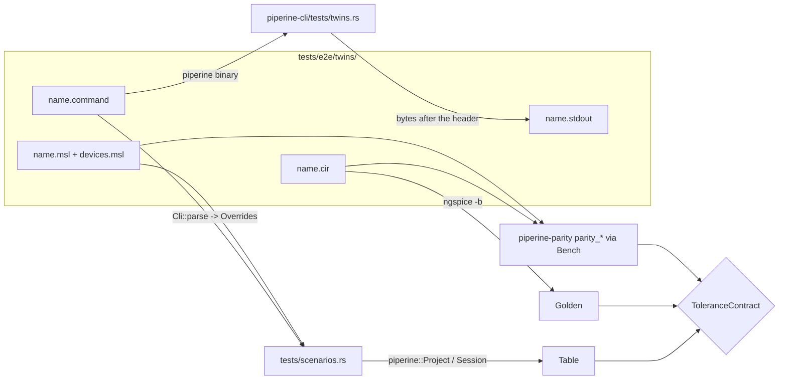
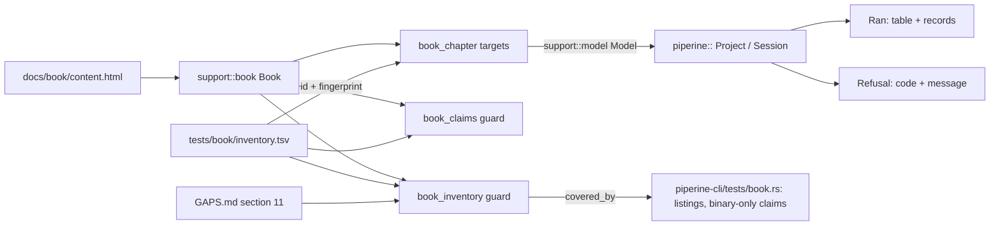

# Root E2E Design

**Spec**: `.specs/features/root-e2e/spec.md`
**Status**: Approved (dispatched under the user's standing instruction of 2026-11-18, queue item 5)

The root package gets its integrated tests, and the ngspice twins get one home. Two independent halves share one rule: nothing the Book or a twin claims is left without a test that would fail if the claim stopped holding.

- **The twins** move from `tests/ngspice/` to `tests/e2e/twins/` in one task, every reader with them. Each twin gains the command a user types (`<name>.command`) and keeps its expected standard output beside it (`<name>.stdout`, today's CLI goldens). A root target, `tests/scenarios.rs`, runs each command through `piperine::` and compares the table with ngspice under `ToleranceContract`. `piperine-parity` stays the harness; the `parity_*` targets keep their comparisons.
- **The Book** gets an inventory, `tests/book/inventory.tsv`: one row per block and one per sentence that states a value or an outcome. Two guard targets keep it whole against the Book. One root target per chapter runs every block and asserts every claim through `piperine::`; a refused block is asserted refused, with its code and message, and listed in `GAPS.md` §11.

**The code follows the spec** (user, 2026-11-18: "O código que diverge da spec tem que ser ajustado"). Where the binary or the library disagrees with the Book or the spec, the code is fixed in this feature (Phase 9), never the Book; see "Divergences".

Starts on `main` with `host-ii` merged (it adds five twins, and `solver-hygiene` four more: sixteen twins in all; the Book's new listings and the root target `tests/host_ii.rs`). T1 confirms that state and stops when it does not hold.

---

## Architecture Overview





**The data path of a Book test.** A chapter test names a block by id (`welcome#3`). `Book` finds the block; `Inventory` checks its fingerprint, so a block that moved or changed fails loudly instead of running another block. `Model` writes the block (or the file the Book assembles with `cli-file` markers, or `examples/<name>`) into a directory of its own and opens it with `piperine::Project`. `Model::run` returns a `Ran` (the table and the records), or the `Failure`, which `Refusal::expect` reads for its code and message.

---

## Approaches considered

| Question | Options | Chosen |
| -------- | ------- | ------ |
| How the root reaches the binary | (a) run the CLI's library in process (`Cli::execute`); (b) spawn `target/<profile>/piperine` found from the test's own path; (c) root tests through `piperine::`, the binary's own output held where cargo builds it | **(c)**. (a) reads the process environment (`PIPERINE_CACHE_DIR`, `PIPERINE_BACKEND`, the working directory), which a test may not set; it would write into the user's cache. (b) cargo hands `CARGO_BIN_EXE_piperine` only to `piperine-cli`'s own targets; from the root a stale binary would be tested silently. The spec allows "through `piperine-api` or the binary" (Goal 1, RE-02 AC 1, RE-05 AC 1): every model and claim runs through `piperine::` at the root; the listings stay held to the real binary by `piperine-cli/tests/book.rs` (Q1 (a) says so), and a claim only the binary can make (an exit code, the layout of a line) names a `piperine-cli` test in the inventory. The root's scenarios parse their command with the binary's own parser, `Cli::parse`. |
| Where a twin lives | (a) one directory per twin; (b) one scenario directory for the twins that share `devices.msl` | **(b) `tests/e2e/twins/`**. Every twin starts `mod devices;`, which MSL resolves beside the file (MD-55, no `#[path]`). (a) needs sixteen copies of the library, a link (refused by Q3) or turning each twin into a package, which edits the twins and every reader of them. The spec names `tests/e2e/<scenario>/` holding `<name>.msl`, `<name>.cir` and the output: (b) is that layout. RE-05 AC 3 ("a directory of its own") is about the run: each scenario builds into its own directory. |
| The inventory's form | (a) TOML read with serde; (b) a Rust table; (c) tab-separated text read with `split` | **(c)**. serde's derive is a macro (AGENTS rule 5). A Rust table of ~600 struct literals reads worse than one line per row, and a guard's failure can print the missing rows ready to paste. |
| How a block is named | (a) its index among `msl` blocks; (b) `<chapter>#<n>` over every `<pre>` block of the chapter, with a fingerprint | **(b)**. The spec asks for chapter and index; the fingerprint (FNV-1a 64 of the decoded text) makes a changed or shifted block fail by name. |

---

## Code Reuse Analysis

### Existing Components to Leverage

| Component | Location | How to Use |
| --------- | -------- | ---------- |
| `Ngspice`, `Golden`, `PrintedNumber` | `crates/piperine-parity/src/{ngspice,golden}.rs` | the scenarios' golden side; `PrintedNumber` compares a value the Book prints at its printed precision |
| `ToleranceContract`, `Point`, `Coordinate` | `crates/piperine-parity/src/contract.rs` | every scenario comparison; never edited |
| `Backend::selected`, `ScratchDir` | `crates/piperine-parity/src/{backend,scratch}.rs` | the scenario's backends, its own build directory |
| `Bench::twin_path`, `Ngspice::fixture_path` | `crates/piperine-parity/src/{bench,ngspice}.rs` | rewired to `Corpus`, the one place that knows the layout |
| `Cli::parse`, `Invocation::Run` | `crates/piperine-cli/src/cli.rs` | a scenario's `.command` into `Overrides`, as the binary reads it |
| `Project::file`, `Project::at`, `Project::request`, `Session::open`, `Session::run`, `RecordSink`, `Failure` | `crates/piperine-api/src/` through `piperine::` | every root run |
| `Settings { rustc: None, cache }` | `crates/piperine-transpile/src/settings.rs` | the cache of a root session; `piperine::Settings` if `host-ii` re-exports it, else a dev-dependency of the root |
| Block and listing reading, `cli-file` assembly | `crates/piperine-cli/tests/book.rs` (`blocks`, `files_before`, `attributes`, `decode`) | the rules the root `Book` reader follows (read, not shared: test targets of two packages cannot share a module) |
| Registry + exhaustiveness guard, planted text | `crates/piperine-parity/tests/parity_corpus.rs`, MD-31 | the shape of both Book guards and the e2e layout guard |
| Root naming rule, target walker | `crates/piperine-lang/tests/suite_hygiene.rs`, `tests/support/sources.rs` | extended to the root manifest's `[[test]]` paths and two exemptions |

### Integration Points

| System | Integration Method |
| ------ | ------------------ |
| Root `Cargo.toml` | dev-dependencies `piperine-parity`, `piperine-cli`, `tempfile` (and `piperine-transpile` for `Settings` when not re-exported); one `[[test]]` per Book target (`book_<chapter>`, `book_inventory`, `book_claims`) with its path under `tests/book/` |
| `GAPS.md` | new §11 "The Book against the binary": one row per refused block and per claim the binary does not meet; the inventory guard holds it equal to the inventory |
| `crates/piperine-cli/tests/book.rs` | the listings stay held there; a binary-only claim with no test gets one there |
| `crates/piperine-solver/tests/workspace_shape.rs` | `root_tests_hold_no_end_to_end_target` follows the decision: the `.cir` fixtures under `tests/e2e/`, Rust under root `tests/` only in declared targets and `tests/book/support/` |

---

## Components

### `Corpus` and `Twin` (the e2e layout)

- **Purpose**: The one place that knows where a twin's files are.
- **Location**: `crates/piperine-parity/src/corpus.rs`
- **Interfaces**:
  - `Corpus::of_repository() -> Corpus` - `tests/e2e/` of this repository.
  - `Corpus::at(root: &Path) -> Corpus` - a corpus at another root (unit tests).
  - `Corpus::twins(&self) -> Vec<Twin>` - every `<name>.msl` beside a `<name>.cir`, in every scenario directory, by name.
  - `Corpus::twin(&self, name: &str) -> Twin` - the one twin of that name; panics naming it when there is none or two.
  - `Twin::name`, `Twin::directory`, `Twin::model` (`.msl`), `Twin::netlist` (`.cir`), `Twin::command` (`.command`), `Twin::expected_stdout` (`.stdout`).
- **Dependencies**: `std` only.
- **Reuses**: replaces the path literals of `Ngspice::fixture_path` and `Bench::twin_path`.

### The scenario command and expected output (data)

- **Purpose**: What a user types to run a twin, and what it prints.
- **Location**: `tests/e2e/twins/<name>.command` (one line, `piperine run <name>.msl --analysis ..`, run from the scenario directory), `tests/e2e/twins/<name>.stdout` (standard output after the header line, today's `crates/piperine-cli/tests/goldens/<name>.txt`, moved unchanged).
- **Readers**: `piperine-cli/tests/twins.rs` runs the command on the binary, once per backend (`--backend` appended), and compares with `.stdout`; `tests/scenarios.rs` parses it with `Cli::parse`.

### `Scenario` and `Comparison` (root `tests/scenarios.rs`)

- **Purpose**: Runs a twin through the user's entry point and holds it to ngspice.
- **Location**: `tests/scenarios.rs` (one target; one `#[test]` per twin, named after it, as the `parity_*` targets do).
- **Interfaces**:
  - `Scenario::of(name: &str) -> Scenario` - the twin and its command, parsed into `Overrides`.
  - `Scenario::run(&self, backend: Backend) -> Ran` - `piperine::Project::file` + `Session::open` with the scenario's own build directory (`ScratchDir`) + `Session::run`; `Ran` holds the table and that directory.
  - `Comparison` - one quantity: the table column (or the operating point's row), the ngspice side (`Golden::printed` name or `wrdata` export) and the `ToleranceContract` constant; one variant per analysis family (operating point, DC sweep, AC magnitude and phase, transient on the print grid, transfer, pole-zero, sensitivity, periodic orbit, temperature), each with the quantities its `parity_*` target compares.
  - `Comparison::hold(&self, table: &Table, golden: &Golden, at: Point)`.
- **Dependencies**: `piperine::` (api), `piperine_cli::Cli`, `piperine_parity::{corpus, ngspice, golden, contract, backend, scratch}`.
- **Reuses**: the grids and quantities of `parity_{op,dc,ac,tran,tf,pz,sens,pss,temp}.rs`.
- **Guards in the target**: `every_twin_has_a_scenario_test` (every `Corpus::twins()` name has `fn <name>()` in this file), `a_disabled_ngspice_still_runs_the_scenario`, `each_scenario_runs_in_a_directory_of_its_own`.

### The e2e layout guard

- **Purpose**: Keeps `tests/e2e/` the one home of the twins.
- **Location**: `crates/piperine-parity/tests/parity_corpus.rs` (the existing corpus guard, rewritten from `tests/ngspice/` to the e2e tree).
- **Rules**: every twin has `.cir`, `.command`, `.stdout` and a test function in a `parity_*` target; an `.msl` with no `.cir` is a library some twin of its directory loads with `mod`; a scenario directory holding `benches/` holds `Piperine.toml` (spec edge 3); `tests/ngspice/` does not exist; the `.cir` byte pins stay. Each rule a named method of `Guard`, tested on planted text (L-013).

### `Book`, `BlockId`, `Block`, `Sentence`, `Fingerprint` (root support)

- **Purpose**: Reads the Book: chapters, blocks with their attributes and `cli-file` marker, and the sentences of the prose.
- **Location**: `tests/book/support/book.rs`
- **Interfaces**:
  - `Book::read() -> Book` - `docs/book/content.html`, decoded.
  - `Book::chapters(&self) -> Vec<String>`; `Book::blocks(&self) -> Vec<Block>`; `Book::block(&self, id: &BlockId) -> Block`.
  - `Book::file(&self, path: &str, upto: &BlockId) -> String` - the blocks marked `cli-file: <path>` joined, as `piperine-cli/tests/book.rs` joins them.
  - `Book::sentences(&self, chapter: &str) -> Vec<Sentence>` - the prose of `<p>`, `<li>` and `<td>` outside `<pre>`, tags removed, split at sentence ends.
  - `BlockId { chapter, index }` - `welcome#3`, 1-based over every `<pre data-lang>` of the chapter; `parse` and `Display`.
  - `Fingerprint::of(text: &str) -> Fingerprint` - FNV-1a 64, printed as 16 hex digits.
- **Dependencies**: `std` only, so the guards link no workspace crate.

### `Inventory`, `Row`, `Verdict`, `Coverage` (root support)

- **Purpose**: Reads `tests/book/inventory.tsv` and resolves what each row names.
- **Location**: `tests/book/support/inventory.rs`
- **Interfaces**:
  - `Inventory::read() -> Inventory`; `Inventory::blocks()`, `Inventory::claims()`, `Inventory::row(id)`.
  - `Inventory::checked_block(&self, book: &Book, id: &str) -> Block` - the block, after its fingerprint is checked against its row (chapter tests call this, never `Book::block` directly).
  - `Verdict` - `Run`, `Refused`, `Fragment`, `Held`, `Shown`, `Holds`, `Diverges`, `Unraised`, `Disputed`, `Binary`, `Prose`, `Pending`; which verdicts fit which row kind and language.
  - `Coverage::resolve(covered_by: &str) -> Result<CoveringTest, String>` - `piperine/<target>::<fn>` to the root target's file (read from the root `Cargo.toml`'s `[[test]]` paths, else `tests/<target>.rs`), `piperine-cli/<target>::<fn>` to `crates/piperine-cli/tests/<target>.rs`, a block id for a fragment; `CoveringTest::body()` is the text of the function.
- **Dependencies**: `book.rs`, `std`.

### `Model`, `Ran`, `KeptRecords`, `Refusal` (root support)

- **Purpose**: Runs a Book model through `piperine::` and reads its result or its refusal.
- **Location**: `tests/book/support/model.rs` (`Model`, `Ran`), `tests/book/support/records.rs` (`KeptRecords`, a `RecordSink` that keeps every record), `tests/book/support/refusal.rs` (`Refusal`).
- **Interfaces**:
  - `Model::lone(book, inventory, file_name, ids: &[&str]) -> Model` - a lone file of the named blocks, joined in order.
  - `Model::marked(book, inventory, path, upto: &str) -> Model` - the file or project the Book assembles with `cli-file` markers, as it stands at block `upto`.
  - `Model::example(name: &str) -> Model` - a copy of `examples/<name>`.
  - `Model::with_source(self, file: &str, text: &str) -> Model` - a file the test writes around a fragment (a top), named in the test.
  - `Model::run(&self, overrides: Overrides) -> Result<Ran, Failure>`; `Ran { table: Table, records: Vec<Record> }`.
  - `Refusal::expect(result: Result<Ran, Failure>, row: &str, code: &str, message: &str)` - passes when the run failed with a diagnostic of `code` whose message is `message`; panics naming `row` and saying "now runs: make the row `run` and drop its `GAPS.md` §11 line" when the run succeeded; panics with the actual codes and messages otherwise.
- **Dependencies**: `piperine::` (api), `piperine_transpile::Settings` (or its re-export), `tempfile`, `book.rs`, `inventory.rs`.
- **Settings**: one cache directory per target (a `OnceLock<TempDir>`), as `piperine-api/tests/analyses.rs` does.

### The two guards

- **`book_inventory`** (`tests/book/inventory_guard.rs`): every `<pre>` block has exactly one block row with its fingerprint; each verdict fits the block's language; every `covered_by` resolves; a `run` row's test body names the row id and calls `.run(`; a `refused` row's test body calls `Refusal::expect(` with the row id; a `fragment` names a `run` or `refused` block; the blocks one `cli-file` path joins name one test (spec edge 1); the `refused` and `diverges` rows equal the rows of `GAPS.md` §11, each under its gap id, and the gap id is an entry of `GAPS.md`. A failure prints the corrected inventory lines.
- **`book_claims`** (`tests/book/claims_guard.rs`): `ClaimDetector` flags a sentence holding an error code (`E`/`P`/`W` and four digits), a number with a unit or a count word, or an outcome verb (data lists in the target); every flagged sentence has a claim row with its fingerprint; every claim row is still a sentence of its chapter; a `holds` or `diverges` row names a root test whose body cites the claim id; a `binary` row names a `piperine-cli` test; a `refused` claim names a `refused` block row.
- Both: until T41, a chapter listed in `SETTLED_CHAPTERS` has no `pending` row; T34 adds `every_gaps_row_names_its_owner` and `disputed_rows_are_listed_for_the_user`; T41 replaces the registry with `no_block_row_is_pending`, `no_row_diverges` and `no_claim_row_is_pending`.
- Both link no workspace crate: `suite_hygiene`'s `ROOT_TARGET_EXEMPTIONS` registers them with that reason (the shape the registry was made for).

### The chapter targets

- **Purpose**: One root target per Book chapter (Q2): every block and claim row of the chapter whose verdict is `run`, `refused`, `holds`, `diverges`, `unraised` or `disputed` is a test here.
- **Location**: `tests/book/<chapter>.rs`, target `book_<chapter>` (dashes as underscores: `book_from_rust`, `book_core_std`); `book_errors` also holds `a_refusal_that_runs_fails_naming_its_row`. A chapter with no such row (possibly `solver`, `structure`) has no target.
- **Shape**: each target declares the support modules it uses inline (`#[path = "support"] mod support { pub mod book; .. }`, item-scoped `#[allow(dead_code)]` with its reason, as `piperine-lang/tests/book.rs` does); each test opens with a comment citing its row ids and, for a claim, the sentence.

---

## Data Models

### `tests/book/inventory.tsv`

Tab-separated, one row per line, `#` starts a comment. Columns:

| Column | Block row | Claim row |
| ------ | --------- | --------- |
| `kind` | `block` | `claim` |
| `id` | `<chapter>#<n>` | `<chapter>~<first 8 hex of the fingerprint>` |
| `fingerprint` | of the decoded block text | of the sentence |
| `verdict` | `msl`: `run`, `refused`, `fragment`; a listing (`data-cli-output`): `held`; `diag`: `holds`, `diverges`, `unraised`, `disputed`; `sh`, `toml`, other `text`, `rust`: `shown`; any: `pending` (until T41) | `holds`, `diverges`, `unraised`, `disputed`, `binary`, `refused`, `prose`, `pending` (until T41); `diverges` and `disputed` only until T41 |
| `covered_by` | `piperine/<target>::<fn>` for `run`, `refused`, `holds`, `diverges`, `unraised`, `disputed`; `piperine-cli/<target>::<fn>` for `held`; a block id for `fragment`; `-` for `shown` | `piperine/<target>::<fn>` for `holds`, `diverges`; `piperine-cli/<target>::<fn>` for `binary`; a block id for `refused`; `-` for `prose` |
| `gap` | the `GAPS.md` id for `refused`, `unraised`, `diverges`, `disputed`; else `-` | the same |
| `text` | the listing's command, else `-` | the sentence |

Sizes at `99d05af2` (before `host-ii`'s Book edits; T1 recounted at `1a3d69dc`: 221 `<pre>` blocks, 214 with `data-lang` (99 `msl`, 2 `diag`, 113 `sh`/`text`/`toml`/`rust`), 35 listings (`data-cli-output`), 18 chapters; the sentence count is T14's): 199 blocks (97 `msl`, 29 listings, 2 `diag`, 71 `sh`/`text`/`toml`/`rust`), 18 chapters; the planner's detector flags about 400 sentences (163 with a code, 82 with a number and unit, 161 with an outcome verb), of which some 150 to 250 are expected to be claims.

### `GAPS.md` §11

```markdown
## 11. The Book against the binary

| Book | Gap | Owner | Today |
| ---- | --- | ----- | ----- |
| modules#1 | L7 | `generics` | `P0001`: a generic module |
```

One row per `refused`, `unraised`, `diverges` or `disputed` row, `Book` its inventory id, `Gap` an id of this file (a new one when no entry covers it), `Owner` the feature that closes it (`root-e2e` for a `diverges` row until Phase 9 fixes it, `user` for `disputed`), `Today` what the binary does, as the test asserts it. At close only `refused` and `unraised` rows remain, each with an owner other than `root-e2e`.

### Divergences (user decision, 2026-11-18)

A row whose sentence or listing the binary or the library does not meet is classified by T34 in `.specs/features/root-e2e/divergences.md`:

| Cause | Example | Verdict | Who fixes |
| ----- | ------- | ------- | --------- |
| (1) An implemented construct gives another result: output, number, message, code number, a name missing from a diagnostic, exit code | the Book says `E0430` names `clk`, the binary gives `E0430` without the name | `diverges`, then `holds` | **this feature**, Phase 9 (T35 to T40, one task per area), each fix with its own test and the Book test flipped to the Book's value |
| (2) The construct is not implemented and an approved feature owns it, refused by name today | a generic module, `P0001` | `refused`, owner in §11 | the owner feature; not a divergence |
| (3) An error code the spec names that no source raises | `E0317` (`GAPS.md` §10) | `unraised`, owner `params-and-io` (PI-13) or the feature §10 names | the owner; listed here, not fixed |
| The spec itself looks wrong | a sentence contradicting `docs/spec/` | `disputed`, listed for the user | the user decides; the Book or the code follows the answer |

Areas of Phase 9: diagnostics (T35), values and records (T36), analog (T37), digital and mixed (T38), packages and the library (T39), host and command line (T40, rules in `piperine-api` per MD-65).

**Size estimate.** The chapters cannot be classified before they are run; the planner's estimate from the Book and `GAPS.md`: of ~160 code sentences, most of the 73 codes no source mentions are (3), the forms `GAPS.md` §4 lists are (2), and a residue of wrong wording, missing names and wrong code numbers on implemented rules is (1), with a few value or record mismatches: about 15 to 30 kind (1) rows, which six area tasks carry at about 3 to 5 fixes each. T34 counts them; above about 6 in one area or 30 in all, the overflow becomes the spec of a follow-up feature `book-conformance`, queued next, its fixes not optional.

---

## Error Handling Strategy

| Error Scenario | Handling | User Impact |
| -------------- | -------- | ----------- |
| A Book block changed, moved or appeared | `book_inventory` fails naming the id and printing the corrected row | the author of the Book change updates one line |
| A chapter test reads a block whose fingerprint no longer matches | `Inventory::checked_block` panics naming the id | the wrong block never runs |
| A refused example starts to run | `Refusal::expect` panics: "now runs: make the row `run` and drop its §11 line" | the row moves with the Book (RE-02 AC 3) |
| A value sentence appears with no row | `book_claims` fails printing the claim row to add | no claim goes silently untested |
| ngspice is absent | `Ngspice::from_environment` fails naming `PIPERINE_NGSPICE=skip`; with `skip` the scenario still runs and prints the skip line | parity never passes by accident |
| A twin's output changes after the move | `piperine-cli/tests/twins.rs` fails naming the twin and the backend | the move cannot change a byte |
| A twin name in two scenario directories | `Corpus::twin` panics naming both | one name, one twin |

---

## Risks & Concerns

| Concern | Location (file:line) | Impact | Mitigation |
| ------- | -------------------- | ------ | ---------- |
| `root_tests_hold_no_end_to_end_target` forbids any `.rs` under root `tests/` and counts `.cir` under `tests/ngspice/` | `crates/piperine-solver/tests/workspace_shape.rs:131` | the move and the first root target fail it | T3 moves its `.cir` count to `tests/e2e/`; T7 rewrites the `.rs` half to "only declared targets and `tests/book/support/`", the decision this feature records (listed among the tests that change) |
| The root walker treats `tests/<dir>/*.rs` as helpers | `crates/piperine-lang/tests/support/sources.rs:61` | `tests/book/*.rs` targets would escape the `//!` header and naming checks | T11 reads the root manifest's `[[test]]` paths; a named predicate tested on planted manifest text |
| About twenty root targets each link the host library | root `Cargo.toml` | link time and disk (22 GB free on `/`) | `debug = "line-tables-only"` stays; each task gates on its own target; the root `cargo test` runs at phase ends only |
| Every later Book edit must touch the inventory | `tests/book/inventory.tsv` | friction for every feature that edits the Book | the guard prints the corrected rows; `MD` decision says so; that friction is the drift detection the user asked for |
| The claim detector is a heuristic | `tests/book/claims_guard.rs` | it misses a claim or flags prose | every flag needs a row (`prose` is an explicit verdict the Verifier samples); the detector's predicate is tested on planted sentences (L-013); a missed claim can be added by hand (rows need not be flagged) |
| The Book reader exists three times | `piperine-cli/tests/book.rs`, `piperine-lang/tests/book.rs`, root support | three copies of the block rules | targets of different packages share no module; the root copy is typed and documented; consolidation is `code-clarity`'s |
| Many error codes the Book names are not raised (73 of 180 codes have no source mention, `GAPS.md` §10) | errors chapter, every "mistake" callout | many rows | kind (3): `unraised`, owned by `params-and-io` or the §10 feature; the test asserts today's exact outcome and fails when the code arrives |
| Phase 9 fixes code in crates other lanes edit (`piperine-lang`, `piperine-api`, `piperine-cli`, solver crates) | the crate a fix names | merge conflicts, a fix that moves a golden | a fix in an in-flight lane's area is reported before it is made; a fix that would move a tolerance, golden or twin's bytes is reported, never made |
| Kind (1) rows may exceed six area tasks | `divergences.md` | an oversized phase | T34's threshold writes the overflow as `book-conformance`, queued next |
| `Settings` is not re-exported by `piperine-api` | `crates/piperine-api/src/lib.rs` | a root session needs `piperine_transpile::Settings` | a dev-dependency of the root (test-only edge); `piperine::Settings` instead if `host-ii`'s T39 re-exported it (T1 records which) |
| The twins' first comment line names `tests/ngspice/<name>.cir` | `tests/ngspice/*.msl:1` | a stale path after the move | T3 moves the twins byte for byte; T6 rewrites that line only, with the goldens, the parity targets and the pinned elaborations as the gate; a pinned text that changes stops T6 |
| A `host-ii` twin a backend refuses on the command line | `tests/ngspice/{tf_divider,pz_lowpass,sens_divider,pss_rc,temp_res}.msl` | `twins.rs` compares both backends | T2 reports to the orchestrator instead of dropping a backend |
| Pre-existing free functions in the files this feature extends | `sources.rs`, `suite_hygiene.rs`, `piperine-cli/tests/{book,twins}.rs` | the cleanliness rules | new code is owned by types; existing functions are edited in place, not restructured (surgical; `code-clarity` owns the rest) |

---

## Touch points with `host-ii` (lands first)

| File | `host-ii` | `root-e2e` after the rebase |
| ---- | --------- | --------------------------- |
| root `Cargo.toml` | dev-dependencies for `tests/host_ii.rs` (HII-24, T39) | adds its dev-dependencies and `[[test]]` entries beside them |
| root `tests/` | `tests/host_ii.rs` | `tests/scenarios.rs`, `tests/book/`, `tests/e2e/`; the walker and `workspace_shape` admit all three |
| `tests/ngspice/` | sixteen twins: the original seven, `solver-hygiene`'s `tran_dq`, `tran_jump`, `tran_corner`, `tran_floor` and `host-ii`'s `tf_divider`, `pz_lowpass`, `sens_divider`, `pss_rc`, `temp_res`; `parity_corpus` count 16 | moves all sixteen |
| `crates/piperine-parity/src/contract.rs` | `TF_RATIO`, `PZ_ROOT`, `SENSITIVITY` | reads them; never edits |
| `docs/book/content.html` | T40: the command line chapter, `Blinky`, `AdderTop`, `Count` | read only; the inventory is generated from the merged Book |
| `crates/piperine-cli/tests/{book,docs}.rs` | three Book tests, record tests | adds binary-claim tests and two record tests |
| `GAPS.md`, `ROADMAP.md`, `.specs/STATE.md`, `CLAUDE.md`, `AGENTS.md` | T41, T42 (`MD-68`) | §11, H11/U5/U10 closed, the next free `MD` number, the test-placement text |
| `crates/piperine-solver/tests/workspace_shape.rs` | may admit `host_ii.rs` | admits the declared targets |

---

## Tech Decisions

| Decision | Choice | Rationale |
| -------- | ------ | --------- |
| Root tests' entry point | `piperine::` for every model, claim and scenario; the binary's own bytes held by `piperine-cli` targets, named in the inventory | the only hermetic way (see Approaches); the spec allows either |
| Twin layout | `tests/e2e/twins/<name>.{msl,cir,command,stdout}` + `devices.msl` | the shared library; no link, no copy |
| A scenario's command | one file per twin, read by the binary test and the root test | one source for what a user types |
| The inventory | `tests/book/inventory.tsv`, every `<pre>` block and every flagged sentence | registry + exhaustiveness (MD-31); no macro |
| Blocks in tests | by id, through `Inventory::checked_block` | the test runs exactly the Book's text, and only that |
| A claim the binary does not meet | classified by cause (see "Divergences"): kind (1) fixed in the code by Phase 9; (2) `refused` with its owner; (3) `unraised` with its owner; a wrong spec `disputed`, for the user | the user's decision of 2026-11-18; no `diverges` row survives T41 |
| A claim about a refused block's run | `refused`, covered by that block's row | the claim gets its own test when the block runs |
| Pending rows | allowed per chapter until T41 | each chapter task settles its own rows; T41 makes the guards strict |

**Project-level decision** (recorded by T43 as the next free `MD` number, `MD-69` if `host-ii`'s `MD-68` is the last): the root package holds the integrated tests. `tests/book/` has one target per Book chapter through `piperine::`, and `tests/book/inventory.tsv` is the registry of every Book block and value sentence, held to the Book by two guards; a Book edit updates its rows. `tests/e2e/<scenario>/` is the one home of the ngspice scenarios, each twin with its command and expected output; `tests/scenarios.rs` runs them through `piperine::` against ngspice and `piperine-parity` stays the harness. The binary's own output stays held in `piperine-cli`, where cargo builds it. It amends MD-28's "root `tests/` holds no Rust target" (`AGENTS.md`).
