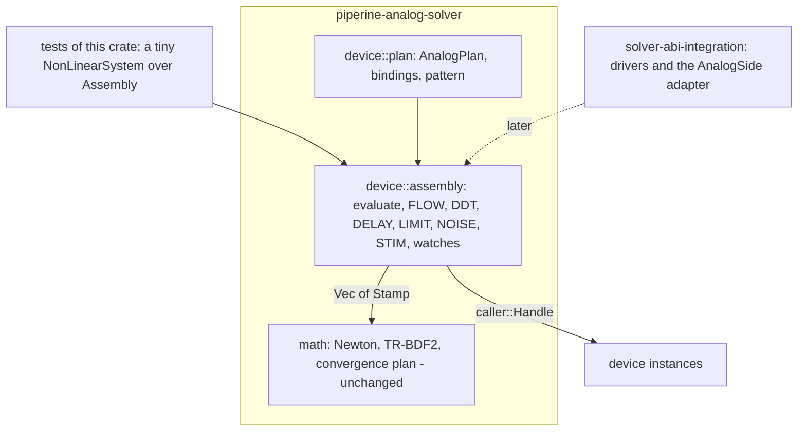
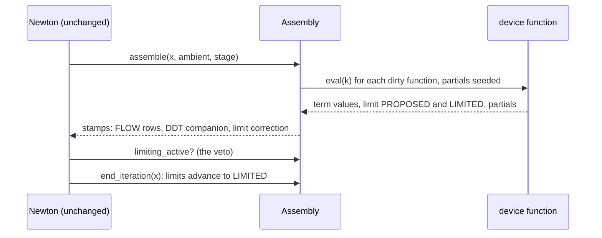

# Solver ABI Analog Design

**Spec**: `.specs/features/solver-abi-analog/spec.md`
**Status**: Draft
**Authority**: `.specs/features/device-abi/abi.md`. The numeric core (`math/newton_raphson.rs`, `math/integration.rs`, `convergence.rs`, `tolerances.rs`) is not edited by this feature.

---

## Architecture Overview

The Newton engine asks a `NonLinearSystem` for stamps. Today the owner's drivers collect them from `Element::load_*`. This feature adds, inside the analog crate, the module that will replace that source: `device`, which evaluates device functions through `piperine-abi` and turns terms and partials into the same `Stamp`s. Nothing calls it from the owner yet; its tests drive the real `NewtonRaphsonSolver` with it.

One Newton iteration through the module:

---

## Code Reuse Analysis

### Existing Components to Leverage

| Component | Location | How to Use |
| --- | --- | --- |
| Newton, damping, convergence plan | `crates/piperine-analog-solver/src/{math/newton_raphson.rs,convergence.rs}` | unchanged; the tests implement `NonLinearSystem` over `Assembly` in a few lines |
| TR-BDF2 coefficients | `math/integration.rs` (`stage_coeffs`, `phase_coeffs`) | called by the `DDT` companion exactly as the hand-written capacitor calls them |
| The capacitor's companion expression | `crates/piperine-solver/tests/helpers/devices.rs` (`impl AnalogDevice for C`, `load_transient`) | read as the reference the `DDT` stamping reproduces term for term; not edited, not imported |
| The Norton shapes | same file: `D::norton`, `conductance`, `branch_force` | the stamp positions and signs to reproduce |
| `Stamp`, `Netlist`, `AnalogReference` | `math/linear.rs`, `netlist.rs` | the assembly's output type and row addresses |
| Non-finite wording | `stamp_validation.rs` | the error's domain and family; the assembly names the cell first |
| Call path and checks | `piperine_abi::{caller::Handle, validate, verify::verify_partials}` | no `unsafe` in this crate |
| Fixture devices | `crates/piperine-abi/tests/support/examples.rs` | resistor, capacitor, diode with limiting and noise, DAC: copied into `tests/support/devices.rs` |

### Integration Points

| System | Integration Method |
| --- | --- |
| `solver-abi-integration` | builds the `AnalogPlan` in bind, points `DcSystem`/`TransientSystem`/`AcSolver`/`NoiseSolver` at `Assembly`, and implements `AnalogSide` (`crates/piperine-solver/src/protocol/sides.rs`) over the transient driver using `set_discrete`, `accept`, `snapshot`, `restore`, `samples`, `drain_traces` |
| `solver-abi-digital` | none: parallel, different crate, no shared file |

---

## Components

### `device::plan` (analog crate)

- **Purpose**: the analog half of bind.
- **Location**: `crates/piperine-analog-solver/src/device/plan.rs`
- **Interfaces**: `AnalogPlan::bind(instances: Vec<AnalogInstance>, netlist: &Netlist) -> Result<AnalogPlan, Error>` with `AnalogInstance { path, handle: Handle, pins: Vec<AnalogBinding> }` and `AnalogBinding::{Unknown(AnalogReference), Ground, Discrete(u32), Absent}` (`Discrete(i)` is a slot of the plan's own byte copy of the discrete pins its functions read, abi.md §10: "its own copy, updated only by boundary events"). `AnalogPlan::pattern() -> Vec<(AnalogReference, AnalogReference)>`.
- **Does**: `validate`; takes analog functions only (F2); resolves every read and write cell to a source or a sink; allocates slots for terms, held inputs and watches; builds the pattern as terms × partials (each term row `plus`/`minus` against each continuous pin a partial of that term names, through `LIMIT` chains `g·p`).

### `device::assembly` (analog crate)

- **Purpose**: evaluate functions and produce stamps for one solve.
- **Location**: `crates/piperine-analog-solver/src/device/{assembly,flow,ddt,limit,delay,small_signal,watch}.rs`
- **Interfaces**:
  - `Assembly::new(plan: AnalogPlan) -> Assembly`
  - `set_discrete(&mut self, slot: u32, bytes: &[u8])` (marks the functions that read it dirty)
  - `assemble_dc(&mut self, x: &[f64], amb: Ambient) -> Result<Vec<Stamp<AnalogReference, f64>>, Error>`
  - `assemble_tran(&mut self, x: &[f64], amb: Ambient, stage: Stage) -> Result<Vec<Stamp<..>>, Error>` with `Stage { phase: TrBdf2Phase, h: f64, prev_h: f64 }`
  - `assemble_ac(&mut self, op: &[f64], omega: f64) -> Result<(Vec<Stamp<AnalogReference, Complex64>>, Vec<Stamp<..>>), Error>` (matrix, stimulus right side)
  - `noise_sources(&mut self, op: &[f64], freq: f64) -> Result<Vec<NoiseColumn>, Error>` with `NoiseColumn { name, psd, rows: Vec<(AnalogReference, Complex64)> }`
  - `param_stamps(&mut self, x: &[f64], param: ParamRef, sink: &mut Vec<Stamp<..>>) -> bool` (false: no declared path, the caller falls back to a finite difference)
  - `limiting_active(&self) -> Vec<LimitState>`; `end_iteration(&mut self, x: &[f64])` (advances each limit's `x̂` to the `LIMITED` just written, `AGE = 2`)
  - `accept(&mut self, x: &[f64], amb: Ambient) -> Accepted` with `Accepted { fired: Vec<u32>, cap: f64, vars: .. }` (pushes `DDT`/`DELAY` history rows, sets `LAST`, `AGE = 1`, evaluates `VAR`, `CROSS`, `CAP`)
  - `push_stage(&mut self)`, `snapshot(&self) -> AssemblySnapshot`, `restore(&mut self, &AssemblySnapshot)`
  - `drain_traces(&mut self) -> Vec<TraceRecord>`; `samples(&self, x: &[f64]) -> Vec<f64>` (continuous pins the digital side's reactions read)
- **Evaluation (F3)**: each function keeps a hash-free dirty flag: set when a continuous pin it reads moved (bitwise compare of the read values against the last call), a discrete slot was set, an ambient it declares changed, or a held input's `VALUE` changed. A clean function's outputs and partials are reused. All partials against continuous pins and held inputs are seeded in Newton solves; partials against params are seeded only by `param_stamps`.
- **`FLOW`** (A1): for term `{plus, minus}` with value `v`, partials `g_j` against continuous pins `j`: `Matrix(plus, j, g_j)`, `Matrix(minus, j, -g_j)`, `Rhs(plus, -(v - Σ g_j·x_j))`, `Rhs(minus, +(v - Σ g_j·x_j))`. This is the Norton form the present doubles emit (`D::norton`).
- **`DDT`**: `q` is the term's value; the term keeps a history ring `q_hist` with the same depth and the same push, snapshot and restore points as the Newton state buffer (`push_stage` after each converged stage). With `(c0, c1, c2) = TrBdf2::stage_coeffs(phase, h, prev_h)`: `i = c0·q + c1·q_hist[1] + c2·q_hist[2]`; in the trapezoidal phase with `prev_h > 0`, with `(d0, d1, d2) = TrBdf2::phase_coeffs(Bdf2, prev_h)`: `i -= d0·q_hist[1] + d1·q_hist[2] + d2·q_hist[3]`. Stamps: `Matrix(plus, j, c0·∂q/∂x_j)`, `Rhs(plus, c0·Σ(∂q/∂x_j·x_j) − i)`, mirrored on `minus`. Nothing when `h ≤ 0` or in an equilibrium solve. This is `C::load_transient` with `q_hist` in place of `c·v(row)`.
- **`LIMIT`** (A2, A3): per limit the assembly holds `x̂`, `LAST`, `AGE`. A reader's term linearizes at `x̂`: Jacobian `g·p_j`, right side from `v(x̂) + g·(x − x̂)` with `x = PROPOSED`. Veto: `abs(x̂ − x) > 1e-6 + 1e-4·abs(x)` (Appendix C.2). `OWNS_CORRECTION`: the function's own values and total partials are stamped as plain `FLOW`/`DDT`; only the veto applies.
- **`DELAY`**: history of `(t, v)` at accepted points, pruned beyond `max`; linear interpolation at `t − td`; equilibrium: `v`; AC: `exp(−jω·td)`.
- **Watches**: `VAR` values stored at `accept`; `CROSS` compares the value at this accept with the last accept (`≤ 0` to `> 0`); `CAP` is the minimum of the values; `TRACE` records are appended at every evaluation with the iteration number and are not part of the snapshot (A5: delivered "whatever happens to the step").

---

## Numerically sensitive work

A task marked sensitive decides a number the drivers will use. Its tests assert stamps against values computed by hand in the test (never by calling the code under test), and solve an analytic circuit with the real Newton engine.

| What | Why it is sensitive | Guard in this feature |
| --- | --- | --- |
| `FLOW` stamping | every resistive stamp | hand-computed diode stamps; divider to 1e-12; diode equation |
| `DDT` companion and history | the integrator's inputs; `parity_baseline` pins a step count of 161 downstream | both phases, with and without `prev_h`, against `stage_coeffs` and `phase_coeffs`; RC step against `1 − exp(−t/RC)` |
| `LIMIT` | Newton's path on junctions | hand-computed correction; the limited diode reaches the unlimited operating point |
| Small-signal and noise | complex assembly | each operator's weight; RC corner; a shared noise input cancels |

The differential test against `Element` circuits (1e-12, equal step counts) is in `solver-abi-integration`, the first place where a driver uses this module.

---

## Error Handling Strategy

| Error Scenario | Handling | User Impact |
| --- | --- | --- |
| a non-finite value or seeded partial | `Error` naming instance, cell and `origin` | the bad contribution is named before the matrix is touched |
| an analog bind rule fails | `Error` naming the entry (after `piperine_abi::validate`) | fails at build |
| a device returns `FAULT` | `Error` with the device's code, message and the instance path | the device's own code reaches the host |
| a `DELAY` beyond `max` | `Error` naming instance and term | no silent extrapolation |
| a test misses an analytic value | stop; the assembly is wrong | no tolerance is tuned |

---

## Risks & Concerns

| Concern | Location (file:line) | Impact | Mitigation |
| --- | --- | --- | --- |
| The companion must match a formula that lives in a test helper of another crate | `crates/piperine-solver/tests/helpers/devices.rs:399` (`C::load_transient`) | a sign or lookback error moves every transient number downstream | T4's test recomputes the expected stamps from `stage_coeffs`/`phase_coeffs` on a four-row history, row for row as that function reads `states.view(k)`; integration's differential test is the second net |
| The history ring must rotate with the Newton state buffer, which this crate's drivers do not own | `math/newton_raphson.rs` (`state_snapshot`, `restore_state`) | a missed push or restore desynchronizes `q` from `x` | the ring has explicit `push_stage`, `snapshot`, `restore`; the tests drive them at the same points the transient driver uses today; integration wires them next to the Newton calls |
| No present device uses a limiter, a delay or correlated noise | `crates/piperine-solver/tests/helpers/devices.rs` | new code with no numeric baseline | analytic tests (see the table above) |
| abi.md gives the limiting tolerance only by reference to the solver | abi.md §4.3; `docs/spec/appendix_c_implementation.md` C.2.1 | the veto's threshold could drift | one constant, `1e-6 + 1e-4·abs(x)`, asserted at both sides |
| The crate was dependency-free in the tree | `crates/piperine-analog-solver/Cargo.toml` | the guard of MD-60 | MD-61 and the guard change land in `solver-abi-core` T10; this feature edits no file of the owner |
| `F3` compares read values bitwise | design `Evaluation` | a function that depends on something it did not declare would go stale | F1 makes that a device bug; the fixture `counting` device asserts the call counts |

---

## Tech Decisions (only non-obvious ones)

| Decision | Choice | Rationale |
| --- | --- | --- |
| Where stamps are made | this crate, returning the existing `Stamp` type | Newton and the linear layer stay untouched |
| Term history | a ring with the depth of the Newton state buffer and explicit push, snapshot and restore | reproduces today's `states.view(k)` lookbacks; correct when a param changes mid-run |
| Limiting | abi.md A2 only | one form; the device no longer names a net to clamp |
| Discrete reads | byte slots owned by the assembly | no digital type; the owner copies boundary values in |
| Tests | integration targets under `crates/piperine-analog-solver/tests/` | the checks cite plain test names; the 24 unit tests of the library stay as they are |
| Module path | `src/device/` | new code only; no existing file of the crate is edited except `lib.rs` and `Cargo.toml` |
