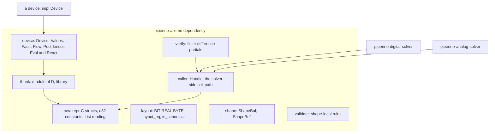
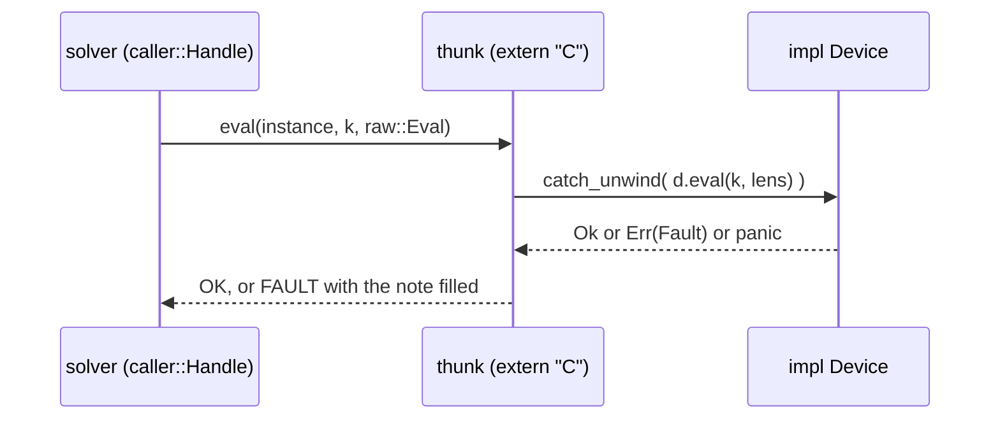

# Solver ABI Core Design

**Spec**: `.specs/features/solver-abi-core/spec.md`
**Status**: Draft
**Authority**: `.specs/features/device-abi/abi.md`. Where this document and abi.md disagree on the C layout, abi.md wins and the design is wrong.

---

## Architecture Overview

One new leaf crate. A device links against it and nothing else; the two sub-solvers read shapes and call devices through it. Beside it, one new module of the owner: the protocol, over two traits (see Components, `protocol`).

A call, end to end:

---

## Code Reuse Analysis

### Existing Components to Leverage

| Component | Location | How to Use |
| --- | --- | --- |
| The struct text of the ABI | `.specs/features/device-abi/abi.md` §3 | copied field for field into `raw.rs`; the test compares sizes and offsets with a hand-written C-layout table |
| Worked examples | abi.md §11.1 to §11.6 | become the fixture devices of `tests/examples.rs`, constant for constant |
| Structural guards | `crates/piperine-solver/tests/crate_boundaries.rs`, `workspace_shape.rs` | extended, not replaced: same scan helpers, one new allowed dependency |
| Hygiene guard | `crates/piperine-lang/tests/suite_hygiene.rs` | walks the new crate with no registration; every new target opens with `//!` |

### Integration Points

| System | Integration Method |
| --- | --- |
| Workspace | `members` and `default-members` gain `crates/piperine-abi` |
| `solver-abi-digital`, `solver-abi-analog` (parallel) | depend on `piperine-abi`; start bind with `validate`, call devices through `caller::Handle`; shape their facade (`Digital`, `Assembly`) so a thin adapter implements `DiscreteSide` or `AnalogSide` |
| `solver-abi-integration` | implements the two traits for the real sub-solvers, binds, calls `Protocol` from the drivers |
| Codegen features (`ir-interp`, `ir-rust`) | implement `Device`; test with `verify_partials` |

---

## Components

### `raw`

- **Purpose**: the C contract, and nothing else.
- **Location**: `crates/piperine-abi/src/raw.rs`
- **Interfaces**: `Str`, `Bytes`, `List<T>`, `Library`, `Module`, `Value`, `Created`, `Instance`, `Note`, `Shape`, `Pin`, `Layout`, `Field`, `Term`, `Input`, `Watch`, `Cell`, `Partial`, `Function`, `Reaction`, `Statement`, `Eval`, `React`, `Host`, all `#[repr(C)]`, public fields. Constants as `pub const NAME: u32` grouped in plain modules: `kind` (`CONTINUOUS`, `DISCRETE`, `EVENT`), `role`, `global`, `pin_flag`, `leaf`, `field_flag`, `op` (`FLOW`, `DDT`, `DELAY`), `input` (`LIMIT`, `NOISE`, `STIM`), `watch` (`VAR`, `CROSS`, `CAP`, `TRACE`), `cell` (`PIN`, `TERM`, `INPUT`, `WATCH`, `AMBIENT`), `part` (`VALUE`, `PREVIOUS`, `CHANGED`, `TIME`, `LAST`, `AGE`, `PROPOSED`, `LIMITED`, `PSD`, `RE`, `IM`), `ambient` (`TIME`, `FREQ`, `STATIC`, `GMIN`, `SOURCE_SCALE`, `TICK`, `HORIZON`), `fn_flag` (`OWNS_CORRECTION`), `reaction_flag` (`IRREVERSIBLE`), `statement_flag` (`LATER`, `REPLACE`), `status` (`OK`, `FAULT`, `RESHAPE`, `FINISH`), `GROUND`, `DEFAULT`, `MAJOR = 1`, `MINOR`, `SYMBOL = "piperine_abi_1"`. `List<T>::get(i)` and `iter()` read by `stride`; `Str::as_str`, `Bytes::as_slice`.
- **Dependencies**: `core`, `std::ffi::c_void`.
- **Notes**: values of the constants are assigned once here, starting at 1 so that 0 is never a valid kind (an all-zero struct is caught as "unknown constant"). `unsafe impl Send + Sync` for the raw structs: they are immutable plain data once frozen (abi.md §3 "immutable description").

### `layout`

- **Purpose**: the shipped layouts and the two byte rules the solver needs.
- **Location**: `crates/piperine-abi/src/layout.rs`
- **Interfaces**: `pub static BIT: Layout` (`{ v: BOOL @0, known @1 }`, size 2), `REAL` (`F64 @0`, known @8, size 16, align 8), `BYTE` (`U8 @0`, known @1); `LOW`, `HIGH` byte constants; `layout_eq(&Layout, &Layout) -> bool` (P4); `is_canonical(&Layout, &[u8]) -> bool` (P3); `leaf_size(leaf) -> Option<usize>`.

### `shape`

- **Purpose**: let Rust code build a shape as data and keep its lists alive.
- **Location**: `crates/piperine-abi/src/shape.rs`
- **Interfaces**: `ShapeBuf::new()`; `pin(PinSpec) -> u32`, `term(TermSpec) -> u32`, `input(..)`, `watch(..)`, `function(FunctionSpec) -> u32`, `reaction(ReactionSpec) -> u32` (each spec is a plain struct with `&str` names and `Vec`s; the index returned is the entry's index); `freeze(self) -> ShapeRef`; `ShapeRef = Arc<ShapeBuf>`; `ShapeBuf::as_raw(&self) -> *const Shape`; `ShapeBuf::shape(&self) -> &Shape`.
- **Notes**: `freeze` moves every string and list into boxed storage owned by the `ShapeBuf` and only then writes the pointers, so nothing reallocates afterwards. The prototype of a device is a `ShapeRef` held in a `OnceLock`.

### `device`

- **Purpose**: the Rust side of abi.md §7.
- **Location**: `crates/piperine-abi/src/device.rs`
- **Interfaces**:
  - `pub trait Device: Sized + Send + 'static { fn prototype() -> &'static Shape; fn create(values: &Values<'_>) -> Result<(Self, ShapeRef), Fault>; fn eval(&self, k: u32, cx: &mut Eval<'_>) -> Result<(), Fault>; fn react(&self, k: u32, cx: &mut React<'_>) -> Result<Flow, Fault>; }`
  - `Values`: `get(pin) -> Option<&[u8]>`, `f64(pin) -> Option<f64>`.
  - `Fault { code: u32, message: String }`; `Flow::{Continue, Finish}`.
  - `unsafe trait Pod`, implemented by hand for `bool`-free leaves (`u8`..`u64`, `i8`..`i64`, `f32`, `f64`) and `[T; N]`.
  - lens `Eval<'a>`: `f64(i)`, `u8(i)`, `bool(i)`, `i64(i)`, `bytes(i)`, `get::<T: Pod>(i) -> Option<&T>`, `out::<T: Pod>(j) -> Option<&mut T>`, `out_bytes(j)`, `set(j, f64)`, `wanted(p) -> bool`, `jac() -> &mut [f64]`. Lens `React<'a>`: the read accessors plus `commit(statement, bytes, after) -> Result<(), Fault>`.
- **Notes**: a lens borrows the frame and the `Function` or `Reaction` entry of the instance's shape, which is how it knows the byte length of each cell (pin layout size; 8 for a real part; 1 for `CHANGED`, `AGE`). `default` methods `eval` and `react` are not provided: a device with no reaction writes `Ok(Flow::Continue)`.

### `thunk`

- **Purpose**: the generic `extern "C"` entry points.
- **Location**: `crates/piperine-abi/src/thunk.rs`
- **Interfaces**: `pub fn module<D: Device>(name: &'static str) -> Module`; `pub fn library(name: &'static str, build: &'static str, modules: &'static [Module]) -> Library`.
- **Notes**: the instance is `Box<Inst<D>>` with `Inst { device: D, shape: ShapeRef }`, cast to `*mut Instance`. Each thunk wraps the method in `catch_unwind(AssertUnwindSafe(..))`; a panic payload that is a `&str` or `String` goes to the note. `create` decodes `List<Value>` into `Values` after checking each `pin` is a `PARAM` pin of the prototype.

### `caller`

- **Purpose**: the one `unsafe` call path of the solver side.
- **Location**: `crates/piperine-abi/src/caller.rs`
- **Interfaces**: `Handle::create(module: &'static Module, values: &[(u32, &[u8])]) -> Result<Handle, CallError>`; `handle.shape() -> &Shape`; `handle.eval(k, input: &[*const u8], output: &[*mut u8], seed: &[u8], jac: &mut [f64]) -> Result<(), CallError>`; `handle.react(k, input: &[*const u8], commit: &mut dyn FnMut(Commit<'_>) -> u32) -> Result<Flow, CallError>`; `Drop` calls `destroy`. `CallError { status: u32, code: u32, message: String }` (`status` is `FAULT` or `RESHAPE`). `Commit { statement, offset, bytes, after }`.
- **Notes**: `react` passes a `Host` whose `commit` trampolines into the closure through `host_data`. `Handle` is `Send`, not `Sync` (abi.md §12: no two calls on one instance overlap).

### `validate`

- **Purpose**: the shape-local rules of abi.md §9.
- **Location**: `crates/piperine-abi/src/validate.rs`
- **Interfaces**: `validate(&Shape) -> Result<(), ShapeError>`; `ShapeError { rule: Rule, entry: String, origin: String }`; `Rule` is a plain enum with one variant per rule of the spec's list, `Display` giving the rule's sentence.
- **Notes**: it reads lists only through `List::get`, checks indices before following them, and interprets no constant before checking it is known.

### `verify`

- **Purpose**: the verifier of abi.md §8.
- **Location**: `crates/piperine-abi/src/verify.rs`
- **Interfaces**: `verify_partials(handle: &Handle, k: u32, input: &[Vec<u8>], rel_tol: f64) -> Verdict`; `Verdict::{Exact, Skipped { limit: u32 }, Mismatch(Vec<Mismatch>)}`; `Mismatch { partial: u32, declared: f64, finite: f64 }`.
- **Notes**: central difference with step `1e-6 * max(1, |x|)` on the `F64` at byte `at` of `reads[read]`; all partials seeded for the analytic call. A partial against a `LIMIT` input's `VALUE` is perturbed like any read.

### `protocol` (owner crate)

- **Purpose**: abi.md §5 and §10 as orchestration over two traits. Nothing calls it until `solver-abi-integration`; it is proven on stubs.
- **Location**: `crates/piperine-solver/src/protocol/{sides.rs, transient.rs, operating_point.rs, sink.rs, host.rs, mod.rs}`
- **Interfaces** (plain data only: ticks `i64`, net and slot ids `u32`, bytes, `f64`):
  - `trait DiscreteSide { type Mark; fn start(&mut self) -> Result<()>; fn next_due(&self) -> Option<i64>; fn advance(&mut self, to: i64) -> Result<Advance>; fn preview_boundary(&self, at: i64) -> Result<Vec<Boundary>>; fn fire(&mut self, net: u32, at: i64) -> Result<()>; fn run_instant(&mut self, at: i64, samples: &[f64], limit: i64, mode: InstantMode) -> Result<Outcome>; fn mark(&self) -> Self::Mark; fn restore(&mut self, mark: &Self::Mark); fn shadow(&self, net: u32, offset: u32, bytes: &[u8]) -> Result<Shadow>; fn host_commit(&mut self, net: u32, offset: u32, bytes: &[u8], at: i64) -> Result<()>; fn drain(&mut self, out: &mut Vec<Observation>); }`
  - `Advance::{Reached, Landing { tick: i64, time_point: bool }, Final(i64)}`; `Boundary { slot: u32, bytes: Vec<u8> }`; `InstantMode { is_static: bool, settle: bool }`; `Outcome { boundary: Vec<Boundary>, host_param_write: bool, finish: bool }`; `Shadow::{Accept, Refused { check: String }, Reshape { instance: String }}`.
  - `trait AnalogSide { type Mark; fn has_unknowns(&self) -> bool; fn propose(&mut self, now: f64, stop: f64) -> f64; fn deliver(&mut self, boundary: &[Boundary]); fn attempt(&mut self, to: f64, exempt: bool) -> Result<Attempt>; fn accept(&mut self, restart: Restart) -> Result<Accepted>; fn equilibrium(&mut self) -> Result<Accepted>; fn mark(&self) -> Self::Mark; fn restore(&mut self, mark: &Self::Mark); fn drain_traces(&mut self, out: &mut Vec<Observation>); }`
  - `Attempt::{Converged, Rejected, LandedEarlier(f64)}`; `Restart::{None, Integrator, IntegratorSmall}`; `Accepted { fired: Vec<u32>, samples: Vec<f64> }`.
  - `Protocol::new(discrete, analog, ProtocolOptions { seconds_per_tick, max_rounds: 20 })`; `operating_point(&mut self) -> Result<()>`; `transient(&mut self, stop: f64) -> Result<Ended>` with `Ended::{StopTime, Finish(f64)}`; `set(&mut self, net, offset, bytes, at: Option<f64>) -> Result<SetOutcome>`; `on_event(&mut self, net: u32, waiter: Box<dyn FnMut(&mut HostCx)>)`; `with_sink(Box<dyn Sink>)`.
  - `trait Sink { fn observe(&mut self, o: &Observation); }`; `Observation { path: String, analysis: AnalysisKind, time: f64, kind: ObservationKind }` with kinds change, commit, crossing, record, trace (with the Newton iteration).
- **The transient loop** (one landing): `C = (discrete.mark(), analog.mark(), sink mark)`; `t_c = analog.propose`; `discrete.advance(tick(t_c))`, a `Landing` or `Final` shortens `t_c`; `analog.deliver(discrete.preview_boundary(t_c))`; `analog.attempt(t_c, exempt)`; on `Rejected` or `LandedEarlier` restore `C` and loop (a `Final` mark is dropped); on `Converged` call `analog.accept(restart of the previous landing)`, `discrete.fire` each fired crossing, `discrete.run_instant(t_c, samples, ..)` with `settle` when the landing is a time point, deliver its `boundary` to the analog side and remember the restart it asks for; drain observations to the sink; take the new `C`. A waiter is called from inside `run_instant`'s place in the loop, never during `advance` (the discrete side stops before it, as for any irreversible reaction).
- **Dependencies**: `piperine_analog_solver::error::Error` for the error type only (the existing `Result` of the owner). No other sub-solver item; a guard test scans the module.
- **Stubs**: `crates/piperine-solver/tests/support/stub_sides.rs`: a `ScriptedDiscrete` (a list of instants with what each changes, fires and returns) and a `ScriptedAnalog` (a list of attempt results); both record every call in order. Plain structs, no macro.

---

## Error Handling Strategy

| Error Scenario | Handling | User Impact |
| --- | --- | --- |
| a device panics | `catch_unwind`; `FAULT`, message in the note | the solver reports instance and message; the process lives |
| a device returns `Fault` | `FAULT`, `note.code = fault.code` | the device's own code reaches the host |
| a shape breaks a shape-local rule | `ShapeError` naming rule, entry, `origin` | the author reads `file:line:col` of the offending item |
| `Host.commit` refuses | `cx.commit` returns `Err(Fault)` with the status | the reaction propagates it with `?` |
| a typed access does not fit the cell | `None` | the device decides; no out-of-bounds read exists |
| operating-point rounds exceed the bound | `E0506` naming the nets the last instant still changed | no silently wrong operating point |
| a host write is refused (`check`, `RESHAPE` in a transient) | `SetOutcome::Refused` with the reason; nothing committed | the run continues |
| either side returns an error inside the protocol | restore to the last accepted mark is not attempted; the error is returned with the time | the analysis ends with the side's own typed error |

---

## Risks & Concerns

| Concern | Location (file:line) | Impact | Mitigation |
| --- | --- | --- | --- |
| abi.md was never compiled; two Rust-side signatures cannot be written as printed | abi.md §7 (`Arc<Shape>`, `const fn module`) | the trait differs from the document | the C layout is untouched; T9 edits abi.md §7 to the compiled signatures in the same commit |
| A guard forbids any workspace dependency under a sub-solver | `crates/piperine-solver/tests/crate_boundaries.rs` (`sub_solvers_depend_on_no_workspace_crate`) | the next feature's first manifest edit would fail it | T10 changes the guard to "`piperine-abi` only" and records MD-61 |
| abi.md does not say what `get::<T>` returns `None` for | abi.md §7, §12 | lens behavior is under-specified | SAC-06 AC 6 fixes one rule: `None` when `T` does not fit the cell |
| The numeric values of the constants, and the field offsets of `REAL` and `BYTE`, are not in abi.md | abi.md §3, §3.1 P3 | two producers could disagree | `raw.rs` and `layout.rs` are the single assignment; tests pin every value; T2 writes the two layouts into abi.md §3.1 |
| abi.md §5 step 5 runs the landing instant after the solve; the kept algorithm lets the arriving step read what is due at microstep 0 | abi.md §5; `transient.rs:944` (`attempt_step` runs the digital side before the solve) | two readings of one protocol | `preview_boundary` (pure, on a copy) before the attempt, the real instant after acceptance; deterministic, so both see the same bytes. `spec-abi-amendments` writes the same rule into §15.2 |
| The traits are fixed before either implementer exists | design `protocol` | a signature that does not fit a sub-solver blocks the parallel features | the signatures use plain data; the interfaces of `solver-abi-digital` (`Digital`) and `solver-abi-analog` (`Assembly`) were designed with them; a change needed later is made in `solver-abi-integration`, the only feature that sees all three |
| `unsafe` is concentrated in three files | `raw.rs` (`List::get`), `thunk.rs`, `caller.rs` | a layout mistake is undefined behavior | the layout test, the examples through real thunks, and no `unsafe` outside those files (a hygiene-style scan test in `tests/contract.rs`) |

---

## Tech Decisions (only non-obvious ones)

| Decision | Choice | Rationale |
| --- | --- | --- |
| Where `validate`, `verify` and `caller` live | in `piperine-abi` | a device author runs the checks with no solver; both sub-solvers share one call path |
| Shape ownership | `ShapeRef = Arc<ShapeBuf>` | "a library returns the same shape to every instance of equal structure"; the shape lives until its last instance |
| Constants start at 1 | 0 is always "unknown constant" | zeroed memory never passes validation |
| Tests | integration targets under `crates/piperine-abi/tests/`, one per concern | the checks cite plain test names; the public surface is what is tested |
| The protocol's home | a module of the owner over two traits with plain-data signatures | the sub-solvers stay independent of the owner; the adapters are written in `solver-abi-integration` |
| Project-level decision | MD-61 appended to `.specs/STATE.md` by T10 | `piperine-abi` under the three solver crates amends MD-60's "no in-tree crate sits under any of them" |
