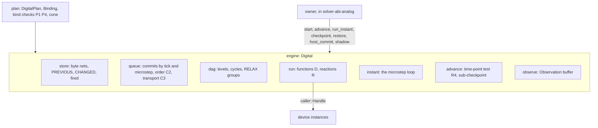
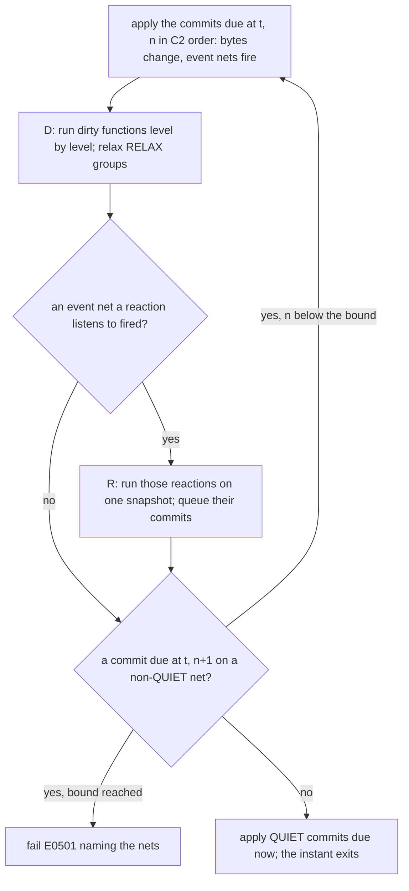
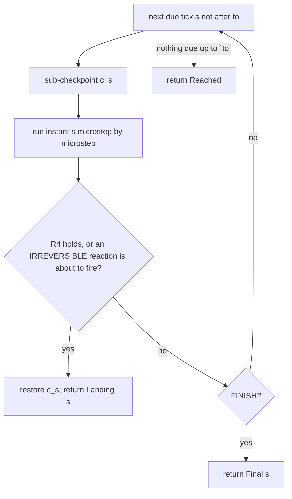

# Solver ABI Digital Design

**Spec**: `.specs/features/solver-abi-digital/spec.md`
**Status**: Draft
**Authority**: `.specs/features/device-abi/abi.md` (rule names P, F, R, C, D below are its own).

---

## Architecture Overview

A new engine in `piperine-digital-solver`, beside the old one. It takes a `DigitalPlan` (instances already created, each pin bound to a net id) and exposes one value, `Digital`. The old modules (`drivers`, `events`, `interface`, `scheduler`, `state`, `topology`) are not edited.

One instant:

`advance(to)`, the digital half of protocol step 2 of abi.md §5:

---

## Code Reuse Analysis

### Existing Components to Leverage

| Component | Location | How to Use |
| --- | --- | --- |
| The call path | `piperine_abi::caller::Handle` | every `eval` and `react`; no `unsafe` in this crate |
| Shape checks | `piperine_abi::validate` | first step of `DigitalPlan::bind` |
| Layout rules | `piperine_abi::layout::{layout_eq, is_canonical}` | P4 at bind; P3 on every write in debug builds |
| Limits and error type | `crates/piperine-digital-solver/src/limits.rs`, `error.rs` | `DigitalLimits::max_delta_cycles` (1000) is the microstep bound; `DigitalError` gains typed variants, its two present variants and their `Display` stay |
| DAG order idea | `crates/piperine-digital-solver/src/topology.rs` | read for the Kahn ordering; not called, not edited |
| Fixture devices | `crates/piperine-abi/tests/support/examples.rs` (flip-flop, comparator) | copied into this crate's `tests/support/devices.rs` and extended |

### Integration Points

| System | Integration Method |
| --- | --- |
| `solver-abi-analog` (the owner) | builds the `DigitalPlan` in its bind step, holds one `Digital`, drives it with `start`, `advance`, `run_instant`, `checkpoint`, `restore`, `host_commit`, `shadow`, `drain_observations` |
| The old engine | none: no shared type, no shared file |

---

## Components

All under `crates/piperine-digital-solver/src/abi/` so the old and new engines never share a module path. `lib.rs` gains `pub mod abi;`.

### `tick`

- **Purpose**: integer time.
- **Interfaces**: `Tick(pub i64)`; `Resolution { seconds_per_tick: f64 }` (default `1e-15`); `Resolution::tick_of(seconds) -> Result<Tick, DigitalError>` (nearest, `E0502` outside the range); `Resolution::due(now: Tick, after: f64) -> Result<Due, DigitalError>` with `Due::{NextMicrostep, At(Tick), Never}` (C1: `after ≤ 0` or no advance, finite positive, `+inf`; NaN is `E0435`).

### `plan`

- **Purpose**: the input contract and the discrete half of bind.
- **Interfaces**:
  - `NetId(u32)`; `NetSpec { name: String, size: u32, align: u32, kind: Discrete | Event, quiet: bool, record: bool, relax: bool, analog_reads: bool, structural: bool, init: Vec<u8> }`.
  - `Binding::{Net(NetId), Sample(u32), Absent}`: a discrete or event pin on a net; a continuous pin read by a reaction, as an index into the owner's sample vector; an unbound `OPTIONAL` pin.
  - `InstancePlan { path: String, handle: Handle, pins: Vec<Binding> }` (functions and reactions are read from `handle.shape()`; only discrete functions are taken).
  - `DigitalPlan::bind(nets: Vec<NetSpec>, instances: Vec<InstancePlan>, resolution: Resolution) -> Result<DigitalPlan, DigitalError>`.
- **Bind does**: `validate` each shape; P1 (derive each net's writer: the function whose `writes` names it, else the instance whose statements name it, else the host; two is an error naming both); P4; `GLOBAL` not `OPTIONAL` and `Absent` is an error; drop `LATER` where `min_after` is under one tick (C1); build the `Dag`; compute the parameter cone (P6: functions all of whose inputs derive, through functions only, from nets whose writer is the host and whose pin role is `PARAM` or `GLOBAL`); compute the static reachability set for R4 (nets and reactions that reach an `analog_reads` net or a reaction with a `Sample` read).

### `store`

- **Purpose**: the bytes.
- **Interfaces**: `Store::new(&[NetSpec])`; `value(net) -> &[u8]`, `previous(net) -> &[u8]`, `changed(net) -> bool`, `fired(net) -> bool`; `write(net, offset, bytes) -> bool` (returns whether the bytes differ; on a change copies the old bytes to `previous` and stamps the microstep); `fire(net)`; `begin_microstep()` (clears the `changed` and `fired` stamps of the last one); `Clone`.
- **Notes**: one aligned allocation per net (the largest `align` is honored by over-aligning to 16); `changed` and `fired` are a microstep stamp compared with a counter, so clearing is one increment. A `QUIET` net keeps no `previous`.

### `queue`

- **Purpose**: pending commits.
- **Interfaces**: `Pending { net, offset, bytes, writer: Writer, statement: u32, made: (Tick, u32), call: u32, due: (Tick, u32) }` with `Writer::{Host, Reaction { instance: u32, reaction: u32 }}`; `push(pending, replace: bool)` (C3 transport removal first, then insert); `next_due() -> Option<(Tick, u32)>`; `take_due(at: (Tick, u32)) -> Vec<Pending>` sorted by (made, statement, call) (C2); `Clone`.
- **Notes**: a `BTreeMap<(Tick, u32), Vec<Pending>>`. "Never" commits are not stored. Transport compares `(writer, statement)` and byte-range overlap, and removes entries with `due ≥` the new one's.

### `dag`

- **Purpose**: the levelized order.
- **Interfaces**: `Dag::build(functions: &[FnNode]) -> Result<Dag, DigitalError>` with `FnNode { instance, k, reads: Vec<NetId>, writes: Vec<NetId> }`; `Dag::order() -> &[Step]` with `Step::{Run(fn), Relax { fns: Vec<fn>, nets: Vec<NetId> }}`; `Dag::readers(net) -> &[fn]`.
- **Notes**: edges go from a function to every function that reads a net it writes. Tarjan's strongly connected components; a component of more than one function (or a self-loop) is legal only if every net on its internal edges is `RELAX`, and becomes one `Relax` step; otherwise bind fails naming its functions. Components are emitted in topological order.

### `run`

- **Purpose**: call the devices.
- **Interfaces**: `run_functions(plan, store, dirty: &mut DirtySet, obs) -> Result<(), DigitalError>` (D); `run_reactions(plan, store, samples, ambient: Ambient, queue, obs) -> Result<Fired, DigitalError>` (R) with `Ambient { tick, time, is_static, horizon }` and `Fired { finish: bool, irreversible: bool }`.
- **D**: a function is dirty when a net it reads changed in this microstep, or at the first instant. Walk `Dag::order()`: for a dirty `Run`, build the frame (inputs are pointers into the store: `VALUE`, `PREVIOUS`, the one-byte `CHANGED`; outputs are scratch buffers pre-filled with the current bytes), call `Handle::eval`, write each output back through `Store::write`; a change marks the readers dirty. A `Relax` step zeroes its nets, then repeats its functions until no write changes a byte, at most `nets.len() + 1` passes; then applies D1 to what still moves. Discrete functions get no seed and no `jac` in this feature (their partials are read by `sens` in `solver-abi-analog`; the frame passes an all-zero seed).
- **R**: collect the reactions with a fired net in `on`; copy every cell any of them reads into one snapshot buffer (R2); call each; each `commit` goes through the range check, `Resolution::due`, the `LATER` bound check, then `Queue::push`, and one `Observation::Commit`. A reaction that ran because the `SETTLE` net fired and makes a `NextMicrostep` commit fails loud (SAD-12).

### `instant`, `advance`, `engine`

- **Purpose**: the microstep loop, the look-ahead and the facade.
- **Interfaces** (`Digital`):
  - `Digital::new(plan: DigitalPlan, limits: DigitalLimits) -> Digital`
  - `start(&mut self) -> Result<(), DigitalError>`: zero, drop, commit every `init` at `(0, 0)`, fire `START` at `(0, 0)`.
  - `next_due(&self) -> Option<Tick>`
  - `advance(&mut self, to: Tick) -> Result<Advance, DigitalError>` with `Advance::{Reached, Landing(Tick), Final(Tick)}`
  - `run_instant(&mut self, at: Tick, samples: &[f64], limit: Tick, mode: Mode) -> Result<Outcome, DigitalError>` with `Mode { is_static: bool, settle: bool }` and `Outcome { boundary: Vec<NetId>, fired: Vec<NetId>, finish: bool }`; `settle` fires the `SETTLE` net after the loop exits and runs its reactions.
  - `preview_boundary(&self, at: Tick) -> Result<Vec<(NetId, Vec<u8>)>, DigitalError>`: on a copy, apply the commits due at `(at, 0)` and run D; return the bytes of every `analog_reads` net. The owner hands them to the analog side before the solve that arrives at `at` (the kept algorithm: the arriving step reads what is due at microstep 0). No reaction runs, nothing is observed.
  - `checkpoint(&self) -> Checkpoint` (clone of store, queue, microstep counters and the observation count); `restore(&mut self, &Checkpoint)`.
  - `host_commit(&mut self, net: NetId, offset: u32, bytes: &[u8], at: Tick) -> Result<(), DigitalError>`; `shadow(&self, net, offset, bytes) -> Result<Shadow, DigitalError>` with `Shadow::{Accept, Refused { check: String }, Reshape { instance: String }}`.
  - `read(&self, net) -> &[u8]`; `drain_observations(&mut self) -> Vec<Observation>`.
- **R4 inside `advance`**: after each microstep of instant `s`, test: a net with `analog_reads` changed; or a reaction about to run has a `Sample` read; or a reaction about to run has a non-`LATER` statement whose net is in the static reachability set; or a reaction about to run is `IRREVERSIBLE`. On the first hit restore `c_s` and return `Landing(s)`. The test runs before `run_reactions`, so no reaction that reads the analog side and no irreversible one ever runs inside `advance`.
- **`HORIZON`**: `min(queue.next_due() tick, limit) - 1`, never below the current tick.

### `observe`

- **Interfaces**: `Observation::{Change { net, at: (Tick, u32), bytes }, Fire { net, at }, Commit { instance, reaction, statement, made, due }, Record { stream: String, at, bytes }, Unsettled { net, at }}`. A `Record` is emitted when a commit to a `record` net is made (C5), with the stream `<instance path>.<pin name>`. Within one microstep observations are sorted by (instance path, statement index) before they are appended.

---

## Error Handling Strategy

| Error Scenario | Handling | User Impact |
| --- | --- | --- |
| an instant does not go quiet | `DigitalError::NotQuiet { code: "E0501", tick, nets }` | the oscillating nets are named |
| a time outside the tick range, a NaN delay | `TickRange { code: "E0502" }`, `NanDelay { code: "E0435", instance, statement }` | typed, no string parsing |
| a device faults, or returns `RESHAPE` outside the cone | `Fault { code, message, tick, instance }` | the device's own code reaches the host |
| a bind rule fails | `Bind { rule, pins or functions }` | both offenders are named |
| a commit breaks its statement's range or `LATER` bound | `Fault` built by the engine, naming instance, reaction, statement | a generator bug is found at its first commit |
| a settle commit with no delay | `Unsupported { what: "settle commit" }` | fail loud until `solver-time-point` |

---

## Risks & Concerns

| Concern | Location (file:line) | Impact | Mitigation |
| --- | --- | --- | --- |
| The old engine shares the crate and is live | `crates/piperine-digital-solver/src/{scheduler,state,topology,drivers,events,interface}.rs` | an edit there would change the owner's behavior before the switch | new code lives under `src/abi/`; SAD-21 and its check: `git diff` of the old files is empty and the 27 tests pass |
| `checkpoint` clones the whole store and queue per instant inside `advance` | design `advance` | quadratic cost on big designs with dense events | accepted: this engine is the reference; the clone is behind one function so a journal can replace it |
| R4's third clause needs static reachability over nets, functions and statements | abi.md R4 | a missed edge lets a reaction that reaches the analog side run ahead | computed once at bind as a fixed point; a unit test per edge kind (statement to net, net to function, function to net, net to `on`) |
| D1's "log pin" has no representation in the shape | abi.md §9 D1, §14.6 | the record cannot be routed to a pin | `Observation::Unsettled`; reported as an ABI gap |
| abi.md does not say whether `START` and `init` commits are observed as changes | abi.md §9 | a sink could see or miss the initial values | they are observed: they are commits at `(0, 0)` like any other (C6) |
| The sub-solver crates were dependency-free | `crates/piperine-digital-solver/Cargo.toml` | the guard of MD-60 | MD-61 and the guard change land in `solver-abi-core` T10 before this feature starts |

---

## Tech Decisions (only non-obvious ones)

| Decision | Choice | Rationale |
| --- | --- | --- |
| Module path | `src/abi/` | old and new never collide; the switch feature deletes the old files and may flatten the path |
| Who binds | the plan takes net ids from the owner and does the discrete checks itself | the owner knows the netlist; the discrete rules (P1, P4, cycles, cone) belong to the engine that enforces them |
| Dirty-driven functions | a function runs only when a read net changed | F3; it is also what makes a free-running clock cheap |
| The time-point test runs before reactions | `advance` stops before a reaction that touches the analog side runs | R6: an irreversible reaction is never undone; a probing reaction needs the accepted solution |
| No analog type | continuous reads are `f64` samples by index | MD-60: the sub-solvers never see each other |
