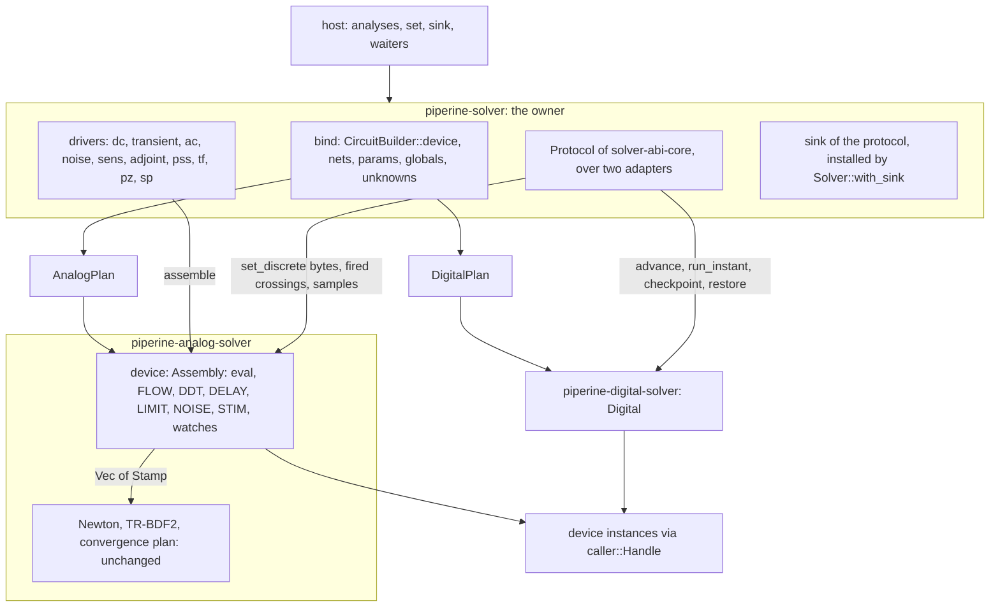

# Solver ABI Integration Design

**Spec**: `.specs/features/solver-abi-integration/spec.md`
**Status**: Draft
**Authority**: `.specs/features/device-abi/abi.md`. The numeric core (`math/newton_raphson.rs`, `math/integration.rs`, `convergence.rs`, `tolerances.rs`) is not edited by this feature.

---

## Architecture Overview

The Newton engine keeps asking a `NonLinearSystem` for stamps. Today the drivers collect them from `Element::load_*`. After this feature they collect them from `Assembly` (`solver-abi-analog`), the discrete side is `Digital` (`solver-abi-digital`), and the step loop is driven by `Protocol` (`solver-abi-core`) through two adapters. Nothing below `assemble` changes, and no logic is added to the three pieces: this feature binds, wires, ports and deletes.



One transient step (abi.md §5, with the boundary delivery of the spec's Assumptions):

```mermaid
flowchart TD
    C[C = checkpoint: Digital, Assembly histories, Newton history, sink mark] --> P[1. propose t_c: controller, CAP watches, stop time]
    P --> A[2. Digital.advance to t_c: stops before the first time point s; t_c = s]
    A --> S[3. solve TR-BDF2 to t_c on the LEFT values of the analog-read nets]
    S --> J{converged and, unless the landing is a boundary change, within trtol?}
    J -- no --> R[4. restore C; smaller step] --> P
    J -- yes --> X[5. accept; Assembly.accept: histories, LAST, watches; crossings become commits at t_c, 0]
    X --> I[Digital.run_instant at t_c with samples, limit Horizon of stop and crossing; settle]
    I --> D{a net an analog function reads changed?}
    D -- yes --> T[deliver(boundary, restart): Assembly.set_discrete; prev_h = 0; after a host PARAM or GLOBAL write also dt = 1e-3 of the last]
    D -- no --> N[6. t = t_c; C = checkpoint]
    T --> N
```

### The strangler

A circuit is built either from `Element`s (today's `CircuitBuilder::element`) or from `Device`s (`CircuitBuilder::device`), never both: `build` refuses a mix. `CircuitInstance` holds `devices: Vec<Box<dyn Element>>` and, from Phase 1, `abi: Option<Bound>`. The drivers are one stack with a branch at three places: where stamps are collected (`assemble`), where the discrete side runs (old scheduler or the protocol), and where limiting is consulted. Every existing test keeps running on the `Element` branch until its port; the differential test builds the same circuit twice, once per contract, and compares. Phase 5 deletes the `Element` branch. Between the two, every batch leaves all crates green.

---

## Code Reuse Analysis

### Existing Components to Leverage

| Component | Location | How to Use |
| --- | --- | --- |
| Newton, damping, convergence plan, homotopy | `crates/piperine-analog-solver/src/{math/newton_raphson.rs,convergence.rs}` | unchanged; `Assembly` feeds `NonLinearSystem::assemble` |
| Step loop, landing, exemption, restart | `crates/piperine-solver/src/analyses/transient.rs` (`predict_step`, `attempt_step`, `assess_step`, `accept_step`, `propose_dt`) | restructured around the protocol; the arithmetic of each function stays |
| Hold clamp | `transient.rs::UicClamp` | fed from `Pin.init` instead of `initial_conditions()` |
| Per-node tolerance override | `tolerances.rs::node_vntol_overrides` | filled at bind from `Pin.abstol[0]` |
| Non-finite check | `stamp_validation.rs::non_finite_stamp_error` | kept as the last line of defense; `Assembly` names the cell first |
| Sensitivity drivers | `analyses/{sens,adjoint,sensitivity}.rs` | `ParamStampCollector` reads `Assembly::param_stamps` instead of `Element::param_stamps` |
| The doubles to port | `tests/helpers/{devices.rs,mod.rs}`, inline doubles of `parity_baseline.rs`, `mixed_signal.rs` and the rest | each becomes a `Device` with the same equations and constants |
| Digital engine | `piperine_digital_solver::abi::Digital` (`solver-abi-digital`) | behind the `DiscreteSide` adapter |
| Analog assembly | `piperine_analog_solver::device::{AnalogPlan, Assembly}` (`solver-abi-analog`) | the drivers' stamp source; behind the `AnalogSide` adapter |
| The protocol and its sink | `crates/piperine-solver/src/protocol/` (`solver-abi-core`) | called by the transient and DC drivers on the device branch |
| Checks | `piperine_abi::{validate, verify::verify_partials}` | bind; one verifier test per test device |

### Integration Points

| System | Integration Method |
| --- | --- |
| Public surface (MD-17) | `piperine_solver::abi` re-exports `piperine_abi` and the bind types; `prelude` keeps the analysis entry points and results. Names of removed items disappear; nothing else is renamed |
| Kept crates that do not compile (`piperine-api`, root shell, `piperine-cli`, `piperine-lang-server`) | not touched; they already fail and are rebuilt by their own features |
| Future codegen | produces `Device`s; needs nothing from this feature beyond `CircuitBuilder::device` |

---

## Components

### `bind` (owner)

- **Purpose**: turn a netlist of device instances into the two plans.
- **Location**: `crates/piperine-solver/src/core/bind.rs` (+ `builder.rs`)
- **Interfaces**: `CircuitBuilder::device(&mut self, module: &'static Module, path: &str, values: &[(&str, ParamValue)], ports: &[Port]) -> Result<&mut Self>` with `Port::{Node(AnalogReference), Net(NetName), Open}`; `CircuitBuilder::param_net(name)` (a shared model card, P5); `CircuitBuilder::session_param(name, bytes)`; `build()` returns the `CircuitInstance` with `Bound { analog: Assembly, digital: Digital, names: NameMap }`.
- **Does**: `Handle::create` with the encoded values; role by role binding (spec AC 1 to 4 of the protocol story); flags a discrete net `analog_reads` when an analog function reads a pin on it; gives each continuous pin a reaction reads a sample index; fills `node_vntol_overrides` and the hold list.

### The two adapters (owner)

- **Purpose**: let `Protocol` drive the real sub-solvers.
- **Location**: `crates/piperine-solver/src/protocol/adapters.rs` (as built: `crates/piperine-solver/src/analyses/adapters.rs`, because `tests/protocol_seam.rs` proves no file of `src/protocol/` names a sub-solver item and the adapters name both, so they live with the drivers that call them)
- **Interfaces**: `impl DiscreteSide for DigitalSide` (a newtype over `piperine_digital_solver::abi::Digital`: `Tick` and `i64`, `NetId` and `u32`, `Checkpoint` as `Mark`, `Observation` mapped with the name map of bind); `impl AnalogSide for TransientSide<'_>` over the transient driver: `propose` is `predict_step`'s controller proposal bounded by the last `CAP`; `deliver` is `Assembly::set_discrete`; `attempt` is `attempt_step` plus `assess_step` (`exempt` is today's `landed_on_breakpoint`); `accept` is `accept_step`'s bookkeeping with `prev_h = 0` on `Restart::Integrator` and additionally `dt = 1e-3·dt_actual` floored at `dt_min` on `IntegratorSmall`, then `Assembly::accept`; `mark`/`restore` pair `solver.state_snapshot()` with `Assembly::snapshot()`; `equilibrium` is the DC plan.
- **As built, two departures**: the transient re-entry restores the captured step's solution, Newton history and controller state in the same task that captures them (the capture fields have no reader otherwise, and an unread field warns); and a step whose target is within one tick of the stop but is not a landing solves to its own proposal, not to the target, because the parity oracles pin the controller's time grid (`parity_baseline` 161 steps, `differential` 1e-15) and a femtosecond floor moves every step.
- **Mapping to today's code**: `predict_step` loses the digital peek, `next_breakpoints` and `SetQueue` on the device branch (the protocol plans the landing); `attempt_step` loses `digital_state.checkpoint()` and `run_digital_at`; `accept_step` loses `settle_digital` and `apply_scheduled_sets`; both reject paths become `restore`. `assess_step`'s arithmetic and `propose_dt`'s controller call are not edited. The `Element` branch keeps every one of these calls until Phase 5.
- **Rule**: an adapter converts and forwards. If the protocol, the engine or the assembly needs a change to fit, the change is made in its own crate with a test there, and the commit body says so.

### Host actions (owner)

- **Location**: `crates/piperine-solver/src/core/circuit.rs` (`set`, `schedule_set`, `on_event`)
- **Interfaces**: `CircuitInstance::set(path, param, value) -> Result<()>` (shadow, then commit; `RESHAPE` between analyses re-creates and re-binds the instance); `TransientSolver::schedule_set(t, path, param, value)` (a queued host commit; replaces `SetQueue`); `Solver::on_event(net, ..)` and `Solver::with_sink(..)` forward to `Protocol::on_event` and `Protocol::with_sink`. A `SetOutcome::Reshape` between analyses is answered here: destroy, create and bind that instance again (bind's job), then commit.

---

## Test disposition

Rule: a test is removed only when every assertion in it is about a removed item; its name goes into `.specs/features/solver-abi-integration/removed.txt` with that item. Any other test is ported: its name, asserted quantities and tolerances stay, and only the circuit construction changes. The port task lists both sets in its commit body.

| Target (tests today) | Disposition |
| --- | --- |
| `parity_baseline` (6) | port; the exact-value oracle. Literals and tolerances untouched. Its digital-settle test asserts `LogicValue` levels: ported to `BIT` bytes `HIGH`/`LOW`, same nets, same levels |
| `sens` (4), `adjoint_dc` (3), `adjoint_vs_sens` (4), `sensitivity_fallback` (2) | port; `param_stamps` becomes partials against `PARAM` reads; the rebuild-class row becomes a `STRUCTURAL` param |
| `transient_reentry` (1), `pss` (3) | port; re-entry state is the protocol's checkpoint |
| `helper_devices` (4) | port; `param_stamps_match_a_central_difference` is removed and replaced by `every_device_function_passes_the_partials_verifier` |
| `mixed_signal` (25) | per test by the rule: A2D, D2A and ordering claims are ported on bytes and events; claims about strengths or the two-phase contract are removed |
| `live_params` (13), `temperature` (3), `probe_selection` (10), `nature_abstol_inheritance` (3) | port on host commits, the `TEMPERATURE` global, `VAR` watches and `Pin.abstol` |
| `limiting_report` (2) | `active_limiter_vetoes_newton_convergence` ported on a `LIMIT` input; `newton_applies_limited_value_to_the_guess` removed (the guess is no longer steered) and replaced by `a_limited_diode_reaches_the_unlimited_operating_point` |
| `failure_rules` (6), `solver_entry` (2), `stepper_fold` (3), `context_init` (1) | port (or untouched where no device is involved) |
| `lifecycle` (8) | per test: create and destroy ordering ported; hook-ordering charts of removed hooks removed |
| `checkpoint_restore` (8) | per test: the transient-reject and homotopy tests ported as "a rejected attempt leaves limit iterates and histories unchanged"; tests of `checkpoint_state`/`restore_state` defaults removed |
| `digital_settle_subscriber` (4) | per test: ported on a `SETTLE` reaction |
| `stamp_bypass` (2), `integration_scheme_elements` (2) | removed (bypass flag, `suggest_transient_step` hook); F3 is proven by `a_clean_function_is_not_called` |
| `capabilities_contract` (3), `composed_element` (2) | removed (capability flags, the composed `Element`) |
| `digital_driver_segregation` (4), `digital_topology` (27), `digital_events_unified` (6), `event_adapters` (8), `event_order` (1), `event_rollback` (2) | removed with the old digital engine and `EventQueue`; their claims are proven on the new engine by `solver-abi-digital` |
| `abi_surface` (1), `prelude_surface` (1) | rewritten on the new surface, same intent (each module is enough on its own) |
| `crate_boundaries` (7), `workspace_shape` (11), `removed_surface` (7) | extended |
| unit tests in `src/` (`analyses/events.rs` 11, `core/introspect.rs` 9, `core/builder.rs` 10, `sp.rs`, `pz.rs`, `noise.rs`, `tf.rs`, `transient.rs`) | by the rule; inline doubles of `sp.rs`, `pz.rs`, `noise.rs` ported |

---

## Numerically sensitive work

A task marked sensitive changes where a number comes from. Its gate includes `parity_baseline` and, once it exists, the differential target; a moved literal or a loosened tolerance is a failed task, never a fix.

| What | Why it is sensitive | Guard |
| --- | --- | --- |
| Drivers reading the assembly (DC, transient, AC, noise) | every stamp now comes from `Assembly` | differential DC, transient, AC, noise; `parity_baseline` |
| History push and restore next to the Newton calls | a missed call desynchronizes charge from the solution; step count 161 of `parity_baseline` | differential transient (equal step count, 1e-12) |
| Sensitivity through partials | adjoint against `.sens` | `adjoint_vs_sens` unchanged; differential |
| The transient adapter (the protocol in the step loop) | landing, exemption and restart decide the time grid | `parity_baseline`, `pss`, `live_params`, `transient_reentry` unchanged |
| Host writes | re-solve and the 10⁻³ restart | `live_params` unchanged |

---

## Error Handling Strategy

| Error Scenario | Handling | User Impact |
| --- | --- | --- |
| a non-finite value or partial | `Error` naming instance, cell, `origin` (domain of the running analysis) | the bad contribution is named before the matrix is touched |
| a bind rule fails | typed bind error from `piperine-abi`, the analog plan or the digital plan | fails at build, naming the entries |
| operating-point rounds exceed 20 | `E0506` naming the nets | no silently wrong operating point |
| a host write is refused (`check`, `RESHAPE` in a transient, structural) | `Err` with the reason; nothing changed | the run continues |
| a digital error (`E0501`, `E0502`, `E0435`, a fault) | converted at the call site as `CircuitInstance::digital_failure` does today, keeping the typed fields | the code, the tick and the instance reach the host |
| a ported test misses its tolerance | stop; the device or the assembly is wrong | the tolerance is never loosened |

---

## Risks & Concerns

| Concern | Location (file:line) | Impact | Mitigation |
| --- | --- | --- | --- |
| `parity_baseline` pins a transient step count (161) and values to 1e-9 | `crates/piperine-solver/tests/parity_baseline.rs:438`, `:443` | a one-bit difference near a controller threshold could move the grid | the companion reproduces `C::load_transient` expression for expression; the differential test compares before `Element` is deleted; if the count moves, stop and report |
| Today a scheduled `set` is applied after the landing step and re-solved; digital events are applied before it | `transient.rs:1060` (`apply_scheduled_sets`), `:944` (`attempt_step`) | unifying both as boundary changes could move `live_params` numbers | host writes keep their own restart rule (10⁻³); `live_params` runs unchanged in the gate of the protocol task; if the re-solve cannot be reproduced by solving on the left value and delivering after the instant, the task keeps a host-write-specific landing and reports |
| The operating-point mixed loop exits silently after 20 rounds | `analyses/dc.rs:355` | a wrong operating point returned as converged | the device branch goes through `Protocol::operating_point`, which fails with `E0506` (SAI-06) |
| `TransientSystem` and `DcSystem` hand `digital: &[LogicValue]` to devices | `analyses/dc.rs:30`, `transient.rs:38` | the shared snapshot | removed in Phase 5 with the last `Element` |
| 84 `impl Element` across 30 files | `crates/piperine-solver/tests/*.rs`, `src/analyses/{sp,pz,noise}.rs`, `src/core/{builder,introspect}.rs` | the port is the bulk of the feature | Phase 4 is six port tasks by family, each with the removed and ported names in its commit body |
| The three pieces were built apart; a seam may not fit | `crates/piperine-solver/src/protocol/sides.rs`, `Digital`, `Assembly` | an adapter that needs logic | the facade-fit tests of the two parallel features; the adapter rule above; T1 is the first task that compiles all three together and stops on a misfit |
| `bound_step_hint` is declared and never read | `core/element.rs:191` | a step cap is ignored | the `CAP` the assembly reports bounds `propose` (SAI-11) |
| Root package and four kept crates do not compile | `Cargo.toml` | a bare `cargo build` fails | every gate is `-p`; unchanged by this feature |

---

## Tech Decisions (only non-obvious ones)

| Decision | Choice | Rationale |
| --- | --- | --- |
| Strangler | two circuit kinds on one driver stack until the last test is ported; no mixed circuit | green batches; the differential oracle; no adapter type to write and delete |
| Adapters only | this feature adds no logic to the protocol, the engine or the assembly | each was verified alone; a fix belongs with its tests |
| Removed tests | by name in `removed.txt` | the rule of `solver-restructure`; the Verifier can audit the list |
| Project-level decision | MD-62 appended to `.specs/STATE.md` in the last task: the device ABI is the only device contract; the solver owns companion, limit iterate, histories and checkpoints; `Element` is gone | binds every later solver and codegen feature |

---

## As built (Phase 3, accepted by the orchestrator 2026-11-15)

- **Adapters** live in `crates/piperine-solver/src/analyses/adapters.rs` (`DigitalSide`, `EquilibriumSide`, `TransientSide`, `HostHooks`): `tests/protocol_seam.rs` forbids sub-solver names in `src/protocol/`. `Protocol` gained `into_sides` and `analog_mut`. The digital engine leaves `Bound` (`mem::replace` with an empty `Digital`) for a run and goes back after it.
- **Every operating point** of a circuit of devices (DC, the transient's, the AC bias point and the other small-signal bias points) runs `Protocol::operating_point`.
- **Tick-grid tolerance.** A transient step that is not a landing ends at the controller's own proposal when it lies within one tick of the protocol's tick-grid target; a landing ends exactly at its tick. The parity oracles keep the controller's time grid; sink times are tick times (within one tick of the accepted time).
- **The step after a boundary change** (`deliver` with `Restart::Integrator` or `IntegratorSmall`) starts with `prev_h = 0` and is exempt from the truncation test and the controller, as after a scheduled set today; `IntegratorSmall` also sets the step to `1e-3` of the last, floored at `dt_min`. The landing itself is solved on the left value (the user's order).
- **Host writes.** `CircuitInstance::set` checks the cone on `Digital::shadow`; an accepted write is one of the host's initial writes of every later analysis (`Bound::host_writes`). A `RESHAPE` or a `STRUCTURAL` param between analyses re-creates and re-binds **every** instance from the kept bind recipe over the circuit's own nodes (bind creates the whole recipe).
- **Host waiters** needed `Digital::wait` and instant suspension in the digital engine (4e4e3f4a).
