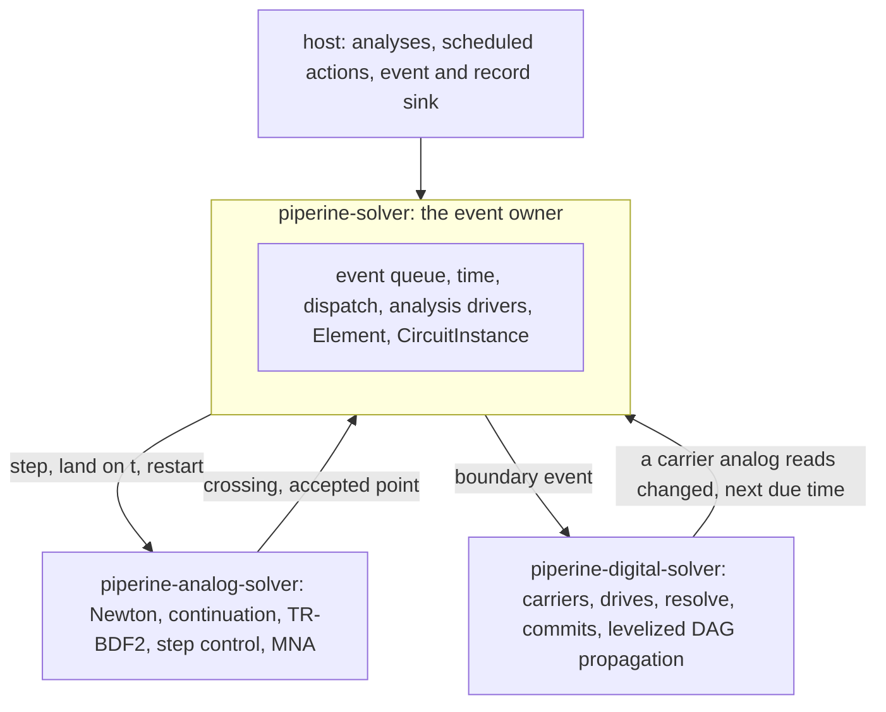
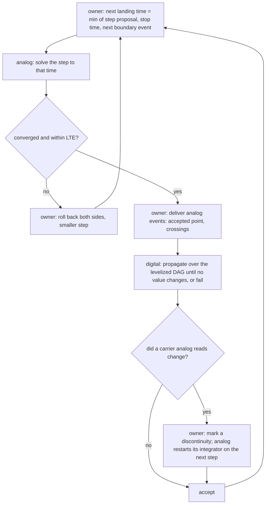

# Solver Completeness Design

**Spec**: `.specs/features/solver-completeness/spec.md`
**Status**: Draft. Boundary-level only: it fixes what the six features share. Each feature has its own design; `solver-restructure` is in `.specs/features/solver-restructure/design.md`.

---

## Architecture Overview

Three crates. The owner holds time and the event queue and dispatches; the two sub-solvers never see each other.

What one analog time step looks like once feature (B) is in:

Digital times between two analog landing times that touch nothing analog run inside the digital sub-solver without ending an analog step (Q8).

The discontinuity path is the solver's present one (Q7): land on the event time, apply, solve the step with the new values, reset the trapezoidal stage's previous derivative and restart the step size at 1e-3 of the last. No jump solve is added.

---

## Code Reuse Analysis

### Existing Components to Leverage

| Component | Location (today) | How to Use |
| --- | --- | --- |
| Newton engine, damping, limiting veto, continuation | `src/math/newton_raphson.rs`, `src/analyses/convergence.rs` | move to the analog crate unchanged (A) |
| TR-BDF2, Milne LTE, PI controller | `src/math/integration.rs`, `src/analyses/convergence.rs` | move to the analog crate unchanged (A) |
| Step loop and the discontinuity restart | `src/analyses/transient.rs` | stays in the owner; (B) replaces the direct digital calls with events |
| Per-step rollback | `Element::checkpoint_state`, `NewtonRaphsonSolver::state_snapshot`, `EventQueue::checkpoint/rollback` | kept; the digital sub-solver's store joins the same checkpoint (B) |
| Unified event queue | `src/analyses/events.rs` | becomes the owner's queue proper (B) |
| DAG order and back edges | `src/digital/topology.rs` | the seed of the levelized propagation (B) |
| Hold clamp, scheduled param sets | `src/analyses/transient.rs::{UicClamp, SetQueue}` | held nodes (time-point), host actions (host-seam) |
| Small-signal family | `src/analyses/{ac, noise, tf, pz, sp}.rs` | unchanged except the noise source shape (numerics) |

### Integration Points

| System | Integration Method |
| --- | --- |
| Future codegen | implements the element traits; declares at build time carriers (byte size, drives, resolve), reactions, which carriers analog reads, held nodes, per-unknown tolerances |
| Future host (`piperine-api`) | calls the analysis entries of the owner, schedules host actions, installs the event/record sink |

---

## Components

| Component | Crate | Feature | Purpose |
| --- | --- | --- | --- |
| Crate split and cleanup | all three | A | structure only; see `solver-restructure` |
| Boundary event vocabulary | owner | B | the only types both sides' events are made of: time, carrier id, bytes, crossing id |
| Tick time | digital (ticks), owner (conversion) | B | integer time for everything scheduled |
| Carrier store, drives, resolve, commits | digital | B | opaque bytes, bitwise change, per-statement transport |
| Levelized propagation | digital | B | DAG order, repeat to a fixed point or `E0501` |
| Event sink | owner | B, host-seam | every boundary event and record, for debug and for the host |
| Settle, operating-point rounds, held nodes, sweep points, continuation | owner | time-point | §15 step 4, §16 |
| Crossing locator, step cap | analog (locate), owner (retake) | crossings | §17.3, §14.10 |
| Host actions | owner | host-seam | §23.1 |
| Per-row tolerances, named singular solves, per-state LTE, pattern union, correlated noise | analog | numerics | §17, §11, §14.8 |

---

## Error Handling Strategy

| Error Scenario | Handling | User Impact |
| --- | --- | --- |
| propagation or operating-point rounds exceed the bound | fail with `E0501` or `E0506`, naming the carriers | the host sees which carriers oscillate |
| an equilibrium or a step does not converge | `E0505`, `E0508` with the time and the failing unknowns or limiters | no silent wrong point |
| a singular or non-finite solve | `E0503`, `E0507` with names | the floating node or bad contribution is named |
| an element raises its own run error | passed through with its code and instance | model errors of §11 and §14 reach the host |
| a host action in the past | refused with `E0806`, nothing changes | the run continues |

---

## Risks & Concerns

| Concern | Location (file:line) | Impact | Mitigation |
| --- | --- | --- | --- |
| No solver test runs today | `crates/piperine-solver/Cargo.toml` (dev-dependencies) | every change is unverified | first phase of `solver-restructure` |
| The operating-point mixed loop exits silently after 20 rounds | `src/analyses/dc.rs:355` | a wrong operating point returned as converged | SCT-07; not touched by A (logic) |
| `bound_step_hint` is declared and never read | `src/core/element.rs:191`, `src/analyses/transient.rs:877` | a model's step cap is ignored | SCX-03 |
| Analog loaders read a digital snapshot | `DcAnalysisState.digital`, `TransientAnalysisState.digital` | the boundary is shared state, not events; it keeps `AnalogDevice` and the drivers in the owner crate through A | (B) replaces the snapshot with boundary events, then moves the analog contract into the analog crate |
| Every digital event time is a mandatory analog landing point | `src/analyses/transient.rs:890` | a free-running clock cuts every analog step | SCE-03 |
| The sparsity pattern is fixed from one dry-run load | `src/math/newton_raphson.rs:121` | a switch branch that changes kind can stamp outside the pattern | SCN-04 |
| §15.2 states an instantaneous jump the kept algorithm does not produce at the same `t` | `docs/spec/part_v_execution.md` §15.2 | spec and solver disagree on one observable | feature (B) amends §15.2 to the kept algorithm (user, round 3) |

---

## Tech Decisions (only non-obvious ones)

| Decision | Choice | Rationale |
| --- | --- | --- |
| Number of crates | three: `piperine-solver`, `piperine-analog-solver`, `piperine-digital-solver` | the user's words: "o dono dos eventos, o digital-solver e o analog-solver" |
| Dependency direction | owner depends on both sub-solvers; the sub-solvers depend on nothing in the tree | a boundary the compiler enforces |
| Carrier values | opaque bytes, bitwise change detection | Q2 |
| Discontinuities | the present algorithm; the spec is amended | Q7 |
| Tolerance mapping | the present one; the spec is amended | Q9 |
| Order of work | structure first with no logic change, then logic | the user's split; a verifier can hold A to "nothing changed" |
| Proof | hand-written Rust elements, unit tests per crate | no frontend exists |
