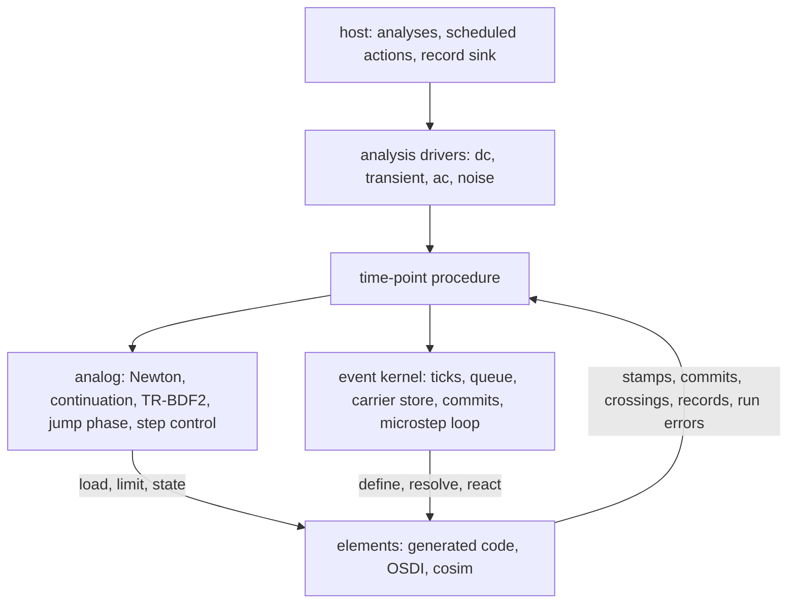
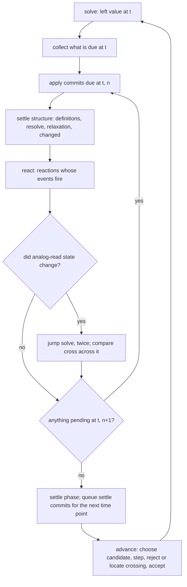

# Solver Completeness Design

**Spec**: `.specs/features/solver-completeness/spec.md`
**Status**: Draft. It assumes the recommended answer to every question of `context.md`; an answer that differs changes the section it names. Each sub-feature gets its own detailed design; this document fixes only the boundaries they share.

---

## Architecture Overview

One crate, three layers, and one loop that joins them. The solver owns time. Elements own evaluation.



The time-point procedure is §15 written once and used by every analysis:



In an operating point the first box moves after the first apply (no left value) and "jump solve" is a new equilibrium round (§16). At an event time that is not a time point, only collect, apply, settle structure, react and the exit test run (§15).

---

## Code Reuse Analysis

### Existing Components to Leverage

| Component | Location | How to Use |
| --- | --- | --- |
| Newton engine, damping, limiting veto | `src/math/newton_raphson.rs`, `src/analyses/convergence.rs` | unchanged; the jump solve is one more caller |
| Continuation (gmin, source stepping) | `src/analyses/convergence.rs::ConvergencePlan` | unchanged; each round of an operating point uses it |
| TR-BDF2 and companion coefficients | `src/math/integration.rs::TrBdf2`, `TrBdf2Phase` | add a backward-Euler phase for the jump; kernels already take `(c0, c1, c2)` |
| Step loop: predict, attempt, assess, accept, reject | `src/analyses/transient.rs` | keep the phases; replace what runs inside attempt and accept with the time-point procedure |
| Per-step rollback | `Element::checkpoint_state/restore_state`, `NewtonRaphsonSolver::state_snapshot`, `EventQueue::checkpoint/rollback` | the kernel's store and queue join the same checkpoint |
| Hold clamp | `src/analyses/transient.rs::UicClamp` | becomes the held-node hold, fed by the netlist instead of a device hook |
| DAG order and back edges | `src/digital/topology.rs` | the settle-structure stage orders definitions with it |
| Param writes and their strength | `src/core/introspect.rs::Invalidation`, `CircuitInstance::set_element_param`, `SetQueue` | a scheduled `set` becomes one kind of host action in the kernel's queue |
| Small-signal family | `src/analyses/{ac, noise, tf, pz, sp}.rs` | unchanged except the noise source shape (SCN-05) |
| Non-finite stamp check | `src/analyses/stamp_validation.rs` | reports through the typed run error |

### Integration Points

| System | Integration Method |
| --- | --- |
| Future codegen | implements the element traits; declares at build time the carriers, drives, resolve functions, reactions with their `touches_analog` flag, states, held nodes, per-unknown tolerances |
| Future host (`piperine-api`) | calls the analysis entries, schedules host actions, installs a record sink, reads typed run errors |
| `piperine-osdi` plugin | an analog element like any other; no change of contract beyond the removed hooks |

---

## Components

### Tick time

- **Purpose**: one integer time base for every scheduled thing.
- **Location**: `src/core/` (a small `time` module).
- **Interfaces**: a tick type over `i64`; conversion from seconds with the rounding rules of §15 T2 to T4; `E0502` on overflow.
- **Dependencies**: none.
- **Reuses**: nothing; replaces `PlanLimits::digital_time_epsilon`.

### Event kernel

- **Purpose**: store carriers and drives, order and apply commits, run the microstep loop, checkpoint and roll back.
- **Location**: `src/digital/` rewritten (the directory may be renamed in the sub-feature's design).
- **Interfaces**: build-time registration of carriers (size, drive count, optional resolve), reactions (source index, `touches_analog`), scheduled events; run-time `commit(statement, level, bytes, delay)`, `arm(event, tick)`, `read`, `read_prev`, `read_others`; `step_instant(t, n)` used by the time-point procedure; `checkpoint`, `rollback`, `commit_step`.
- **Dependencies**: tick time, typed run errors.
- **Reuses**: `DigitalTopology` for the definition order.

### Element contract, discrete half

- **Purpose**: what the kernel calls on generated code.
- **Location**: `src/core/element.rs` (`DigitalDevice` replaced).
- **Interfaces**: evaluate one definition, one resolve, one reaction (each given a read view and a commit sink, each able to return a run error); the settle reactions; an optional wake request.
- **Dependencies**: event kernel.
- **Reuses**: the capability flags; `EventSink` as the idea of a write-only sink.

### Time-point procedure

- **Purpose**: §15 and §16 in one place: left value, loop, jump, settle, operating-point rounds.
- **Location**: `src/analyses/` (shared by `dc.rs` and `transient.rs`).
- **Interfaces**: `run_time_point`, `run_event_time`, `run_operating_point`, each returning what changed for the analog side and whether a `finish` record was accepted.
- **Dependencies**: event kernel, Newton, the jump phase.
- **Reuses**: `DcSolver`'s mixed loop and `TransientSolver::{attempt_step, accept_step}` as the code it replaces.

### Jump solve

- **Purpose**: the right value of §15.2.
- **Location**: `src/analyses/transient.rs` plus a phase in `src/math/integration.rs`.
- **Interfaces**: one more `TrBdf2Phase`-like variant with `h` of one tick; a per-state "moved" report used by the restart.
- **Dependencies**: Newton, per-state tolerances.
- **Reuses**: the companion-model path of every analog element.

### Crossing locator

- **Purpose**: land on a crossing within `ttol` or `etol`, rounded up to a tick.
- **Location**: `src/analyses/` (replaces `EventKind::Crossing` as an advisory).
- **Interfaces**: elements register crossing expressions and report their value at each solution; the locator returns a retake time to the step loop.
- **Dependencies**: time-point procedure.
- **Reuses**: the secant predictor now in `piperine-ir`, the reject path of the step loop.

### Host seam

- **Purpose**: scheduled host actions and the record sink.
- **Location**: `src/core/` and the analysis entries.
- **Interfaces**: `drive`, `force`, `release`, `set`, `probe` at a time; a record sink trait with accept and reject; session parameters by name.
- **Dependencies**: event kernel.
- **Reuses**: `SetQueue`, `ScheduledSet`.

---

## Data Models

Sketches, to be fixed per sub-feature.

```rust
/// An instant of §15.
struct Instant { tick: i64, microstep: u32 }

/// A pending commit. Ordered by (due, made, source_index, exec_index).
struct Commit {
    due: Instant,
    made: Instant,
    statement: StatementId,   // one commit statement of one reaction of one instance
    level: LevelRange,        // which bytes of the drive
    source_index: u32,
    exec_index: u32,
    bytes: SmallBytes,
}

/// A run error of Part V.
struct RunError { code: Code, instant: Option<Instant>, names: Vec<String>, detail: String }
```

---

## Error Handling Strategy

| Error Scenario | Handling | User Impact |
| --- | --- | --- |
| microsteps or rounds exceed the bound | fail the analysis with `E0501` or `E0506`, naming the carriers | the host sees which carriers oscillate |
| a jump, an equilibrium or a step does not converge | `E0504`, `E0505`, `E0508` with the instant and the failing unknowns or limiters | no silent wrong point (today's row 32) |
| a singular or non-finite solve | `E0503`, `E0507` with names | the floating node or the bad contribution is named |
| an element raises its own run error | passed through with its code and instance | model errors of §11 and §14 reach the host |
| a host action in the past | refused with `E0806`, nothing changes | the run continues |

---

## Risks & Concerns

| Concern | Location (file:line) | Impact | Mitigation |
| --- | --- | --- | --- |
| No solver test runs today | `crates/piperine-solver/Cargo.toml` (dev-dependencies) | every change is unverified | `solver-baseline` goes first and is the only thing it does besides removal |
| The operating-point mixed loop exits silently after 20 rounds | `src/analyses/dc.rs:355` | a wrong operating point is returned as converged | SCT-07; add the failing test in `solver-baseline` so it is red before the fix |
| `bound_step_hint` is declared and never read | `src/core/element.rs:191`, `src/analyses/transient.rs:877` | a model's step cap is ignored | SCX-03 |
| Digital events run before the analog solve of the same time | `src/analyses/transient.rs:972` | the opposite order of §15; every mixed test encodes it | the time-point procedure replaces it; mixed tests are rewritten against the spec's traces, with the user's consent to change them (Q3) |
| The sparsity pattern is fixed from one dry-run load | `src/math/newton_raphson.rs:121` | a switch branch that changes kind can stamp outside the pattern | SCN-04: the build-time declaration is the union; a stamp outside it is a typed error |
| The residual test's tolerances are the reverse of §17.1.2 | `src/analyses/context.rs:140` | changing it moves convergence everywhere | Q9; done alone in `solver-numerics` with before and after iteration counts |
| `Context` holds `Rc` values and a text output sink | `src/analyses/context.rs:269` | removing `io` and the postures touches every analysis constructor | mechanical; done in `solver-baseline` |
| The rewrite of `digital/` and of the `DigitalDevice` trait breaks the ABI every old device used | `src/core/element.rs:352` | none in tree today: no consumer compiles | this is the window to do it |
| Per-state restart needs states to be visible to the solver | `Element` ABI | today a device hides its charges | the jump design adds a state report (value and derivative) per element |

---

## Tech Decisions (only non-obvious ones)

| Decision | Choice | Rationale |
| --- | --- | --- |
| Time base | `i64` ticks in the kernel; the analog side keeps `f64` seconds and converts at the boundary | §15 T5: a time point chosen by step control need not be a tick |
| Carrier values | opaque bytes with bitwise change detection (Q2) | the solver knows no MSL type |
| The jump | a third integration phase, backward Euler over one tick (Q7) | reuses every element's companion path |
| Reachability | flags from the elaborator (Q8) | no dependency graph in the solver |
| Proof | hand-written Rust elements in `tests/helpers` | no frontend exists; the elements double as the reference for codegen authors |
| Old and new digital engines | never both: the old one is removed in `solver-baseline`, the new one arrives in `solver-instants` | the crate must stay minimal; between the two the solver is analog-only, which is acceptable because no consumer compiles |

Project-level decisions (where the discrete engine lives, the opaque carrier store, the removal of the Verilog-AMS surface) are appended to `.specs/STATE.md` when the user answers Q1 to Q4.
