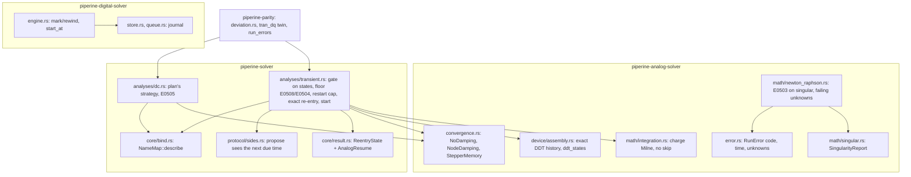
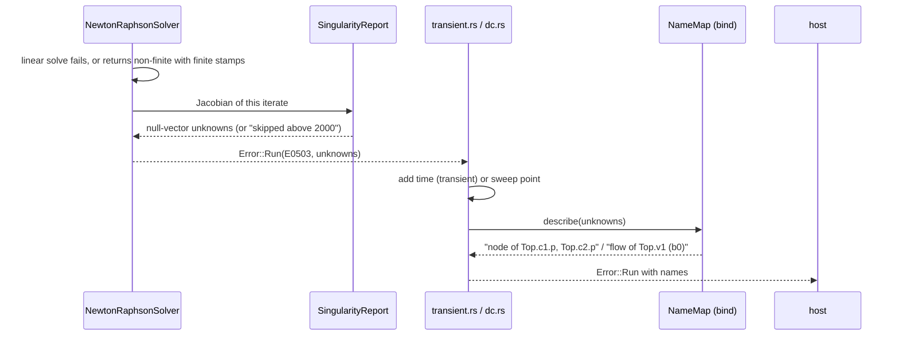

# Solver Hygiene Design

**Spec**: `.specs/features/solver-hygiene/spec.md`
**Status**: Approved with the spec (2026-11-17). Q0 to Q7 were answered with option (a) each ("Aceito todas (Recommended)"), which is what every component below describes.

Line numbers are those of `feature/solver-hygiene` at `4293de6b`. Measurements are the planner's
probes of 2026-11-17 (scratchpad `plan-c/`, not committed), ngspice-47, interpreter backend unless
said.

---

## What the code does today

### Truncation error and step control (V1, V2, V3)

- `TransientSolver::assess_step` (`crates/piperine-solver/src/analyses/transient.rs:713`) computes
  `TrBdf2::milne_lte_indexed` (`crates/piperine-analog-solver/src/math/integration.rs:124`) over the
  Newton buffer's rows `x_n`, `x_{n+γ}`, `x_{n+1}`, restricted to node unknowns
  (`device_record_start`, `transient.rs:1234`), normalized by `reltol·|x| + vntol`. `chgtol`
  (`tolerances.rs:36`) is read by nothing.
- The estimator skips a component whose differences `d1 = |x_{n+γ} − x_n|`, `d2 = |x_{n+1} − x_{n+γ}|`
  satisfy `min < 0.1·max` (`integration.rs:148`). It was added for breakpoint jumps; the protocol
  now exempts landings and the step after a delivery (`StepPrediction::landed_on_breakpoint`,
  `TimeLoop::sets_just_applied`), so it only hides the start of a fast rise from flat.
- The PI controller (`convergence.rs:167`) targets 1; the gate rejects above `trtol` 7
  (`transient.rs:732`). The comment at `transient.rs:777` records that normalizing by `trtol` broke
  `tran_rc`'s parity once; that band is kept.
- At the floor: `device_reject_lte` (`transient.rs:1469`) accepts an LTE rejection once the next
  step would be `≤ dt_min`, with `tracing::warn!`; a Newton failure at the floor is kept in
  `DeviceRun::failed` and returned raw by the next attempt (`transient.rs:1413`, `:1332`).

ngspice (`src/spicelib/analysis/cktterr.c`): per state, `tol = max(abstol + reltol·max(|ccap_0|,
|ccap_1|), reltol·max(|q_0|, |q_1|, chgtol)/delta)`, the step from the divided difference of `q`
against `trtol·tol`; `dctran.c:801` accepts when the new step exceeds 0.9 of the old; at
`dctran.c:896-910` a step that falls to `delmin` is retried there once, and the second time the run
fails with "Timestep too small".

### Newton damping (V4)

- `DampedNewton::damp_update` (`convergence.rs:90`) halves the update toward the previous iterate
  when `‖Δx‖₂ ≥ 0.5` over every unknown, volts and amperes together.
- Both drivers hard-code it: `TransientSolver::execute_timestep` (`transient.rs:670`) and
  `DcSolver::newton` (`dc.rs:273`); `DcSolver::equilibrium` builds `ConvergencePlan::default()`
  (`dc.rs:211`) instead of using one it was given. `ConvergencePlan::newton()` has no caller.
- ngspice (`niiter.c:297-323`): node damping is off by default (`cktinit.c:91`); when on, it runs
  only in `MODETRANOP`/`MODEDCOP`, after the first iteration, while a device reports
  non-convergence, over voltage nodes, scaling by `max(10/maxdiff, 0.1)` when `maxdiff > 10`.
  Junction limiting is per device (`pnjlim`, `fetlim`), which Piperine has as `LIMIT` inputs.

### Dead hooks and stale text (V5, V6, V10)

- `NonLinearSystem::apply_limit` (`math/newton_raphson.rs:46`, called at `:208`) and
  `apply_limiting_reports` (`:77`, called at `:374`) are default no-ops nobody implements; the
  comment at `:366` describes a mechanism that no longer exists.
- `analyses/sp.rs:5-9` and `:48` say ports come from PHDL `@rfport`; they are `SpPort` values the
  host passes.
- `tests/abi_devices.rs:184-198` accepts a device when any `verify_every_function("Name", …)`
  call names it, whatever module the call verifies.

### Re-entry (V8 = N1, V9 = N2)

- `ReentryState` (`core/result.rs:202`): the digital `Checkpoint`, every net's bytes, the
  `AssemblySnapshot`, the step cap. Captured at the top of the next step (`device_capture`,
  `transient.rs:1289`) for every recorded step, and for the last step after the loop
  (`:1132-1145`).
- `device_resume` (`transient.rs:1250`) restores the assembly, then pushes the captured solution
  twice as the Newton history and starts the time loop fresh: `TimeLoop::new(start, options.dt)`,
  `prev_h = 0`, `last_step_accepted = false`, the PI memory empty. So the re-entered run takes a
  restart the continuous run did not, and another step grid: up to 7.3e-4 relative off at the end
  (N1, `build_clocked_rc`, 15 to 154 steps against 21 to 151).
- Missing from the capture: the Newton buffer's rows (the predictor reads two), `TimeLoop::dt`,
  `prev_h`, `last_step_accepted`, `sets_just_applied` (the pending restart), `DeviceRun::last_dt`,
  and `PiController::prev_error`.

### Errors (V15, §4.8)

- `Error` (`crates/piperine-analog-solver/src/error.rs:57`) is `Simple` or `WithCause`, a domain and
  text. Codes that exist are text prefixes: `E0501`/`E0502` (digital), `E0506`
  (`protocol/operating_point.rs:16`), `E0509`/`E0510` (`device/watch.rs:62`, `:93`).
- A structurally singular matrix fails in faer's symbolic LU: `NewtonRaphsonSolver::new`
  (`newton_raphson.rs:121`) through `faer.rs:40-50`, or the numeric solve at `faer.rs:185-199`
  ("The library threw an error while trying to create the RHS"). A numerically singular one returns
  `±inf`/`NaN`: "Linear solver returned NaN/Inf" (`newton_raphson.rs:202`, `:360`).
- A non-finite stamp is named well but cites "LRM §7.3.2.1" (`device/assembly.rs:633`,
  `stamp_validation.rs:1-21`); `tests/failure_rules.rs:219` asserts that citation.
- No code exists for `E0503`, `E0504`, `E0505`, `E0507`, `E0508`.

### The new defect (HYG-05, Q0)

Probe circuit (`tran_dq` without the hold): 1 V, 1 kΩ, 1.59 nF and a diode whose `analog` is
`DiodeTt`: `vd = limit(v(a,k), pnjlim…)`, `id = is·(exp(vd/nvt) − 1)`,
`i(a,k) +> id + gmin()·vd + ddt(tt·id)`.

| Variant | First steps of `v(a)` |
| ------- | --------------------- |
| `tt = 1 µs`, charge on `vd` (limited) | 0.6294, **−32.47**, −32.26 (both backends) |
| `tt = 1 µs`, charge on `v(a,k)` (unlimited) | 0.6294, 0.6294, 0.6294 |
| `tt = 0`, held at 0 V | 0, 0.0063, 0.0125 (right) |
| linear `ddt(cj0·vd)` through the same limit | 0.6294, 0.6294, 0.6294 |

So the fault is a `DDT` term whose value is nonlinear in a `LIMIT` output. Suspects, in order:
`Assembly::push_stage` (`device/assembly.rs:407-419`) stores `limit::linear(t, inst, st).v`, the
limit-linearized value `q(x̂) + g·(x − x̂)`, as the history row, which equals `q(x)` only when
`x̂ = x` or `q` is linear; and the rows `device_begin` pushes after the operating point
(`transient.rs:1206-1224`) under a held state whose `LAST` is still the seed (`vcrit` ≈ 0.73 V,
where `q` is 50× its value at 0.63 V). The task bisects with a hand-written device before fixing.

### Digital checkpoint (V7)

`Digital::checkpoint` (`crates/piperine-digital-solver/src/engine.rs:252`) clones the store, the
queue and the dirty set. The protocol marks once per attempt (`DigitalSide::mark`,
`analyses/adapters.rs:177`, which also copies every net's bytes into `Settled` when the run keeps
steps), and the look-ahead marks once per instant it runs (`advance.rs`).

### Start time (V14)

`TransientSolver::solve` refuses `start_time ≠ 0` without a captured step (`transient.rs:967-977`);
the digital engine's `start` (`engine.rs:151`) commits `init` and `START` at tick 0 only. PSS
(`analyses/pss.rs:162`) is the only caller of `with_start`, always with a captured state.

### The restart after a jump (V11)

`device_deliver` (`transient.rs:1537`): `Restart::Integrator` sets `prev_h = 0` and
`sets_just_applied` (the next step is exempt from the gate and the controller); the step size stays
the controller's. `IntegratorSmall` (a host write) also sets `dt = max(1e-3·last_dt, dt_min)`. The
first stage is backward Euler over `γh` (`TrBdf2::stage_coeffs`), whose error grows with `h²`: at
the harness's 10 ns cap `boundary.rs` misses `TRAN_VOLTAGE` 5.55 ns after the jump (F-B7), so it
runs at 1 ns. ngspice (`dctran.c:487-524`): after a breakpoint, order 1 and
`delta = min(delta, 0.1·min(saveDelta, breaks[1] − breaks[0]))`.

---

## Architecture Overview

No new crate and no new boundary. Every change sits in the three solver crates, the parity crate's
tests and fixtures, and the records. The owner names what a sub-solver reports by index.

### Run errors

---

## Components

### RunError (HYG-01 to HYG-03)

- **Purpose**: one typed carrier for the run codes of Part V.
- **Location**: `crates/piperine-analog-solver/src/error.rs`
- **Interfaces**:
  - `enum RunCode { E0503, E0504, E0505, E0507, E0508 }` with `as_str()`.
  - `struct RunError { code, domain, detail: String, time: Option<f64>, unknowns: Vec<usize>, names: Vec<String> }`.
  - `Error::Run(RunError)`; `Error::run(code, domain, detail) -> Error`; `Error::code() -> Option<RunCode>`; `Error::with_time(t)`, `Error::with_unknowns(Vec<usize>)`.
  - Display: `{domain}: {code}: {detail}` then `at t = {time:e} s` when set, then `: {names joined}` (or `unknowns #i` when not yet named).
- **Reuses**: `SolverDomain`. Existing string codes (`E0501`, `E0502`, `E0506`, `E0509`, `E0510`) stay as they are.

### SingularityReport (HYG-01)

- **Purpose**: say which unknowns make a Jacobian singular.
- **Location**: `crates/piperine-analog-solver/src/math/singular.rs` (new; named for what it does).
- **Interfaces**: `SingularityReport::of(size, &[Stamp]) -> SingularityReport { unknowns: Vec<usize>, skipped: Option<usize> }`. Assembles the dense matrix from the stamps (`Stamp::Matrix`), runs faer's dense column-pivoted QR (or SVD), takes the null vector of the smallest pivot, keeps `|component| > 1e-6·max`. Above `MAX_DENSE = 2000` returns `skipped: Some(size)`.
- **Dependencies**: faer (already a dependency); `Stamp`.
- **Reuses**: `FaerSparseLinearSystem::apply_stamps`'s stamp walk.

### Newton reports (HYG-01, HYG-03)

- **Location**: `crates/piperine-analog-solver/src/math/newton_raphson.rs`.
- The symbolic factorization in `new`, a failed numeric solve and a non-finite solution (the
  stamps were finite: `non_finite_stamp_error` already ran in the transient system) become
  `Error::run(E0503, …).with_unknowns(report.unknowns)`, keeping faer's text as the cause.
- On iteration exhaustion, the error carries the unknowns that failed the update or residual test
  at the last iteration (`Tolerances::failing(...)`, a new method beside `has_converged`, same
  formulas) and the active limits (`any_limiting_report` gains `limiting_report() ->
  Vec<LimitState>` on the system). The driver decides the code (`E0505`, `E0508`, `E0504`).

### NameMap::describe (HYG-01 to HYG-03)

- **Location**: `crates/piperine-solver/src/core/bind.rs`.
- **Interface**: `NameMap::describe(&self, unknown: usize, shapes: …) -> String`: a node unknown is
  `node of <path>.<pin>, …` over every `Site::Unknown` bound to it (pin names from the instance's
  module shape); a private flow unknown is `flow of <path> (<branch>)`. `Bound::name(&mut Error)`
  fills `RunError::names`. Every analysis entry of the owner (`dc`, `transient`, `ac`, the
  protocol's operating point) passes its error through it before returning.

### E0507 (HYG-02)

`device/assembly.rs:633` and `stamp_validation.rs` keep their instance, cell and origin naming and
become `Error::run(E0507, Device, …)`; the text cites `E0507` (§17.1 rule 4) instead of the LRM.

### Exact re-entry (HYG-04, HYG-13)

- `StepperStrategy` gains `fn memory(&self) -> StepperMemory` and `fn resume(&mut self, &StepperMemory)` (default: empty, no-op); `StepperMemory { values: Vec<f64> }` is opaque to the solver; `PiController` stores `prev_error`. (`convergence.rs`)
- `ReentryState` gains `analog: AnalogResume { newton: CircularArrayBuffer2<f64>, dt: f64, prev_h: f64, last_dt: f64, last_step_accepted: bool, restart_pending: bool, stepper: StepperMemory }` (`core/result.rs`).
- `device_reentry_state` fills it from the solver at the top of the next step (after the delivery,
  so a restart is already pending in `prev_h`/`sets_just_applied`); `device_resume` restores the
  Newton buffer instead of pushing two rows, and seeds `TimeLoop` and the stepper from it.
- `TransientAnalysisOptions::reentry: Reentry { EveryStep (default), LastStep }`: with `LastStep`,
  `device_capture` and `device_mark_start` attach nothing, the final step keeps its state, and
  `DigitalSide::record_settled` is not installed (so `mark` copies no net bytes).
- Exactness: a re-entered run with the same options and stop equals the continuous run bit for bit;
  a different stop follows §16.4. The tests compare `f64::to_bits`.

### Charge truncation estimate (HYG-07, HYG-08)

- `TrBdf2::state_lte(states: &[DdtState], tol: &Tolerances, h: f64) -> f64` (`integration.rs`):
  per state, `err = |q_{n+1} − (q_{n+γ} + ((1−γ)/γ)(q_{n+γ} − q_n))|`, normalized by
  `max(h·(abstol + reltol·max(|i_n|, |i_{n+1}|)), reltol·max(|q_n|, |q_{n+1}|, chgtol))`; the worst
  is returned. No skip. `milne_lte_indexed` loses its skip (Q2) and stays for the unit tests that pin
  it, or is deleted with them if Q1(a) leaves it unused.
- `Assembly::ddt_states() -> Vec<DdtState { q: [f64; 3], i: [f64; 2], abstol: Option<f64> }>`
  (`device/assembly.rs`, from `ddt::History` and the companion currents of the two stages); a term's
  own `abstol` (TermSpec `abstol`, not `DEFAULT`) replaces the flow `abstol`, as §17.2's Resolution
  says.
- `assess_step` reads `ddt_states()` instead of the node rows. A circuit with no `DDT` term returns
  0, so the controller grows `dt` (ngspice: no state, no truncation limit).

### Step floor (HYG-09)

`device_reject_lte` stops accepting: the first time the next step would be `≤ dt_min` it is set to
`dt_min` and retried; a rejection of an attempt that was already at `dt_min` returns
`Error::run(E0508, Transient, …).with_time(t)` with the components that failed the estimate as
unknowns (or `E0504` when the step reads a jump). `dt_min_floor_hits` counts the retries.

### Newton strategies (HYG-10)

- `convergence.rs`: `NoDamping` (the new default `NewtonStrategy`, same convergence test as today)
  and `NodeDamping` (ngspice's rule; it needs to know whether the solve is an operating point and
  whether a limit is active, so `damp_update` gains a `DampContext { static_solve: bool,
  limiting: bool, nodes: &[usize] }`). `DampedNewton` is removed with its export in `prelude.rs`.
- `dc.rs` and `transient.rs` take the plan's `newton()`; `DcSolver::equilibrium` uses the plan it
  owns (a `with_plan` like the transient's) instead of a fresh default.

### Restart step (HYG-11)

- `AnalogSide::propose(now, stop, next_due: Option<f64>)` (`protocol/sides.rs`): the protocol
  passes the next scheduled time point it knows (`DiscreteSide::next_due`, converted from ticks).
- `device_deliver` on `Restart::Integrator` records `restart_cap = 0.1·last_dt`; the next
  `device_propose` takes `min(controller, restart_cap, 0.1·(next_due − now))`, floored at
  `dt_min`. `IntegratorSmall` is unchanged.

### Start from an operating point (HYG-12)

- `Digital::start_at(tick)` (`engine.rs`): `start` with the instant `(tick, 0)`; `start` becomes
  `start_at(Tick(0))`.
- `TransientSolver::solve` drops the refusal; the protocol's operating point runs at the start
  tick; scheduled host writes at or before the start are written before the run, as today.
- A non-finite or negative `start_time` fails before the operating point.

### Digital journal (HYG-14)

- `Store` (`store.rs`) and `Queue` (`queue.rs`) record, between a `mark` and the next, the first
  previous state of each touched net and each queue operation; `rewind(mark)` replays them in
  reverse. Marks nest (the protocol's per step, the look-ahead's per instant).
- `Digital::mark() -> Mark` and `Digital::rewind(&Mark)` (`engine.rs`); `checkpoint()`/`restore()`
  stay (re-entry needs an owned copy).
- `DigitalSide::mark`/`restore` (`adapters.rs:177`) use the journal; the full copy is taken only
  where a re-entry state is captured.

### Deviation table (HYG-06)

- `piperine-parity/src/deviation.rs`: `Deviation { fixture, quantity, worst_ratio, at }`,
  `Deviation::of(contract, rows: &[(Coordinate, golden, actual)])` using `ToleranceContract::abstol()`
  and `reltol()` only (no new bound, `contract.rs` untouched); `Deviation::table(&[Deviation]) ->
  String`.
- `tests/deviation.rs`: runs the 7 twins and `tran_dq` with each `parity_*` target's own policy and
  prints the table and, per transient, accepted and rejected steps and `dt_min_floor_hits`. It
  asserts nothing numeric (the `parity_*` targets do); it is the source of every before/after table.

---

## Goldens, pins and twins that may move

Only these, only under the named answer, and only to values at least as close to ngspice (the
commit carries the deviation table of `tests/deviation.rs` before and after).

| What | May change under | Expected |
| ---- | ---------------- | -------- |
| `crates/piperine-cli/tests/goldens/tran_rc.txt` | Q1(a), Q2(a) | unchanged: at the 10 ns cap every one of the 1 000 steps is at the cap with no rejection (probe) |
| `goldens/{divider,isrc_r,diode_series,diode_iv,diode_rev,ac_rc}.txt` | Q4(a) | last printed digit at most (probe: `diode_iv` deviation 0.3685 to 0.3686) |
| `crates/piperine-solver/tests/parity_baseline.rs` `parity_rc_transient` (161 steps, `v_last`) | Q1(a), Q2(a) | re-pinned with the evidence the existing comment uses: the value on a converged grid |
| `parity_baseline.rs` DC pins (`parity_diode_dc_point`, `parity_divider_op_dc`) | Q4(a) | re-pinned within `reltol` of today's |
| `crates/piperine-parity/tests/boundary.rs` step cap 1 ns to 10 ns | Q5(a), Q7(a) | a stricter run of the same assertions |
| `tests/failure_rules.rs` `§7.3.2.1` assertion to `E0507` | Q7(a) | the same naming, the spec's code |
| `tests/transient_reentry.rs` `a_late_start_needs_a_step_a_transient_recorded` | Q6(a) | now asserts the start from an operating point |

No `ToleranceContract`, no `contract.rs` line, no existing `.cir` and no twin `.msl` changes.
`tests/ngspice/devices.msl` gains `tt` on `Diode` (default 0, ngspice's); the six goldens that
place `Diode` must stay byte-identical, which the CLI twins test checks.

---

## Cross-lane touches

| File | Lane | What this feature does there |
| ---- | ---- | ---------------------------- |
| `docs/spec/part_v_execution.md`, `appendix_c_implementation.md` | shared (spec) | Sentences of §15.2 rule 6, §16.4, §17.2 Resolution, the `E0508` row; C.2 rows (convergence, truncation error, step control, restart), C.2.1, C.2.2 item 4. Only those sentences |
| `crates/piperine-lang/tests/spec_text.rs` | A (`msl-fixes`) | Appends test functions, one per decided fact (MD-57); edits no existing one |
| `crates/piperine-cli/tests/goldens/*.txt` | B (`host-ii`) | Re-captured only as the table above allows |
| `tests/ngspice/devices.msl`, new `tests/ngspice/tran_dq.{cir,msl}` | parity (C) | `tt` on `Diode`; the new twin |
| `GAPS.md`, `ROADMAP.md`, `.specs/STATE.md` | shared | Removes V1 to V11, V14, V15 and the §4.8 first bullet; the ROADMAP lines for N1 to N3 and the non-zero start; `MD-67` |
| `crates/piperine-api` | B | Not edited. `Session` builds `TransientAnalysisOptions` with the default `Reentry` and `Keep::Last`, so it sees no change |

If the root cause of HYG-05 lies in `piperine-plan`, `piperine-interp` or `piperine-transpile`
(lane A), the task stops and hands lane A the failing twin.

---

## Code Reuse Analysis

### Existing Components to Leverage

| Component | Location | How to Use |
| --------- | -------- | ---------- |
| Parity harness (`Bench`, `Ngspice`, `Waveform`, `ToleranceContract`) | `crates/piperine-parity/src/` | `tran_dq`, `run_errors`, `deviation` load and compare through it |
| `parity_corpus.rs` guard | `crates/piperine-parity/tests/parity_corpus.rs` | Forces `fn tran_dq()` in a `parity_*` target |
| Hand-written devices | `crates/piperine-solver/tests/helpers/abi_devices.rs`, `abi_mixed.rs` | Sources, capacitors, `Timer`, `Counter`, `Dac` for the solver-level tests |
| Analog test devices | `crates/piperine-analog-solver/tests/support/devices.rs` | A device with a `LIMIT` and a nonlinear `DDT` for HYG-05 |
| `removed_surface.rs` scan | `crates/piperine-solver/tests/removed_surface.rs` | New rows for the dead hooks and the PHDL text |
| `ddt::History` | `device/ddt.rs` | The states the charge estimate reads |
| `TrBdf2::GAMMA`, `stage_coeffs` | `math/integration.rs` | The Milne predictor and the companion currents |
| `Digital::checkpoint` | `engine.rs:252` | The oracle the journal is tested against |
| The re-pin evidence pattern | `parity_baseline.rs:211-223` | A moved pin cites the value on a converged grid |

### Integration Points

| System | Integration Method |
| ------ | ------------------ |
| `piperine-api` `Session` | Unchanged; it reads `Error`'s `Display`, which now leads with the code |
| PSS (`analyses/pss.rs`) | Uses `with_initial_state`; exact re-entry makes its shooting map deterministic; `pss.rs` tests must stay green |
| `piperine-cli` | Prints the `Display`; no change |

---

## Error Handling Strategy

| Error Scenario | Handling | User Impact |
| -------------- | -------- | ----------- |
| Singular Jacobian (structural or numeric) | `E0503` with the null-vector unknowns, named | `DC: E0503: the solve is singular: flow of Top.v1 (b0), flow of Top.v2 (b0)` |
| Singular, more than 2 000 unknowns | `E0503`, diagnosis skipped, count given | the code and the reason, no names |
| Non-finite stamp | `E0507` naming instance, cell, origin | as today, with the spec's code |
| Equilibrium exhausts Newton and homotopies | `E0505` with failing unknowns or limits | names what did not settle |
| Transient step fails at `dt_min` (Newton or truncation) | `E0508` with time and unknowns | the time and what failed |
| The failing step reads a jump | `E0504` with time and the delivered carriers or params | names the change that caused it |
| `start_time` not finite or negative | refusal before the operating point | names the value |

---

## Risks & Concerns

| Concern | Location (file:line) | Impact | Mitigation |
| ------- | -------------------- | ------ | ---------- |
| Silent wrong transient for a nonlinear charge through a limit | `device/assembly.rs:407-419`, `analyses/transient.rs:1206-1224` | every junction model with a charge is wrong from the first step | HYG-05 first, with a hand-written-device test and the `tran_dq` twin |
| ngspice's default error on nonlinear charge exceeds the contract | `tests/ngspice/tran_dq.cir` | a twin at default options would fail for ngspice's inaccuracy | the `.cir` sets `reltol=1e-4 trtol=1`, measured 0.57× of the bound against an `reltol=1e-7` run |
| The harness's 10 ns step cap hides the LTE basis | `parity_tran.rs:19-25` | V1 and V2 cannot be judged by `tran_rc` | the spec-outcome test `truncation.rs` (forced node, nonlinear charge) is V1's proof |
| A buck target may touch `dt_min` | `crates/piperine-parity/tests/buck_*.rs` | Q3(a) would turn it into a failure | T2 measures floor hits before any change; a hit stops T23 and goes to the user |
| No damping may lose convergence on a circuit the twins do not cover | `convergence.rs:90` | an operating point that converged now fails | every parity, buck and solver target is the gate; `NodeDamping` and the homotopies remain; a loss stops the task |
| `parity_baseline` pins move | `parity_baseline.rs:170`, `:189`, `:223`, `:228` | a moved pin reads as a regression | re-pinned only under Q1/Q2/Q4 with converged-grid evidence in the comment |
| Changing `AnalogSide::propose` touches every implementer | `protocol/sides.rs:212`, `analyses/adapters.rs`, `tests/support/stub_sides.rs` | compile breaks in one commit | one task, one commit (lesson L-016) |
| Journal correctness under nested marks | `engine.rs:252`, `advance.rs` | a wrong rewind corrupts digital state silently | tested against `checkpoint()` equality after random sequences, nested marks included |
| Dense diagnosis cost | `math/singular.rs` | slow failure on a large circuit | only on failure; capped at 2 000 unknowns |
| `spec_text.rs` is lane A's file | `crates/piperine-lang/tests/spec_text.rs` | merge conflicts | append-only, new test functions at the end |
| `GAPS.md` section numbers are read by a test | `crates/piperine-cli/tests/docs.rs` | removing rows could break it | keep the section headings and numbering; run that target |

---

## Tech Decisions

| Decision | Choice | Rationale |
| -------- | ------ | --------- |
| Where codes live | `RunCode` enum in the analog sub-solver's `Error` | The sub-solver raises most of them; the owner only names |
| Naming | by bound pins, filled in the owner | The sub-solvers hold no names (MD-60) |
| Singular diagnosis | dense rank-revealing factorization on failure, ≤ 2 000 unknowns | Exact null vector for both structural and numeric singularity, no new dependency |
| Truncation basis | `DDT` states with ngspice's tolerance, Milne over TR-BDF2's stages | ngspice's basis; §15.2 rule 1 names the `ddt` argument as the state |
| Controller band | target 1, gate `trtol` 7, unchanged | Normalizing broke `tran_rc` once (`transient.rs:777`) |
| `dt_min` default | stays 1e-15 s | One tick; ngspice's `1e-11·dt_max` is under a tick for `dt_max` < 100 µs |
| Re-entry capture | full state including Newton rows and controller memory, opt-out `Reentry::LastStep` | Bit-exact continuation; the default does not move |
| Digital checkpoint | journal for marks, full copy for re-entry | O(changes) per mark; re-entry still needs an owned state |
| The diode's charge | `tt` on `Diode` in `devices.msl` | ngspice's model and default |

A project-level decision is recorded as `MD-67` by the records task: the run codes of Part V are
typed in the solver and named in the owner; re-entry is exact; the truncation basis, damping, floor
and restart rules as answered.
